# 《基础模型和生成式AI｜6.S087 Foundation Models & Generative AI 2024》中英字幕 - P7：-7-MIT 6.S087_ Foundation Models & Generative AI. AUTONOMY.zh_en - GPT中英字幕课程资源 - BV1YYWpzaE3q

But A Fua I from Siliccom Valley， he's going to be here Thursdays' wall for Bass Park。

 but he's going to talk about harm's agents so please enjoy。

Hi everyone so Im just gonna to quickly jump into it right away。

 imagine you want to research a topic of the future of AI。

 you want to understand what's going to happen soon in terms of AI space and so on and you don't want to see it on a one hour and 30 minutes lecture you don't want to click on a thousands of links you don't want to research and spend long time doing that you want to have a concise report right away right there This is possible now with autonomous agent it's also possible now to basically send a prompt to ChaGT and get your favorite pizza delivery from the favorite restaurant。

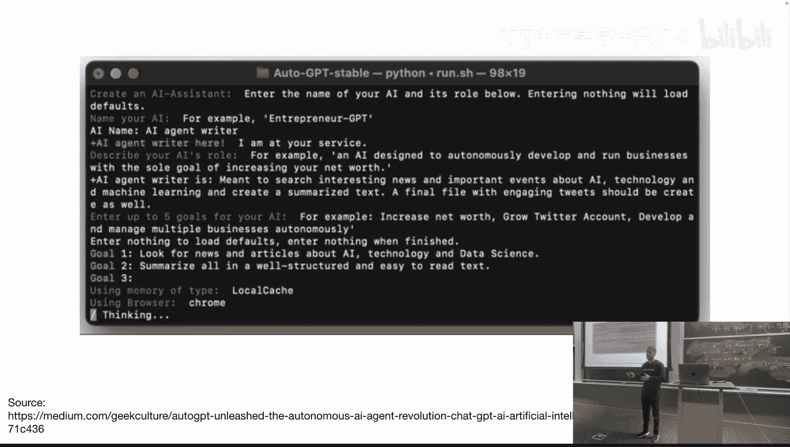

Furthermore， it is possible now to execute on any。Almost any online task， like say， for instance。

 doing a California driving task online and you can look at the sinister face of this guy。

 you can trust he did it himself。

So yeah， my name is Art。 I'm originally I'm software engineer。 I was born and raised in Ukraine。

 I have been developing AI products for the past more than a decade， I guess。

 as every second Ukrainian software engineer right now because of the geopolitical situation。

 I'm also an ethical hacker and work a lot in cybersecurity space。😊，And I'm a serial entrepreneur。

 I came to MIT to do my MBA degree， but too many people ask me why software engineer does an MBA degree and I dropped out。

Not exactly because of that， I started my own company， which is called Kken AGI。

 and we are building agents with the mission to drastically elevate global digital reliability and security。

 we basically build in autonomous AI agents for cybersecurity and software development space。

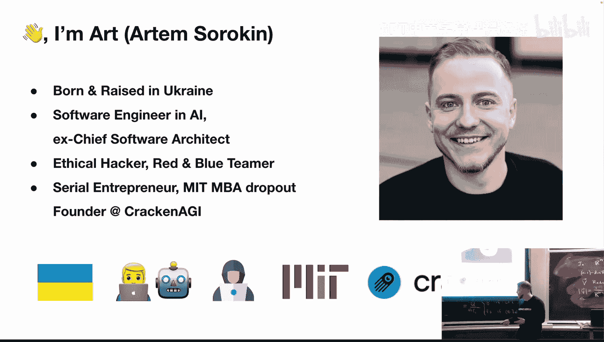

Now today I want to quickly touch on the topic of terminology in this field。

 extremely it's extremely confusing and convoluted unfortunately right now as in any in new field。

 I also want to explore autonomous AI agents from the perspective of specifically AGI artificial general intelligence and I want to expose you to some techniques and mechanics that are being used in the industry to build such an agents right now so that you maybe can go offline and research more on these topics。

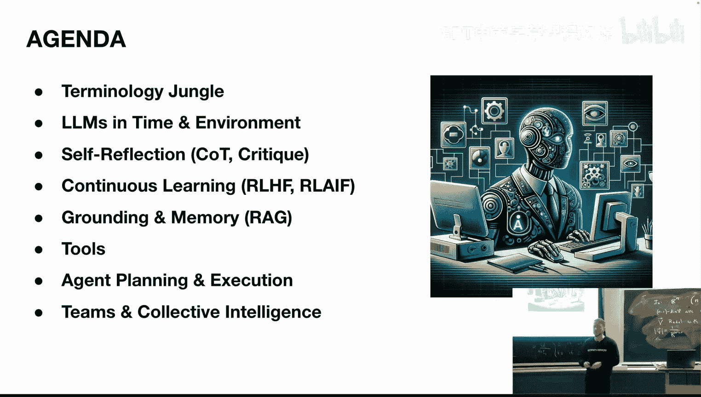

In terms of terminology。GPT is a model， GPT 1， GT 2， GT 3， GP 4， Ch GT is a Saas product。

GPTs are now agents。Or compileils or assistant。 So the deterinology in the industry is extremely extremely confusing。

 Different things mean the same， although named differently。

 different things that are named the same mean different stuff。

 So it's like super confusing right now。 and this is fine。

 You need to understand that this is fine when you search something on the topic of autonomous area agents。

 you will see， well， in some paper neurosymbolic link in another rerie augmented generation。

 Google will tell you this is called grounding。 some other folks would use emotional grounding concept。

 So this is fine。😊。

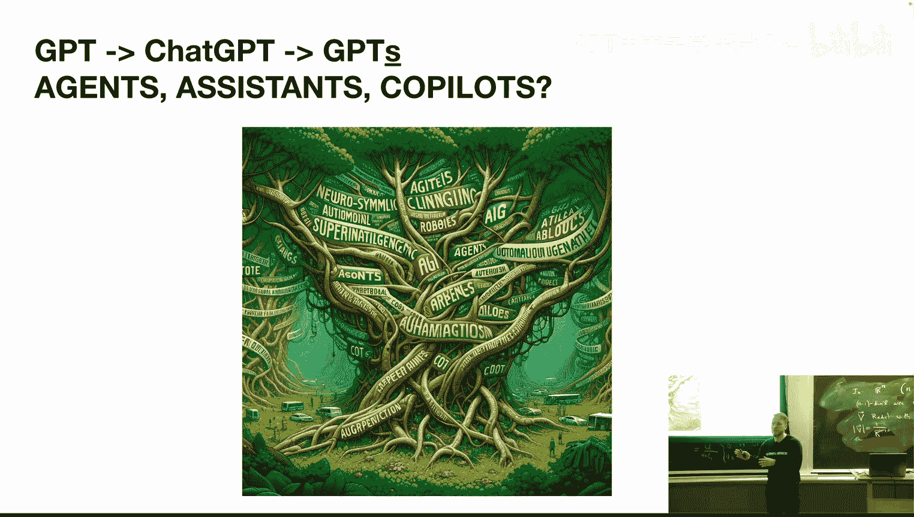

But let's touch on a couple of key terms here。 So the agents have been developing for quite some time。

Since the advent of AI basically during this old AI deep learning hype， this architecture emerged。

 so it was quite some time ago， and basically the main components of it is we have a system that can autonomously perform。

 it has sensors， it has actuators， it interacts with an environment。Post generative AI hype。

 so like a couple of years ago we got a more simplified architecture and a more simplified approach Now auators and sensors are kind of called tools。

 Now in this system we have either an LLM as a core or a family of AI models basically providing reasoning capability for the whole agent itself。

 we give out a task to an agent that it needs to achieve on goal。

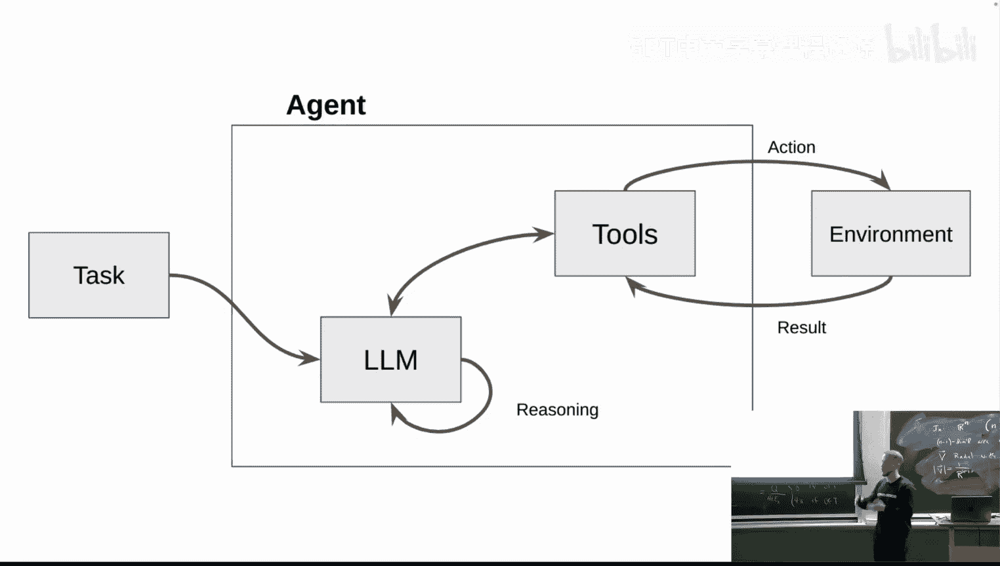

Another thing I want to define here today as well is what is AG。

 what is artificial general intelligence。And I think Google has taken an approach to that and actually had very good definition。

 AGI is basically something that can accomplish any task that human can accomplish do or of can interact and react in any environment human can interact and react。

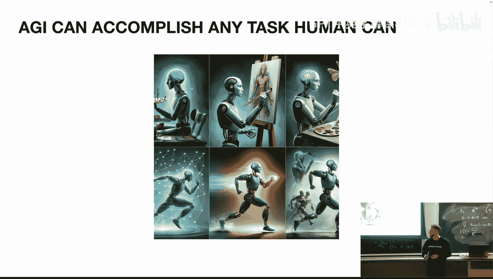

Now， whats two days AI is missing to be AGI， well except of this lame joke about letter G。

 today's AI is like a monk in a cave。M item。So it like the LLM or you charge GPT when you interact with it。

 it's a snapshot。off。Time and space and knowledge， it's very wise it has a lot of general knowledge。

 but it exists outside of time， outside of the environment。

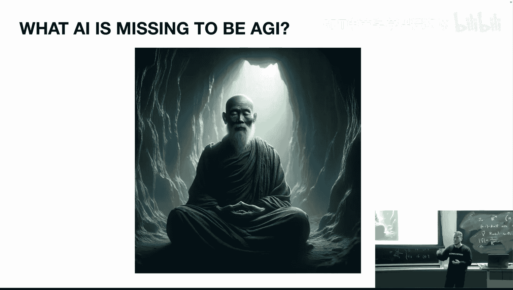

And basically， you come up to charge GPT， you bring a letter。With the task written on it。

 T GPPD get this letter， reads it as a monk， writes down the result。

 gives you back and keeps meditating。It also has quite a lot of constraints。

 specific scalability constraints。 One of these scalability constraints is the fact that， well。

 if you bring like a bunch of books to this monk， it will just truncate half of the information that has been provided and will only work with information that allows that its context window allows。

Another thing。To look on the current AI， to kind of put an additional analogy。

 what Ricard mentioned on today's lecture about the foundational models。

 that the current LLMs foundation models are components of the brain， but not the whole brain。

Our whole brains are much more complicated， it's a family of AI intertwine together。

 and they're not the whole body。The body has the sensors interfaces to， to feel， to see。

 to have vision and so on。 currental alarm models only have limited interfaces to do that。Now， still。

 considering this can we achieve AGI like capabilities today？

And the answer is we kind of can or we at least can push to HR like capabilities。

And there are a couple of approaches to that， one of the approaches is what Young Licoon。

 he's a chief scientist at Matta proposes， iss basically he basically says hey LLMs Saam。

 they can't execute on a batch of tasks like say planning， they still hallucinate。

 so we need to build a completely new architecture。

 basically inherit our own knowledge and build a completely new approach， completely new AI model。

 probably based on transformers or something else。And I'll give the new AI new architecture of this new ability。

But I'm software engineer， I love to problem solve and in software engineering industry we say composibility over inheritance。

 so we potentially still can try and use something that already exist in the field and try to apply。

 try to work around the limitation that exists there。

 try to create new techniques around it and actually still try to push the existing LMs towards AGI like capabilities only using what we have and that's another approach that currently the industry and most of the silicon Valleyley startups and companies are taking right now。

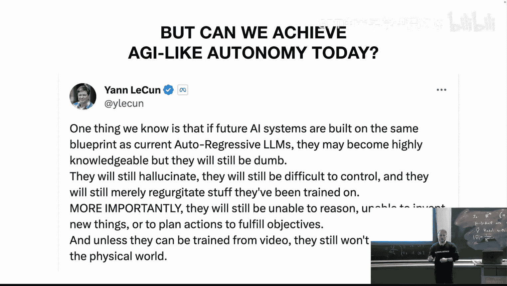

How to do that specifically， How can we build， how can we push current Lms。

 those monks sitting in the caps to be more like Hgi。 first， we can give it。

We can give the LLM's ability to self reflect。We as humans， humans， we are thinking iteratively。

 we don't have like when we produce an idea， our next thought is being fed of the thought that happened a second ago。

 So we iteratively think about something until we come up with the result。

 We don't just go ahead right away and produce the idea or suggestion or something。

 This technique of like thinking associatively in iterations is called the chain of thought。

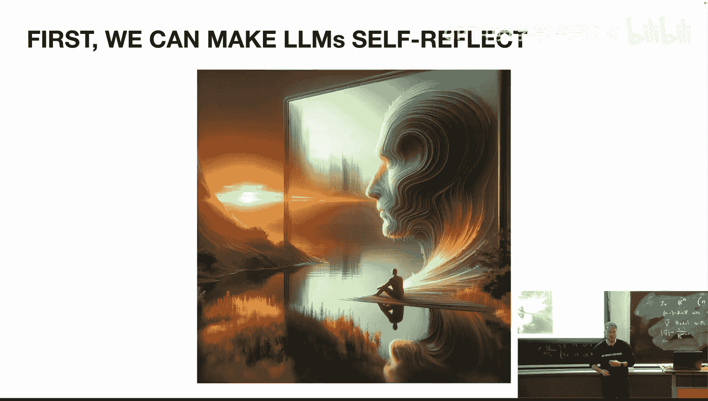

And it's been applied in prompt engineering， you can apply it on your own even now when you go to C GPT and ask it to think about some concept in a couple of iterations based on your new iteration on the result of the previous one。

 you basically will be implementing a chain of thought technique， and it is extremely powerful。

 so much powerful that Google actually decided to use it for their marketing purposes when they release Gemini Ultra。

 which is a new model by them， they basically claim that their model is much more powerful than GT4。

 but it actually is much more powerful than G for on the chain of thought at 32 iterations。So again。

 it can drastically increase the performance of the model through simple prompting technique Now the technique is critique prompts。

 it's basically you sit look at yourself in the mirror after your well maybe successful maybe be a failed date and you like thinking of what you did wrong or what you did right。

So basically， you can implement this same approach。

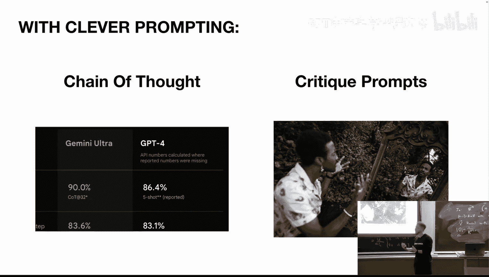

Or in the prompt for the current LLM and foundation models。Now， if we。So also as humans。

 we not only like self reflect and think itly in time。

 we also continuously learn from our experiences。We continuously kind of adjust our weights and biases in our brain。

 It's not that we are a snapshot that we are static and only trained on some particular knowledge。

 no， we continuously improve ourselves。This improvement can be achieved with a strategy that is called reinforcement learning with human feedback when you open up chargeGT you see like dislike that's basically open AI getting data about how well chargeGT produce the result and basically at some point in time they will finet the model that they have on dislikes and dislikes producing a better more perform fine tuneed model。

But now， AI itself is very smart， and can we ask AI to do dislike and dislike。

Can we ask AI to remember do this Ctic prompt？If we ask here to do this critic prompt this technique will be called reinforcement learning with AI feedback it's quite a recent one and but it already is extensively used in the industry for me this concept of errorIF is like sleep like a concept of sleep for humans when we sleep we adjust our weights and biases again。

 remember new information we learn new things that we kind of like engrave the things that we learned during the day。

Now， still， it might not give a capability for the current LLM to produce information and produce value working with the tasks related to recent events。

But can we just give this monk that's sitting in a cave and a computer and access to a news source。

 or can we give them vocabulary or some kind of a book so that a computer an LLM。

 I'm sorry an LLM can search this new source to get the most relevant information for the task that is also the most recent from maybe today from maybe a couple of seconds ago even。

Or even can we give them a notad to remember things that happened recently to write down。

 jot down some notes in terms of the task that have been asked just a couple of prompts before？

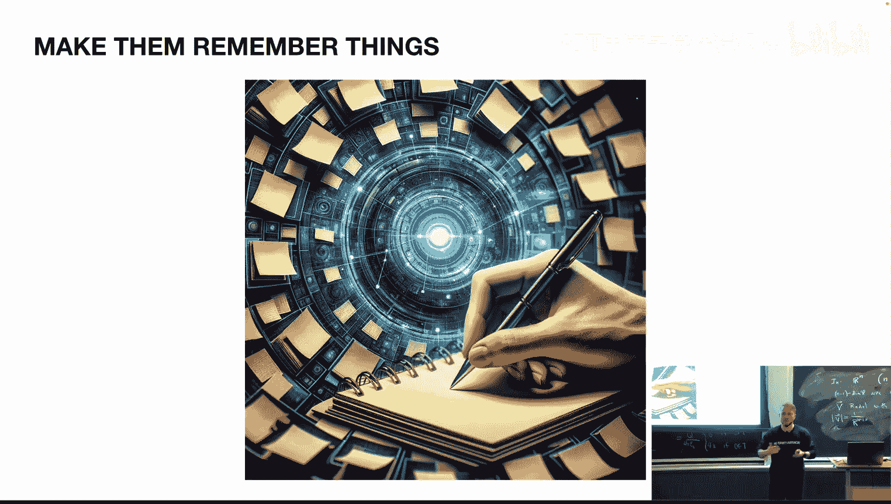

And for that。We in the industry currently use socalled retrieval， augmented generation。

Google also calls its ground this approach ground， but most of the people call it rock， again。

 coming back to the terminology aspect。This is extremely high field right now。

 Retrieval augmented generation is extremely extremely active。😊，I mean， myself。

 I work and wake up in the morning， we have an internal tool developed in the company that basically funerals all the new sources around the AI topic that is relevant to us all the academic papers and things like that it basically filters out only the relevant items and gives it to the team to read and every week I read something new on retrieval augmented generation every week a new technique is coming up every week a new approach is there so it's very active filled and actually it produces quite valuable results for those of you who kind of familiar with software engineering and be' wantna play around with something check out Lama index framework they are doing extremely amazing job of gathering these techniques and implementing them as they are published in academic papers。

Now I want to do a quick giveaway。If you solve the next task on the next slide in five seconds。

And if you can do that， I'll just buy two Burges back home when I'm in California。

 if you can do that， you will buy three considering the prices for Burges here in Boston， but anyway。

Basically， on the next slide， I will give you a task。 You have5 seconds to solve it。Ready。5，4，3，2，1。

 You lost。 okay， two bos for me when I'm in California。 Why are we so bad at symbolic concs。

For calculator， it' just a microsecond to solve the task。For calculator。

 it's extremely computational efficient for this， we are extremely inefficient for symbolic stuff。

 for working with structured data。😊，Our brains are not wired for that。Same problem with Lms。

 unfortunately。The LLM architecture is not wired to work with symbolic calculations， structure tools。

 and so on。But RaG， the retrieval augment generation that I mentioned before。

 also gives the capability。For LLMs to work with these tools and synergize with these tools。

 LLMs now can use calculators， they can use some interfaces to act and interact in the environment。

 and they can basically be much more efficient for the task where structure and symbolic computation needs to happen。

Now， if we。Teach L M to self reflect。 We do continuous learning we。

Give access for LLM to tools to structured knowledge to new sources and so on。

 The only thing that's left for us to do is just to teach it how to plan。Planning is a separate。

 quite large subject。Thousands of papers there， if you want to play around with planning techniques similar to what I mentioned about Lama Ind。

 check out Lcha there are just actually a couple of frameworks for planning at our company we build our own framework but Lcha will get you started with just basic stuff that you can check out babyH LLM planner and1 thousand of other papers basically proposes different approaches and planning techniques。

But LLMs in itself they're still very bad planners。

 and that's what I was showing on this Jan Lico's Twitter post。

It has been shown in research and in papers that the planning capability of all alarms are quite limited。

Here you can see on the screenshot of this Cha GpT that's not Min screenshot。

 you can check out the Twitter post lately， but basically it fails to plan for a simple instructions。

 for a simple task。Is it critical， though， is it a critical issue， is it a critical problem？Well。

I believe it's not because when we combined planning was acting。

We can actually solve for this problem of planning long term， meaning that in simple terms。

 go do your startup， go， I don't know， build your crafting item you always wanted to build and actually see which issues you will get actually try do an action。

 see the result of the section and the effect of it， work with this effect， or it。

 and then replan again to get to your goal。Action is the most efficient environmental computation。

 and we don't need LLMs to have a capability to plan plan too far away。

 Plan too far away increases informational entropy。

 we don't need that we can just plan we can basically we basically need the first action to be planned well other subsequent action in the process might not be planned well。

 we will still replan everything after we did this most efficient environmental computation in time and space。

 sorry for such a complicated term here but basically what I'm saying here。

 action speaks louder than planning actions speaks louder than prediction if we have an LLM。😊。

If we open it up and give it an ability to act and the result， perceive the effect of action。

 we don't need planning too far and advance once too far in the future。

 we only need the first steps to be planned well， to be executed well。Now。

 with all of these components， we pretty much can build a functional AI agent that can actually achieve on quite a lot of tasks and will be quite aGlike。

So it will be quite close artificial general intelligence， the problem， it won't be practical at all。

If you want to put it outside or work for some particular goal work for some particular task。

 it will be extremely expensive， very inefficient， and this is now my speculation in terms of what's coming next for this industry。

I feel like this industry now is working a lot on optimizing and optimization of different approaches and techniques。

 and that's actually let me show you the move I learned recently。😊。

So I'm not like thinking about the next motion。I learned it through imitation learning after watching some YouTube video。

And I'm like， I'm not having any inefficient reasoning processing in my brain。

 I don't think about it。 I just performed the move。 I have a muscle memory already。For now AI agents。

 they think about the next section， they think how to put the hand， where to put its body and so on。

 so they actually do some quite in efficient computation。

 there is no muscle memory technique there that optimizes that kind of caches the process。

And for this， I believe action and behavior based models can be that component of a brain that helps with this muscle memory。

I also believe that imitation learning and motion diffusion planning is going to be there for AI agents as well。

 there is something going on in the industry around it。

 but it's not quite there yet in terms of implementing this approaches as a part of autonomous AI agents。

 but I think that's a part of the future another part of the future is。

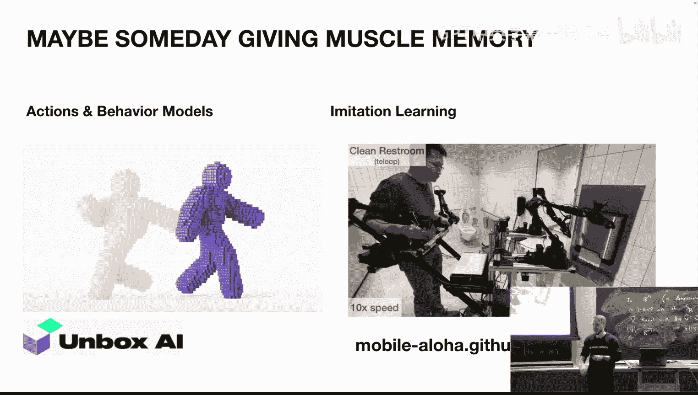

嗯。Video processing and efficient video processing right now LLMs are not processing video information well they are not printed on the videos in any at MIT at CL the liquid neural nets have been developed with sparsewiiring that's basically a technique for autonomous vehicles to better navigate。

With the information that they receive from their computer vision sensors， as well as for say。

 drones， for cars， for autonomous， for everything that exists in a real environment and that can perceive the video information。

ItIt is extremely efficient model， very small one that can still provide this navigation capabilities。

 I feel like this can be。Can be aligned with something similar to instincts that human has。

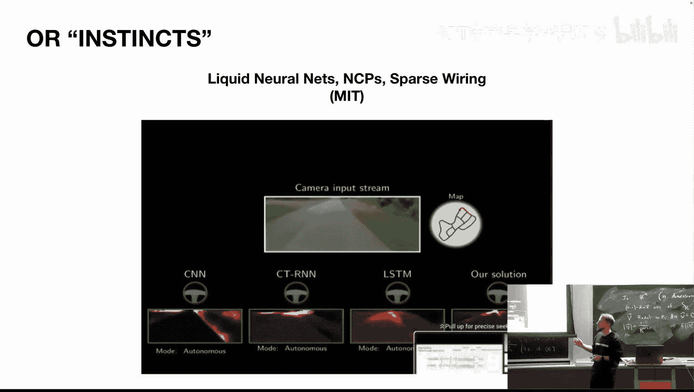

And for the last part。That I want to touch。When we put AI agent in the environment。

 when we optimize it when it's sufficient， maybe not today， maybe sometime in the future。

 we potentially can have this agent socialize and work together。

And there is already there are a couple of projects that are exploring this， like to say。

 my favorite one is Cha Dev。It's basically a company made of AI agents that do software at 247。

 each AI agent is specialized， one does coding another one does designing。

 the third one does testing the first one does development and you bring them a task。

 they all try to solve this task together as a collective intelligence。

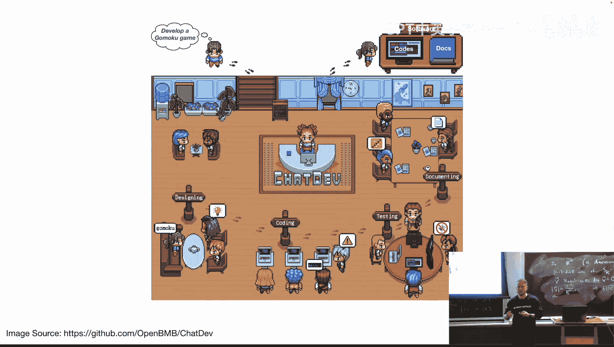

And another thing for you to Google or charge AD after this lecture is Microsofts Autogenferme work。

 where they explore specific interfaces and interactions between agents。

 how to make this happen and how to implement it。At last， again。

 when I come back to this subject about AI and artificial general Belence and ask your questions。

 are we there yet？I personally believe we have all the components that we need。

 the problem now is we need to glue them all together。

Another problem now is that the gluing process is not going to happen like this year and next year is going to take us probably a decade Well we can specifically predict how much or forecast how much but I'm pretty much sure that from the theoretical perspective with LLMs we have solved one of the key critical problem which is reasoning we didn't have this capability before now we have this capability and bringing this interface is bringing these tools putting in this reasoning model in time and environment is just a matter of engineering and combining this components in the right way。

Until we get there， until we get to this AGI part， until we get to this point。

 we still need to consider how can we make these AI agents practical， and this is critical right now。

We cannot trust at MaxX the AI agent that we built。

 so we need to understand how we put the human envelope。

The huge topic of user experience and user interface for an AI agent right now is in Silicon Valley。

 also many companies are talking about that， we have hackathons about that。

 where we explore how to specifically put human in the loop to approve what AI agents want to do。

And I feel like we get to till we gain all the trust we need。

 this is going to be probably one of the key developments in the industry and we probably never would be at the point when we have all the trust。

 always humans will be accountable for something， we will just reduce some stuff or delegate some stuff。

 that we are comfortable delegate an accountability for but most of the time the decision will still be driven by humans so we need to learn now how to effectively integrate human with an agent so that they can collaborate well。

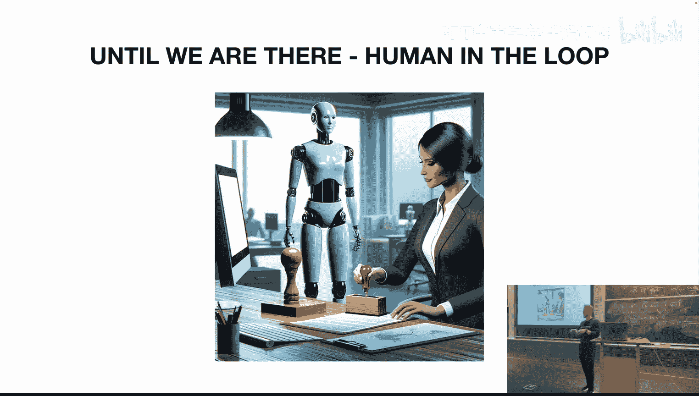

So。Today， after today or maybe after this course overall check out this concept。

 I think the slides will be published charge GPD about them， Google them again。

 don't worry about the terminology。 It might be a bit eed up， it might be a bit confusing， but yeah。

 that's how the industry is structured today unfortunately。

All these techniques and all of these approaches are extremely powerful and bringing the autonomous A like agents to life even today。

And I'm always happy to discuss this topic with you， that's my linknked in on the QR cord。

 that's my Twitter， although I don't use it that much。

 welcome to reach out to me and chat about autonomous site agents overall。Thank you very much。Okay。

Guys， you spend like two hours listening about so many concepts at reaching back and forth between different topics。

 I guess like。But anyway， questions， yeah。😊，Yep。So the first part is like。

Are these current like models like the way you're thinking about it。

 it's kind of like inspired with like human intelligence right。

 like when you said like there's different types of parts of our brain and like the models would also like work this way。

But it believed that like this is like ultimate or there's like about way of arranging that's much better than like humans than we should use like extremely extremely great question。

 I feel like because also I don't have an answer to that I feel like from what I see well there are some like what Ri discussed today we still can use foundational models with the modalities that are unusual that we're unthinkable of to be used before where humans are I mean。

 we don't see in biology in our environment around us something that also uses this data。

 this information in the way that say foundational models are being built right now like foundational models for behavior that are been used for retail for instance。

 So it's kind of like an intuitive so still there is something that evolution hasn't been able to achieve but I feel like evolution was still like extremely powerful process right and it has built extremely efficient machine in our brain in now。

HaSo I still feel like we will draw， and there will be a lot of， a lot to learn about it。

 and we will draw a lot of lessons。 Some historical artifacts， right。

 will be probably eliminated since we are constructing it artificially。😊。

But I'm pretty sure that's like a vast amount of information provided by nature to us that we haven't explored fully yet。

 and I feel like we pretty much will lean towards how the human brain is being developed and how we interact and act。

Cio。Makes sense。 Yeah， thank you。Okay， awesome。Thank you very much， everyone。😊。

