# 基础模型与生成式AI：7：自主智能体 🧠

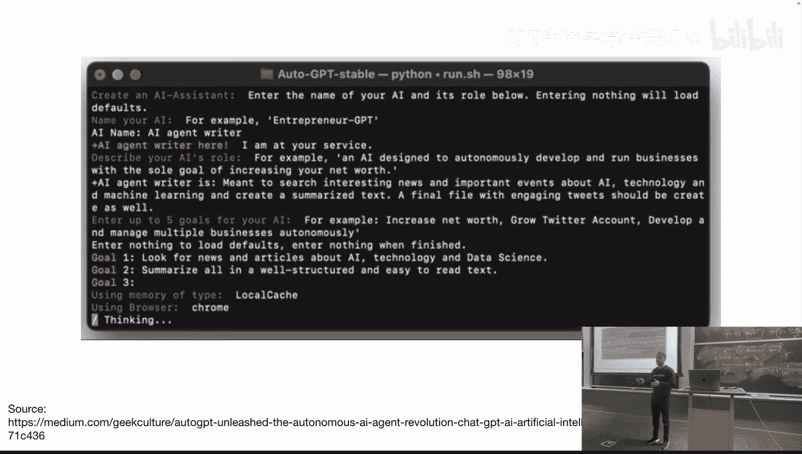

在本节课中，我们将要学习自主AI智能体的概念、其与通用人工智能（AGI）的关系，以及当前构建此类智能体所采用的核心技术和未来展望。

大家好，我是Art。我是一名软件工程师，出生于乌克兰，在AI产品开发领域有超过十年的经验。同时，我也是一名道德黑客，专注于网络安全领域。目前，我在麻省理工学院攻读MBA学位，并创立了名为Kken AGI的公司，致力于构建用于网络安全和软件开发领域的自主AI智能体。

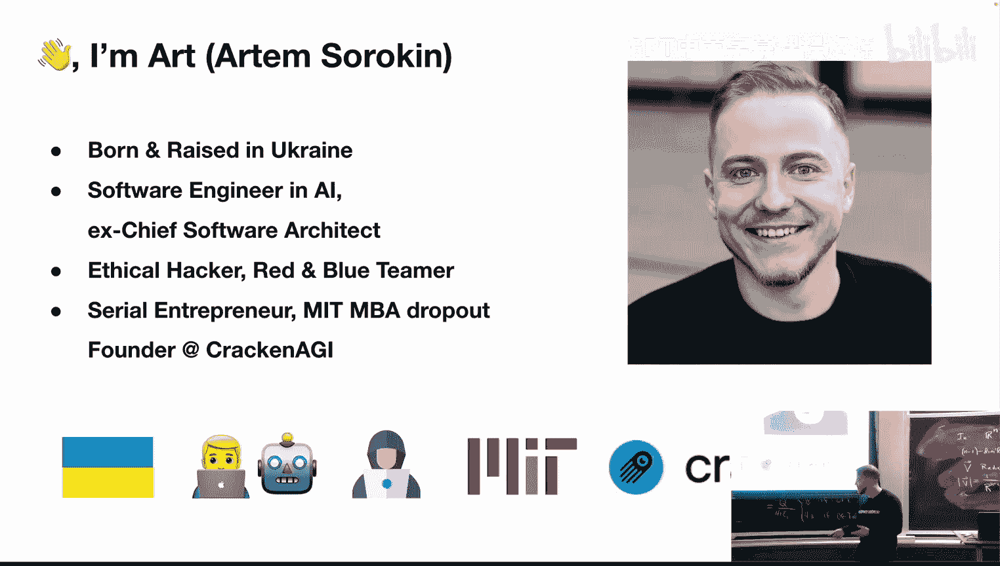

## 术语澄清 🤔

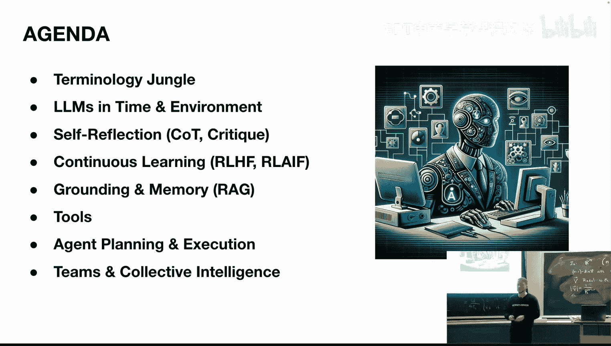

首先，我们需要澄清这个领域中一些令人困惑的术语。目前，术语的使用非常混乱。例如，GPT是一个模型，而ChatGPT是一个SaaS产品。GPTs现在也可以指代智能体、编译器或助手。不同的名称可能指代相同的事物，而相同的名称可能指代不同的事物。这是新领域发展初期的正常现象。

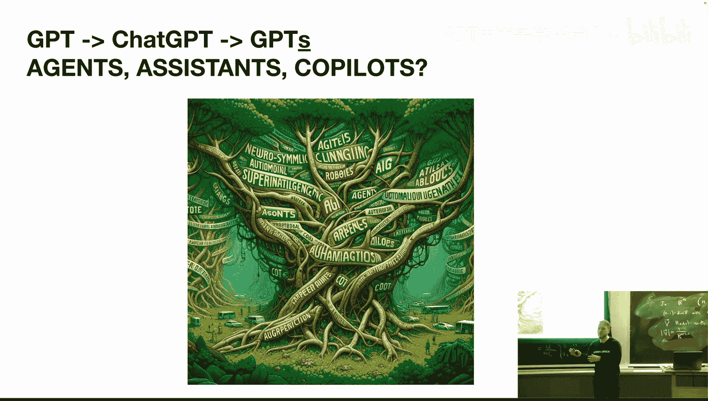

## 什么是自主智能体？🤖

智能体的概念在AI领域已经存在了一段时间。在生成式AI热潮之前，智能体的架构通常包含传感器、执行器，并能与环境交互。生成式AI兴起后，架构变得更加简化。现在，执行器和传感器通常被称为“工具”。系统的核心是一个或多个大型语言模型（LLM），它们为整个智能体提供推理能力。我们向智能体下达一个需要完成的任务或目标。

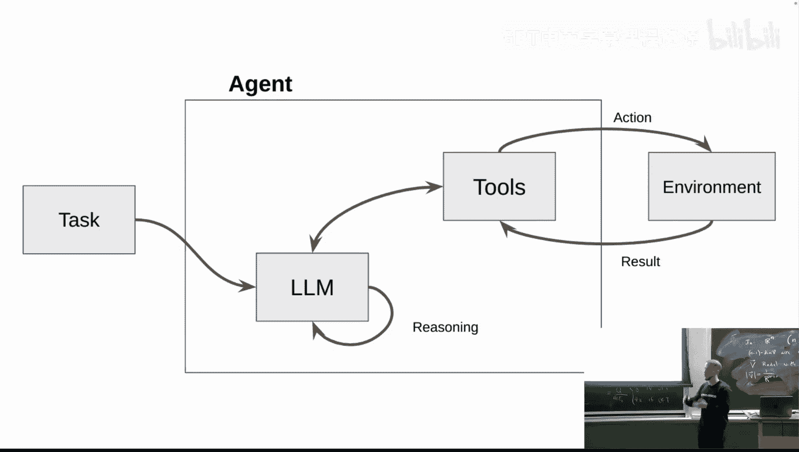

## 什么是通用人工智能（AGI）？🎯

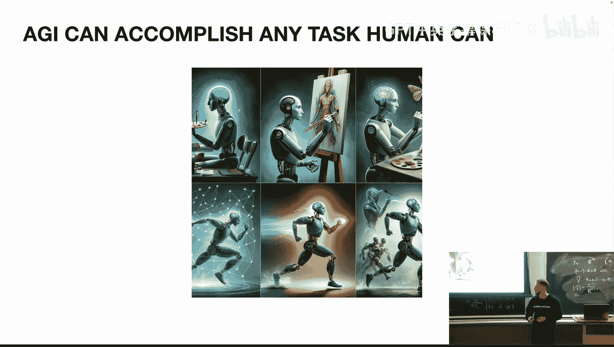

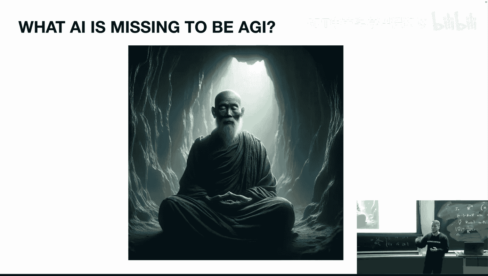

AGI指的是能够完成人类能够完成的任何任务，并能在人类能够交互和反应的任何环境中进行交互和反应的智能系统。这是谷歌采用的一个很好的定义。

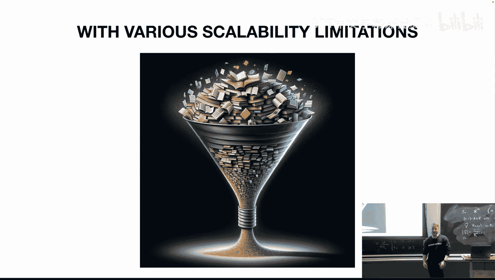

## 当前AI与AGI的差距 🧘

当前的AI，特别是LLM，就像一个山洞里的僧人。它是一个在特定时间和知识上的“快照”，非常博学，但存在于时间和环境之外。你向它提出任务，它思考后给出答案，然后继续冥想。它还存在一些可扩展性限制，例如上下文窗口有限，无法处理过长的信息。

此外，正如今天讲座中提到的，当前的基础模型只是大脑的组成部分，而非整个大脑。我们的大脑要复杂得多，是多种AI模型交织在一起的家族。而且，它们也不是完整的“身体”。“身体”需要有传感器接口来感受、观察和拥有视觉等，而当前的LLM模型只有有限的接口来实现这些功能。

## 能否用现有技术实现AGI能力？🚀

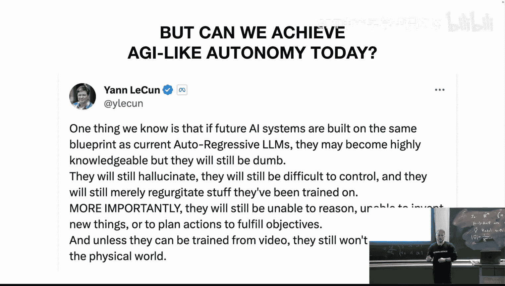

答案是：某种程度上可以，或者至少可以推动其具备类似AGI的能力。对此有两种主要思路：

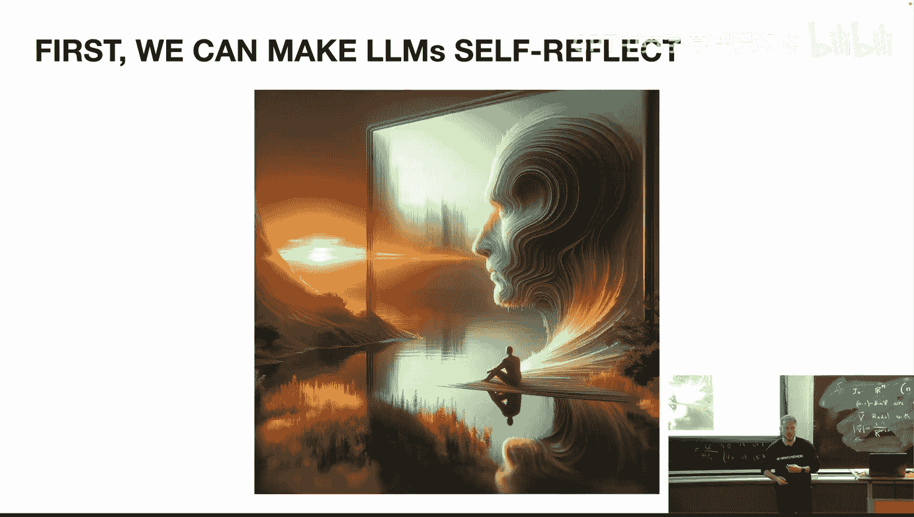

1.  **杨立昆（Yann LeCun）** 等科学家主张，LLM存在缺陷（如无法进行批量任务规划、会产生幻觉），因此需要构建全新的架构和AI模型。
2.  **软件工程思路**：遵循“组合优于继承”的原则，尝试利用现有技术，通过新方法绕过其限制，将现有LLM推向类似AGI的能力。目前硅谷的许多初创公司和企业都采用这种思路。

## 如何推动现有LLM发展？🔧

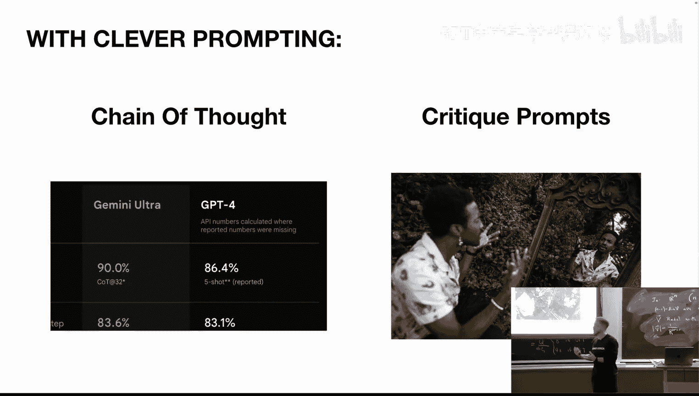

我们可以通过以下几种方法增强现有LLM的能力：

### 赋予自我反思能力

人类是迭代思考的。这种迭代、关联性的思考技术被称为 **思维链**。在提示工程中应用它，可以显著提升模型性能。谷歌在发布Gemini Ultra模型时，就宣称其在32步思维链上的表现远超GPT-4。

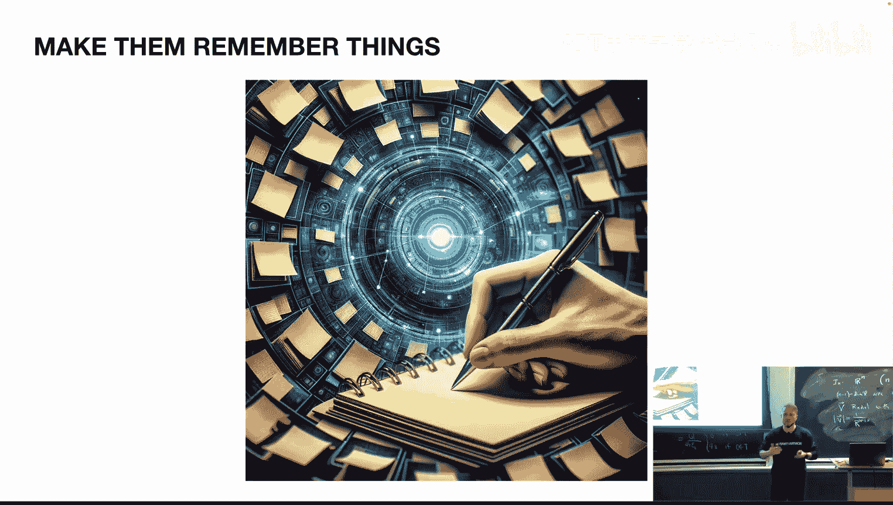

### 实现持续学习

人类会从经验中持续学习，调整大脑中的“权重”和“偏见”。在AI中，这可以通过 **基于人类反馈的强化学习** 实现，例如ChatGPT中的点赞/点踩功能。更进一步，我们可以让AI进行自我批评和反馈，这被称为 **基于AI反馈的强化学习**。这类似于人类的睡眠过程，用于巩固白天学到的知识。

### 提供外部工具和信息源

为了让“山洞里的僧人”了解最新信息，我们可以给它连接新闻源、词汇表或笔记。在行业中，这通过 **检索增强生成** 技术实现。这是一个非常活跃的研究领域，每周都有新技术出现。对于想实践的开发者，可以查看 **Llama Index** 框架。

### 解决符号与结构化数据处理问题

人类和LLM都不擅长符号计算和结构化数据处理。但通过RAG等技术，LLM现在可以使用计算器等工具，并与环境交互，从而在这些任务上变得更高效。

### 规划能力

规划是一个庞大的独立课题。LLM目前仍然不擅长规划。但研究表明，将规划与行动结合，可以解决长期规划的问题。我们不需要LLM规划得太远，只需要第一步计划得当即可。因为**行动比规划更有力**。行动后，我们可以感知结果，并重新规划。对于想探索规划技术的人，可以查看 **LangChain** 等框架。

## 构建功能型AI智能体 🛠️

结合以上所有组件——自我反思、持续学习、工具访问和规划——我们几乎可以构建一个能够完成许多任务、接近AGI水平的功能型AI智能体。

然而，问题在于，这样的智能体目前**完全不实用**。如果将其部署以完成特定任务，它会极其昂贵且低效。

## 未来展望与优化方向 🔮

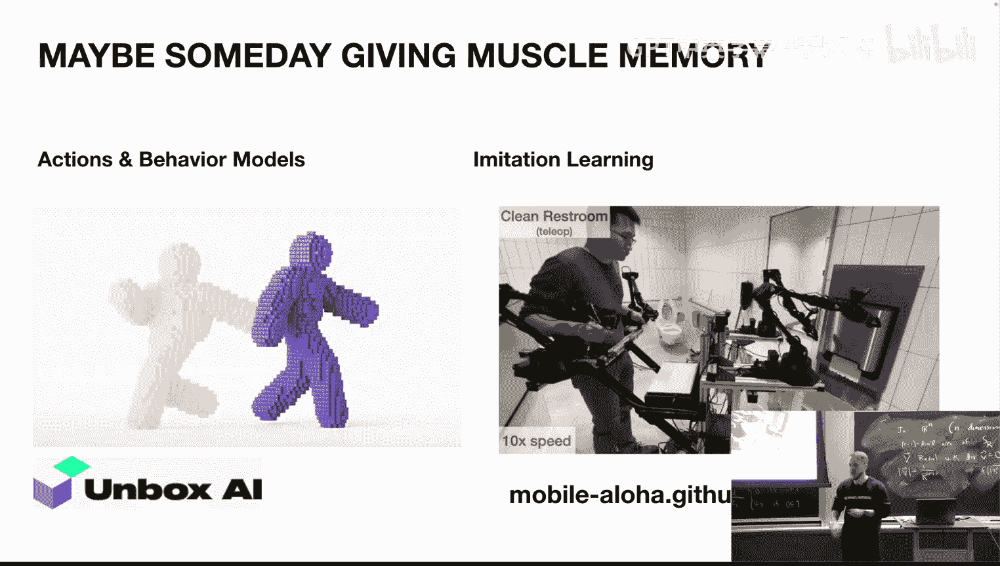

我认为行业下一步的重点将是优化。当前的AI智能体在行动前需要大量低效的“思考”，就像没有肌肉记忆一样。未来，**基于行为和动作的模型**可能会成为实现“肌肉记忆”的大脑组件。**模仿学习和运动扩散规划**也可能被整合进自主AI智能体。

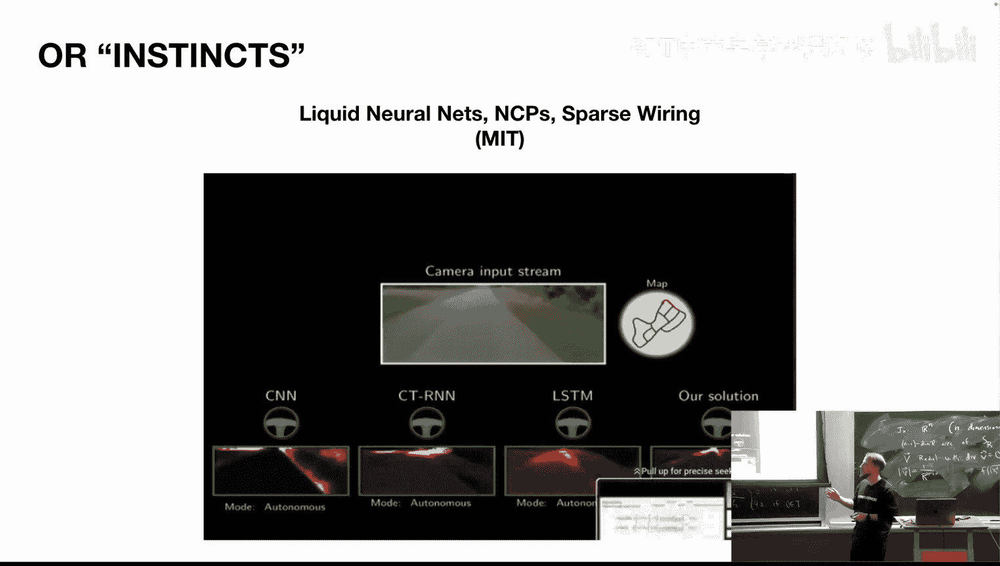

此外，高效的**视频处理**能力也至关重要。MIT的CL实验室开发的**液态神经网络**具有稀疏连接特性，能让自动驾驶车辆等更好地处理视觉传感器信息，这可能类似于人类的“本能”。

## 多智能体协作与社会化 🤝

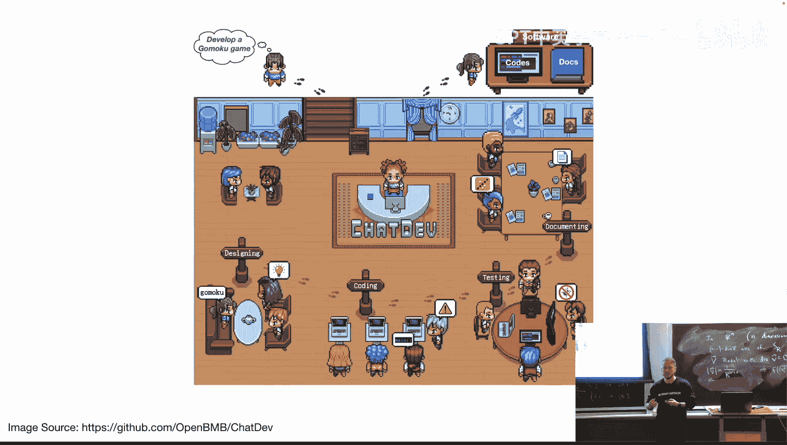

当AI智能体被优化并置于环境中后，它们可以社会化并协同工作。例如，**ChatDev** 就是一个由专门从事编码、设计、测试等不同工作的AI智能体组成的“公司”，它们以集体智能的形式共同解决问题。微软的 **AutoGen** 项目也在探索智能体间的特定接口和交互方式。

## 我们实现AGI了吗？❓

我个人认为，**我们已拥有所需的所有组件**。现在的关键问题是如何将它们有效地“粘合”在一起。这个过程可能需要十年甚至更长时间。从理论角度看，LLM已经解决了关键的推理问题，剩下的主要是工程实现和组件整合。

## 当前挑战：实用性与人机协作 👥

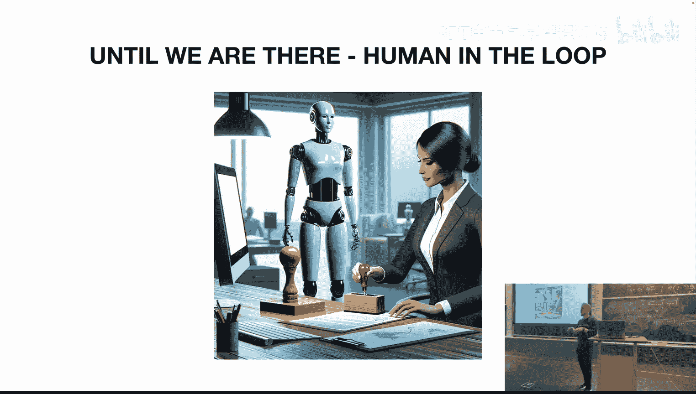

在实现AGI之前，我们必须考虑如何让AI智能体变得实用。目前，我们还不能完全信任AI智能体。因此，**设计人机交互的“信封”** 至关重要。如何将人类置于循环中以批准AI智能体的行动，是当前硅谷许多公司和黑客松关注的焦点。人类可能永远需要为某些决策负责，我们将学会如何有效地让人与智能体协作。

## 总结 📚

本节课中，我们一起学习了自主AI智能体的核心概念。我们探讨了其与AGI的关系，并详细介绍了通过**思维链**、**持续学习**、**检索增强生成**、**工具使用**和**规划-行动循环**等现有技术来增强LLM能力的方法。我们还展望了未来在优化、视频处理、多智能体协作以及人机交互方面的发展方向。

尽管术语可能令人困惑，但这些技术和方法非常强大，甚至今天就能将类似AGI的自主智能体带入现实。这是一个激动人心的领域，值得深入探索。

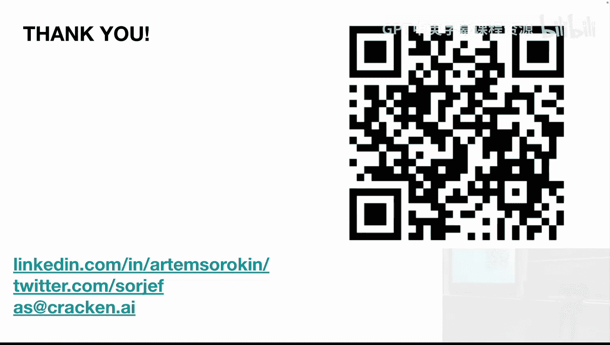

---
*注：本教程根据MIT 6.S087课程相关内容整理，旨在以简单直白的方式介绍自主AI智能体的核心概念。*