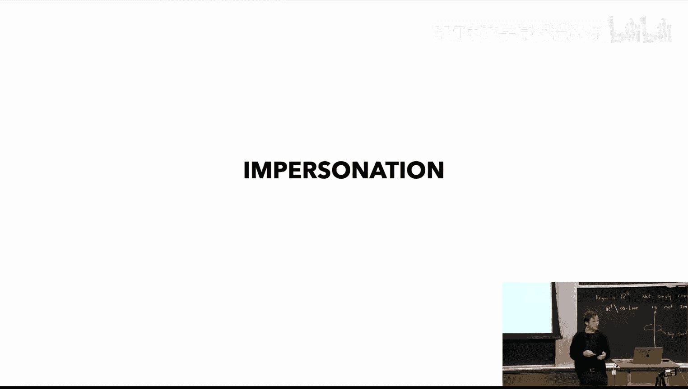
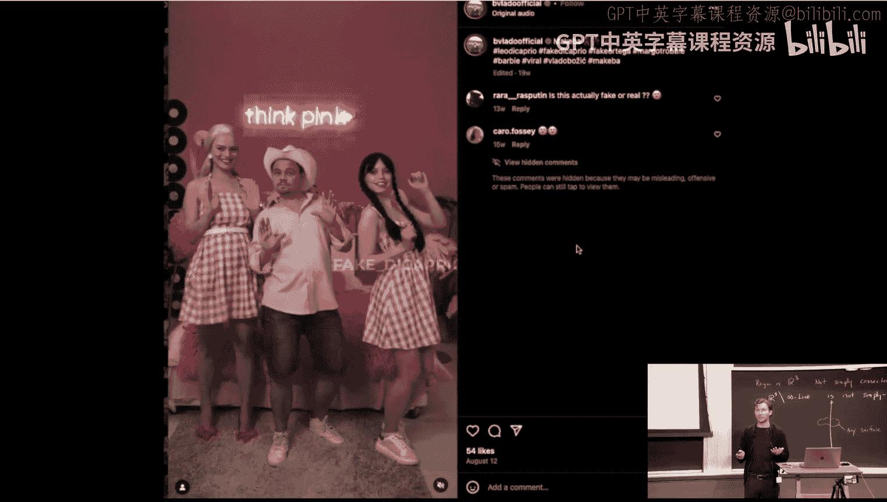
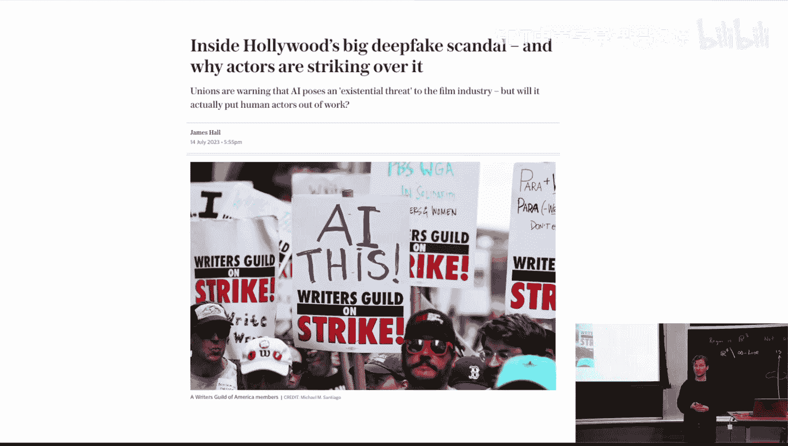
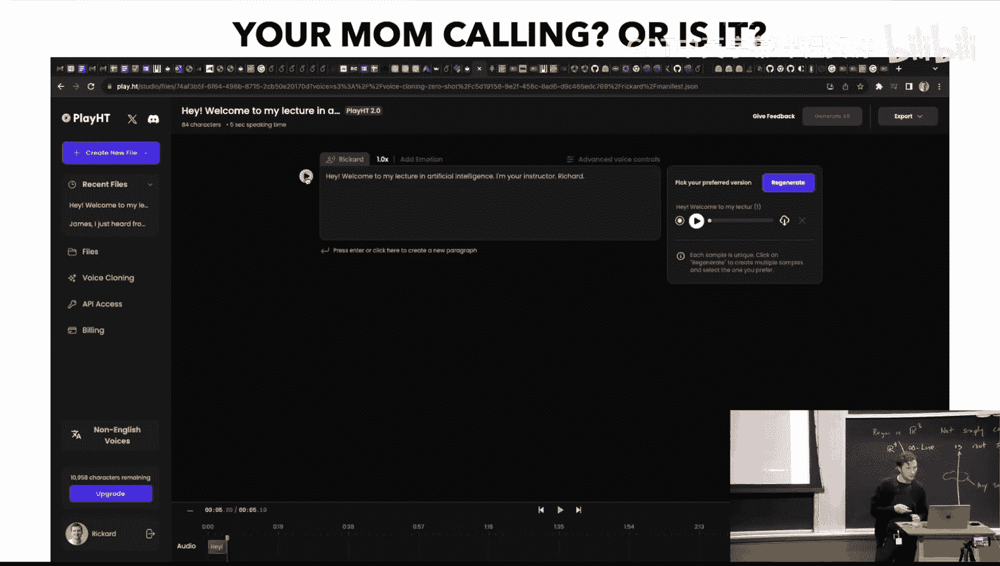
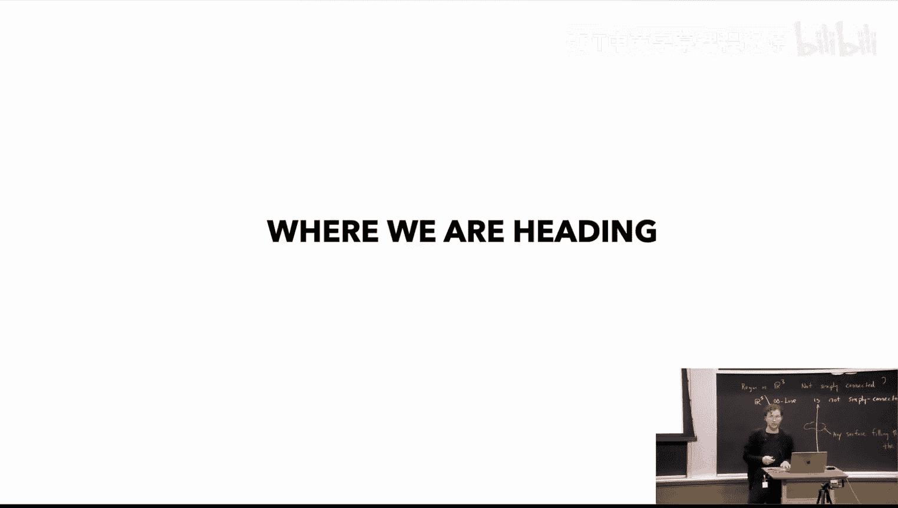
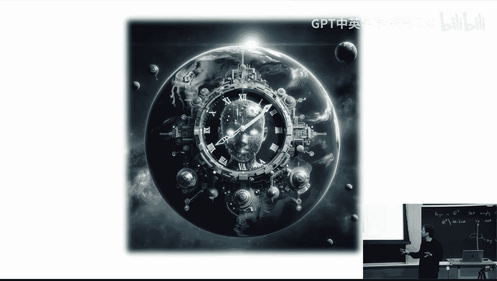
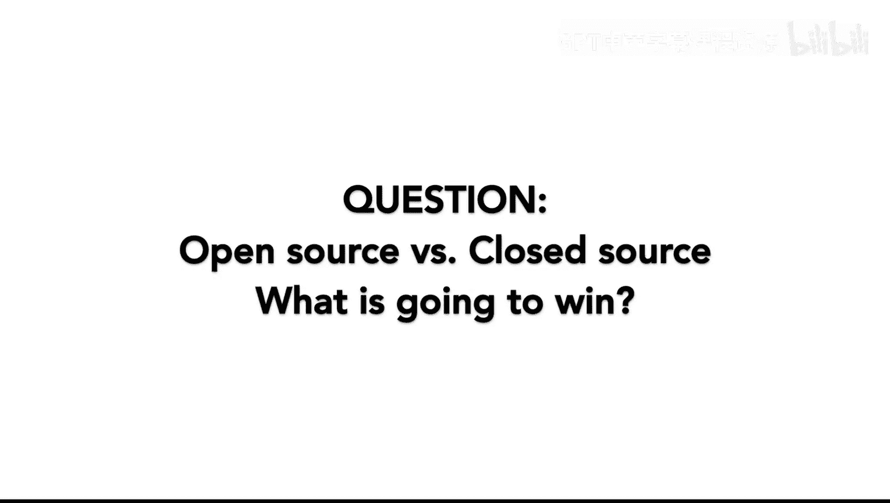
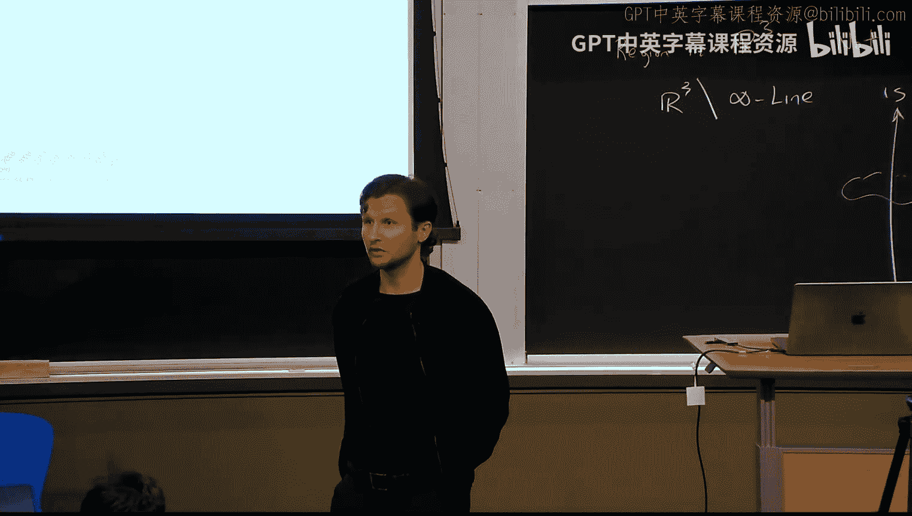
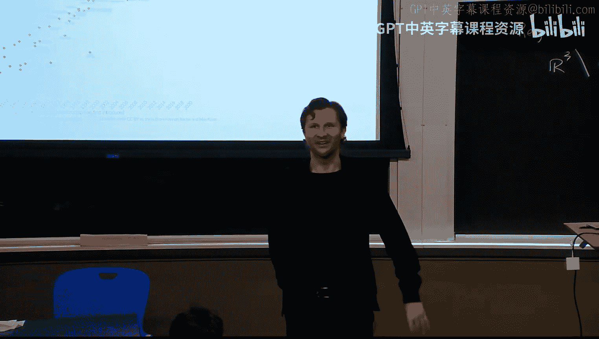

# 《基础模型和生成式AI｜6.S087 Foundation Models & Generative AI 2024》中英字幕 - P8：-8-MIT 6.S087_ Foundation Models & Generative AI. ETHICS.zh_en - GPT中英字幕课程资源 - BV1YYWpzaE3q

All right， let's get started。So today should be very fun because we're going to talk about ethics and regulations。

So first， I'll provide kind of a very high level lecture cover a lot。

 and then we're gonna have a panel where Mans comes back and you get a chance to ask a lot of questions。

 we can discuss this more in detail。😊，Right， so I mean theres this little doubt that foundation models in Gen AI is becoming very impactful as the technology right so then the question is how do we develop this safely and responsibly。

 what kind of AI do we want and what can we affect and also should we regulate it and how can we balance innovation and regulation is we're going to try to cover today。

So I'm actually going to open up and asking you a question。Who would you blame if an AI hurt you？

AndI think this is a key question。And so there's a lot of different alternatives。诶。Maybe you want to。

 let's say TB does something， should you blame the company that developed it， open AI？

Or is it perhaps institutions like government institutions。

 agencies that suppose to regulate things and protect us？Is it maybe， you know。

The AI itself is an entity where a person is responsible， like we you know。

 we see AI as an individual with its own aims and desires。Is it the data it's being trained on。

 or is that the problem？Or is it maybe， you know， the。

 the best kind of tool they will have is the people behind it， right。

 the stakeholders behind this AI。嗯。And I think likeropomorphizing， sorry， anthropomorphizing。

AI is very dangerous because it makes us feel that AI has an agency and responsibility and it can allow stakeholders to hide behind AI and relieve itself with responsibilities。

But at the end of the day still right， even this type of AI that we're seeing right now that's very powerful。

 there's always people behind AI that's benefiting from it right and that's the ones that somehow probably should be kept responsible I think that's a very it's a useful perspective because they're motivated and they have something to gain or lose so you can try to understand what AI is doing but look at the stakeholders behind it。

😊，So， right， if you ask。Chater P itself to G forehead to create an image of yourself， you get this。

 you know person like entity that media also likes to portray。

 which I think is a dangerous and false representation that allows the stakeholders behind them to hide behind the problem of the AI rather than the problem of the stakeholders right the ones to build it and benefit from it。

Okay， so what are let's take Cha T for example， an Open AI what are the stakeholders Well you know there's the people behind the company。

 the leader， the management， etc ce right we have them on picture here。

 then we also know that Microsoft has bought a 50% stake in Open AI so then suddenly they are also kind of stakeholders and have a lot of motivation here and then on top of that right。

 suddenly the CEO of OpenI is pushed out and then he returns so know when we talk about transparency responsibility in terms of AI models it's a huge lack of transparency in the stakeholders behind these AI models。

And I think it's， it's kind of。You know a great challenge to kind of hypocritical that these people are supposed to build transparent AI。

 that's what we care about when the organization is completely you know nontransparent and they can't keep their things together right and that should make us aware and this is nothing that's not related to AI at all but the problem already starts there right when you try to establish who's the stakeholders。

Okay， so嗯。RightSo we're going to start off covering a lot of different topics。

 basically the first part will be jumping between different topics of AI and ethics and then we we're going to say like well these are complicated issues and then we're going to see how government and institutions try to regulate and address these issues and then we're going to talk about potential future directions。

And I think also， I don't want to put like pretends like there's a mainstream perspective on these issues。

 right， These are very nuance and complicated。 I w to hide behind some， some， you know。

 mainstream or say that these are， you know， solved solved problems and there clear answers。

 So just to be completely， you know， transparent。This is， you know。

 I'm sharing these thoughts and perspectives and really it just to get you guys to think about these problems。

Also， you make you ask more questions， really。 So I'm going to cover a lot of different things and jump back and forth。

 not gonna cover everything。 just go try to make you guys think and。

And be excited and try to make up your own opinion right。

 I don't want to lecture and tell what's good or bad and moral as for you I guess to decide I want to provide you with certain aspect and problems that we're seeing in AI。

Okay， so before we jump in， I just want to emphasize certain perspectives。

So one perspective I think is important is that is AI categorically different from other technologies or other problem areas that we've been seeing in our history。

 right maybe AI is just part of a type of development or evolution I've been seeing for a long time。

 maybe AI is just part of a continuum rather than something that's very different and maybe AI is not the problem in this trajectory。

 maybe we went wrong somewhere earlier， maybe when we started using electricity。

 maybe that's where we really went off and this something bad。

 So also like is AI really that different from what we've seeing before。

 I think it's important perspective and actually is this not where a real challenge。

 iss not AI but something else。Okay， another important point I think is that ethics is a lot about how things should be。

 how the world should work， right philosophyophy ethics los talk about the should。

I think it's a big difference between how the world should work and how the work how the world actually works。

 right So I think for me， I think there' less utility in building up a utopia of how we would like the world to work。

 I think it's more interesting to talk about how we think the world will work and you know。

 realize there's a difference here。Okay， and last let well。 I mean， so these are。

you know real problems that are high stake problems right and now there's definitely you know using these technologies to booster nations military security and it's becoming an arms race and I think it's also you know that makes the stakes highers and certain things become like a necessities to protect your nation and typically when there's an arms race it's a lot of you know it's much less should but it's a lot of competition and things move very very quickly。

Yeah， so I think that's also。Good to keep in mind that these things are not just affecting ourselves。

 but they're affecting this bigger picture， right everything is fair in love and war。

 and I think that's historically quite true。O。So we're going to start walking through some different threats that we see from AI。

And well， there's a lot of them， right we have misinformation and manipulation， we have deep fakes。

 we have privacy， bias and discrimination， lack of transparency and accountability， centralization。

 job displacement， unnatural living conditions and the unintended unknown。😊，So let's get started。

And of course， some of these are quite related。Okay， so misinformation manipulation。

There's a fairly famous example of Cambridge Analytica。

 right that maybe it was more big data than AI， but they definitely use technologies to do something that they called behavioral microtargeting。

So they're able to go into a nation， for example and just look at a lot of Facebook data or data inhabitants。

 get to know them pretty quickly， and it turns out that people might be fairly easily easily influenced if you have some data on them。

 you can do some targeted attacks or actions。诶。😊，I mean， how effect this was， I mean。

 it's hard to tell， but theres certain indication something that is quite effective in actually making one election go one way or another。

 which sum that seems that our democracy seem to be quite fragile of these kind of things。

But of course， right again， is this a new threat It's a very famous example of you know the late 19th century where there was this American warship called Maine that blew up close to Cuba and it was independence war Civil war going on in Cuba and there was before America entered the warship blew up and then a lot of like newspapers in America was fairly centralized。

 so there's a lot of vested interest in these newspapers actually for these people that control the newspaper to go and enter the war So they made up this story saying that it was the enemy who blew up this ship。

 it was the Spanish that blew up the ship， but a military report showed this was an accident it was a mistake that made the ship blow up but the newspaper said it like no。

 there was the enemy and the Y Republic went with a narrative and America did enter the war so I think that maybe then there was more of monopoly on information terms of newspapers controlling it but symmetry of information very。

Vulnerable to before as well， so maybe it's not really a new threat in that sense。嗯。O。Iersonation。

So okay， this is how this pitch came up to my Instagram， it's not super good， but oops。

Skep like and play。I mean， you probably maybe recognize the people that it's not super good， but it。

I mean it's pretty good， it's getting cheaper to produce。

 actually start seeing this stuff in a lot of places， right I was fooled for a little bit。😊。

And of course， I mean。You can see this can be used for for much more bad stuff than this， right。

 But I mean， at the same time。

RightActors are scared of losing their jobs， even riot as well are scared of AI coming and impact and stealing their livelihoods。

 so it's also a real problem there and of course， maybe as well we're starting to see this when you start impersonating public officials and stuff you can really fool people。

 people in a sense that we're vulnerable too， which is also very。

 very scary you could probably also impersonate me。

So here's， let's see if we can hear this， so here's just a website I uploaded a little bit of my lecture audio and this is what it produceds。

He， so welcome to my lecture in artificial intelligenceence， your instructor Richard。I mean。

 it's pretty good， this is the complete AI generated。

 right I just write it down and it starts producing this。

 it even gets my Swedish accents you know fairly well， which is impressive。😊，And then imagine。

 you know。Coopling this with my Facebook data， which says lot of things about me。

 you know can you grab it and have a large language model。 And then this is basically real time。

 I mean， if it calls up my grandma transfer money， it could fool my grandma quite easily right So it's impressed。

 me see this is actually becoming a real problem now because these abilities。诶。

Okay， right， so。In terms of impersonation and scams that are write the scale now is completely different because AI at the scale can really get to know' an individual level。

 impersonate you and create like a lot of different personas as well online it seems really realistic and it can create a sense of public opinion or an opinion of the people that you care or the groups you care about that just are fake and we see this in terms of comments on online etcter that is becoming a real problem and I think it's kind of something new that we haven't seen before。

😊，嗯。Okay， and I think。You know， with this as well， we're getting almost a little bit of informational reset where。

Before， you know， several hundred years ago， when we didn't have newspaper， even Internet。

 etc cetera。 information was kind of。Fussy， right If somebody came to a village said they heard something。

 you know it was secondhand information。 it would always doubt it probably a little bit like， hey。

 I don't know if it's true or not。 I think we start to see the same thing now。

 we almost have too much information。 It's too nois saying we don't know what's real or we can trust' a kind of recing information somehow that like whatever we see even with our own eyes We cannot trust right So everything has to be critical。

 We have to like somehow use our own judgment more。I maybe that's good， right， but？Yeah， I mean。

 back in a day， somebody might say like I heard that Biden had an affair right and you would have to like be like that secondhand or thirdhand information。

 you would have to judge that and be like， oh， I'm skeptical， but now you might be like， well。

 I saw Biden actually kiss a woman， but it could have been a fake。

So I think that's quite interesting。Okay， so manipulation， right， I think AI is really。

 really good to learn from data like human weaknesses and able to exploit them。😊。

And it can do this at scale by addressing every person tailored in the whole world， basically。

 which is quite scary。And of course how he's able to do this。

 while it's able to do this because also because we share so much of own privacy in our own data online。

 it really there's so much data on each person here that a smart intelligence can really impersonate you and get to know you and manipulate you on a very targeted level。

And I think this is you know compared to what we've seen before in terms of monopolies of newspaper one directed communication channels。

 this is really a new type of threat that this AI works at scale and really personalize its targets right at the level they can get to know us and have almost a complete master of right？

How these algorithm algorithms keep us consuming things and it starts to almost getting to know us better than ourselves。

 so it's almost like a drug that it's very hard to get rid of when we start consuming it because it's so good to keep us involved you know。

 engaged and manipulate us。U。Okay。Bs and discrimination。Right， so this is， of course。

 extremely difficult subject。 And I think all I want to do here is just， you know， deep some。

Some perspective on why this is very different， difficult and present some challenges， right。

So here's a few key features to summarize me。Okay， I'm Swedish， I'm from a small town。

 I'm a non smoker。 I'm a history nerd。 I sit a lot。 I love chocolate。 I stress a lot， and I'm a PhD。

 right。😊，So one thing that you might want to do when you look at these features， if you wantan to。

 let's say， implement like。Insurance pricing， right？ you might say that， okay。

 certain features here are protected。 you don't want to use these features You don't want to disc discriminator based on certain features。

 let's say that you don't want to discriminate based on Swedish features let's say that there's an insurance company that's active in both Denmark our neighbors and in Sweden and they want to set some pricing。

 but they don't want to discriminate based on where you're from if Sweden or Denmark So one way we do this is you look at all these other features that that you have and you try to predict Sweden because like you don't want to know you don't want to ignore Sweden and then other features correlate very much to Sweden。

 So what you do is that you try to predict my nationality based on other features you train an AI'm all to do that and see like what features are predictive terms of my nationality and then you remove these and say know great and now we remove the ability to make decisions based on features because we're not able to predict your nationality based on these features。

Of course。You know， that's good， maybe， but also it's quite true that。

This big difference between Sweden and Denmark is that people in Denmark love to。

 they love to smoke and they love， you know， they're a little bit less healthy。

 So if there's a health insurance something， like， why should they be benefiting， right。

 somehow and we we bring， you know， we're getting a higher price。

 even though we're healthy in some sense。 Like this is kind of non smoker smoker might correlate very。

 very。You know， very a lot with your nationality。 and then somehow they're getting a free car by having the same premium insurance。

Right。So it might seem like it's quite an unfair in that sense。诶。And then， right， you might say like。

 well， you don't want to discriminate based on nationality。

 but also not on your professional education level。 So any you try to predict， you know。

PHD from other features。 and you remove those two。 And then when you try to， you know。

 the more protective features youre trying to remove， etc cetera。

 the less information the model has to， to， you know， make a decision。

 So it can be quite hard as well。 And you know， it's like nothing left to decide on。

And so like there is quite hard in a very robust or structured way to somehow say what's the difference even between bias and knowledge。

 there needs to be certain bias able to make decisions， you know， based on your features。And then。

 of course， like， yeah， what groupings should matter。

 it' called it subjective like what should matter and what should be fair to make decisions based on and what is not fair to make decisions based on。

And then， yeah， sometimes when you're， you know， trying to equalize things。

 you're helping someone and hurting somebody else。One way you know we tried in research to make these things more robust or like more mathematical so you can think about fairness。

 for example， one way to define fairness in AI is to think about something called a lipst condition and this means that if you change the input your AI model a little bit the change in output should be very little right so you're not able to single out people you are not able to single out people positively or negatively because if the input is similar。

 the output is similar so if they are similar， they treat it similarly。Okay。

But also like this also kind of show that fairness then is a continuum。

 it's like a slider because you can make this constant， how much it's allowed to change。

 you know up and down and if we to 0， then of course you any change in the input leads to no change in the output and you have a constant function just like treats everybody the same。

 but then then again the AI is kind of useless。😊，So this is like very， very。

 very difficult to solve and address mathematics and into these models in a lot of senses。

 I also feel like these big companies， they love to throw around like nice maths and make you feel that know you're safe。

 we have address this with these different approaches that don't really work well at all。

 but it's some kind of emeachment just to make you like oh they actually addressing these things。

 but they don't really care。 It's not really working that well So I think I should also be very skeptical of some of these approaches。

 they might sound good but the question is how well they're working and how much these big companies actually care about solving this or lessing these problems adequately。

😊，And also， I think。Maybe right all data is always going to be potentially biased in some way。

 whatever you do。For example， if you put data online just by the fact that you put it online means that it's biased there's a difference between things you publish and put online and things you don't。

 So for example， research is a big difference between things we decide to publish and we don't publish so the internet and certain information is extremely skewed to past results etc I like So of this hallucination is typically just wishful thinking because the internet is a very different place than than the real world。

😡，So maybe the problem is more to diagnose the bias that data has in completely removing it， right。

 make it more transparent than trying to solve the problem completely。Okay。

 transparency and accountability。So， I mean， people say this a problem with AI is not transparent。😡。

But I don't know if that's the real problem， right， So we rely on human decision making。

 Human are not very transparent。 We don't know how we work ourselves。

 We don't know how the brain works and what really motivates us。

 So like maybe that transparency probably is not the real problem。

Because humans suffer from a similar problem， you know。

 potentially maybe the problem is really that there's a lack of skin in the game for AI。

 A human being we kind of understand a little bit what they're seeking to optimize and they might be selfish other。

 we can try to understand you know what's involved and what to have to gain or to lose。

 But from AI it's much harder， right whether they actually optimize their own interest。

 So it's lack of like lack in terms of skin of the game， I think， is。Is difficult。 Again。

 that's why I think also。Going back to the stakeholders behind the AI is very important because they do have skin in the game。

So maybe that's the one we can actually regulate and focus on because AI maybe shouldn't be seen as an known it on an entity。

Also， I think another aspects this might be problematic is that's not the lack of transparency。

 but it's the scale of AI。You know， human beings are not very transparent， but typically。

 their decision making is more localized。 I mean， typically we don't like dictators making decisions for everybody。

 right， but an AI is kind of a dictator is disguised。 T。

 it's a model that's used by a lot of people at the same time。 a single， you know。

Person who like a single intelligence is used by everybody at the same time。嗯。So， I think， I mean。

Okay for some small claims staff or in court even like small things。

 I think I would trust G4 to do a fairly objective， you know compared to like a random human being。

 I think that G4 might be fairly you know an average decision if I would ask it to like okay we have this dispute help us solve it。

 I would trust GPT4 G4 or GDPP to do pretty good job but the problem is I think is that if we start using GT4 to augment judge or be using every courtroom is that then suddenly using the same AI model everywhere。

 which makes it very， very you fragile because it this scale it's like that's like putting the same judge in every courtroom you're just taking one human being in the same human being every courtroom and that's bad because if he's off or if he's biased he's going to be systemically biased in all of these instances a human being is typically very inadequate。

 but it's inadequate， maybe more in his own ways and that's gonna to be localized。

Put this everywhere is's going to be biased in the same way systemically。

 and I think that's really dangerous。😡，And this judge will appear to be personable in local。

 but it is really one single huge AI brain on an open AI server， right， and that might be quite bad。

ok。Indusial revolution on drugs。 So what are we seeing， Well。

 we're seeing a lot of change happening quickly。 Probably is gonna be a lot of。You know。

 change in terms of how we spend our time， what kind of jobs we do， etctera。

 now that we see AI transforming society， So what are some of the potential consequences right and potentially unintended consequences do not really relate to AI itself。

 but just a change happens really quickly。RightSo job displacement again is something that's likely to happen。

 We've seen it happen before industrial revolution。On natural living conditions right now。

 we spend so much time in weird cities and also on our phones and on。

You know the web etctera just changes how we interact， etcter， and maybe people are more lonely。

 etcter。 There's a lot of things going on here and it's completely changing how we used to live before。

 And I think you know maybe also gives us more free time etc。But。Typically， you know。

 a lot of change happening quickly creates a lot of unrest among people。

 People don't take change happening quickly， typically， historically， I believe very well。

 So that can be quite bad。 And maybe when people get more time and they feel more， you know unsecure。

 insecure。 They don't start writing poetry and and paint。

 they might start blaming each other and it start might might start taking out on each other， right。

 So what happened when we had industrial revolution。 Well。

 I would say that quite quickly after industrial revolution， we had some， you know， major。

 really terrible world wars。 and it's kind of unintended， right。

 I mean it's also something that that's。Quite。Possible here as well that we developed this technology this。

 a lot of change happens quickly and it creates a lot of unrest it's an arm race and it becomes a war or something。

 but that's not really AI to blame it is something that change happened quickly and there's basically unintended consequences。

And。And I think these unintended consequences can be really， really impactful。

Because if you're not able to， right， I mean， they're typically unintended because they're unpredictable。

So you weren't able to predict them， predict them， so you weren't able to address them so they happen had a huge impact and had a huge impact just because you could not。

Anticipate them， right， Something that happens。 you're not able to anticipate will typically have a big impact because you're not prepared for it。

And this is part of this broader thingme that we're going talk a little bit about in terms of unintended consequences and things that being unpredictable and this from a finger called Tlib in terms of black swans events that we didn't see common and see coming and they're extremely extremely important。

 we to somehow be able to function as a society and as a system without being able to predict everything that's going to happen we have to still be able to survive and prosper when things are unpredictable。

诶。Okay， so。A big problem is that when you have this centralization that we're seeing in technology。

 especially in AI， right， a coupled with things being unpredictable where it's going to do what's going to happen。

 it creates a very， very fragile system， I think intuitively， we can understand like well。

 if we have a single AI to rule them all that everybody uses。

 it creates a lot of you know if that AI goes wrong or goes wrong。

 then we're all screwed So centralization in a way where something's too big to fail， it's very。

 very fragile， because most things do fail because we cannot predict all potential outcomes and address it and make it completely robust。

 most things fail， and when they do because somehow have to survive。

 So I think we can all agree that sometimes seems like a bad idea。

 and maybe we should be inspired more by nature， for example。

 where things are allowed to fail or things are very unpredictable in nature。

 but it's still able to thrive and prosper So it's almost uses unpredictability and the change。

To its advantage and something I think there's something that we also need to be able to do。

It's very， very decentralized nature。Okay， so this comes right from this Nassim Tlibb and this comes a fragile。

 robust， anti fragile。So fragile is something that basically is everything from lose from something being unpredictable or something unpredictable happen。

 right， just everything to lose is very， very fragile。

And it's fragile to change I just wants things to be constant So if you have a glass something。

 just wants everything to remain the same。 if you change things， something unpredictable happens。

 it's very fragile and everything to lose from something changing and then actually the opposite or fragile most people say like well is robust but it's not really so fragile something that has so much lose from change but antifragileist opposite of fragile。

 which means actually' something to gain from change you consider it your advantage and then in the middle we have this idea of robustness。

 meaning that we try to create something like steel metal that is robust to change。

 meaning that it can handle it and it won't change we're gonna to now like but it's really。

 really hard to think about to build truly robust systems because building robust system is that going design it and build it and say well we predict what's going to happen in the future。

 we're going to address this in our design and how we build this system or whatever so it can withstand these things。

they not suffer too much， but it's very， very difficult because it rests on this assumption we can build something or that we can predict the future and then build something based on those predictions。

 right？Forkushima Sa， there was really， really robust and people made predictions of what's going to happen in terms of earthquakes。

 so they tried to build a really robust system could withheld or survive earthquakes， right。

 but they just were often the predictions。 a much bigger earthquake than ever happened before happened。

 and they were completely screwed。Because robustness is very， very hard， right。

 So do you think then like a too big to fail bank you try to make really robust。 It's also very hard。

 right， Do you think it's。Is it easier to build a bank and think about all the potential things that can happen so it never fails。

 know you think it's easy to build a bank it will never fail or to build a system where banks are allowed to fail and the system survives。

Right， and I think it's it's just。Impossible to build a bank that's too big to fail because everything fails at some point。

 you need to have a system。 Actually， allows for things to fail for banks to fail， right。

 And this is a really good and of allegory terms of how we should think about A I think。

 because we don't want AI that's too big to fail。 It's a very， very fragile system。Right， so again。

 this relies on the fact that。We cannot predict the future。 We actually， if you look about。

 if you look at people trying to predict the future and our own historical record of trying to predict the future。

 we suck at it。 It's just basically random guesses， and it doesn't work。 So we shouldn't。

 we shouldn't。Re on our own predictions， we should be able to be fine even if we're wrong。呃。Yeah。

 we have to。You know， say like something is going to happen， we don't know what， but when it does。

 we're able to handle it， you know， quickly and well。And one of the best ways right to actually。

 then if you cannot predict and anticipate what might happen， we build safe like， you know。

 that's not how we can judge what's safe and actually works long term。

The best thing actually we can do then if we don't want to rely on our own assumptions and predictions is to use a test of time。

So we just put something， we try it out in small scale where it can fail and we see how well it works。

 we actually uses a test of time to see if something works or not。

Which is typically the most robust way of seeing if something safe or not。

And I think here again there's a real big difference between how nature built intelligence over a long period of time and like we as human beings are very。

 very anti fragile and robust because we've been developed roughly 3。5 billion years。

 So there's a lot of test of time here has happened over in nature's version of intelligence but for us example。

 right I mean， an order of magnitude， the latest AI has developed over the last 3。5 years。

 this is like a factor of a billion off here。hich like we're moving so quickly， not testing anything。

 we're just deploying it。 And suddenly everybody has their own hand。

 and it's been no test of time whatsoever。 So we basically have no idea what's going to happen if we're safe or not。

 And that's， I think it's a， you know very， very scary and dangerous path。Right。

 so this is kind of a nicer image of what we want to accomplish for an anti fragile system where you have multiple。

 you know， deployments and systems in place。 everybody， you know， every， every each one of them。😊。

Sub back to a test of time。 and each one of them allowed to fail and a system prosper and is able to function。

You know， even when those failure happens。I think we have to really learn from time and change。

 That's what our options are not to be a victim of this change in our predictability。Okay。

 so those are a lot of different aspects。 And now we're going to say， okay， well。

 these are clearly difficult。 So how did our institutions and our government solve this and protect us。

 right， What's the regulations that people now。You know。

 put in place to try to address these problems， okay。

So I'm just going to give a little bit my own opinions quickly before I jump in and covered the regional sources。

 So it's definitely like you know I went through the European and the American and the Chinese one right and the Chinese 1 I used translations from Stanford and Carnegie Institute references later。

But this， right， what I don't like is this tons of forecasting again， like predictions。

 did this like， hey， we predict what's gonna to happen next 10，20 years。 And I'm like。

 how the hell do you know what's gonna to happen AI the next 20 years。 Like， I'm a researcher。

 I have no idea。So I think that that's like that's I just think is fragile and bad。

 we rely so much on people's prediction in these different regulations I just think it's very。

 very hard。Okay， there's a lot of bureaucracy mean that like， okay， you know。

 all this basically all this apps like you should report everything and anything to us as institutions and we'll keep record of everything it's like。

 yeah， sure， but what youre going to use that for us is that's useful and it sounds like you create a huge bureaucracy which maybe will be counterproductive。

It's a lot of fussy words， I think to make you feel good it sounds safe and like hey。

 we care about your kids in your future， but when you read about it's like well what does it really mean。

 it feels like it's very， very there's nothing behind these words and just promises that we're gonna take these things into account in the future care about alling and benchmark around these things that you want to accomplish but there's no actual action plans or actual welldefined procedures here。

Okay， another thing I think is bad is that there's a lot of talk in all this regulation about preventing AI basically from thinking bad thoughts and cover。

 I mean it's also very hard to say like， hey， we're gonna we're gonna somehow be able to restrict how the AI thinks。

 how it thinks right if it' thingss in im more or moral ways。 I mean it's very， very difficult。

 but they seem like they seem like that's something that they believe is very doable。

Red team testing。 So America especially has somehow found this term red team testing。 it sounds cool。

 It's about kind of ethical hackers attacking the AI and trying to defulner vulnerabilities。😊，I mean。

 yes， it's useful， but。It just seems like this think it is gonna solve a problem like keep saying like。

 hey， they' going to use red team testing， which is。

I don't think it's going to solve all our problems。Okay， good parts。 Well。

 it's a consensus me that we should disclose AI generate content。 Sure， like great。

 let's watermark AI generate content or something and make that inter low。 I mean， it's great。

 It's very actionable at least， right， So we can do that。😊，Also， I think it's interesting as well。

 because they're starting to be forced to provide more definitions of like what is AI。

 what our foundation also N AI， and also that's interesting， I think。

 useful to push for more exactness in in terms of these definitions。Need for talent。 Yeah。

 there's a huge push for need for talent， right， So they're going help people out。

 They want to do AI， which I think is good because we need more talent and people address in these things。

I'm European。 I think the European one is quite tired and bureaucratic and wants to have more regulation。

 You know， come to other ones。 The US one is kind of in between terms of regulation。

 They still care about control， but they're like， well。

 this is important kind of an arm race going on。 We don't want to lose so we're gonna be a little bit looser regulation。

 Okay China seems to be like， okay， we're going be the least regulated regulation。

 It's a little bit more unclear sometimes。 but they seem to be very kind of aware that there are armed race going on and they see like they can have a chance yet to become the supreme kind of AI nation。

Okay， so let's jump in and compare。So we have Europe and we have American and China。

 right So in terms of the aims that they want to accomplish。 So I think it's interesting in Europe。

 we don't like to say like， hey， European values or something。 So we use nice， fancy words instead。

 So we want to make AI systems used in Europe to be safe， transparent， traceable。

 nondiscriminatory and environmentally friendly and overseen by people all in automation， right。

 It sounds great。 What does it really mean， I don't know。

 but that's how they put it up right starting it。 America gets a little bit more like， okay。

 we want to have civil rights and current De values， but also foundational American principles right。

 What does it mean， I don't know， but for Americans， it probably sounds good at least。😊。

China as well right， they go the route of kind of you know socialist core values right thats at least has some kind of name right like foundational American principles and versus socialist core values They also care a lot about having indigenous innovations like okay。

 we're gonna to push for doing great things in China and they want to upset the economic order or social order right so these are some of the different aims and。

That's what they say at least right， maybe they're quite similar still。诶。Okay。

So what kind of definitions do you to define these different types of AI。

Europe seems to be focusing more on the impact of the different models right and also name call。

 So they， you know， they they say chatt P and GP4， right。

 so high impact general purpose A models that might pose systemic risk。

 such as the more advanced A all G4。 So they name calling O AI Open AI。

 which is interesting American company And again， like general purpose AI models that might pose systemic risk。

 like， okay， what does that mean Well， this actually turns out is very very difficult to。You know。

 very precise or even define that precisely or closely to something precise。 right it's very。

 very hard。 So it becomes quite arbitrary。 We'll actually pose a systemic risk。 It's hard。Okay。

 so the American ones are a little bit similar， but they try to go to the next level right So the focus they say like。

 well， it could be easily modified to exhibit high levels of performance to pose serious risk。

 security， national economy， security， national public health or safety。

 or a combination of those matters。 And they said those can can can permit the evi of human control or oversights through means of deception or obfuscation。

 I think it's very interesting because I think it's almost a pretty good definition of AI is like AI might be what we get when we give up our ability to understand and control right。

 It's like a human beings。 It's very powerful and creative because we cannot know what exactly what's going on。

 It's not very compressible。😊，Okay， but then you also go and talk about numbers， which I like。

 So they say that， you know， this dangerous AI has computing power greater than 10 to 26 inte04 point operations。

At least is like that's very sad。 It's kind of nice。

 I feel like because time we can use in sort iterating isn't an adequate， adequate definition。

 we don't know， but we'll try。And he say that if has a train on something train on data center networking。

 with data center networking of over 100 gig per second and having a theoretical maximum maximum compute capacity of 10 to 20 integer floating points operation per second。

 maybe doesn't mean a lot to you guys， but it does mean something to like us in computer science。

 that is something that we can at least。Understand and can make quite exact。

 I like that they're forced to try to make it more exact。

Okay so the summary of the Chinese one is that they've done a little bit of a different path right So Europe focused more on impact。

 America focused a little bit on the compute and and it needed to create AI and China focus a little more on a specific algorithm they have an algorithmic registry where where you register your algorithms and they try to make decisions based something is fine or not based on a specific algorithm know a little bit independent of how big it is or how it's used they focus on the algorithm。

 So a large language model， train using selfweupstaring with a transform model might be an algorithm that they might register and then they would regulate that in the same way if it's big or small or however it's used。

ok 诶。Intervention， so what how do you want to solve these things。Okay。

 so the European Parliament wants to disclose that consultation generated by AI。

 that's true for all time， I think it's good。Design the amount to print it from generating illegal content。

 It's like， yeah。 but how can you do that， How can you design like a。

A trillion primary new network train on Internet not generate legal content。 I think it's just very。

 very hard。 And it seems like， yeah， publishing summaries of copyright data use for training。 Okay。

 great， sure， let's do it。 And again， undergoes thorough evaluations of an any serious insight would reported to the European Commission。

 Its like report report and some bureaucracy。Okay， America。

 they create initiative initiative to create guidance and benchmarks for evaluating in ordering AI capabilities。

 like， yeah， but what does it mean， Hows it helpful， We don't know。Again。

 AI red team testing shows up multiple times。 They seem like it's a great path forward。

 I don't know how it's going to solve all everything， but maybe。And companies again。

 that you know use this financial， et cetera should on basis ongoing basis report and report and report。

China and。It's a little bit kind of， yeah， I think that like nobodys safe， right， because。

whohoever is using the AI， if you're creating the AI， if you're using it。

 if youre using somebody's else AI， if you have an API， whatever you do。

 if you're interacting with an AI， you can be responsible if anything happens。Yeah。

 and then they seem to be a little bit more vertical and iterative me and they go look at。

 they're a little bit more flexible and and look at specific cases and try to allow for a little bit more quicker innovation。

 less sweeping。😊，Okay， so what are some。Feedback on these regulations well。

One pretty big criticism of the E1 is that they take a lot of pride in creating the kind of first super huge sweeping regulation of AI。

 but they basically create no AI。 So I think also as a European is quite It's a quite strange situation。

 where you try to regulate big American AI companies that's what happened Italy， Italy banned chatp。

 Open As like well， then we just not be active in your market。 And then Italy is like well。

 we want your AI still。 So I think it's quite difficult。

 for example for the Eu to regulate AI without being the ones actually producing AI。

 So I think we talk like I think you want if you want to be able to regulate。

 you also be able to produce it。 I think that that's。That more。Tracable procedure forward。Okay。

 another thing that we'll be seeing is that open source seems to be fairly discouraged。😊。

Both in the European and American ones， American ones especially seems to say like well。

 opening eyes is bad it's dangerous， you know， we shouldn't allow people to have access to these things。

The EU Act as well， but it's this potential， you know， there's some rumors。

 the EU Act will allow a little bit more for open source models， right again。

The only thing that Europe does have is the biggest open source AI like Mistrral and Huging face。

 So like maybe you know， they're pushing and they are pushing for changing the EUs regulation。

 America has all the biggest companies in AI and they're all closed source basically right so no surprise open source is not allowed。

嗯。😊，Okay， then goes start thing but。You know， not thinking bad thoughts right So I think it's interesting。

 Like where do we draw a difference， right you thinking something that's bad or immoral。

 you drawing something on a piece of paper that's bad or immoral right all these things are illegal illegal right or you know an AI model thinking or generating something it's illegal based on your prompt ormo based on your prompt I think it's like where do you draw a line。

 I it fine to prompt an AI model as a human being to generate things that might be moral。

 So it's okay for human being to think it to draw it， but an AI it's not。

 So clearly it's a distinction because the all regulations are basically saying like， yeah。

 you can think bad things， you can draw bad things， but an AI can't。

 So that's where they draw a line。 I think it's quite interesting。 And also I think it's very。

 very difficult I think it creates deception in these models because maybe they're not going output literally bad things for us。

 but they might think them mean use them in their computations， but just keeping them away from from。

 So it creates dishonest thinkers， if you all。And also。

 I think that maybe actually the ability to think bad thoughts and consider all the different cases might be necessary to be able to be a good person and and do good things。

 maybe to be able to think bad thoughts to be able to do good things， right， Maybe it's necessary。

So if you remove that， maybe it's just really， really bad。Okay， again， need for talents。

 especially now if you' in America as well， they want you to stick around in AI。

 So take advantage of that。Again， so for the Chinese1。

 I used the Carnegie Endowment for natural peace and timeford the University for translation， ce。

Okay， so。Again， right， who knows what AI is going to happen。

 like what's going to happen in AI for the next 20 years。

 did the parliaments and our politicianstic know this？Well， you know， I don't think so。

 you can actually look at the track record， right， So if you， if you follow these any， you know。

 kind of backtrack how they've done historically， there's no correlation between their their estimates and what actually happens。

 So if you just look at this A regulation， there's already problems。

So the big EUu regulation took years to finish our thousands of pages。 Okay and now like， okay。

 so they did a lot of work on it on 2020。 or you say 2021 did a lot of work on this regulation。

 This was pre chatp pregentive AI and not like， well actually we just released the AI act。

 but it's missing a lot of things because we made made the most progress in 2021 before all this AI。

 So now we had like restart because we were off even before we were we were off in our expectation in before we were done。

And say， you know， the Chinese one were especially unlucky because they released their deep census regulation just five days before T P was released。

 So they kind of completely missed the what was going on right then was like， oh shit。

 five days super relevant and then something happened。O。And I think， again。

 a lot of this wording in these regulations are like， we're going to protect our citizens。

 It's for you。 is' for the， you know， the little people， the common people， Okay， I think that's。

Might be very deceptive and dangerous because a lot of times the big companies want to be regulated we see open eye in America people oh。

 please regulate regulate us And historically it's been a lot of instances where regulators and big government goes hand in have a big big business because the big players。

 a lot of times big players established players benefit from regulation because it keep keep the status quo you know and keep small players out So if you look at like how the military industrial complex was create America。

They both wanted， you know， they both wanted regulation going into the war like， well。

 you we should only allow big companies to produce war material right and then when they went when the war stopped stopped and they wanted to go from a war come into regular economy。

 also the big companies want to have regulation because like。

 well we don't want to lose out now they were switching our economy to small place。

 let's regulate everything。So I think also like regulation might not be in your best interest。

 maybe actually it's place in the hands of big business， right？O。Can' we have it all？Again。

 I think that。Some of us， well， we need to be fine with certain tradeoffs。

 I think AI is a lot of times what we get when we give up our， you know。

 desire and ability to explain and understand and control things。 So we can。

 we cannot have the cookie eat it to。 So we have to give up something。 I believe。

 and we have to decide what we're willing to give up。诶。

RightAnd and we mean we do give up a lot of things when we use other human beings to control things and take decisions for us。

 and we need similar kind of checks in place for AI。

 I think if we were going be able to trust them because we're not able to understand exactly how they work can make them completely unpredictable。

 etc。I think what we need to again to do is that we need to say like yeah things that we don't know and bad things and good things are going to happen。

 let's not try to predict those things and rely on that。

 let's try to make systems that are fine when it happens and we react I quick to react when it does happen。

 I think that's the viable path forward。😡，And also I'm a European and I've been in Europe a lot and I'm a little bit。

 I mean， a little bit tired of Europeans and like the bars in Europe just want to regulate so much and make all these long plans when they're not when we're not really building AI and I think。

Really， you know。For Europe， for example， I think needs to have its own AI companies so theyt just control and regulate the American ones and plea to these big American companies that should need to build their own AI companies to be able to be secure and able to dictate how things are going to be used and also think typically actually the creators and the innovators in a technology are more important to the standards and how things are done in the regulators right mean good people and more people build this stuff because they decide what's going to be used or not。

 so lead the way right I mean that's key。Okay， we're almost done。Right， so this is also like。😊。

These are very difficult problems like ethics and morality， right。

 philosophers and human beings have been thinking about these issues forever。

 And I don't know if we made a ton of progress。 But suddenly as well， like， now we're like， okay。

 we're gonna use AI in all these different places and make decisions for us。

 We just have to solve AI。 I we just have to solve ethics and morality in a few months。

 and it will be fine。 It's like， well， I don't think we can solve ethics and ethics and morality in just a few months。

 Like these are。Maybe unsolvable questions。 And we have to somehow， you know。

 be fine with things being unclear， uncertain， right， Maybe that's how the world is。

 That's maybe how value things， you know， value system reality subjective。

 And everybody thinks different things。 And maybe actually we should be scared of institutions。

 The company saying like no， we have to answer for you。 This is our， you know。

10 step approach to moral AI。 and it solves all their issues like， well。

 it gives you a full sense of security。 And actually。

 I think that the world is much more complicated and nuanced。 So I think we should be you know。

 not ask and。Expect institutions and AI companies to tell us what's good or bad， right。

 We have to like judge for ourselves and understand that there's no clear answers。

 So I take more responsibility as well as citizens actually read up and make your own make your own decisions on detailed questions because there's no simple rules。

And I think also it's very interesting because now we have to take all these different value systems that we have and we need to code them into computer so we have to translate our different values to we might might want to incorporate into actual code and math and put it in and it's very interesting because also shows how little we actually know because we cannot't define this exactly and a lot of times we try to define you know fairness in one way and then fairness in a way way that actually contradict each other。

 like they're not consistent with each other。 So these are like very， very difficult things to solve。

There's a lot of things that we haven't solved as a society in terms of ethics and morality that AI is like how we're supposed to solve AI when we haven't done。

 we're able to solve the problems that already have。we we， we comp in the financial world。

 we have tons of companies that are too big to fail， right。

 And the financial system itself is extremely extremely non transparent。

 right Who knows what's going on。And then like equal access to opportunities right in comes equal access to compute like。

 yeah， we haven't solved that， it's super unfair and it's going on and nobody's doing anything about it。

😊，And so I think you know， we're not doing a great job。Also， again， the arms race， right。

 Have you ever seen an AI play a game against a human being like a real great AI。

 like it completely destroys it。Like imagine that as well。

 Now you have like an AI who can can fly an airplane doesn't feel a G force and it train can just be super fast。

 I mean， it just can completely outcompe human beings。

 maybe just a few airplanes can have a complete dominance of airspace。 And in modern warfaest。

 like warfare， if you have control of airspace， you're basically control the war。 So like， of course。

 it is too juicy for the American military to give up， for example。

 So they're already having AI pilots driving these planes。 So' like ethics， whatever who cares。

 This is just too good。Like， you know， they need this。 So again。

 like it doesn't really matter as much to me what we want to happen， this is happening。Okay。

 so what where are we heading？ Well， I think we're heading towards a very。

 you know centralized system， one single AI model to rule the mold， they will rely on。

 And if it fails， right， one single clock， if it fails， we're all screwed right。

 I think that's how we build system and that's where we're heading towards right。

 What do we want to do。 Well， we want actually to be。

Anti fragile， we want to be， you know， inspired by nature and allow things to be able to fail。

 and we're fine。 And we're going to be thriving in that environment。

 And we want to allow a test of time to test our systems to make sure that they're safe， right。😊。

But I don't think we're doing that。In fact， I think that every 100 years we're doubling our risk for human extinction。

Okay， so I'm ending on a very pessimistic note because also note the vi here today that's going to be much more optimistic and we can all now debate this。

 so I think this is a great place to God， I can take some quick questions。

 but we're going gonna set up with the panel in the meantime。😊，Thank you。Okay。

Yeah， I， I think， I think that I think the close source， I mean。

 I think close source is gonna wing in， win in the short term perspective because it's just like。

It just makes more sense short term， and we love to optimize short term as you， right。

 If we just don't really think in terms of long term， I think open open source is what we want。

But the market is going to decide with close source， sense。Yeah。

 I would I'm totally down for open source， but look at open AI。

 Open AI was supposed to be open source nonprofit。 and now it's like the most close source， you know。

System we have or company We have in AI。 So I think that hiring Simon and rehirring him was the best thing that happened to closing。

YeahMaybe。Alright， another questions before we go into the panel。

