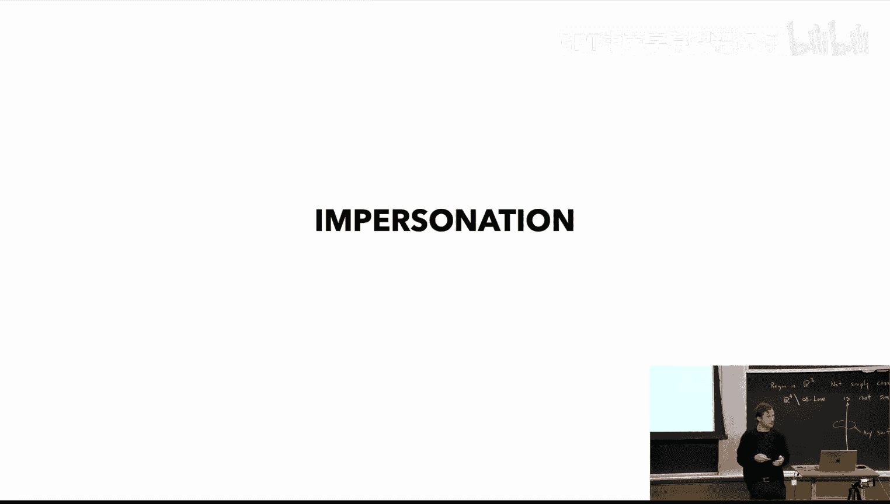
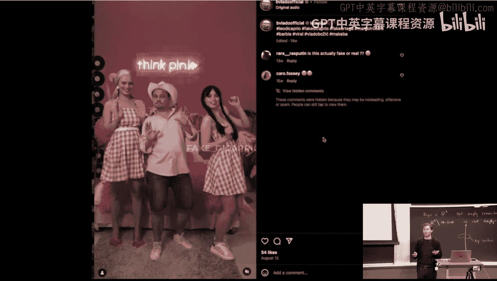
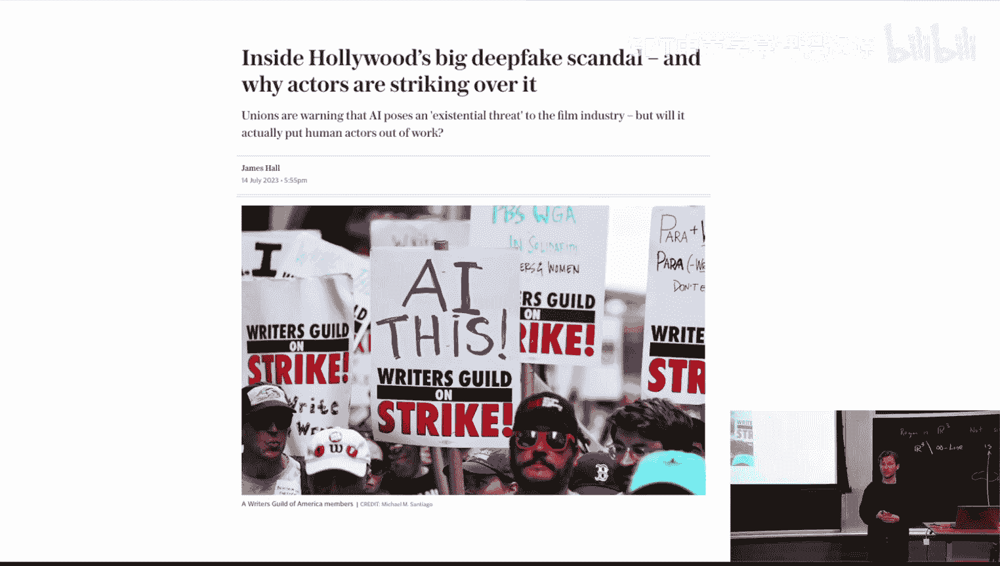
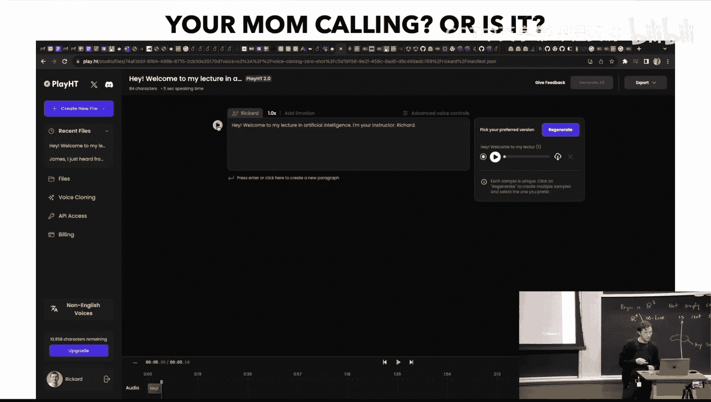
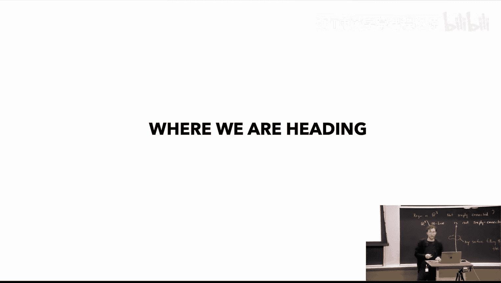
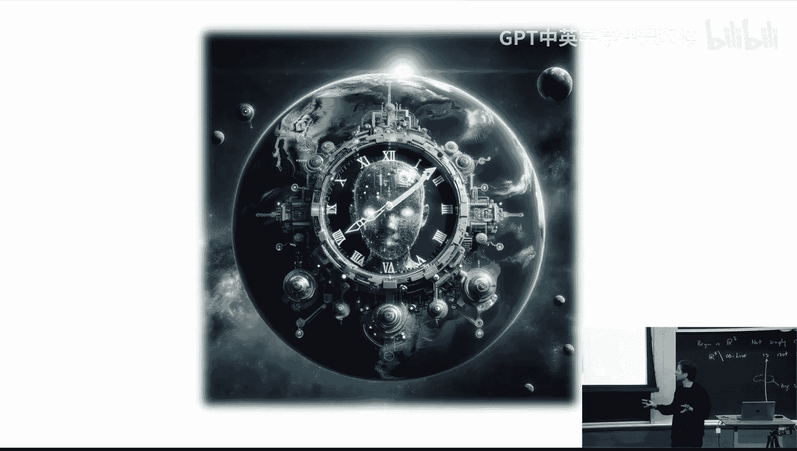
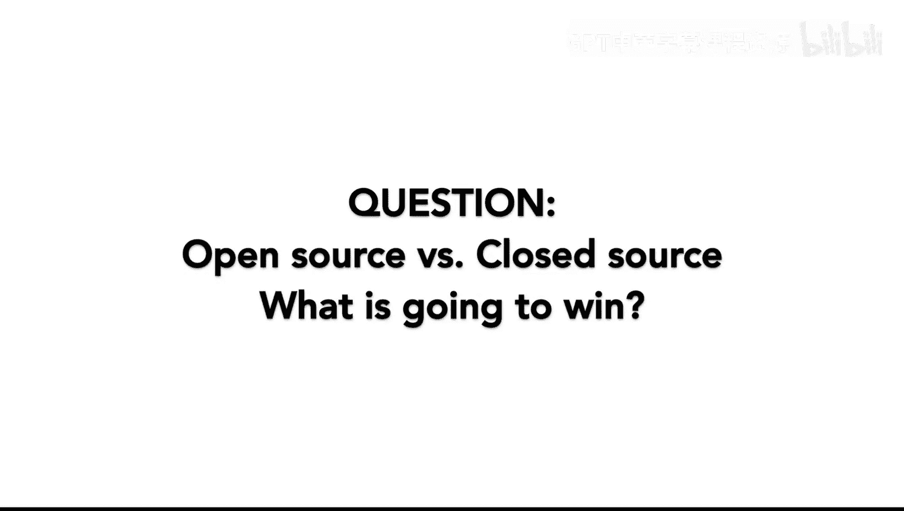
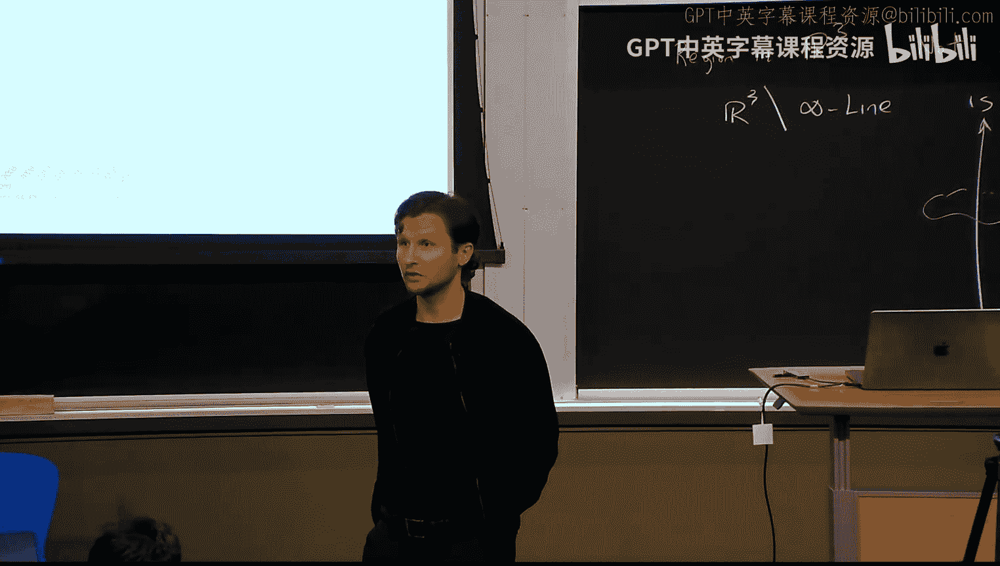

# 基础模型与生成式AI：8：伦理与监管 👨⚖️

在本节课中，我们将探讨基础模型与生成式AI带来的伦理挑战，以及全球范围内正在形成的监管框架。我们将分析技术带来的具体威胁，并审视不同地区应对这些问题的策略。

## 概述

基础模型与生成式AI技术正变得极具影响力。随之而来的核心问题是：我们如何安全、负责任地开发这项技术？我们想要什么样的AI？我们能够影响什么？是否应该监管？以及如何平衡创新与监管？这些都是我们今天试图探讨的问题。

## 谁是责任的承担者？

一个关键的问题是：如果AI伤害了你，你会责怪谁？这存在多种可能性。

以下是可能的责任方：
*   **开发公司**：例如，如果是ChatGPT造成了伤害，是否应该责怪其开发公司OpenAI？
*   **监管机构**：或许是本应监管事物、保护我们的政府机构。
*   **AI本身**：是否将AI视为一个拥有自身目标和欲望、需要承担责任的个体？
*   **训练数据**：问题是否出在用于训练的数据上？
*   **背后的利益相关者**：或许最终的责任在于从AI中获益的人。

将AI拟人化是非常危险的，因为这让我们误以为AI具有自主性和责任，从而可能让背后的利益相关者隐藏在AI背后，逃避责任。归根结底，即使是目前所见如此强大的AI，其背后也总是有从中获益的人，这些人或许才应该被追究责任。这是一个有用的视角，因为他们有动机，也有得失利害，因此我们可以通过审视AI背后的利益相关者来理解AI的行为。

例如，如果你要求ChatGPT生成一张自己的图像，你会得到一个类似人类的实体，这也是媒体喜欢描绘的形象。我认为这是一种危险且虚假的表述，它让背后的利益相关者得以隐藏在“AI的问题”之后，而非“构建并从中获益的利益相关者的问题”。

以OpenAI为例，其利益相关者包括公司背后的创始人、管理层等。此外，微软收购了OpenAI 49%的股份，因此微软也成为了重要的利益相关者。最近，OpenAI的CEO被罢免后又回归，这显示出围绕这些AI模型背后的利益相关者，存在着巨大的透明度缺失。这颇具讽刺意味：这些人本应构建透明的AI，但其组织本身却完全不透明且内部混乱。这应当引起我们的警觉。这个问题并非AI独有，但在试图确定谁是利益相关者时，问题就已经开始了。

## AI带来的威胁

接下来，我们将探讨AI带来的多种不同威胁。这些议题复杂，之后我们将看看政府和机构如何尝试通过监管来解决这些问题，并讨论未来的潜在方向。

需要明确的是，这些问题非常微妙和复杂，不存在所谓的主流观点或明确答案。本节旨在分享观点和视角，引发大家的思考。

在深入之前，需要强调几个重要视角：
1.  **AI是否本质不同？** AI是否与我们历史上见过的其他技术或问题领域有本质区别？或许AI只是长期发展或演变的一部分，是连续体而非截然不同的新事物。也许问题不出在AI本身，而是我们更早之前就走错了路。
2.  **“应然”与“实然”**：伦理学很大程度上关乎事物“应该”如何，世界“应该”如何运作。但“世界应该如何”与“世界实际如何”之间存在巨大差异。比起构建乌托邦式的理想，讨论我们认为世界将如何运作并认识到其中的差异更为实际。
3.  **高风险与军备竞赛**：这些是高风险的真实问题。各国正利用这些技术增强军事安全，这演变成一场军备竞赛，抬高了风险。在军备竞赛中，竞争往往取代了“应该”的考量，事情进展会非常迅速。

现在，让我们开始审视AI带来的一些具体威胁。

当然，其中一些威胁是相互关联的。

### 虚假信息与操纵

有一个相当著名的例子是剑桥分析公司。它可能更多涉及大数据而非AI，但他们确实利用技术进行了所谓的“行为微观定向”。他们能够进入一个国家，分析大量Facebook或居民数据，迅速了解他们。事实证明，如果你拥有某人的一些数据，可以很容易地影响他们，进行针对性攻击或行动。

其效果如何难以断定，但有迹象表明，这在影响选举结果方面可能相当有效，显示出我们的民主制度对此类事物相当脆弱。

当然，这真的是新威胁吗？19世纪末有一个著名的例子：美国军舰“缅因号”在古巴附近爆炸，当时古巴正在进行独立战争。在美国参战前，军舰爆炸了。当时美国的报纸相当集中，控制报纸的人有既得利益推动美国参战。他们编造故事称是敌人（西班牙）炸毁了军舰，但军事报告显示这是一次事故。然而，报纸坚持其叙事，美国最终参战。那时可能是报纸垄断信息，信息不对称使人们同样脆弱。因此，从某种意义上说，这可能并非全新的威胁。

### 深度伪造与冒充

这项技术正在变得廉价，并开始出现在许多地方。它可能被用于比娱乐更恶劣的用途。同时，演员们也害怕AI会取代他们的工作，影响他们的生计。当开始冒充公职人员时，真的可以欺骗人们，这非常可怕。

例如，这里有一个网站，我上传了一小段我的讲课音频，以下是它生成的内容：
`（音频内容：“大家好，欢迎来到我的人工智能讲座，我是你们的讲师Richard。”）`
这完全是AI生成的，我只输入了文字，它就开始生成这个，甚至相当好地捕捉到了我的瑞典口音，这令人印象深刻。

试想一下，将其与我的Facebook数据结合，这些数据透露了很多关于我的信息，然后让一个大语言模型来模仿。这基本上是实时的。如果它打电话给我的祖母要求转账，很可能轻易骗过她。这些能力正成为一个真正的问题，因为AI能够大规模地、在个体层面了解并冒充你。

在冒充和诈骗方面，现在的规模完全不同，因为AI能够大规模地了解个体、冒充你，并在线创建许多不同的、看起来非常真实的虚拟身份。它可以制造出你关心的人或群体的虚假舆论，这在在线评论等方面已成为一个真正的问题，这是我们前所未见的新情况。

随之而来，我们几乎正在经历一场“信息重置”。几百年前，当我们没有报纸甚至互联网时，信息是模糊的。如果有人来到村庄说他们听到了什么，那是二手信息，你总会怀疑其真实性。现在我们似乎也看到了同样的情况：信息过多、过于嘈杂，我们不知道什么是真实的，或者我们可以信任什么。这迫使我们以某种方式减少对信息的信任，甚至亲眼所见也无法相信。因此，我们必须更加批判性地看待一切，更多地运用自己的判断。这或许是好事，但也很有趣：过去，有人可能说“我听说拜登有绯闻”，你不得不判断这是二手或三手信息，会持怀疑态度；但现在，你可能会说“我亲眼看到拜登亲吻一个女人”，但这可能是伪造的。

### 操纵

AI非常擅长从数据中学习人类的弱点并加以利用。它可以通过针对全球每个人进行个性化定制来大规模地做到这一点，这相当可怕。

它能够做到这一点，也是因为我们在网上分享了太多个人隐私和数据。每个个体都有大量数据，一个智能体可以真正地冒充你、了解你，并在非常针对性的层面上操纵你。

与之前报纸垄断、单向传播渠道的威胁相比，这是一种新型威胁：AI大规模工作，并真正个性化其目标，能够了解我们，几乎完全掌握我们。这些算法让我们不断消费，几乎开始比我们自己更了解我们，就像一种毒品，一旦开始消费就很难戒掉，因为它太擅长让我们参与、投入并被操纵。

### 偏见与歧视

这当然是一个极其困难的话题。这里只想深入探讨一些观点，说明为何这非常困难，并提出一些挑战。

以下是一些总结我特征的关键词：瑞典人、来自小镇、不吸烟、历史爱好者、久坐、爱吃巧克力、压力大、拥有博士学位。

如果你想实施保险定价，可能会说某些特征是受保护的，你不想基于这些特征进行歧视。例如，一家在丹麦和瑞典都有业务的保险公司不想基于国籍（瑞典或丹麦）进行歧视。一种方法是查看所有其他特征，尝试预测“瑞典人”这个属性，因为你想忽略国籍。但其他特征可能与国籍高度相关。于是，你训练一个AI模型基于其他特征来预测我的国籍，看看哪些特征对预测国籍有贡献，然后移除这些特征。这或许不错，但瑞典和丹麦的一个巨大差异是丹麦人更爱吸烟，可能不那么健康。如果是健康保险，为什么他们应该受益？不吸烟/吸烟可能与国籍高度相关，他们却可能因此支付相同的保费，这似乎不公平。

你或许也不想基于职业或教育水平（如博士学位）进行歧视。于是你尝试从其他特征预测“博士学位”，并移除这些特征。当你试图移除的保护性特征越多，模型用于决策的信息就越少，决策会变得困难。甚至可能没有足够信息来做决定。

因此，很难用一种稳健或结构化的方式来区分偏见与知识。基于特征做决策需要某种“偏见”。哪些分组应该重要是主观的：基于什么做决定是公平的，什么是不公平的？有时，当你试图平衡事物时，你帮助了一些人，却伤害了另一些人。

在研究中，我们尝试使这些问题更稳健或更数学化。例如，定义AI公平性的一种方式是考虑**Lipschitz条件**。这意味着如果输入发生微小变化，AI模型的输出变化也应该非常小。这样你就无法单独挑出某些人进行优待或歧视，因为如果输入相似，输出就相似。

但这同时也表明，公平性是一个连续体，像一个滑块。你可以设置这个常数，规定输出允许变化多少。如果设置为0，那么任何输入变化都不会导致输出变化，你得到一个常数函数，对每个人都一样，但这样的AI就没什么用了。

因此，在数学上将这些概念融入模型是非常困难的。我也感觉，大公司喜欢抛出一些漂亮的数学概念，让你觉得安全，声称他们用不同的方法解决了问题，但这些方法可能效果不佳。这只是一种权宜之计，让你觉得他们确实在解决问题，但他们可能并不真正关心。我们应该对这些方法持非常怀疑的态度，它们听起来不错，但关键在于它们效果如何，以及这些大公司是否真正关心充分解决或减轻这些问题。

此外，也许所有数据在某种程度上总是存在潜在的偏见。例如，仅仅因为你将数据放到网上，就意味着它存在偏见：你发布到网上的内容和你不发布的内容之间存在巨大差异。因此，互联网和某些信息极度偏向于过去的结果等。所谓的“幻觉”通常只是一厢情愿，因为互联网与现实世界是非常不同的地方。

因此，问题或许更在于诊断数据存在的偏见并使其更加透明，而非试图完全消除偏见。

### 透明度与问责制

人们常说AI的一个问题是不透明。但我不确定这是否是真正的问题。我们依赖人类做决策，但人类本身也不透明。我们不知道自己如何工作，不知道大脑如何运作，是什么真正驱动我们。因此，透明度可能并非真正的问题。

人类也存在类似问题。或许真正的问题在于AI缺乏“切身利害关系”。对于人类，我们多少能理解他们寻求优化什么，他们可能是自私的等。我们可以尝试理解他们涉及什么，得失利害是什么。但对于AI，这要困难得多，我们不知道它们是否真的在优化自身利益。因此，缺乏“切身利害关系”是困难的。这也是为什么我认为回到AI背后的利益相关者非常重要，因为他们确实有切身利害关系。

也许这才是我们真正能够监管和关注的，因为AI或许不应被视为一个独立的实体。

另一个方面是，问题可能不在于缺乏透明度，而在于AI的规模。人类不透明，但通常他们的决策更本地化。我们通常不喜欢独裁者为所有人做决定，但AI在某种程度上是一个伪装的独裁者：一个模型同时被许多人使用，一个单一的智能体被所有人同时使用。

对于一些小额索赔或法庭上的小事，与随机的人类相比，我可能更信任GPT-4做出相当客观的决定。如果我要求它帮助解决纠纷，我可能会信任GPT-4做得不错。但问题在于，如果我们开始使用GPT-4辅助法官或在每个法庭使用，那么突然之间，到处都在使用同一个AI模型，这使其非常脆弱。因为这就像在每个法庭安排同一位法官：你只是把同一个人放在每个法庭。这很糟糕，因为如果他出错或有偏见，将在所有这些实例中产生系统性的偏见。人类通常也不够完善，但他们的不完善可能更多是其个人方式，并且是本地化的。而将其到处部署，将以同样的方式产生系统性偏见，我认为这非常危险。

这位法官在本地看起来是个体，但实际上只是OpenAI服务器上的一个单一的巨大AI大脑，这可能相当糟糕。

### 工业革命“加强版”

我们正在看到许多快速发生的变化。随着AI改变社会，我们如何度过时间、从事何种工作等可能会发生很大变化。那么，一些潜在的后果，特别是与AI本身无关、仅仅因为变化发生太快而导致的意外后果是什么呢？

**工作替代**很可能发生，我们在工业革命时期就见过。
**非自然的生活条件**：现在我们花大量时间在奇怪的城市里，也在手机和网络上，这改变了我们的互动方式，人们可能更孤独等。这完全改变了我们过去的生活方式，或许也给了我们更多空闲时间。

但通常，快速发生的大量变化会在人群中造成很多不安。历史上，人们通常不能很好地接受快速变化。这可能相当糟糕。当人们有更多时间却感到更不安、更不安全时，他们可能不会开始写诗或画画，而是可能开始互相指责，发泄情绪。

工业革命后发生了什么？很快，我们经历了一些重大的、可怕的世界大战。这是意外的，但在这里也有可能：我们开发了这项技术，发生了许多快速变化，造成了大量动荡，加上军备竞赛，可能导致战争或其他冲突。但这不能怪AI，而是变化发生太快带来的意外后果。

这些意外后果可能真的非常有影响力。因为它们通常是不可预测的，所以你无法预测它们，也就无法应对它们，于是它们发生了并产生巨大影响。正是因为你无法预见，它们才产生了巨大影响。

这是我们将要讨论的关于意外后果和不可预测事物的更广泛主题的一部分，涉及纳西姆·塔勒布所说的“黑天鹅”事件——我们没看到、没预料到的事件，但它们极其重要。我们必须能够作为一个社会、一个系统运作，即使无法预测将要发生的一切，也仍然能够在事物不可预测时生存和繁荣。

### 集中化与脆弱性

一个大问题是，当我们在技术（尤其是AI）中看到这种集中化，再加上事物的不可预测性，就会创造一个非常脆弱的系统。直观上，我们可以理解：如果我们有一个单一的AI来统治所有人，每个人都使用它，那么如果这个AI出错，我们就都完了。集中化到“太大而不能倒”的程度是非常脆弱的，因为大多数事物确实会失败，因为我们无法预测所有潜在结果并使其完全稳健。大多数事物都会失败，当它们失败时，系统必须以某种方式生存下来。

因此，我们可能都同意这有时似乎是个坏主意。也许我们应该更多地受到自然的启发，在自然中，事物被允许失败，事物非常不可预测，但它仍然能够茁壮成长。它几乎利用不可预测性和变化作为优势，我认为这也是我们需要能够做到的，这是一种非常去中心化的本质。

这直接来自纳西姆·塔勒布的概念：脆弱、稳健、反脆弱。
*   **脆弱**：指事物因不可预测事件而遭受损失，它害怕变化，希望一切保持不变。
*   **反脆弱**：脆弱的对立面，指事物实际上从变化中获益，将变化视为优势。
*   **稳健**：介于两者之间，指我们试图创造像钢铁一样能够承受变化而自身不变的东西。

但构建真正稳健的系统非常困难，因为这依赖于我们能够预测未来，并基于这些预测设计和构建系统以承受这些事件。这非常困难，因为它假设我们能够预测未来。福岛核电站就是一个例子：它本应非常稳健，人们预测了可能发生的地震，试图构建一个能够承受地震的稳健系统，但他们低估了预测：发生了前所未有的特大地震，他们完全失败了。

因此，稳健性非常困难。那么，你认为构建一个“太大而不能倒”的银行并试图使其非常稳健更容易，还是构建一个允许银行倒闭而系统仍能生存的系统更容易？我认为构建一个永不倒闭的银行是不可能的，因为一切在某个时点都会失败。你需要一个系统，实际上允许事物失败、允许银行倒闭。

这对于我们思考AI是一个很好的比喻，因为我们不想要“太大而不能倒”的AI，那是一个非常脆弱的系统。

这再次依赖于我们无法预测未来。事实上，如果我们回顾人们试图预测未来的历史记录，我们在这方面很糟糕，基本上只是随机猜测。因此，我们不应依赖自己的预测，而应该即使错了也能安然无恙。我们必须说，有些事情会发生，我们不知道是什么，但当它发生时，我们能够迅速妥善地处理。

如果我们不想依赖自己的假设和预测，那么判断什么是安全、什么能长期有效的最佳方法实际上是**利用时间的检验**。我们只需在小规模尝试某些东西，允许其失败，观察其效果如何。我们实际上利用时间的检验来看某物是否有效。这通常是判断某物是否安全的最稳健方式。

这里再次体现了自然经过长时间构建的智能与我们人类构建的智能之间的巨大差异。人类作为生物体是非常反脆弱和稳健的，因为我们经历了大约35亿年的发展，经过了大量时间的检验。但相比之下，最新的AI是在过去3.5年里发展起来的，这相差了约10亿倍。我们进展如此之快，没有测试任何东西，只是部署它。突然之间，每个人手中都有了它，完全没有经过时间的检验。因此，我们基本上不知道会发生什么，是否安全。我认为这是一条非常可怕和危险的道路。

我们想要的是一个反脆弱系统的美好图景：拥有多个部署和系统，每个都经过时间的检验，每个都被允许失败，而系统即使在失败发生时也能繁荣和运作。

我们必须真正向时间和变化学习，而不是成为这种变化和我们不可预测性的受害者。

## 现有监管框架分析

以上探讨了许多不同的方面。现在我们要问，既然这些问题显然很困难，那么我们的机构和政府如何解决并保护我们呢？人们现在制定了哪些法规来尝试解决这些问题？

在深入分析具体法规之前，我先简要表达一些个人观点。

我不喜欢的是其中大量的预测，比如预测未来10年、20年会发生什么。我想，你怎么可能知道AI未来20年会怎样？作为一名研究者，我毫无头绪。我认为这很脆弱且糟糕，我们在这些不同的法规中过于依赖人们的预测。

其中有很多官僚主义要求，比如你应该向机构报告一切，他们会记录一切。但这有什么用呢？这听起来像是创造了巨大的官僚体系，可能适得其反。

很多措辞模糊，听起来让人感觉良好，好像很安全，关心你的孩子和未来。但当你细读时，会发现背后缺乏实质内容，只是承诺未来会考虑这些事情，关心对齐和基准测试，但没有实际的行动计划或明确定义的程序。

另一个我认为不好的地方是，所有这些法规中都大量谈论防止AI产生“坏思想”。这也很困难：我们怎么能限制AI如何思考，如何以更道德的方式思考？这非常困难，但他们似乎认为这非常可行。

**红队测试**：美国尤其喜欢这个术语，听起来很酷，指的是道德黑客攻击AI，试图发现漏洞。是的，这有用，但这似乎被当作能解决所有问题的方法，我不认为它能解决所有问题。

好的方面：普遍共识是我们应该披露AI生成的内容。很好，比如给AI生成内容加水印或将其纳入法律。这至少是可操作的。

另外，有趣的是，他们开始被迫更明确地定义什么是AI、什么是基础模型、什么是生成式AI。我认为推动这些定义更精确是有用的。

**人才需求**：有很大的推动力满足人才需求，这很好，因为我们需要更多人才来处理这些事情。

作为欧洲人，我认为欧洲的法规相当繁琐