# 《扩散模型实用导论｜6.S183 A Practical Introduction to Diffusion Models, IAP 2025》中英字幕 - P2：Lecture 2.zh_en - GPT中英字幕课程资源 - BV1FzhczeEnb

Okay， cool。 Thank you all for coming to the second lecture。 My name is Cole。

 I will be speaking a bit about perspectives on diffusion to give you a bit of an idea of different ways you could understand what diffusion models are doing。

 and we'll also go into a little bit of the math of one of。😊。

The main ways diffusion models are understood， or one of the main papers is denoing。

Diffusion probabilistic models so DDPM， Chennyang might have discussed this briefly。

 so we'll go into a little bit of the math about how you get to the objective function。

 this minimizing this squared loss over epsilon that Chennyang talked about briefly last time。

 and then we'll go into some of the high level， not too rigorous discussions of different ways you can interpret what diffusion models are doing。

So first， there were a couple questions about homework 1 B， so I thought I'd give a small hint。

If anyone's curious， so if we recall from part 1A， it tells us the following this classic fact about how the minimizer for this expectation is the conditional expectation。

So if we use this fact。We can get a nice little fact that this L sigma。

 so this loss function where you fix sigma of epsilon。

Let's described in the homework problem the minimizer of this。

 we can do some pattern matching and we get that it looks like something very similar from 1A。

 Now the question is how do we find this expectation of epsilon given x sigma that's sort of the main crux of the problem and a little hint that I'll give is that if we rearwrite epsilon as this fraction because if we rearrange because we know that x sigma is equal to x plus sigma times epsilon so if we rearrange we can write epsilon in this way and then we can also get a conditional expectation。

Like there。 And so that reduces this complexity of the problem to figuring out what this conditional expectation is。

 expedation of x0 given xigma and then I guess the only hint I would give the last hint was justy。

 we can use Bayes rule to learn something about this distribution。こ。

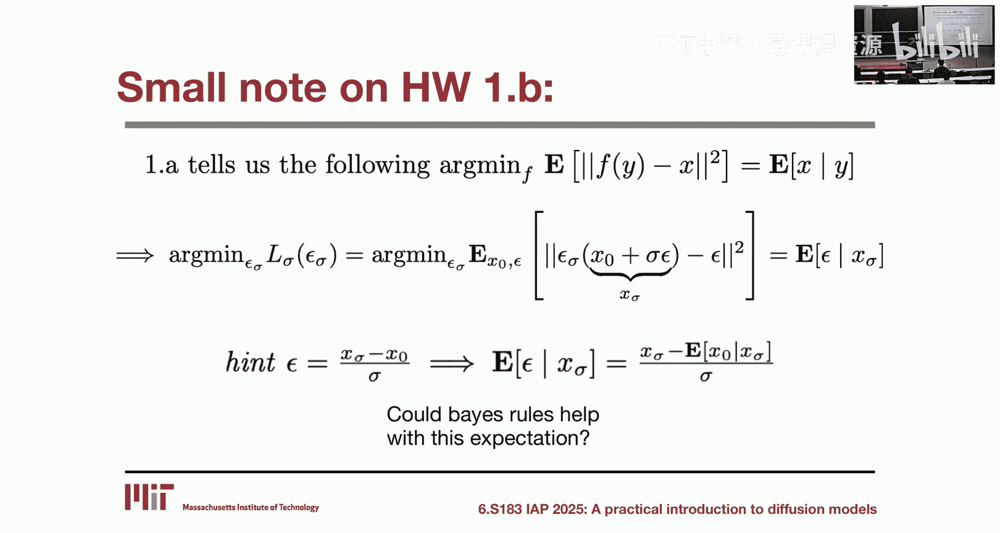

Okay， so。These are some perspectives and interpretations I'm going to discuss today about diffusion models。

 the first being sort of a seminal paper， DDPM denoing diffusion probabilistic models。

 This is akin to the stochastic sampling that Chennyang briefly talked about。 DDIM is the。

Sort of analog， the deterministic analog of the stochastic sampling from DDPM。

 different ways to sample。 And then these have a nice analogous interpretation moving from the moving into like from the discrete to the continuous world。

 we turn DDPM and DDIM into stochastic differential equations。

 And so there's a nice interpretation about what they're doing when you make the step sizes really。

 really small。 And then also you can so ODE interpretation is a way to。Have a。

instead of a stochastic sampling， have a deterministic way to sample from the SDE。

 and then briefly we'll discuss sort of a high levell concept about what flow models do。

 what flow models are， these can be a generalization thought of a generalization as the ODE interpretation or four。

 if you want to learn more about anything from three to five I'd highly recommend taking the class at the end of the two weeks of intercession that will go into a lot more detail about the math about stochastic differential equations and flow and flow matching and stuff like that。

And then lastly， just like present a little bit of an idea about how you can think of diffusion models as autoregressive models。

And so， yes， the goal of this lecture to introduce a bit of math and let you know what's out there。

 We'll start with a little bit more math， and then it'll sort of become very high level and less rigorous。

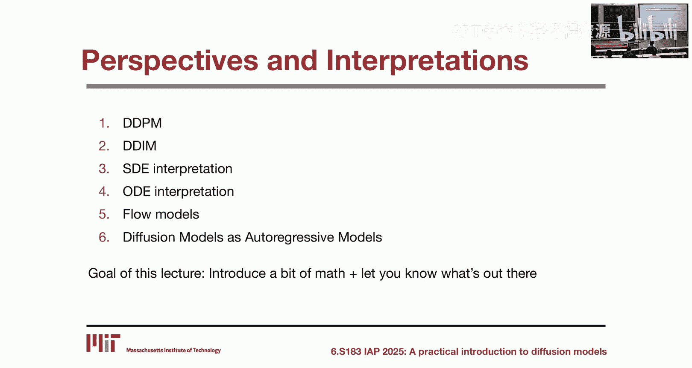

So if we recall when we're trying to train diffusion models。

 Chennyang had this really nice slide about we're learning this to Noiser， epsilon theta。

And we learn it when we have an XO sampled from training data。

 we have some Sigma which is sampled from our training noise schedule， and we have an Epsilon。

 which is a standard adapttion。But I want to talk a little bit more about where this objectiveive comes from。

 we had this nice interpretation of your learning， this reconstruction noise。

 so epsilon is kind of the amount of noise you've moved away from your original point。

 but really how do we get to the subjective is what I wanted to talk a little bit up today。嗯。

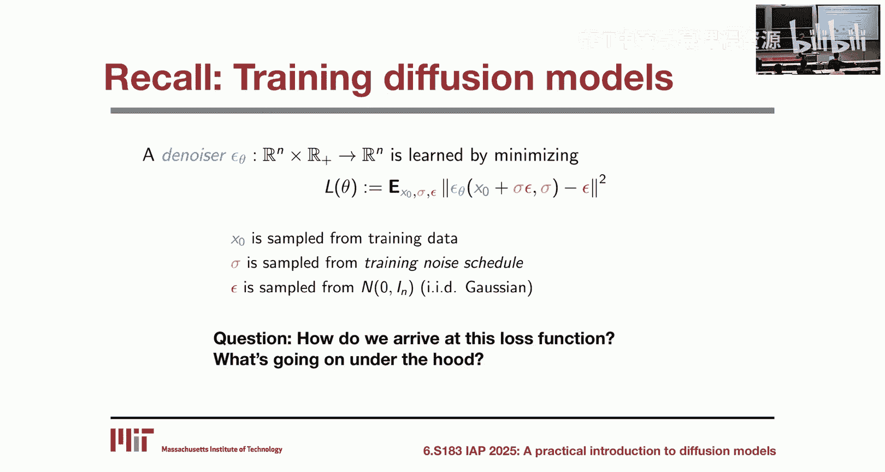

So， yes， there's a well known paper called。Ipe I got decided it， yes。

 it should be down there by ho called thenoising diffusion Pbilistic models。

 where we interpret what diffusion models are doing is starting with some clean data XO you see on the right。

And building a sequence of encoders which are fixed noising procedures。

 these transition kernels  Q X T given x t minus1， and these encoders will gradually add noise to the clean data X and produce gradually noisy latnts。

 so go X X1 all the way to X T， where you fix some T。

And you'll add a little bit of noise in each step until the final step is indistinguishable from a standard dousion。

And what these try to do is we try to learn a backward process which is the decoder。

 so there's a nice image of p of theta of xt minus1 given xt。

 we try to learn these backward reverse increments。

 these reverse transitions to reconstruct step by step moving back from Xt。

 which is really easy to sample from， it's just a standard Gaustion we know how to sample these in order to sample our in order to sample data that looks like our original data。

This is， in general， a much easier procedure than trying to do this all at once。

 to try to generate it all at once。 If we can first sample things that we know how to sample standard Gaussian and then。

Apply these small transition kernels， it'll be easier for us we'll see to generate good samples。Okay。

So yes， key idea is the noing in small steps is easier than attempting to remove all the noise in a single step。

And we'll sort of explain a little bit about why that might be。

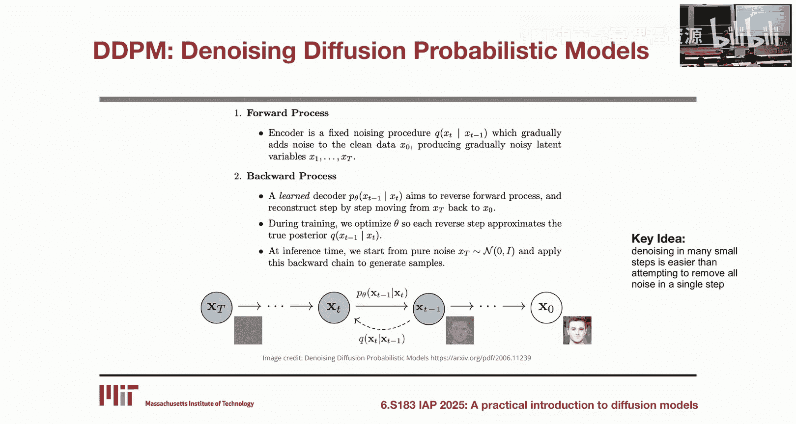

Okay so on the top right I've borrowed a nice image from the machine learning course from this fall。

 but it's the same image as before， I've actually just swapped XO and XT from left to right。

 so apologies that that's confusing， but really we're starting with our clean data on the left。

 we're noising to XT on the right and we're denoising back to XO on the left。

So what are these transition kernels Q， So what is the forward process， how do we define it？

So so for some fixed beta knot， beta or beta T we'll see is sort of like our noising schedules that Chennyang brought up last costs。

 we define these transition kernels as Gaussian distributions with mean of a slightly lower magnitude Xt minus1 and a little bit of a variance。

And these depend on our choices of beta。 we're just going to assume these are fixed from now。

 we're not going to learn these as hyperpara。Equily。

 we can write that X T is equal in distribution to。This quantity。

It's the exact same thing as what was written above， nothing too crazy has happened。

You might that now we have a square root of beta t， this is just standard Gaussian math。

 the variance gets squared from whatever the standard deviation there is。

And we sample epsilon from standard caption。Interestingly just with some very simple algebra。

 youll find that we can actually write xt as equal in distribution to x。

 a sort of linear combination of x n and a standard a standard Gausian epsilon also and the way we do this is you can just imagine unraveling this chain and we get something that looks like this where I think I've hopefully defined it I've not defined alpha t alpha Ts are alpha t bars are functions of beta T。

嗯。Very， very simple。It mightight be a good exercise if you wanted to figure out how to relate these two quantities。

But yes。So by a Markov property， we can write this joint distribution of all of our forward la。

 of all of our latent variables conditioned on the original XO。I was the following。

This is we're just multiplying the product out because this is really just a Markov chain。

 every variable x2 conditioned on Xt conditioned on Xt minus1 and all the other lants before it is equivalent to Xt condition on Xt minus1。

But yes， just to draw a small connection between last lecture。

 we can sort of think of this square root of beta t as equivalent to the difference in the noise schedules。

 yes。It makes sense why you're adding the the wise。请把你说话。Yeah。

 so this will allow us to sample from a standard gaush at the end， so after T steps。

 if we run this long enough， given that beta t is in between 0 and1 and the alpha T's you can think of as they're just a product Al T bar is a product of1 minus beta Ts。

And so after we compound this enough for a long time。

 X capital T will approximately be a standard option。

So that'll allow us to make sure that the reverse process when we sample standard Gaussian at x capital T。

 will be able to match the forward process。Yes， any more questions？Yes。Capital I， Where is capital I。

 Oh， this is just the identity matrix。い。

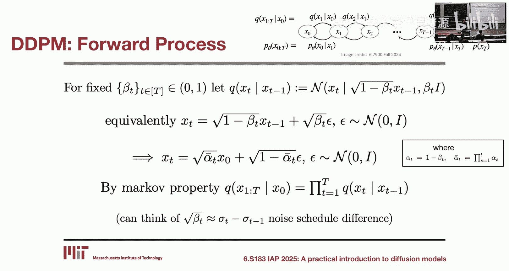

Okay so you know one natural question might be why are we why are we using Gaussian kernels here。

 why are we using why are these transitions transition kernels Gaussian。

 we could add some other noise perhaps so one really intuitive reason is that if we have forward Gaussians i。

e ifq of X T given x t minus1 is a Gaussian， that will actually imply that the backwards direction is Gaussian 2 approximately not exactly for very small noise additions。

 the backwards direction is going to be Gaussian。So given our forward transition kernel。

 this is a fact。One one can prove this more rigorously if they wish。

 if you'd like to talk about how you would show this， welcome to come to office hours。

 I can also post some nice discussions on some very high quality blogs that we'll go into it a bit more deeply。

 but a nice fact for now is that。For some small beta， I guess I could have written beta t。

 there exists some mean function of x and xt such that this reverse transition kernel。

 so I haven't written p theta of x given x or xt minus1 given xt is because this is supposed to approximate this Q x t minus-1 given x T。

But the。True。Re first kernel approximate is approximately。

A Gaussian random variable with the same standard deviation， but the mean that willll have to find。

And there's actually a way you can write out this mean in terms of xO xt and the noise schedules beta t。

 it's a little bit messy， but there's a very nice way to write it out。

 so essentially if we know XO and we know XT， we can figure out what these reverse transition kernels are going to be。

So that's going to lead us to the backwards process。U。So for large tea， as briefly mentioned。

Q of X T this final latent variable is going to be approximately a standard Gaussion。

 This is what will allow us to， when we're trying to construct data sample from standard Gausians。

 This is。What lets us do this？So we have the following。 So we have the joint distribution of。

Our data and all of our lateness together。Just by a simple days rule is going to equal the distribution of our data and the distribution of all of our latents。

 So X T1 given or X T1 to X T， given X T。And then we can do a little rearranging to realize that this is also the distribution of Xt times the product of the reverse transition kernels。

Nothing， too complicated here。And then， as we've said， for large t。

 Q of xt is approximately a standard Gaussian。And for small enough beta。

 Q of x t minus1 given xt is approximately a normal random variable。

Where we still have this sort of annoying function mu of xdot Xt。But。

We don't have to know what that is just yet。We get approximately this distribution。

Which tells us that it's sufficient to take。P theta are what we're going to learn is the reverse transition kernels。

Equal to this， equal to a normal， where all we need to do is predict。

 or we need to figure out how to find mu of xtont nextt。So we're going to learn how to figure out。

 I mean， this is a deterministic function。 I want to be clear。

 this is a deterministic function of x do X T。 What we need to figure out a way to learn is X。

 Once we know x not， we know X T。We can figure out you。

I just haven't written it up for ease of notation because it just gets kind of messy with all the beta T's and all the alpha Ts。

But think of this as known as a deterministic function of x do X T。

 So the difficult part is being able to learn a function to predict X not as a function of X T and T。

Okay。Cool。So。Continuing with the backward process。How do we learn XO？嗯。So we can recall that。

By unraveling this chain of Xt as a function of xt minus1 and epsilon。

 we can also describe Xt as equal distribution to this linear combination of xO and epsilon。

And some standard gaus。If we rearrange this， we can rewrite xO as a function of X T and epsilon where again。

 we're not going to be learning our hyperparameters， alpha Ts， alpha Ts are functions of beta Ts。

 we're going to assume these are fixed for now。What we've done is we've reduced the problem of predicting x not。

To predicting epsilon。We're Epsilon now， we're writing as a function of Xt and T。Okay， stop me of。

This is a little confusing。Okay， yes。せてばたそのは。変わる。From that。Good question。 So every transition kernel。

 like every transition from x t minus1 to X T， this is a bit of abusive notation。

 which is good to point out Every transition from x t minus1 to X T， you add a noise vector epsilon。

 but these equal here are really equal in distribution。😊，So they're not exactly like。

This epsilon here is just some standard normal that's been sampled。

 but if we remember if we go back a little bit。Hopefully I'll have it here。

That this is an equality and distribution。So even though you're right， it's not the same epsilon。

We can sample from X T。Instead of iteratively sampling one by one， drawingps。

 drawing two separate epsilons。We can sample them from XT by equivalently drawing one epsilon。

And reweightiting this way。And we get this equation by unraveling this。If it'd be helpful afterwards。

 I'm more than happy to talk about how we get from here to here。 But it's just a bit of algebra and。

A bit of a pieceive notation， which I have here and here， but in reality。

 essentially it draws on the fact that if we add two standard douss。

We add the variances and it's equivalent in distribution to one standard Gaussian。So okay。There。しくの。

那 year。そし。Do you know he's one step。No， no， no。So geonoizing in one step is not going to be a good idea。

 we'll see why， but similar to a slide Jen Yang had last class where。

You sort of showed that you're kind of always predicting this conditional expectation of where your original point is。

 And if you try to noise in one step， you'll end up。

Sort of sum end up averaging out the different possible XOs。😡。

So if I'm at a certain noisy distance and I have an image it's maybe starting to look like a cat。

There could be like 100 cats that are likely for this image to be。And if I had de noise in one step。

 I would end up being taking the average of all those cats。But if I do a little steps。

 then I move sort of more slowly， and then it's easier for me to get to a real image of one of those cats rather than doing it all at once。

 but what this is saying is we can noise in one step。

But it's important to dennoise in the little steps because that's when we have this nice equivalence between the forward process and the backwards process both being Gausians。

If we have a large step in the reverse step， we're gonna get a lot of error from approximating this reverse step as a Gaussian。

 But in small steps， when beta T is really， really small。Yes。And small steps。

 when beta T is really for small beta。No。The reverse transition kernel is very close to a standard gausian。

 in large depth， we're going to have too much of an error。在那个。Yep， Ill saw on also other hand。

 I think。I haveてで。To the forward policy。全然は。いうな。当最告。没有。Yes。啊。Or you can think of this sampling。

 you can do the sampling procedure in many steps， or you can get an equivalent distributed you can do in sampling procedure in one step。

 sorry， noing procedure in one step。By just sampling one epsilon and taking a different weighted combination。

Okay。So where were we？So we did this。Yeah， okay， so。What I want to say here is that， yes。

 so the main crux of this problem is finding mu， given x T and x n， we don't know x not。

 so we've reduced the problem to finding x n。Now we've reduced the problem of finding x0 up there to the problem of predicting this noise epsilon。

😡，Give an X， T， and T。So what is the equivalent amount of noise we would add from x not to get to Xt？

😡，This is what this is， this is what Epsilon hat of XTNT is。And。

To write out the full what this really equals， it's a little bit messy。

 but just want to show you that there is a nice way once we know Epsilon， once we know Epsilon Ha。

There's a sort of one to one correspondence between epsilon hat and X knot。

Does it make sense why there's a one to one correspondence between epsilon hat and epsilon X sorry。

 Epsilon hat and exxO， given X TNT？If I'm able to know epsilon。

 the amount of noise I've added to get to XT， that's equivalent to being able to know X Xon。

It's just a difference。こ。I just wanted to write out that this is a nice expression that we have。

 but really the crux of the difficulty in this is how we predict epsilon hat。

Once we pick epsilon hat， we have a good approximation from you。Once we have mu。

 we have a way to sample in these inverse transition kernels， reverseverse transition kernels。Yes。

Please。さ。新。いいことで。第二位。見付けをつ。あわ。そたま。Yeah， I think it's just a scaling fact。

 I think Che Yang had a slide where you mentioned that a Sigma can get very large。

 we're keeping Sigma small in this case， it's just the difference of scaling though。Okay。So yes。

 just to recap the main idea of this slide is that ultimately we want to be able to find mu that problem can reduce to figuring out to giving a good approximation of XN and getting approximation of xO can be reduced to getting approximation of epsilon given。

X， T and P。 So given some noise image and knowing。At what point this noise image occurred？

Preicting what the noise was that got it there。That's the crux of the heart。And so。

This lends the loss that we saw from。Last lecture。This is a bit of a motivation for why we get this squared loss here。

And then of course， as in an earlier slide， we sample instead of sampling like so the earlier slide would be here。

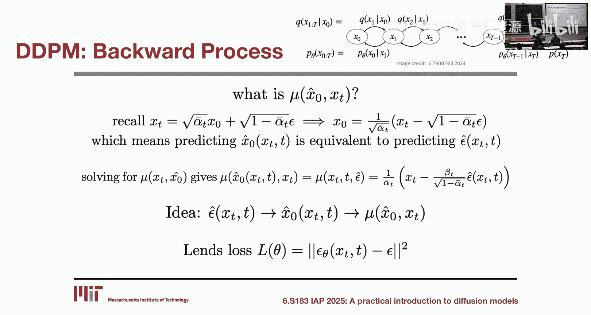

I guess I just want to write a little analogy。Last class we sampled Xnot from fading data。

 sigma from our noise schedule， and Epsilon from Sand Gausian。

 and this is what the expectation was over here。You can think of our expectation。

O see here as sampling epsilon， sampling an x not per our data， and then sampling a T。

 and Xt then is going to be described。Yes， up there。As sum of this weighted sum of x not an epsilon。

So instead of sampling noise， we're sampling， we're sampling time。Uniformly from our one to T。

But it's the same thing。Every time slot is an equivalent to a noise that we'd be sampling in the previous example。

So just wanted to make a small connection to score matching if that is something familiar that you guys might have heard before。

So just to recap again or just to go back， we have XO。

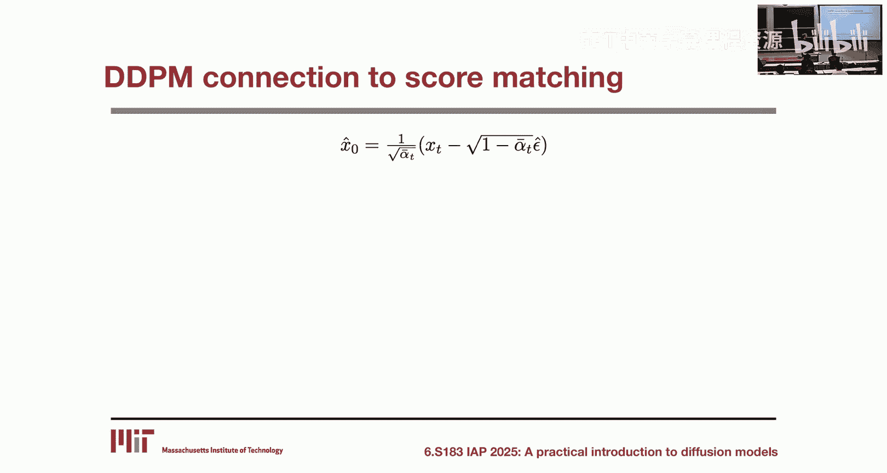

Is equal to this quantity just by rearranging what we have on the second line there。

 that's all we've done。

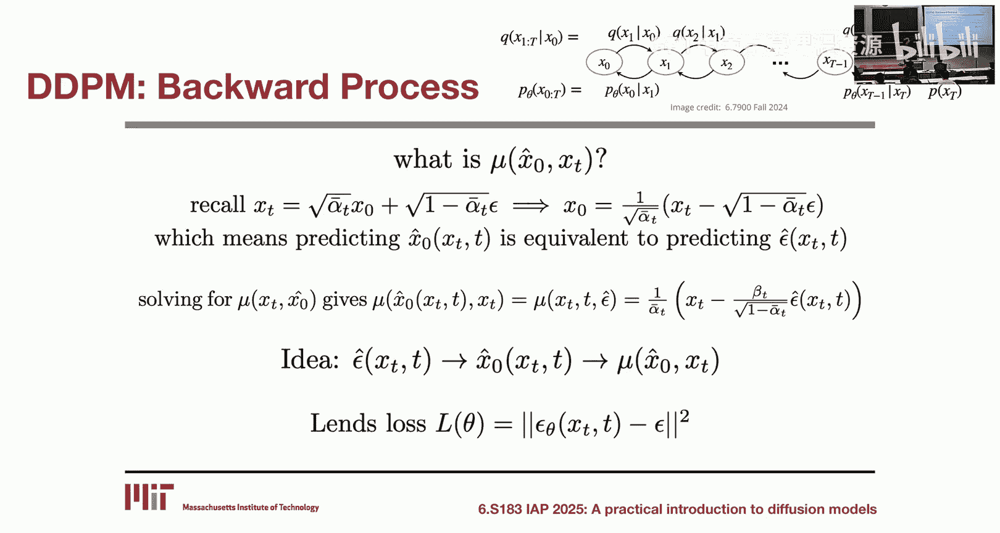

So once we have a good way to approximate Epsilon， we have a good way to approximate exon。

And if we denote Qt of Xt as the marginals of this process。So not conditioned on anything。

 just the true marginals。 So here's like an image。 And maybe we have some complicated data that looks strange。

 and we're noing it slowly to what is closely approximating a Gaussian。

So QT of XT would be the teeth margin。Then there's a nice property that uses something called a Tweies's formula。

I'llPo a sort of blog post。 if you guys want to read more about this。 It's nothing too complicated。

 but I just wanted to keep it simple that there's nice。

 there's this nice proportionality relationship between learning this function epsilon。

 So the amount of noise that you're adding to the data at。Time T。And。

What's called the score of the data。 So the gradient of the log or the score of your distribution。

 the gradient of the log of the marginal。And you can think of this as like this is just the direction that you want to be moving in to increase the probability of your samples。

And instead of imagining that every。That every time increment war。Reducing the noise。

 you can also analogously think of it as we're increasing the likelihood of our data。Okay。

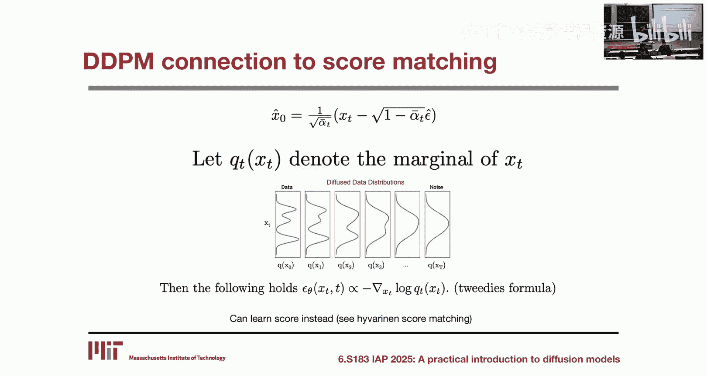

And then I also just wanted to quickly summarize the。Difference between。

Stochastic sampling and deterministic sampling。Just at a very high level。

 I think Kenyan also went over this， but。We can use- so if we go back， is this the slide？Yeah。

So if we have。If this is our reverse transition probability， this is our。

 this is what we're learning。 We're learning this mu， then the way to sample from it。Given X T -1。

Would be。O， just this， so x minus1 equals mu plus r noise times z where z is a standard Gausstion。

So this is just the way we do the DDPM sampling。Once we' have a nice function epsilon。

 which we've learned via some neuralural network by training it on the loss function。

This is the way we sample。So DDIM is a more general way to understand the sampling where you can interpolate a little bit between how much noise you're going to add。

And I won't go too much into。What the differences in the constants are here， but essentially。

 we are removing this noise scale term。呃。I think Chennyang had a slide。

With this graphic where we can actually scale up the noise and down。嗯。But yes。

 this is just the difference between sampling probabilistically and sampling deterministically。

Why intuitively can we sample the terministically？Why is it not？

Why doesn't this just mean that we're like always getting the same sample。

 the reason being because at x capital T， we're still sampling from adoption？

So that's where we get the randomness， even if the process to reverse it is deterministic。

 the stochasticity of the joint distribution comes from the Gaussary sample at time capital T。

And these empirically lead to slightly different sample qualities or sample outcomes。

Sometimes I think empirically GDPPM sampling tends to be。A little bit less quick。

 but you get some more diversity in samples。As you can see with this image。那可。

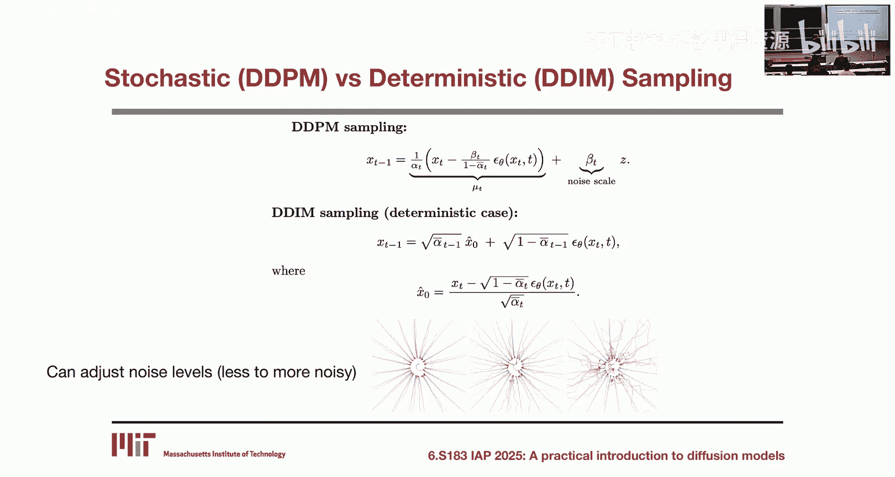

Is itrop if you wish。So how do we understand， So what what we've been doing so far is we have these discrete increments。

 We have capital T steps， and we're adding noise in these T steps， but。

What happens if we take this discrete process and we try to make it more continuous？ In other words。

 what happens if we use a lot more steps。Between0 and t and adding a lot less noise。

 so as we add less noise， our approximation of our inverse transition get a lot better。

 they become closer and closer to Gausians。Intuitively， but we also have to take more steps。

So how would we write this， so we can write the noise variance as beta t Delta t as deelta T approaches 0。

And let's see what happens。So here is our。Sort of。Incremental forward process that we have。

And if we rearrange， we get the difference between X T and X T -1。Equal this weighted sum of x t -1。

And epsilon for epsilon is a standard reduction。But now these weighted sums have constants。

 which are also shrinking。As a function of Delta T。So。Approximately。

 and if you want to really understand this more rigorously。

 I highly recommend taking the course at the end of the two weeks。But approximately as we shrink tea。

More and more， and we take a limit。We arrive at a schal differential equation， so an SDE。

We described as this。So DW is Brown in motion， this is what happens when we take root T。Epsilon。

 or epsilon is a standard Gaussian， and we take the limit of it as it goes to  zero。

 We get this differential。呃。And this is what， this is what。We get。

 And if s differential equations are。New to you or unfamiliar， you can think of them as an O D， So。

Or near differential equation with some added randomness with a Gausian process that might be weighted in some way。

I think I have an image。

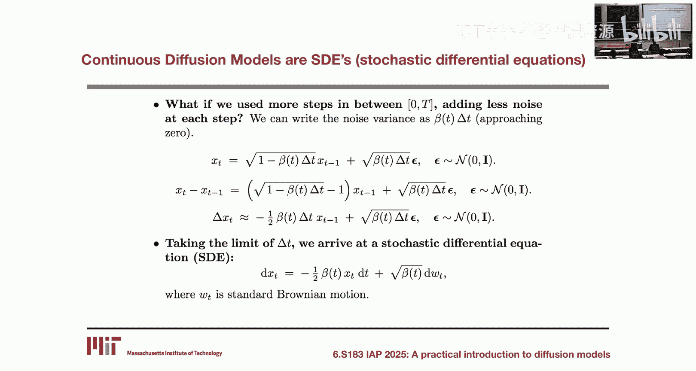

About what this looks like here， yeah。As we。How this Delta T approaching0。

We get something that looks more and more like this in the reverse process。Where。

This image is supposed to describe as sort a more complicated distribution on the right。

 I know here it's like just looks like a bimodal Gaussian。

 but imagine this is being like a clean image that we're trying to reconstruct。

 And this here sort of looks like the level sets or looks more like。

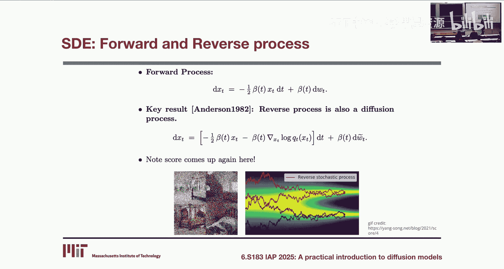

Like a standard dashion。And we're sampling from our standard Gausion。

 and the SE describes this continuous process of。What is known as like particle flow where you have some。

You know， particle that's like your image and it's moving towards a higher probability area。And so。

A key result is that if we make the forward process the continuous analog of our forward process for DDPM。

That the reverse process also is a diffusion process。What does that mean。

 the reverse process looks like this？Where so in in the， in。In like SDE literature。

 this is called the drift term。So this first term， the drift term in our forward process only depends on our betata T。

 so these schedules。But the drift term on our reverse process。

Which is the main thing we need to learn is now a function of beta T things we know， but also。

 and this is just again， like high level is a function of our score function。So。

This makes us believe that， okay。If we can predict our score function。

 if we can find our score function here， then that's going to be sufficient to reversing this SDE。

So running this stochastic process。Backward in time。

So in the same way we add like small little Gaussian noise increments all the way we're taking clean images to noisy images to a noisy Gaussian。

 if we make this process continuous， we can imagine our image is sort of like naturally flowing from a clean image to a noisy image and then learning the score function here is going to be sufficient to being able to reverse this process。

 this continuous process。So score comes up again here。Yes。From an implementation perspective。Yes。

At that point， is there any difference between what you have to be write down the code and what UPM was doing。

 it's a good question。I think there are ways to make them completely equivalent。

 but I think there are also ways in which they can be different。 I think it gets。Little nuanced and。

Yeah， we are happy to discuss more offllline too， but yes。

 there are ways to make the discretizations of the SDE flow equivalent to a DDPM algorithm。Okay。

So in the same way that we were able to take this reverse process in DDPM。

 the stochastic sampling procedure and construct a deterministic sampling procedure。

We can do something similar where we take a stochastic differential equation。

 the reverse process of our forward SDE， which is an SDE。

 and we create an ordinary differential equation。So which would be the or the analog of deterministic sampling。

So。Briefly， so consider general EO SDE， but written as this where we have our drift and diffusion term。

 so our F term is a J term， and then G more controls the amount of gausian noise we're adding at different time stepss and under some mild regularity conditions。

 there exists a deterministic OD， which is known as a probability flow ODE。Whose solutions I。e。

 if we solve this OD， share the same marginal distributions as the SDE。

So this is like not a trivial fact at all。 This relies on something called like falcker plank。Again。

 if you're interested in learning more about this， definitely take the class at the end of the second few weeks of intercession。

 they'll go very rigorously into the math behind this。

 but I just wanted to present it so you guys know about it。呃。And knowing this。

Allows us to take our reverse STE。Which we've reversed in the previous slide。嗯。And。

Obtain a corresponding reverse OD。And this can have some nice computational advantages because now we're solving an ODE and we're not solving an SDE。

Which means like you know we have ways to numerically compute ODs。

 SDs are a little bit more challenging。And。Just wanted to write this to point out the。

Difference and different ways to understand。How we can have an analog between the stochastic sampling and the deterministic sampling in the discrete case and the stochastic and deterministic sampling and the continuous case。

And more formally， these can be made to be equivalent。Just so you know their existence。

Read diffusion model papers。 They might be coming from。These different interpretations。

 you might see the score function， you might see it based on DPM。

 you might see it based on DDIM just so you know。So really briefly。

 I wanted to talk about flow matching， which is a way of learning。

 you can imagine it as a way of learning this。Drift term。嗯。F of x T， but really it's more general。

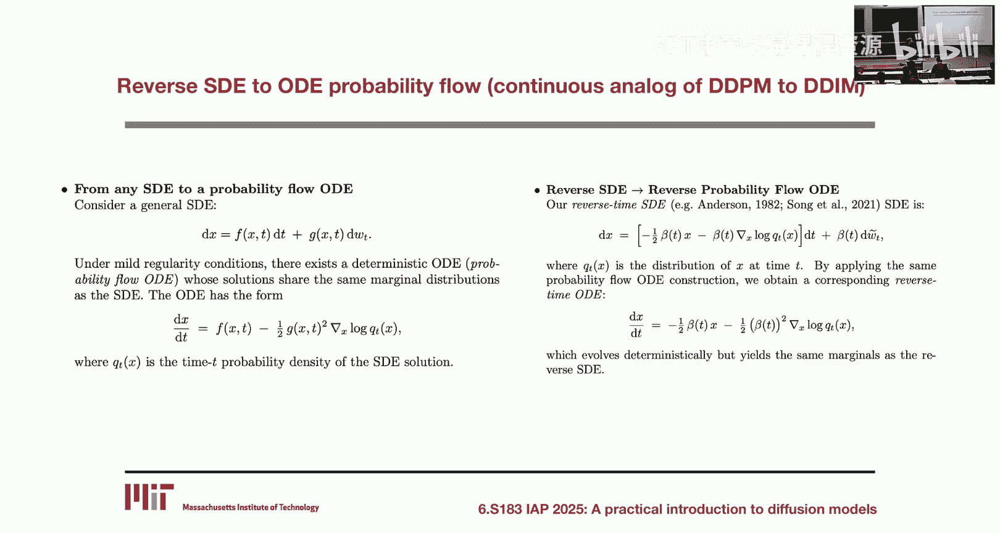

So just to give a high level idea of what flow matching is。Is。Maybe instead of。

What we're really doing is learning like these errors， these error functions。

 and then moving in the direction of Epsilon or moving in the score matching case of the direction of increasing sort of our probability。

What if we instead learned at velocity velocity field V of XTT that continuously transforms a simple Gausian distribution at time equals 0 into the data distribution at time equals 1 So here we've re parameterameterized time if you read a flow matching paper。

 time equals zero is no longer the noisy version or sorry yes。

 time equals zero is no longer the clean version it's a noisy version。

 time equals1 is the clean version。And。You sort of just follow this flow trajectory and the main idea is instead of learning epsilon or instead of learning the score。

 you're learning of velocityy field that takes in a position x and a time T。

And the connection to the probability flow of ODE。😊，Is that in score based diffusion。

 probably flow OD is deterministic OD whose solution shares the same onetime marginals as the original diffusion STEs。

 as we talked before。And。V of X E plays a similar role to this drift term that we learn。

 So this large term。But it's a different way to understand learning it。

 and the math is actually a little bit simpler， you'll see。

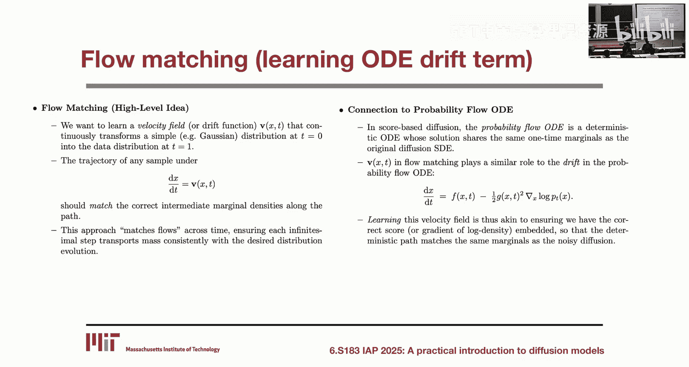

So， yes。Really quickly wanted to include this mind map， sort of have discussed it a little bit。But。

This is a way to， I think， understand nicely what these different methods are doing at a high level。

We have the continuous and discrete worlds and the stochastic and deterministic sampling。

And in Sreet stochastic， we have DPM。And the。Discrete and deterministic sampling as DDIM。

And we have our analogs for the reverse SDE and the reverse probability flow ODE。

 and then flows and flow matching is a more general way to understand this。Great。

And then the last thing that I wanted to talk about briefly。

Is to give a little bit of an intuition as to。

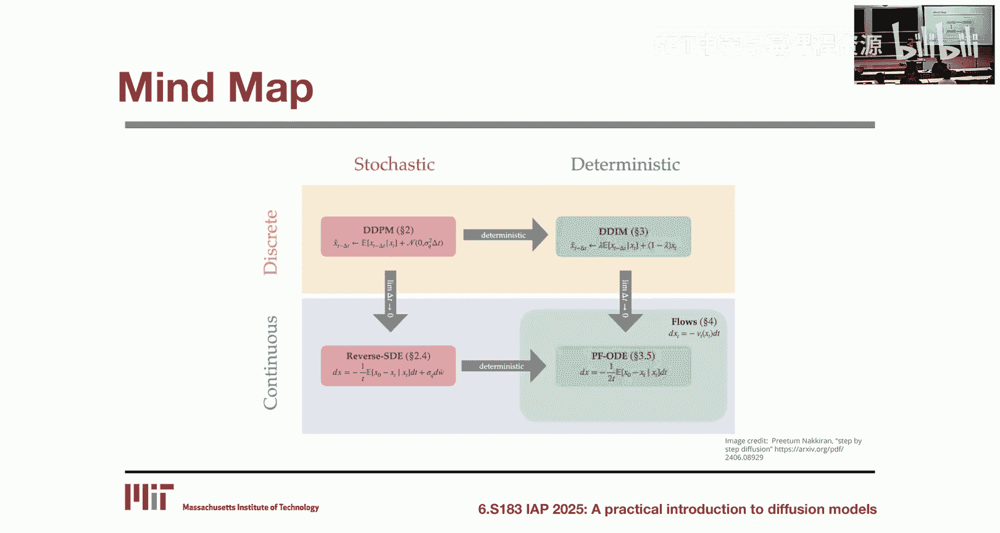

So why you could think about。Diffusion models has autoregressive models。

Autoregressive models being where you predict little increments at a time。

Is that what's what's happening is that we have this sort of large scale first find details later。

 philosophy of diffusion models where。Diffusion sampling is offered in generating these very core structures and early samples。

 so if you see these images where you go from noise to I don't know pictures of dogs or cats。

 the early images on this in this process have like the general you can think the general like low frequency features of your images。

 the shapes of the animals， you know where the animals are in the frame and then as you go closer and closer。

 you're generating much more high frequency data you're sort of filling in the details。

And you're doing this in like iterative steps。And so a way to understand this in sort of the frequency domain is that sampling is really building up frequencies from。

 from low to high。 And this is akin to how autoregressive models generate data step by step in the pixel space。

 So they're generating。Maybe high level features in the beginning。 And then or sorry。

 low level features in the beginning。 And then as you go on more and more high level features。

 And there's ways to sort of envision this as。Maybe if you have a convolutional neural network or something that you're learning maybe large structures earlier on and then you're learning finer structures as you go on。

嗯。But I will post a few。Resources that you guys can look at if you want to dive in deeper into any of these interpretations。

But。Yes， for today， this is what I wanted to go over。High level ways of。

How to understand diffusion models， ways in which you might see them if you read the literature and yeah。

 feel free to。Paing some questions at me， talk offline， all the。

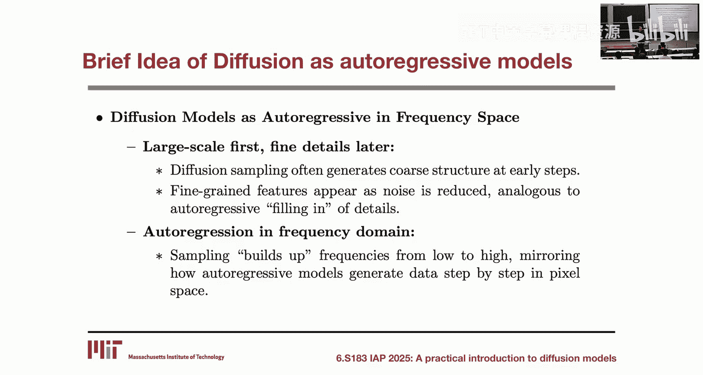

Thanks。Oh yes， I look out for an email about a survey for today's lecture。

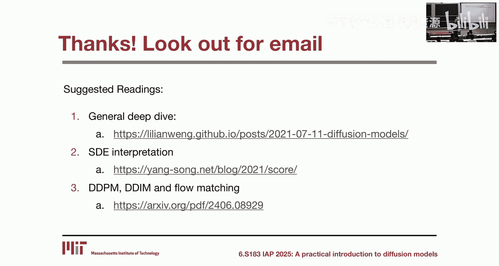

And with a bit of questions from what we discussed。

