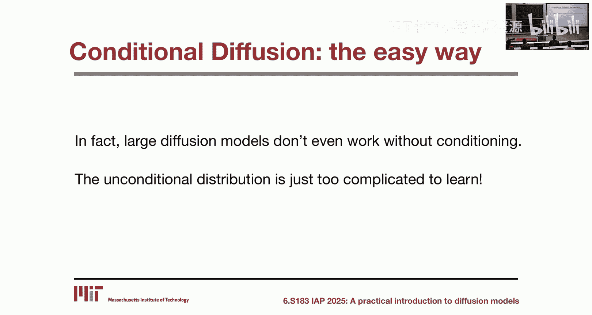
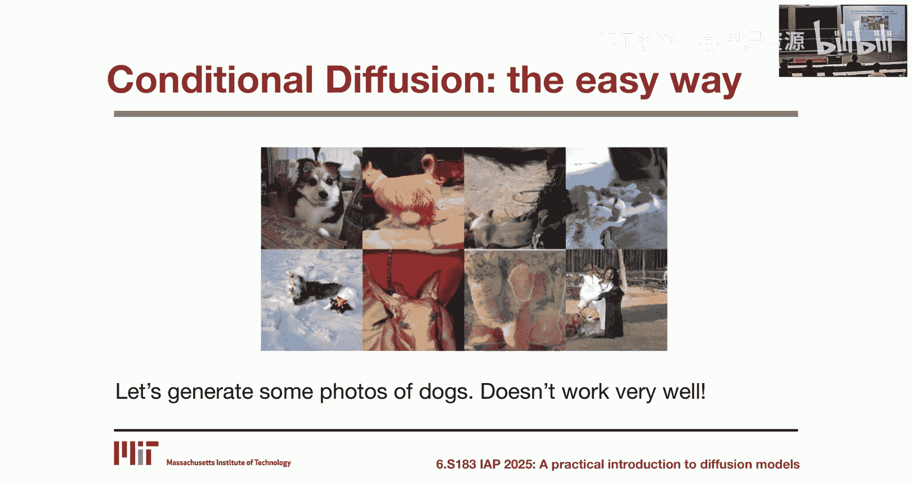
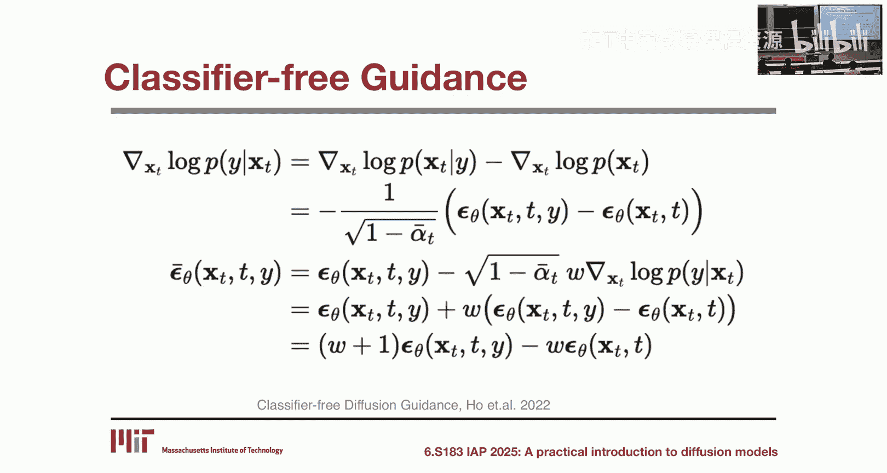
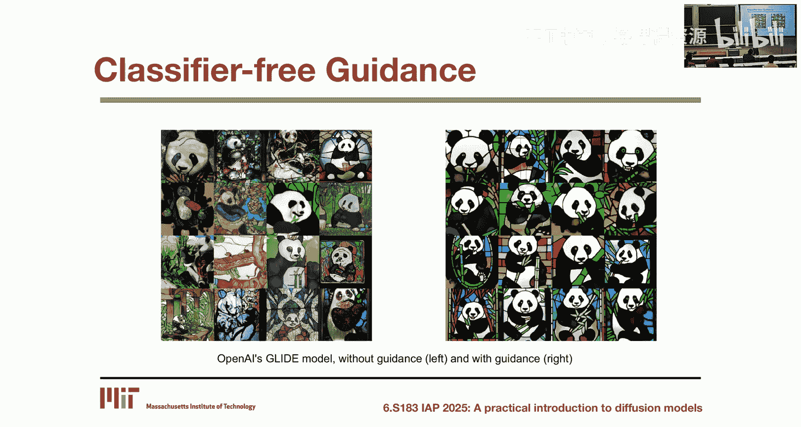
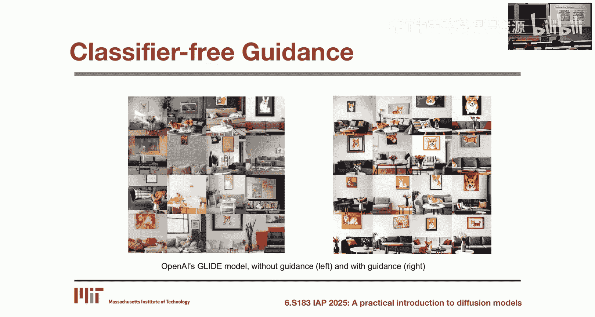
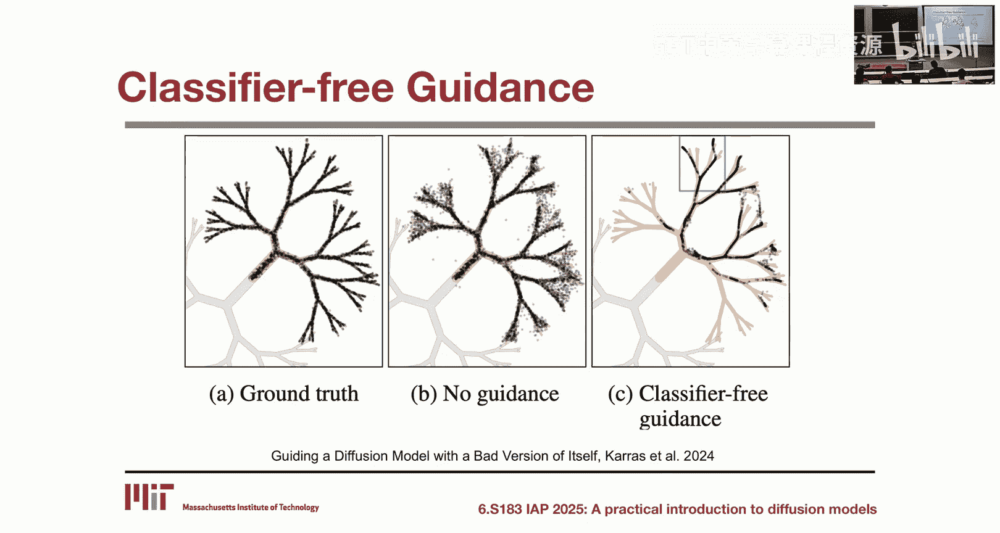
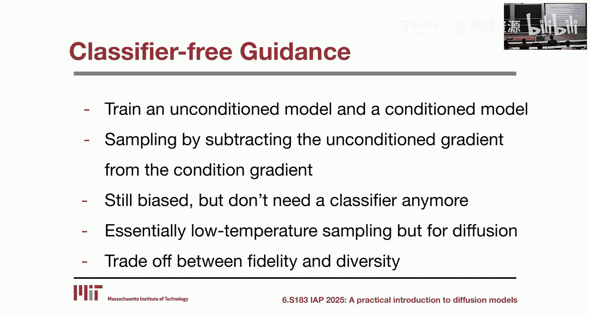
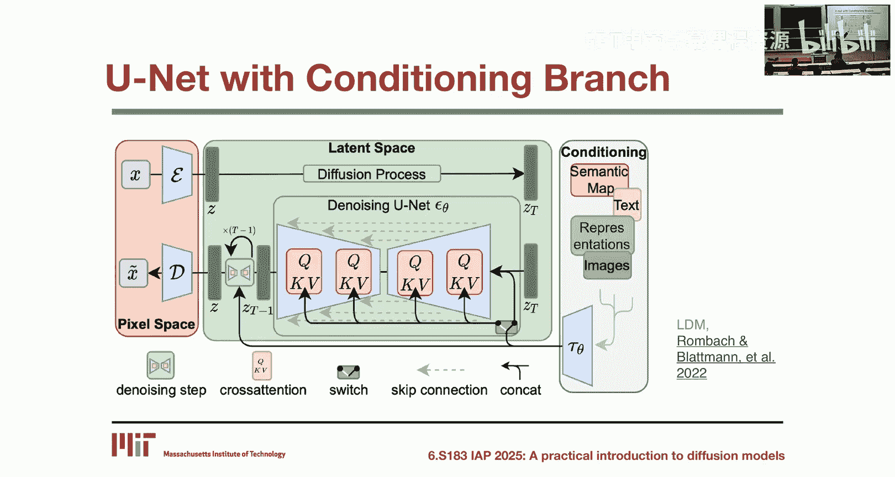
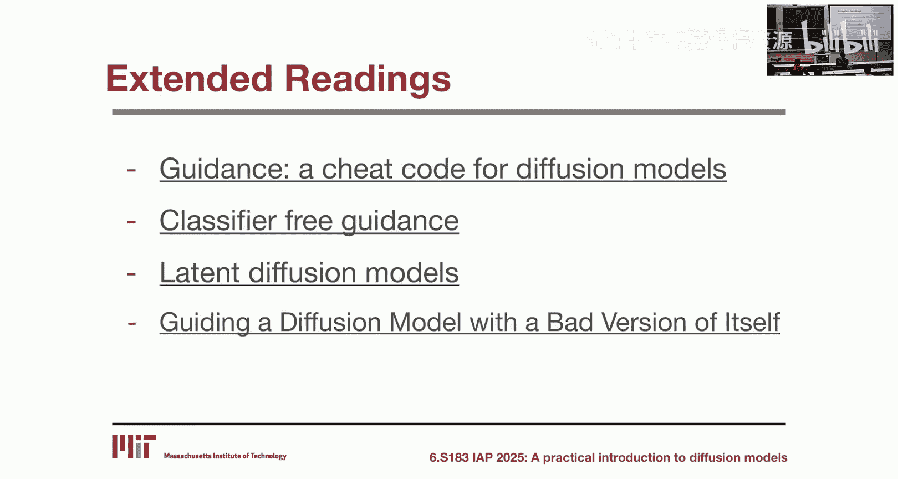

# 《扩散模型实用导论｜6.S183 A Practical Introduction to Diffusion Models, IAP 2025》中英字幕 - P3：Lecture 3.zh_en - GPT中英字幕课程资源 - BV1FzhczeEnb

Okay， it's 1005。 that's begin。 Hier one， We to the third lecture of our diffusion cluster during IAP。

 and today we are going to talk about conditioning and guidance of diffusion models。

So here is outline for today's lecture first we will talk about conditional diffusion and then we will talk about some empirical hacks to achieve conditioning a diffusion model for example nowadays modern diffusion models are always language condition or some other same conditions and we are going to talk about two empirical hacks called classifier guidance and classifier free guidance they are actually very critical to modern diffusion models and all modern diffusion models you see nowadays use these two techniques Finally we are going to cover some modern architectures for conditional diffusion。

So in previous lectures， we are talking about how do we train a generated model that we can sample from PX。

 That is the distribution of your data。 If you are generating images。

 Px is a distribution of all images。 And today we are going to talk about sample from a conditional distribution。

 PX conditional Y， for example， if your conditioning variable Y is a class， for example， cat or dog。

 right previously， you are just you just want to generate images of arbitrary things。

 And today given some conditioning label Y， for example。

 specifically ask your diffusion model to generate dogs， then your model should generate dos。

There is an obvious way to do this。 So just like in a conditional prediction。

 neural networks are able to take extra input y。 So one intuitive attempt is that instead of letting your diffusion neural network taking only X T。

 that is a noisy version of X， you can let it taking both noisy X in your label Y。😊。

So this is the intuitive way theoretically if you train this。

 it's likely that your neural network can just learn something reasonable but it's not good enough。

 In fact， large diffusion models don't even work with oh there's one interest in fact。

 in fact large diffusion models don't even work without conditioning so you may think that okay we look at the source of math about like how to sample from Px with diffusion models but in ready everybody is doing px conditional why that is conditional diffusion if you don't input a language。

 this model don't really work very well why this this is because the unconditional distribution of all images is just too big for the neural network to learn like only when users like impose some language conditioning does this models figure out the distribution reasonably well so in fact it doesn't work without conditioning and we human also want to have some control of the model so it's ideal。

So let's use the easy way to generate some photo of of animals。 I ask you to generate the cute dog。

 and this is a result。 You can see that the result is really weird。

 You can hardly identify any dogs in some of these pictures。

 So the easy way that don't really work very well。

嗯。And here is a takeaway。 You can just add your conditioning variable during your training by cnating that to your neural network input and you can treat it as a kind of treat it as like a regression problem。

 conditional regression like predicting your score conditionals on label Y， it works in some cases。

 especially in low dimensional cases。 for example， like in later lectures。

 we may see things like diffusion policy or those low low dimensional cases。

 but it doesn't work in practice when you actually scale this up like all the modern architectures don't just con your conditioning variable。

 and finally， there is， however， one nice thing about conditional diffusion。 So just like regression。

 if you just con your y into your neural network。You are actually predicting unbiased distribution。

 That is P， X conditional Y， because by definition， like this this is exactly doing that。 Okay。

 is everybody with me about the high level objective Any questions。Okay。

 so then we are about to dive into the second section， which is slightly more mass intensive。

 First of all， how many people here like no bass through。Okay， how many okay， great。 I think。

 I think most of the people know this to sign extent。

 Then we are going to dive into probability for the second section。Okay。

 so we are going to talk about classifier guidance。And basically， today。

 we have four sections and two sections are specifically about guidance。 What is guidance。

 Guidance is a technique that lets your model to condition on something stronger than the easy way。

And it is a technique that is critical in or modern diffusion architectures。Previously。

 we proposed an easy way that we let sorry， previously we talked we already talked about unconditioned diffusion models that where your diffusion neural network only takes your noisy X and try to output a clean version of X。

And in earlier slides we talked about easy way of just coning y into your diffusion model。

So now let's consider a slightly different objective。

 let's say that at training time you are allowed to train a diffusion neural network that can diffuse they can denouise your noisy X so just like before just like all the lecture before so that is a given setting However this time as sampling we want to sample from PX conditional Y without retraining your model so you're actually given an unconditional model。

 but I want you to sample conditional how can we do that。

So here is a trick everybody knows the base rules and let's take a look at the distribution we want to sample from。

 So as I said earlier， our distribution is Px conditional Y。

And this term can bewritten into PY conditional x times by Px over Py Does everybody get this Okay。

 great。And then you just take log on both sides of the equation on the left hand side。

 you have log Px conditional Y on the right hand side， you also expand this term out。

And then you take gradient with respect to X on both sides。What will happen is that you。

 you can see that this is a term we try to， we try to approximate with our。Ne networks。

 this is a desired sampling distribution。 That is a conditional one right And on the other hand。

 we have this this nice term here。 That is a diffusion score that we previously calculate using our unconditioned diffusion model。

 And now our desired term and our given term or both appear in the same equation。

 Then what happens is that we suffice for us to figure out this term in order to approximate the desired term from the given term。

😊，And we can take a look at what is this， What is this。 Why is a label。X is your is your like image。

What does this look like to you？It's a classifier， right。 However。

 this is also not as simple as a classifier。Because in diffusion models， What is your X here。

 What what is your X here， Your X is actually not your clean image X， right， Your X is the score。

 the the score term for diffusion here actually takes in your noisy X。 That is your X T。

 Your gradient and also respect to X T， right。So you ready， this is。Somewhat like a cloudifier。

 but on the other hand， it is also cloudifier on nay input X T instead of a clean X。

 So there is a to keep in mind。O。Now we've noticed that。 And let's see。

 let's just assume that we have such a classifier for your noisy X。 whatever happen。

 So now let's do it for noisy X infusion， so。😊，I want everyone to consider this term。

 This is a joint distribution of X T and Y。 So that is you have try to synthesize you are trying to。

Sampling from the。Joint distribution of X C and Y。 And previously。

 we talked about we can do this decomposition， right。

 And here you can rewrite the joint distribution into the。Into the unconditional fusion score。

 plus your guidance score。Sorry， your classifier school， noisy classifier score。

 and then you can just take gradient and this term is what we learned earlier。

 this term is this is epsilagon is what are your division in neural network outputs and of course like there are some other constant hip terms here and here you just take a gradient with respect to your noisy classifier。

And finally， you put them together and you can modify the score of your diffusion model into this mod term by incorporating Cloudifier as a result。

 this is what it looks like。 So just once if you note here。You know。

 we can do something like this in order to achieve this conditioning， right， However。

 there is this this have some direct empirical interpretations。However。

 what people do is that there is an empirical hack saying that， okay。

 this is a term with periods de1， right， and this is a conditional bias。 Like by adding this。

 I'm biasing this distribution towards a conditional distribution， right。

If you put a constant one here， right， this is directly translate to a very meaningful conditional disagree。

 But there is one empirical hack that people always do。 So is， they put a constant here。

 usually called s or gamma here， that。Upweighs this even further， like instead of having a one。

 basically people say， what if I just put like 1。2 here two here such that it is biasing my distribution like even stronger towards a conditional one。

So that is what empirical hack people do and what in reality， like by putting is there。

 what people are actually doing is that there will be sampling from Px conditional wide like twoson to the square and divided by PX on something。

 but basically the intuition is that by putting a constant here。

 you will be able to condition a stronger with a classifier。

Or and because that constant like sometimes we call that guidance scale or like guidance strengths。

Okay。So in reality， what people do。 So previously， let's say you。

 you can predict the sound distribution for X T -1 using like your， your diffusion currentization。

 that is。You predict the mu for the less noisy X and you also have a variance matrix。

 but with a classifier， what you do is that you just take gradients through the classifier。

 you multiply it by the guidance strengths and you add it to the mean so it's making some modification to x such that add test time。

 you will bias the sampling towards a conditional distribution。

And this is quite useful because you can actually as soon as you can write your。

Your objective into a classifier。 you can do a lot of fancy things。

 So in the case I talked about you condition it on like cats and dogs right but in general。

 like you can generalize this to many other classifiers for example。

 in later lectures maybe the special topics， we may talk about diffusion planning and you will see that like you can write like reinforcement learning like a value function or like success rate into a classifier and if I have a classifier on success or failure then I can use classifier guidance to guide a model to plan a successful trajectory for us。

So this is a generalization of it。 and here is also a visualization of what is actually doing。

 So here is a original distribution PX that we are tried to sample from and you can see that it is a mixture of three Gaussians。

And here I start to add guidances。specated classifier guidance and what will happen is that if I add guidance。

 sample from each cluster and like overlay the three cluster together。

 what will happen is that you witness a picture like this that is we modify the original unconditioned distribution by pushing each cluster of the distribution towards their own own center。

 and then you bias the distribution like this leaving more space in the middle and as you get add more guidance you will realize it will just go further and further。

Okay， here is a takeaway for coifier guidance。You can train a classifier on noisy input X。

 And this is usually undesirable， because why do you want to train a separate classifier。

 And also it is on noisy X， not like really X， right， it is actually really confusing photo model。

 if you as a human， look at a quite noisy image。 you cannot determine what class it is。

 it is very hard。 you cannot determine whether it is a cat or dog。

 So there will be a lot of variance in the training。 It's undesirable。 And also at sampling time。

 once you get this classifier and your additional model。

 you can compose the score of this unconditional model。

 And this gradient of the classifier using the previous formula。 And then after you compose them。

 you can sample it with a compose the score。What does this allow you to to do is that you can now do conditional sampling without training a conditional model。

 I give you an unconditional model。 You only do to train a node classifier。

 and then you get get a conditional model。However， as you see earlier in this picture。😊。

Adding classifier guidance can bias a model towards some distribution that looks like this。

 This differs from the ground truth distribution。 We actually want to prox。

 right Why do people still want to do this， Of course， I want to do conditional sampling。

 but there are many other reasons。 Sometimes you will find that generating images using a picture like this is actually more favorable。

 because I actually don't many people don't care about matching the original distribution of or images。

 The only care about generating high qualityality samples。

 And there are two very different objectives， If I only care about generating high quality samples。

 then I don't want to generate like less likely images， just like the original distribution， right。

 I want to sample different。 So if you apply guidance， you are adding some bias into the model。

 such that it is not sampling from the original distribution here。

That is what I mean by bias the distribution if you use a higher guidance strength。Finally。

 you can see that classifier is really limited so so far we talked about you know it's a classifier and classifier is usually you need to formulate your problem into discrete classes or binary classes and you can see this is quite limited because more than neural networks more than diffusion models you play with like either it' openli。

 So like all those diffusion models what they do is like you don't input a label like dog or cat instead you put a free form language and first of all。

 what people actually do is like you can even input the existing image and then ask your diffusion neural network to modify it。

And all this conditioning inputs， like images or language。 They are not really discrete classes。

Which means that we need something better beyond cause of fire guidance。

Then there comes class free guidance。Classified free guidance ask a slightly different question。So。

Previously， we。In previous lectures， we talked about unconditional generation of X。

 and now we want to generate X better without training a causeifier or naisy X。

 that is we stick to the very original objective of diffusion generating x better。

This is not even conditional yet。And I also want to generalize beyond class conditioning。

 and we want to do that like language。Sorry， maybe I should spend a bit more time on this。

You will see later that cloud of far free guidance。

It's not only extremely useful to do conditional sampling。

 but also you will find that classifier free guidance is important to improve the sampling quality overall。

 just like in this example， you you may feel classifier guidance as a way to generate like from one cluster fare well。

 but when you overlay the cluster for all three classes， we will end up with distribution like this。

 right And for classifier free guidance， it's usually like it's not only that I just want to generate one cluster。

 I actually want all three clusters together by putting all the classes together。

 And and I claim this distribution is better than that as you will see later in the size。

 as everybody with me。Like about the high level objective differences here。Okay。え youか快改。在这在。今のは。快。

That is a good question。 I think it really depends Usually when you're。

 So I first talk about the easy way， right， and， and usually you can for this three cluster model。

 three cluster model， you can just train three easy way models。And if the dimension is low。

 if each individual cluster is a distribution that the easy model is already good at。

 then you are good。What which usually means that whenever your x is low dimensional the easy way usually just works。

However。This is first wasteful because you may have a lot of classes， right secondly。

If each individual cluster correspond to still a high dimension of manifold of data。

 for cat and dogs。Its it's still challenging for the it could still be challenging for the easy way I will have a visualization probably after P Africa as shows you like the effect of guidance and what if you have no guidance and just train individual models but I think usually like there are two reasons first。

 you have efficiency reasons if you have100 classes you don't want to train 100 different models。

 second， even if you break it down， it could still be challenging。Yeah。我对。So that weve got the image。

I白的犯。You part。That might called sort of in the bill。た。说完了，就在庭在。那对ね。get worse。那个。来装。嗯。So， I think。

So first of all， an image with cat and dogs will be also like auto distribution for the classifier right Like if you are a human annotator。

 you cannot really annotate this very well。 So I think first it's strictly other distribution data。

 And I think what will happen is that your neural network may make a guess and a steer is a sampling like towards one of this cluster then eventually give you an image of just one dog or one cat。

 but ensuring that it is high quality like if your model like pursue something in the middle。

 if you don't add guidance you will actually not actually probably not see something that contains a cat and dog。

 you will probably see something that is like a weird animal like that you cannot identify。

 and obviously when we humans see something like that， we see this is a weird animal。

 it is a bad image obviously AI generated。And that's actually one reason why people wantifierifier guidance。

 because it steer you away from something ambiguous and towards something people say， okay。

 I can identify this AI decorated image。Okay， any other questions？We have plenty of time today。

I keep hearing you say could you use the term high quality Does I mean that。

Is high solution or this doesn mean。ああのアファイです。It's like a low FID score。

We are talking about fixed problem， like when I say generating P from PX。

 we are say generating from the distribution of original data and by that we means that the problem is already fixed if your original data is solve by 10 then you want to dissemble from 10 by a southern images so we are not really comparing against like different resolutions。

And we will talk about low temperature sampling later， which explains what is high quality。Okay。

 any other questions。If no， we are going to dive into you class free guidance。Okay。

 it's a slightly different objective。 now we want to get used guidance to even improve unconditional sampling。

 like not just conditional sampling。O。Previously in classifier free guidances， we used this formula。

 then your gradient of your log probability of conditional distribution can be decomposed into this term plus that term。

 so this is a familiar like uncontitional distribution score， this is your classifier gradient。嗯。

This is a reason why we need a Cloudifier， and as I said earlier。

Such a classifier is highly undesirable， and we want to get rid of it。 For many reasons， For example。

 it can only handle these quick classes。 You have to train it on noisy images。

 which is really weird and third like。 People just don't like to take a separate neural network。

And to avoid doing that， let's tackle this difficult term。

 so this is a classifier term here and still we use space rule again and see what we'll get。

 we write it into PX conditional Y that is a conditional distribution and with it to PX and PY。

And we like before we take log and we take gradient。 So after you take log。

 you will notice that here's a term that doesn't involve x at all， right。

 you can just cross it up because there is no gradient with respect to X。

 So what we end up here is that our original term from the we want from the noisy cloudifier is this And you can decompose it into gradient of x log P X conditional Y。

That is a conditional distribution in minus like your unconditional distribution。

So I want everyone to remember that this is a alias for the term that's circled in red， okay。

 because this term is about to appear again in the next slide。O。

Last slide we have this and we can plug it back into the gradient for classifier guidance as shown below。

 this is a formula for classifier guidance。Make sure you recognize that。

And now this is a term that appears here。So。We replace this difficult term by plugging in this formula here。

 And what do we end up with。You'll see that if we combine， combine these two things。

 you will end up with a turn。That looks like this。 So in your previous slide it was actually not previous I already copied。

Okay， this is just。Yeah， so。This isfire， this is Cloudfire guidance。

So classifier guidance says that you can， can you can add a score of uncontentional distribution plus classifier gradient right。

 And now classifier free guidance classifier gradient iswritten here。Oh， sorry， oh yes， yes。

 we were written here。 I made a mistake。 You can replace that。呃。

You use this formula and plug it into the second one。 And what you end up with is that。

You modify the classifier guidance term Px conditional Y。

 it was originally unconditional distribution， it used to be here。

 this term here used to be the classifier gradient。Remind yourself。

This used to be the CAfire guidance for the CAfire gradient。Right。

 and now we say we want to get rid of that using a previous formula from B。

And now we just replace it with Px conditional Y N PX。Is everybody with me？

I saw some confusing faces。But this is really just combining the formula and writing things together。

So what does this say？We start with the motivation of classifier guidance。

There is one difficult term in it， namely the gradient of the classifier。 And using barethrough。

 we will write that difficult term into the terms we already have。

One of them being still the original unconditioned distribution。

 The other is the score for the easy way， right。At the very beginning， we saw this。

 It's just concatenating your why into your neural network。And use that onbi distribution。

 like are people with me。 I just want to make sure everybody actually get get this mass cracked。Okay。

 and just like before。This term replaces the gradient for the classifier right。

 and this is a term that's used to bias the unconditional distribution into the conditional one。

So if we want to add a strength here the guidance strength here。

 we add it to this classifier term and of course now it's decomposed。

 but we still add it here okay so if you want your guidance to be stronger。

 you turn this gamma to be much stronger if you don't want to steer it towards a like certain conditional distribution。

 you don't add this gamma。What is the typical range of。It can be quite wild。

If you just want to do unbied sampling， you set it to one。

 and what you will end up here is the easy way formula。However。

 people typically find that like you can use like three or six， I think people use six quite often。

Actually， six is a crazy value， isn't it？Like it basically says like you're really guiding it really。

 really strongly。Yeah， because you can see that unbiased distribution is just one。

 and like if you use two， I would already say like it's a weird distribution now if you use6。

 it's really， really weird。So， but you're saying。We will train one。Unconditioned model。

 and then that the when the gamma to radiate the lot the X Y is the easy。

Cond that just beencateninated wide。 Good question。 Okay， here what's your name。You guess。

 you make a really point， a really good point。 So if you now， if you look at this formula。

 you need to train2 neural networks works。 One is already the unconditional one， right。

The other one is a conditional one that's trained using the easy way。

And you compose a score of both models。And youre seeing the next direction。

 like why why why do we how， how do we actually do this。

But here we are actually trading two neural networks to approximate the distribution we want to do in causing fire free guidance。

Okay， any other questions？Great。So here is the final form of classify free guys。Now。

 instead of doing x， we are saying more rigorously。 we are using X T。

 That is a noisy version of X and。

You can see that。If our neural network predicts apsilent prediction that is predicting the noise。

 what we'll end up with is that we all the best before， we are going to modify this epsilon term。

So let's say our neural network is trained with conditional label Y。

And this is apsilom that this is a condition on your network that's done the easy way。

And we take its output。Timeson constant， and we takes the output of your unconditional model。

 timeson constant， and we add them together to form the final output of your neural network。

 It's like you combine the output of two diffusion neural networks together to get your final one and sample with the final one to achieve your sampling for classified free guidances。

And here is is a typical term people use specifically for classifier free guidance that is mega and it's like you put omega plus one weight on the conditional model and minus your mega times unconditional model and intuitively after you write this out。

 you will find that well classify free guidances doing is that it is uping the score for the conditional model and while pushing it away from the unconditional model and this is actually exactly like the picture we just saw earlier that is this one so we are pushing the entire distribution more towards towards the conditional model and away from the unconditional model that is the center。

And in images， people use omega value of6 lot， yeah。

And what is the effect of this if you just sample from the。Easy way model。

 What you will end up with is low quality pictures like this。

 Here we are asking the model to generate a panda on like a colorful glass panel。

 And what you all see is that this pandas on the left hand side just look really weird to us。

mAnd as a human， I would definitely prefer like this more saturated images like。

 but with a nice looking kind offace。So this is the effect of that。

 and we'll get a deeper understanding of that very soon。

Another example， I'm trying to generate。A sitting room with a picture of the corgi on the wall。

 And on the left hand side， you will end up with many pictures that looks like this。

 And you will see they are slightly。's very weird， like if you look at this image。

 you can now find the corgi photo and here you just generate a corgi instead a photo of a corgi。

And also as a picture doesn't look as appealing as source on the right。 And on the right。

 it is with classifier free guidance， in fact， with a much stronger scale。

 and you will end up with these nice looking pictures as you want。

 So all modern diffusion models actually use classifier free guidance and it's actually quite important as a trick for it to example good images。

😊。

Now， let's try to understand。Why is it good， So previously I've talked about bias the distribution。

 like quality and like all this abstract terms right。

 And let's understand why does this empirical hack improve the sample quality。

Usually our our distribution， P， X is a directly desirable outcome。

 You want to sample sample from all the images。 you， you use your train model。 For example。

 let's say I just train models like on all the Internet images。

 But then you will immediately realize that。The entire like online image contains a lot of low quality samples。

 And we humans naturally prefer like more professional photography。

 You want to generate something fancy， right？ So actually。

 if you speak to the original Internet image distribution， youll realize that this is actually a。

Not quite preferable distribution。 You want to sample from。 If you sample from it directly。

 you can sample like some random pictures。 The data set is bad。 And however。

 we also know that in among this distribution， there， of course， mostly most of the data is good。

 and most of the good data that could look have some certain traits。

 and what we are essentially doing is that when you sample from the distribution。

 you want to be more conservative about it and do low temperature sample。

And low temperature sampling can be understood better in language model。

 How many of you know approximately like what， what is language model， How does language model work。

ok。So imagine that you。You are language model and are trying to predict the next word。 for example。

 let's say I give you something called I picked up。Blank on the front of the table。

 And if I want to predict a blank。I can write out a distribution over the entire dictionary。

 For example， I picked up the Apple from the table。 I picked up the phone on the table。

 something like that。 And obviously you can assign a number to each of this work。 For example。

 you can assign like 0。6 probability to phone。 You can assign 0。 like1 probability to Apple 0。

1 probability to remote controller。 something like that。

 This is a ground truth distribution you want to you want to sample from。 However。

 what people actually do is like because phone is with 0。6 probability。

 It is a one with largest probability。 I always output phone all the time。

That's sometimes what people do， like when they want to generate really high quality samples is everybody with me。

 It's like there are regions with higher probabilities。

 And instead of stampling them with just like that specific gr probability。

 like I up the probability there and downplay the probability or like less likely terms。

 And then I end up with terms that are actually like very， very likely。

 And it is also the case like in internet images。 Let's see most of the images are good。

 like there are some longtail cases that are bad。 So what I do is like if I can model original distribution really well。

 I justs original distribution， such that the high probability cluster have even higher probability。

 or like I just sample from auto time。And obviously this is very easy in language space because you have a probability distribution that looks like these pictures they say like this is like this。

 you can just skill it to something that looks like this such as the most likely tablet is sampled almost other time。

 it is easy in discrete because you can just for each entry you just scale the logics and take it exponent like something like that。

However， for diffusion it's quite unclear isn't it。

 it's continuous data and you are sampling in weird ways。

 not just like it's not something you can just scale。And in fact。

 what you are doing with all the guidance here is exactly low temperature sampling。

By saying that I want to upweigh the more likely ones and push down the weight or less likely one and as a result。

 like by doing this， you are no longer sampling from the ground choose distribution but you are sampling from the more likely distribution that contains like image set you would like to deem as good images more likely。

Is that clear to everybody， no temperature sampling？Okay， great。 let's take take some。

 take a deeper look inside guidance。Of course， everything comes at a cost。 as I said。

 you have low temperature sampling that generate more visually appealing images。 However。

 this also comes at a cost。 As I said， this is actually a bias the distribution that doesn't represent the true distribution So if you have a groundous distribution that looks like this like with all the tree branches you can see the tree branches data set sorry like each data point is one like thought of the tree branches Its like a 2D coordinate or something things。

 okay and this tree is highly multimodel is like a very difficult distribution like a small neural network。

 So if you just like naively trained your easyway model what you end up with is something that looks like this you will have a lot of outliers here due to like the limit power of neural networks。

 and just like I said like in the lowt sampling example。

 this are the samples that you want to discard。 and of course they having a low probability。

But you still want to completely avoid them right so what you end up with is that you apply your guidance to it and you can see that if you sample from the guided thing。

All your points lies in the tree branch。 as expected。 However。

 you can also see that yeah voice sampling from some tree branches is completely。

 So this what this is what I mean by by bias the distribution。

 You are actually sampling from a biased distribution that doesn't represent the original distribution。

 However， because everything lie in the tree branch as a human as a user， as your user。

 the might prefers this way over this way。So is everybody with me？

Okay。Here is a summary of classifier free guidance。

You want to train an unconditional model and a conditional model together。

And you sample by subtracting the unconditioned gradient from the conditioned gradient。

You assemble the score from both models to get your final score and sample with that combined score。

It is still biased because it doesn't sample from the true distribution。

 but first it don't need a classifier anymore。Second。

 essentially doing low temperature sampling buffer for diffusion。

 which can improve your sampling quality despite the bias。And finally。

 it could trade off between fidelity and diversity。

 you can see that like here I'm actually reducing the diversity of my sample because I'm less likely to sample from like local likelihood good regions。

 but the fidelity， the quality is much better。

Finally， I want to say that if you take a look at our formula here。

You are combining the easy way model with unconditional model。 And here does why need to be a task。

 It doesn't because your easy way model only says that。

I want to take in Y because the information of Y into my neural network。But here。

But can be something in general because we are not really taking gradient through the caulifier。

We're just taking it from the neural network。So if you have a language instruction。

What you do is that you embed your language instruction into a language model and your language model output a vector that is probably like 4096 dimensional and just can it to the neural network。

 feed it to the conditional neural all the time。And you can do classifier free guidance on top of that。

 you achieve conditional language very well。So in class Fire free guidance。

 we generalize beyond classes and we can now do any same conditioning。Okay， is that clear？O。

Let's talk about how we do this empirically as I said earlier。

 your diffusion models in classified free guidance has to be two separate models one conditional and one unconditional but in reality22 neural networks is just like very waste for in fact there should be a lot of parameter sharing between them because the generation power like between these two they are like kind of shared and what people do in reality is I just combine these two models into a single one and here is what people do in stable diffusion if you take a look at this this is a reverse reverse reverse diffusion process。

 what you do is that you start from some gaals here in latent space of course and here you have some conditioning variable。

So all this conditional variable are embedded by some small neural network into into a conditioning vector。

And then this conditioning vector is sometimes contaminated to this to the scian noise to begin your division。

 but sometimes you flip the switch to this way。 Oh sorry Oh sorry。

 I think I talk about the wrong picture。 but basically sometimes you drop out your conditionary variable。

Sometimes you don't。 And， and then feed the feed whatever input you you have like your neural network。

 So it's like your neural network is trained to handle unconditional input and conditional input at the same time。

So typically， usually you have a weight like 0。1， but with 0。1 probability。

 you just completely drop out your your conditioning。With 0。9 probability。

 like you feed with conditioning。 And then your new same neural network is trained for both obs。

 And at test time， of course， you can turn the switch and now you can sample with unconditional score or conditional score。

 and you combine them together。 sorry， I think the picture is for the section4。

 actually not for the empirical like switch is actually slightly different， but basic。

 basic like that。 You use the same neural network to represent both objects。

 Okay is everybody with me。Okay and here is a picture of how people do conditioning in practice。

 this is called Un this is quietly widely used and infuion。

 this is designed called diffion unit you feed your conditioning like into the into into the deno unit at different levels what this architecture does is a specifically designed for images and at the beginning like you have your noiseisy image and then you fit it into into some layers that is。

Cve layers that sample it down and then you do some like spatial attention over a and then you combve it down like something like that。

 and you can carry the earlier features to the later features just like traditional unit deep learning。

There are the ways to feed conditioning。This is diffusion transformers。

 So I think everybody have heard of transformers and。

We know that transformer has been applied on images in terms of VIT。

 what that does is basically dividing your image into different image chunks， like small patches。

 If you have a large image， I just crop into this chunk this chunk。

 this chunk to this chunk like each patch and I feed the patches to a transformer and let a transformer like train be my backbone and in different transformer。

 what special is that if you want to。If you want to condition on something。

 instead of coning your condition into input tokens。

 what people actually do is that you feed your condition into on multi layer perception and the multi layer perception output on parameters that you use to scale and shift the previous the。

Intermediate layers， like in the token branch。Okay， this is architecture。And of course。

 people can do cross attention to but like this， this is what people actually do。

 And there are also alternative like easyRT detectors that are investigating this specific specific paper。

 you can also just conating conditioning into sequence dimension。

 like I said in the easy way just can can it But like what people do in reality is that I always apply some MOP on conditioning and this MP output on like scalingating vector and shift the vector that I add to this。

 So it's like if if if the output of layer norm is called Z。And then like what I do is like。

Gabba is conditional conditioning better It conditional conditioning。

 Then what we end up with here is gamma times z plus beta where gamma and beta functions of condition。

 It just how conditioning is applied， like in architecture。Of course there are also tradeoffs。

 for example， people say that this trick here called adaptive layer normalization。

 like they have problems for fine tuning if you have some conditioning at training time and at test time you want to fine tune it for some different conditioning distribution。

 this is actually more numerical unstable than like this approach。And finally。

 there are also interesting techniques called controlNe and that is saying that let's say I have a protrained diffusion model。

 for example， stable diffusion and now at test time I want to add some control， for example。

 a stable diffusion like this a model tailored for text2 image generation and now at something time。

 I want to make a model that conditional other things， for example。

 I can draw a human skeleton on a blackboard like with like just like draw a stickman and I want to generate a human that align with a specific human pose and and my original protrained model isn't tailored for the application。

 but I want to get a model for the application， what people do is that they can use control net basically let's say you have a protrained neural network。

That is a stable diffusion and each of the neural network block block basically look at this you have x to Y mapping and now in control net for every block that looks like this and make a copy of it。

Here and then I freeze the original parameters here and I keep a trainable copy here and I only fine tune this branch on some small data sets that contains like human skeleton and clean image pairs okay I fine tune this copy here and reads the objective that the output of this small control that copy plus the original output will like fulfill my objective。

So basically， it's like just like Laura fine tuning。

 you're inserting sound like new parameters to to your original per neural network。

 and you only train the added added parameters for your downstream objective。Okay。

 and it has some special tricks called zero convolution that's initialized with zero weights but all the trick are done to maintain to ensure that at test time。

 when you are sampling， when you are like fine your model。

 you don't catastrophically forget what you already learned in the pro model。

It's like you are only adding some small novel skills to your original model instead of asking it to forget everything before and just learn this。

So this is how it's achieved， and I would highly recommend people to really control that because it's quite useful in image diffusion model。

There are some extended readings。

I highly recommend this blog guidance a cheat code for different models if you visit our website and access the sitess you will be able to click into this。

 you can read the original classifier free guidance paper I will also add some other papers like for people who are interested in too。

And that's the end of this lecture and questions will be appreciated and we'll also send out the survey link first。

我。我这我这改紧。And is some arbitraryrbitrarily large number。

Like what happens like what's taking your education all of day because they' right to say that。

As my guidance shape becomes fairly large， I'll be only generating the seeing and into over over over again。

Actually， not really。First， you will realize it generates very。Fad images。So because as you see here。

 like if you look at the picture here， you are pushing it away from the center。

 from the unbiased distribution， and as you can see if you added so much that it's called push the so far away。

It will be bad， it will have no overlap with a onba distribution。And in fact。

 like whether you generate the same image actually。Doesn't really make sense， because your。

Your metaphorifold is extremely high dimensional。And what class free guidance it says is that I push it towards a certain class。

 It can only guarantee that you condition a class stronger， but each class。

 each cluster is still like so many points here， right。

 So there is no guarantee that you will end up with the same image。

 which can only guarantee that you end up like with a class。

 like more and more likely in the extreme。感。