# 《扩散模型实用导论｜6.S183 A Practical Introduction to Diffusion Models, IAP 2025》中英字幕 - P4：Lecture 4.zh_en - GPT中英字幕课程资源 - BV1FzhczeEnb

All right， so by my clock， it's 1005 because it's time to get started before we get started。

The official club you to sync up audio recordings。 Okay， All right， well， thanks。

 everyone for coming out this morning。 My name is Chris Garvallis。

 I'll be delivering today's lecture on generalization in diffusion models。😊。

So just a quick quick recap of oils seen so far， so in lecture one last week。

 Chennyang introduced diffusion models in the following lecture。

 your coinor Cole delivered a few different perspectives on diffusion models including DDPM sampling DDIMs。

 etc， finally last lecture Bouan discussed conditioning and guidance and today we'll be talking about generalization in diffusion models。

So in particular we're going to be addressing a couple of questions so we're first going to be asking well what does it mean for a diffusion model to generalize we're then going to ask ourselves if diffusion models generalize should they generalize the answer is going to be yes they do but it's surprising that they do and in light of that we're going to ask ourselves why they generalize and that's a fairly recent topic of study so I'll be surveying a couple of recent papers in the literature but in my opinion there are no clear-cut answers quite yet to this question。

Alright， so let's get started。 So what does it mean for a diffusion model to generalize。Well。

 informally， we say that a diffusion model generalizes if it generates novel and realistic samples。

 and I think novelty is pretty clear， means that it needs to generate data that wasn't in its training set。

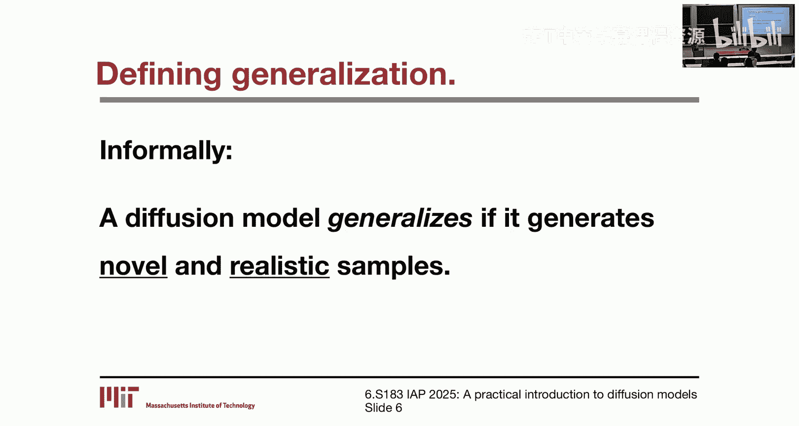

Realism is a little bit more subjective， fundamentally it's a customer always right kind of question we do have metrics like the fishish inception distance。

 FID scores， these sometimes see reported in diffusion models papers。

 but these are pretty imperfect measures I've often seen papers where FID scores don't quite line up with my subjective assessment of the visual quality of the samples you get。

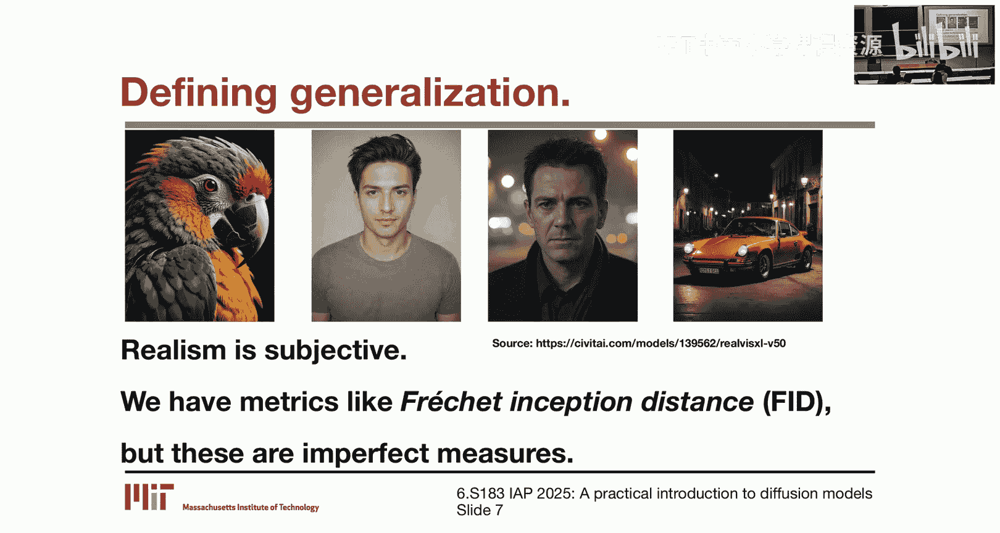

We can also define generalization formally though， so a diffusion model is fundamentally an object that encodes a probability distribution。

 which we're going to call P Theta throughout this lecture。

 Now typically we're interested in sampling from P Theta。

 that's what you're doing when you're generating images， for instance。

But you can also query P Theta to obtain， for instance， the log likelihood of a new sample。

 so this is a scalar number that tells you how likely it is to have observed this sample under the distribution you're modeling。

 I'm not going to go into details into how this is done， but if you're interested。

 it involves applying the so-called continuous change of variables formula to the probability flowdeE。

 which I believe you guys have seen a few lectures ago。

And we say that a diffusion model generalizes formally if its average log likelihood on the true distribution is large relative to the empirical log likelihood on training samples。

 so just to unpack this a little bit。You can think of that expectation as being in Monte Carlo terms as basically being a sum over test samples from the manifold K from which you want to sample。

 so this could be images that warrant seeing in your training set。

 you want the log likelihood of those samples under your model to be large relative to the log likelihood of the training samples。

 which you'd expect to be large under the model because if it's a good model。

 it should assign high likelihood to the training data， it was trained on that data。

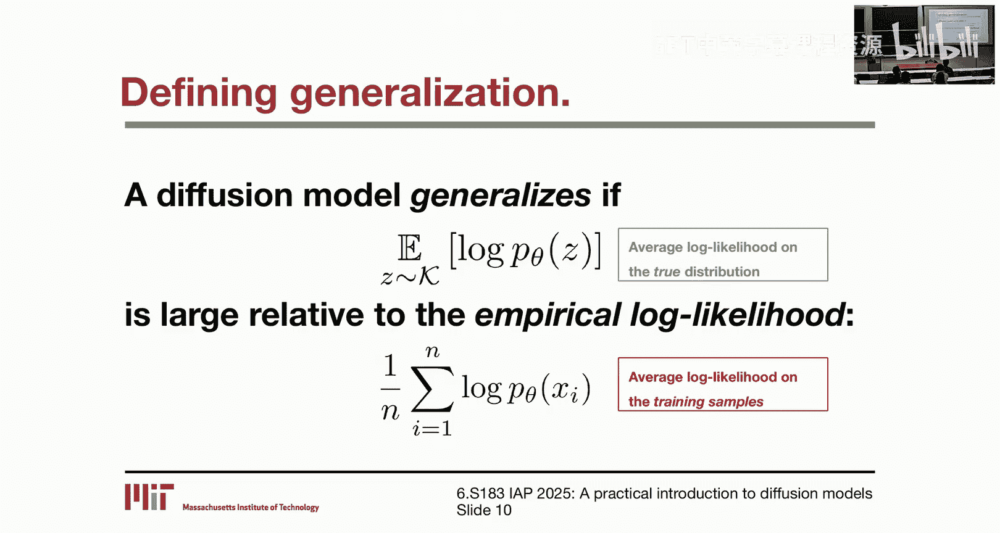

Some pictures to help illustrate things。Oh there you go Okay so on the left panel here。

 we have an instance of what poor generalization might look like like so over here we were thinking of the true distribution as being a uniform distribution on a circle the heat map in the background represents the likelihood of a particular point in space under your model distribution and then the red points or training samples。

 so a model that generalizes poorly is really just going to assign high likelihood to the data's seen and training but if you look at what's going on on the circle in between those red points likelihood isn't very high Now on the other hand。

 on the right panel you see an instance of a model which is generalizing well。

 So this model does assign high likelihood to points throughout the circle not just on the training points。

 And if you imagine sampling from this model you would get samples that are drawn from the circle in between the red points this is the behavior you want to see。

In a good sampler like a diffusion model， yes。入れてます。How。Yeah， that's one way to think about it。

 especially if your data lies on a manifold， which is usually an assumption you make。

 you could think of sampling as basically being interpolating between nearby points on that manifold and we're going to see an instance of that perspective a little bit later in the lecture。

Real good。

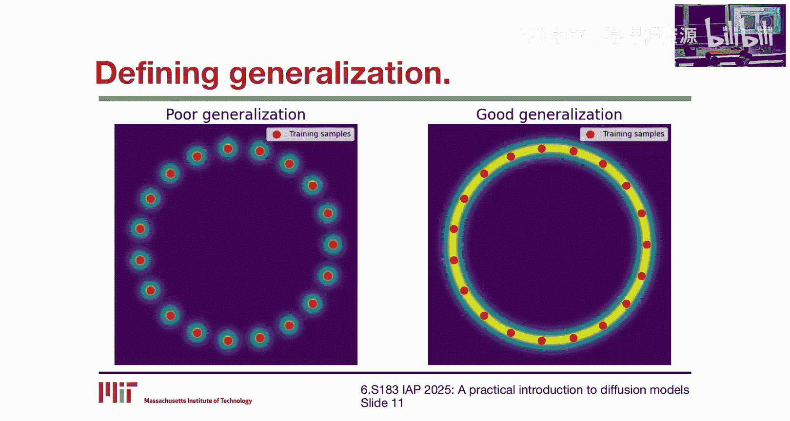

Good okay one quick caveat before proceeding about these two perspectives。

 so there is an old paper from 2015， which points out that these two concepts。

 these two notions of generalization aren't really isomorphic so it's possible have a model that assign poor likelihood to training data or to test data。

 but still produces great samples， and the other hand。

 you can have a model which has really good log likelihood on test data and produces poor samples this has to do in part with weird pathologies of high dimensional space。

 not going to go into too much detail here， but we'll see an example of this pathology in generative modeling a little bit later in the lecture just keep in mind these aren't quite the same thing in practice。

Okay， so now that we define generalization， we're going to ask ourselves， well。

 do diffusion models generalize？So according to our informal definition。

 if a diffusion model generalizes， then it should be able to generate novel and realistic samples。

 so let's address those one by one。Let's start the novelty。

 so there's a paper from a few years ago by Soappali and a few others。

 which finds that at least roughly 1。9% of stable diffusion samples replicate content from its training data now。

I believe the way they describe it in their paper， they're not strictly talking about outputting complete images that are drawn from the training data。

 but we're also talking about replicating concepts from the training data， like for instance。

 if you were to output a picture of a Van Gogh painting that looks the hell of a law like starry night。

 but might differ on a few pixels， that would still be considered replicating data。Now 1。

9% is quite a bit of content replication and in particular it's enough to trigger copyright concerns。

 this is one motivation for caring about generalization so very recently theres a class action lawsuit in California in which stability AI and a few others were the defendants which hinged on the fact that diffusion models like stable diffusion or midjourney for instance。

 are able to store copies of protected expression， so copyright of material in after having been trained on that data。

 I don't think some Apoo's paper was cited here， but there are some other papers in the generalization space which actually were cited in this lawsuit in the plaintiff's arguments so I think a neat instance of theory meeting practice from rubber Hs the Road。

So 2% is enough content replication to trigger copyright concerns。

 Another way of thinking about it though is that about 98% of stable diffusion samples are novel and so while it's certainly possible for diffusion model to memorize its training data or at least some of it。

 I think it's fair to say that typically diffusion models do generate new content。

 I think you guys have played around the diffusion models which you all should have by now on the PSATS。

 then you'll see that given you know a prompt of something that's very unlikely to be in its training data。

 typically the diffusion model is going to be able to give you a sensible output in response。

 So I think it's fair to say yes， diffusion models do generate novel samples。

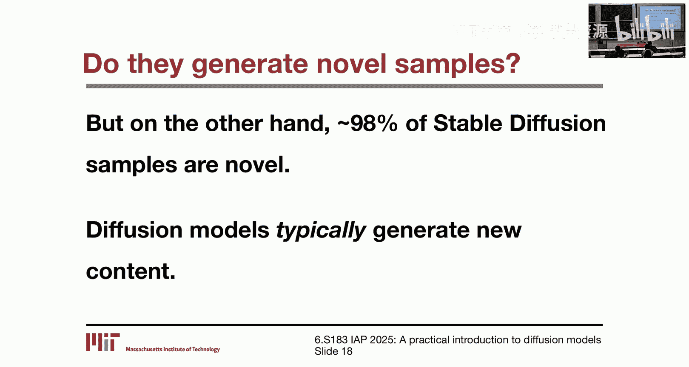

Now in terms of realism， what we said earlier that this is a customers always right criterion。

 and so you guys need to be the judge on this front。

 I've attached some samples from a diffusion model called real Viz XL， to my eye。

 these samples are very realistic looking but again， fundamentally it's objectiveive。

 sometimes you don't necessarily want hyperrealism， you might want more stylized output。

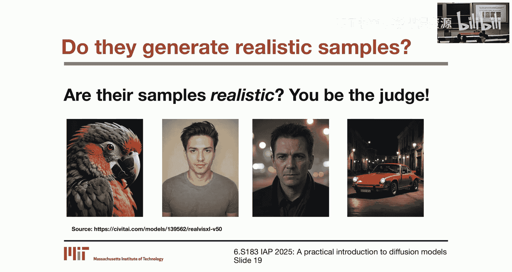

To this end there's a paper from a few years ago which proposes an informal Tring test for AI generatedrated images。

 I think the gist of that one is to be able to see if you can distinguish between actual prize-winning weather photography and AI generatedrated photography the slides are going to be posted online after this lecture so you guys want to click the link it's a fun little thing to try out if you're interested。

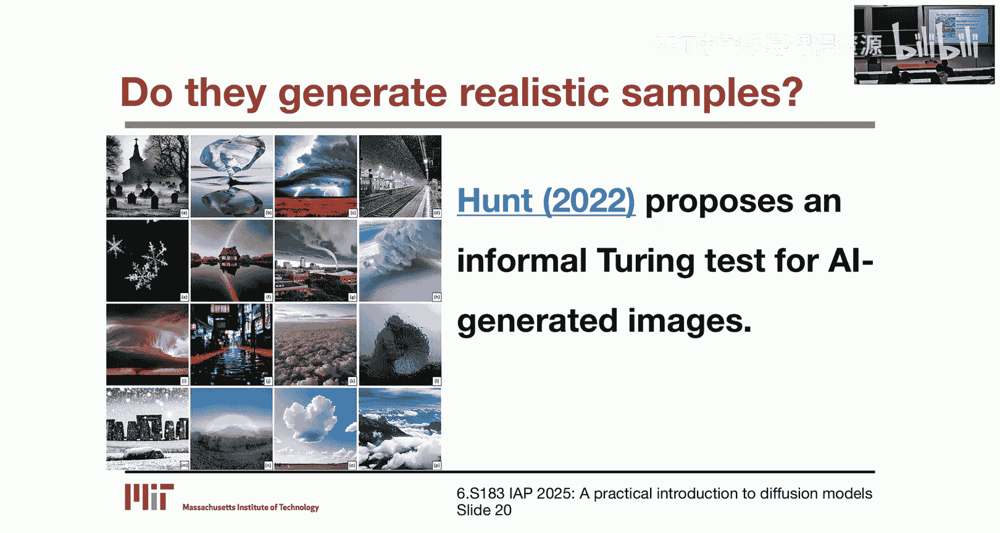

All right， now the formal picture， a little bit murkcurier。

 so in principle you can approximate the average log likelihood of your model on the true distribution by doing a very typical thing in machine learning you hold out a test set in training and then you just take the average of the log likelihood of your model which we saw earlier you can compute in principle over those test samples now one caveat is that computing those estimates is in practice a pretty noisy process so it's unclear how reliable those estimates are。

 but this is something which you can do in principle。嗯。To my knowledge。

 and if you guys know of any instances where they do this formal comparison to the literature。

 please do let me know。 But I wasn't able to find anything that makes this comparison outright。

 There is a recent paper， which does report test。Its back up okay。

 which does report test log likelihoods for the models they train。

 but they don't give empirical log likelihoods for comparison。

 and so the numbers are a little bit decontextualized for our purposes。Now， on the other hand。

 there is a different type of neuralgenerative model called a normalizing flow which you guys might be a little bit familiar with。

 there are papers out there which do study the generalization gap so that difference between the test log likelihood and the training log likelihood of normalizing flows。

And this paper by Melisnick and a few others does find that normalizing flows generalize pretty well。

 so if you look at that generalization cap， it's quite small in practice。

I think personally this is probably indicative of the numbers you would observe if you were to run this experiment on diffusion models。

 that's just a hunch， though I have no numbers to back that up Now another one reason why I pointed this out is that there's an interesting pathology。

 which they highlight in this paper， which is that。😡。

These models can actually give you better log likelihoods in particular I think here the reporting negative log likelihoods。

 so smaller is better in this case， you can get better log likelihoods on outer distributionion data so in other words on samples drawn from a data you didn't train on so over here for instance on the left hand side。

 they would have trained their model on fashion Mnist which is basically a simple data set of black and white pictures of different pieces of clothing。

 they then test on MNist， the famous panin digits data set and find that their model actually signs higher likelihood to that data。

 I think it's a fun pathology， which maybe is something to do with the weird geometry of high-disional space just wanted to point that out I think that's an interesting observation that maybe highlights how you know what you observe in theory in terms of these test log likelihoods doesn't necessarily align super。

Well with the model's behavior in practice， this model train on fashion Eist is not actually going to give you samples from the digits distribution。

Al right。So so far we've done is we've defined generalization。

 and then we've seen that at least according to our informal definition。

 diffusion models do generalize。Now what I want to argue is that you should actually be very surprised that diffusion models generalize。

 this isn't something that should happen according to all the theory that we've seen so far okay and here's the gist of the argument that I want to make so we've seen earlier in this course that diffusion models generate samples using denoiser。

 which is learned from training data。😡，Okay， we also saw in lecture one that for any finite training set。

 which is always we have in practice， you also have to stop training at some point。

 you can directly compute what the ideal denoiser is going to be so you could literally just write down the optimal solution to the training objective。

I've copied a slide from Shennyang's lecture and the details， I don't think matter too much。

 but you can see that the closed form solution to the training problem on the bottom is something you can write down。

 it's something you can evaluate just using samples from your training distribution。

 so this is perfectly computable in practice。In fact。

 one of my papers from two years ago also shows that this is not only computable in theory。

 but it's also easy to approximate so you can make this computation tractable。

So you might ask yourself， well， if you could just compute the true solution to this problem。

 just use it， why would you bother training a neural net， It's very expensive in principle。

 it's giving you a worse solution and the problem of doing this is that if you use this denoiser in a diffusion model。

 you're going to get a diffusion model which is only able to output samples from the training distribution because fundamentally if all your denoiser knows about is the training data。

 well then it thinks the distribution it's learning is just the empirical distribution over that data。

 and so that's what it's going to try to sample from。

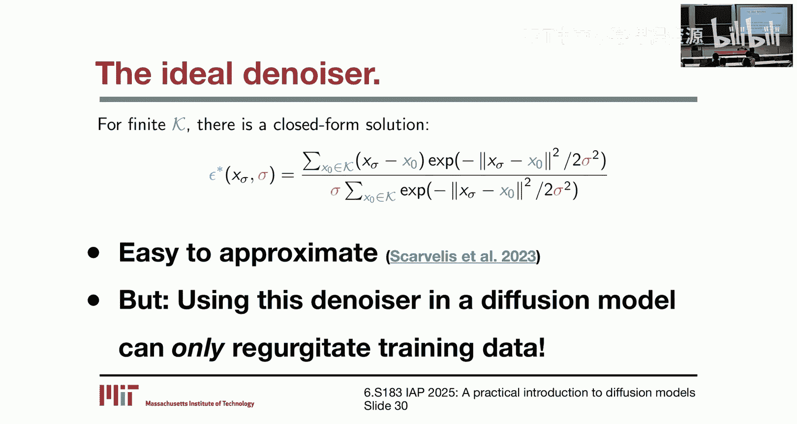

In particular， optimal diffusion models aren't able to generate new samples so if you use the approximation that I mentioned to the optimal denoiser on MNIS then you might get model samples which look like the ones on the left Now my first reaction seeing this way back in the day when I was working on this paper was wow。

 this works amazing you have to train it the model samples looks great but first thing you do though is you compute the nearest neighbors of the samples your model generated in the training set and you'll find that they're almost identical and so this is really just regurgitating data from your training distribution it's not really doing anything useful for you。

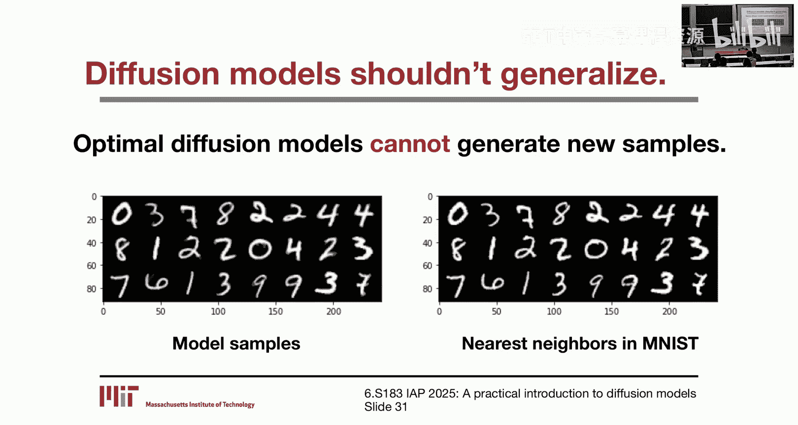

So you might ask at this point， well we know that overfitting is a problem in machine learning。

 it's something that we've been dealing with for a long time。

 how is this fundamentally different from overfitting and supervised ML。

 what makes this more surprising， I'm going to try to argue that in the next couple of slides？

So in supervised learning like classification or in this case regression。

 your typical setup is that you're given end training samples。

 so over here those are black points which are basically samples from the sign curve。

 which is what you're actually trying to learn and given those end training samples。

 you want to find F， which in this case is just the sign function， it's the green line on the slide。

Okay。Now the function that we're looking for， the true function does actually perfectly fit the training samples to go back one slide。

 the green line really does interpolate the training data， it passes right through it。

We can we also want the function we've learned to agree with the true function everywhere else though。

 and that's the hard part of the problem。 we don't know a priority what that function is going to look like everywhere else。

But we can enforce that the function we're learning be close to the true function of the training data by writing down a training objective that looks like this guy on the slide。

 this is just the empirical risk of your model。And the issue is that this problem is highly underdetermined right in principle the function could be anything。

 there's infinitely many possible functions which you're trying to determine with just endpoint。

 however， the true function is one of these solutions to this problem。

 there are just many others and we're kind of trying to find a needle in the haystack。

So over here you have an instance of what different wrong solutions that still interpolate the training data might look like。

 we don't want those high degree polynomial fits， we really just want the sign curve。

 but you can get it in principle by minimizing a training loss。

Now this is not at all like the situation in training a diffusion model。

 so when it comes to the denoing problem， there's just one solution to the problem。

 which you actually know everywhere， the problem is that that one solution to the training loss minimization problem is that it's useless to us if you have a finite training set。

 which you always do in practice。And so generalization and diffusion models can only happen if you fail to solve the training problem。

 there is no solution which actually minimizes this training objective。

 which does something useful for us to me this is a pretty different picture from what generalization an overfitting and supervised ML might look like is everyone okay without argument in broad strokes。

😡，Good stuff。Okay。So so far， we've also shown that it's actually very surprising that diffusion models do anything useful to us in the first place。

 which I think brings up a very natural question， which is， okay， well。

 why do they do something useful， why do they generalize when we don't expect them to fundamentally it's as we saw just a few slides ago。

 it's because they're not learning the ideal dennoiser， which would just regurgitate training data？

But nonetheless， they're still learning a useful denoiser， which does something that we like。Okay。

Why does this happen， I don't think there are any clearcut answers yet。

 this is a new and in my opinion， an exciting problem to work on。

 but I'm going to outline a couple of recent papers that have come out just in the past few years。

 which attempt to attack this question for a couple of different angles So I think the first place to start is this paper by Zara and a few others at NYu。

 this paper was one of the best paper winners that IC when it came out。

 so I think this paper is really worth reading it's fantastic I'm just going to call this generalization in diffusion models because it's a bit of a long title for the purposes of this talk。

And the analysis for why diffusion models generalize looks a little bit like the following。

 So their basic observation is that if if you parameterize the denoiser by neuralNe with re activations。

 this is very common and this analysis still holds approximately even if you're not using re activations。

 you just kind of replace that equal sign with an approximately equal sign in the math more or less works out。

 but if you use re activations， then the denoiser is a piecewise linear function。

 and so in particular at any point why so any noisy input you might feed into your denoiser。

 you can know everything you'll ever need to know about that function。

 just by computing its Jacobbian it's piecewise linear so it's first order tailor approximation is exact。

Now， if you're willing to assume that the Jacobian is symmetric， so it has an eigen decomposition。

 this is actually a stronger assumption than you would think。

 but it's true of the optimal denoiser and they want to argue that this is an okay assumption to make。

Then。You can basically decompose the denoiser's action on a noisy input， F of y。

As taking your noisy input Y and then transforming that into a linear combination of the eigenvectors of the Jacobian。

 So you take a noisy input。 Turn that into a linear combination of some vectors。ok 咁。

Now you might ask me， well， so what， I mean we know that any vector is a linear combination of basis vector。

 we haven't said anything super interesting just yet。

 but the answer to that question is that the training objective tells us something special about what this linear combination is going to look like。

 We know something about the structure of that linear combination。In particular。

 you can do the following and this is something they do in their paper。

 so you can take the denoing objective， that's MSE of F。

 it's the training objective and with a little bit of math。

 you can decompose it in the following way。So you can turn your objective into a sum of two terms。

 Okay， The first term is a data term。 This is saying you want your function to look like the identity on noisy data。

 So it should be able to accurately reconstruct noisy inputs。

This is not actually what you want on its own right you want it to dennoise。

 not to output noisy data， but in principle， if the noise level isn't too large。

 you'd expect that the denoise data should be pretty close to the noisy data。

 the noisy data should tell you something about what the clean inputs should look like so the first term represents。

 and then you also have this regularization term whose strength depends on sigma squareds so the noise level you expect to see in your inputs。

😡，Which is the sum of the eigenvalues of the Jacobian of the denoiser at that point。Now。

 if you're again， willing to assume something about the Jacobian and if you're also willing to assume that it's positive semidefinite。

 which is also， in my opinion， a strong assumption to make， but it's true of the optimal dennoiser。

 So you'd hope that this tells you something useful。

 then those lamb decays are actually all positive。 And so that second term is the L1 norm of the eigenvalues of the Jacobbian we know in machine learning that L1 regularization likes to make things sparse。

 and that's also true if you penalize the L1 norm of the eigenvalues of the Jacobbian。

 that's called the nuclear norm of the matrix。 you guys are interested。

 and it's known that penalizing the nuclear norm of the matrix。

 encourages its eigenvalues or its singularvalues rather to be sparse。

 So it encourages low rank solutions。Also， if you guys are interested in a regularizer that encourages our Jacobbians。

 even when it isn't positive semi definite， then you can check out another paper of ours from just earlier last year called Nuclear normm regularization for deep learning。

 it starts off from this observation， you can't always assume the eigenvalues are Poitive and develops an efficient regularizer that works even in those cases。

But in either case， for our purposes， yeah， we can analyze the training objective as being the sum of a data term。

 which says make the outputs look like the noisy inputs subject to this penalty on the nuclear norm on the eigenvalues of the Jacobian。

Okay， so if we plug this back in to our linear combination representation of what the denoiser is doing。

 this is basically telling us that we want a model that's able to pretty faithfully reconstruct noisy images。

 using just a few of those basis vectors， the EKYs that it's learned right under the sparsity penalty。

 those La decays are going to be mostly zero， for those of you who are familiar with some more classical machine learning approaches you might know this under the form of sparse dictionary learning。

 there are many parallels between this perspective on what the denoyser is doing and on sparse dictionary learning。

 some of the more classical approaches。😡，Okay。Now， one issue here is that sparsity actually isn't enough to get you generalization on its own。

 in particular， the basis vectors， the EKs of y these things are all functions of your noisy input and in principle they could vary arbitrarily with your inputs。

 so this doesn't really rule out memorization like one thing you can do， for instance。

 is your model could learn that at any noisy input the eigenvector corresponding to the biggest eigenvalue。

 So E1 of y should just be the nearest training sample to y you could do this in principle。

 and then you could also have it assign exactly zero eigenvalues to every other eigenvector that's totally compatible with the sparsity penalty that we saw earlier。

 So this is something you could do in principle and this would just memorize all this would do is it would take a noisy input and send to the nearest training sample not what you want to。

啊。But in practice， this doesn't happen。 They have an experiment in their paper where they compute the Jacobbian of their dennoiser and they visualize what its eigenvectors look like。

 you could see a few of the larger ones。 these are ordered in order of the size the eigenvalue from top left to bottom right。

 and you can see that this denoiser， it's not really memorizing training data。

 Its learning eigenvectors that seem to capture salient geometric features of its training data。

 so face images without outright memorizing that data。 So these guys call those basis vectorctors。

 geometry adaptive harmonic bases one small gap here is that it's still not clear what it is about about either a model or our objective that causes it to learn these geometry adaptive harmonic bases。

 this is one way to think about the。bias of neural dennoisers。Okay， so in this story just to recap。

 what a neurald Noer does is that it reconstructs noisy images as a linear combination of just a few basis vector and these basis vector are special because they capture some relevant geometric information without I wouldright memorizing the training data and again。

 I encourage you guys check out this paper， I think it's fantastic。Okay。

 I'm going to highlight one other experiment for this paper that I also think is super cool and very surprising。

 so there's an old literature which started with this paper stabilityability and generalization。

 which is the name suggests connects stability and generalization。A。Intuitively。

 the gist of this literature is that it improves results of the following form。

 So it says that if a model isn't too sensitive to changes in its training set。

 then you know automatically that that model must generalize。

 and this holds up in many different contexts。😡，This is， I think， pretty intuitive。

 it's basically saying that if your model doesn't care about its training data。

 then it can't overfit to that training data if you think of like the extreme case where your training process always outputs the same function no matter what your training data is。

 it's not going to be a great model， but it's certainly going to generalize。

 so you could at least say that。😡。

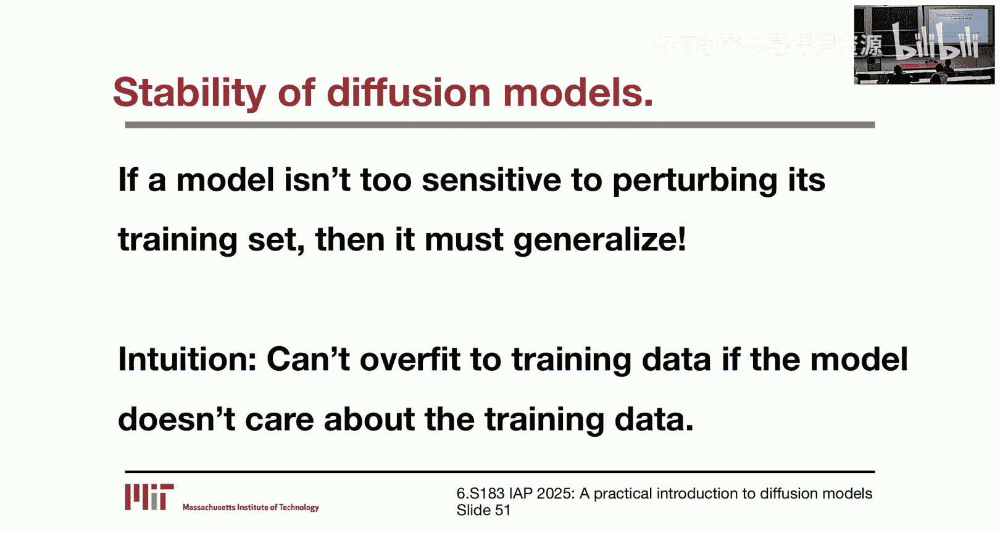

Now， Zara and her colleagues have this really cool experiment where they directly test the stability of diffusion models。

 So here's what they do。 They take， they take a denoiser。😊。

Same architecture in both cases and they split thelet into two disjoint subsets so no overlap at all between these training sets you're training the same architecture on different data entirely and then they just subsample these training sets in progressively increasing increments they then take the same input noise sample。

 they're doing ODE sampling， which you guys might recall from a few lectures ago which is deterministic and they pass that same noise through these two different bottles Now intuitively you would expect。

There we go， intuitively you would expect that if you have two diffusion models trained on entirely different data。

 that they should give you different outputs， which are somehow informed by the differences in that training data。

But this actually doesn't happen in practice， so it does happen if you train your diffusion model on very small data sets。

 so for instance in the first two columns the two data sets the Udennoisers are trained on have one and 1 samples each respectively。

And you can see that the outputs really are very different。

 and you could also see from the closest images from each subset that the denoisers really do memorize the input data in that case。

 where you don't have too much training data。However， as you increase the size of those subsets。

 as you increase the amount of training data， this phenomenon increasingly disappears and you can see on the right- hand side that if you train two denoiseers on disjoint subsets of cele a so celebrity face images with about 100。

000 samples each， then the outputs of your diffusion model for the same noise input actually look almost identical。

 and they're quite different from their nearest samples in the training distribution。

 this tells you something really strong about the stability of a diffusion model。

 it tells you that if you train a diffusion model on enough data， it's actually incredibly stable。

 it really doesn't care at all about well it cares to some extent what the training data is because it is generating faces。

 but it's very insensitive to the particulars of its training data to me this is a really mysterious phenomenon I think this experiment is。

Super cool， super unintuitive， and understanding why diffusion models are so stable is one of the thrusts of my current research right now。

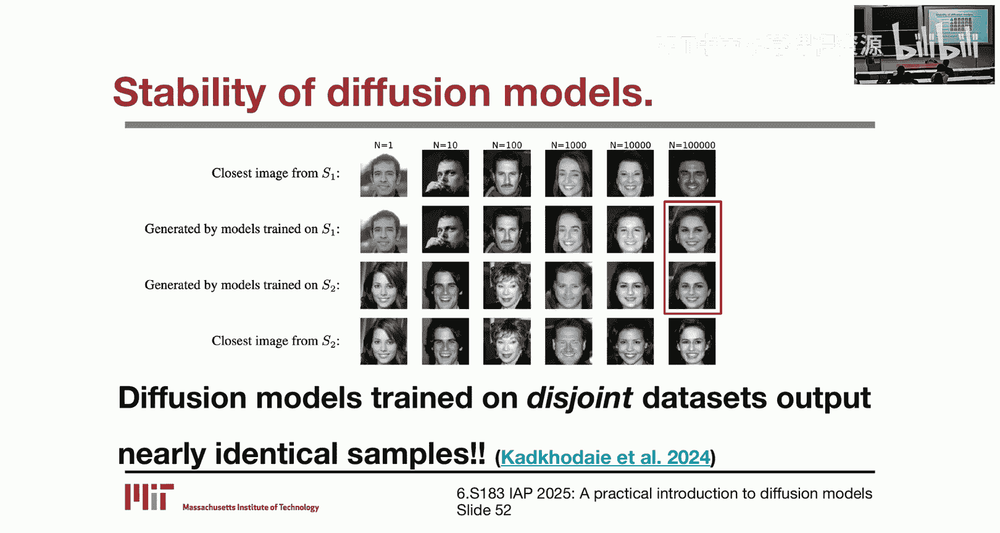

Okay， there are some other inductive biases we can consider。

 so I'm going to plug one of my own papers here， so another inductive bias of neuralNe we know about is smoothness。

 we know that most neural nets tend to learn low frequencies in the target function first。

 they prefer to learn smooth approximations to very high frequency discontinuous functions。

We can exploit this prior directly so one thing we can do in light of that is we can compute the optimal dennoiser。

 you saw earlier we have a formula for it， we can compute it pretty efficiently given access to the training set and given that optimal dennoiser。

 you can postpro it by smoothing it if you do this you get what we call a smooth closedform diffusion model and that's a diffusion model that doesn't require any training at all。

 but which nonetheless generalizes。

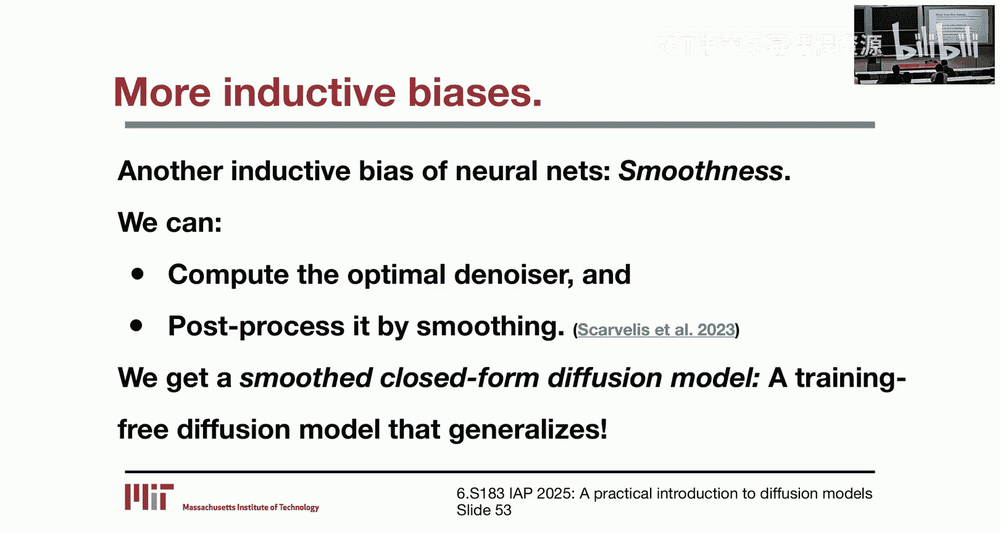

A。Over here， we have two panels which describe what the smoothing process does to the flows of this diffusion model。

 So the ideal diffusion model， the optimal denoiser on the left hand side flows noise towards the nearest training sample。

 So here we have like the simplest possible case。 where your training set is just two points。

 the blue in the red point。 And if your noise sample sits on the left hand side of that panel。

 then its closest sample is the blue one。 And the sampling process just pushes your data towards that blue sample and vice versa for the right hand side。

 It all goes to the red training sample。Now on the other hand， after you smooth this velocity field。

 then instead of flowing directly towards the nearest training samples。

 you can show that the noise instead flows towards barrry centers of nearby training samples。

 this connects to what we discussed earlier where you could think of a diffusion model that generalizes is somehow interpolating between training data。

 this is a reasonable prior， especially in low dimensions， but in higher dimensions。

 this isn't quite the right inductive bias or something like images。

 you think about what happens if you interpolate directly between two images。

 you're basically taking a superposition of those two images。

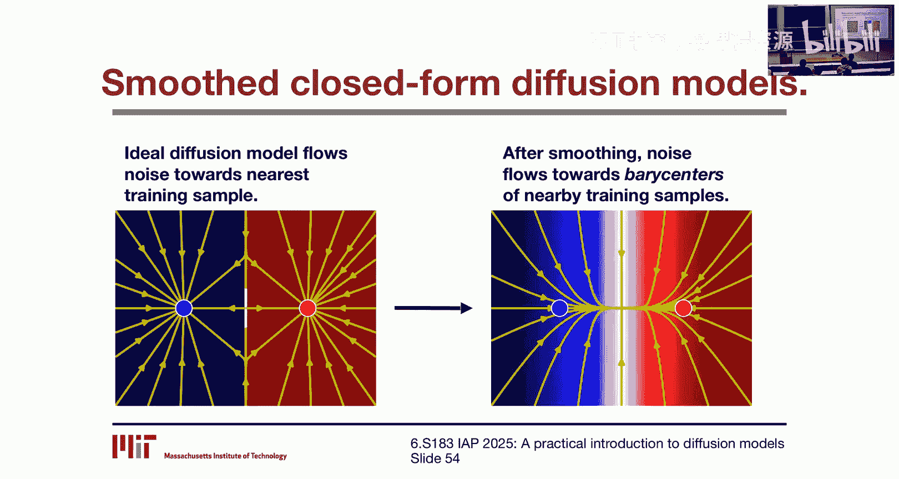

Superpositions of images， except in very special cases where the images are super well aligned。

 those aren't typically going to look like real world images。

 it could if you have an incredible amount of training data。

 but we typically don't have that in practice。But we show in our paper that if you work in the lant space of the right autoencoder。

 if you guys are familiar with autoenrs， you basically map images to lower dimensional representations。

 then so if you do that， if you get the right autoencoder and then apply this smooth。

 closed form model。To the latest space of that autoender。

 you can get a model which generalizes plausible， though not state of the art samples despite requiring no training。

 and these are all novel samples from the training distribution from the celete data set。😡。

And so smoothness is one candidate prior that can tell you something about why diffusion models generalized。

 they're just learning smooth approximations to the optimal dennoiser。Here's how we define the right。

We do yeah， so we use the autoencoder from one of our other papers。

 the one on nuclear norm regularization， I can just run you through the basic details of what the regularization does it's an autoencor where we penalize the nuclear norm of the encoders Jacobbian which says that so what this says that locally the encoder looks like a low rank linear map in other words its image locally looks low dimensional and so you could think of this as forcing the encoder to map the image is the training data onto a low dimensional manifold and latent space somehow that's the right prior you want if you have a sampler which just interpolates in a clever way between nearby points this is more likely to lie on the manifold if it's a low dimensional and low curvature manifold so that's what we end up doing。

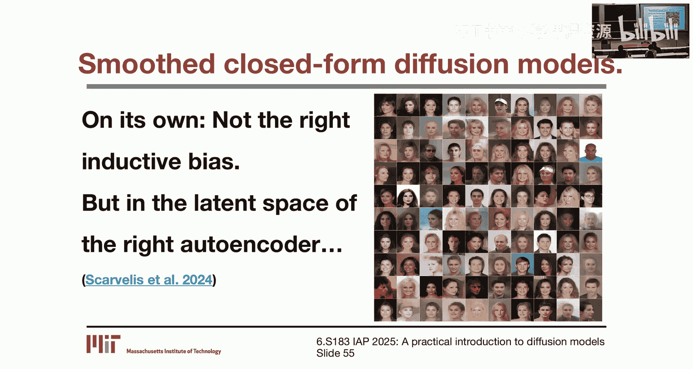

All right。Okay before closing off， I'm just going to highlight a very recent paper that does something similar but from a different angle。

 this paper literally came out just a couple of weeks ago。

 it's called an analytic theory of C in convolutional diffusion models by Masoncam and Syria Gguli this paper is really neat I think so I also encourage you guys to check this out again these are all hyperlinks and so if you guys want to check out the slides after they're posted。

 you can access all these papers if you have some time。

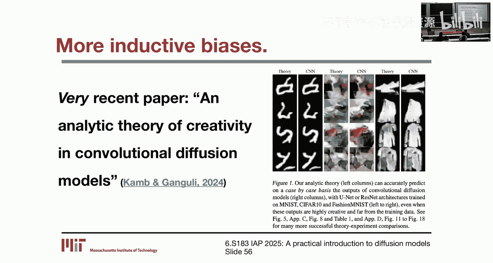

So this paper makes an observation which is that connets。

 convolutional neural nets have two wellknown inductive biases， so the first one is locality。

 which tells you that the output of a CNN at a given pixel on your image。

 depends on its inputs only through a small receptive field of neighboring input pixels。

 it doesn't really cares too much of what's going on far away in the image。

 it also has another inductive bias， which is equivariance。

 so in other words if you translate the input image to a con it should also translate the outputs in the same way。

It turns out that those two inductive biases are not they're both enough to give you something interesting。

 but they're weak enough that you can still obtain， which I think surprising。

 an exact closed form solution to the denoising problem even under those constraints and I'm not going go into the mathematical details but intuitively what the resulting denoiser does。

 and again， this is something you can compute in closed for without any training is it mixes and matches patches from the training set and combines them in a somewhat meaningful clever way to give you new images。

 it's like a mixing and matches of patches and they call this patch mosaic model of creativity。

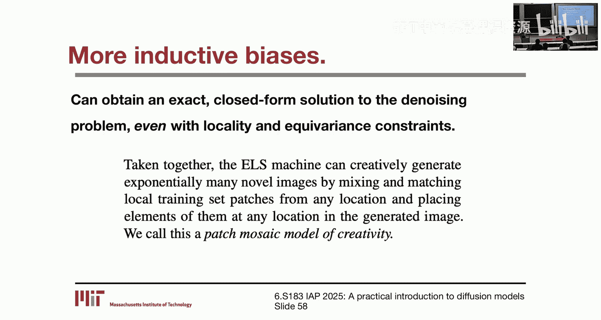

What I think is really neat about this is that not only is this a plausible prior intuitively but you can actually use this this closed form diffusion model under the equivariance locality constraints to predict what the outputs of a neural diffusion model are going to be so in these examples on the lefthand side you always see the output of the diffusion model which their theory predicts according to their optimal solution。

 and on the right hand side you see what a unit， what a neural diffusion model is going to output given the same input data you can see that these are quite similar this is a shockingly good theory of how neural diffusion models generalize the caveat is that their experiments are on relatively small data sets and you can see that for the more complex ones like I think the middle row is seeR even the unit' outputs are in particular。

coherent semantically， and so there is still a little bit of work to be done。

 but I think that this is a really interesting step towards understanding how the inductive biases of neural nets。

Impact generalization。

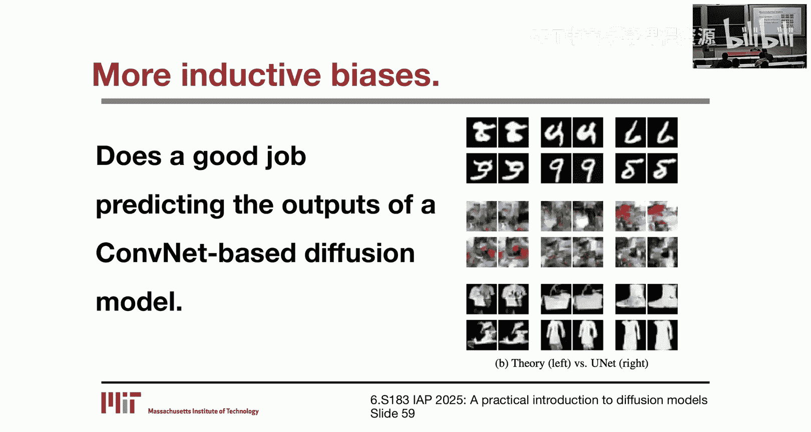

All right， so before closing off， I'm just going to make a quick case for why practitioners should be interested in generalization。

 so there's a few different reasons why I think this is a good problem。

 aside from theoretical interest we saw earlier that generalization in diffusion models has legal implications。

We saw that there have been lawsuits which have hinged on the ability and in fact。

 the likelihood of diffusion models to memorize their training data and just output that to quantifying and better understanding how diffusion models generalize and when they generalize can help either support the plaintiffs or the defendants in these lawsuits and maybe lead us towards diffusion models that won't memorize protected expression。

Now another interesting angle for generalization is， well。

 if we know what makes diffusion models generalize。

 then we can hopefully find a way to make them generalize with less training data。

 we saw earlier in that interesting experiment from Zara's paper that it took quite a bit of training images to get that knee generalization behavior from the diffusion models。

The good thing about images is that we have a lot of training data but that's not always the case。

 so for instance video diffusion models are very data hungry that's a notorious downside of video diffusion models。

 there's also an interest in applying diffusion models to different data types like molecules for instance where collecting that data isn't quite so simple as just trawlling Google images there's unfortunately no Google molecules just yet that you could use。

So that's another interesting angle for generalization in diffusion audism。Finally， diffusion models。

 aside from being fairly data hungryung are also quite expensive to train and sample。

 training time for big diffusion models is often in the weeks and sampling costs are quite expensive。

 even on GPUs， there's tons of papers out there that all try to attack the question of。

 well how do we sample diffusion models more quickly with fewer steps。

It be really neat if you could come up with a training-free diffusion model that can be efficiently sampled ideally on CPU just on your laptop that gets around the constraints of needing for instance。

 the full training distribution， which is a limitation of both my earlier paper and Masons。

 if we can get a better handle on what the inductive biases are that induce generalization。

 we could also hopefully get better realism in the samples that you get by using this approach。

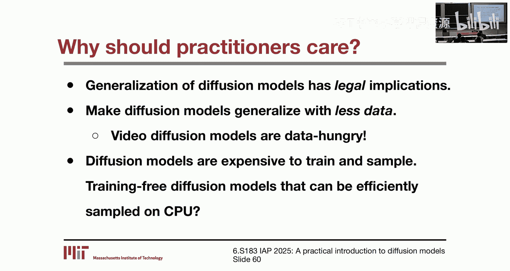

Allright， so that's all for my lecture if you guys are interested in this topics。

 I encourage you all to reach out once again， my name is Chris Carvallis and I got my email up on the screen I think as always we're gonna have a post lecture survey that you guys can fill out for credit and give a little bit of feedback on the lecture otherwise thanks all for attending。

 hope you have a good rest of the day and I think the next lecture is going to be on Wednesday where our team is going be talking about some advanced topics in diffusion models。

