# 《扩散模型实用导论｜6.S183 A Practical Introduction to Diffusion Models, IAP 2025》中英字幕 - P5：Lecture 5.zh_en - GPT中英字幕课程资源 - BV1FzhczeEnb

All right， thank you everyone for coming， really really appreciate your commitment to knowledge during January during the break period。

 so my name is Arttm， I'm currently PhD student here in CSL。

 I work somewhere in between graphics and vision。😊。

So Im really curious like about all the stuff in 3D， how do we perceive the world。

 how do we understand the perspective， how do we。Map it in our brain and how computers can do this。

 So today we are going to talk about score distillation。

 This is like a little branch or like per se application of the human models and I think it's very exciting so I hope you'll think the same way after the lecture。

There is quite a few material slides in here so we might not go through all of them。

 but feel free to ask questions if you get lost or if you like z out， just raise your hand it's fine。

 I think it's okay to skip through some of the material in the end。嗯。So just a little reminder。

 like we had four lectures before this one。 right， so Cheian Yang started by introducing a diffusion model so we know like。

What's it doing roughly whenever it's denoizing the objects。

 it's moving our image towards the data distribution and then assigns depending the time step T to somewhere to one of the data points。

Then coal continued to use samplers and more formal derivation。

 so I hope you remember what is DDPM and what is DDIM， what's the difference right。

 like DDPM is a stochastic sampler of images， DDIM is very similar as we remove the noise term and we sample images deterministically coal continued with the reive perspective。

Then boy and introduce conditioning right so like what if we want to sample images based on our text prompt based on other images or based on like whatever we want to generate and finally Chris was talking about why do they generalize right if you remember there is a big question why do they sample something apart from the images in the training dataset right if you're like analyzed or minimizer of the loss。

 it seems to be not so trivial？And so finally today， well be talking about score installation。

So this lecture is going to be built like this， I'll start with。

Just like introducing a rough hand wavy explanation of how it works。

And then in score disill least in the original paper it's called the infusion。

 there were a few caveats， it was not that clear why it works， the way it works。

 so we will go through three different variations， three different perspectives on how to view it and I hope that the last one。

 this for me also partly because it's my paper， it's the most intuitive one。

And then we'll see how to apply this in different scenarios apart from3 degeneration。

What are we trying to solve really， like what is score disill？Maybe before I go there。

Does anyone have an intuition what it can be， like just looking into the words。

 like score distillation， what can we do with this？Any ideas？

Can you raise your hand if you remember what to score？All right， well that's fine， we'll go over it。

 but basically score in diffusion models rightling statistics by score we usually understand the gradient of the logar if of the distribution probability distribution。

😊，So if you're like。Remember all this scary maths from。

From the homework or from the delevation from lecture2。

 usually when we work with diffusion models we work with the gradient of a logar of the probability distribution in image space right and so typically this gradient of a logarm we call the score。

And score distillation is something like right， so something around taking this score and applying it somewhere else。

And the same if you remember the objective that we used to train the diffusion model is called score matching。

And why score matching is because we take one noise from one diffusion model。

 take another noise from another diffion model， and we try to match them with L2 loss。So anyways。

 this is just like some intuition。From the start。So what are we trying to do。

We know that all these future models， they work amazing on image in of task so we can take some noise。

 we can fine tune some units。And run it through this network， and it will generate as a case。

 What if we want to do the same for 3D， like， What if we try to generate 3D shapes。

So maybe we can take some kind of like concept of 3d noise。

Take adapt our architecture of the neural network to take the 3D noise and generate3 shapes and hope will' generate the 3D cut。

Well， the problem with this approach is that how many images we have in Internet。

So there are like a few data sets that are billion scale， right。

 so like this line 5 v that contains many billions of images。

But how many3D shapes do we have available to us， like the biggest data sets are usually on the scale of like hundred0000 at most。

And so while you're increasing the complexity of the task。

 you want to generate more complicated objects than just images。

You have much less data available to you， so we probably need to consider some other methods than just naly scaling all to three dimensions。

And this is really what Sc distillation is about。

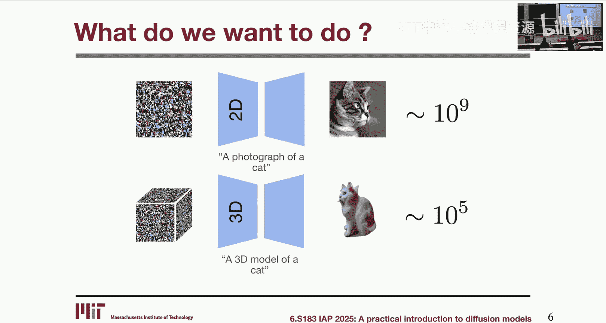

So there was a work duringfusion， but to be fair， there were like multiple works at the same time。

 approximately two years ago that introduced the same idea。Why don't we take。

Pretrain the future model and try to do something with this。So in particular。

 we'll start with some kind of like 3D shape container。

Can you raise your hand if you know what the nerve is？Not like the gun， but。Okay， not menu。

 So N is basically， you can think about it as a differentiable rigid representation。

It doesn't really matter how it works。 There are like multiple that is like Gaussian Stings that is very famous right now。

 but the idea is that。You can take some3D shape。And parliament tries it such that。

Whenever you render a shape， so they you put a camera around this data structure。

And with this camera parameters， you can create an image like a rendering of the 3D shape。

And this rendering what's most important。This rendering will be differentiable all the way back to the data structure。

 so it means that it can but propagate information through the surrendering procedure。

And this is really what we need to look we just have some differentiable 3D data structure。So okay。

 we took this differentialable structure， we initialized it to like a random blob or whatever or like a sphere。

We randomly sample a camera around the sphere， and we get like one projection， right。

 like one view onto this block。What we want to do next is we just add noise to it right so we know that like the h models they just do denoising。

 so let's artificially create a task for our the model， so we'll just add the random noise。

Then we'll take a pretrained to DDffusion model right so this model was trained on just like billion size image data sets。

 and it turns how to de noise images and that's exactly what we do we give it a noise image。

And what it does， it dennos the image。 So returns as a blowlob， but because。

You cannot really like exactly you construct the same blo。

 it's going to be a slightly different blob， right， it's going to be modified。

And so what we are going to do next， we will take this slightly modified blow up from the diffusion model and just back propag it to the Su presentation。

And we'll see what happens。And it happens for some reason that if we keep doing this procedure。

 we'll iteratively generate a single shape。So I can probably skip through a slide before jumping in like this is the results right this is what this original work offers as a result for 3Dgen。

 you can see like for a core if for instance taking a selffish it is like a dog and it 3D shape you can rotate it render from different angles。

 there is like a frog。

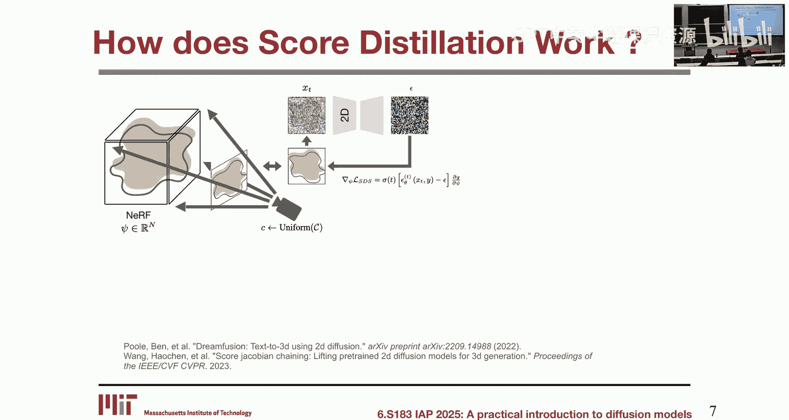

So you can really like gene shapes， and they have meaningful geometry， right。

 So like if I can show you。So this is usually a normal map。

Just like tells you how the actual3 shape looks without the texture and this is the opacity map but basically the idea is that the3 shape is actually meaningful。

 we can take it and pass it into video game or we can take it and pass it like in a video production pipeline。

But maybe we can go a little bit。Back and see like step by step how exactly it works。So。

And scored distillation right， so in the hand wave the explanation we like render random camera add noise。

 de noise and by propagate。嗯。But if you look into the algorithm that the author provides。

There is like an interesting formula， right So what's happening here。 We have P。

These are just like parameters of how data structures it represents a shape。

 and this is what we can change， right， like if you change this C， the 3D shape changes。

Then we have a set of cameras， just like you can sample like multiple orbits around the3D shape。

We have a tax prompt y that what we want to generate for instanceorgi taking the selfie。

This function， like it's a function from RN and C to RN times n。

 this is just a differentiable render， so this function takes parameters of the C shape。It takes。

The camera position。 And it gives you the image， right。

 So this is like how we get an image given our3D structure。

 And the whole point of this C presentation was， G is a defensable function。

 We can but propagate gradient3。And finally， we have Epsilon data。

This is our pretrained diffusion model that can take an image。

 an noisy image and return another image with like the noise that we should remove from it。

And what's important is like PE is fixed， we are not optimizing the weight of the diffusion model。

And then what we do is we just randomly initialize the shape and then keep iterating over this loop。

On each step， we randomly sample T。 so if you remember unlike DDIM or DDPM whenever we re generate images。

We don't really have a chicado O。 We just randomly sample it。

So imagine we item assembled sample somewhere like on a certain noise level。

Then we random sample a camera around the object。Randomly sample noise。

 So we basically randomly sample everything。Add this noise to the rendering so that you can see。

 we take the parameters of the。So you shape， we render them， it gives us an image。

 we rescale it add the sample noise and we get a noisy image， so like we get this thing。And finally。

 there is this formula， which says that the gradient of sum loss function。

 and we don't know yet what this loss function is， is defined as the difference between。Simple noise。

And the predicted noise。 And then risk scale L is like some parameters。So if you do。

 we take these gradients that are defined by this magical formula and we just plug them in as a direction of improvement for this image and but propagate。

😊，again like。In an important detail that we don't have a loss function that we propagate through。

 The initials ggelation formulation gives us the gradients directly that we just like plug in as gradients of the image。

And this is to zoom in， this is the formula， right。

 like super simple to take difference between predicted noise。And theあ noise。

So I'll probably pause here if you like lost or。Tned out or have any questions。

 please don't hesitate。Its kind of like the most important slide to this lecture。Thanks，Yes。

 like the thing that's inside the block。Yeah。Exactly， so we are optimizing for C。

Which is kind of like a latent code for this data structure that in the end represents the3D shape。

So were generating the degree shape。そでの。But really shape as we would have。It can be So like。

 for example， right。Yeah， so these are examples of studio shapes you can generate。I mean。

 it's a different representation。 So usually in video games， people use triangle meshes。

This is representation is's called the nerve， it's like a very metric representation it doesn't matter because you can convert from one to another right so like the main property of this representation is it's differentiable and as soon as you got it。

 you can like extract like the surface you can extract triangle mesh like whatever and plug it in in your favorite destination。

Yeah， any other questions？Justsper。合わせてと。aches because it seems like the law function of that combination art。

usageage。倒して。他是て了。Even mean about Sc installationill versus what。W is just general like。こ些。For。嗯哼。

I'm wondering what's unique about it？啊，那个的科生。Maybe how we choose that different。Yeah。

 it's a good question。 Well， so this is actually quite far from like a typical neural network training。

 right， So while we have gradients here， don't mistake them for neural network training。

 So instead of training the neural network， like we， we have a neural network here， right。

 But it stays unchanged。 So it's per se more like。Test time optimization versus training。

 so like these weights are not changing。What we are changing。

 we are changing is through presentation， so。Instead of。

Training a model that will generate 3D shapes， we are basically like optimizing the3D shape。

 given a fixed to the image image model。Right dimensionality。Not just this， right。

 like the fact is that we are fixing the model， but I think the most magical part here is that if you think about it。

 this model has never seen anything in 3D， it's like it's got no idea what depth is。

 it's honestly seen like flat images。And then all of a sudden is being able to generate things like this。

So like all of a sudden you get like a cor3D where there is a depth， you can like rotate it。

While the model， there was like not a single data point that this view consistent or CD。

So I guess this is like the most exciting part about this is that you take it from one domain。

 which is images。And you can use this image model to generate three。

 which is completely different domain， there are like so many more complicated things you have to consider。

But it still works somehow， right？So score installation is like， you can think about it as。啊。

Basically， and this is why it's distillation， right， I'll give you a little hint。

 It's distillation because you kind like distilling the knowledge from one domain about images to apply it to generate objects in different domain。

 like a different task。Right。I hope that answers the question。Here's the weight。

Try to word learning from the TV in it。自会性。え个大。で。规我们这个区理的。Do we change the X to？しまで。More wait。分。还这。

感違だ。不在分。Can you repeat please？We're learning something about the image from to date。S玻ing that。

But three day we have X YZ axes， each one of them can have a different。In terms of weight。

 so if one ax has to do with shape， one other ax has to do with the line lot of of image。

 do we give them how do we alter？的位置。教教員自 한て。え the wait。嗯。Yeah， well， this is a good question。

 and I think for that you really need to understand a bit more about this rendering function。

Because this is where the magic happens， right， All this right part。

 it's still like we operate in the domain of images。 We like get the gradients。

 we propagate it back to the image。So there is no shared dimension in this right part。

When the magic happens is that whenever we back propagate this gradient， back to a 3D shape。

In that case。We unproject the gradients from the image， back to three dimensions。

And so that you're right to ask about the third dimension， like how they're weighted。

So the two dimensions that you imagine I'm looking into like this clicker， right？

And this is my camera angle， right， So you can see that like I'm generating an image that is just like a flat projection of the clicker onto the plane of my camera。

In that case， these two dimensions， they're going to be like equally weighted。

 So I just like insert the gradients and I change the image from this perspective。But the depths。

 I have no knowledge about the depths。So even if I supervise this like one view。

 like I'm not really changing anything about the depths， it can be like arbitrary。

But the whole magic is because I'm resembling the camera position right so like instead of staying stationary。

 the next iteration is going to be a new kind re， so I will be like somewhere here right and this is kind of like in different perspective and in the object coordinates it's going to be different projection。

😊，So this is what supervisees object。Yes。してて。促进 price。呃，Yeses。

So what is this data that you are optimizing。Yes， so theta are the weight of the diffusion model。

 and theyre not really changed。P are the parameters of the 3D shape。

So you can think about like if you change the P， this blob will morph into something。Kind of， right。

 So like the three dimensions is just like where the 3D object exists， right。

 So like this clicker is the three dimensional， right。

An image of this clicker is two dimensional right， but P is basically like imagine we take p's like some collection of numbers。

 some latent code if we change some of the coordinateiness or the p this clicker will get longer or it will get like change color it will rotate or it will morph into a sphere。

Exactlyly。you should help you that。Yeah， so I think it's a little bit outside of the scope of this lecture I can share additional materials about this it's a very good question and there's like lots of research in this and there are many different approaches there's many like pros and cones this particular one is called in your。

😊，呃。It's called a neural radiance functions。And the idea is a volumemetric。

 differentiable representation， and I can share a paper later about it。

 I'll include it into the email later。So this approach is basically just like using a fusion model to linearly scale just like create a。

G there are no gradients directly flowing from the diffusion model to the nerve。

Something the issue sound。呃。By so just like to trade for listeners， the question is that like。

This approach is linearly scaled to gradients from the fuion model to the 3D shape。

 and there is no direct gradient flow if I need correctly。Sigma G over Sigma G。

 so there's no direct raian directly flowing from the fusion model too。Like the their present。Well。

 yeah， it's flowing but surgeryji， right， so it's being projected surgeryji， but it is flowing。

I'm not sure if' answer yet。Yeah， it the is？Is it possible to also use like other？

Guidance and a classifier or something。到。A model distribution model very important here for this guide。

没异议是吧。把个。Yeah， so the question is that can we instead of a diffusion model because like diffusion model just gives us gradients right and sounds like we can take the gradient from a classifier or some contrastive approach。

 can't we do the same without the diffusion model and I guess I just didn't see many works in this area。

 it might be a very interesting research question。There are definitely gains。

 so to your question about contrastive learning or maybe at title adversarial learnings there against gene shapes。

They are not that successful compared to diffusion based approaches。嗯。

But I think there are a couple properties of diffusion models that hopefully we'll get to today that I think are very important that actually makes it so good。

三本概念。Makes the representation be optimized。Ssem。嗯。这是个。Yeah。

 this is really the idea right it's very simple right you have you just optimize this really presentation with something that moves it towards the prompt can if you have a very good function that moves your images towards the prompt you can replace theffusal model with this function so yeah exactly。

Okay， before you ask any more questions， let's probably move because it's already half past 10。😊。

And it's only 10% of the slides。

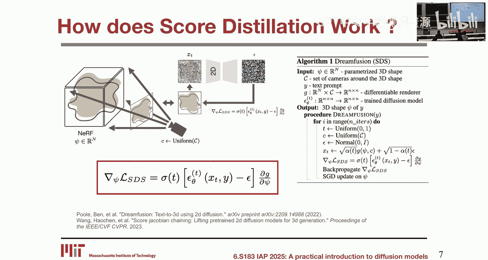

All right， so we can get results with this the results。

 you can probably see that they're like a little bit short compared to what the image diffusion model can do。

 they're like a little bit oversaturated， they're like super colorful， a little bit like cartoonish。

 toyish。And there is like a reason for this。Which is basically because the first work who introduced this。

 we don't really know where this objective function comes from。

 and it turns out that this exact form of this objective function tends to overhaurate and make the three generations a little bit cartuish。

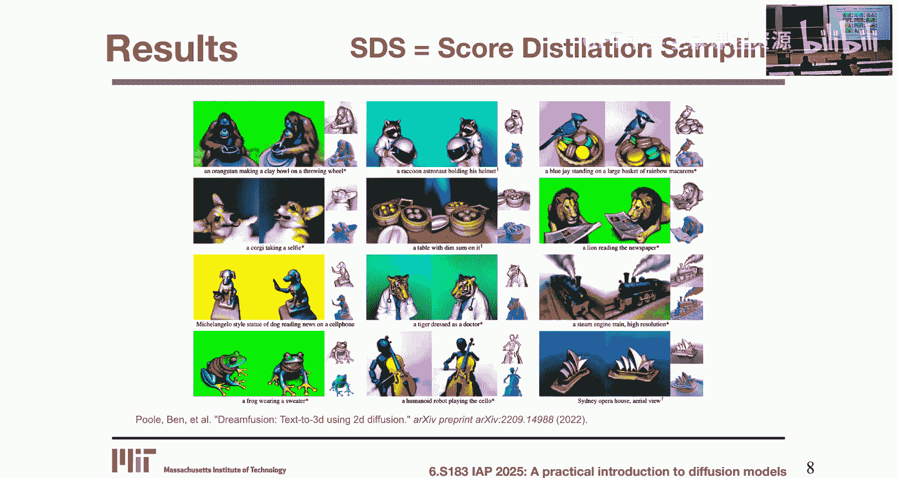

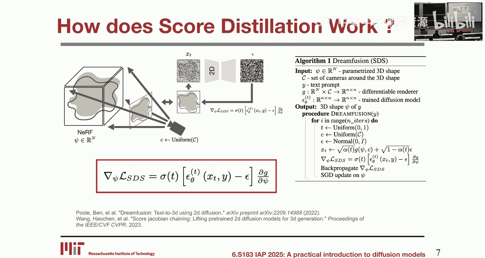

嗯。There is another work， there is actually not another work， there are like so many works。

 so this thing came out two years ago and since then like probably every week there are like five new works that try to fix this。

The proic dreamer is one of the most famous ones， we'll jump to it in a second。

 noisepher called distilllation， but like many， many of them， I also tried to jump on the train。

So a very famous one is called variational score distillation， oh and just like for reference。

 this first algorithm is called like the whole field is called score distillation。

 but the particular algorithm that we went through it' called SDS or score distillation sampling。

So there is like a little confusion about notations just like now that SDS is a particular algorithm。

 square distill kind of like a collection of all these algorithms in the entire field。

So another particular algorithm is called variational score distillulation。

 so you can see it here or VSD。So if this magical formula in score distillation。

 how we get the gradients， it looks like just a difference between predicted and added noise。

The magical formula for variation cord disilllation is a bit more complicated and it's actually even more confusing。

 like if you if you're curious about this field， I would really encourage you to read variations cord disilllation paper because。

😊，it made me think a lot about this whole field and inspired my research， but basically。

The notations are a little bit different， but。Like what's happening here， right。

 like this is just a scaling term。This is our gradient of the rendering function back to the parameters of the Swish shape。

 So both of them， they have。So like here the notations a bit different。

 but basically these are the same two terms and the weighting also like different notations because from different papers。

 but these things are the same So whereas the difference is is in what is actually like between the braces。

In the first case， we just like sample random noise added to the image。

Predict the noise and then take the difference between predict another noise。 Here。

 we do something more， much more complicated。 We take this epsilon， these are just sampled。

The added as the image。We den it with our pretrained and fixed diffusion model， but at the same time。

 we also have a second copy of this pretrained and fixed fuion model。

That is fine tuned at every step of our update and is fine tuned to dennoise our current reche。

So this second copy of the deusral model that is actually a fine tune。

Also gives us a prediction of the noise。 And then the difference between these two is。

Taking as a gradient。It's kind of like super confusing and the derivation of this also made me like I was extremely confused。

 but why the hell would be fine tune it？

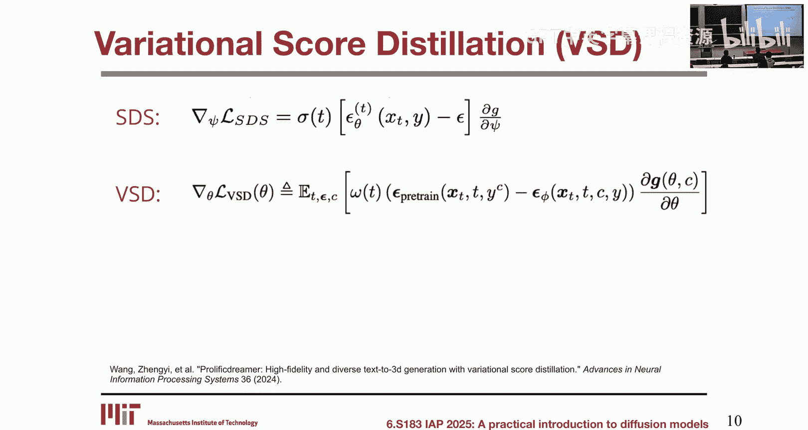

Why would it work？And the results are actually very impressive。

 so you can see how we jumped from this like cartoonish a little bit of a saturated3D shapes to something like this。

 it can actually go to the website of this paper and you'll see them like you can rotate them in 3D and see how detailed they are。

 but there is like an insane amount of details like the geometry or the 3D shape is very good all the shadows are very good like it just looks amazing。

 so much better， but the question is like why like its completely not clear why this would work。

So I'm afraid we really like being too slow， so you'll have to probably skip through one of the generations。

 but let's try to go through one of them at least。

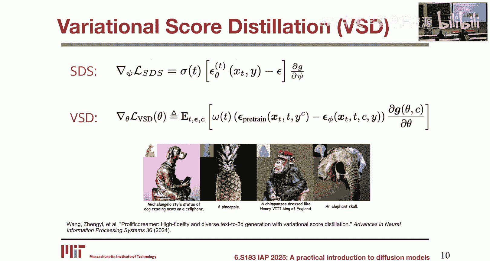

So how did we obtain this magical formula in the first place？嗯。

So can you raise your hand if you remember the loss function we used to train the diffus models？

Approximately。Okay。Alright， well， then， let's remember。呃。On the first lecture。

 Cheng Y Young prepared these beautiful slides with different colors that I just stole from him。

That basically explained the training procedure。 So the audiou noiseer neural network， Epsilon data。

It's a function from some。Fun from what R N， I guess， is an image。And。Our plus is a time step。

It mapps us to another image， right。And so the way how we train it， we just。

Our loss function is an expectation。Which in practice means we just randomly sample these three parameters。

And these three parameters are initial training data sample from the dataset。Sigma。

 which is just a no， like it's a scaling parameter according to our noing schedule。

And epsilon is just like an instant of random noise。So we sample all these three things。

We add them together to get a noisy image。We feed it into our neural network。

And our training loss is just basically L2 laws between whatever we predicted and whatever we added。

 so very simple loss。And so this thing， this function。It's called score mushing。

Because like if you remember at the beginning， I mentioned that。Indiussion is all about scores。

 which is the gradient of the logar of the probability function on the image space。

 and it turns out that the score is also the noise。So the noisesterorem is a score。

And so we kind of like matchsh this course together with L loss， and that's how we doing objective。

Okay， so why don't we try to derive this weirdered formula if you remember a weirdered formula from the score installationill was also。

Something similar， like the difference between predicted and added noise。

 So maybe there is a connection between the two。And Bin could try to derive this gradient through this objective function。

So we start with the same， right？We sample noise level， sample the noise itself。

Like there is some scaling factor， there is。Predicted noise that comes out of our neural network。

 and there is added noise。 Co， So this is how I was score matching that I just re wrote in notations that I like more。

😊，We started this， we take a gradient right so we calculate the gradient of the expectation。

 expectation is linear so gradient goes inside， this is a linear function so WT goes outside。

 this is L2 loss so we get two somewhere that we it's just a constants or whatever。

We get the difference between the two。Then the gradient of the。

Diffusion model with to the input image。And then the gradient end of the input image respect to the parameters that parameterize this image。

Right。Basically， if you remember your car just。Very simple calculations here。All right。

 so we got this。😊，But then there is a caveat。 so in the original paper。

 authors claim that apparently it's much better to just do this。😊，So what does this turn， right？

This term， again， is a gradient of the output。Of the neural network of the diffusion model。

 which is a noise image with respect to the input image。And so strictly speaking is a ja bin。

 so it's like a giant matrix of like n squared by n squared parameters where like each pixel is of the output image differentiated with respect to each pixel of the input image。

 so it's like a giant object， It's very heavy to keep it in the memory。And the authors just like say。

 all right， let's drop it。So the Jacobin is basically determining how fast or how sharp is your function of the dennoing in a particular noise sample。

And what we do is we just say its identity， meaning that like it does nothing。 So we just say。

 why don't we assume that like our diffusion model does nothing。

And then we end up with this update rule， and so this update rule is exactly what is used in score disill。

But it's kind of like a very wild assumption， right。

 like why do we assume that the giant trained neural network that generates images has like some logic in it？

Has a jaar unified identity， which means that like it's basically does nothing。

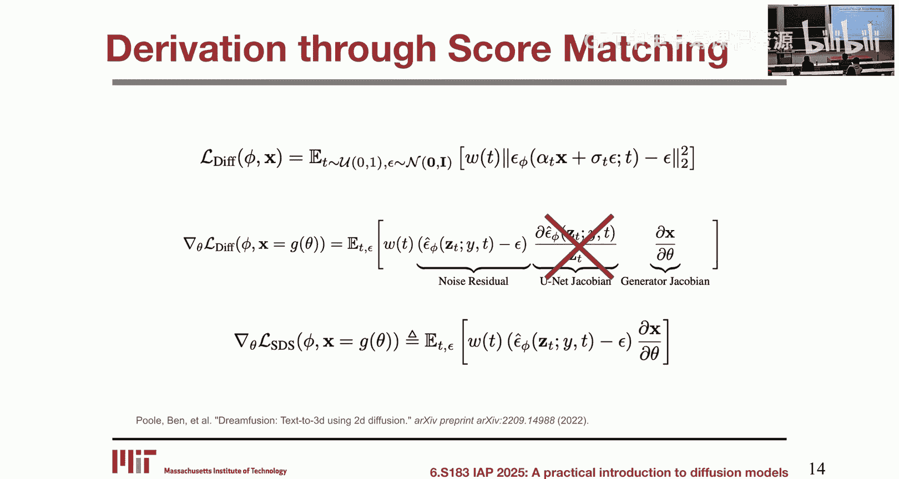

And moreover， you feel like try with drag。It kind of like doesn't really work。

His that was a drug then。So like whenever we dropped it， it starts working。

 So it's like a big mystery why。

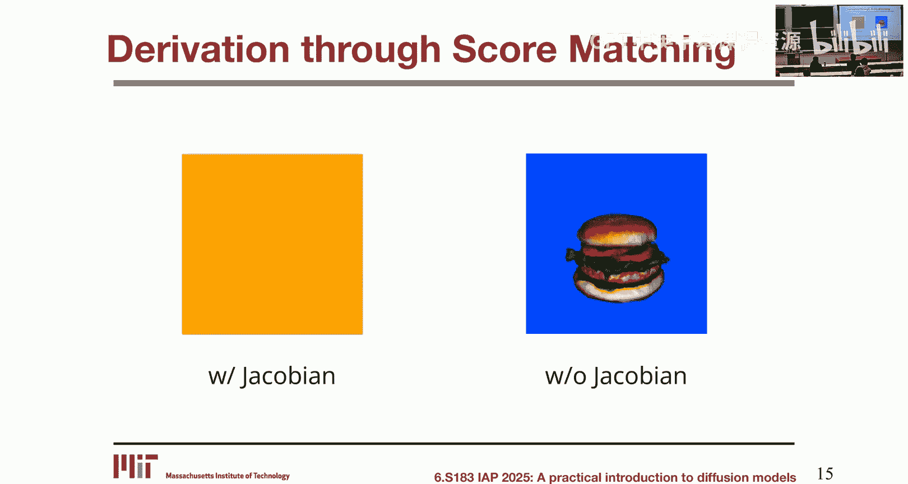

So maybe that's not the correct way of deriving this。Then there is another perspective。

 So what if you start with cool book laness divergence？Has anyone heard about the KL divergence loss。

You here。 Okay， a couple people。 Yeah， so basically just this is a loss function that's defined on two distributions and we can match the two distributions with each other。

So I'll probably skip through some of the slides， but basically the idea is that let's try to see what can we try to optimize here？

This is a loss function that they propose。It has two distributions， right。

 so the chaos is defined on two distributions Q。And this is distribution of the images from our。

3D shape right So if I take my phone like there's so many cameras I can sample around。

 it determines the distribution of the projections of this phone somewhere。 So this is our queue。

Then all ZT is our noise latent code for the image， so like after we took the projection。

 we can noise it and calculate the probability of this noise projection given that our denoest projection comes from the one of the projections of the CD shape。

So this is the left distribution， right like how likely is the noisey sample if we assume it was sampled from the projections on the3 shapes？

And the second term is that oh， I kind of like note that the diffusion model kind of learned some distribution。

 it was trained to learn distribution and images， so even though we don't have direct access to the distribution but it contains knowledge about how likely each image is and how unlikely it is and so this distribution that the diffusion model learned its P fee I know we keep changing this parameters name。

 but just just the weight of the diffusion model and the distribution is conditioned on our text prompt right so in this case it would be smartphone in the classroom and the diffusion model learns distribution of all possible images of smartphones in the classrooms。

So this is kind of like what we try to optimize， let's start with this loss。

And then there's like some math and then more math and more math and more mathths and whatever。

Basically， the story is the same， like after we do all this。

 we kind of have to drop one of the terms。And one of the terms happens to be a partial derivative of one of the distributions with respect to the image and if you don't drop it it doesn't work well。

 if you drop it it works well and so the question again is like why what the hell is going on？So。

Here is like there is some intuition behind that， I'm not sure we have much time。

 but I'm happy to talk more about this， but basically we are ending up in this interesting situation where okay。

 we have the score distillation update rule。If we don't drop this last term in the kial derivation。

Then this。Function that we will get for the gradients。

 for the fair gradients that should go to the 3D shape， iss going to look like this。

 it's going to be like expectation of just the dennoizing。

 which like the noise predicted from the model times the gradient of the differentensiable under。

So like。This is just the formula that we get in a fair way。

 but if we actually try to generate something with this， the results are like very so slow。

 they're like super noisy， they get lots of artifacts。

 so if we actually drop this term in the k derivation，Then we get minus epson。

 so we kind of like instead of just back propagating the predicted noise as a gradient。

 we propagate the difference between predicted and knot noise， and then results they get much better。

 they are like less noisy， there is less artifacts， the shape actually looks better。

 everything's cold。But if we do something even more weird， right。

 like variations called distillation did， if we take a copy of this diffusion model and like train it on。

Find unit to denize this particular object。And it's going to be like much more complicated object right now we are taking difference between pretrained model and the fine tuned model noise predictions。

 in that case， the shape， like the results are much much better like。Basically yeah。あった先か。九二十。打。

You find。Iく。Yeah。好的。Yeah， so unfortunately， it's also a little bit beyond the scopeal lecture。

 but the way how they implemented the practice， they use Laes， how many of you have heard about Laes？

This is called low run decomposition so basically the idea is that if you have a giant neural network and you want to fine tune but you don't want it to forget stuff。

 you don't want to spend too many resources fine tuning it。

 there are approaches that just allow you to fine tune like only some parameters in there sorry that it doesn't forget that's what they use it's like a little bit less expensive it still is much slower to do this right because there's like a whole fine tuning step。

But there's also much better oh and also like in terms of how long it all takes。

 it's already taking like one hour to generate this previous shapes。

 right with Laura and like this fine tuning it takes like two hours。

So it's not like instantaneous generation where you immediately get a through of shape。

 you input the prompt and if I get about it for a while， then you come back and you have the shape。

 So it's kind of like doesn doesn't matter that much。

 We are not like competing for real time generation。

So that's basically like an interesting question why what's happening with this term。

 like why is it behmaving the way it is？And I kind of have an answer。

 but I don't have time to go through it。Oh my god。So there is a thing in statistics。

 I actually recently learned about it in not from a statistics class for some reason。

It's called control variances， and it's a very interesting approach for mean estimators。

Maybe I can quickly say what it is， because I think it's a very interesting approach。

 So imagine you have some parameter mu。 So like you're sampling from some distribution。

First distribution M and you just like want to estimate what's the average of the distribution。

 what's the mean distribution， But the problem is that M is kind of super noisier and you don't have that many samples。

So how do you estimate mu in the best possible way？So then you can use this control barriers。

 Imagine that you have a second。Distribution like second statistic。T is the mean in Tower。

So if's the second statistic。😊，Somehow correlates with your first statistics。

You can use this information of correlation to dennoise your mean estimator。So in particular。

If you know the mean of this， the original mean of this T samples。You know that， like， if you。

Take the like one of the samples M and are constant of a sample T minus its mean distribution。

 You know that on average it's not going to change the distribution of the mean of M， right。

 like mu is not going to change because this is on average is going to be 0。

But the thing is that because。If T corresponds with M。You can choose C with this magical formula。

 which is like something variance， covariance， whatever。 The whole idea is that C， basically。

Dechores M。 so if you can imagine that like M is just crazy statistics it jumps across the entire spectrum of its values。

Using this correlation between the two， you can kind of like reduce the variance。

 You can make it jumpless。 in that case， you don't really change the it unbiased estimator of mu。

But it also has much lower variance。 I mean it depends on the correlation。

And so probably the answer for like this second term is exactly this， right。

 We are trying to estimate， this is exactly what we're trying to do。

 right like we are trying to estimate the average of some statistic， which is noisier because。

It's a complicated function， and then we subtract different statistics with a coefficient one。

So one of the ways to view onto this like what's happening in this entire field is that we just try to reduce the variance of the gradients。

like the original gradients that we get from the fair derivation are supernoisia and with all these approaches we just try to declate it。

 dennoous and reduce the variance so that we have a better approximation of the gradients。Right。

 I really want to go to。The second part of this。呃。So there is another perspective。

 and I think I found it quite intuitive， so let's look into that how can we get this field force quarter distillation through this field。

呃。So oops。So remember how like the are two parts， right。

 Like this left part is just entirely about3D presentation， how we take a 3D shape， how we render。嗯。

And truly is' like kind of detached from the right part， the right part， as you correctly mentioned。

 is basically just a guidance， it's just something that gives us gradients on the image to make it aligned with prompt。

So we can like swap these parts， so if we hear the suggestion to swap the right part with something。

 let's see what happens if we swap the left part in theory we can just swap it with some kind of image representation right we have like latent code P we have some decoder that just represents an image basically right or it can be like pixels of the image directly。

So in that case， this whole approach of cortillation with this magical function will be。Basically。

 just image generation， right。Because we have to myparander of an image。

And so in that case we can compare quality to how does， for instance。

 DDIM or like all these methods be to lecture2， how do they compare to score distillation when we actually optimize the image and the answer is that it's not really in the favor of score distillation so you can see here that this is DDIM。

This is like a hamburger we get from there。 this is a hamburger we get from this metric formulas。

So something is like really off here。And there's definitely a capacity to improve all this。Well。

What we'll try to do is。Basically， replace this right part of the guidance。

With something similar to DDIM。 So like we now the DDM is capable of generating good samples。

 So why don't we use DDIM as a guidance instead of the serial formula。So let's see how we can do it。

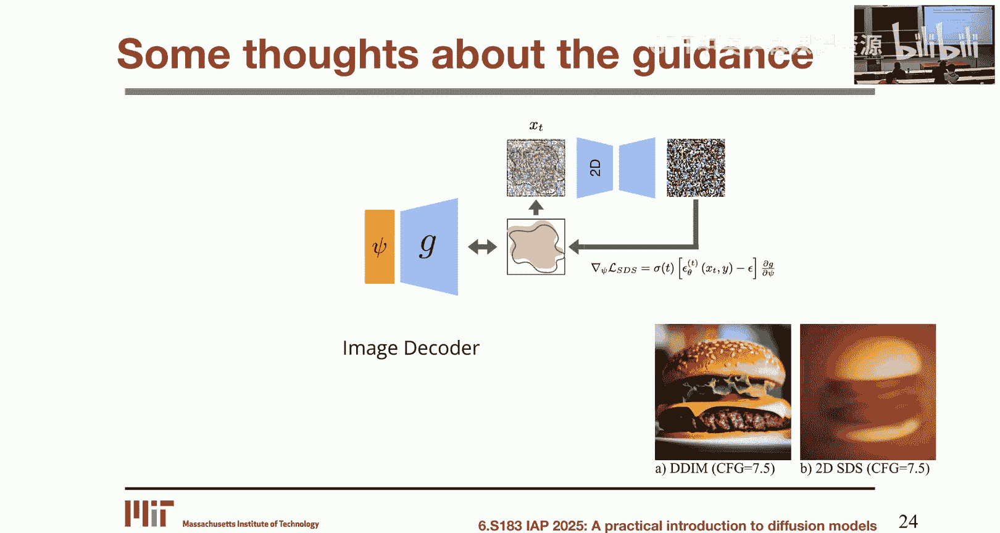

Just a reminder of what DDM is from believe second lecture by call DDM is just basically deterministic way of sampling images。

 we have the DPM which is stochastic DM which is deterministic and the idea is that after we train the deffudal model we just sample noise and gradually remove this noise from the image。

But a very important part here is that we operate through Xn。

Which is like on each step of taking the noise back。

 were kind of like we can take all of the noise and generate a single noise like a single step the noise image。

So let's look at it。Imagine this axis is our data dimension。

 so assume our image are just like one dimensional， meaning they have only one pixel is one color。嗯。

This axis is going to be the T individual modeling， right， So this is like how much noise we add。

And if you're like all the way at one， this is like completely noisy image。

 it is like just Gaussian noise， and this is going to be like completely deno images。

 So like our training data lies somewhere。Some are here。All right， so if you have this。

How does DGIM look like？At first we sample a completely noisy image right。

 so it's going to belong somewhere like at the bottom。Like on one of the coordinates of this。Aes。

 all right， we sample this noise。Then we take our pre model and。Predict the noise to remove。

 And it gives us some direction。In the space。 and we basically remove a little bit of this noise。

 right， like we。呃。This is like one of these take on D DM。 We just moved a little bit。

Up select to a less noisy image， right， And we get something like this。 So you can already see。

There's like some signal appearing through the noise， and we call it like x bar of T2。Cool。

 and then we do the next step， where probably where you can guess what the image is。And finally。

 the last step is completely removes all the noise， generates the high frequency details。

 and we get the cancer。Nice， at the same time， whenever we did the first step of DDAM。

What we could have done instead of removing just a little portion of the noise。

 we could have removed it all the way。And so the way how it would work then we would get something right like single step denoizing so we would get like completely densized image。

 we would guess something like this。And so this is the reason why we don't use diffusion models in a single step。

 right， like they just don't for it。And hopefully from the lecture yesterday。

 you probably got some intuition why is the case， right？嗯。All right， so this is what we can do。

 but you can probably still want to keep generating this image， right， still want to improve the cat。

 So what we'll do from this image。We can return the noise back。 So we say， look， okay。

 we didn't generate enough。 So let's return some noise back。

 And let's call this noise that we add back to the image copper。It's also a function of the prompt。

 and it's a function of the T3。 So we just like remove the noise back and we end up in the same point as DDM。

And then we just keep doing this。 This is the second step。 It's a little bit disturbing， sometimes。

But the fact is that we just keep improving the image， right？呃。

And it's basically the same process as DDM right， So DDM。

 you like just existing in the space of noise images。But what's interesting is that。

Now we just define the new process， right， so we can think about this like intermediate variables。

 X T3。It's still the part of the same process， right。

 like we've always been coming back to the same immediate values。

But it basically determines a new process and this new process。

It exists in the space of dennoed images。So you can see right， like if DJIM was just like。呃。

Defined on the noisy images here we kind of like evolve our image from blurry。

 slightly disturbing to something much better， like we evolve it to like sharp。

 actually good looking images。While it's exactly the same process。

 just like e parameter triess to this new variable of xn。

And this is kind of like the whole view that I wanted to share today on the score distillation。

 right。Because what's happening next is that let's make it a little bit more formal。

 so I'll skip the formal as。The idea is that if you like write the definitions for all these steps。

We assign to Kaa， just like the same noise churn that we added on the previous step。And then we do。

This is like a formula that copper should be。嗯。And what's interesting is that if you look into this formula。

 Eppsilon or kappa appears twice in the formula。 So basically epsilon should be such an epsilon or like kos should besides that。

Whenever we run the fuion model on the English noise to the same epsilon， it gives us。

The same noise back。So this equation is called stationary point equation。

 right it's basically a point， if you call this function on this point， it doesn't change the point。

So if you basically pick the cow to be a solution of this or。More like simpler。

 it just should be epsil from the previous step of the generation process。

Then we build up is the formula like do this。It's a little bit long and scary， but there are。

If it can simplify certain parts of it， so let's look what this formal does。There are two parameters。

 like xn t minus style and xn t。This is basically just like the steps on this。Top line of our plot。

 This is like previous blurric cat， and this is slightly less blurric cat。

 but both of them don't have any noise。And so basically。

 this formal just provides us an update how to go from bluericette to that bluericette。All right。

 cool， the right part is basically a rescaled version。Of a difference between。Predicted noise。

 unlike some。On something， we'll go to what it is。Minus the copper that we added， right？

 So it can probably reduce sense， like some common。Common的。Noose here， right。

 And if you look into what epsilson is running prediction on is basically just our current cat plus the added noise。

So again， the entire right part is just the difference between the predicted noise and the noise。And。

I know I probably lost some of you already， but。Does anyone know where it's all going。

 So like right we took theDIM， we reprimetturized it， we got this formula。呃。

And then we can also say that copper is like a little bit complicated how where we get copper。

 but if youre just like randomly sample it。Doesn't anyone want to say what it is。

 what this formula is identical to， maybe they're all some。Some intuition。Here。

By also just an update rule that gives us like some kind of gradient that's equal to the rescaled version of predicted noise minus added noise。

Allright， I won't be touchuring you。 So it's SDDS。 So this is like the core distillation thing。

 This is exactly what we are trying to derive。 And if you remember the first two derivations。

 in this case， we didn't really drop anything。 It was all like。

Viered parts where we assume that Jacob and his identity was no part where we assume that the partial derivativeivity doesn't exist。

We just like fairly took DDM and reprimetized it and got the exact update formula1。With one caveat。

 though， so there is still， yeah， there is one sketchy part。

 We assume the couple that we added is not to really a solution of this stationary report point equation。

 which just randomly sampled it。 in that case， it's exactly as DS is。

But the beautiful part is about this。😊，Is that if we actually take a better approximation of copper。

doesn't really matter how we do it。But we can just find a better approximation of the copper following this equation。

 instead of random re sampling it， we will improve this first paper that generate cartoonish results。

So even though there was like a sketch part in this deviation， if we。Kind of like， don't do this。

 sketch apart。 We get much better results and we can generate something quite realistic。

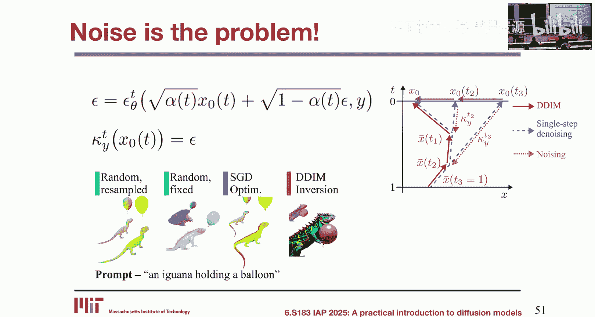

For instance something like this， so this is all like 3D shapes you can generate with this reperitized DDM。

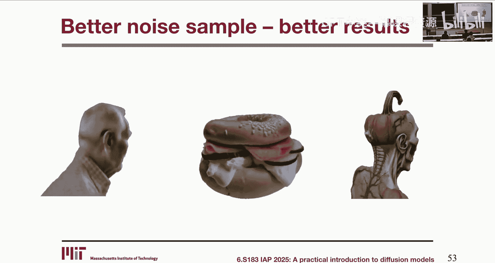

But， basically。

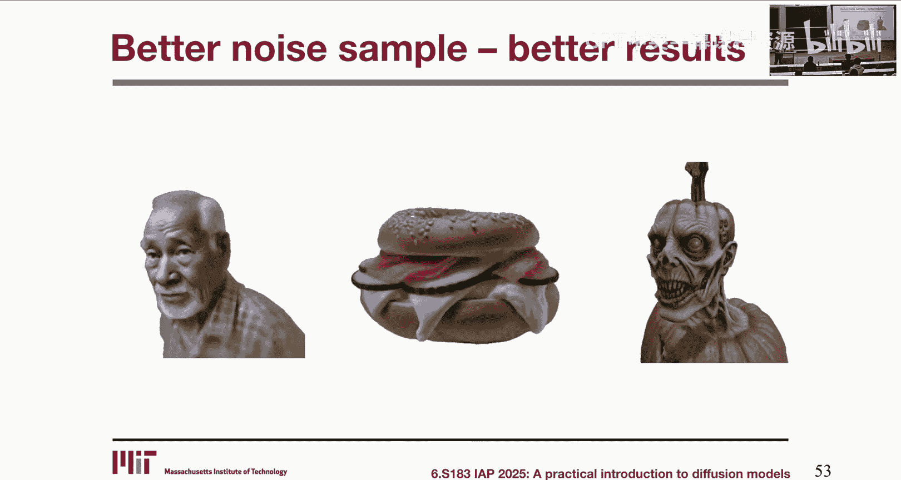

We have less than five minutes left， so I it's。

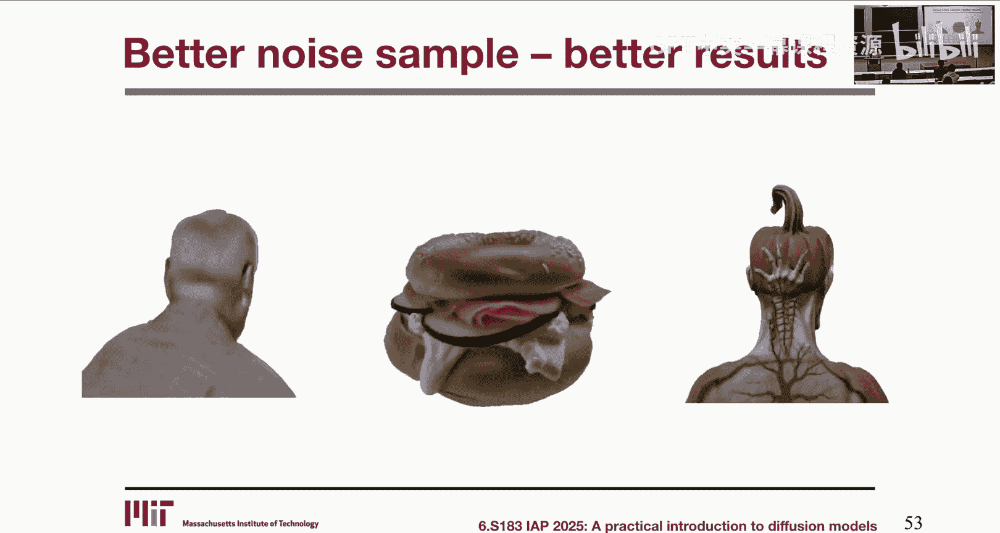

Almost perfect on timing。Basically， if you had to。If you want to read more on this like cops and correct noise samplingpering or whatever the right bunch of works。

 this is a very interesting one where they。Suggest to generate noise sample that is like kind of consistent in 3D so that you can take a noise sample。

 but then if you generate the same noise sample from the side。

 it's going to be like de form consistently， and it's a very beautiful idea。But in any case。

 if you had to take one thing away from the day， right？Basically。

 the whole point is that if you have a trained diffusion model。

By all this like reparitization or whatnot， you can just use this trained image diff model as a source of semantic gradients。

So you don't have to always use it on like denoizing task， right。

 you can reppriittize it in such a way that it gives you direction on any image that will improve this image or like move it towards a prompt。

And you can really plug this thing into many applications， right， So this is what I just said。

 But basically into different applications where you can plug it in， for instance。

 imagine you start with one image。

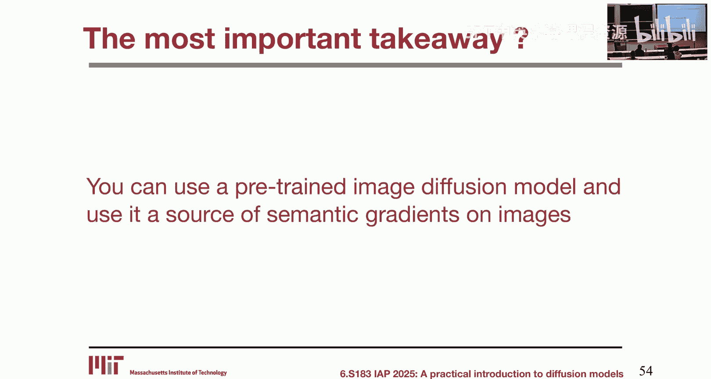

And then you take this pretrained denoiser， but then the neuro probably tries it in a clever way and you apply this gradients with a different prompt right so you start with an image of a statue。

😊，And then you apply this gradients where the diffusion model is conditioned on the prompt a statue of his raised arms。

 and it's like keep evolving this。And。If you do this， you just like obtain the deformed image。

 So like you get a statue with raised hands， right。

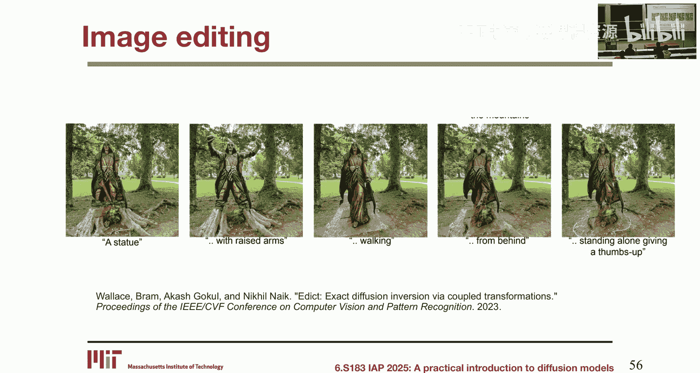

呃。Another approach that is like not really published much。

 but I think it's quite interesting to consider for potential research is that imagine we take some initial image。

 right？And this image is probably just a normal Toyotara4， right？

It's probably quite likely under the distribution that our diffusion model learned。

But what if we make some distorttortion to it so here I'm not sure if you can see it because of the contrast。

 but I just like removed the single square from somewhere in the image right so in that case it's very unlikely that the diffusion model have seen something like this right？

Now， this image contains an artifact。So what if you take the gradients from this reprimettriized。

 pretrained the fuion model and just see where these gradients are big， we try to evaluate。

What would be the first thing that square distillation tries to fix in this model。

 And if you just like numerically evaluate this gradient。

 you'll gather that they are very big in this area。

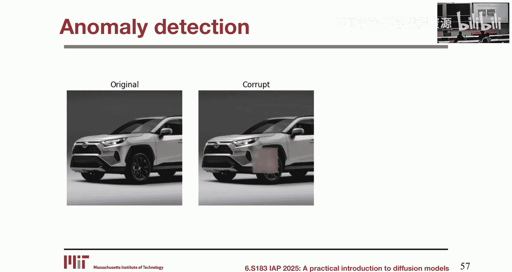

Like there is not that much that we need to evolve in this area。

 but since this is kind of like a weird spot， the first thing condlation will'll try to do is like fix it。

AndSo maybe we can use it for some kind of a caomoid detection right， you can see what's going wrong。

 you probably don't know what exactly is going wrong。

 but your diffusion model can hint you like the certain parts of your image are not really aligned to the distribution and even like localize them。

 right？

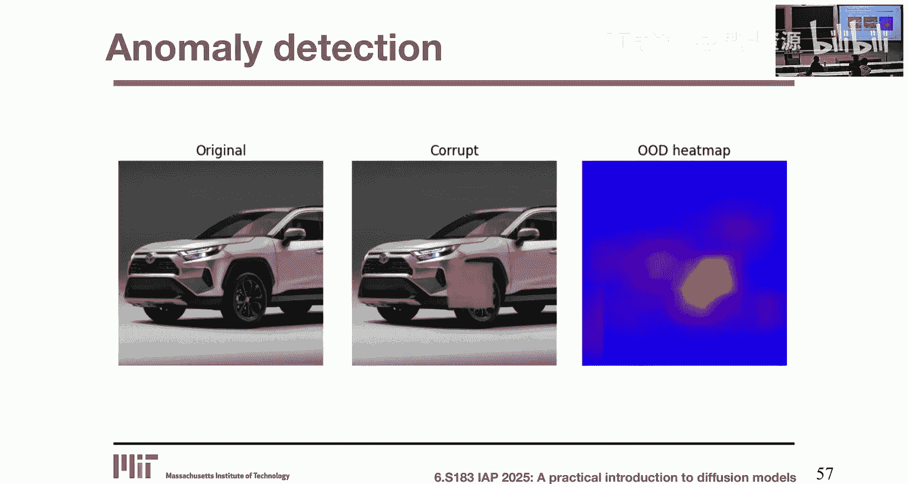

So I think that's really it for today， I guess that really the main message is just use differ models like super flexible for many applications。

 there are lots of exciting things you can do with them and yeah I'm happy to chat answer any big questions after and feel free to reach out。

And yeah， thank you a lot。