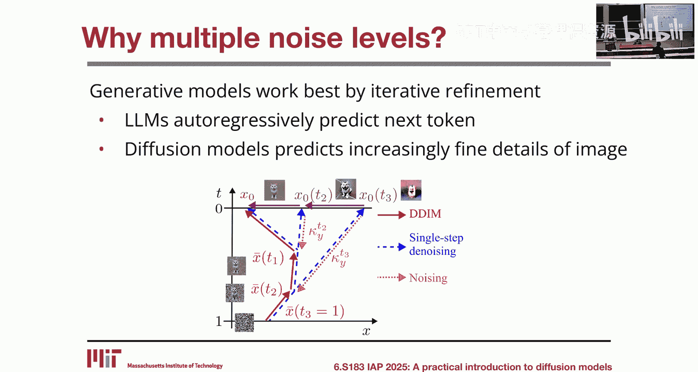
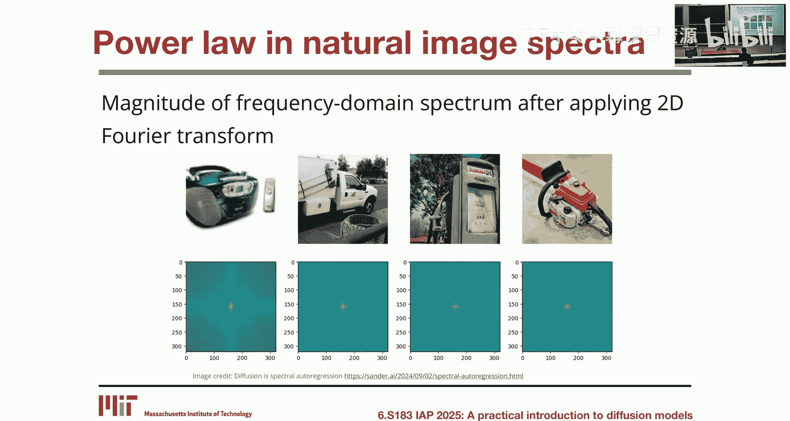
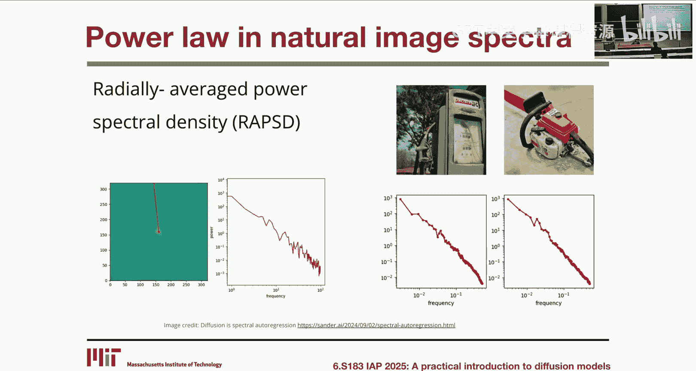
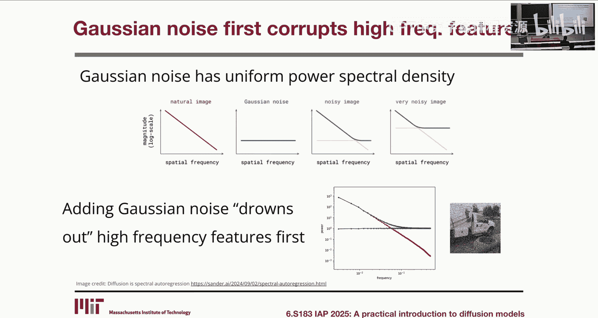
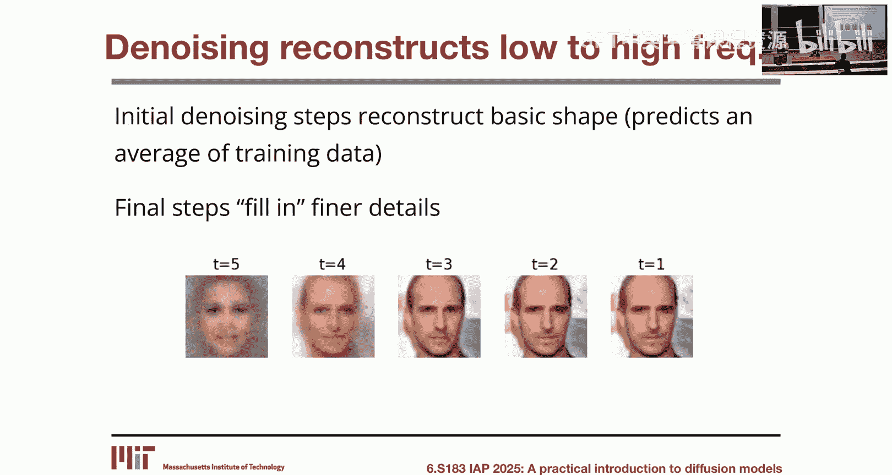
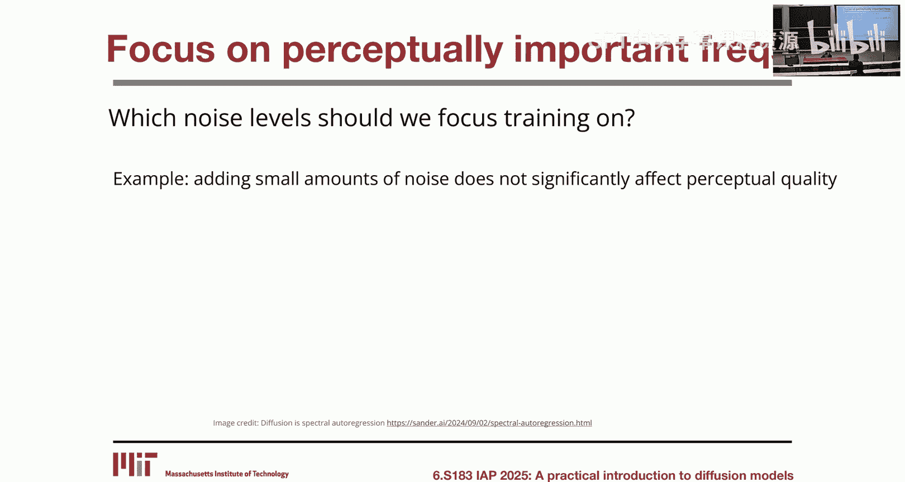
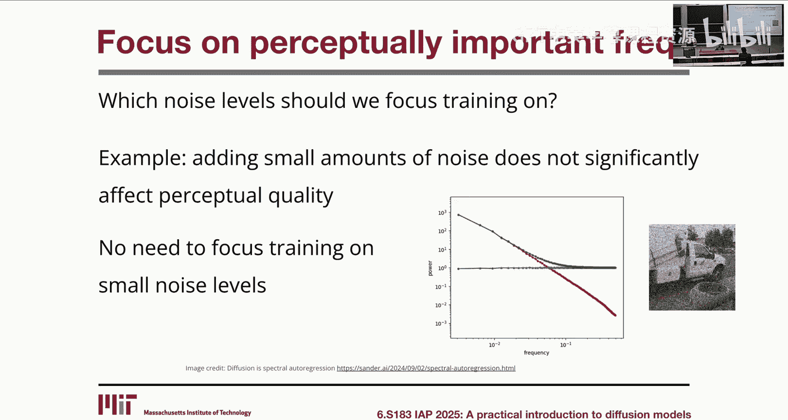
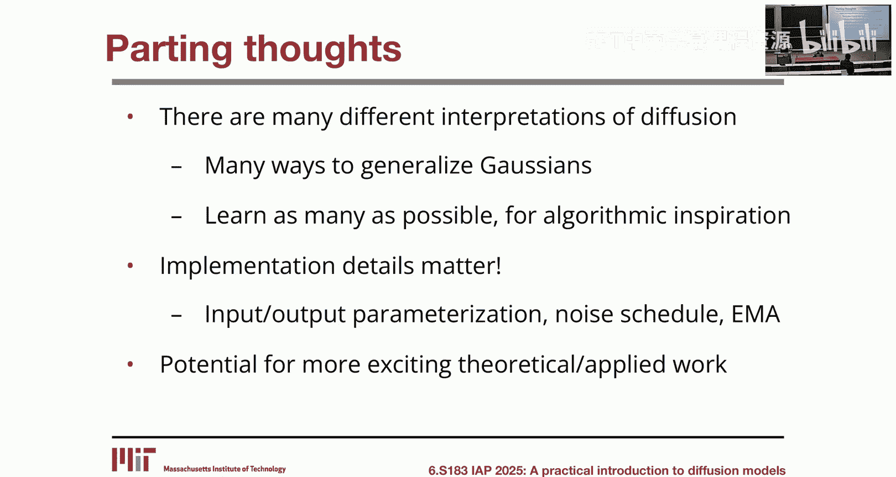
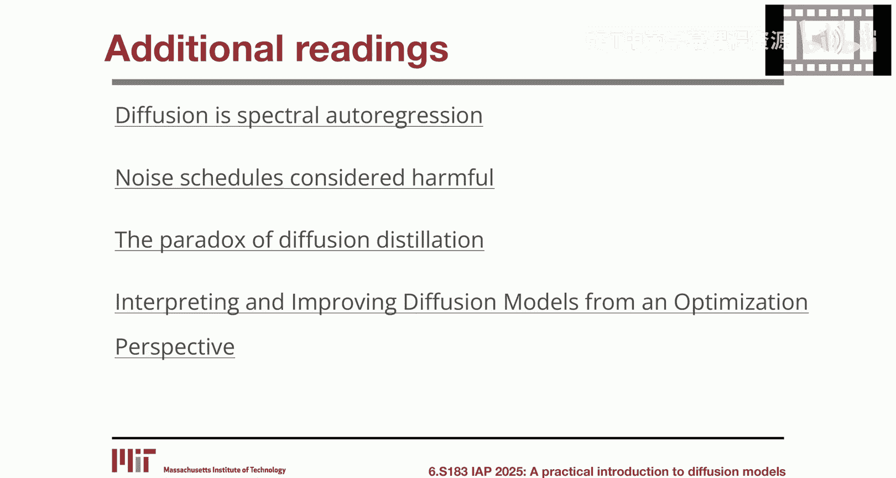

# 《扩散模型实用导论｜6.S183 A Practical Introduction to Diffusion Models, IAP 2025》中英字幕 - P6：Lecture 6.zh_en - GPT中英字幕课程资源 - BV1FzhczeEnb

So thanks， everyone， for coming to the last lecture of the class。 So today， our talk。Over yeah。

 I'll go over the outline of this lecture。First， let'll go over some announcements for people who are taking the class credit。

And then I'll go over three different topics。 The first one is。How to train better。

Additional tricks and methods to allow you to train better。 And then next is how to sample faster。

 how do you get better sampling like results at the cost of adding a bit more training。

And then finally I'll go over a different way of thinking about sampling as well as guidance as thinking about diffusion as minimizing distance to a data manifold。

 so generally this is the outline there will be many different topics and different ideas and I try to organize these them into three different length。

😊，There。I guess three different strands。So first I'll go over the announcement right so just a reminder。

 this is the grading scheme for the course。There's attendance process sets and mini projects。

And the project report is going to be due next Friday if you're doing the project。And the homework。

 the P that we've all probably submitted by now will be graded by next week。

 so if you're taking the class for credit， you can take a look at your scores and yeah and make sure that your lecture feedback forms are submitted by next Friday because that's around when we will submit the grade for the class。

And you have any questions about this， just feel free to email us。And I also like to。

Just give a shout out to the next class， so 6 S184， which is the class happening next week。

 be taught by a different's going to be taught by Peter。

 and it's going to be more of the theoretical Society it's called generative AI stochastic differential equations。

So that's gonna focus more on SEs and more on the math behind diffusion models。

 So if you're interested in that， please go ahead and attend that class。Allright。

 so thiss the announcement and。Let's go into the first topic for today。

 which is how do you train better， like what are the different methods of training better？

And the first thing I want to talk about is like， why do we use multiple noise levels。

 I think a lot of people have asked questions about why do you need different。

Number of noise levels when training diffusion models。This kind of。And then。

because you're using so many noise levels， which noise level should you focus on which are the like when you're doing training。

 you get a choice of sampling different noise models。

 different noise levels the question is which ones do you focus on it's going to be turned out that there's the relation between the noise you add and how much perceptual information you erase and that's going to be。

The answer to this question。As well as how do you actually focus on these noise levels？

When training diff models， I'm going to talk about a couple ways to do that。

And as well as there are so many different parameterizations of diffusion models。

 you've seen a few of them during the class。And now， this is going to be the。

I'm going to talk about different generalizations of diffusion models and what these different parameterizations are。

 So this's going to be all grouped under like how do you train， how to train better。Allright。

 let's dive into this right now so recall like that in the past few lectures we've seen especially in lecture one。

 we've seen this way of training diffusion models which is you sample some data。

 you sample some noise level， sample some noise and you add the noise to the data and you try to predict the noise so this is what you've learned in lecture one。

But so we're going to start with this basic training procedure。

 but there are two different variations to this training procedure。

 so which first one is how noise is added。There's different ways you've seen in later lectures。

 a slightly different version of this， so we can vary how noise is added。

As well as what quantity to predict here we're predicting epsilon， which is the noise direction。

But there's different things to predict， you can predict data。

 you can predict like velocity in different， basically different quantities。

So I'm going to talk about how these affect the training procedure and how to think about them。

All right。So。呃。I guess stop me if you have any questions about this。

 but this is what you've seen in lecture 1。And what's interesting about them is that these different variations I'm going to talk about are kind of mathematically equivalent。

Cly in the sense that。If you solve for the I in order， exactly， you get basically the same result。

But they can differ in practical performance and when you're actually using them to train data with this objective and I'm going to kind of touch on the reasons why。

 and this is important when you want to extract the most practical performance or diffusion models because this gives you in different knobs to tune that to fit their data better。

All right。So the first one， yeah。So recall this is the method to add noise to a data。

 except we've seen in lecture  one， we're going to call this the variance exploding formulation。

 because if you take a look at the variance of Xt，Compare as the function of the noise level that you add。

It's going to be increasing。The more noise you add to it。

So because the sigma T can range from a small amount to a very large amount。

 like this variance will be dependent on sigma T。But a different way of adding noise that you've seen in later lectures。

 lectures two to five， is called the vance preserving formulation。

So this various preserving formulation is basically the。So instead of adding noise。To the clean data。

 you scale the clean data here by some alpha bar and then you scale the noise by a different amount。

 so this is what you've seen this is actually what you see in a lot of diffusion papers。

And here I use a different variable x and z to denote between these two formulations。

 because I'm going to show you later on how to convert between them。

But basically Z node is the clean data， the same as x node。

 but ZT is different from Xt in that the variance changes with the amount of noise you add for x。

 but the variance remains the same， no matter what noise levels you add for z。

And this is achieved through this kind of square root river weighing。So also for Z。

 there's kind of two different ways of viewing it one of them is based on a Z node。

 the other one is based on the previous time step the way to go between them is to use this alpha bar T。

 like this formula for alpha bar T。But anyways， we're going to focus more on this the second one。

 There's actually a way to convert between them， right？

So the conversion is actually quite simple right you x not is equal goes to the z nu Xt is zt divided by this alpha bar of T right so it's just a simple change of variables。

😊，And the sigma T that you see here is just。1 minus alpha bar over alpha bar。

 so basically you're dividing this equation here by square root of alpha bar T。

 so this is a one to one conversion between these two formulations。

So since they are basically equivalent to each other。

 the question is why do you use one or the other in practice。

 it turns out the variance preserving formulation performs better in practice。

Because if you look at the input to the model， here the input could have different variants or different norms。

Depending on the noise level you add， but here the input is actually constant and neural has constant norm。

 and neural networks tend to predict train better when their input is constant norm so this kind of affects the training dynamics of the model and that's why you use all these kind of different input parameterizations。

Alright， any questions about this right now。Okay， so now the question is like since variance preserving is better。

 why do I teach you about variants exploding in the first places。

It's much easier to the expressions become much easier when you're thinking about it in sampling procedures。

 you just take a look at the sampling formulation， the sampling algorithms you get。

 this is what you learn in lecture 1。This is the determinacy DDIN update。

 this is a probabilistic DDPN update。So these are two different updates rules。

You can see that they are very simple when written in terms of x and sigma。

So what happens if you try to write them in Z with the variance preserving formulation？😊。

It turns out that if you write them the same， this the same exactly the same update rules。

 its just doing a change of variable。When you after you do this change of variables。

 you get this expression for DDIM and this expression for DDPM So you can see this is very complicated。

But there is actually， if you do a bunch of math and calculations。

It's actually equivalent to this update here。So you can see that using this variant exploding like formulation is actually much easier to reason about these sampling algorithms。

So that's why we taught you both like formulations。And yeah。

 the did give an update for why we have Sigma T prime instead of Sigma T minus1。Yes。

 the question is why is there Sigma T prime right， because the reason is because you're adding noise to it？

So if you have so the sigma T is predetermined as the kind of the target noise level。

Or noise schedule during the denoising process。But in DDPM， you're adding noise。

After you take a denoizing step。So you need to remove a bit more noise。

In order to get back to a sigma t -1。 So if you look at the variance of this over here。

Like the variance of this。Should be like sigma t minus1。

Because you're considering T prime as well as Ata here。And if you yeah。

 so this is eight that's why Eta is defined as kind of this square root of these two variances。

 that's just to ensure that after you take that step， you get sigma t minus1。

So these are basically like two different like parameterizations。

And they're equivalent mathematically， but people use them different formulations in practice because of the reasons I talked about earlier。

 like the input variance of the neural network。All right。

 so so this is one way you can one source of variation in training。So was's another。

Another variation， it would be the different noise levels you use。

So another question that people had is why do we use different noise levels when trading diffusion models and this goes back to something that's quite interesting。

 I think。It's because what people have discovered like in the past few years that generative models。

 they work best by doing iterative refinements， what does that mean？

It means that you take your output so far， you fit it into the model and tries to improve the output by a little bit more。

 So in large language models， this means like you predict the next token from all the previous tokens。

And diffusion models， this means that you're predicting a bit more detail。

 you take the previous de noise output feed into the diffusion model。It dens it a bit more。

 So you're increasingly adding detail to the images。

And that's kind of the reason why you train on different noise levels。

And this is a picture you seen in the previous lecture on school district something。

 but the point I wanted to make is that。As you go you slowly deno。

 you're getting more and more detail in the image。So this is kind of the intuition behind why you use different noise levels。

So I'm going to give you one more interpretation of this。

Right，This comes from this thing called the power law in the natural image Spec。So this is。

So what is this plot here doing， right， So this plot。

Basically applies the two dimensional Fourier transform。To each image。

 So the fluid transform kind of extracts the frequencies of the。Spial frequencies of the image。

So for example， there's low frequency features which are basically these large by like outlines。

 and there's also high frequency features which are the finer details in the image。

 so what the full transform does is that maps from a spatial domain into a frequency domain。Okay。

So this is， if you know， about signal processing。Viewing things in a frequently domain can give you different insights about signal。

 in this case， an image。

And here from this frequency domain， we can extract this and call a raly average power spectral density so what does it mean right if you take the frequency plot here。

 if you take the frequency domain plot and then you ra sweep over this，To the plot。

 you get a series of lines。But you can average these lines。And after taking the average。

 you get something that looks like this for each image。

And for images this it seems to follow a trend， right it decreases。

 so the X axis here is the frequency， it's kind of the magnitude of the frequency。

And the Y axis is kind of the。Basically the magnitude or the color of this。So you can see that。

As the frequency increases， the relative magnitude decreases， so what does it tell you， right？

It tells you that。The楼呃。嗯。On the left hand side。Of this plot。

 it kind of corresponds to low frequencies in the image。

 and it tells you there's more low frequencies than high frequencies in the image。

And this is something that's inherent to natural images。

 if you take a whole day set of natural images。Make this plot for every image and then average them together。

 You're going to get something that looks like this。And why am I telling you all about this？

This is relevant when you think about， what happens if you add noise to an image and look at the same plot。

So let's take a look at what happens if you add noise to images。

So it turns out that so this is the plot that we've seen before。

It turns out that the Gaussian noise has uniform power spectral density。

 So it's a property of a Gaussian noise。 It basically has the same magnitude across all frequencies。

If you add a noise to this natural image。You're basically going to take the max of all of this。

 The noisy image is going to have a spatial frequency that looks like this。And a very noisy image。

 I'm gonna get the。呃。Fency like product looks like this。 So what does it mean。

 it means that when you add noise， add a smaller amount of noise。

The features that get destroyed are the high frequency features。

So you're going to destroy fine details first。But the large outlines， the low frequency features。

 are going to be kept if you add a small amount of noise。

As you add larger and larger amount of noise， you're going to erase the lower frequency like features。

So this is。So basically the red line is this fruit。AFency plot of the image。

 the blue line that of the Gaussian and the green one is the image sum with the Gaussian at different noise levels。

So this is what happens in the frequency domain as you add noise to this image。Right？

So what does it tell you， right， So if you look at this picture， like perceptually， when does it。

Stops becoming a picture of a truck。 It only happens like at higher noise levels。

Which kind of tells you that perceptually adding small， like noise levels doesn't really affect the。

How you perceive the image。And there are some noise levels that are more perceptualally important than others。

And we want to focus on those noise levels when we are learning how to dennoise because。

For learning to denno at those noise levels are more important。So any questions about this？Right now。

Yeah。Now， this is true only when we are applying diff mode on images。

 if we have not diff image on other。The robotics trajectory。

 how did that affect our choice on choosing the？Yes， exactly。 this is a very good question， right。

The what you're saying is that like this kind of this is called a power law。

 this power law for images might not be the same for different domains like audio or robotics trajectories。

And then。Ls itself to different decisions like for example。

 you cannot use the same hyper parameters like that works for the or same noise schedule that works for like。

Like image models for other domains。 So if you see。

 if you look at what people do in practice when they move to different domains。

 they actually choose different noise schedules and different like training objectives， for example。

 and that essentially what it does is it enables you to focus on like the frequencies that matter more。

Which is something that's quite important， I think。Yeah。

 so I think what's really important here is that you you want kind of want this。

You want to remove information from the image at a constant rate as you add them at like a as you increase loud noise level。

 I think that's the most important thing。Yeah。And what lets you do that。

 there's a lot of different knobs for you to tune， but they all kind of try to achieve this objective。

 which is like removing information at a constant rate。

Yeah， so。Let's take a look at the denoing procedure， right。

 So what happens when you train a diffusion model and use it to dennoise an image。

It turns out the initial denoisising steps kind of reconstruct the basic shape of an image。

 which if you look at what the thenoiser predicts， this is like the result of say one step denoising。

You get a basic outline， which is kind of like the average of all the images of your training sets。

And as you progress along， the final steps gives you more and more finer details。Right。

 so this kind of。Follows the。Intuition you get from here where adding。

 so instead of adding noise like going up， you're going down by slowly removing the noise。

And by removing the at first， you are removing like。Larger amounts of noise。

 which kind of fills in higher the lower frequency features。

And then you're removing smaller amounts of noise and。

Constructs higher frequency features are finer details。So this is kind of the。What happens like。

During thenoing in the frequency domain。So as I said just now。

 we need to focus on these perceptualally important frequencies。

 So which noise levels should we focus the training on， right？ so for example， right。

 if you add a small amount of noise to the training to the image。

If the noise is so small that doesn't affect perceptual quality。

 do we actually need to spend a lot of effort like trying to dennoise at that。

Training the model at a small noise level。 And we don't have to write。

You don't have to focus on small noise levels if removing the small mountain noise doesn't really help us。

So。So this kind of motivates us to like figure out how to focus on the important frequencies or figure out like what parameters during training to that allows us to focus on these important frequencies。

 I'm going to tell you about two ways to do that。

The first way， of course， is to modify the noise schedule， as we've seen in the first lecture。

The noise schedule determines how much noise you add。

At like to the image during training that can be thought of as a distribution of the noise。嗯。

On the noise levels here this。Log， this is also in the log scale， the signal to noise ratio。

As we've seen before， the plot just now on the frequency domains， also in the log scale。

 So essentially what this tells you is that you should focus this noise schedule for example in blue focuses most of the noise。

At signal to noise ratio of one， right when log is 0。So this tells you。

 so this gives you different ways to。Like sample the noise and focus on different frequencies。

 You can， of course， change the noise schedules， which changes where you focus on。

 And if you move to different domains， like aer robotics。

 you might want to use different noise schedules。Because the frequencies that matter most might not be the same as those in images。

And I'm going to talk about a second way of focusing on different frequencies， which is by training。

 modifying the training objective。And there's something that you might have seen before。

 but we haven't talked much in this class。So。So what do we predict during training， right。

 one way so the one we've seen the most in class is predicting noise。

But you can also predict the clean data， so you're doing the same input。

 but you're trying to predict x0 instead of epsilon。also predict。

Or like the noise minus data in this case。This is also known as flow matching。Right， so。

If you've heard about flow matching before， that's basically all it does。

 it predicts a different training objective。It turns out that these training objectives are mathematically equivalent to each other。

😊，For a fixed sigma， For fixed noise level。As you can see from the deation here。

Here you're predict the clean data， but you can。Through some manipulations。

 show that this objective is equivalent to。Predicting the noise。

Except that you have an extra factor of sigma square here。The sigma square is the noise level that。

It's basically the noise that you add so this objective is almost equivalent。

 it equivalent is actually equivalent for a fixed sigma。

 but the problem is you're averaging over all of the sigmas here。

 so this is what and kind of rewa stigma different sigmas by different amounts。

And this implicitly allows the training to focus on different noise levels。

The same story holds for flow matching。Like it's also a different way of focusing on different noise levels。

So。Any questions about this。So I think this is something that is not very explicitly stated in many papers。

 there's a few papers that talk about this， but there's something that's quite important to know。

Alright。So， so that's mostly all I'm gonna to talk about for how to like。

Adjust different aspects of training。The next topic I'm going to talk about is like how do you sample faster？

Right。So in lecture 1， right， we've seen that。You can use faster deterministic exemprs by that uses some sort of acceleration。

 And this is。it's called training free because you take the same model that you trained from before and you just apply a different sampling algorithm。

But there are additional ways to speed up sampling。

This is known as either distillation or consistency models。 What these methods do is that。

In addition to training your initial model， you spend some more training effort in making the model better and。

Using this additional training like this， you can get faster sampling。

And it's kind of a trade off between like training and inference compute。

I'm going to talk more about this。Faster sampling methods in the next few slides。

So the first thing I'm going to talk about is called progressive distillation， so what is this thing？

So the first step is to train a model， which I call a teacher model。

 So this usual diffusion training， just train a diffusion model。

And then so so now we train another model， but first we do this by sample some clean image like what you do when you train diffusion models。

 you add some noise to the clean image。And then then from this noisy image， we take two。

Deterministic sampling steps。So essentially you're evaluating the teacher model twice。

And then you train the student model to predict。Two steps I once。Right so。Instead of predicting one。

 one step， the student model for the teacher model， the student model predicts two steps。At once。

And you do this for a lot， a lot of。Clean images， a lot of， lot of noise。

And what you get is a student model。They can sample in half the amount of steps as the original teacher model。

So this allows you to reduce the total number of sampling steps by half。So。

You can continue doing this。By using this new student model as a teacher model。

 and this threats to reduce by half again so you can keep having the number of steps。人民村。Like。

 so the question is like， can the student model like reproduce exactly what the teacher model like that's right。

 Of course， you cannot If not， then it is like having like having free lunch like you're just somehow you。

 you just get a model that。😊，Doesn't even do like iterative refinement。

 that you can just generate very good images in one step。Which is， yeah。The， I think that's so。

Because you cannot do that， there must be some error。When you're doing the distill， or equivalent。

 there's a trade off between how fast you speed up sample and how much quality you lose。

So in practice， people do this until like the decrease in quality becomes like very noticeable and it's not worth having the decrease in quality。

So， but， but。In practice， you can probably speed up sampling from like having。

 say 40 steps to like four steps without losing that much quality。But beyond like four step。

4 to 8 steps， it becomes much harder to。When你开的 to know。by Kile is already learned。I see。

 the question is， how do you？How do you train the student model right so it turns out that what people do is they take the student model has the same architecture as the teaching model。

And it's actually initialized with the same weights。

 so you're just making a copyier of the teacher model。

And you freeze one copy and the copy you made is the initialization for the student model and you keep training this。

 So it's kind of like a fine tuned version of a teacher model。Yeah。So。

 so this is something that's quite miraculous， right。The issue work。Because。The natural question is。

 why can't you just train the teacher model better to do fewer sampling steps？

That's a few explanations far why is this true， I think I'm just going to go over like a startdy hem wavy explanation。

So why do distillation work， right， it's something that like April should not work。是快手。

Just think about the go back to the。objectivebjective of diffusion models。

 which is trying to predict the clean data given like which is given noisy data predict the expected value of x0。

 given Xt， which is the noisy data。And let's look at this quantity， right。

 this quantity actually has very high variances。So this high variance。Comes from the fact that x0。

 here you're trying to predict the expected value。But when you sample the noise。Right， the。

X T has a lot of。 you're adding a。A lot of noise to x0。

 but you're just trying to predict the mean values。

 So let us go to the special case of low noise levels， right？And low noise levels。

The optimal dennoiser。It's gonna be very close to identity。

You want to learn an identity map because at low noise levels you don't really have much to remove。

But your input is gonna be。Basically a lot of different noisy samples。

 so the result is just average of a lot of training samples。

 but you just want to predict something that is kind of fixed。Which is identity。

So this quantity they you want to learn initially has very high variances。But using the pretri model。

 you're going to get something。That is of lower variance。

 because the teacher model will tend to output just the the expected of X0 given X T。

 It's not going to output something。 It's not gonna give many outputs that averages to this value。

 It's just gonna give you this value， instead。So。Intuitively。

 like using the pretri model give you like input with lower variances。And with lower variance。

 if a quantity has lower variance， its going to be easier to learn and there's something that you can prove theoretically for like theastic degree descent。

And thiss something that's also quite intuitively， like。Helpful。

 like we are training like neural networks if we had reduced the variancerance。

Of your output generally is going to be easier and faster to learn。 So this is an explanation。

 one explanation for why disillation works。And。Yeah， so， but there must be。

 there could be different I。And more explanations to this， is one way to see why thisill could work。

And then so let's take a look at what progressive distributioneration is like in terms of the sampling trajectory。

So sampling trajectory， like is where you take a noisy image and it slowly go to the。A clean image。

 What does it look like。Along this path that you take if you are doing many， many different steps。

So you can think of the diffusion model output as predicting the tangent of this path because you're taking only a small step in this direction。

 predicting the noise level again and taking another step。Okay。

 so so this just comes from the denoing formula that youre you have in during sampling。

So what does progressive dis solution do is try to predict the result of two steps at once，It。

You're taking two steps and predict the results， so with this you can take longer steps and simple faster。

So this is just what pre distation does。And now you can think about like other ways to generalize this。

 like can you do different kinds of distillation？So this brings us to this topic called consistency models。

RightSo it is the same path that we had before。Consistency models tries to predict the end just from any point。

 any starting point， it just tries to predict the final point。There's different ways of training it。

 one way of training it is also by distillation。A different kind of restorationation。

But the objective is just to predict the endpoint。And the question is why of course with this you can do one step sampling。

 but one step sampling is going to give you worse results than multiple step sampling。

 so what people will do with consistency models is they sample to the endpoint。

 add some lower amount of noise to get to say a point the lower noise level and then try to predict the endpoint again。

 it just keeps on doing this。Until you get a clean image。

 usually you can do this for fewer steps than usual than like。

And the idea is that if you run consistency model with more steps。

 you're going to get more accurate like results。But you're also going to take more time。

 So gives be a way the trade off between these two。Yeah。

 so this is just a brief introduction to what consistency models are， but if you want。

 you can read more in this original paper， which I linked here。All right。

Question have people tried and trade distilling like chains of models like you could chain a model with another version of itself and then you have some lower filters some more in the second model or maybe you can get rid of the image。

Connect the ladies。Yeah yeah， that you have two models worth the size but two one and a half。Yeah。

 of course there's many ways of doing this。Applying these disation ideas， one。

 one way that we have done also is survey during classifier free guidance。Usually。

 you have to evaluate the model twice on the。The guided image and the the unconditional。

 the conditional and the unconditional model， you can actually distill both of them into one。

 So like。Instead of evaluating it。On both unconditional and conditiondal。

 we can just try to predict there are some。So， that's a。There are many ways of applying this idea。

Yeah， and the reason why it's so successful， I think。

 maybe is because it reduces the variance of diffusion models。All right， so。

 so that that's basically the。Sampling faster methods for faster sampling。

And the next part I'm going to talk about is a different interpretation of diffusion。

That I've written about in one of my papers and the thing is this is kind of different from everything else they've seen so far。

 but I think it gives you just a different perspective of what diffusion models are。

And it's worth talking about。So。Just a reminder what the distance function and projection to a set is。

Right so you have seen this before in the first lecture。

The distance function is just defined by some say Euclidean distance projection is the point that minimizes。

Point on the set that minimizes the distance。Right。So。

If youre think of the set as this outlineing here。The projection。Alright， is's the。

So what is the gradient of the distance function， The gradient is the direction of steepest descent。

Which direction can you remove decrease the distance by the most is the direction of the projection？

That's all what this is， right， the gradient of this square distance function in this case is basically this。

The directionion here， just move towards the projection。And then。So we can interpret。

Diffusion as gradient in decent on the distance function as follows。

Remember we've seen before the ideal noiseer。And we seen that is equivalent to the gradient of a smooth distance function。

Smoothed by some kind of taking， taking a soft mint instead of a mint。

So this is something we've seen in lecture one。And here's an interpretation is that what is defffent sampling trying to do is trying to minimize the distance to your data manifold。

And how does it minimize this distance， it does so by。Performing different sampling steps。

If you look at the structure of this determinatory update。It kind of reminds you of creating dissent。

Right， so it turns out that。If you let this so consider this function。

 which is the square distance to the manifold。If you think of the noise level as being approximately equal to the distance to this manifold。

Then the gradient of this function。It's actually going to be approximately equals to the noise level times the denoisr output。

So in a nutshell， the DDN is approximate gradient descent on the distance function with a certain step size which is determined by your noise schedule where the gradient of this distance function is estimated by your thenoisr output。

 so the neural network is trying to predict that the gradient of the distance function。

So this is one interpretation of like。Diffusion。And I I'll talk a bit more about what you can do with this interpretation later on。

 But first， any questions about this。🤧Allright。So， so let's take a look at。

What were you learning in lecture three right where about guidance。

 so this is the picture I taken took from lecture three。

This is the equation update you get for classifier guidance。So here there are two quantities。

 to focus on。 The first one is the thenoising step， right， the noise。Prediction from your noiseiser。

And the second is the classifier guidance term by differentiating through your classifier。

So what is this doing in a framework of diffusion as minimizing distance to the data manifold？

What it's doing here is that。During guidance， you actually want to find a subset of the data manifold that's classified as a certain classy。

 the subset of images that are cats。Right。So this data Mani here。

 you can think of it as the set over here and the classifier decision boundary。

 you can think of like a different set over here。 you want to find there。

 so this is basically all the pixels that would be classified as cats。

And you want to find the intersection。Note that， well， there are pixels。

That might look like nothing might look at just random noise。

 but the crossifier can still return the result as a cat。So the classifier。

 these are known as averar examples。Which is why you don't want to find points just on the decision boundary。

 You want to find the intersection of decision boundary and the data manifold。

So what classifier guidance is doing is a sort of a constrained optimization problem trying to solve this constrained optimization problem。

That tries to find intersection of these two sets。And one way to do this is by alternating projection right so the denoing steps try to project onto the data Manifold。

 the classifier step tries to project onto the decision boundary。

 and you want to find the intersection so you take kindnot these average of these two steps。

So it's just trying to go one step at a time and eventually end up something in the middle。

So there's one way to think about guidance as constrained optimization。

Using the what we've seen before us where like diffusion is trying to do gradient descent on a distance function。

Yeah， what happens if these terms directly oppose each other。

 like if you're sort of in the bottom of the corner of that image。

 with the class fires directly pushing the away？Yeah， yeah。 So the question is。

 what happens when they're like exactly opposite directions from each other。

 So this really doesn't happen in high dimensions。 If you think about like high dimension data like。

It's going very unlikely that these two vectors are pointing exactly opposite directions。So。

 so this is only a low dimensional picture。 but what happened in high dimension is quite different like。

In terms of a picture， right？Yeah， there's always going to be an intersection， and we'll find it。

The intersection。オリピは冇り公で。有有。There could absolutely be multiple intersections。

But you'll just find one of them。Yeah。Right， so another way to use this interpretation is to think about score distillation。

 Sc youve seen score distillation sampling in the last lecture。

 which is basically you're parameterizing an image。By嗯。Like a fee。And then you're taking this。

You're passing it through this nerve to generate a 2D image。

And then you're trying to optimize this 2D image using a diffusion model。

So youre going to think of this as minimizing an objective here， which is the。

The G of V is basically the output of your nerve， a 2D rendering of your nerve。

 and you want this to be very close to the distance to the image manifold。

 So you try to do this by minimizing the distance of this output to the image manifold。And。

If you want toSo of course， to do this， you want to take the gradient of this function。

 this objective function。And。If you take the gradient of this objective function。

 this is exactly what you get right using the chain rule。And if you do some approximations。You guess。

The whichch I won't go too much into detail here right now because of time。

 you get exactly the score distillation loss。So you can think of it as just trying to minimize this objective。

 which is the。Distance of your 2D rendering to the image manifold。

 you want it to be a realistic image， and you do this by like differentiating through this objective function。

And there's another way of deriving Sc disill and sampling。嗯。So。From after it from this， I。

 I'll just try the。I think。The's called。 So basically the this the gradient disinterpre is the last thing I' going to talk about。

 So let's just go over a summary of what we learned in the class so far。 So we had an introduction。

 and then we talk about different perspectives on diffusion， different ways to。

Think about diffusion models。And we talked about conditioning and guidance。

 which are very powerful ways to get diffusion models to generate what we want them to generate。

And then we talk about generalization and why that is important。

 why do we expect it to happen and why is it surprising that generalization happens？

And then talk about score dist， how to use it to generate 3D models。From a 2D， like diffusion models。

 just using diffusion models。In different and more advanced ways。 and this lecture talked about。

Different ways of speeding up training and sampling， as well as the new interpretation of diffusion。

And so basically， this is the content of the class。 And before I end。

 there's some parting thoughts on diffusion models。Do I have。

So we've talked about many different interpretational diffusions in this class。

 and why are there so many different interpretations？😊，It's because。

Essentially what you're doing is adding Gaussian noise to clean data and trying to predict the noise。

There are so many different ways to generalize Gaussians because they are special in so many ways。

 that's why there are so many interpretations of diffusion。You can think of as very confused。

 it's kind of a double edged saw， right？There are so many different interpretations to。

Think about people used so many different notations。

But you can also think of it as this gives you many different areas to draw algorithmic inspiration from that you can use these interpretations to like。

From all of these different areas to improve your di， sampling and training。

And another thing that hopefully you get from doing your homework or pizza。

Is that these implementation details actually matter a lot like there's small details that don that we haven't even talked about that could influence the result of training a model by a lot。

Like weve talked about like input upper parameterization， we talked about noise schedules。

 there's also this thing called exponential moving average， which you haven't talked about。

 but it's also very important when training diffusion models。So。So the thing is， yeah。

 these details matter and the only way to know about these details is to train the model by yourself and play around the parameters minister。

And also there's like diffusion models， like there's potential for a lot of very exciting theory as well as applied work and hope you guys have more questions about that。

Please feel free to contact us。And yeah， I mean there's some additional readings。

嗯。