# 《数据中心人工智能导论｜Introduction to Data-Centric AI, IAP 2024》中英字幕（Claude-3.7-s） - P1：Lecture 1_ Data-Centric AI vs. Model-Centric AI.zh_en - GPT中英字幕课程资源 - BV1wvhczTETR

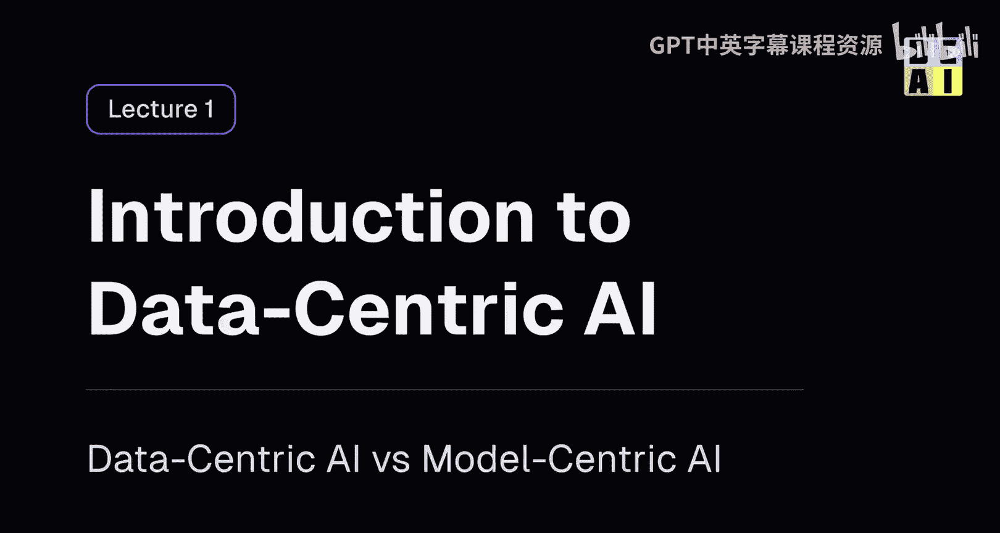

All right， good to see everybody。 I just flew in from SF where I've been the last two years working on company stuff。

 but I did my PhD here and I did nothing but math and machine learning and it's great and like one of the best times in my life and now I just work all the time and so I'm actually so happy to be here teaching stuff I'm really interested in and I think you guys are going to really enjoy this。

 I think it's going to surprise you a little bit I think it's going be a little bit more grounded than you might expect in this world of all the applied GT models and things that are just like online and you try the new thing So what we're going to look at is some actual foundational principles of this new emerging concept of datacentric AI。

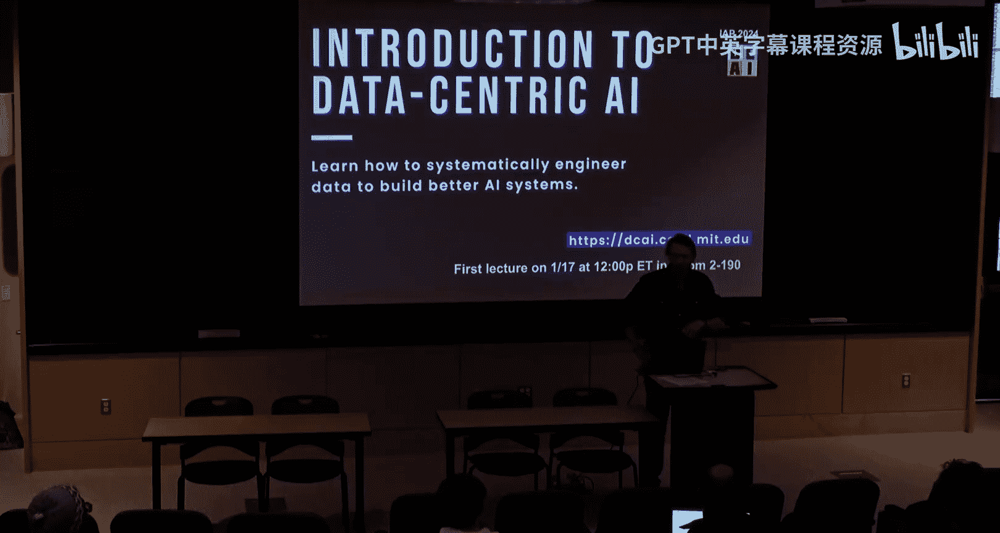

Before。Oh， I can't hear。For the recording， yeah， the room doesn't need the mic。

 it's for the video recording later。Real quick show of hands， who knows what datacentric AI is？Okay。

 that's a fun starting point， all right， okay so this lecture we'll cover in the first 10 to 15 minutes what is datacentric AI and then we'll jump in。

Originally the lecture was going to be 40 minutes of like yeah this is awesome let's get hype but then I remembered where I was and I was like that's not how we do things so after about 15 minutes we'll just jump in I'll get on the chalk board and we'll go through what I call the perceptron of datacentric AI Do you guys know what perceptron is can to get a show of hands who knows perceptron okay that's very good so you guys are in the right place and you've taken a machine learning course at some point that's a prerequisite so it's worth noting that that this will be very difficult to understand the whole course will be hard to understand if you haven't taken machine learning。

So， just。Just heads up okay， all right， let's get started and the key idea here is systematic okay。

 maybe before I jump into the first lecture high level is you're trying to train a machine learning model and you train it on data。

And how can you improve the model by improving the data， Okay， so that's like the high level idea。

 And we're going to focus on systematic ways to do that。

 meaning a computer could be programmed to do that。O。跟话两。That不错。系。How's that better？

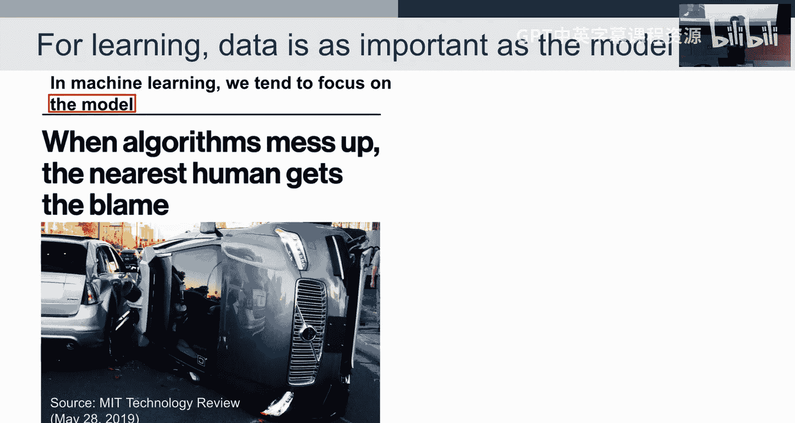

Yeah。W。Yeah。

你本。How's that。All right。

Testing， testing， how does it sound？It's okay。I can turn the volume up。Okay， all right， great， okay。

 so this is a image from MIT tech review of a self driving car。

the title isWhen algorithms mess up the nearest team gets the blame So I wanted to just review a paper that everybody hopefully has seen at some point that's a great paper which basically makes the point that a deep neural network can easily fit anything so the concept here is not that the machine learning model is somehow bad and it just can't learn it's if you fed it a bunch of wrong data it would learn the wrong thing and if you fed it completely perfect data it would learn the perfect thing with enough data。

So that's an important concept。Our brains aren't quite that good。

 we forget we don't have infinite memory， but you could imagine that if we did have infinite memory and we had some kind of perfect system in the type of knowledge we were learning。

 that if all the data fed into your brain was always perfect， you're never told anything wrong ever。

 you'd probably be smarter than you would be if like wrong things are fed into your brain。

 likewise if you're a student and you get the teacher who lies to you 30% of the time and your friend gets the teacher who never lies to you。

 who thinks going to do better on the final exam。Does it have as much to do with your brain and your friend's brain or does it have more to do with the fact that one of you got told the wrong thing 30% of the time？

So this is the way that we want to start thinking。Okay， so I want to sort of reframe this and say。

 instead of when algorithms mess up， it's when algorithms are trained with erroneous data。

So let us think a little differently and to my knowledge。

 at least every like major self-driving car in the bay struggles with this problem and I know that in depth personally by working with founders at those companies so this is a very serious issue for self-driving cars as an example so traditional machine learning is model centric so when you learn machine learning your very first class you have some data it's given to you and it's like a constant and then it's usually fairly curated and clean and then your goal is to produce the best model you can for that data set and everyone has had that homework assignment we've all seen that homework assignment。

So this is very standard taught classes you've taken here。

 and then in the traditional model centric way， you learn different types of models。

 how to tune their hyperparameter， how to change the loss function， regularization， that standard ML。

But yet in real worldd applications， the data sets's not fixed。

 you can change it and you can add new data， you can even change what the classes are。 So you had。

 for example， a task and you're trying to detect a bunch of images and you're trying to detect is this a frog as this a dog as a cat。

 whatever but then you've got a bunch of stuff that's weird Often what helps is you just throw it all into a clutter class I don't know if you've ever use that but it's a technique where you just make a new class and you throw in all the stuff that only has like three examples you just throw it into a clutter class and now your classifier doesn't have to learn 1057 classes it only has to learn like the 24 that are most important and everything else you throw into a clutter class。

 much easier task and it will do better on the stuff you care about So in the real world you get to decide what the data is you get to curate it the way that's best for your problem So how can we do that systematically and rigorously in a way that will improve our machine learning performance。

So like a company or user in the real world doesn't care like how fancy your hyperpremeter tuning is。

 they just want the model to work， that's what we care about。

So in the real world data tends to be messy， tends to have lots of errors， outliers， timeshift data。

 ambiguous data， that's the real world， it's very different than a homework assignment where it's like an image with perfectly cropped a cat's face。

 labeled cat， and then a perfectly cropped dog's face labeled dog like in the real world you don't get that kind of data usually。

And so one example you can look at this on your own and we'll cover this again is this labelairs。com。

 where you can see that the 10 sort of most commonly cited data sets and machine learning。

 specifically the test sets。So this is sort of a big highlighting point。

 the test sets all have error in them。Okay and that should surprise you that the field of machine learning has been benchmarking on test data and all of it has errors in and you can look up those errors on your own。

嗯。So a seasoned data scientist would ask themselves it might be worthwhile to invest in how I can improve the data set instead of the model because of this garbage and garbage out issue okay。

 so what is data centric AI it usually takes two forms。

 AI algorithms that understand data and use that information to improve models。

Or and this is like curriculum learning， has anybody show of hands real quick seeing curriculum learning？

Okay， cool key idea is you're just deciding which should I show you first in order to help you learn faster。

So you're changing the order of the data in which you learn you usually learn the easy stuff first and if you think about a school curriculum that's exactly what you do with students so you do the same thing with the machine learning model。

 lots of great papers on that another approach is AI algorithms that modify the data to improve AI models so that's different than understanding the data and reorganizing it in this case we're actually changing the data in order to make your model better and we'll look at an example of that next lecture and we'll lead up to that this lecture。

Okay， so what's the difference between model centric AI and data centric AI and model centric AI。

 give you the data set you want to try to produce the best model so that's your standard approach and you change the model in order to improve the performance。

So you might do that by changing your loss function， your hyperparameter。

 just using a totally different architecture， and data centric AI。

 it's given any model tried to improve the training dataset。So you see the foot。

And you want to systematically or algorithmically think about how you can change that data set in order to improve the performance on the AI task。

Now idealally you do both at the same time， but what you'll actually find and there's a bunch of graphs I'll show this。

 but a lot of people have spent a lot of time on this find that when they're in school it's like 80% of their time is spent on messing with the model and they barely touch the data and they go out to actually use these things to change the world and make it better and they spend all their time on the data so that's just something that's going to happen and I think that that shift is starting to go from industry into school and I hope that's why you guys are here today。

Okay， so our goal is to start thinking about ML in terms of data， not the model。

And so let's consider a very simple example like Kae nearest neighbors。

 and I just wanted to ask you guys what's different about Ka nearest neighbors and what we'll teach in this course just to get us thinking。

 maybe before I do that real quick， how is Can nearest neighbors similar。

Or like data centric in a way。Yeah。Yeah parametrically 100% and then you can choose how you want the distance to be defined。

 but in terms of like the actual inputs， it's just the data itself so you can imagine that you could change the data and then it would change the inputs and you're gonna to get different answer by changing the data so you can see how you're starting to bridge something you've seen before in traditional machine learning but starting to think more on the data side this is not a well specified question but does anybody sort of have an idea of w K&N is different then sort of。

What we're talking about。Yeah， a great way to get a silent room is to say it's not well specified right before you ask the question。

Yeah， that's a really good way to think about it and to go a little bit deeper。

 what we would do and what you'll see us do is we're going to learn parameters that aren't just for the purpose of learning the classifier but also to understand the data and then use those parameters into our machine learning paradigm in order to do something better or to throw out data but somehow we're going to do a separate task in addition to the machine learning task and then that separate task we're going to understand our data character it and use that information to train a better model by they're providing different data or by reordering the data or structuring it or using that information some way。

 and you'll see that over and over and over and every time'll see we'll connect the dots for you of how you're going to get an improved model by doing that。

Okay， cool， so what is not data centric AI handpic a bunch of data points you think will improve a model。

 can somebody tell me why？Yeah。系。100%，00% so what do you do if you're you know you' Google or your meta or Amazon now you have trillions of data points good luck you know okay two double the size of your data and train an improved model on more data can somebody tell me why that's not a good example of datacentric AI。

对呀。Exactly and this has been that's very well put there's been a huge paradigm shift from like the last 10。

 15 years where people used to focus on how do we improve the quantity of data and it was big data that was the big thing if'm was talking about and now you're noticing a shift where it's about the quality of data and that's because you can't just add more data forever at some point there's a limit and so people are starting to think about this and we're going to look at ways we can do that。

Okay， so here's the datacentric AI versions of this one would be Coet selection。

 so this automatic way to identify what is like the few handful of examples that if I just trained on those I'll get the best results possible with like as little time as possible and if you're familiar with the concept of a proto frontier this is optimizing that proto frontier of time to train and quality and cost so how much you cost to train。

And then two would be data augmentation so doubling the size of your data set by just gathering more data that's done by hand one and two it's not scalable forever so two is data augmentation where you have techniques where you can either simulate to the model that you're doubling the data or you actually do you generate more data and then train on it。

 but still an algorithmic algorithmic systematic way okay so some examples of data centric AI would be outlier detection removal hopefully you guys have seen who here has seen an algorithm on outlier detection。

Okay， can I just get an example of one？Yeah。Are there any others， it's a good example。C score， yeah。

Did you guys learn one class SVM？Tomi Akala was teaching ML when I was here。

 he was like really excited about that。There's a bunch of them。

 but the simplest one as you just look at the distribution of the parameters。

 if you have a data point that has like 10 dimensions for each dimension you look at the distribution of the value and then if something is way out there you throw it out that's like what you learn in high school and then it gets more advanced from there error detection correction so this is like how do you actually find incorrectly ableed data and how do you improve it automatically suggest an improvement or just throw it out。

Da augmentation， so that's how do you take a data set and then somehow expand it with enriched data。

 more data or duplicated data， so you might want to expand in the column level imagine like a table of data。

And you might want to expand in the columns， meaning more features。

 or you might want to expand in the rows， meaning more data by generating a new example。

 Can somebody tell me an example of data augmentation？Yeah。

So that's image and shape based data augmentation yeah。What's another example。

 Does anybody know any others， it's a great one。没有。Yeah， that's augmentation to the right。

 like column wise augmentation， like feature generation， yeah。Any others？Yeah。Yeah， that works。

The one that's super like famous and commonly use it similar to that is。like reverse translation。

 so you take something in English， you have a text data set in English and you want to get more examples。

 so what do you do， you need more data but you don't want to go collect it so you just translate it to German。

And then translate it back to English and you'll get a few word perturbations。

 so it's basically the same thing， but slightly different and now you have more data。

So that's just another like systematic way to produce more data Okay。

 feature engineering and selections like which features are the ones that are going to improve your model or generating more finding a consensus label so you have a whole bunch of people who have all voted like say that you had an image is kind of a blurry like potato chip。

 someone might say oval someone else says potato chip， someone else says potato chip。

 someone says asparagus chip okay so how do you decide like what is the consensus label and there's a bunch of work on that and then active learning anybody know what active learning is。

Okay active learning is very popular in practical settings and active learning you have some data set that's already been labeled it's not too big and now you need to train a good model。

 your performance is like 80% you're trying to get to like 85% so what do you do you need to label more data how do you know which data to label say that you have 10 million examples that are unlabeled how do I choose the one example that if I labeled that one and I added that to my training data and when I train on this new data that now has this one example labeled included I get a better model。

And then how do I do that repeatedly over and over to say 10，000 of the 10 million examples？

So that makes sense， so you pay little cost， but you get big in performance and how do you maximize that？

And then finally， curriculum learning， which we already talked about。Okay， all right。

 so there's a lot of hype around this datacentric AI concept because it keeps coming up in practical settings。

 I think we'll go through this part really quickly but I was surprised that you guys haven't heard too much of datacentric AI so I will mention that there's a lot of big thinkers who think a lot about this and spent a lot of time on this Andrew Eing constantly is pushing for datacentric AI because in his when developing like Google Research La and Badie Research Lab and Coursera and a bunch of other stuff he's worked on he found that most of the time was spent on the data。

That data cost the US like 3 trillion a year。

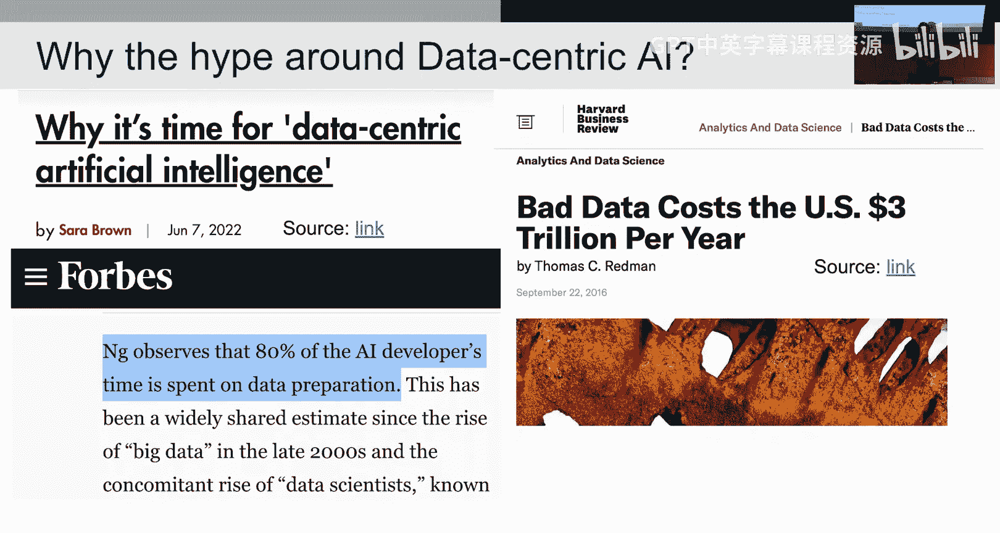

and a lot of people are like this should be solvable this is an example I wanted to share with you guys。

 I use this a lot， but I was a fair intern， is anybody interned at Fair？By chance。

I like that probably。Sure there's some meta interns here。Oh no， meta has gone。Okay。

 I won't publicly record okay well anyway， so I was at Meta。

 there were a ton of MIT people there at the time and I was meeting with Jeff Henon and Jan Lacoon and this small meeting back when Fair was only like 10。

 15 people in the New York office and the reason I wanted to share this example。

These are both Tring Award winners， which is like the Nobel Prize in Comp science。

And Jeff Henon is here to present his new work on capsule networks which is really hot at the time and it's a brilliant paper if you have a time to read it。

 it's impossible to understand， but it's a really good paper and it's arguably impossible to understand。

 even Jeff Henton has admitted that and he's at fair and he's telling Jan on La Coon about this new research in our group。

 and at the end he says but I want to share something that I'm really excited about on La Coon。

 your data， the MNIS data and real quick show hands who heres heard of the MNIS data。Exactly， okay。

 so that has like 40，000 citations and many of the citations say that it is assumed to be a perfectly labeled data set and Jeff Henton says lo and behold with my new capsule networks。

 I was able to find one error This five is labeled three in your dataset set。

He was very excited about this and I'd bring that up because that shows you where the state of the world was in summer of 2016。

 a Turing award winner and one of the greatest minds in machine learning was excited to find a single label there in a systematic way。

So I want to show you how far we've come and show you where you are learning。

 where you're on the precipice up。So it's a good kind of reminder Open AI has openly stated that their biggest issue in terms of training Dolly has been on data and the labels and I just looked at their demo video and this is just screenshots from the demo video if you go to their website。

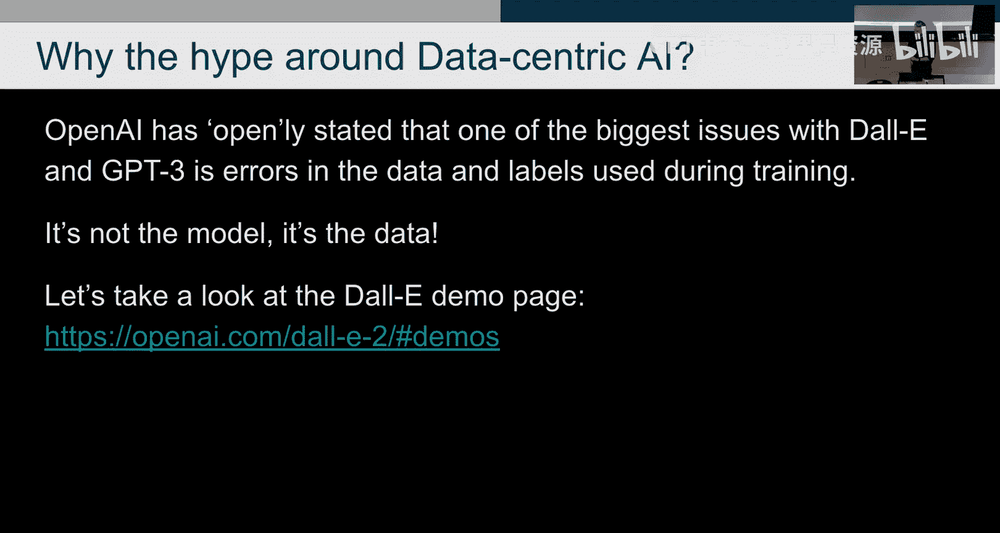

And it'll say it has limitations if you teach it objects that are incorrectly labeled like a plane labeled car。

 then when you say hey， generate me you know a car。

 it will generate a plane because it's seen a bunch of planes but they were labeled car how can they know right so if you have hundreds of millions of data points。

 you're generating this huge massive system， how do you know？

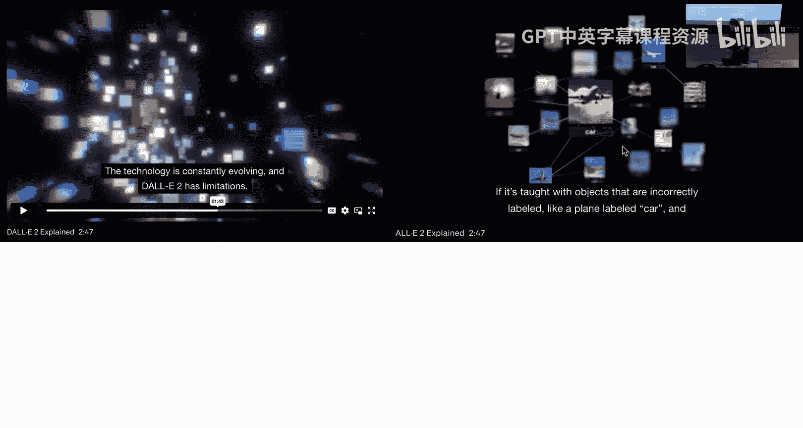

You need a systematic algorithmic approach or you're just going to do things like this and then you'll see all the internet news headlines。

 hallucinations， models are performing poorly if you're a car and you misread human as stop sign or stop sign as human this is devastating so we can't get this wrong so how do we get it right？

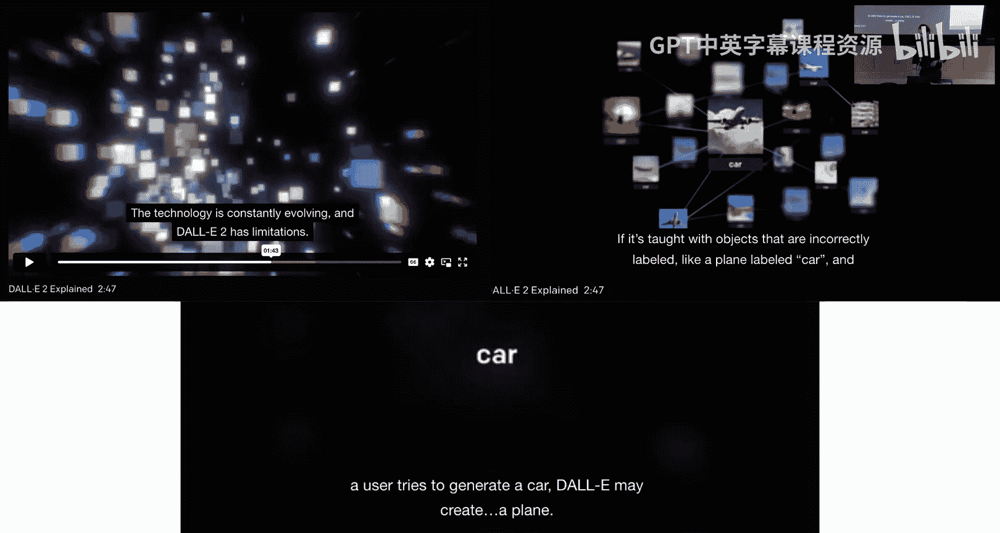

There's a bunch more examples， we all know about chat GPT。

 can somebody tell me very quickly sort of what the big jump was from chat GPT or sorry from GPT3 to GPT 3。

5， which is known as chat GPT。What was like the big difference？两。Mmhm。😊，Yeah， why did they need it。

 so you were getting it at the very end， why did they have to do that？Yeah。

100% yeah so there's the emotional side which is what we like and don't like and then there's also the veracity side which is like is this even a true statement or not and you have people checking for those things because these models were producing hallucinations and errors and then stuff that really you know irked people and so you had to have a human loop what's that human doing they're doing data quality。

And they're doing it at scale， and it's costing hundreds of millions of dollars。

So that's sort of the big difference between chatt GT3 or GPT3 and Cha GT， it's a data quality issue。

So we'll skip ahead this is a slide from Andre Carpathy it's a really good one this top left is Tesla Car Andre Carpathy just in case we don't know is he ran autopilot for Tesla super sharp guy you may have used his online tools he's done a lot of good stuff for the mail community like training a deep neural network in JavaScript on your browser locally like as one example anyway so he ran the autopilot group and this is a slide he used to show to sort of make the following point you have a car you trained it on a bunch of data and then you put it in a tunnel and it crashes。

And it crashes because it's never seen dark image data。

it's a new kind of data and that data goes in the model， it gets poor predictions， it screws up。

 so what do you do， you then send your team out to put that car in tons more tunnels and you collect a bunch more data。

And then you label that data which is an expensive process and then you retrain your model which is an expensive process and then you deploy the model and guess what happens now you go on Golden Gate Bridge well it hasn't seen bridges before and it crashes again every time a lawsuit every time you gather more data etca etca so you see how this process can be very painful but this is the loop and there's always data quality involved so what we want to think about is how can we automate that loop。

Another example is that， and this is imagine your Andre Carpathy。

 you're running autopilot group at Tesla and Elon Musk comes to you and he says Andre。

 I want you to do something very simple for me， I just want you to make my Tesla cars be able to detect a stoplight and you think to yourself I can do that for you Elon that's no problem then you go out in the real world and these are stoplight。

So it's hard， data quality is hard and so I would consider this a class of data called ambiguous data。

 which is something that you can detect and one way you might do that is just by looking at a bunch of training and a bunch of different algorithms and saying do I ever get high you know probability one on my outputs or is it always like very much in the middle and what does the middle mean and if you have some notion of what the middle means。

 then you would say that the data is always ambiguous so I call this ambiguous data meaning these are examples which are definitely stoplight but they are not in a data set of stoplight。

 these would be ones that would be a little bit weird or difficult to detect and much this is a very narrow scope of all the stoplight that are out there？

Okay， we already talked about this， so this is like left is what we think about when we're doing school and right is real world。

 that's why we're here。嗯。And then this is a slide I wanted to bring up that we'll get into next time。

 but it's a very motivational slide and it's a good one this right here， this is out of Google。

This is out of Facebook， this is out of a really good research lab。Also out of a good research lab。

And these are some a of good research labs but older papers。

 so what I've done is benchmarked a bunch of different methods that all do one simple task and that task is given 40% wrong labels。

Train and classifier。And see on a test set， what is the performance when you've trained on a training set with 40% wrong labels and the data set is CFR 10 and that's just 10 images。

 10 different classes， 10，000 images in the test set and can't remember I think 60。

000 total images or something can't remember exact number okay so you train on this 60。

000 set you then predict on this 10，000 held outset you've never seen before， but of the 60。

000 we intentionally pertuurrb， make 40% of the labels wrong。

And and then you train on that that's all you get to see。

 you never get to see true labels and then you predict on the test set okay when you do that you'll notice sort of the this is when all of your data has label errors and then on the right which is much more realistic is when 60% of your classes are not flipped to other classes so what does that mean tigers are flipped to lions and cats。

 but they're not flipped to bathtub。Miiles are flipped to projectile。

 but they're not flipped to a balloon。So most of your data is not erroneously labeled as other data because in the real world that doesn't actually happen that much。

 it's very unlikely that like bear gets mislabeled as computer just doesn't happen that often so in the real world most of the sort of flipping rates are zero and so this is saying 60% of your flipping rates are zero so that's the column on the right the point I want to emphasize is two there's two of them one is that there's some methods that when you go from academic setting to real world setting you have a massive drop off。

Like it doesn't actually work and in the real world setting。

 all your error is not distributed perfectly over all the classes。

 it's like really focused in a certain area， so that makes it harder。

When the air's uniform is' much easier because air is spread out。

 so there's not that much error per class。And the second main point here is that when you rank these methods。

 something magical happens， all the methods that end up on the bottom change the loss function。

So they are model centric learning and all the ones at the top change the data。And that's fine。

 so this should motivate you that there's something to this data changing thing。

 in fact it may be the case that when there's enough error in the data。

 changing the data will do better than changing the model。And that shouldn't surprise you。Okay。

 before there was data centric AI， what did we do， we spent a ton of money， we still do this。

 by the way， spent a ton of money for higher quality data and more labels。

 we built custom tools with Jupyter notebook， Jupyter Lab， Google CoLab。

 this whole data quality platform where we do things in a cycle very expensive， data centric ads。

 how do we do that systematically and algorithmically。

And I'm going to stop here and I'm going to jump into an example and it's going to be more focused。

 I'm going to get on the blackboard and we're going to go through an algorithm and a subset of machine learning called P learning that's going to really get us excited I'm super excited to show you because it's super cool but before we do that any questions。

Yeah。Yeah， so they're definitely model centric， but it's very difficult to do data centric AI without AutoML。

So they are useful for a lot of the algorithms that we work on and everything I'm going to show tomorrow is needs something like AutoM in order to generalize to all data。

So with a good AutoML tool you can throw any dataset at it， text or image or tabular or whatever。

 so if you have a good way of being able to find errors in any data。

 then you need a good AutoML tool to be able to train those models if it's a probabilistic approach so the two are often combined but the way I like to think of it is it's a tool that's used in order to do a lot of these in practice。

But it's not the data centric AI itself。It's worth noting that our third。

 one of our lectures and a core lecture he'll teach Monday and Tuesday is Jononas Muer。

 and he built the AutoML system for AWS。So and I guess I should introduce Anish two who set up the course。

 ran the course and we've worked together for like 10 years or so and' show that I'll show that at the end。

 I'm getting ahead of myself， but they're fantastic people it's an honor to be able to work with them and to get to know them and I'm excited for you guys to see their lectures too but Jonas will teach one on a little bit of AutoM but on most other stuff and he is super rehearsed and if you have Autom questions throw them at him。

 I'd love to see someone st him on Autom stuff。He did his Ph with Tommy Acola。

 if you guys have had his class。 Okay， all right， let's jump in， so I'm going to raise this now。

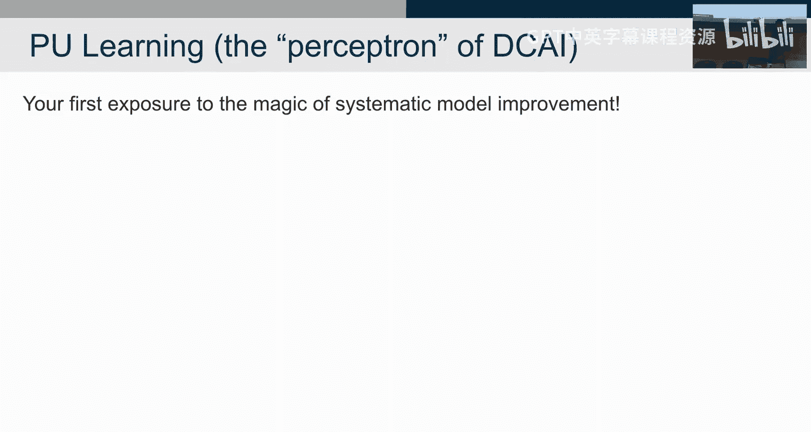

Help me out。Until one， okay。

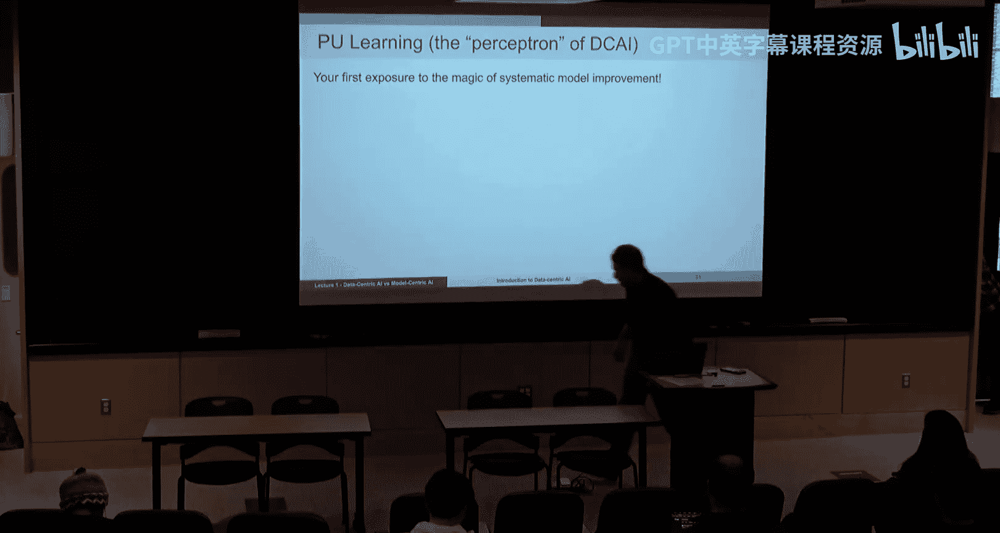

I think what I have to show you is too cool for 15 minutes。So we'll do our best。嗯。

And I'll upload lecture notes by end of day that we'll have all this stuff in more depth。

I like to call this the perceptron of data centric AI because and we got a good show of hands。

 everyone's pretty familiar with Perceptron。Do you guys know why you learn that first in machine learning？

Can somebody tell me real quick？Yeah， it's super similar and it's all in the notes so I don't want to write it all out because I want to focus on new stuff but you get a formulation that's a lot like SGD。

 stochastic gradient descent and it's pretty simple and then you have this term which is basically the predicted label minus the normal it's okay if you don't remember it perfectly but predicted label minus the normal label which is basically a loss function you multiply that by Eda or whatever it is and that gives you a learning rate that somehow is going to update your weight。

 so you're gonna to add that and then improve your weight。

 and that's the whole algorithm and it's this nice little simple example and it seems kind of weird。

 it seems kind of magical like somehow you just move this line you add some this like random term。

 which is the subtraction of a binary label and somehow the line kind of ends up fitting the data and it works it actually does work in practice it's just like slow and not super scalable but it does work so that's cool and that should make you excited it seems kind of magical so I'm going to show you something that's magical and datacentric AI and what I'm gonna to show you is say that we have a data set。

😊，And。Real data looks like this。And this is true data okay so when I say real data I mean the underlying truth that we don't get to see x is some data point so it can be a line of text or an image or tabular data。

 a bunch of healthcare features about a person， and then this is a label。

 and we're going focus on super simple case， binary classification， this is day one。

 let's start easy， binary classification， the label is in one in zero okay。All right。

So this is standard binary classification。 Everybody's seen this， right？Okay， boring。

 great now what do we see in the real world and the real world we see this。

Where this guy is the label you observe， okay， so this is latent。Truth。And this is observed。Noisy。

Noisy means it can be wrong sometimes。 So I gave you an image is a dog or cat。

 It's an image of a big， beautiful， fuzzy dog and it's labeled cat。 Okay。

 so that's what real world happens because we've got millions of images。

 How can we check them all And we're going to train on those images。 Okay。

 so this is way we together。😊，Okay， so this is what we actually get in practice when we're training machine learning models。

And what we're going to show you in the next 15 minutes is that when you train a classifier on this thing。

 you're going to get some function。On of x， that equals。Okay。

 so that's sort of your like you know gold star function and that's what you want to get it's the if you had perfect data and you had say a perfect model and you had enough data youd get this really great function however what we get in practice is we get this thing。

That's what you actually get when you train on this data， Have I lost anybody yet？Okay。Good。

 because this is the basis' because what we're going to do， that's magical。

Is we're going to go from this to this。And that should make you feel very happy and we're going to do it algorithmically in a way that you can totally type into a computer tonight if you wanted to。

Okay， so we're just going to go from that to that， and it's actually not that complicated。

 but it's going to take some assumptions because it's day one。Okay， so there are two assumptions。

The reason that this is called。PU learning。Is because P stands for positive。Unlabeled。

And this positive set has no error。 It's a big assumption。

 Tom we're gonna to look at something extremely general that works for and the real world for real world multiclass settings。

 but let's start simple because it's really beautiful and elegant。

 So positive your labels have no errors。 Okay so call this class P and P is a bunch of stuff of examples like images that are labeled。

 let's say the positive class was cat then it would all of the things that are labeled cat。

 you know none of them are delicate。 It's guaranteed and the unlabeled stuff。

 we're just going call that like the zero class So this will be the one class。

And then this is the unlabeled， we're just going to call that the zero class。

 Now the zero class is actually unlabeled data。But we just label it all zero， haphazardly。

That means that some of that stuff is actually labeled what？1， yes， there's some ones in there。 Okay。

 so that's what we're going start with and。And let's look at two assumptions。

 so one assumption we've already done。And that assumption is it's the definition。嗯。

Which is basically this。Okay， so given that something is。

It's an image and it's actually labeled a zero。Probably that we observe it to be a1 is zero。

Does that make sense？So everything that we observe as one。

 everything in the positive set that we see is positive。The probability that it was actually。

Like conditioned on that actually being a negative example， the other class is zero。

 it's never going to happen， Okay， that's assumption one。An assumption two。Is。

That and let me write it out and then I'll explain it。Okay。

So the only thing that's different is this guy。Okay。

 and this is a conditional independence assumption。So what this is saying， all right。

 so conditional independence and this is just like。X and PE is perfect。

And this is conditional independence and what this says is that the probability of an example being flipped from one to zero。

I does not depend on the example。Okay， so if you have a whole bunch of images。

 we don't care what the image is， the probability that that image gets if it was actually a one。

That'd be flipped to a zero。Is the same no matter what the image is。

 It doesn't matter what the image。 That's an assumption。 That's definitely an assumption。

Because maybe an image that's more dog looking would have a higher probability of being mislabeled dog。

Okay， so that's an assumption。It's somewhat reasonable though， because say for example。

 that you zoomed out and you had millions of classes then the probability of like some missile looking like projectile relative to like all the other classes is like within a certain boundary so it's not a super well assumption but it is an assumption okay。

 given this then we can do something really easy we can subtract one from both sides。

And there's only two classes right， so I'm going to do this like really shorthand。

 but given some stuff。Equals one， right？There's just two classes a sum to1， okay。

 so that means that we can do one minus one minus this one。And then we we can plug that into here。

 so if we do one minus this and one minus this， we get this。Okay。

 so I haven't done anything fancy yet， I know I'm writing a lot and I'm writing quickly and I'm talking fast。

 but I haven't done anything fancy。 I just attracted one from both sides and I got that So those are our two assumptions all right。

So now I have a loop to close， okay， so the key insight。Is as follows。Let's do alema。嗯。

Say these two assumptions， say this holds and say this is the definition of the problem。

 so just say that assumption holds， then we have the following。

Okay。So I just call the C because it's a constant， there's no data in here。

That's why I call it C a constant。And this is a term that tells you how often when stuff is one。

 is it actually one， We're going to estimate that， by the way。And if we know that。

Then I argue that we can go from this guy。Remember， that was the output of。Of top board。

 that was the output that we get when we train on our noisy data。And we're going to get to this guy。

Are excited？

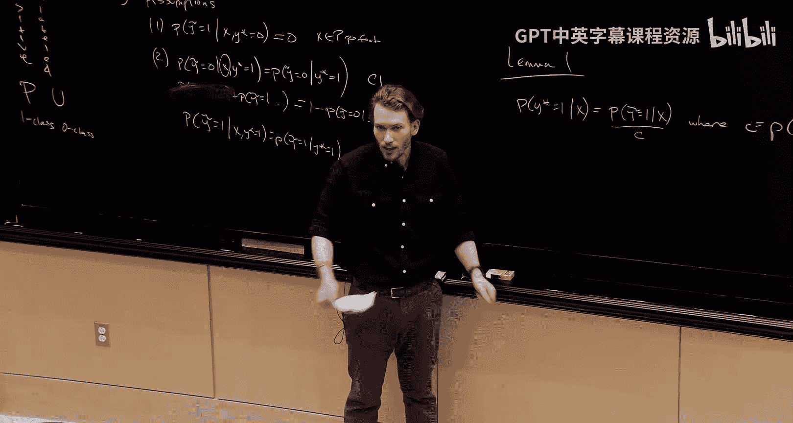

That's kind of exciting。 I mean， like if you actually think about it， I know it it's text on board。

 but like think about it。 like you looked at a bunch of wrong stuff。And somehow， we're gonna to get。

As if we looked at the right stuff， that's magic， it should feel it magical。

Because data centric guy is kind of magical。 it's cool。 So all right， so how do we do it。

 So we need this to be true。 I haven't proven it， by the way。 So let's prove it。😊，And it's elegant。

Super short， super easy proof。So。

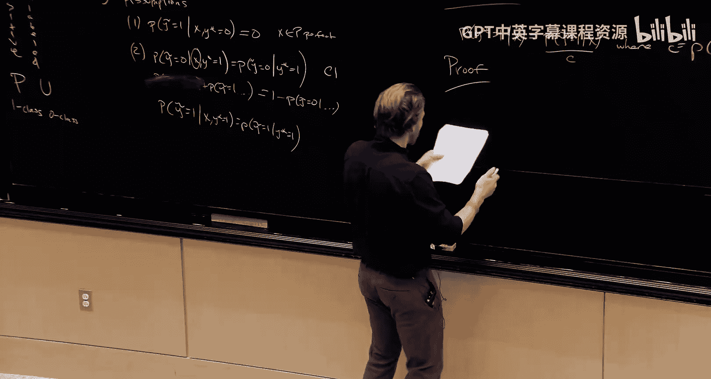

This equals。This is easy， so this is just， I'm just going to do some very standard trick you saw like when you first started learning probability。

And what I love about this is it doesn't require advanced probability。

So everything I show you is going to be like can if you just take in high school probability or like intro to probability。

 it will work。Okay， so that's nothing fancy。I've just broken this apart and then these two。

 when you sum together， they combine for all the terms and you just get this term okay。

 so has everybody seen that role before？Okay。So we're just summing over all the possibilities of I。

 which sums that term out and it's called marginalization， Okay， so that gives you this term。

 all right， cool。Well， what do we know about this guy， can somebody tell me？What is that equal？Yeah。

 it's zero and it's a think jump， not just a stuff on a board jump。

 right if you have some stuff that the true label is zero。

Then we never observe it as positive because our positive class that we observe never has zeros in it。

 So this just can't happen。 And then mathematically。

 that's obvious because you can just multiply by y star equals0 and you get the same thing， but。

If one of them is zero， the other one's zero because they're multiplied， but anyway。

 like non mathematically， conceptually， it makes sense。

So we can't have any errors in our positive class， that's an assumption， so this thing is zero。Okay。

And then。And then， yeah， cool。 So now we're actually really close。 So we have。

Now I'm just going to split this up and the two terms。Okay。So that's just the definition of a joint。

And then we're basically there。Can somebody tell me how I went from here to here？Yeah。嗯。Yeah。

 so this one going from here and to there is just problem definition。 So we're saying look。

 we just need our positive class to be true， but the negative class we don't have any assumptions on it。

 And then this one was the assumption that，And anything that's like we don't care about the data。

 the probability that it flips is constant。So whenever those two things are true。

 then we get that this equals this， and if you notice that is exactly this。It's the same thing。

 it's just that C is that。And it's multiplied on the other side。So we just proved it。

It's actually that simple。And so you may be asking yourself， we'll hang on a minute。

 like close the loop here， how would I code this up in a computer？And so with 90 seconds left。

 it's actually not that hard All you would do to code this up in a computer is you want to get this guy。

So what is this guy， this guy is given data， that's y star equals 1。Well。

 we know the stuff that's y star equals 1， everything。

 all the data that's in that positive set has y star equals 1， we know that。

So all we have to do is train a classifier like you would on you know any ML class。

 you just train a classifier and you get。What do you get？Remember， that's what we got。

 We don't get Y star， we wish we did， but we get this instead。And then you just average it。Yeah。Sa。

So。If we what's the probability of y tilde equals 1， what is this term here， what is this guy。

 this is the probability that y tilde equals1 conditioned on stuff being，In the positive set。

Now this is finite， so I did it approximation， but if you had every single possibility。

Then this would。Asymptotically， give you that。So condition that you're in y star equals 1。

 what's the probability of y tilde equals 1， and this is just saying average all the stuff that's y tilde equals 1。

 conditioned that you're in the stuff or y star equals 1。

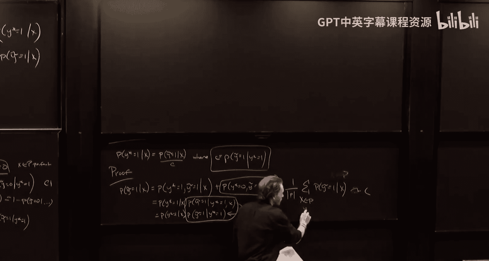

So conceptually hard， but algorithmically extremely simple。

 and this is like three lines of Python to get you to go from a。

Classifier trained on erroneous labels。To an approximation， an estimation。

