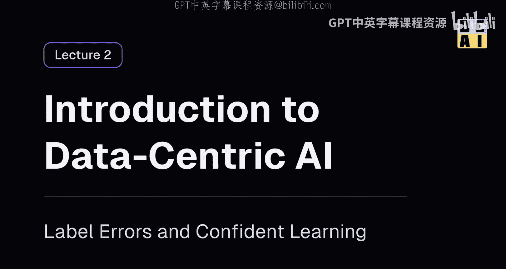
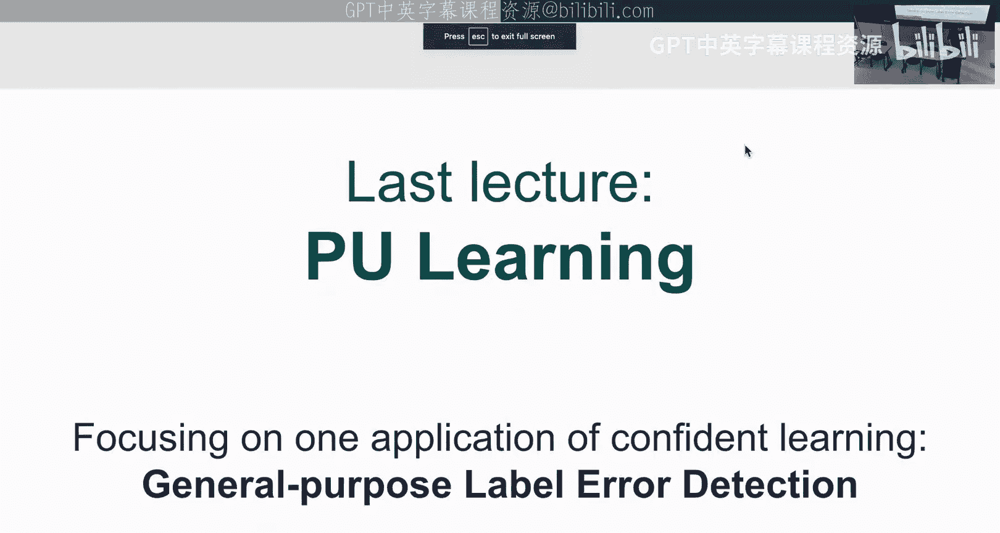
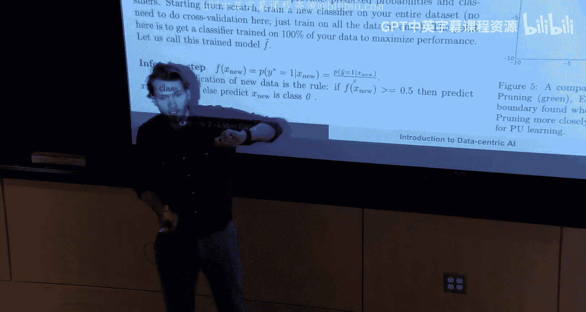
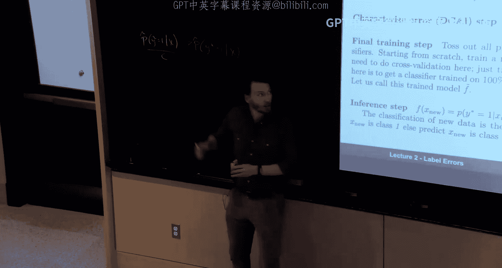
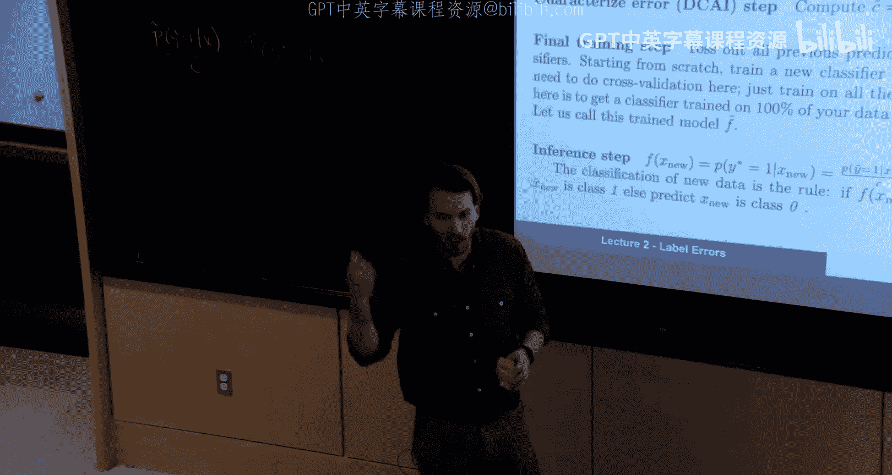
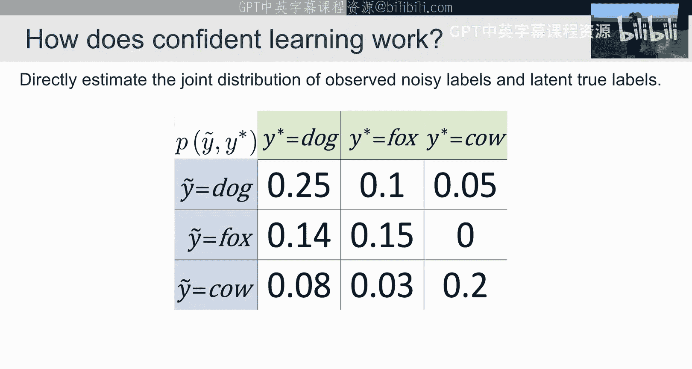
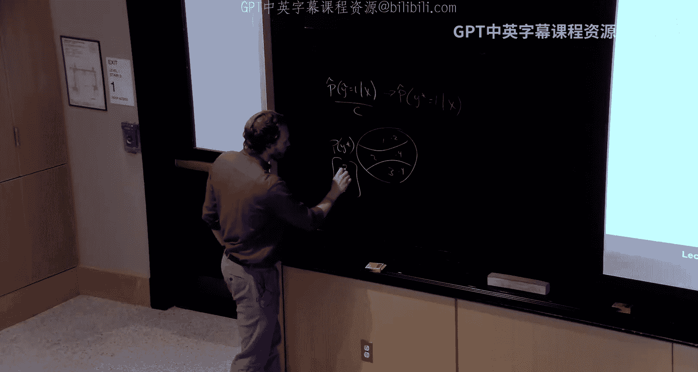
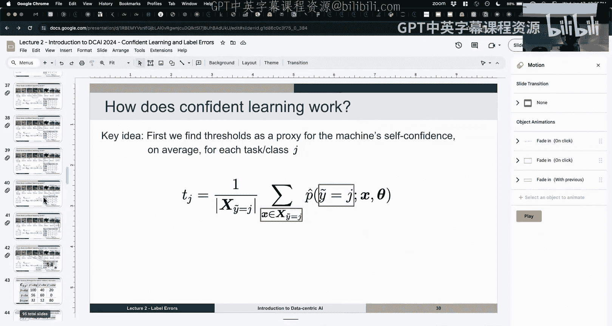
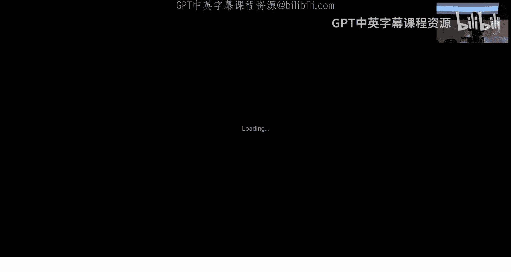
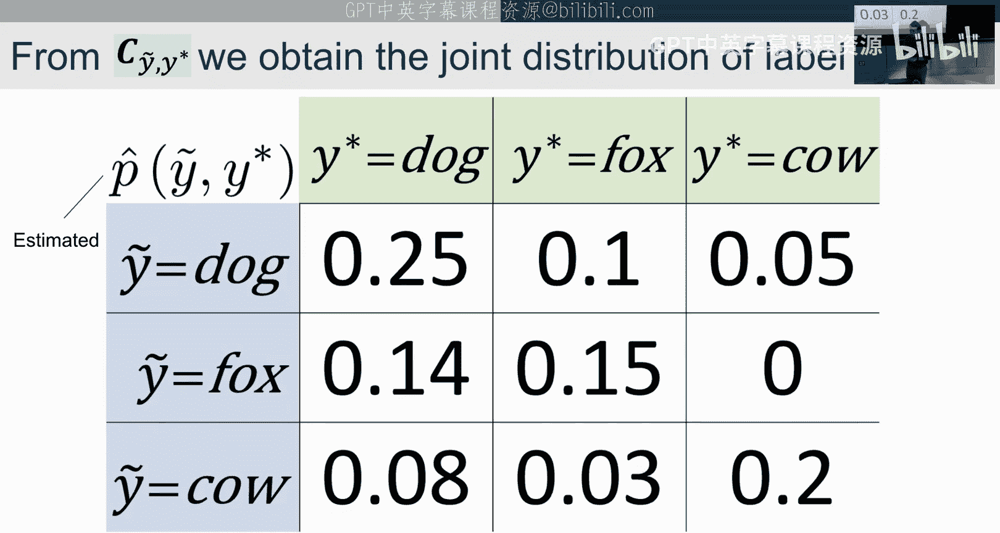

# 《数据中心人工智能导论｜Introduction to Data-Centric AI, IAP 2024》中英字幕（Claude-3.7-s） - P2：Lecture 2_ Label Errors and Confident Learning.zh_en - GPT中英字幕课程资源 - BV1wvhczTETR

Okay， so welcome back today's going to be a fun lecture so we're going to pick up right where we left off。

 we'll do a reminder slide and then we'll jump into confident learning Any quick questions。

From yesterday。Okay， cool， I realized that I skipped the slides just now。At the end of。Yesterday。

There's some， just super。Short stuff。So high level， this is what we're covering。And of course。

 it's just a whole bunch of stuff like what we saw， but for different domains， outlier detection。

 data set creation， data curation for LLMs， so this is kind of high level what the course will be like。

嗯。And there's lab assignments for everything on the GitHub， some of them are reused from last year。

 there's a piazza for the class。And you can search。

 and I think an niche email outs everybody the link and you can ask questions there。嗯。

Today we're covering label errors and how to find them automatically。

 how to train classification models generally for any data set that contain label errors in the data。

And we may get to the impact on machine learning benchmarks。And it's the instructors。Okay。

 so let's jump in。

So last lecture， we looked at P learning。And。I just wanted to show this one slide to kind of put things together。

 We're not going to go over all of this。 The point is this is in the lecture notes。

So I typed up for you guys sort of a step by step， how all everything we looked at comes together。

And a handwritten paragraph form algorithm instead of。Code。

 because really the only code step is this one。And I just wanted to highlight。Two things。

 one thing is that there's a difference between train and inference。

And there's two trainings that happen。 So the first step is you obtain that that P。 we saw。

 if you remember， we saw a。The sort of Pa hat of Y till day from last time。So we saw this。

And then we did things with that in order to be able to get。What we really want， which is this。

And the solution was quite simple， was just divide by C， which is estimated here。

And the one thing I wanted to emphasize is these predicted probabilities are coming out of a model。

So what we actually have is estimates。There is some notion of a true， perfect predicted probability。

And we can chat about that。 We actually will today。

 but these are coming out of a model and machine learning models looking at some subset of data。

 they haven't seen all the data in the world， so the predicted probabilities they output are not the perfect predicted probability。

 maybe the perfect is 0。85 and they might output 0。7。So when we're averaging these numbers。

 we're averaging a bunch of numbers that have error in them and sometimes on average， you know。

 the error kind of averages out， but it's not perfect。

And so the C you get is this constant factor that helps you get closer to here。

 but if your model' is really bad。

It helps you get closer to here the goal。 But if your model is really bad， these are really bad。

 And so this estimate。

Here is going to be off more and then this is going to be off more。

 so that's how the air propagates and it's good to keep track of error because that's what we're trying to deal with here。

We're trying to improve the machine learning model so it's always good to track the air and I just wanted to bring us back to that and the second point I wanted to make is the predictive probil are computed out of sample and kind of get a show of hands of familiarity with cross validation。

Okay great， so' that's how we're gonna do it for the most part， you can also have two data sets。

 maybe you have a training data and then you have that data set that you want to improve before training a model on that data。

 and you could train on the training data and then predict on the one that you want to improve but another thing you might do is just download a model from the internet and as long as the classes are the same then you could always just use that model to get your predictive probabilities and those would also be out of sample as long as that model wasn't trained on any of the same data that you have。

So that might make sense if you've ever downloaded models from CarIS or Huging face and then you can just run inference on your dataset。

 but the classes have to be the same otherwise there's a fine tuning step so those are just some some technical details I wanted to cover and then what this is is I wanted to show you when you code this thing up。

You get the purple circle for this data and for this data。

 some percentage of these circles have been perturbed and flipped to the other label and it's not displayed here because this is very old image from like eight years ago but the green line is a very simple version of the algorithm we're going to look at today。

 it's not quite as good but it was sort of the first version and then the black line is the ground truth if you had all the true labels and the purple is what you get using the method we looked at yesterday。

So we're going to look at a method today that will get you closer。On average。

 this is one simple example， but on average across a lot of data sets。

 it's been benchmarked quite thoroughly。So I just wanted to ground us and where we're headed and where we're coming from。

Okay， any quick questions？Okay， let's jump in all right。

 so today we're going to talk about Comp learning and our goal is some general purpose label error detection so that we can then use to improve labels that we feed into a model or a systematic improvement of machine learning models。

This is an image from a paper that we worked on together。

And I wanted to highlight that there's a lot of different types of errors and these errors here。

 for example， are errors of images， this is INIS， if you're familiar with INIS。

 these are the CPR datas， Caltech 256 INet Quickraw， this is a Google dataset set。

And these are examples where we had a machine learning model。

 and we had human reviewers who just couldn't agree on the label themselves。

So I think of this as ambiguous data。There are ways to detect it we won't focus on it in this lecture there's also examples where you provide two labels to annotator and they just neither of them are correct。

 sometimes these are outliers。There's also data where there's two labels in the data point。

 so like for example， if you had to choose between the label laptop and people。

 which one would you choose for a single class data set you'd be kind of out of luck， right？

So that happens quite a bit in single label data sets。

And then this is the one we're going to look at today。

 so this is one where there actually is one label and you want to correct it。

 and then once they've been corrected， you're going to feed that data into your machine learning model to get better performance。

So high level， are we clear on what type of errors we're trying to fix？Go， all right。嗯。Okay。

 so what are we going to do， we're going to learn about different kinds of label issues。

 why they matter noise processes and how to find the issues and then mathematical intuition for why these methods work。

And then if we have time， we'll go deeper into some algorithms and how you can rank data。

 how to estimate the total number of label issues and then how to train the final model and then the impacts on ML benchmark so this will be sort of stretch goals and if we don't get to these。

 we'll go over them briefly on Friday before doing some other stuff。Before we sort of jump in。

If you'll permit me， science is a dispassionate subject， math is a very dispassionate subject。

 there's literally no passion。And the reason I'm bringing that up is because I want to share a passionate story that's very short。

 but it's important。So。This lecture I'm going to share with you came from a desire。

 So when I came to MIT， I was the first research scientist atedX。 you guys heard of edX。

And there's the courseurra too。And we had this goal， which was to detect cheaters。

 and I was playing around with the data， and I discovered that like 10 to 30% of certificates earned by people who had more than five certificates were cheated to earn and the way you earned them was you opened up two windows。

 So this is like a cheating strategy on video but you can actually apply this。

 but there's no algorithms to detect it。 you would open up two windows and you have two accounts on one account。

 you type the wrong answer， you get the wrong answer。 you then click show answer。

 It displays the correct answer because it's a learning class。 You copy that correct answer。

 You then go to the other window and your other account。 that's your real account。

 the master account。 You pacee that answer， you hit enter and you just do that on repeat and you can get perfect scores on online courses and people were doing this to get perfect scores on MIT courses and Harvard courses and Stanford courses and then using those certificates to get jobs。

So this is highly problematic。 I'm from rural Kentucky Education was everything to me。

 it's how I got to where I was， and I was on a mission to democratize education。

 So the barrier between sort of democratizing education for the whole world was how can we generalize detection of these cheaters。

And my first approach was to take machine learning and try to achieve this。

 to try to solve this problem。 And what happened was that we had a bunch of labels that were0。

 We thought they were not cheaters， but they actually were。Because innocence until proven guilty。

 you don't want to say someone is a cheater if they actually haven't cheated。

 just like you don't want to put someone in jail if they're not guilty。

 so we had a ton of false negatives。And I tried to train on that data and nothing was working。

 and I just kept getting bad results， models that would not generalize and a lot of problems。

 so I start diving into the literature， and it turns out that at that time since 2013。

 there is no algorithm that will allow you to generally learn on noisy labels in machine learning。

Which perturrbbed me because I'm doing a real world data set and in real world data sets。

 there are noisy labels。And so then I wondered， wait。

 so as every single company and person who's trying to apply machine learning。

 are they all dealing with this issue， And it turned out that for many people， the answer was yes。

 and that is how the lecture I'm presenting today became confident learning。

 That was the very beginning that motivated everything you'll see today。

So I just wanted to share that story to show this is very real。

 and this is how we were able to get make the jump to then train a machine learning classifier detect cheating at scale across like 700 different courses。

Okay， let's dive in。There's two papers if you're interested in looking up more。

 so the types of data this lecture applies to text data， LOM output data， video classification data。

 audio。This is a kind of a joke slide， This is any type of data you can train a machine learning model one。

ok。So a quick method， just a sanity check， you can。

 let's think of a really simple way that you would find label errors in sort of any data set。

So you could train a model and then you have a loss function for each example。

 and then you could just sort wall training。The example by the loss。Can somebody help me understand。

 maybe I should get rid of all the text on this screen， Can somebody help me understand？

Because generally， does that make sense that you could do that so as you're training on a data set。

 you could take the loss function， the loss for each example。

And then just see how much is the loss after I've done hundreds of iterations of training。

 so my model pretty good at this point。Can someone tell me some issues with that？Yeah。Yeah。

 you could have a really bad model， although that will affect most any algorithm that depends on the model outputs too。

But that would have definitely screwed this up to。Yeah， so this is the in sample issue。

 And so what we chat about at the very beginning was you need to compute the predictive probabilities out of sample。

 And if you're using the loss function。 then in the previous 99 iterations on the0th iteration。

 it already saw that data point。 And if it had the wrong label then it's going try to force the wrong label and just a reminder from our first lecture we saw a machine learning model trained on completely random labels can get 100% accuracy。

 just a reminder。 So this is good to drill that into our minds that that is a possibility。

 So during training time it it will learn okay， this image of a cat is label dog and by the00th iteration。

 it will just spit out the label so your loss might be zero and that can totally happen。

 say that we did this out of sample so say that we trained on four fifth of our data set we predicted on the remaining onefith we did that for all the sort of onefi did N dot v stack combine all our predict probabilities。

 we have outof sample predictive probabilities coming from five models。

Each of those are trained on4 fifths of the data set predicting on the remaining one fifth。

 we combine them together， we have out of sample predictive probabilities for our training set。

And say that we then during that process， we could get the loss on these these held out sets and we ranked by those losses。

What would be a problem with this approach？Do you all see any issues with trying to find。

 how do you know what the subset of errors are？And let's say we're at scale。

 like a real world data set with 10 million examples。Yeah。My know。Yeah。

 that would be ideal if there was like a very clear curve and then something way off very far and nicely distributed that was like a little bump that would be ideal。

 it could happen organically for some other reason as well。

 and it' wouldd be hard to sort of discriminate is this label error or something else。

But that would be ideal， we want to do this entirely systematic and algorithmically。

 so we don't want a human to have to do anything。So for the sake of moving things along。

 the punchline is you just don't know where to stop。That's the punch line。

 So you've ranked 10 million things。V a number。 So you have 10 million numbers。

 those numbers are the loss for each example。 and now you've sorted them。

 So this is my highest loss first， my second highest loss。

 and they're just numbers like in a computer。It's like 0。9， 0。899 。897 down to zero。

How do I know where the cutoff is？The assumption is above that cutoff， those are the errors。

 how do I know where the cutoff is， say it's 100 million data， how do I know where the cutoff is？

So that's a serious issue， we have to solve for that， we have to solve for the out of sample issue。

 there's a few other things。But that's sort of the two high level。

Main issues with why you can't just sort by the loss。Okay， all right。

 so this is like the simplest algorithm for finding label issues。

 but you just wouldn't know how far to go Okay all right so what is confident learning。

 This is a framework and theory for finding labelers and datas ranking data by the likelihood that is' an issue learning so training machine learning models when you have noisy labels and then fully characterizing label noise in a data there's some other things we can do too。

 we'll see that on Friday like how do you find ontological issues which is sort of how you define the classes themselves but these are the core core things so key idea is that this works for any email model。

As long as you can get these predicted probabilities and you have labels， that's it。

 those are the two inputs for Comp learning， predicted probabilities and labels。Okay。

 so that means it's data centric。And it's not agnostic。Cool。All right， so some notation。

 we've seen this before， so this will go quicker。Tilday that's the noisy observed label Y star that's the sort of true label that you don't get This is now I'm having an actual notation for what the data set is。

 so this is the data set that you're going to train your final training on to get your final model and we're going to find error in that data set and this notation here is the subset of data in your big X data set that is noisily labeled I。

 but the true label is J。This is just the counts， cardinality of that set。

 and this is standard joint distribution。Okay。And that's your flipping rate of things that were， say。

 images that were dogs that you observed as frogs。O。All right。

 so let's look at some types of examples of where noise comes from and how this can happen。

 I'll go through this one quickly， because。Well， I guess I should ask。

 have you guys have you ever had like data that you've noticed there were errors in？Is this okay。

 cool。 And and there's tons of sources。 We'll go over some。 Some。 you just click the wrong button。

 So I spent summer at Facebook。 I mentioned that last time。

 and they had a bunch of up votes and down votes on comment rankings Theyre just mistakes。

 when I was working with edx。 people would walk away from the computer and like drink coffee and go to the bathroom。

 but it was still timing。 So then you would estimate how long it took them to solve a problem。

 had nothing to do with how long it took them to solve a problem。

 So there's all sorts of errors that get introduced in data。 Sometimes we just make mistakes。

 Sometimes we're tired。 Sometimes we send data off to you know the Philippines for people to label it。

 And the data is like insurance records for。San Mateo， California。

There's a huge disconnect here and so you just don't have the right expertise for the task that happens all the time。

 mis measurementament， mis measurementasurement happens all the time。

 or you literally just don't use the tool right， whatever the tool is that happens in physical setting。

 manufacturing。In competeetence is an obvious issue。

 another machine learning might be used to predict the labels and that machine learning itself。

 that model is not a good model。And then you can just have corruption。

 There's a lot of ways that can happen。 But the result of all of these sources of noise is that you eventually have some image text。

 tabular data， audio file that's labeled the wrong thing。O。So that's the example。 All right。

 so I think we're super on board。 I'm going pretty slow because I want to make sure we're together。

and。We're good， right， Okay， cool。 All right， So eventually you get this matrix。

 And this is a generalization of what we saw last lecture。 So last lecture。

 the matrix was two by two。 and one of these entries had to be zero for the positive class。😊。

Now we're generalizing， so now we're3 by3， this can go up to n by n， or for us， it'll be M by M。

And it also allows any of these entries to be non zero。

So there's no restriction on which classes have air。

 which classes have error flippeds to other classes。

 there's no restriction on the number of classes or the number of examples。

So that's the setting we're in today， and can somebody tell me like what how they would interpret this number 32？

Yeah。早け。That's right， perfect， that's exactly the right interpretation。

 so 32 dog images labeled cow and there were 100 dog images correctly labeled dog。Cool。

This is an example in text。So you might have some tweet， hi， welcome to the team。

 but the label is toxic language。This happens all the time， this is actually super common。

 stuff like that。Okay。All right， so there are different types of label noise and I'll tell you which one we're gonna to focus on。

 It's the more general type， but it's good to just think about high level like how does what are the distributions of label noise So this is a type of distribution where you have uniform noise across all the flipping rates and then a signal across the diagonal This thing needs the sum on the columns to one because it's a conditional distribution so the sum of all these things iss the number of things that will end up being the probability of each class that's why they sum to one So this is not a joint distribution that's just a small detail but these are the flipping rates。

 point1 is the probability for every single class that it flipped every other class in this example and this is a type of distribution that's looked a lot at in research papers and is totally impractical in the real world。

 So we're not going to look at that。But it was sort of the first like five years of research in this。

 a lot of people focused on that。Can somebody tell me really quickly why this is super easy to solve？

Well， relatively much easier to solve than what we're going to look at。And just for example。

 say you had five errorss。And five classes。Yeah， like from an algorithmic perspective。

 that's a good way to think about it totally， and what about from a sort of signal to noise perspective？

so you had 100 errors。And they were all in one class versus being uniformly spread out across all classes。

Have I walked this close enough？Yeah。Yeah， totally。Yeah， I mean， if you just imagine you have a。

 say you're a student， you're a human being and someone's presenting data to you and theirre images and will make it simple dog catt。

 and there's a hundred of them。and。100 dog examples， let's say， and 40 of those dog examples are cat。

 They're mislabeled cat。So that's one example， and the other example。

 say there are four other classes， so the 40 years are distributed uniformly， so now it's only 10。

Airs， so now your signal to noise ratio just went from 40 to 60 to 10 to 90。

So basically uniform just takes whatever noise you have。

 imagine that the total number of errors was constant。

And then now we have two options for the how the noise is distributed。There's 100 errors either way。

 but in one of them， the 100 errors are distributed uniformly。

 so signal to noise is extremely high for every single one of these entries。And the other option。

 if you had the same amount of noise， total。 and it was only in a few entries。

 then you'd have very high numbers in those cells and then zeros elsewhere。

 But for those high numbers， it's really going to screw you up because you just don't have much signal to noise。

There's an assumption happening here， and the assumption for all of these methods is that that diagonal is larger than the sum of the column。

And that just means more signal to noise。 And that makes sense if I gave you a binary classifier and it was dog and cat and 60% of the labels were wrong。

You'd be in a bad shape， right， and you'd probably just predict the wrong direction。

And if 100% of theirs were wrong， you'd get a perfect classifier that perfectly always predicts the wrong thing。

Assuming it was a good model for the data。 Does that make sense。

So that's why we think about noise distributions， the sort of generic。

Example is where there is no restriction on this， except for the restriction I mentioned。

 which is that the diagonal has more signal any than the sum of the column so this entry here。

 that 0。6 needs to be greater than the entries in that column。

And in the most general cases is that 0。6 is greater than just any other entry。In the con。Okay。

 so that's what we're going to focus on is the most general case there's also the idea where you don't build this matrix。

 so this matrix naturally implies the fact that you're saying every class just flips every other class and there's some set constant number we want to estimate that。

The sort of most general case is that you just say for any example in your data set。

 every example has a unique flipping rate to all the other classes。

And there's a reason we're not going to do that it's problematic and all the works that take this approach always make assumptions and those assumptions when you dive deep into them ultimately lead you to the case in the top right or a case in the middle。

So they'll like break up the data set into groups， or they'll find like local similarities and then errors within this region and you're effectively just getting back into this matrix。

But calling it that with a lot of assumptions。 Okay， so we're focused on the middle one。

I want to really quickly go over the concept of uncertainty and what is uncertainty。

 so confidence in a machine learning model is how confident you are in a prediction。

 so if I predict this is a one， how confident am I between zero and1 and we think of that as a confidence or sometimes a probability。

Uncertainty is the opposite okay， so uncertainty is a lack of confidence， it's how unconfident。

 uncertain the ability to not have confidence in the prediction。

 and we can measure this there are sort of two kinds of uncertainty。

 but the main thing that uncertainty depends on is the difficulty of an example。

 there are other types of uncertainty， but the ones we'll focus on is the difficulty of an example and then a model's inability to fit to the data。

And these are two types of uncertainty， allegatoric， and epistemic uncertainty。

Have you guys seen those or those new terms？50，50， Oh， pretty new， pretty new。 Okay。

 does it make sense because we're going to have to disambiguate these。So your data has error in it。

 but your model is also imperfect， so your model is going to be producing imperfect predictive probabilities and your data also has error。

 so somehow we have to have two sources of error going into this model that we're going to try to train and we're going to have to separate those two sources of error and we'll see how that's done。

Okay， so yeah， some examples is the model too simple or just never see an example like that。

 and that'll give you a poor predicted probability so this guy。Its going to be way off。

Coming out of the model。Yeah。Yeah， so in this case， it's going to be a label error。

So example is difficult because it's。M yeah。Yeah。And if it's labeled wrong。

 that's extremely difficult because it's literally just a wrong data point and you're still trying to learn it。

 but there's lots of other ways that data can be wrong or difficult or hard。Okay。

 so in the concept that we're going to think about， just to link them， there's an L and allotatoric。

 so that's how I connect them in my mind is label noise， allleotoric， and epistemic uncertainty。

 model noise。But just to be super clear， we've got model noise from the erroneous predicted probabilities coming out of a model that are imperfect。

 we've got label noise coming from the labels。Allright。

 so it's a bit slower because I wanted to just make sure we're really grounded。

 and we're going to use all these pieces。 I promise we'll bring everything I just talked about together into one simple algorithm。

Okay， so these are our predicted probabilities， we've got something new I've added data that's the model because I wanted to be super explicit that these predicted probabilities are coming from a model X is data that's going into that model and y tilde is your noisy label and it's now equal to some general class I not one this is not binary classification or in multi-class setting you can have arbitrary number of classes。

 there are M classes in examples， theta is our model。

 we feed it in example X and it outputs a predicted probability that's over all the classes and this is the predicted probability of class I for example x from model theta。

Are we okay。Okay， sweet。This expresses two things。 And this is where we're going connect the allotatoric and epistemic stuff。

 It It has this itself is the predicted probabilities。 Those are your noisy model outputs。But also。

 this is the label noise， if you notice， for this example。

 it tells you the probability of all the labels。So say that， for example。

 you had an example and it was the perfect predictive probability。

 it's not going to just be one for the class， it'll be like 0。7。Well， that point。

7 tells you how much the model thinks that this example should fit to that label。

 and it also tells you how much this example should fit to the other labels。

 so it's giving you an idea of sort of the label for all the examples。

 which is the same concept of finding the noise in the labels。

Can somebody tell me really quickly what the perfect predicted probability would be if you had an example that was labeled dog。

 but it's actually a cat？And in your data。in3 or 30% of dogs are labeled cat。

Then what would the sort of if a model was perfect， what would it output for the probability？嗯。

just to be super explicit， you've got an image， it's a cat。

 it's a super cute cat with whiskers and it's labeled dog。

And you want to see what's the problem and 30% of all the images in this data set that the distribution is drawn from。

 30% of all cats are mislabeled as dog。What should the probability of that image be for dog？

And a reminder， it's an image of the cat。Yeah。It's  one minus it。 Yeah， so it's 0。

7% sure because 70% of these images are actually assuming there's no error in the other classes。Yeah。

 if it's an image of a cat， the probability of dog， if there's no other classes。

 I'm just doing simple binary would just be 0。7。And that's because 30% of the time。

 this thing is actually mislabeled， so 70% of the time when it's an image of a cat。

 we think it's dog， so the probability of it being a dog should be 0。7。

That's actually the perfect predictive probability。

 that's what it should do if the distribution of the data was like this， does that make sense。

 so there is a notion of a perfect predictive probability when you have label noise and so the key idea here is that this term expresses both the label noise and the model noise。

And that should bother us。 So we know that somehow in whatever algorithm we do。

 we're going to somehow have to disambiguate two sources of noise within a single term。

And the way you do that mathematically most of the time is you make an assumption。

So assumptions are how we sort of break things apart and we break them into sections。

 so we're going to do that。So this is basically saying we need an assumption and the assumption we're going to use is the one we saw last lecture。

All right， so this is I was naturally going to the board where it was last time。

 So this is the same thing we saw。The probability of the true label being flipped some other label is conditionally independent of the example。

And this， as we saw last time was kind of highly restrictive for two examples。

 but it makes more sense and when you have more examples and we're going to look at why so let's just look at some real world data。

 this is INe in the real world we've got images， lots of them are bores that are mislabeled as pigs。

 this is a real world data set， imageagenet if you guys are familiar。

 but you don't see missiles or keyboards or bananas that are mislabeled as pigs。

So if you have an image and the image is a pig， yes。

 the probability of it being this labeled to missile is somewhat different for every image。

But if you've got a lot of classes and they're reasonably distinct， then this assumption。

It is not so wild。So are we on board with that？That this assumption is not too crazy。

And it's not perfect。 It's an assumption， but it's not too crazy。

 it's appropriate for the setting in most cases。A setting where this might not be appropriate is where your classes are all basically extremely similar and it's very hard to justambiguate unless you look at some。

Super particular aspect of the image。But for most data sets， this is a reasonable thing to do。

And this is just showing that。What uniform just so that we're on board of what uniform noise would look like。

 it would mean if you've got these images， these are all pigs， they're all labeled pig。

 so this would be like the actual data and then this would be a uniform noise data so every single if you had five classes。

 then it's like there's one example of an error in each one。Okay。

 and this is very unlikely to happen。 That's the whole point of this life。

 It's very unlikely that a pizza is mislabeled as a pig and a tire and a ruler。

 it's usually going to be like hogs and stuff like that Okay， all right。

 I'm going pretty slow because it's kind of technical。

 but I want to make sure how are we on pace faster can I get a hands for faster。Okay， all right。

 cool。All right， does label noise matter， so there were some papers not anymore。

 but there were some papers for a little while that kept arguing that label noise does not matter。

 deep learning solves everything。 This is preLOM excitement so this is deep learning excitement days everyone's psyched about deep learning it's the hottest thing ever and the answer was most of the time at this time was just used deep learning its robust to label noise that was actually a thing in research at the time unproven but it was a hypothesis when we looked through the papers and went in depth it turned out that without exception every paper that made that claim used uniform noise。

As we remember， uniform noise is not particularly practical in the real world。Okay。

 we're way beyond this now， though， in terms of research。All right。

Types of noise that we won't cover is noise in the data in this lecture there are definitely ways to do this we just don't cover it in this lecture so this is for example。

 something that's just bad data you just can't tell what it is it's blurry and another one is annotator noise Jononas will cover this and Monday or Tuesday of next week and we're not going to cover in this lecture but basically you've got multiple annotators and they're all throwing different labels how do you know what the right label is in this case we only have one label for example。

So we're grounded， we've got one label for example。

 we're not going to worry about if the example itself is just blurry or garbage，Yeah， totally。 yeah。

 noise and data。 And outlier detection is a good example of all To uncertainty estimation tool。有。

Yeah， we're just going to ignore noise in the data， there could be outliers。

 but we're just going to ignore it for this lecture。できがい。Yeah。

 you could totally say like some an example of a data point that is not in the model。

Basically just think of epistemic as intrinsic， unsolvable。

 like the model just doesn't fit to the data well enough， if it's never seen it before， epistemic。

 you don't typically have tools to deal with it。Alatoric。

 you want to use DCAI and algorithmic approaches to deal with it。

You can mess with the data to solve with alletatoric noise。

 but you can't mess with the data to solve for epistemic noise。Cool， those are really good questions。

 thanks。Okay， all right， so types of methods， there's model centric methods and data centric methods。

 So the model centric methods change the loss function typically and some of the ways they might do that is train two neural networks and then one neural network is going to you look at an example and because they're different neural networks it's kind of giving you an outof sample loss and you can use that loss and say。

 hey， the loss on this this example is really high So I think it's an error。

 so now tell the other network hey， when I see this example。

 this guy told me the loss is high and it's held out because we're training on different we're two models training on different subsets of the data simultaneously So this person told me the loss is pretty high on this example after seeing it several times so now when I train on it。

 I'm actually going to down weight that example， I'm not going to look at it very much。

As I'm doing my SD gradient update， as I'm updating my weights in my model。

 I might multiply it by like 0。3。And that's a factor。

 It's a constant factor when you code this thing up。 So I just multiply it by some number。

 now I don't update my gradient as much， and I kind of ignore that example。

 and that's a way that you can ignore errors during training time。

The downside of this is that the way this is actually done is you're modifying the loss function and you're taking predictive probabilities and outputs from different models and feeding them into other and that's taking noise from each model and putting into the other One algorithm is mentornet that's the Google algorithm co-teaching is out of group in Japan and Sydney so there's a bunch of methods like this and they propagate error by using the loss function。

Okay yeah， co teachingeaching is the paper mentioned Mennet's the Google one Another one is you modify the loss directly so you literally just change the loss We didn't do that here。

 but it's a similar concept where you just divide by a term。

 you can do stuff like this but on the loss function and again you propagate error when you do that。

Another one is importance reweighting， so this one is a model is basically at each iteration。

 you're looking at the previous iteration， seeing how much you think what the loss is and then in real time。

 you then say that the predicted probability for an example， that's labeled cat。

The predicted probability of cat was。Was 0。8 instead of one。

 Then you would just multiply when you do the gradient update by 0。8， That's it。Okay。

 so these are ways that people have tried to deal with this problem in the past。

Let's look at the data centric methods， so in data centric methods we're going to alter the data set。

And we do that by finding the errors and then removing them or fixing them and then training on a clean data set。

Okay， all right， so it's a lot of details I'm just making sure we're grounded。

So let's go into how this thing works because I think that was quite a lot of background and let's do the actual algorithm now。

So we've got this distribution， we've seen this before。

 but now I've divided by the sum to make it a proper joint distribution。And let's ground ourselves。

 can somebody tell me what this 。03 means？Yeah。Close。

 3% of the whole data set because it's a joint distribution。

 but if this was conditional distribution， meaning this was the probability of white tilde given y star。

 then what you said was right。And you can represent it either way。

 but you'd have to know y star and you'd have to multiply y star by the conditional to get this joint。

 It's worth noting that when we solve the joint， we get everything else， we get the flipping rates。

 we get y tillil day given y star， we get y star given y tillilde， we get y star， probably Y star。

And real quick， can somebody tell me what the P of Y star is？Model outputs P of y tillilde given x。

 this is just P of y star， no x at all。Yeah。It's a distribution over the number of classes。

 so if there's M classes， it's M numbers。And they sum to one。But， yeah。Yeah， exactly， yeah。

 and just so we're grounded， so say you had some data set。

And there's say there's three classes， class one， two， and three。Then P of Y star。

Would be a vector and say that this class1 was 0。2， 20% of the data。This was 40% of the data。

 and this is 40% of the data， it would be 0。2。4 。4。

Okay， what's magical about P of Y star is you don't know that。You don't know that。

 It's not given to you because you don't know what the true labels are。

 So this is the distribution of the true labels。 But do you know P of Y Tilde。That's right。

 and in the computer that would be like if you use pandas， it would be value counts。

Or if you use nuy， it would be imped out bin count， and that will spit out。

 and you divide that by the total， and that will give you P of Y tillilde。Okay， all right。

 so if we have this thing， we have all the magic， we know P of Y star。

 all you do is you would just sum across the rows。Yeah， some across the。Oops。

 some across the columns， yeah。What do。W tillday is the training data and the labels of the training data might have errors in them。

 so Y Tilday represents the label that you observe， and that's the only label you ever get。

 You never know the true label。有。Okay， cool， so we're going to estimate this thing。

And we're going to do it generally for multiclass and for any type of data as long as you can fit a machine learning model on it。

All right， so that's our goal。 That's what we' got to achieve。Okay。So here's the algorithm。

 first we're going to find thresholds as a sort of concept of how confident the machine is in each class。

All right， so what that looks like is this equation。 So this looks probably somewhat similar。

 right to what we saw for how to estimate C。But this is now the general case。

So this is the predicted probabilities。These are the outputs of that model like we just saw for P learning。

And now we're instead of in the P class， we're in an arbitrary class。

 and we're just going to average them， and this is going to give us our threshold。

 which is the probability that the model thinks that this stuff is labeled correctly。

So say that Jay was like class dog。If the threshold for dog was one。

 what would that tell us the model thinks about？Or what would that tell us about the model？Yeah。

 the model would think that there is no error in any of the labels for the dog class。That's right。

And it would also mean that all these probabilities were one。

So it's just outputting one every time it sees a dog。

 that could be a broken model or it could be a very good model that and there's no error in your dog class。

If the threshold is very low， that means that your model says， look。

 I am super not confident in the labels of this class。O。All right， so how does this thing work。

 so let's do an image data set because it's just easy to follow， same thing works， text， audio。

 whatever。This is a fox in the top left， but it's labeled dogged。

 and we've got a fox and it's labeled fox and so forth。

've got like a field at the end does't even have one in it。And before we start。

 we've got our predicted probabilities that we've gotten out of sample and we have our labels。

 Those are our two inputs。And these are the predicted probabilities。

So our model we've trained on this data set out of sample。

 we've gotten our predictive probabilities for each image。

 and we have our thresholds that we've computed， as we just saw in the last slide。

And the algorithm is pretty simple， this is slightly simplified， so I'm leaving out a few edge cases。

 but this is the crux of what we're going to do。We're going to just find the predicted probability of class J。

When it's greater than the threshold， and that's going to mean that we're confident。

Confident learning， confident that it's labeled class J， even though it was given label I。

So it's very simple in terms of the formulation。 the beauty of this is the theory that we can prove that it works。

But the formulation is quite simple。 It's what you might expect。

 So we have this matrix we're going to build up。We're going to start out with all zeros。

 and then the algorithm works like this。 Look at the first image。

And let's look at the first predicted probability and the label。 So noisy label is dog。

Thre for dog is 0。7。 we're going to stick those numbers in。Is the probability 0。

3 for class dog greater than or equal to 0。7， no it's not。

 so we're not going to update this entry for the example being confidently a dog given the label dog and that's it and we're going to do that for each predicted probability。

There's a special case when there's a collision， you take whichever one is bigger。

Meaning that for one example， does it kind of get counted twice， the answer is no。

 if it ends up passing the threshold two times you take the bigger one， other than that。

 this is basically the algorithm。So let's walk through it。

 We have Fox 07 is the probability 07 greater than equal to 。7。 Yes。

 so this entry is going to get updated for。The true label being Fox and the noisy label being dog。

Does that make sense？And then we're just going to walk through our the that way。

 so same thing with0 it'll still check a0 with computer is0 greater than equal to 09 no。

 so it was a 0 and now I'm just going to go a little quicker 0。7 greater than equal to 07。Yes。

 so that entry is going to update and notice that this is correctly labeled and it's on the diagonal。

O。So I'm just going to walk through now sort of fast。And I want to get to this one here。At the end。

 so this is an outlier。And here we don't have any of the examples and you'll notice in this example。

 the cowt doesn't exceed the cow threshold。 we're not confident that it's a cow。 So in this case。

 no nothing got counted。 This example doesn't even get counted here。

 So the total count here is not the same as the total count in the data。

So stuff that's like not confident in any class is not even included。

And that's part of robustness to outliers that happens inherently in here。All right， so high level。

 does that make sense？O， cool。So this is going， yeah， this is going to now run。

And what you can see is this thing is actually filtering out。

So this is the stuff that's labeled incorrectly， this is the stuff that's labeled correctly for each class and then outliers。

With one simple algorithm。Does this surprise you？It seems very simply formulated。

 but that was my goal。Are there any questions high level at this step？Because at the end of the day。

 what have we done， we does't look pretty cool， we've taken a data set that could be any scale and when we have an algorithm that we can code up in like 10 lines of nuy that then will tell us everything that's labeled correctly。

 everything that's labeled incorrectly， and outliers。For arbitrary data。

And then you can feed the good data on the diagonal into your model。对。Yeah。

 so that's the previous slide that we did right the one right before this one。So these thresholds。

Are computed the same way that we saw with P learning， basically a little different。

 but very similar。Yeah二。

So there are guarantees when it's accurate， we're going to cover that on Friday first half of the lecture in practice the requirements for it to be perfectly accurate usually are not met in the real world。

An example of data that's close is MNIS because the models have we figured out almost exactly the right hyperparameter enough grad students have not slept。

 that we have a pretty close model that can almost exactly fit the data， but in the real world。

 there's a weird stuff that happens in the data and you'll have some weird predictive probability that does not meet the requirements。

 but what we'll see is that for a pretty loose defining amount of error in the model outputs。

 meaning model for every example and for every predictive probability。And a decent amount of error。

 you can still exactly prove that this will give you the exact right label errors。But in practice。

 there's usually some predictive probabilities for some examples that still break that。

Because models are wonky in the real world， yeah。这是关系。Yes。Yes。It's the true label that we don't know。

And it's just saying， look， the probability for that is really high。How high。

 exactly greater than are equal to the threshold high。終えたい。こ題を。That's right。Yeah， wait。

 why star is the true label？It's the true label that you don't get to observe。

There is some ground truth。 It's an assumption， by the way， that every data point has a ground truth。

If you have a gray image and there's 10 classes， then what is the true label。

 there actually isn't one。But if you have an image and it's a little fuzzy cat。

And the true label is cat， maybe the label you observe is dog， though。So why star is cat？

The recording the video cuts off exactly at one， so I'm not going to go over。

 I'm going to prove how this thing is right on either Thursday or Friday。

 we might switch the order all chat with An each， but probably Friday。

The last thing I want to show is once you have these counts。You then have this。

 this is the sort of end game， and then all you have to do is two things。You know。

 we know what the total counts are of the observed labels so we can normalize the rows to match the total counts。

So you would literally just up these numbers relatively to each other to make them match the total counts。

So that's one thing we do， and then two is we divide by the total number of examples that were detected。

T out the outliers。 So that gives us a normalized version of this matrix that then looks like this。

 And we have our joint distribution。And from this， we fully characterize label noise in the data。

So that's the algorithm on Friday， we'll do applications in theory and then also some applications for some G AI stuff。

Any questions？

