# 《数据中心人工智能导论｜Introduction to Data-Centric AI, IAP 2024》中英字幕（Claude-3.7-s） - P3：Lecture 3_ Advanced Confident Learning, LLM and GenAI Applications.z - GPT中英字幕课程资源 - BV1wvhczTETR

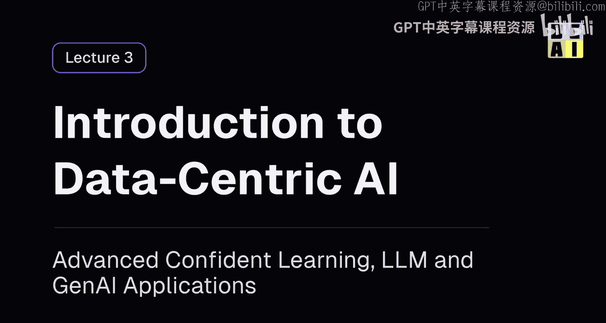

All right cool， I think this will be the best lecture of the three All right so this is the culminating lecture we saw the algorithm today we'll see why it works and why it's right in certain settings and we'll see applications。

So first lecture， we built up general ideas， what is datacentric AI， simple， very controlled case。

 Then last lecture， we said let's generalize it to all classification。

 It does generalize to regression and beyond， but we won't cover that。 Let's focus on。

Is it right what we learned yesterday and what are the applications。

 how can we use it practically in the real world， so that's what we'll do today。

I just say this is advanced because there's some math at some point I'll ask you guys if you want to go through theory。

And we can prove bits and pieces of things， or you can take certain things as fact and we can then skip like more。

Let's just say rigorous just writing step by step algebra， so we can do both。

 we can write it all out or we can skip steps and sort of jump to the punchline。

So this is what we saw， the inputs were noisy labels and predicted probabilities。

And then we computed these thresholds。These thresholds give us a statistical guess of sort of what is typical for this example in terms of the model being confident that。

Examples of that class are indeed labeled that class。And then based on that。

 we can then have a threshold that says if the probability is greater than that。

 we think it's probably that class。And we know what the original label was。

 so that allows us to build up。This matrix。And we saw an example of that here where we're filling in this matrix by looking at each example。

 checking if the probabilities are greater than the threshold。

 and then filling in this matrix where the off diagonals are then our label errors。

The stuff on the diagonal of the stuff that's labeled correctly and the stuff that doesn't get included is outliers stuff that's not confident of any label。

 It's called confident learning because it provides data that we're confident is labeled correctly when learning。

All right， so that's sort of where we were。We saw the final counts were this。The normalizing rows。

 in case I kind of went over that quickly， but all you would do is take the total number of dogs that were in your data set。

 say it was 200。And you would divide this row by 200。And then you would multiply or sorry。

 you would divide this row by the total here， 160， and then you would multiply by 200。

And so that would up all those numbers to match what the true distribution was， yeah。

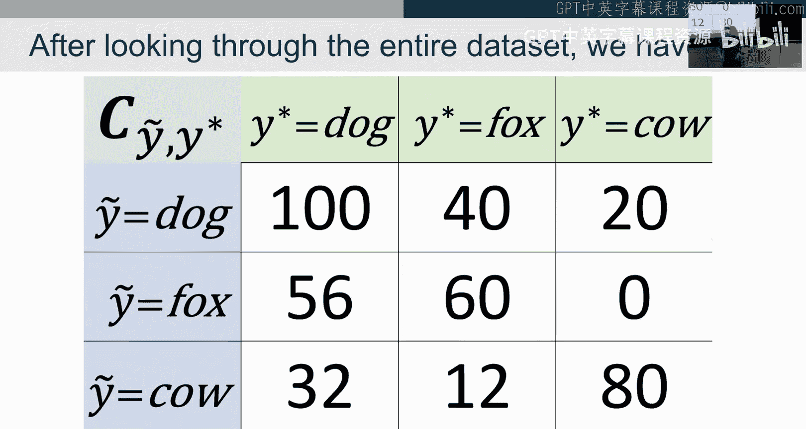

For Y star， that's the whole goal of the algorithm。

 so that's what we're doing here is we're counting up stuff that we think is noisily labeled I。

 this is given and this we're estimating because the probability is greater than some threshold so it's really high confidence that that example is that Y star class。

Yeah， the counts are how many examples for that box that were noisily labeled this thing？

That we are highly confident because the probability was higher than the threshold for that class。

 and we count those up over the whole data set， and that's the number that you get。Right here。

So this would be there are 12 examples where the predicted probability was higher than the threshold or the f class。

But the example was labeled Cal。Cool。Okay， all right， so once you had normalized rows。

 meaning you just sum that up 160， divide that in and then multiply by the actual count you observe here you would sum this up 116。

Divide this row by 116， multiply by the actual count of the actual number of foxes you observed in your data set。

 same thing here。 Now you have these are all the row normalized to match the original counts of noisy labels。

 and then you divide the whole thing by the total to get a proper joint distribution。

 and you get this guy。Okay， and then from this guy， you can estimate if you divide by the columns。

 then that will give you the probability of y tillilde given y star so that's your flipping rate。

 if you divide by the rows it gives you the inverse flipping rate。

 probability of y star given white tilde。And if you sum the columns， you get P of y star。

 which we talked about last time。That will give you your prior distribution over your true labels。

 Does that make sense？Cool， alright。So I wanted to emphasize that you can do then this is a practical thing。

 but I want when you see a bunch of stuff， it's one thing。

 but like iss not a lot of code and you can do this in one line of code and that's in the slide。

 that's not what we're here to do。 I want to show you very quickly an example。

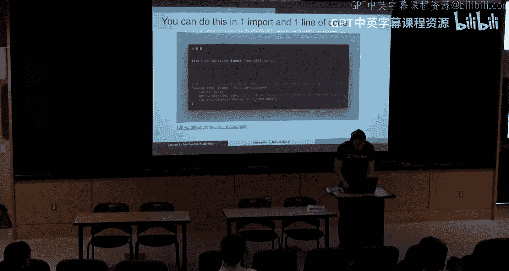

Of an actual data set。So this is like a product which is not what we're here to do。

 we're here to understand the algorithms， but you've got to see it to make it click。

 So we saw an algorithm Now this is Inet show of hands real quick， how many people know Inet。Okay。

 good so it's like 300 gigabyte， 270 gigabytes， so we just ran that algorithm that we just learned exact same algorithm。

 and then you can see these are the actual images in Inet training data and you can see stuff that this is running confident learning。

So like this is like the actual data set it's not altered in any way and then this is labeled CRT screen。

 and then this is just a model that's running based on removing all the bad data and then training on the good data。

And it says oscilloscope， and then this was labeled fountain。

 and we say Geyser and this is labeled Palace， and we say castlestle and so forth。

And then you can just do like very simple embedding stuff and you can see like what are other images is kind of tiny。

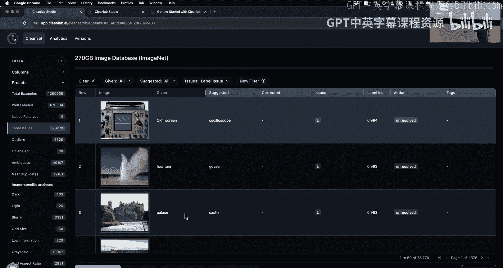

But like what are other images of castle， so you can see this definitely looks more like a castle than a palace and so forth。

But I just wanted to and then this goes on for like。Tens of thousands of issues and errors。

 So you can see how this scales， right okay。

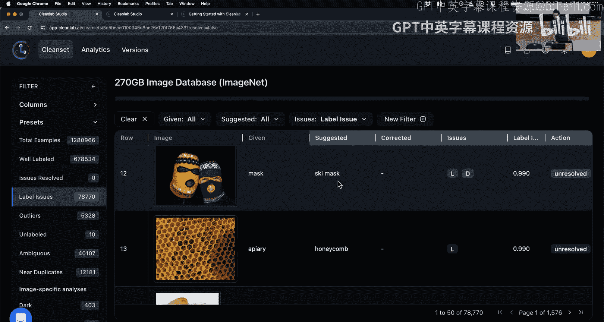

Let's go back to。All right， so let's chat a bit about ranking label errors。

So once you have these errors， let's go back to this。

So you've got 12 errors right that are cow Foxox examples， so how do you rank them。

 so there's a few things that you can do。I'll just write this pretty quickly。O。So， to。

Two quick methods。So once we have our label issues。

 we want to decide which one is the most likely error。

 So what's the one that we should either throw out first or we should fix first so can I get a quick guess at like what's one way to do that？

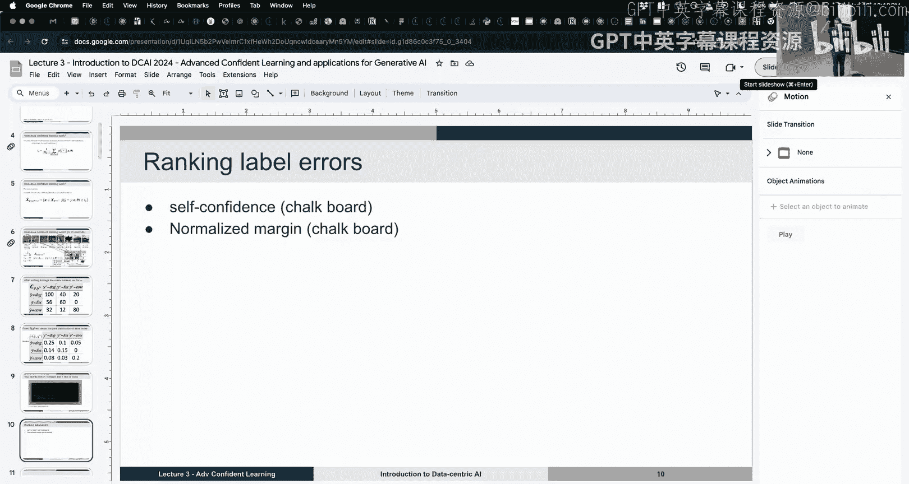

第二。Mmhm。😊，Perfect， and that's called self confidence。 And it's it's a method。 So in terms of。Ranking。

Eors。Okay， so。Or a given example， X。What we want to look at is we want to look at the probability of the given label。

So I'm just going to say equals the given label for x。Okay， give an X。

So this right here tells you the probability of the model and the label that was given。

 and you could， for example， go to this。

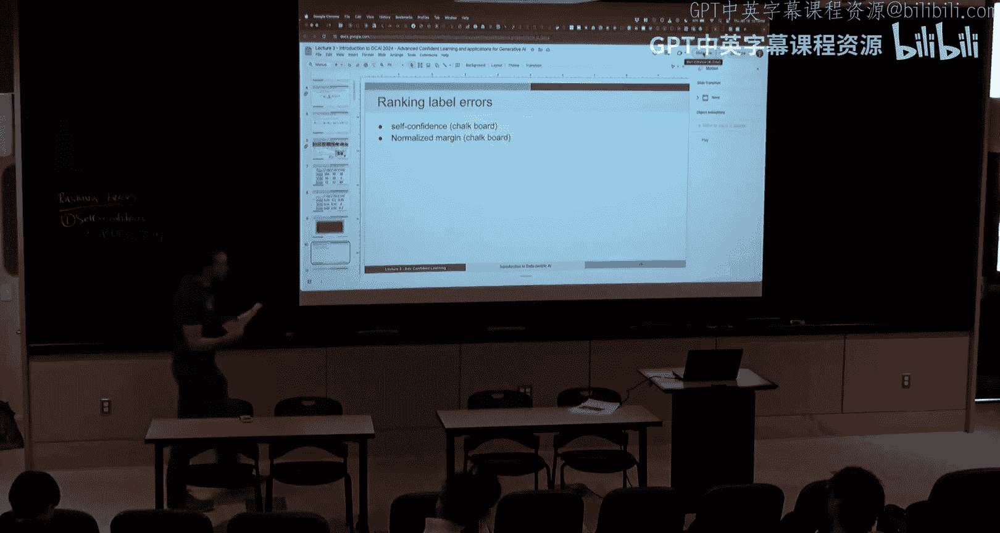

These 12 examples。Here。And to store their indices in nuy， for example。

 and then you would sort them by this probability and then take the first one as the most likely error。

 second one is the second most likely error and so forth。Does that make sense？

And this is useful because you might have 10 millionaires。

So you'd want to say toss out the first 00 first and then maybe rerun or something like that， okay。

 second。Max margin。So this is slightly fancier， but it's not going to surprise you。

It's the same thing as this。But we're just going to subtract one other turn。嗯。And let this be。Again。

 the given label。Of x。You know， give an x in your model。就厉害。Quer。Okay。

 and then we're just going to subtract one other term。The max。

Where J is not equal to the given label。And hopefully you can see on the right。

 let me know of same thing。But this case， just what tde equals J？Given x and theta。Okay。

 so can somebody tell me what that term is semantically？Yeah。What you。No。mh。😊，Yeah。

 and if we're thinking of stuff that is probably not。

 it's probably an error right so we've already we've already run an algorithm that's told us this is likely to be an error。

 So we have that set that set of 12 things。 so we already know these have been identified as candidate errors Okay。

 so given that we know theyre candidates。And this probability is probably not going to be like one。

 there's probably something else that has a significant probability in one of the other classes。

 so what's the biggest and maybe it's that label。And so for stuff that is a true label error where it's not an image that has say two examples in it or a piece of text that where both too many classes apply。

 there's probably one good class and that's an assumption， by the way， for single single class。

 not multilabel but single label， multiclass classification。

 you assume there's one good class and so if we're saying the one class it's an error So we're saying the one good class is not the given label So one of these other labels is the one good class so what's the biggest one and if we're very confident it's that other label then this number will be high and this number will be low and this difference will be very negative。

So it's a lot of words， so maybe I'll say it super succinctly。

The lower this is and the higher this is， the more likely it's an error。That's it。

So we're just looking at how big the probability is of the second most likely。

 or like the class after the given label， and most of the time that probability on the right will be much bigger than the probably on the left。

Real quick， just sanity check， if this is a one， what does that mean？

Or is it likely to be a label error if that's a one？No， correct。

 and is it likely to be a label error if it's a negative one？It's super， super likely。

 that means that we the model is 100% confident it's a different class than the given label。Okay。

 cool， all right， so that's one， those are sort of the two ways to rank。

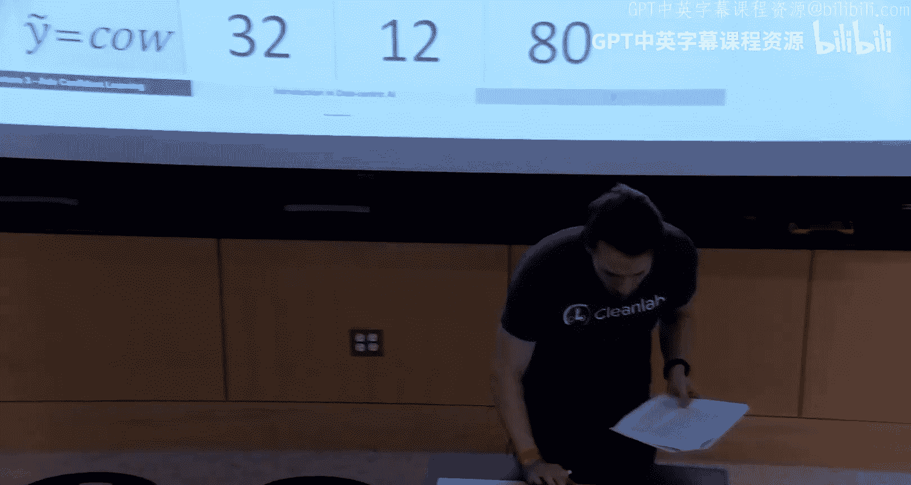

And then。Just to put， let's make sure we've got the algorithm sort of put together。

Any quick questions on that？It's okay。The biggest jump in the whole course is like this is true for all mathematics。

 but it's the semantics versus syntax。 it's always going to be the jump in like all email classes。

 So that's why I try to go slow when I'm remember I'm writing stuff。Com。

All right， so what is the actual algorithm？So it's step one is compute。Compute that counts matrix of。

Y tilde equals I， y star equals J。And we saw how to do that last lecture， okay？And then two。

 and then you can normalize this。As we saw。喂。In practice models， and this is a very practical thing。

 but in practice models tend to overestimate a little bit。So I've found that if you don't normalize。

 you get slightly closer to ground truth with a pretty noisy model， like a real world model。

 so this is optional in terms of practical， but mathematically you should normalize。

And then you would just normalizedize by rows， and then you would get sort of your normalized。

Version of this。And if this doesn't make sense， then ignore it's okay， you've got your counts。

 it's totally fine。So step two is then you take the trace。Of C。And that gives you a number。

 let's call that like good stuff。啊。Step three would be the total。It's in。

 so this is the variable would be in， the total number of examples in your data set。Okay。

And we're going to do we're going to do。We're going to do。That minus。嗯。This trace of sea。啊。

Weay together so far。So we go on this diagonal。And we。

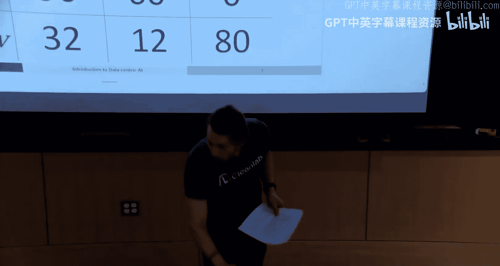

Basically sum up all this stuff。Or you can just sum this and then take the total and subtract it。

All right， so that gives us the total number of errors。All right， so this is our number of errors。

Okay， so now we have options。So one option for finding errors is we just take the stuff that's here。

And we've got our errors， we're done， and you don't have to do anything I wrote on the board。

 you're already done。

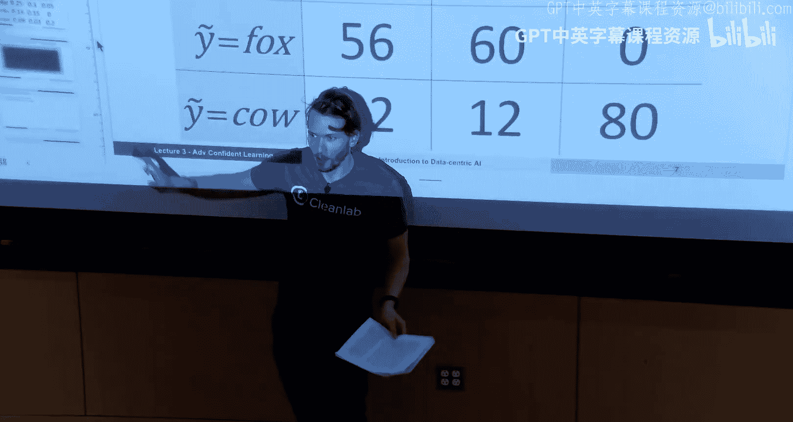

Okay， another option。Is。There's three options， there's more than three。

 but I'm just going to share three。Okay， so one is。

You have an idea of how many errors there should be in this class Okay。

 so we know there are all right let's go across rows。 So in rows， we say， all right。

 there are 56 errors in this class okay。So then what you would do is you would say for the stuff。

For x and the subset of examples that are。啊。Let's do class I， you would say take。

The 56 it's okay if I write， 56 instead of notation。We're together。Just for this example。

 it would be take the 56。Examples。With the highest predicted probability of the given label or lowest predicted probability of the given label。

 you guys tell me。The lowest to find the errors。So take the 56 examples。With lowest。

Probability of y tillilde equals I。That are in class J， Okay， so where the data is in。Class， sorry。

 class I。So that's another algorithm， and then you do that for all classes I。So， this is。We're all。

Classes。hi。And there it is， you could code that up。So that's just another algorithm。

 does it make sense why it's lowestest probability？

So this is the lowest probability of the given label。

 so it's more likely to be an error with respect to the given label。Does it make sense？

I'm just trying to make us think a little。 I know typically you would just get presented one algorithm and you'd like this is it。

 let's move on。 But the point is once you have this computation， once you have this statistic。

 this central characterization of all label noise， you can do a lot of things and that's the goal of this lecture is to show you all the things we can do with it。

 So I'm trying to make us think。And so we know that this class， there's 56 errors。

So there's lots of ways to find those 56 errors using confidence scores。 And the thing is。

 is we can rank two different ways， right， we could rank by。

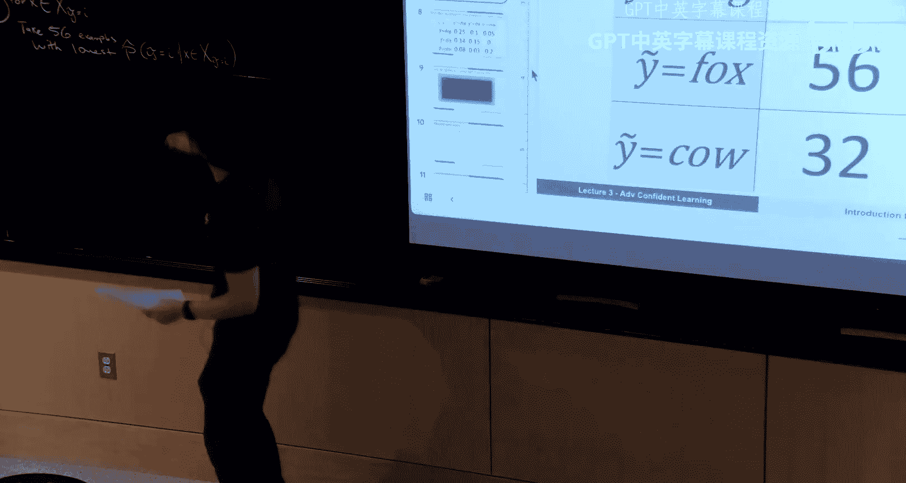

Self confidence， or we could rank by max margin。 So that gives us two more algorithms for this one。

 So you see， there's lots of ways to combine the pieces and these become hyper parametersa， yeah。

So the epistemic and allotatoric will'll get to that in a second how they separate allotatoric is typically and almost always going to be thought of as just label issues you can totally have model errors where you just have stuff this 56 that should have been like 40 and you overcounted。

And so that's why we want to rank and the ranking， if you want to be really safe with this。

 you would just say take the top 50% or take the top 5% and let's recompute so you could iteratively do it and that's why we want to talk about these ranking functions so we can rank the errors because the stuff at the bottom is the most likely to be epistemic error where you just have a bad model and it just makes mistakes。

Yeah。Okay， so we do some。100% so for outlier detection that's a really good idea for labeler detection it's a little different because similarity doesn't take into account the label。

 but for outlier detection that's a great idea And if we took， for example。

 all the images like this where no label was confident in the label and we have some subset of our data set like that and then we said find me all the data that's very similar to data like that。

That's a great idea。 It's a very good idea。You absolutely can do that。

And that stul is showing this that is done for this outlier detection， by the way。So like this。

 these are all the outliers and Inet， and so you'll take something that's out and then you'll find similar stuff and you'll notice it's a lot of like banners and ads and stuff like that。

It's a really， really good suggestion。All right。Okay。

 so let's do two more real quick and then we'll move on， so that's one example。

Another one。Is let's just focus on these 32 examples， okay。

 so these are the 32 things that are errors。SoThey're estimated errors， candidate errors。

True label we think is dog。Given label was cow。 we know。

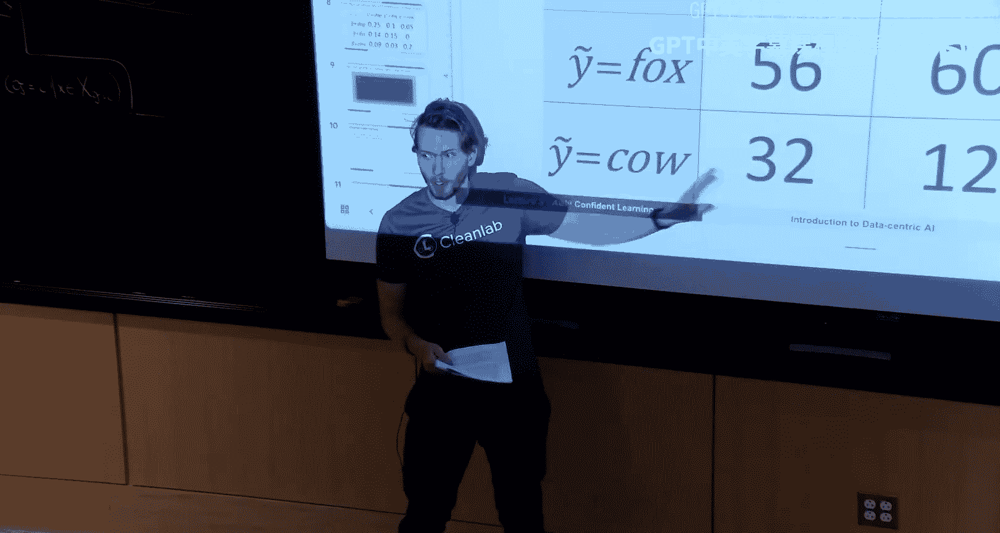

And what we're going to do for that is we're going to say of those 32 examples。

 I'll skip a bit on the notation， we'll just say we got 32 examples。And。

What we want to do is we want to。Rk。Oh， wait， slightly different。 slightly different。

What we want to do is we want to take everything in class cow， everything that was labeled cow。

And we want to take the 32 examples with the highest probability of being do， that's it。

So that's another algorithm， okay， so method two， by the way， this one's called prune by class。

This one's called prune by noise rate。So nothing too surprising and we're just going to get the 32 examples。

With。The biggest or smallest probability of being a dog。Biggest， good。So， with。啊。Greatest。

Probability。Okay， I'm being very cheating with my notation， but I hope we're on the same page。O。

And then a final example。Is you get the list of things from this。And that's true or false。

 error or not。You get the list of things from this true or false error or not。

 and then you Boolean or them or Boolean an them。And that's just a stronger confidence that is likely to be there。

 So that's called。So this is called prune by noise rate。This is called Prune by Class。And this one。

Is called。Just class， plus image。Or you're just hand them together as a boying operation。

And that's it， those are three methods you can come up with more。

But you get the idea of how you can come up with lots of ways to find errors and depending on your model and the way it works or your setting。

 you can try all these and then use hyperparameters and figure out which one's best on your test set。

O。All right cool let's keep moving I want to show you something say you have a data set that's like that's like this data set。

 this 140 thing， but what if it came out？

And instead。You got this。Okay， what would that can someone interpret that for me real quick？

So what does the 50 mean？Yeah。Totally， it thinks a lot of dogs。

 they're actually images of dogs are labeled fox and then mis labelbeled fox， okay。

 so what if we saw this？Or even better， what if we saw？This。I have seen this， by the way， many times。

 so that actually happens in real world data。I've seen that for like companies that everyone in this room has heard of in their data sets。

Mh。😊，And could you give you're all over it， so could you give a suggestion of something you could do before anything that we've learned in this class when you're first coming up with the classes in the data that you could do to the classes that maybe would make your machine learning task easier。

Say you could choose the classes and say there's a bunch more dog， box， cow， truck， ship。

 and you get to pick the classes， so it doesn't have to be 10 classes you get to pick the classes and。

Totally yeah， and at first you're like， wait， should I do that and you might were going to restrict your mind but but don't restrict your mind because it may be that this is like fox。

 dog， fox， cow， cat， you know， and then there' like small cat， big cat。

 medium sized cat And it turns out like for whatever you're trying to do medium sized cat and big cat really doesn't matter。

 You just need to know small cat and then medium are bigger And if medium and bigger are super confusing your model that means you' predicted probabil are super off。

And it just makes everything hard for you。 So don't do that to yourself。

And you can use the key here is you have a systematic way now to detect this。And then you can say。

 all right， just find stuff where they're very similar。

And then now you have a way to know which classes are the ones that if I combine them。

 it would simplify my problem the most。In a systematic way， So this is three classes。

 but a lot of data sets have0 or more classes like Imnet。So it can be very helpful。

 I imagenet and someone tell me real quick，10 classes， this is very， very easy。

 but just so we're on the same page， how many entries are in that matrix？

If you have1 thousand classes。Yes， a million yeah and I know it's for the people who got the question immediately it's like。

 oh， why did he ask that， but like it's just so we ground ourselves。

 there are a thousand numbers we just statistically estimated or sorry。

 a million numbers that we just statistically estimate so it's hard it's a hard task and to be able to systematically an algorithmically say which pair of classes among a million pairs a million minus1 thousand because same pair on the diagonal。

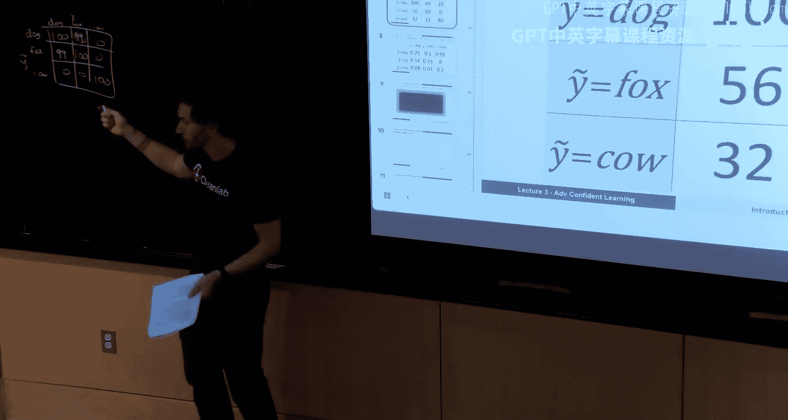

Which are the two they'll look at first， that's a hard task。

 so we want systematic ways to be able to do that。O。

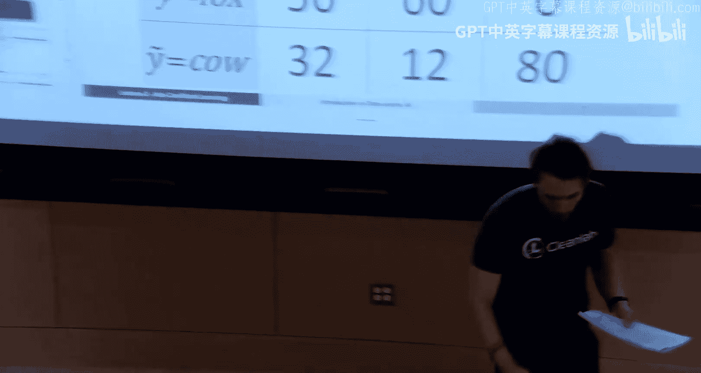

Does it make sense？Cool， all right， so we've already seen this， I'm going to skip it。

 but if you bin these are these five methods you see here， I think if I delete this。See。

 there's the methods we just talked about。So that's and they're all ranked in terms of performance。

 so they perform pretty similarly for some data that's different。

 but you can see that they all stack very similar and then where they stack comparatively。嗯。

All right， so theory side we've got about 20 minutes and we have two options I prepared both do you guys want to jump into theory and depth in terms of why this works and we can prove that it works or do we want to look at applications like how we would use this in terms of gene AI generative AI like LM generation stuff like that so that'll be more like fun and exploratory and I can show you cool stuff or we can rigorously show and mathematically that this stuff is going to give us the right answer。

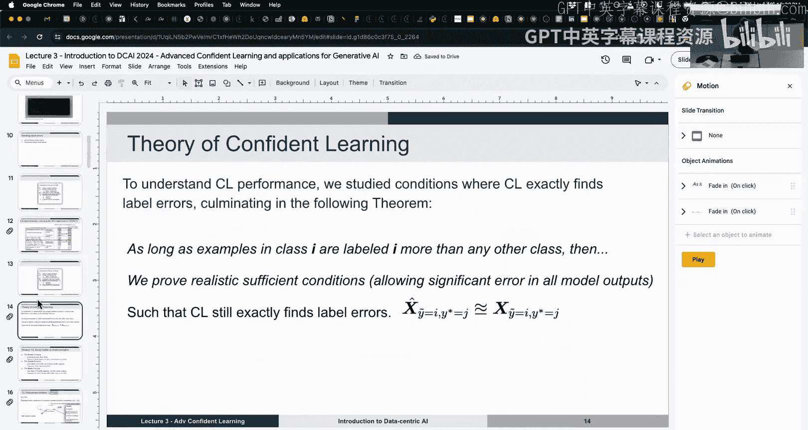

So show of hands for theory。Okay， and show up hands for Gen AI。Okay， so we're split。

 but slightly more for Gen A， so I'm going to do about five minutes theory， 15 minutes GenI， okay。

So there are sufficient conditions that show in realistic settings that are in practice。

 big models tend to be off this a little bit， but I'll tell you how much off。

Where you can this exactly finds label layers and data， okay？

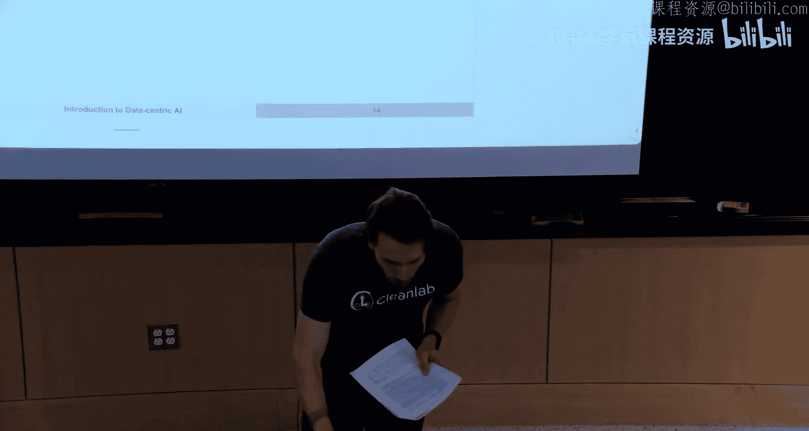

And there's a bunch of principles， this was in the slides and in the notes。

But I think let's focus on some key sort of highlights。So。We talked about loss reweighting。

 I think the first lecture。And this is what that looks like。

 so you have some function function you take of your model's output。And you multiply it by your loss。

 so if this probability was low， then the model's not very confident。

So say this is the probability of the given label。You take some function of that。

 maybe maybe it's literally just a multiplier by Eda could be that simple of a function and you multiply that by your loss when you're doing your stochastic gradient descent update。

 So if this number is very small， that means that your models not confident in the example so then it won't update the loss as much when you do HD so this is the concept of loss reweighting This was the prior solution prior to cleanla This is prior to confident learning and this is to help us understand why confident learning would do better Okay so our new loss ends up just being this number which tends to be small for errors。

 times are old loss okay。So when we do update， we don't update as much。Now here's the issue。

This is a predicted probability， models are very imperfect in practice， there's error in this。

 so there's a true predicted probability and this P hatAT is P hat equals true predict probability plus that error term。

 so that plus error term now is in your new loss function and now every single SGD update you inject error into your SGD update so all your weights now and your model have that error。

Does that make sense？So we want to try to get away from that air propagation。

So this is your standard SGD。And now this term has error in it that you get from your predictive probabilities and now that error is in your weights。

 which is your model。 So now you're yeah。The error is that this predicted probability from a model is imperfect。

Were you here last lecture by any chance， okay， you remember that a perfect predicted probability？

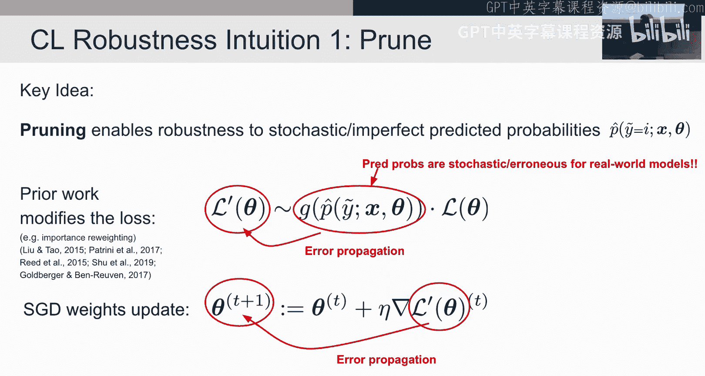

So the sort of true。Preicted probability for a model。 for an example， that's in class。i。For label。啊。

For the true label being or just for labeled J， okay？If you knew the noise rate was like。3。

 it would be  one minus that， so it ends up being this ends up being equal to1 minus。

The probability of。啊。Like that。You mightight want to double check the exact formulation it may be you switch these and then that's switched but。

High level， does it make sense？So this is how often things that are class J end up being class I。

And so if this happens 0。3% of the time， then you would have like a 0。7 probability。For this thing。

 or sorry， no， no， this is this is sorry。Just equal。 Sorry about that。It's just equal。Yeah。

 I'm off my notes right now， but yeah， so it's just equal， does it make sense。

So the probability that is class J， given that you're an example in class I is that error rate。

Of the flipping rate of going from J to I that would be the true predictive probability。 However。

 when you train machine learning models and you look at individual data point and you look at the predicted probabilities。

 they're way off they're like not they're not right。 So what you end up with is this。

So this is from an actual model。And this ends up equaling。Your perfect probability， this one。Plus。

 an error term for that example and that。And let's do for a class， so let's do class J。

So for class J， for an example， x and a model theta。

 then it's going to be the true probability plus some error term for that example in that class。

So that's the error。有 what。That's epistemic uncertainty， yeah。Hundred%。

So that's just model imperfection， epistemic uncertainty， same meaning in this context。

 and that error term。Sorry about the chop， that error term is now in here and now it's in here and now it's in here。

 and that's your model。Okay， so we want to avoid that。

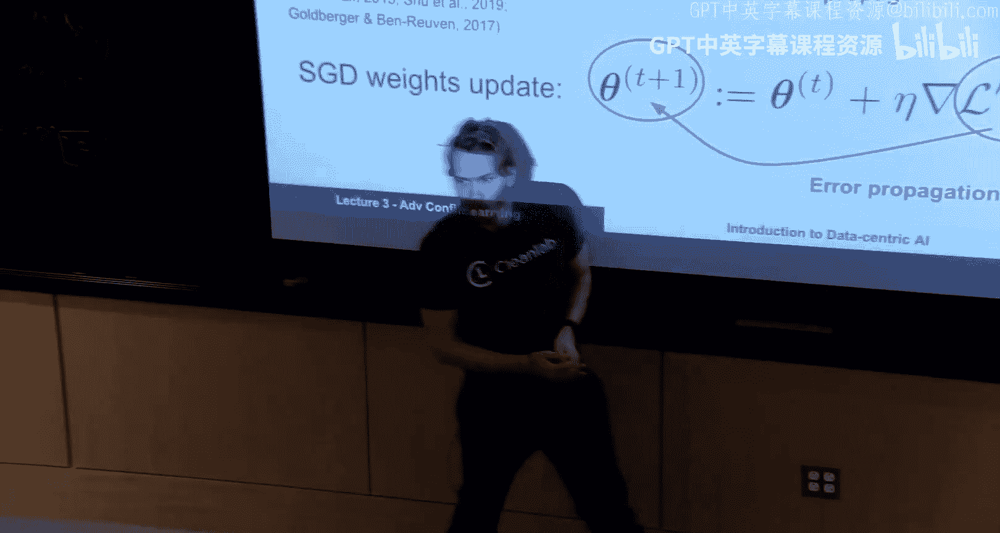

And the key idea in terms of how we're going to avoid that is that these methods just remove the error instead of propagating the error。

That's it。It's a really quite simple point， but it's just good to follow the error。

 So the goal is always follow the error in terms of understanding these things。

So as a high level do we。Do we get this concept。Okay， cool all right。

 so that's sort of the concept of pruning and why this would be reasonable we'll look at this count and rake rank concept So another way that people have tried to some of those methods we saw have tried to estimate the noise rate so this is the noise rate of class I to J so say this was dog and cat so this is the noise rate of images that are。

Actually。Say that J is cat， so these are cats。And this is a inverse noise rate。

 so this is given that the image is labeled dog， what's the probability that it actually should have been cat？

And a lot of times， people will just say， all right， well。

 let's just take from a model all the predictive probabilities of all the things that are labeled。

Dog。And then our labeled cat。 And then we'll see。 So these are all of our images that are。

These are all images that are labeled dog， what's the probability of them being cat。

 and then average that？So that's one way that people have estimated those error rates。

Does that make sense like why you might want to do that？It's difficult to say these things。

 so I hope I can have your patience with the flipping of the classes。

But this is all the stuff that's class I。Given class I， and this is the probability of J。

Probably of J， so we cool on why you might want to do that。And then the issue is the same。

 so the issue is this is a bunch of probabilities， these have error。

 so you just took a bunch of error and averaged it and then you said that's your statistic。

Which is different than what we did when we computed this。We didn't just average a bunch of error。

Okay， what we did。Is。Instead， we said this probability can be written like this， and that's true。

 that's equality， that's always true， that's bas rule。And this can be estimated as counts。So。

If these are counts， now what we're doing is we're getting away from predicted probabilities。

 we're basically saying， look， these are just stuff with large predicted probability and large is not exact。

And so now we get away from the error term， and the reason I bring up this slide is because this is how we do the disambiguation between allotatoric and epistemic uncertainty。

 this is where it's happening。So to bring that home。

This is a robust statistic if you've studied any robust statistics。

The concept here is that it just has to be large， but we don't care how large it is。Okay。

 so median of means is another robust statistic， it does the same thing。

And so what that does is it allows us to get away from this label noise and epistemic noise。

 I can point which one is which So this。

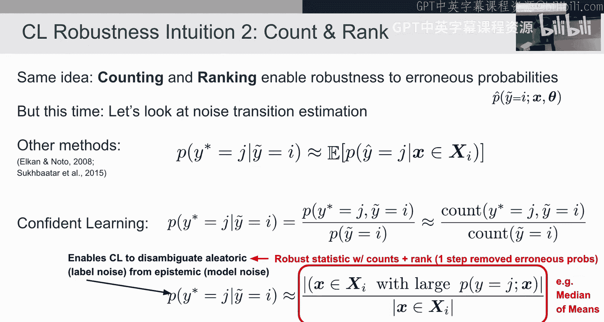

That's your label noise。And this is the epistemic noise。Yeah。Yeah。

 so this is the one at the top or the one at the bottom。Well， there's it。

There's no expected value here at all。There's no expectation。Does it make sense？

So the key idea here is just。I think it may be simpler than this slide。

 Let me try to make it super simple。 Let's go over go over here。 I think it's pretty。

 it's actually simpler than it seems。 Remember we have。

The predicted probability P hat is equal to some true probability that we don't have。

 this is what you get from a model， models are imperfect。

 this is ground truth plus some error term for the example and for the class Okay， I or J。

 let's just do J。So this is what happens in practice， and then all this is saying is that for this。

 say that the true probability was 0。7 okay， so that's what the probability should have been from the model。

Then with confident learning， what's going to happen？Is we'll go back to the very first slide。

Or like fifth slide and。Because we're just saying the stuff has to be greater than or equal to a threshold。

Then let's say that the threshold。For class J。Is equal to 0。7。Then the predicted probability。

 let's ignore that into for a sec。 then the predicted probability P hat。If it was correct。

 it can be 0。9。It can also be。071 it could be。8。All of them are going to get correctly put in the right bin。

 that's the point。

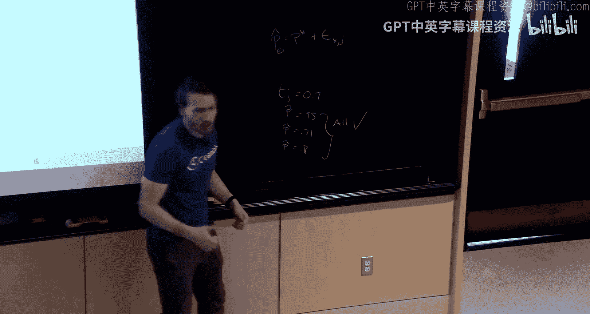

So you have like 0。3 error wiggle room for your model for that example。If the thresholds 0。

7 and it's actually confidently that class， like it should be that class， then it could be one。

 it could be whatever， you've got wiggler， that's the point。

So yeah。Oh yeah， this is not restricted， it can be positive or negative。

It can be positive or negative。I know it's still robust。 So say that the threshold。

 So this is saying you， this example， X should be。

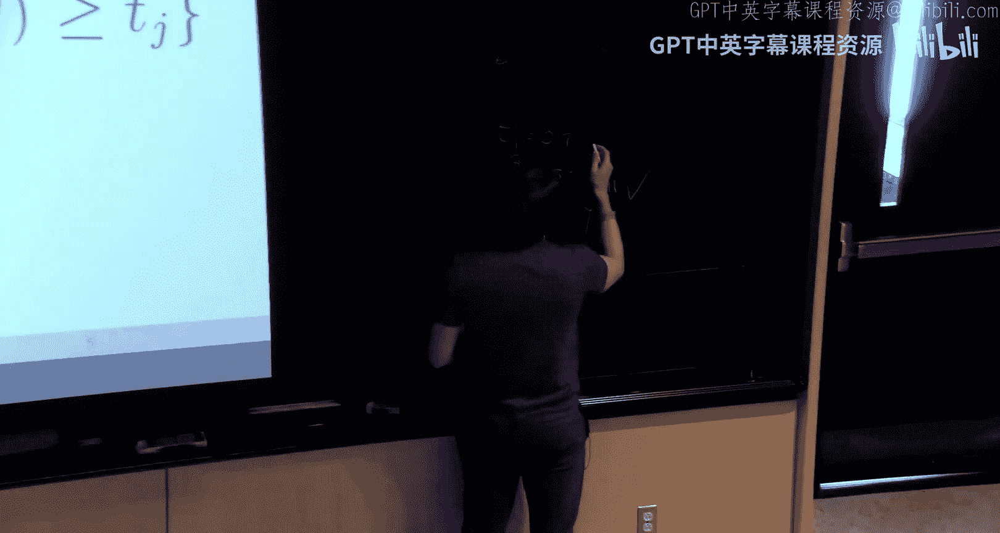

Like confidently in class。呃J。Okay， so then there's the other case where x should not be。Okay。

 we'll make the threshold the same。And now this probability for should be。

Can actually be anywhere from 0 to 0。7。

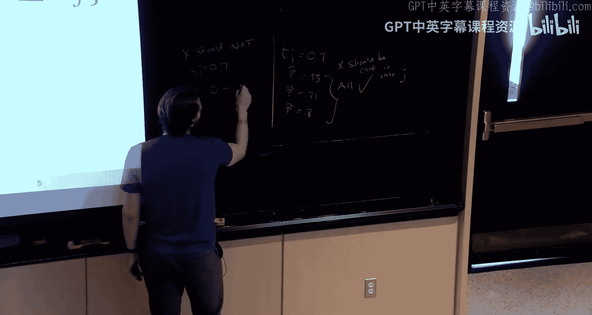

It's less than or equal to。So this now won't count it comply in that class。

So they probably can be anywhere from 0 to 0。7 to get that right。Does that make sense？

The key idea is just whenever you have greater than or equal to。

 instead of actually averaging a number， you start putting things in bins and you work with counts。

 and that means you don't have to have exact numbers。

 The output of the model doesn't have to be perfect。

And it's just the key idea that makes this stuff work。

 It gets you away from averaging numbers and working with counts。

 And that's how you get this robustness。

嗯。I want to show you cool stuff so I'm going to skip a lot of the theory it's in the slides this one is the only last thing I'll show you and this one's just very clean and nice and I was going to write on the board。

 but I think let's get to GI stuff。We have we've seen that at the top， we've seen our threshold。So。

You'll have to take it from me， and this is not too hard to prove that this exactly finds errors when the probabilities are perfect。

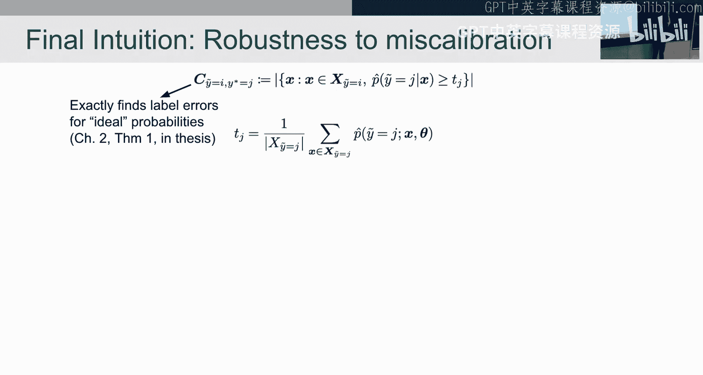

So。Perfect。Or otherwise。Okay。So when that's true。

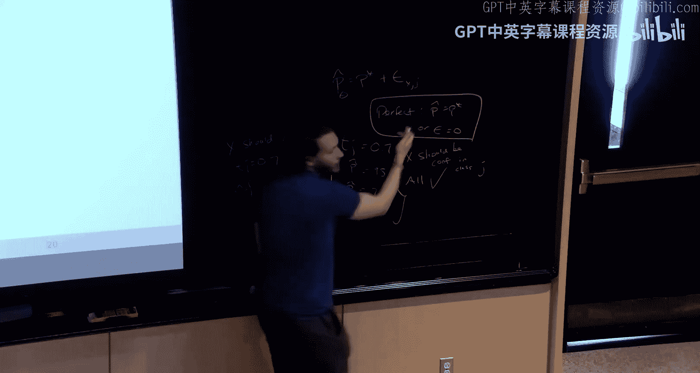

The algorithm we've seen and all all of these algorithms， too。

And finding errors on the Otagonal is perfect， it will exactly find errors in a data set when that's true。

 and in practice this is almost never true。On MNIS it's close， but in practice， most hard data sets。

 that's not true， okay？

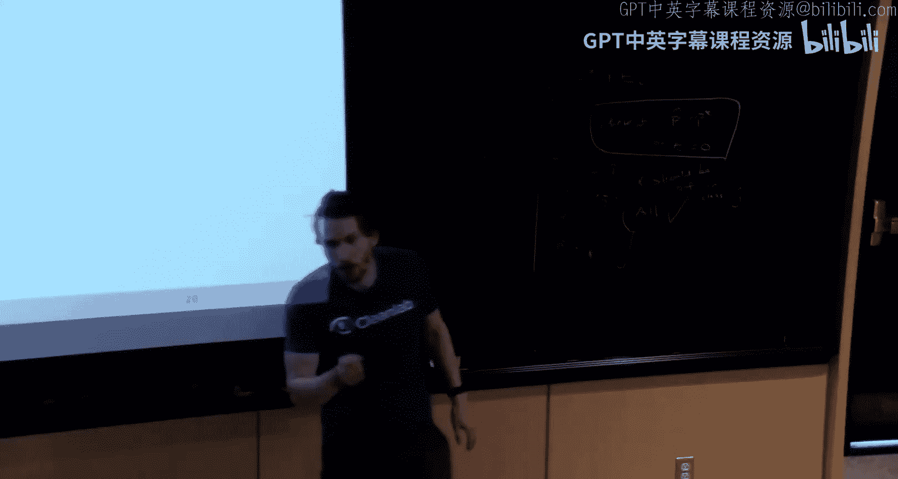

So。Just take it from me that when it is， if we can assume that it's true that this thing exactly finds errors。

 then I'll show you something cool。 Okay， so we know that neural networks tend to be overconfident。

And we can express that as the predicted probability plus an increased confidence。

 So we add some error term in this case， this is intended to be positive， could be negative， though。

So overcondent， they might be underconfident in some classes， and then it would be a negative term。

So now you factor out that epsilon and you just get the original threshold plus this epsilon term when you calculate your threshold。

Does that make sense， so your new threshold is now increased by the amount that's overconfident for that class okay？

So that's increasing the error term， this is the new threshold， so what happens to our count。

 our counts matrix。How off is it going to be， how much error are we going to have now that the model is overconfident in every example in that class。

And what you'll find is due to the formulation。We replace this term， now goes into here。

 this is our new formulation， so threshold now has error in it。

Preictive probabilities have error in it。And what happens， they're going to cancel out。Because again。

 we're doing this greater than equal to threshold， so you end up with the original formulation。

Which is proven to be exact。So this gives you exact error finding again， that's the punchline。

So even though we added error in every class， we still exactly find label errors。

That's the punchline。O。Does it hit？哦，O。All right， I can answer questions on that after there's a bunch of examples。

 hard cases， some big takeaways， we looked at every example in like sort of the most commonly data sets and you can check that out on labelairers。

com and you can see the slides。There were some conclusions basically you should check your test set。

 let's jump into some GinAI stuff real quick。So let's think about image and text generation and what you would use Comp learning for。

The sort of inputs during training time， you've going to have errors， bad labels， outliers， etc ce。

 you train a generative model on that。 If you have downloaded Falcon or any of the open source LLMs。

 all of these models have been trained on tons of errors because they're just massive datas and they did not use confident learning we know this So there's all sorts of error they've publicly stated this and so when you're downloading those things you can't retrain them sometimes there are a billion parameters so what you'll do is just inference and then there's going to be some error here so you want to detect that and so this is on the training time you sort of take your input run it through confident learning and improve the data labels and then train and then generative AI。

You get your outputs and then you can do some stuff。 All right。

 so let's look at what that looks like。 So we've seen this example。 This is。

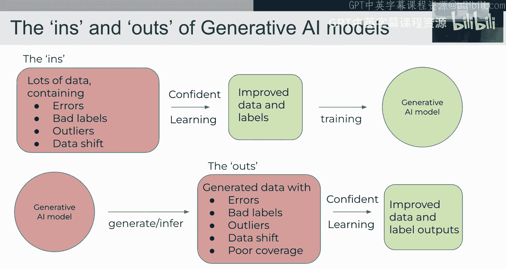

Dolly2， which is now in G4， and they have data， for example， that would be。Planes。

 but they're labeled car。 and so then you type car and you get a plane。

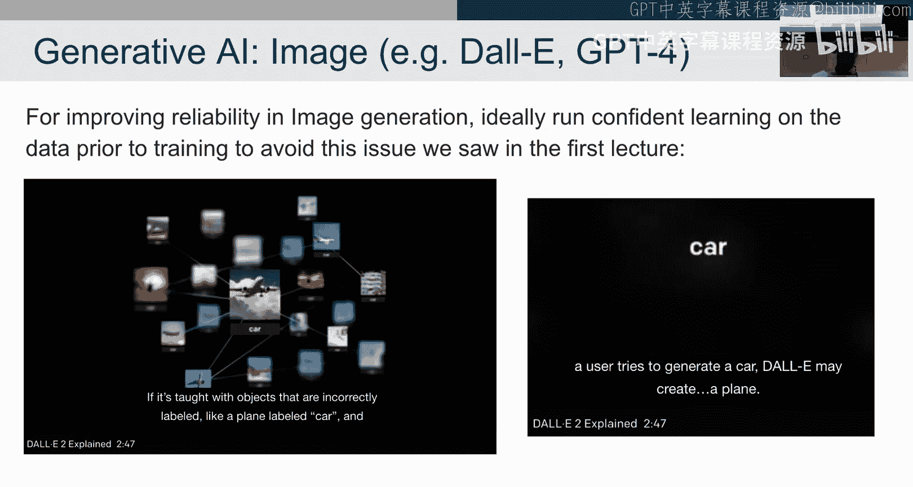

So the way that you would use what we worked on today for the generative AI setting is to work backwards。

 so I just used Chad GPPT4 and had it draw me a cat。And then I had it draw me a dog。

And then do this a thousand times for a cat and dog。So generate 1 thousand0 cats，1 thousand0 dogs。

 now you run this data set that you've generated， it has labels， cat and dog。

 and then you can auto remove and fix the errors， and that's how you can get generation that then doesn't have errors in it。

To some degree， it'll improve the amount of errors。

 So that's sort of how you would improve on the inference side in practice。

 though dogs and cats it usually gets them right。 So I just wanted to look at an example where it gets it not right。

 This is an image of I asked to do an ion trapping quantum machine This has some ion trapping。

 but it's doing some other stuff too So it generated this for me and I worked in ICs lab。

 So this is what an actual ion trapping quantum computer looks like and there's some similarities。

 it's not not too far off but the machine that's generated here actually is it slightly different type of machine。

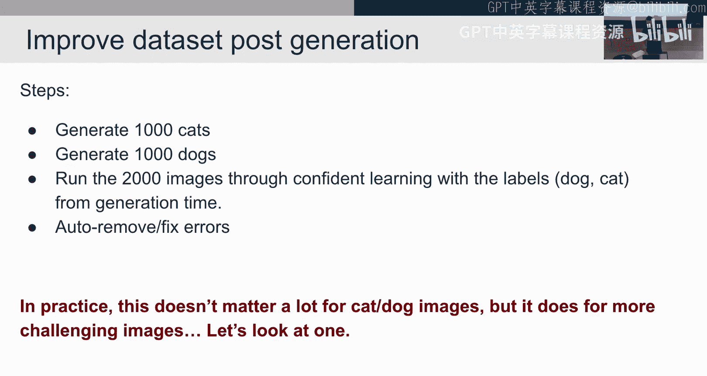

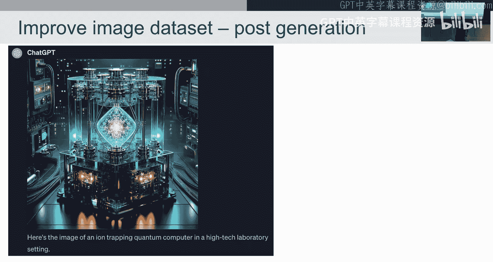

So that's just an example that's harder instead of dogcat。Make sense。

So if you generate a whole bunch of these， you would hope that the geneative mechanism had more signal than noise if it's generating total noise。

 you're in bad luck。Okay， and then for AI for text， okay， so generative AI for text。

 there are sort of two cases， one is Rag， Does anybody know what Rag is。Okay， cool。

 it's a retrieval augmented generation， basically it's just an LLM that queries a database。

And labels things so you're like， oh， what's what's the state where that has the highest loan percentage blah。

 blah， so you ask queries and text and then access a loan database and then it'll output the state is Kentucky。

And so you're getting a label for a text query， and then you run that through the content learning algorithm that we saw。

 and that finds the errors and you now have also ranking on those errors。

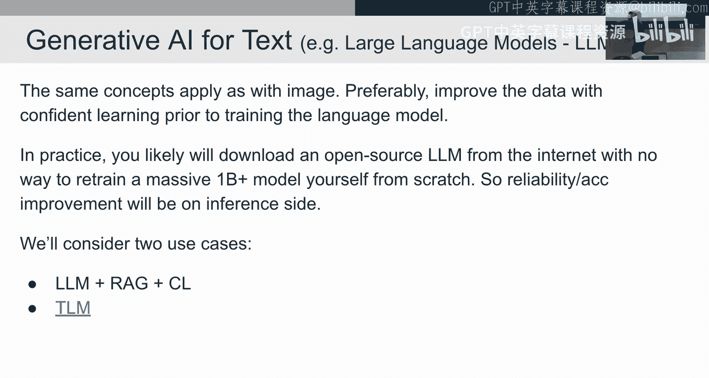

So in addition。To errors， you also have confidence scores for the outputs of the LM。Okay。

And then the last one is a TLM， we don't have time to go into how this works。

 but I can show you a demo。

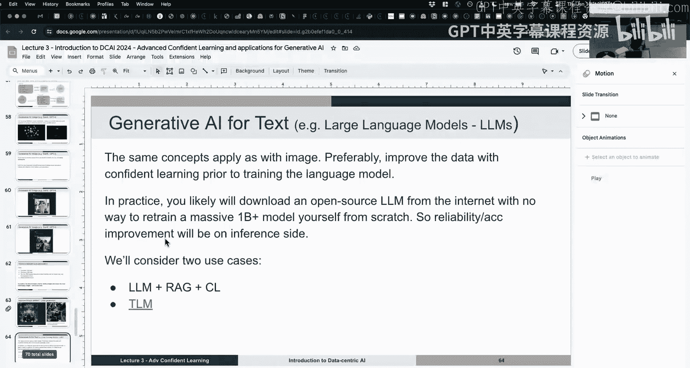

I tried for。Chat GT。I tried this。How many ends are there in the word enter。

 and it says there are two ends in the word enter。So ideally we would have a confidence score with this。

 right， just like we have ranking scores on errors with confident learning。

 we would ideally have that W chatt GPT and these LMs that are now pervasive。

But it just gives you an output。 There's no confidence score， right， So that's a bummer。 Also。

 ideally， it would be correct。So that would be nice too。

 And so I wanted to show a demo of like you can actually run。

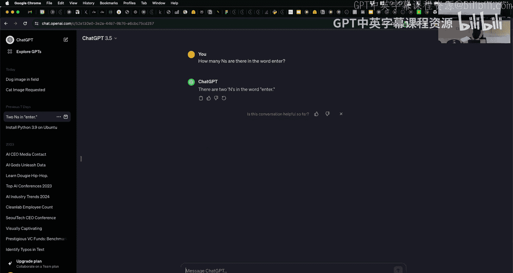