# 《数据中心人工智能导论｜Introduction to Data-Centric AI, IAP 2024》中英字幕（Claude-3.7-s） - P4：Lecture 4_ Class Imbalance, Outliers, and Distribution Shift.zh_en - GPT中英字幕课程资源 - BV1wvhczTETR

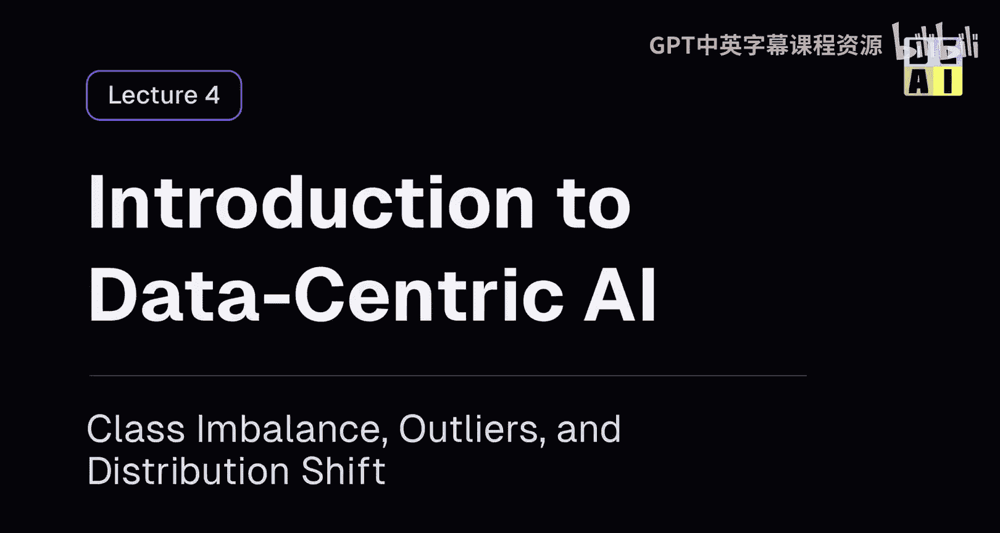

Yeah， good afternoon everybody。 Today's lecture is going to be 100% on the chalkboard。

 so if you can't read what I'm writing up here feel free to move closer to the front I'm also hoping for a highly interactive lecture I'm just going ask like 100 questions feel free to raise your hand or just shout out answers Let's make this as interactive as possible。

So today were going and also feel free to ask questions at any point。

Today we're going to talk about three topics that come up often in real world machine learning tasks。

 class imbalance outliers and distribution shift， so for any of you who took an intro machine learning course like 6036 here at MIT。

 can you tell me if you covered any of these topics into what degree you covered them in that course？

Raise your hand if you've taken an inter machineachine learning class either here or somewhere else。

Okay， I'm just going to pick on you in the back。Okay。So you covered domain shift。

 but not the other topics too much。 Okay， awesome， yeah。

 so I think these topics are often not covered in these introductory machine learning courses。

 And yet， I'd say that。At least one and often multiple of these come up in almost every real world machine learning task that you might work on。

 so they think they're really interesting and important。

So first we'll be talking about class imbalance。Class imbalance is when you're working with a machine learning classification task。

 either binary classification or multiclass classification where you have data points and you want to label them as one of a number of classes。

 and you have the property in your data set and in the deployment setting that the prevalence of the different classes is really different relative to the other classes。

So does anybody have any examples？Of imbalanced classification tasks that you can come up with。Sorry。

 what？What prize winner at MIT？Nobel Prize winner。So how would you frame that as a machine learning classification task？

Determining whether somebody is a Nobel Prize winner based on their research contributions or something like that。

I think you could frame it as an imbalanced classification problem。 but yeah any， any other ideas。

Yeah。Okay， yeah that's an interesting point that there have been issues in the past where people have deployed image classification models where they classified。

 say darkkinned people as gorillas because that was present in the data set。

 I think that's a little bit more closely related to distribution shift which we'll be talking about a little bit later。

 so we'll revisit that one。Any other ideas？All right， I'll give you one。

 and then you can try to come up with two more。 One classic one is fraud detection and credit cards。

So credit card processing networks have incredible transaction volume。

 I don't know the number off the top of my head but it's like billions of transactions a day or something huge like that。

 but among all these transactions， fraud only makes up like 0。2% of the overall transactions。

So the distribution looks like this。Frad 0。2%， not fraud，99。8%。

 That's just what the transactions are like。And so could anybody tell me what might be challenging about training a machine learning model。

 which is absolutely what these companies do right。 That's the only way can solve this problem。

What might be challenging in training a machine learning model on a data set that looks like this。对啊。

Yeah， exactly。 Like if your metric you're using to evaluate your model is say accuracy。

 super standard， right， Like if you just have to pick one， go to metric， accuracy is a good one。

And a model that just always predict like ignores the data and just predicts not fraud would be 99。

8% accurate， like really good， right？So you can already see how class imbal can be a tricky issue in real world at tasks。

So。Let's try to。Can we come up with the one or two more real world examples now that we have this one to go off it？

Medical imaging， yeah so。I think especially for， say， like preventative diagnostics。

 like say you're just screening everybody in the population to see if they have a certain rare disease or something。

Yeah， the vast majority of people are not going to have that issue right。

 so then training a machine learning model might be hard because your model might just predict yeah nobody has the issue and it's going to be highly accurate and yet very useless。

 right。Three we got one more？Yeah。Yeah。Sm classification。Yeah。

 so I actually don't know off the top of my head what the prevalence is of spam versus not spam。

 but my guess would be that the vast majority of email is spam and the spam classifiers have gotten pretty decent at filtering it out so you all don't see too much of it in your inbox。

Awesome。😊，So any question so far is the problem clear， like what is class imbalance？

And I think all the things we talked about here， credit card fraud， medical imaging。

 sp classification， these are all binary classification tasks。

 the same thing can happen in a multiclass setting， analogous。

 you can have imbalance between multiple classes。And so yeah。

 as we touched upon earlier with that credit card fraud detection example。

One of the main things you have to do when working with this type of a problem is come up with a good evaluation metric because just the standard like oh let's just use accuracy and then go from there doesn't really work well because yeah your evaluation metric is going to inform your choice of loss function or whatever you use to train your machine learning model and then yeah you might do well in your evaluation metric if you choose some very basic one like accuracy and yet that might not actually be what you want from the final model you get。

And so unfortunately， there's no simple answer I can give you here。

 there's no one size fits all evaluation metric that works across all the different imbalance class。

Tasks you might encounter because it really depends on like the particular domain and what kinds of failures you can tolerate versus which ones you don't want to tolerate。

And so yeah， this can get pretty fancy， there are lots of different metrics you might come up with。

 so let's just talk about a couple basic ones just to see what the different choices look like and how one choice might be better than another in a particular setting。

Okay， so some of you have taken a machine learning class， can anybody tell me what precision is。

 either the mathematical definition or a more intuitive English language definition？

It's a commonly used metric used to evaluate machine learning models in the binary classification setting。

Rise your hands if you've heard this term before。Okay， a couple of you， nice。

Nobody wants to find it for， okay， great。It's this is all like deterministic。

 The model given a particular data point will give a certain answer。 So it's， but okay， so。

I think mathematically。When we think about binary classification。

 we have some positively labeled data points and some negatively labeled data points。

 and then when we classify these things， we might make mistakes so we can have true positives。

 false positives， true negatives， false negatives， right those are the four possible outcomes and so mathematically the way we define precision is the true positive rate over the number of true positives divided by the number of true positives plus false positives。

And a little bit more informally。So your're class is when you predict positive。This is fraud。

 they'll say this is the positive class and this is the negative class。

 it'll predict positive and for some of the examples。

 and precision measures how many of the selected or how many of the things that the classifier predicts as positive are actually positive。

Among all the things that were predicted as positives。

 so true positives over true positives plus false positives。

 there's another metric that's commonly used called reoff。Does anybody know what this one is？

Closely related to this one， you could probably guess。

 but this one is the number of true positives divided by the number of true positives plus false negatives。

And so in plain English terms， this is。是什么？How many relevant examples are selected？

There's a bunch of things that have the true label positive。

 and how many of those do we successfully find。对。Both super standard。

 both in just standard machine learning classification。

 and then we can also think about them in the class imbalance setting。

 and so get a better intuition for each one of these。

 why don't we try to come up with an example of a machine learning task where precision is a good evaluation metric to use and another one where recall is a good evaluation metrics to use。

So can anybody think of a situation where？We want high precision。

 So all the things that are like that are flagged or that the classifier says are positive。

 most of them are high fraction of them are indeed positive。And where recall is less important。 Like。

 it's okay if there' are some things that are actually positive。

 but they're missed by the classifier。 So when would we want to kind of error in that direction。

Yeah二。Yeah， that's a great one， so a good example for recall might be disease detection。

And do you want to explain your thought process for why this is a better metric than this。

 let's take a like COVID detection as an example there。Yeah， exactly。嗯哼。😊，Yeah。

 so you don't want to miss any positives。So absolutely。If。

And if you think about what happens in each of those scenarios like okay。

 suppose you diagnose somebody as positive when they're actually not sick。

 well okay they'll stay home for a couple days like no big deal， but if you miss a positive。

 then they're going to like go into their workplace or go into their lab and then get everybody else sick right so much better to err in that direction。

So that's a great example for recall。 What about precision， Any ideas there。Okay。

 so I'll give you one here。So。These days， people train machine learning models to automatically find bugs in code and computer code。

 So you might have a model that will say point to specific parts of your code base and be like， oh。

 this looks suspicious。 like maybe there's something wrong here。And。

With the current state of that technology we can't really expect it to find all possible bugs it's like too hard to reason about code right now for automated tools and so these are yeah bug finding tools and not tools like prove your code correct or anything like that and so for these tools we really want high precision because whenever these tools flag an issue like some developer has to go and look at that piece of code and like reason about it。

 think about whether it's actually a bug or not and fix it and if the automated reasoning tool just flags a whole bunch of examples that are kind of bogus it wastes a lot of time and so here in that setting you really want high precision。

Automated。Bg finding。Here's one example there。Any questions so far？

Hopefully this gives you a little bit of a flavor of how you might choose different evaluation metrics for different problems and that's especially relevant in this class and balance setting。

 There are some fancier evaluation metrics as well。 Maybe you've heard of F score。

Which is the harmonic mean of precision and recalls。 And you want to balance precision and recall。

 There is this fancier thing called F beta score， which allows you to decide how to trade off between those two。

 So there's this， it's a metric that's parameterized by this parameter beta。 and it's defined as。

This quantity here。And it kind of lets you smoothly trade off between precision and recall so here if you select beta equals1。

 this basically corresponds to the F score， which is the harmonic mean of precision and recall。

 if you have beta bigger than one， then that emphasizes recall more than precision and on the other side if you have beta smaller than one it emphasizes precision over recall。

Okay， so first step in dealing with a class imbalance problem is defining an evaluation metric。

 you have to start there。 And then once you have that。

 then you can train a model and see is it any good or not given your metric， right。

So then on the model training side， yeah， you have to do something special。

 you can't just apply the standard approach you might for like a normal classification problem because otherwise it's likely that you'll end up with a model that's not very good on your evaluation metric right like we talked about in the fraud classification case but probably just get a model that predicts not fraud all the time it's not very useful。

So what do you do in the model training process to get a model that does well on your evaluation metric and handles this this class imbalance。

 There are a bunch of pretty intuitive things you can do。 So actually， yeah。

 I'll open it up to you all and see if anybody can suggest strategies that might be useful in these kinds of settings。

じ二。Yeah， so one idea is over sampling。Right， just when training your model。

 make extra copies of the class that has fewer examples so that there are some more examples and then as a result。

 your model is going to do a little bit better on predicting that class。Any any other ideas？Yeah。

Yeah， so that's a good question， The question is if you do oversampling。

 do you need to be worried about data leakage and at a high level in general you need to be worried about data leakage and make sure that you're not having the same example in the train and test set so the way you do this with class imbalance is you're going to do a stratified split over your data set upfront so you split up into your train and test set。

 make sure you don't just like randomly split it and have different proportions of the different classes but preserve the relative distributions you had in your original large data set when you do your train test split and then anything interesting you do to better train on the imbalance data like all of this you do only with the train set so you would never include a test point in this oversampling just the train examples。

Yeah， that's true。 Yeah， so you would have a duplicate in your screen set。

And that's totally fine right in some scenarios it can give you bad results。

 but it's one technique we can use and sometimes it works。Is that another hand yeah？

any other ideas for how we could deal with class and balance？对。Yeah。Yeah。

YeahCl to related to oversampling here， one way to think about this is you change your loss function。

To have individual weights。For individual data points。

So if your per example lost and then you weight things differently and then you can overweight the minority class。

And yeah， some machine learning algorithms let you， supply just per sample weights。

 and it kind of fits in nicely into that paradigm。Any other ideas？I guess nobody guessed this one。

 but closely related to oversling is undersamp， and it turns out people found in practice that over samplingampling can be a little bit more unstable and in some scenario years undersampling can actually outperform so you actually just throw away some of your examples of your majority class to have a closer to balance dataset set。

Now，The tricky thing is， like in that fraud example， super imbalanced data set， right。

 you'd be throwing away tons and tons of those not fraud examples to try to get closer to a balanced data set。

 And so it can be a little bit tricky。And then the lecture notes talk about a couple more slightly more advanced techniques。

 so feel free to refer to those if you're interested。

 but these three should give you some idea of some of the techniques people use and that can be surprisingly effective at dealing with class and balance。

Any questions so far before we move on to the next topic of outliers？

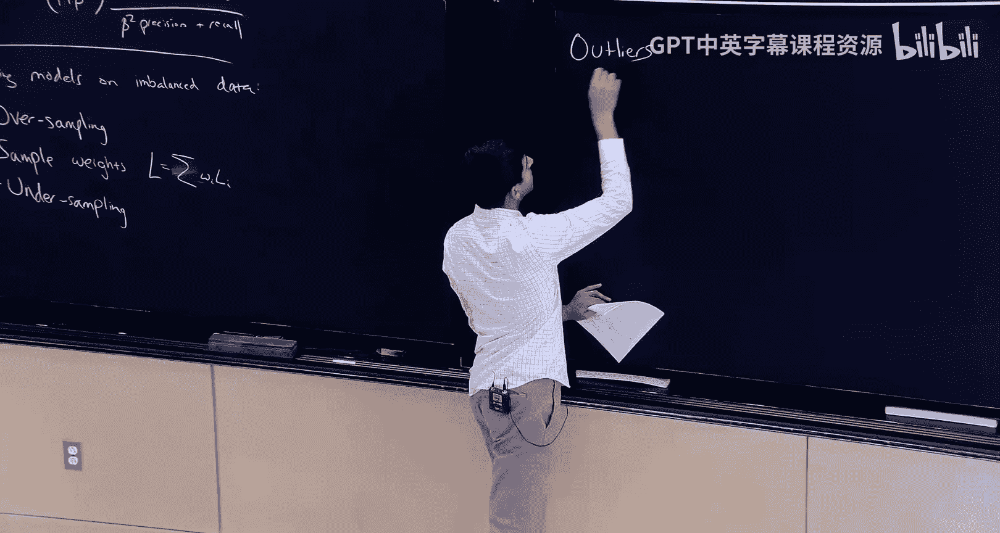

Can anybody tell me what an outlier is？

I'm sure everybody's heard this term before。 You don't have to have a precise formal definition。

 just a kind of intuitive。

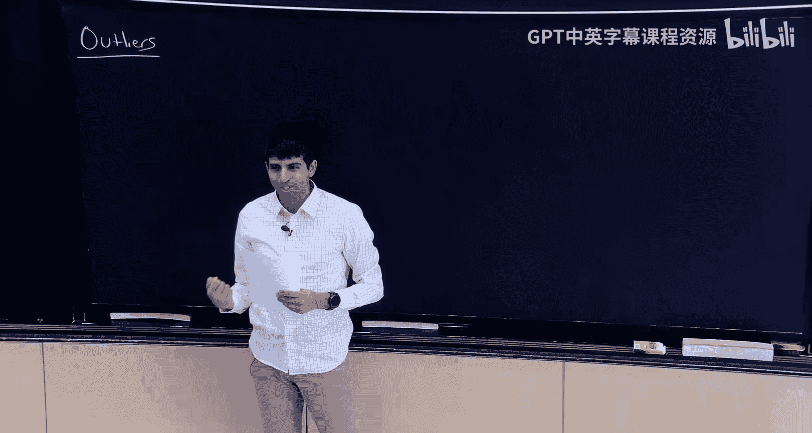

What do you think of when you think outlier？

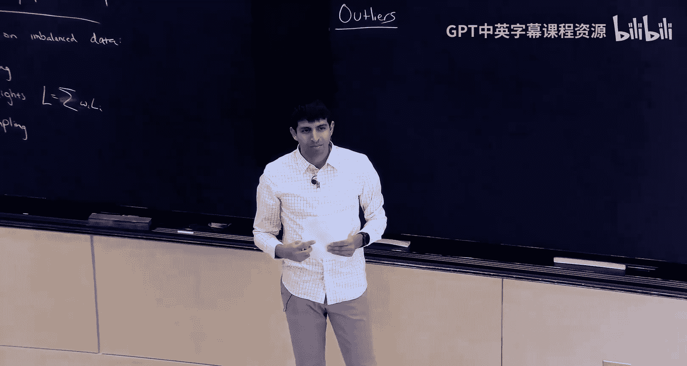

Yeah。Yeah， so something up there。Like a data point at the tail end of your distribution。

Another even more informal definition is data points that just differ significantly from the other data points。

 and I would precisely or formally specified what differ significantly means。

 but as an intuitive definition it's pretty good。

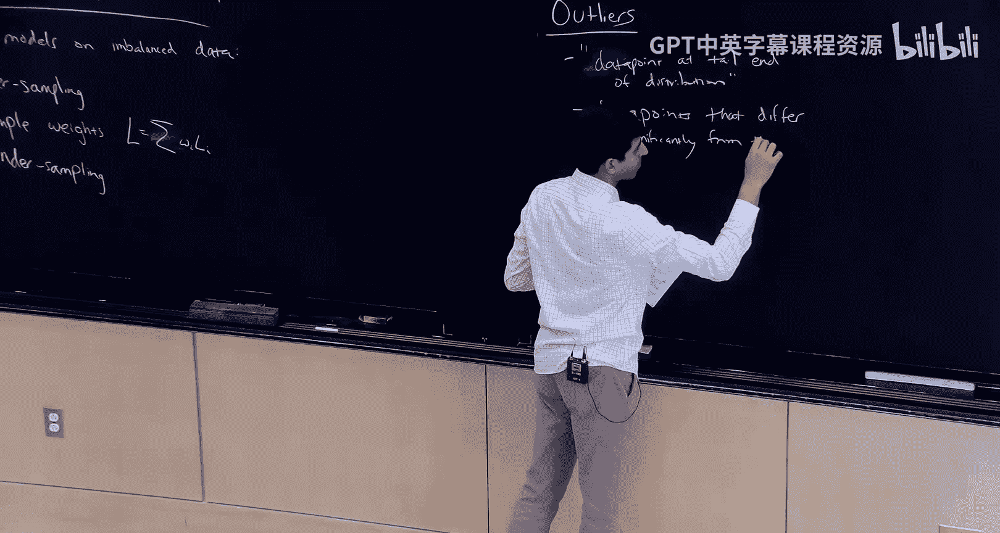

And so in picture form， suppose I have this data set， I'm actually just showing features here。

 so in feature space we might have a feature X1 and x2， I'm going to draw a bunch of points in here。

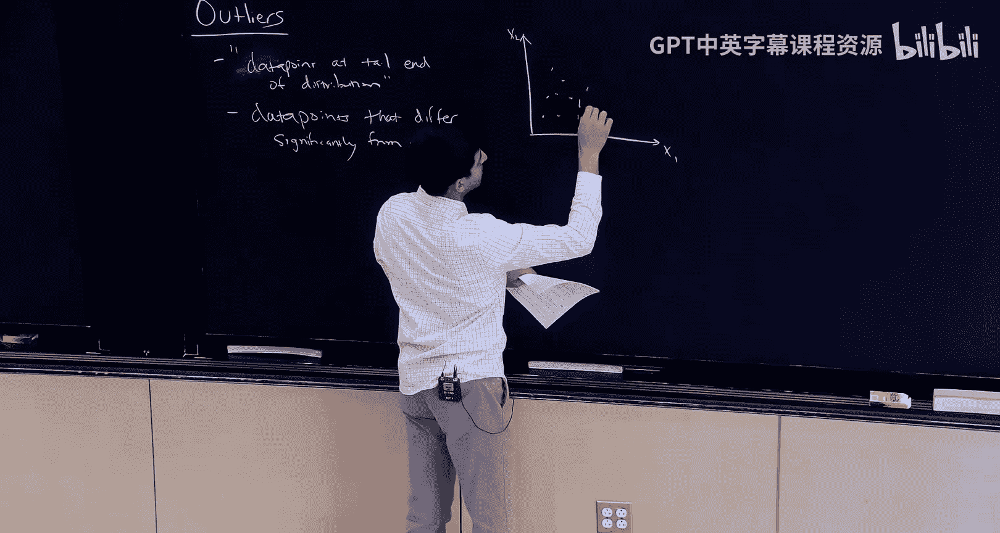

And when I draw this picture and I tell you find the outlier， can you tell me which one it is？

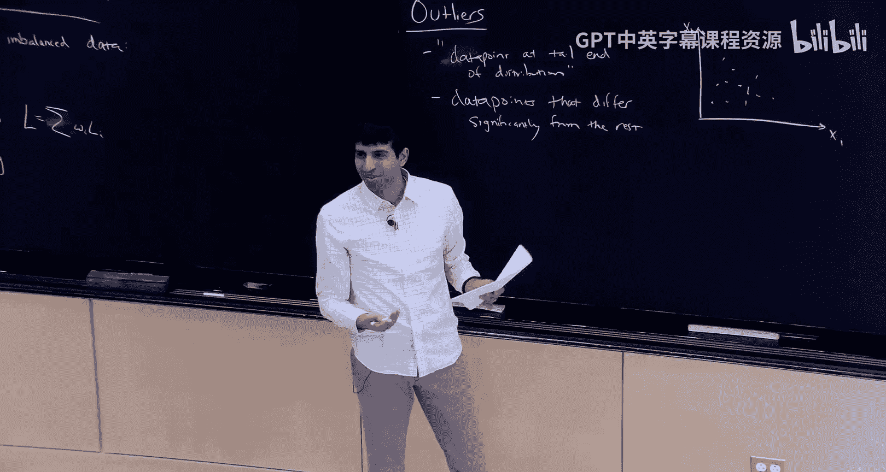

Yeah， it's this data point I'm here， right humans are surprisingly good at looking at various types of data sets and picking out the things that look different from the rest。

And so in this class we're all about systematic approaches to these data problems right so we're not just going to say oh。

 the way you find out Lis is look through your billioning examples in your data set and just pick out the ones that are bad。

 we want to come up with algorithms to automatically identify these so we'll talk a little bit about that。

But before we talk about algorithmic ways to identify outliers， can anybody tell me？

Why finding outliers might be helpful， like what problems would they cause。

 why do we want to find them and what you might do once you find an outlier or find outliers in your data。

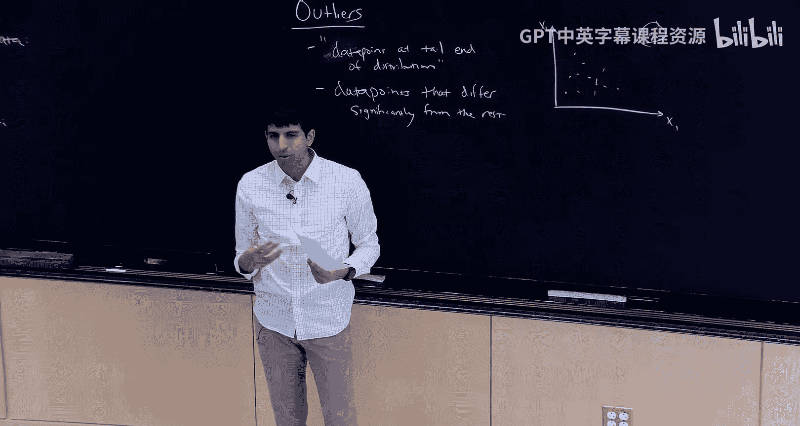

Yeah。li。ペース？YouFind out why。Youve done。Entry error。Yeah， exactly。

 so outliers can harm machine learning model performance。

 that's one of the main reasons we might want to identify them and then if they're indeed say a result of bad data entry。

 we probably want to get rid of them and if there's something else going on。

 we'll at least want to think deeply about what's going on and maybe address it in some way。

So can anybody come up with some examples？2。Causes for outliers。

 like why we might end up with outliers in a data set。SoYou already named one bad data entry。

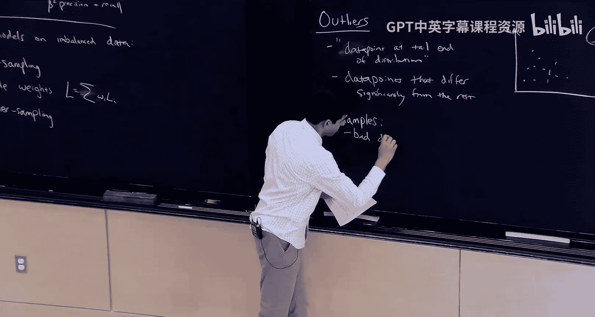

Maybe people are， say， labeling a large data set that consists of a bunch of images。

 and after they've labeled 10 of them like they start making mistakes because they're tired。

What other causes might there be？Outliers。这二啊。嗯哼。😊，Yes， so。I's call that rare unusual examples。

 and so these aren't like erroneous data points that they just want to throw away。

 but they're still outliers in some sense maybe want to handle them differently yeah。Yeah。

 so maybe something in the data itself has changed， do you have any concrete examples of that？Yeah。

 so we'll talk a little bit more about that in this next part of distribution shift。

 like something in your data changes a little bit more closely related to that than outliers。Yeah。

Yeah， that's a great one。Mmhm。😊，So let's call it， say like bad sensoror readings is one example。Yeah。

 just your measurement instrument is damaged or flaky or something and you get some funny data that's yeah。

 like bogus and it looks very different than the rest of the data。Great。

 and so we're gonna talk about how like algorithmic means through which we can identify outliers。

 And then what exactly you do with the outliers depends a little bit on what type of outlier they are。

 Like if it's bad data entry， say like a mislabeled example and that's why it's an outlier。

 Maybe you want to fix it。 if it's a bad sensor reading maybe unclear that you can fix it。

 you measured something at some point in time。 It's just bogus like can't go back in time and get the real reading Maybe you just throw this away for rare or unusual examples。

 you might actually want to handle it differently like those are actually super valuable data points because they're like real。

 they're not bug here or anything like that。 And you actually might want to make sure that your machine learning model handles them correctly like that stoplight example we saw in one of the previous lectures。

Any questions so far？And one way we'll break down or categorize outlier detection into one of two categories is。

Outlier detection。Versus anomaly detection。Both broadly related to this problem of outliers。

 but slightly different problem settings。 So in outlier detection， we have a bunch of data。

 and we want to find data that looks different from the rest。

 So this is an example of an outlier detection problem。Whereas an anomaly detection。

 the setting is slightly different， were given a data set。With a bunch of examples in it。

And then given a new data point， we want to determine if this data point came from this distribution or not。

So does everybody see how these are two slightly different problems？

RightHere I'm not told like what is in distribution。

 whereas here I'm given what is in distribution and then given a new data point I want to figure out。

 do it come from this data distribution or not。And these are closely related， like for example。

 suppose you had an algorithm for outlier detection， and then I gave you an anomaly detection task。

How could you use the outlier detection algorithm to solve your anomaly detection problem。

 Does anybody have any ideas？This is a pretty simple transformation between the two。

So so you have an algorithm where you can just give it a bunch of data points and it'll tell you these subset of data points look very different than the rest。

Now I give you a problem where I give you a bunch of data points。

And I tell you this is all my data distribution， and I give you one other data point。

 and I ask you the question， does this belong to this distribution or not？

How can I ca this as an instance of an outlier detection problem？じや。

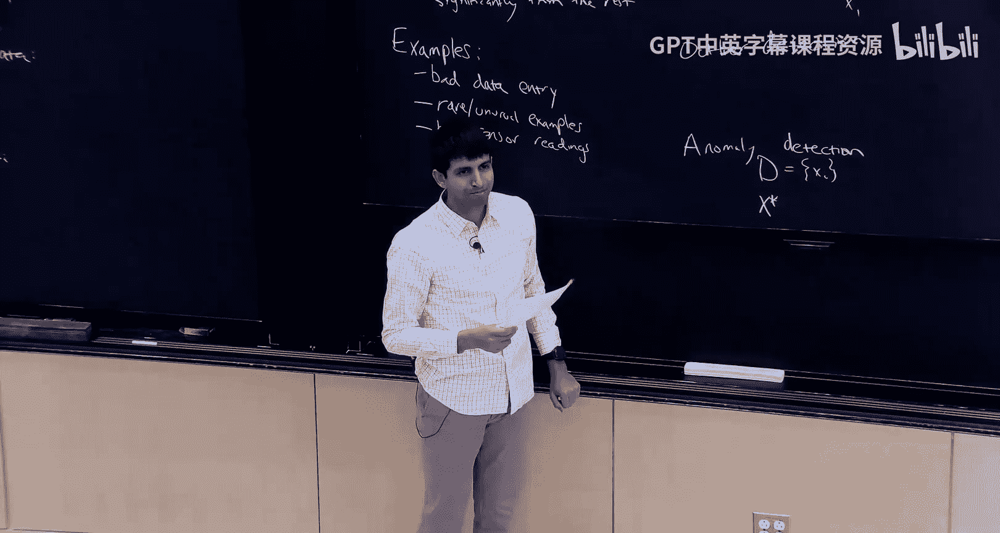

Yeah， exactly， you just combine all these data points with this one。

 give it to the outlier detection algorithm， see what it flags as being an outlier。

 and then if this data point happens to be one of the ones that's flag， then it's anomalous。

 otherwise it's not。And then to make this difference really concrete。

 can we come with an example of each of these as some real world example of a task that involves either outlier detection or anomaly detection？

So I'll give you one for later detection。Suppose I just have an image data set like an image classification data set。

 maybe some of the images in there are just bad， like they're blurry or something。

 there's kind of bogus， and I I have this big data set and I just want to find these bad examples and throw them out。

That could be framed as an outlier detection problem。

 like the blurry images are outliers among the other ones。

Notice there， I don't have like a here or good images now given a new image of good or not。

 it's just I have a big collection of images and I want to find the bad ones and throw them out。

Any ideas for an anomaly detection example？Plagiarism， okay。That's an interesting one。

 so you might have， say。A bunch of homework assignments and a professors grade at all of them and they thought deeply about it and determined like。

 okay， none of these students plagiarized and then the next year the professor doesn't want to think too deeply about this instead of want to use a machine learning algorithm to figure out like oh given another student's submission。

 it doesn' it look like plagiarism or not。LikeDoes it belong to the non plagiarism distribution or not？

 That's a good one， Any other ideas。Yeah。

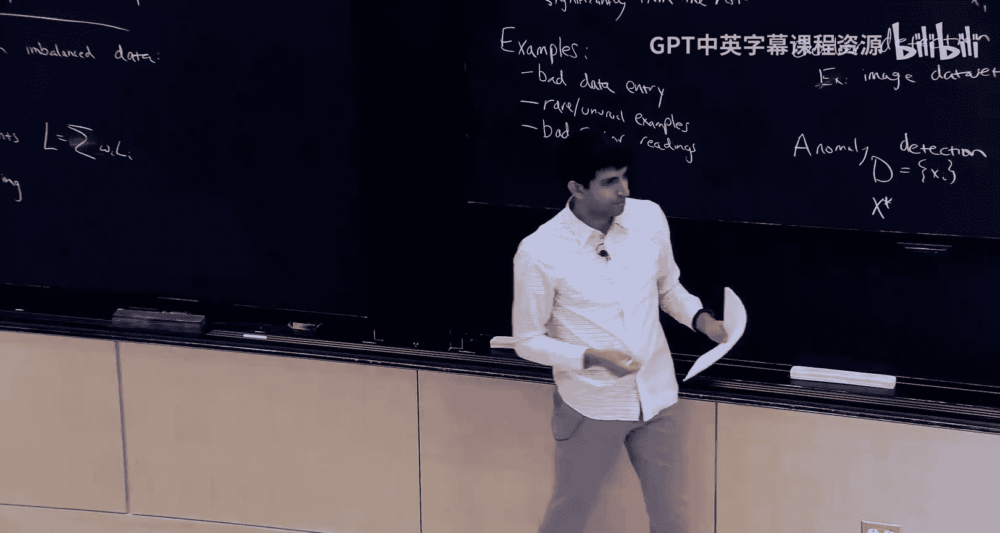

嗯。没有。Yeah。

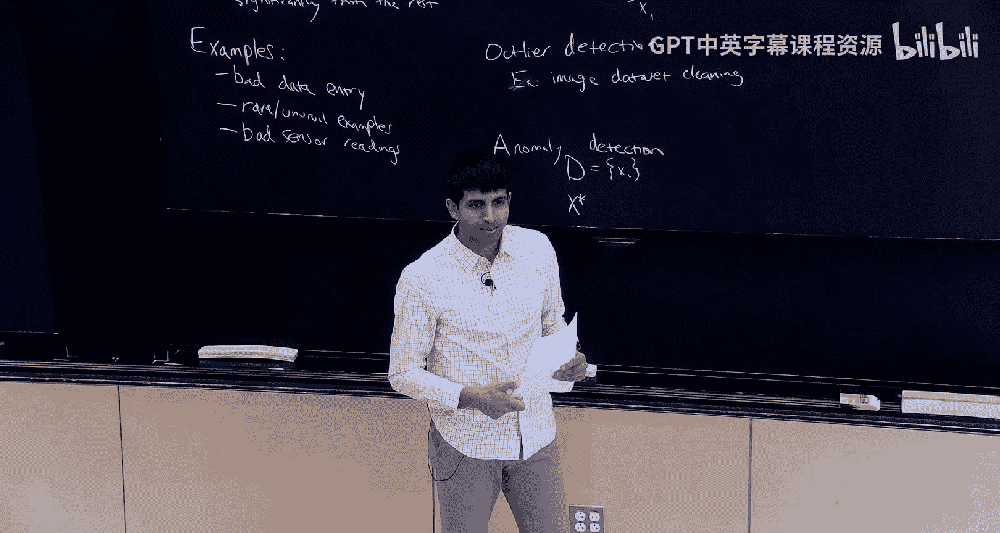

Yeah。

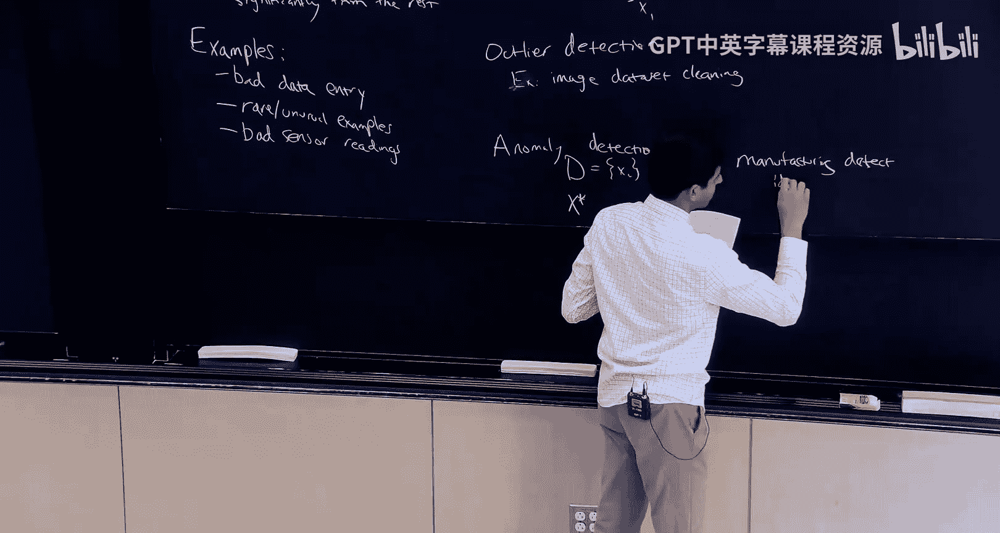

Yeah， that's a good one。So maybe you don't have a prior like you have a bunch of examples of defects and examples of nonds you just have like okay we produce a bunch of items they all look good and now I want to start monitoring for anomalies in the future All I have is the good examples so yeah that's a good example of anomaly detection。

any questions about that before we move on？

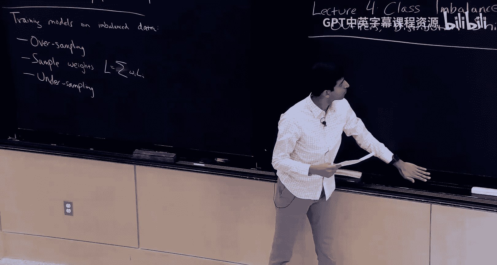

All right， so now we're going to look at a bunch of algorithms we can use for identifying。

Outliers in data， and so we'll start with some really simple ones and then look at some slightly fancier ones that work surprisingly well in practice。

So just to get us warmed up， we're going to consider a really simple application domain where our data points are just real valued numbers。

 superda one dimensional just like  three or 4。5。是的。

呃。This first one I' to look at just to got us warmed up。

This was a method that was proposed in 1977 or something like that by a statistician called Tki。

And the method is as follows。 So we're thinking about。

One dimensional data points right now so we can just plot them along the real line。

 And here I'll mark them as little X's on here。 So you have some data points along this line。

And one method you can use what this method says is find the first quartile and the third quartile。

So 25% of the data is here， 50% of the data is here。

 25% of the data is here define this as the inter quartile range。

And then look at these as thresholds。Take 1。5 times this inter quartile range。And。

An increaser like balanced by that much on each side and then say like this is what's considered in distribution。

So if we have a data point over here， we'll flag that as an outlier。

 but all the data points here are considered not outliers。

So there's no scientific basis where we can prove that this finds outliers in a data set。

 yet it's surprisingly effective in simple settings。So it's getting us warmed up here。

Any questions about that one？IThink in lecture one or two， somebody mentioned Z score。

 so that's another。Tecique you can use for identifying outliers。

 you can give a score to each data point and then the。Higher the score。

 The more likely that that it' an outlier and they can find a cut off and define everything about that as an outlier。

 So recall that the Z score。Of a particular data point is that data points value minus the mean over the standard deviation。

 And so if you have normally distributed data， for example， you'll say like， okay， you might pick。

Some threshold like， okay， we're going to look three standard deviations on。

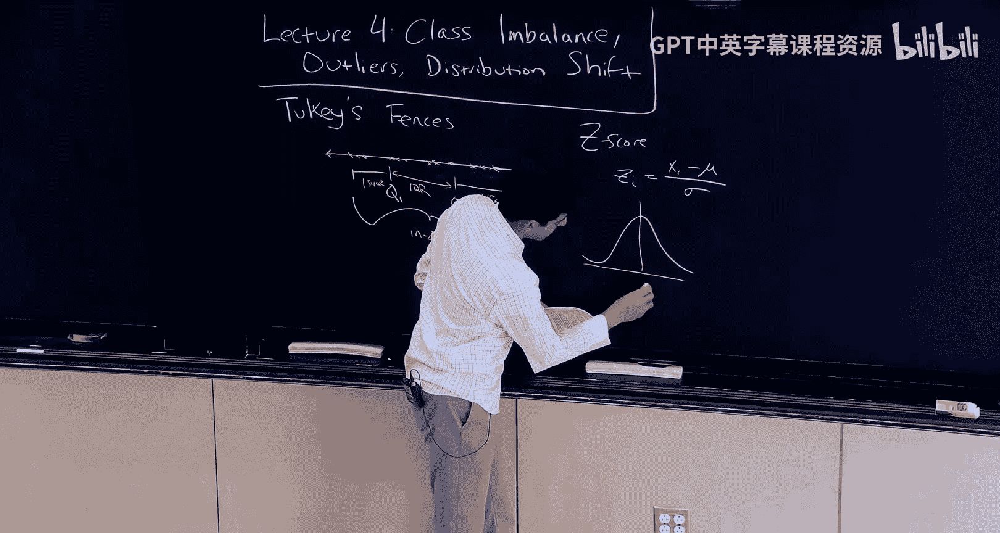

Either side and define anything at these tails of the distribution to be in out of water。

Go another simple method。Any questions about that one？All right。

 these are too simple and nobody's excited yet。 Okay。

 we're going to look at some slightly fancier ones that are actually pretty， pretty neat。

So this next one we're going to talk about is called isolation For。AndIt's a pretty neat technique。

 It's pretty simple。 So actually， if you want to， you can take today's lab assignments and implement this yourself。

 like actually just write the algorithm from scratch yourself。And intuitively。

 the way this method works is it's related to decision trees。

 And hopefully most of you have heard about decision trees before， and if not。

 I'll explain it briefly。intuitively the way this method works is it creates a random decision tree for the data and then the score associated with each data point is how deep you need to go in the decision tree to isolate that data point from all the other data points and so if a data points is like really far off from the rest of the data。

 you probably don't need to go very deep in the decision tree to isolate it right but if there are a bunch of data points altogether so that any individual data point there is not that far off from the others。

Well， then it's less likely to be an outlier and you to go deeper into the tree to actually isolate it from the rest of the data。

And so this one's much easier to understand when I draw it out in picture form。

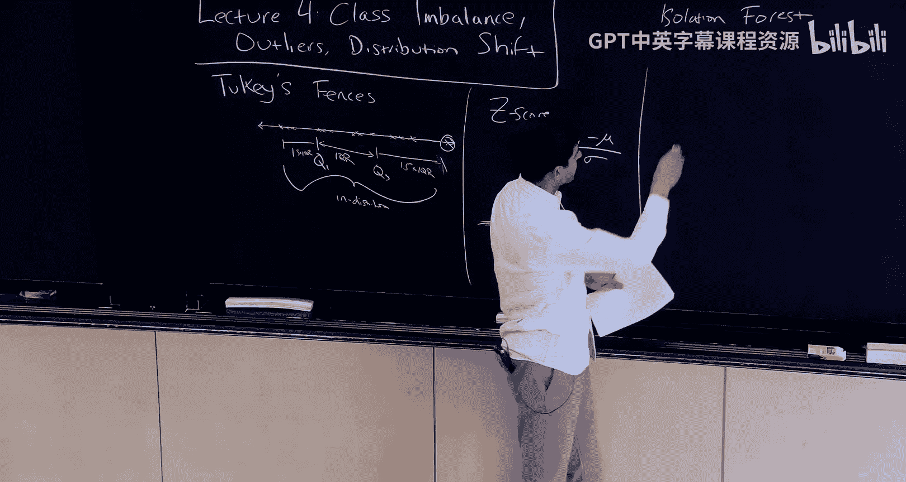

So here we're going to look at yet another data set， this one's a two dimensional data set now。And。

I'm going to draw data points as a bunch of dots。And then we're going to run this isolation forest algorithm on here。

Also， just looking at this data， if I tell like there's one outli in this data， can you find it？

You can always point to this， right， but we want to find these sorts of things algorithmically。

And so the way isolation forest works is it's just going to create a random decision tree for this data。

 So we might start off and pick a random feature， so maybe we randomly pick the X2 feature and we randomly pick some cut off like maybe we pick right here is the cutoff。

 And so here's the first。First node in our decision tree。

 so we'll start building up our decision tree and this first node will be like is x2 less than I say this is like10。

Is x2 less than 0。4 Then we have the two branches here， right。

 and so far we haven't isolated any data point。 So we have to keep going until every data pointss isolated。

 So I'm not going to draw out the whole tree， but I'll go a couple levels deeper， so。

Maybe in this left branch now we'll randomly pick x1 and pick like this as a cutoff so I'll have is x1 less than 0。

2 or something like that and continue building up this decision tree。

 maybe in this branch of the decision tree we'll also pick x1 randomly as a feature and randomly pick this as a cutoff。

So note that yeah。Like we don't have to pick the same cutoffs or same features in different parts of the decision trees。

 all just randomized。So this branch of the decision crew might have like x1 is less than 0。5。

And notice here。We've already isolated this one data point right so I only needed to go two levels deep in the decision tree in order to isolate this data point。

 whereas for all the other data points I have to keep going like I might okay on this branch here。

 I might say split the tree here and I'll have a x2 is less than 0。

7 and so on and so I'll keep recursively splitting up the space and then associated with each data point I will have a depth than my tree yeah。

Just there。嗯。Now pick a random， feature， pick a random cut off。Yeah。Yeah， so the question is。

 since it's randomized。 you have to run this multiple times。 Yeah。

 I think you'll get a better estimate if you run this multiple times。

 There's a link in the lecture notes and it links to the， yeah。

 original research paper that propose it。 So a lot more details and some like analysis of balance and stuff are in there。

Any more questions？Yeah， it's a kind of neat method， right，呃，一把这个。Yeah。

 so the question is how do you contrast these three methods and is there time you'd use one over another。

 I think ideally， if you can set up some sort of experiment on your data where you actually know for some subset of your data that you can just benchmark these different algorithms。

 otherwise you want to look at other people's benchmarks and like kind of similar data and see what works better So some of these things like。

This is so simple it likely just doesn't apply to your data， right， I。嗯。

Isolation force is something that's a little bit more general。

 the next one we'll talk about is also more general and those are the more likely candidates。

Any other questions？So we'll talk about two more algorithms before we move on to distribution shift。

 So this next one is another， yeah。Pretty useful method。

 I think some of these ones like you're not going to use this on your data set because it probably just doesn't apply。

 whereas these like this next one I'm going to talk about almost certainly applies to your data like lots of people use it in practice。

 super useful， it works quite well。This was also easiest to explain through a picture。

So hopefully most of you have heard of can nearest neighbors right， like take a data point。

 look at its can nearest neighbors in the future space。

And turns out that you can create a metric based on that that's surprisingly helpful for identifying outliers。

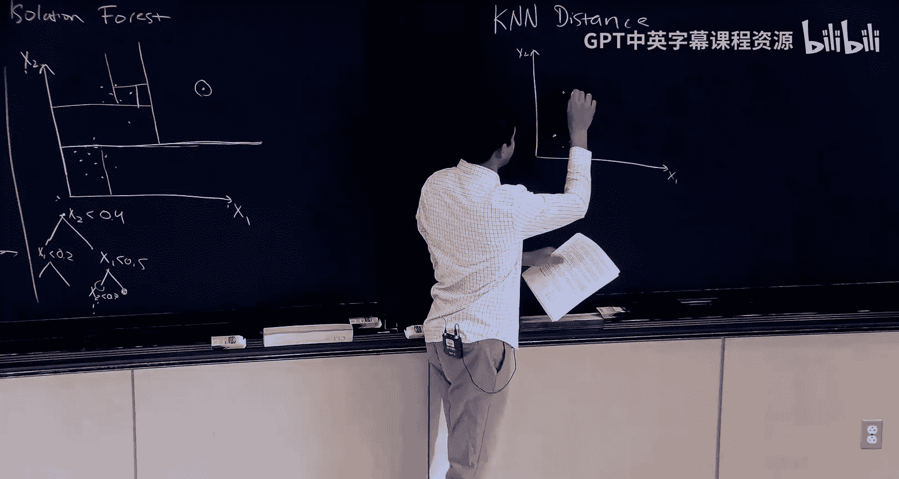

And this is also super intuitive。 If I asked you to come up with this kind of an algorithm。

 to come with some algorithm for identifying outliers on your own。

Maybe you' be able to come up with this on your own。

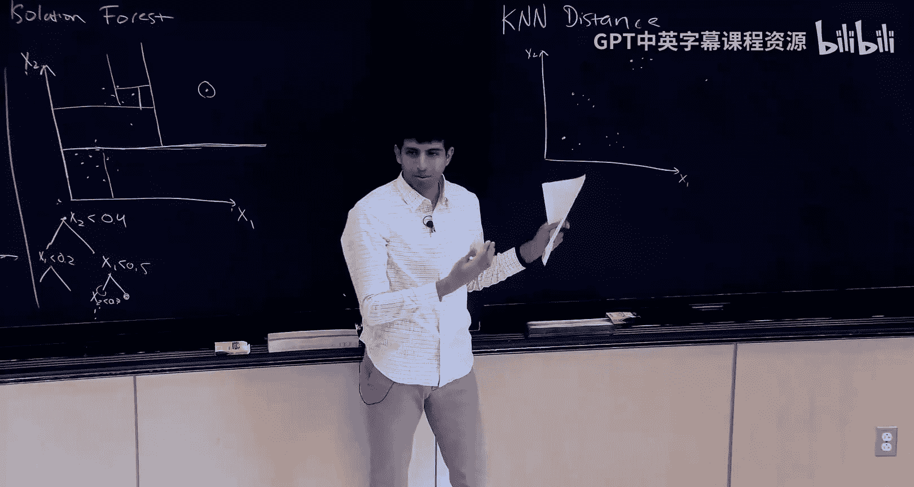

So one thing you might do is yeah， look at k nearest neighbors of a data point in this picture I'm just going to pick k equals 3 and then。

Say if I want to give a score for a particular data point， like I want to score this data point。

 what I'll do is I'll find its three nearest neighbors。And compute the average distance to them。

 right， And for this data point， for example， that'll be small because there are a bunch of other data points that look like it。

Whereas for this data point， this is going to be large， right。

 like it's three nearest neighbors around or something like this。

So the canon distance here is very large whereas here it's very small。

 and so you can help with scores for outliers based on this technique。

So what if I had going back to one of my earlier examples。

 what if I had this image data set and I want to identify， say like weird images in there。

Could I just directly apply can on distance， like how would I， what would I do there？

What do you think would happen， like if I say directly just took the pixels in the image as the individual features and then just looked at this distance metric。

It might not give the best outcome， right， because like。

Distance between different images in pixel space is perhaps not the best metric for comparing images。

 if I have， say a data set of cats and dogs， lots of like diverse looking pictures。

 and then there's a couple pictures of like Curtis in there and I want to find the ones that are anomalous just looking at differences between pixels in this very high dimensional space is unlikely to give good results。

 So any ideas for what we could do there we still wanted to use canon distance yeah。Yeah。

 so some kind of autoencoder framework， there's another way we can use autoencoderrs。

 but yeah one thing we could do with an autoencoder is just encode our images right。

 go from our high dimensionional representation， the raw pixel values to some lower dimensional representation where distance under some distance metric is a more meaningful comparison between data points。

And so you don't have to use an autoencoder， there are other things you could use like for example。

 working in this image domain， you could take a model that's pretrained model that's trained on some image data set。

 take one of the penultimate layers of that model and just use that as a feature representation for your images and then yeah look at distances there。

So this method works surprisingly well in practice， I think if you were to choose a default method。

 Id say embeddings plus canon distance is a great one to use。Any other questions？

And since you mentioned auto encoders， the last method I want to talk about is related to auto encoders。

 it's a super cool one。It's just a clever method， so I think it's cool to go over。

Raise your hand if you're familiar with an auto encoder， that is。Okay， roughly half of you。

We'll very briefly explain auto encoders and then talk about how they could be useful for finding out liars。

 So auto encoders。Can be used to take some input data。 Let's talk about images here。

 So you have a picture of like canwritten digits， like the Ms data set you have this five。

 What auto encoders do is there。There are models that consists of two parts。

 one is called an encodeder， the other is called a decoder， and the idea is that this encoder。

Turns your input data， some high dimensional， complicated thing into some lower dimensional latent representation。

 So maybe you turn your。Image of a five， it's like whatever 700 something pixels in Mist into to say like a 10 dimensional vector or something right。

 much smaller latent representation。And then you have a decoder。

That turns this back into a reconstruction of the image。

So the idea with auto encodecors is that you can train this whole thing。

 so jointly train the encoder and decoder， get some good latent representation out and then these things have a bunch of different uses。

 but one of the ways we can use this to identify outliers。

Is leveraging this property that the autoencors have to figure out how to compress the high dimensional input into this low dimensional latent representation。

 And so they kind of learn。Kind of like you can think of them as kind of modeling the data distribution as part of that because you can't encode like directly encode all the values of the pixels in here。

 you kind of have to encode。You might imagine that the latent representation captures something like what is the digit and like roughly what is the handwriting style used to write down that digit。

 but it can't just encode arbitrary pixel values And so what might happen once you train an autoencor on a data set like this like say train an auto encodecor on MNist。

 then if you pass in a handwritten digit like a5， you might get something out that looks very similar。

 but if you pass in something like totally random， say a pass in a smiley face through this whole thing。

I might get out something that looks totally different。

 You could actually try this just train an auto encoder and on this and see what happens。

 I wouldn't be surprised if you get something that looks vaguely like a handwritten digit because like this was designed to compress encodings of handwritten digits into a low dimensional representation。

And so the way you can。Leverage this to identify outliers is use the reconstruction loss as a score so what you do is you come up with some appropriate distance metric here working with images so you can even use L2 distance like just distance between the pixels and for in distribution data you'll expect this reconstruction loss to be small whereas for out of distribution data the output will change a lot compared to the input and the reconstruction loss will be larger。

This is a kind of neat method leveraging auto encoders。家。クラウンして。知道。Oh the question is。

 how is the reconstruction loss different from the loss that's used to train the autoenrs application？

は。ま。好好的。Yeah， so you could even train an auto encodecor without labeled data， right？

Thiss a totally fine way to train this kind of a model。But， yes， if you have。You you feel like a。对对位。

拍lo。Yeah， I think so。Any other questions about this？

And so I think today I don't have enough time to give a proper treatment of distribution shift so we'll just let that overflow into one of the future lectures。

 There's a cool lab assignment for today's lecture。

 We collected a data set or we created a data set for you consisting of a bunch of pictures of dogs with some outliers in there and then the assignments。

 explore various methods including some of the ones we talked about in order to automatically identify outliers in there we have a bunch of scaffolding set for automatically we have the ground truth because we created the data set right so we have some code we've provided for automatically benchmarking the different outlier methods so you can experiment with that and see what works and what doesn't on that data so yeah would encourage you to experiment with that lab assignment。

And。In the next lecture。 So for the next two lectures。

 we have Yoonas teaching the next lecture is gonna be about data curation on Monday。

 It's a very cool lecture。 The focus will be on multi annotator data sets。

 So say you like a big image data set and you wantna label it， one of the common ways to do that。

 It just farm that mechanical turk workers， you have a bunch of humans label your data points。

 But humans make mistakes And that one of the ways you deal with that is you have multiple humans label your data points。

 But even then like okay now we have one person says as a cat。

 one person says as a dog another person says as a cat Like how do you combine all that into the final labels for your data point。

 How do you do that in the way that gives you the best quality and also like identify interesting properties like who are your best annotators and worst annotators and things like that。

 So it'll be going deep into the multiannotator。It's a setting and covering some pretty cool algorithms for that on Monday。

Well， any final questions？对。IOutly detection methods for time series。Not off the top of my head。

 but I can talk to you after class。Any other questions？Cool， well， we will see you all on Monday。

 have a good weekend。