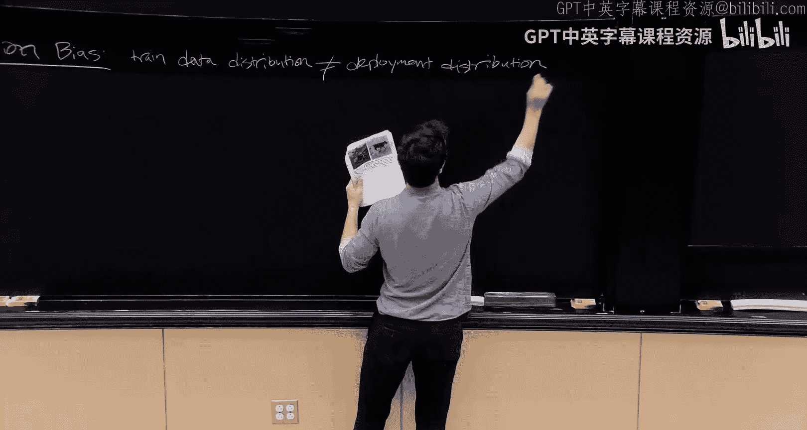
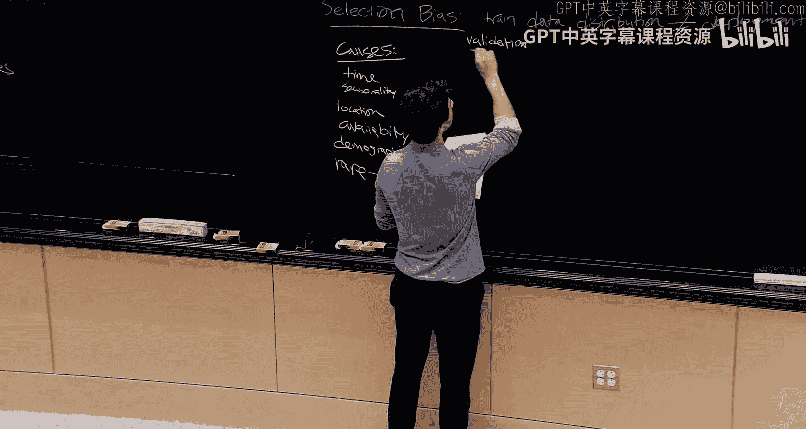
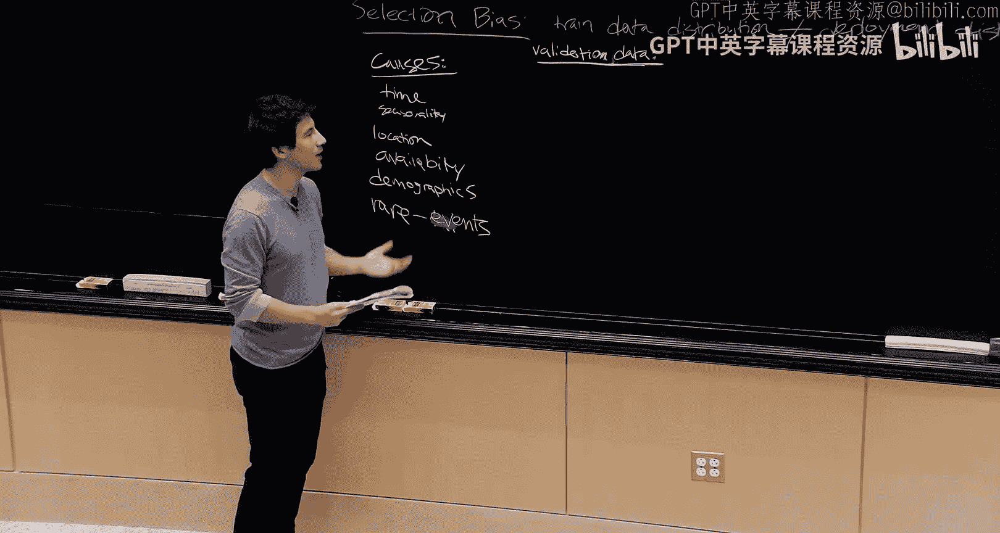

# 《数据中心人工智能导论｜Introduction to Data-Centric AI, IAP 2024》中英字幕（Claude-3.7-s） - P5：Lecture 5_ Dataset Creation and Curation.zh_en - GPT中英字幕课程资源 - BV1wvhczTETR

Hi， everybody。Can you guys hear me okay？Cool， I'm Jons and hope you guys have been enjoying the class so far。

At least you are back So that's a good sign And today's lecture we're going to cover sourcing data and really like how do we think about you know where do we get data from。

 where do we get it labeled， how do we make sure that we are you curating the right data for machine learning。

 which is you know the foundation of everything that we're going to build in AI product or machine learning application。

 will depend on the data that we're sourcing for that application。And so we're going to start with。

Key questions here。And so the two things you should always be thinking about when you are even at the very beginning of any machine learning project。

Before you even have any data is how will your model be used？So really。

 that means like what population are we going to be making predictions on and at what time are these predictions going to be made right。

 like you really need to think about that end use case and exactly how everything will happen and that will really inform the right way to collect your training data。

And then you'll really want to also think about like hypothetical。I'll just call these hypotheticals。

 but things like edge cases， high stake scenarios where you really need the model to make the right predictions。

 you know specific cases of how it will be used that are more important to think about than others。

And then a third thing we'll consider is when you're sourcing your training data。

 like problems that might occur in your data。And we've covered a lot of them thus far in the class。

 like mislabeled data and outliers， but some other data problems that might occur， for example， is。

Duplicates is a really big type of problem that occurs in a lot of data and it's so obvious right。

 it's so easy to find if you have data duplicates， but a lot of the times people just forget to check for it and it's just the kind of thing that you really want to think about at the very beginning of the project before you get to into the specifics of improving your models and gathering more data and things like that。

And so to emphasize why these questions are important， we can think about。

Say an image classification task。Forgive my drawing skills， but you're going to have to bear with me。

So say we have this picture of a cow in a field and。

A machine learning model was trained on some data and it correctly predicted this as being a cow。

And then we had another image。And it was， say a beach。

This is supposed to be a palm tree。Hopefully somewhat recognizable。And then we had another cow。

And here our machine learning model。Ended up saying not cow。

And does anybody have any idea why a machine learning model might have predicted the cow in the field as a cow。

 but not the one on the beach？Yeah。Yeah。Yeah， totally and why might have started using those other factors？

Exactly， so that's the training data presumably you know always had the cows and grass and in pastures and it didn't have any examples of cows and beaches in the training data and so the real thing to think about here is machine learning models are basically pattern detectors right so that's these factors that we're talking about are called spurious correlations。

And these are essentially patterns that exist in the training data。

 but are not really representative of the right kind of predictive patterns that will be present during deployment and you know the real patterns that you want your models to base their decision making off of so basically。

 yeah， you can think of ML models。

They're almost like cheaters。And they're looking for shortcuts or any simple pattern that can enable them to get good predictive performance in the test data or in the training data。

 sorry。And that's just something you really want to think about whenever you're creating a machine learning application is that imagine your model is just a cheater and it's going to look for whatever patterns it can find that exist that give you the quickest path towards decreasing the training set loss and increasing the training set accuracy and you want to make sure that any patterns that do exist in your training data really are going to still be present in the test data。

 like in text， you problems like in natural language processing。

 there might be specific words that happen to be in your training data more frequently when associated with certain classes that just happen to be an artifact of how you collected the data。

 that's an example of a spurious correlation that you just really want to get rid of and not have present as much as possible。

More broadly， this problem is referred to as selection bias。

So really， what's going on with this spurious correlation is that the training data is somehow different right than the。

Data we're going to encounter during deployment time and that's why you have these patterns in the training data that are not present during deployment and so that's this broader theme of selection bias really is that there was just something that happened while you're collecting your training data such that its distribution is no longer representative of like the deployment distribution that you're going to see when you're actually using your ML model in a real application。

And the main thing I want to emphasize here is that selection bias is really。

 really nasty and there's like really little you can do about it in many cases like once once it's sort of creeped into your training data and the weight in your problem set up it's almost irrecoverable a lot of the times and so really the number one thing to think about is just what will the deployment distribution look like like how will I be using my machine learning in my application and try and avoid at all costs when you're collecting training data that you would introduce selection bias really try and think about all the factors that might be causing the training data to look different so let's think about like some common causes of selection bias does anybody have any ideas of like。

Reasons or factors why the training data might not match the deployment distribution。

I'll start with a really simple one， like a really common one is just time like if you're applying say machine learning on humans like on users。

 you know user behavior in the past might not be reflective of user behavior in the future。

 the world is always changing so the time of data collection is a really common cause of selection bias。

 maybe less so you know like if you're studying nature and doing biological machine learning then the mechanisms would remain static over time and you wouldn't have to worry about it as much。

Any other ideas on some common causes of selection dice？Seasonal effects， yeah， yeah。

 definitely so seasonality。This is really common you know。

 in like retail applications of machine learning where you have Christmas and holidays and things like that make a massive impact on all the models。

 COVID， that's not seasonal yet hopefully， but we will see any other ideas。や。啊。😮，Yeah， batch effect。

 so I will call that more location or you know， like batch effect could be like you collected some measurements about cells in this one plate of cells and then in this another plate of cells or more broadly maybe you have like data from one hospital and then you're collecting data from another hospital。

 but actually deployment during deployment， maybe you want to deploy this machine learning for all hospitals and so the location at which you're collecting the data won't make a huge impact。

Anything else， any other ideas？There's a lot of them。

I'll go with something adjacent to location is just like availability， this is really common。

 is just， you know you collect the data that's easy to collect。

Because that's just the way the world works， everybody starts with whatever's easiest。

 so maybe you're getting data from your friends or people near you and just the data that's easier to collect might not actually match the data that you will encounter during deployment time。

Any other ones？I'll go with just two others， one would be demographics。

With human related machine learning applications， this is always really important。

 you know is making sure your data is representative of the end population that you will be using this machine learning on。

 and this has been seen with really bad effects like in clinical trials。

 which is you know pre-machine learning probably the biggest use of data for impacting people and they saw time and time again that because many of the clinical trials were not properly adjusting for demographics when they were collecting the data for the clinical trials that the conclusions and the treatments that were derived from them are totally sub-optimal for certain kinds of demographics。

And then the last one I'll go with is rare events or long tail， we might call this。

 which is just where you just have a lot of you know really rare situations。

 think like you autonomous vehicles and encountering certain kinds of accidents。

 you're just almost never encounter those when you're collecting your training data for good reasons。

 but how the vehicle should behave when it does encounter those situations is actually important。

 you know that your machine learning system behaves properly when it encounters these rare events。

And so， yeah， so we have you know all these causes of selection bias that we should be really careful about。

But we should also be thinking about， you know what can we do。

 we can't always fix all of these right sometimes they will creep into the training data。

So maybe you someone just gave us the training data and we're not able to collect any more data anymore。

 and so what can we do when we know you there might be some of these effects in our training data。

And so we'll think about the validation data being a way to。Decide。

How we might try and improve the machine learning。

So there's two things here， one is just even seeing you how machine learning will perform under selection bias is tricky right。

 because we have this training data and we know it's collected under some bias distribution that doesn't match the real distribution we're going to encounter when we are using this machine learning and so the way to think about how can we estimate how will the machine learning actually performed during deployment is through careful selection of validation data that tries to get rid of this selection bias。

Or you know at least reflect it tries to reflect the gap between the training data distribution and the deployment distribution as best as possible。

So here we just have now one training data set and we're thinking about we're going to split out some validation data and then we'll train our machine learning model on the rest of the training data and measure its performance on the validation data。

 and we want that。Process to match roughly what will happen when we actually train the machine learning model on the full training data and then measure its performance during deployment。

 And so let's think about how can we come up with some techniques for not just selecting validation data randomly right that's the traditional gold standard is you just randomly split your training data into validation and training splits。

 But rather here， let's think non-randomly， let's purposefully try and choose validation data such that we're able to see what kind of effects each of these sources of selection bias might have on machine learning model performance。

Does anybody have any idea say， like if we know like time is really important and probably causing a distribution shift in our data。

 how we might try and split our validation data to account for that？

Like if you imagine our training data goes up to the year 2023 from you know， like the year 2000。

 like how might we think about splitting that data into a training set and a validation set such that we're most closely trying to assess how well our machine learning model will do in the year 2024。

So one way we can do it is we can just take all the data up to some time point and use that as our training data right。

 and then all the data after that time point can become our validation data and you can see how well a machine learning model is able to generalize to future years that are outside of its training data and that is a standard technique so you might split your validation data as being all the most recent data。

And so the first thing to notice here is that that's definitely not going to tell you exactly right how your machine learning model will suffer in 2024 because you don't know what sort of new changes in the world will happen。

 but you'll at least be able to see that how your machine learning model tends to have performance issues when its training data is cut off up to certain time point。

 and then it is being evaluated on future time points。

 and you can at least start to see the effect of time on your machine learning model。

 the effect of this selection bias。How about for say location。

 does anybody have any ideas how we might split our data set into training and validation splits if we know like the locations at which data is being collected is kind of important and will affect our performance and we want to know how much。

Yeah。Yeah， exactly， that's a really common way， so you can just like hold out entire locations like entire hospitals if we're doing medical machine learning。

Or you can even be more aggressive and like have some features of the locations， you know。

 like longitude latitude in the world or country， like some higher level features。

 and then make like a really aggressive training and validation split difference such that you even entire hemispheres say are cut out of your training data and see how bad the machine learning performance drop is under such types of training validation splits。

How about rare events anybody have any ideas how we can you know say we know there's certain kinds of events that are really rare in our training data and but we know they're important and they will occur during deployment。

 like how can we try and make a validation data set？

That measures the effects of these events being super rare on the training data。Yeah。Exactly， yeah。

 so I'll generalize that idea to just say you could have more of them in the validation data than in the training data。

You could save all of them too。And so what you'll notice is if you're taking these rare events and putting more of them in the validation data。

 you're actually then having less available leftover in the training data。

 so you're making the disparity even greater and really measuring the gap and the performance drop that your machine learning model will incur as these events get rare and rare in the training data。

 but tend to be present in the evaluation set。

Yeah， question。Oh yeah， so at the end of the day typically the best practice will still be you know training your machine learning model on the full training set this is like an internal evaluation you're doing preeployment and you're just trying to measure essentially like what might go wrong say you're just trying to make the decision even you should I deploy the machine learning model or not so we don't have access to any of this part over here and we know our training data had some selection bias in it that's always kind of unavoidable right at the end of the day there might always be especially with human related machine learning some selection data and you' some selection bias in your data and your question is just trying to understand how badly might my machine learning go when I do do the deployment。

嗯。😊，Yeah。Oh yeah so with rare events typically it will underestimate these rare events right and so the idea being that these rare events do matter during deployment。

 we are consciously making that decision that these matter and so what we're doing is making them even rarer in the training data yeah we are skewing the training data but we're basically trying to see what happens when these events are even rarer than they actually are because there might be future types of rare events in the deployment that we don't even have so we can't even do anything with such types of rare events。

So we're just really trying to see what is the performance hit on the machine learning model as we make these events more rare。

 as we make， say in the case of time， the gap between training data and validation bigger in time。

 we're just trying to see you how robust is our machine learning model to these kinds of effects。

Because at the end of the day， selection bias is really nasty and like it will have impact on your machine learning on all machine learning。

 and you're just trying to see how much impact it might have based on your knowledge of what forms of selection bias there might be。

Any other questions about that？Okay， I'm going to shift gear slightly here to。

The next question that comes up。 So now we've。We've got。

Worried about selection bias when sourcing the training data and we've tried to see you know like what kind of impact the selection bias might have on the trained machine learning models and now the question that comes up next when you're sourcing training data is how much data do we want so the goal might be you know we need 95% accuracy say。

For a classification problem。And that's just like a you know application requirement for some applications。

 we just need this like for speech recognition， it's actually 99。

99% like you need really high accuracy for users to want to use a speech recognition system。

 otherwise people just won't use it but let's say you know like here our goal is 95% accuracy and the question is how much data do we need to have for that right？

And this is important in the planning phases because often this will how much data will incur costs to go collect it or time to wait until it's collected。

 and this really is an important fundamental planning question when you're trying to curate your data for an AI product。

And so。Yeah， we're going to talk about strategies to estimate how much data will we need to hit this target accuracy。

And so we have already some training data， let's imagine。

 and let's call this or let's just draw it as a circle here。

 so this is all the data we have and the sample size is n。Of this data。

And so the strategy that one can use to try and estimate you how much data will we need to hit this 95% accuracy will be as follows。

 so we'll make a graph。And this will be the accuracy。

And this will be the sample size of our training data。And so here。

 let's say this is the 95 goal that we're trying to hit。

And say we've trained our model on all the data we had so far and we ended up， you know， like here。

And the question is， how can we estimate how much data do we need to close this gap to get you know that 95% accuracy。

 And so a strategy one can use that's really simple is just train your model on subsets of the full dataset。

 So here， you know we might take like 10% of the data。

 and let's train a machine learning model and call it M1 and that will lead to you know accuracy。

 some accuracy on some fixed validation data set。 So let's imagine we always have a fixed validation data。

And we are going to train the model on this part of the data， get the model and evaluate it。

 and get its accuracy。And so maybe that was 10% of the data， so we would get， you know。

 maybe our performances over here。And then we can just repeat with an increasing subset of the data。

 and let's train this model， call it M2。And that evaluated on the same validation set again。

 that'll give us another accuracy performance。Maybe it's up here and so on and so forth， right。

 we can just keep doing this on all these subsets。And actually each one of these training and validation runs is highly noisy because how most machine learning models operate today is highly stochastic with like you know deep learning models and stochastic gradient descent。

 but also the choice right of this data subset within this universe of data was just a random selection of the data and typically even the training and validation set is kind of a random split so you might actually repeat all of this multiple times and you'll end up collecting observations that look。

Something like this。I guess with the full one， you'll just have one， right。

 because it's not easy to have many reruns， but you could rerun the machine learning model itself without changing the training and validation data。

And so now the question is， at what point？Will this accuracy hit this desired target， right？

And so any ideas how we might estimate that， so we've collected some new kind of observations that look like this。

How might we go about trying to estimate you know when are we going to hit at what multiplicative factor say of the training data size are we going to hit that target if ever？

Yeah， so we could try regression and more generally write any kind of machine learning because this is in some sense kind of like a curvefitting machine learning problem so what we could do is try and use say like a machine learning model like a linear regression model and then it would extrapolate like this or we could use like a K nearest neighbors model right that's a popular machine learning model but if we do that it'll actually never extrapolate beyond the range of the values it's seen before because that's how K nearest neighbors works and so one problem here with this extrapolation is that it's fundamentally like a really big extrapolation problem we're trying to go way beyond the scene sample size here and really that kind of extrapolation is fundamentally impossible without injecting some kind of external knowledge right so just fitting black box machine learning model to this like a neural network or something will just not work very well。

And so the kind of external knowledge that we can inject here is this formula that describes how the。

Arror of machine learning models trained on limited data evolves。And what that formula is is。

That the log of the error。This is the error of the train model。

 so you can think of it like one minus the accuracy。

 or you can think of it like if you have a probabilistic model。

 like the log loss of the predicted probabilities。But it will just be。So I'm constant。

Times the log of the sample size plus some other constant。

And so this is what's called like a power law， but basically in log log space。

 the error of the trained machine learning model will be linearly related in the log space with the sample size。

 the amount of training data that you are collecting。

And so the idea being now that we know this fundamental like physical fact。

 now we can just estimate these two parameters of the。

Of the equation based on the observations we've collected so far so we can basically try and fit a curve that obeys this property and minimize the mean squared error of all the observations we have so far。

 choosing A and B and eventually that curve will or will not ever intersect the target accuracy and that would be our estimate。

 say like it's 3x， the amount of data is required。And so to get some intuition of like where this formula comes from。

 I mean， one case where it comes from is just empirically， you see this happening all over。

 doesn't matter what kind of machine learning you're doing， what kind of data you're collecting。

 you just always see this relationship and to give a little intuition about it。

We can go back to like the very basics of just trying to estimate like the mean of a population so this is gonna to be like slightly more mathematical。

 but if we think about like what machine learning is at the end of the day it's like estimating the mean or average of a population sounds really boring but machine learning really fundamentally is just estimating averages over like subpopulations of your data set like people who look like this or you know examples who have similar feature values to this tend to have this average so like conditional averages is pretty much all of machine learning and so let's just go back to estimating an average on its own without any conditional features so we might have a bunch of numbers。

Like drawn from say a normal distribution。And it has this average and it has some variance。

And so we're going estimate， try and estimate the average here。 And that will be， you know。

 denoted by the mu hat。 And it would just be the。Empirical average of your data。

And after doing a little bit of math， basically what you can see is that if we look at。

 let's first formulate our notion of error， so our notion of error in estimating this average will be like the mean squared error is a classic type of error metric that one would take or loss function。

And if you want to calculate like what's the expectation of this mean squared error from this data。

 well， it'll literally just be the variance of the data divided by the sample size。

And so basically what we see here is exactly this formula in action。

 and in this case the constant is just depending on the variance of the underlying data。

And so that's starting to give you intuition yet。Yeah。

 so it definitely does not work a lot of the time when you have selection bias A is a really common one。

 but here let's assume you know everything is nice and we just have random training validation splits and that matches the real worldorld scenario then where so these constants where they will start to become really bad is based on the dimensionality of the data so there's this phenomenon called curive dimensionality and really like as the dimension of the data gets higher and higher and the complexity of the relationship that this model has the model as you get higher and higher dimensional the kinds of functions that relate the inputs to the labels can be more and more complicated these constants start becoming really bad and so it starts to not look like this as much。

But it still holds， it's just looking very slow， basically。Yeah。

 it's in random scenarios where the data is coming randomly。

 it pretty much always holds as far as I'm aware。So all the scenarios where it's not happening is due to the data not being random。

 like there's what's called fixed designs where you just have fixed data and therefore it doesn't even really make sense to talk about what does it mean to have 3x like you would have to start thinking about what's the process by which you're 3 xing the data。

Any other questions？Okay， now we've talked about sourcing data。

And we've talked about estimating how much data you will need based on some initial data set that you've collected。

And the final question that we're going to address in this lecture is like how do we get this data labeled for supervised learning tasks。

 say for classification or for generative AI， you might be trying to estimate like you might be doing reinforcement learning with human feedback trying to get feedback on you know what outputs are good or not good and yeah so at the end of the day you'll want to get some data labeled and how do we go about labeling that data now that we've talked about sourcing the data itself and figuring out how much we'll need。

And so here we're going to draw a picture， so the natural way to label data is with big workforces。

 you know， with many annotators who are labeling their data。And so here we might have， say。

 three annotators and I'll denote them by A1。8 two， eight three。And we have， say images。

 say we're just doing image classification again， it's such a simple concept。

 so we like to use it for this class as the canonical machine learning task and so here you know we have some images say this is like an autonomous vehicles application。

And so yeah， we're going to try and get a bunch of these images annotated。With our workforce。

And so we'll ask， right， the annotators will give them the image and we'll ask them you know which of the classes is in this image and you know say this is just standard image classification。

 so there's just two classes person and car and we asked the first annotator you know what's in this image and they say person。

And then we'll ask the same thing to the second annotator what's in this image and they'll saySa person too。

And then maybe you we're not going to have every single annotator look at every image because we have a limited annotation budget and that might not be the most efficient way to use it so say like this third annotator just never saw this image。

And then we can go to the second image and again ask the first annotator what's in it。They say car。

 of course， in practice， right， you would be giving batches of images to the annotator and they would just be annotating that whole batch。

 and maybe this is the only annotator that's ever annotated this image。Then the third image here。

 maybe it was only given in the batches assigned to annotator2 and three。

So the first annotator never labelled it。The second annotator said it's a person。

 and the third annotator said it's a car。And maybe the final image we give it to all three。

 and they all say it's a car。So。The big questions here that we want to figure out are。Number one。

 like what should be the consensus label right for each image。

 so like what is the actual label we should apply？Second goal would be to estimate once we have these consensus labels like how confident are we that each consensus label is actually correct or incorrect。

 right， like when the annotators disagree intuitively。

 you should be much less confident that your consensus label is correct versus say for this bottom one。

 presumably your consensus label would be car and you should be much more confident that that's correct。

And then the third question you'll want to understand is like which annotators？

Are doing good or bad jobs， right， like not all annotators will take the task as seriously as others or be as skilled in that domain。

And so you'll want to estimate the annotator qualities。And so yeah。

 these are just like three foundational goals that you'll have to want to address whenever you're trying to label data set with like a big workforce of annotators in this way。

And so let's first think about， you know， what are some things that could go wrong in。

Annotating data like this， does anybody have any ideas of like what are some potential problems we might encounter？

And why might our final data set not just be perfect or why might it not be a trivial task to just construct a great labeled data set out of this？

Yeah。Yeah， that's a good one， so like the machine learning task itself might be underspecified and that will be a big problem if you've spent a big amount of money collecting data that you haven't even provided the annotators the right interface to label the data appropriately。

Yeah。Yeah， exactly there's no ground truth here so the goal of inferring consensus labels is sometimes called like truth inference and you're trying to basically figure out like what is the truth here based on this data that you've collected and yeah it's really hard because you don't know which of the annotators is doing a good job or not a good job and so that is like the canonical issue that we are dealing with here。

And so one thing that happens， like if you use a platform like mechanical Turk。

 as many academic researchers in the social sciences will tell you is like you just get a bunch of the annotators who are just trying to do the least amount of work and get paid。

 And so they are just going to say always click car for every single thing that you give them and get through the task really quickly。

 And so their labels will essentially be useless to you like you can't even include that person at all in your study because everything they're doing is just totally adversarial essentially。

 And so for that sort of individual， typically what you' want to do is you want to include some gold examples。

Where you know like the true label。So you know， maybe every 100th example that the annotator annotates is secretly something you already know what the correct response should be。

 and then you can see you know if this person is always getting those wrong。

 you're just not going to include them in the data at all。But yeah， that is of course wasteful。

 the other way you can try and get around this problem is just to have all of your annotators always annotate every image right so that you really see the full picture of what all of them think about every single piece of data and that again is going to be really wasteful so both of those are not preferred in terms of solutions to solve these three goals on an efficient budget right because we're going to be paying for every single annotator either literally paying money or you're paying a time cost here。

And so really， the most efficient way to label such data sets is just to have the minimal set of annotators label each image such that you can still be confident that you're getting correct consensus labels。

 and so we're going to talk about strategies to get those now。

And just to introduce a little notation here， we'll say like Y IJ。Is the label for chosen。

 for example， I？So in this case， you the third example and by annotator J。In this case。

 also the third annotator， and let's just focus just on classification here。

 so these would be in you know just one of the K classes。

 but we can also have an empty label where we never even presented this image to the annotator。

And so now that we have this basic notation established。

Let's talk about ways we can try and start answering those three questions。So given data like that。

 does anybody have any ideas like what would be the？

Like the most straightforward way to get consensus labels。

Like so we need to figure out what is going to be right a label for the top image。

Like what would you guys， what would you guess is the consensus label a good one for this first image？

Yeah。Majority vote？

I's that what you said， yeah， so yeah， we can just have a majority vote。

That's a purely democratic way to do it。And so here we're going to write this a little mathematically。

 and so we're going to denote。Actually， before we do that。

 let's say we're using majority vote to measure what is the consensus labels to estimate that。

 how might we estimate the confidence in that consensus label？One。

 we're using majority vote to produce the consensus labels。Yeah。Yeah。Exactly， so for majority vote。

We can estimate the。The confidence here based on the agreement。For each example。So for example I。

 the agreement will be so here's where I'm going to introduce a little notation。

 basically we're going to look at the set of annotators that annotated example I and we're going to call that set JI。

So that's just the set where the annotation is not empty。

And the agreement would just be over that set of annotations。

 like how many of them agree with the majority vote annotation， right？

So that's really straightforward。And if we were going to measure the quality or confidence that the consensus label is correct。

 in this way， how might we measure how good each annotator is？

Following a similar strategy if we wanted to estimate how good each annotator is。Yeah。

Exactly how often they disagree is a very easy way， right？So the quality。Of annotator J。Maybe be。

So here's where we're going to introduce another piece of subtle notation so we're trying to estimate how often each annotator agrees with the majority right。

 but for example， consider this example here with the where only annotator one labeled this image like should we count that as annotator one agreeing with the majority。

And probably not right because they are the majority there。

 and so we want to introduce another subtle piece of notation here， which is that。

We're going to let I J。Plus。Basically be the set。Examples。Where。This。

The set of annotators that labeled them is greater than one。

 so these are like the set of examples where it at least makes sense to even talk about the majority in terms of more than one annotator。

And so the quality that we might apply for。Esimating how good each annotator is。

Is literally just right how money out of all the examples that each annotator annotated。

 like how often did they agree？With the majority or consensus label。Okay。

 so that is like a very easy， straightforward way to answer all three questions that we were interested in。

 right？So can we think of like what are the problems here， why is this not？Like the end all， be all。

 and this is a great solution。いや。Yeah， and why might the majority not be right？Yes， so yeah。

 some annotators might be better than others， like much better。 And so， you know， if you have two。

 especially if these are say medical images and， you know， you have different kinds of doctors。

 maybe some of them are medical students and some are expert doctors。

 and you might not want to consider them all equally。What's another problem we can think of？嗯。😊，Yeah。

 so if we go back to。Like in this example， we could be pretty confident that this was a car because we had a lot of annotators annotate it。

But and they all agreed， but say for this example here， right， we only had one annotation period。

 like how to even measure how confident we are in this annotation。

Another related issue when you have fewer annotators is you'll get more ties right so for this image here you know we have one in one。

 like what should we even consider the majority vote to be in this case？So these are yeah。

 some of the many problems that will come up if we just use the majority vote strategy。

And so I'm going to very briefly introduce something we can do。That is better than majority vote。

So actually， before I do that， let's talk about some intuition here。Intuitively。

 what we want is that our consensus label protocol should take into account how good the annotators are and then our protocol for measuring the confidence in these consensus labels should take into account how good the annotators are that labeled each example。

 but also right like how many of them labeled the example and how much they agreed or disagreed。

 so majority vote is taking into account just the how much they are agreeing or disagreeing and that's it。

And so let's go back to the problem of ties。So when we had ties， right， like for the。

Example three up there where you had annotator two say it's a person annotator3， say it's a car。

 like how might we think about breaking ties， one idea is we can train a machine learning model to predict you know make predictions for all these images too。

 and then we can basically just treat that as another annotator。

So。

What if we train an ML model in this case a classifier and we denote。

 say it's making probabilistic predictions like most classifiers will， and we denote those as PM。

Let's call the model M。And is making predictions right about the class for the Ith example。

And so one thing we could do right off the bat is use these probabilities to break ties in the case where we have you know two annotators evenly split。

 that's like a natural way to break ties in the absence of any other information。

Another thing we can do now is for the example here。Where we just have。

 so here we're going to add this machine learning model and it's going to give right like person。

And car probabilities。Now we can say for this example here where we just have only a single annotation being applied。

 like we just have to blindly trust this annotator right we have no other option but now if we have a machine learning model as well。

 we can at least start to get at least one other piece of information about this example and how might that even be possible then a machine learning model could provide us additional information about this example。

 well you could imagine there's many cars that look similar to this one in the training in the full data set and some of the other cars are actually really well annotated。

 say by many annotators that are good。A machine learning model can basically generalize you know across the feature space to get a good prediction for this car as well in a way that enable and that you know how well it's able to generalize if we have a good machine learning model will show up in these probabilities if the machine learning model is very。

 very confident in its prediction here that means it's probably seen other images that look very similar to this one and so by using its probabilities as an additional source of information we can be much more confident in handling an image like this that we originally all we had was one annotator who was possibly really noisy that we had no idea how much we can trust them。

And so this is all building up towards some intuition to a method we call C Lab。

Which is an alternative way to answer。The three goals here。And estimate consensus labels。

 confidence and which annotators are good or bad， and so this is a probabilistic method that willll use a trained machine learning model to augment our estimates here。

And the basic idea is if we let the machine learning models， predictions look like this。

 what we're going to do is create a similar probability vector for each annotator。

 so for annotator J， we're going to pretend basically each annotator is also just the machine learning model。

And。We're going to just say that they have。Probability distribution over classes that they like to give。

And that distribution we'll see some more details of。

 and you'll see a lot more details about this in the lab assignment。But basically。

 if we treat each annotator as a machine learning model and then we actually have a real machine learning model。

 the question becomes how do we combine right like all of these predictions from all these sources into our one single prediction which we'll treat as the consensus label。

And what we know from CAle and all these machine learning competitions is the best way to combine a bunch of models。

 predictions into one is via weighted ensembling， and so what we'll do is we can add weights to the machine learning model。

And have weights for all the annotators that annotated each example。

We'll call these WJ for annotator J。And this is how we're going to produce。

Our probability of our consensus label。So this will be our。

We'll basically form a probabilistic prediction and we'll take the consensus label as the most likely class under this probabilistic prediction。

And the confidence in this class will literally just be the probability for that consensus label and so this probabilistic prediction will be just a weighted combination of the probability given from our machine learning model and the probabilities that we are constructing from each of our annotators and so there's many。

 many variants of how we might。

Construct these probabilities for each annotator， but a simple way might be to just say like how often did this annotator agree with the consensus or disagree and just say like the probability given by that annotator is。

I'll call it P and 1 minus P。For。And for all other classes。

And we'll have to normalize by right like the set of classes here。

And so that's like a really simple way we can construct。

 turn each annotator into a probabilistic predictor。

And essentially what you'll see in the lab assignment is specific procedures for estimating these weights。

 which will then tell you right how good each annotator is relative to the machine learning model and how good they are。

 how much we can trust each annotator， and so what you see here is that this sum is only over the annotators that annotated each example。

And so if we have an example， you know， with like 100 annotators all annotating that example。

 then the sum here will dominate。it will just be much like there's only one machine learning model。

 and so this sum will totally dominate the results。

