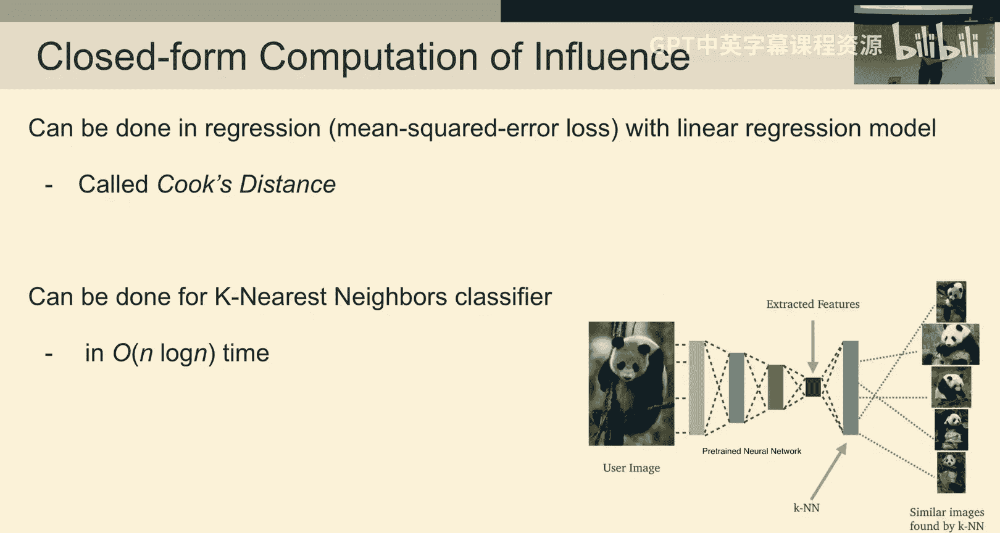

# 《数据中心人工智能导论｜Introduction to Data-Centric AI, IAP 2024》中英字幕（Claude-3.7-s） - P6：Lecture 6_ Data-centric Evaluation of ML Models.zh_en - GPT中英字幕课程资源 - BV1wvhczTETR

Alrighty， I think this is probably everybody， so let's go ahead and get started。

Hope everybody's having a good day and today' lecture is going to cover data centric evaluation of machine learning models。

And so first， let's just take a step back and think about you know how do most machine learning applications look at like an overall view。

 so you know you're collecting data， exploring the data to see if it has problems。

 preprocessing the data into a format suitable for machine learning。

 training a machine learning model that you you think will perform reasonably。

 you're investigating shortcomings of the model and the data set。Then hopefully improving the data。

 using techniques we've been teaching， improving the model via all the modeling techniques you've learned in your other machine learning classes。

 and then finally deploying the model and monitoring its performance in production and the new data coming in for different kinds of issues。

And so yeah， it's easy to get， you know。Into the weeds with all of these steps involve a bunch of other components。

 but today's lecture we're just going to focus on improving the shortcomings of the model and the data set。

And so obviously to improve a model we first have to be able to evaluate it and so that's really going to be the main topic and then we're going to think about how do we handle badly performing models when they're badly performing for a particular subpopulation in the data rather than badly performing overall。

 which is a common problem that always comes up and how do we measure the influence of individual data points on our model。

 which is also important for understanding the model's problems and also potential data issues and how we might change the data to improve the model。

And so I want to start just going back to standard multiclass classification。

 as usual with this class， we're going to try and present things in simpler machine learning tasks rather than more complicated ones and multiclass classification is probably the simplest machine learning task out there。

And so we have this training data CD and we'll say it has sample size N。

 and you're typically assuming we have features X and labels Y， and in multiclass classification。

 the labels would just be one of K classes for each data point。

And we're assuming that they're drawn from some underlying joint distribution over the features and labels。

 so really the most standard machine learning setting。

And we're going to use this data set to train a model， and that model is supposed to。

 given an example with new feature values X， produce essentially a vector of predicted class probabilities。

 right， the probability that that data point belongs to each class。And typically to train this model。

 you're going to use a loss function and that loss function is typically applied to these predicted probabilities and that will you determine how you optimize your model over the training data to produce a model whose predicted probabilities tend to match the labels in the training data。

So so far， hopefully nothing too surprising。And so the key assumptions in this whole process here is that you know the data encountered during deployment will stem from the same distribution as the training data。

 we went over that last lecture when that isn't happening we have problems of selection bias。

 our training data are assumed to be independent and identically distributed。

 that's why typically we're going to measure you this loss here just as a sum over the training data and it's really crucial there in that sum that you're assuming you know they're all exchangeable。

And that each example belongs to exactly one class， which as we saw in the Con learning lecture。

 may not always be the case in real world applications where people think they should apply multiclass classification。

And so the loss function here will evaluate the model predictions right for a new example versus its given label。

When the loss operates on the predicted probabilities， it's typically needs to be differentiable。

 say for training neural networks because you need to understand how if I make an infinitesimal change to my model weights or parameters more generally will the loss change but actually you know differentiable losses like for classification don't really necessarily make the most sense for interpretation or the end use case of your machine learning model and so often in practice the loss of how you're evaluating the model will be different than the loss that you're using to train the model and so here we're going to focus since this lecture is about evaluation primarily on different kind of losses that we will use as evaluation measures and these do not have to be differentiable right because all we're using the loss for here is measuring the model at the end of training and really what we care about most is that this loss function represents how the model will affect whatever performance it's being used for in an application。

And so often you know the loss is just a function of the predicted class。

 so that covers almost all of the standard classification losses like accuracy， balanced accuracy。

 precision， which would be the fraction of times， say like in a binary classification problem。

 if model the fraction of positive cases that the model was able to catch。

The loss could alternatively be a function of the predicted probabilities。

 so these are the probabilities of each class and that would lead to finer grained measures of performance。

And so examples of such losses might include the log loss。

 so that's essentially measuring the log probability that the model assigns to the given class of each data point。

 the area under the ROC curve which is often used in binary classification which would say we could use any threshold right for determining based on the predicted probability of the positive class。

 you know it totally depends on our actual application how much we care about having high precision versus high recall and so the AUROC would say over any possible threshold on those probabilities。

 what is the resulting precision and recall we achieve and we'll just consider all possible thresholds and measure you the aggregate precision and recall over all possible thresholds and then finally there's this notion of calibration which is you know if the model says this example is you cat class with 10% probability you would hope that over say 10% of the data where the model made that prediction。

act was cat right that would be considered a well calibrated model and that becomes important when there are stakes associated with your predictions。

 say like in financial applications right there's you know different stakes associated with the odds and the calibration of the probabilities。

 also you know like weather forecasting is another great example。

 the calibration of the probabilities really matter here because people are making decisions based directly on the probabilities。

And so。I hope everybody realizes， you know we're trying to summarize how good is a model over all kinds of data and really it's just not a great idea to just use a single number to summarize that it's a complex question of you how good does this model perform in all sorts of different scenarios over all sorts of different types of people but that's just what everybody does because we our brains can only process so much and to make decisions we kind of need single metrics and so the typical overall score will just be the average the loss over many examples that are held out during training this would be your validation set or your test set。

Alternatively， you can actually break down this loss into finer grained measure。

 so like a really common one classification that's really useful is to look at each class separately。

 like measure the accuracy per class because you'll find models can be really good at predicting some classes and really bad at other classes and you might totally not see that when you're just looking at the average overall loss or even better is reporting you know the complete confusion matrix of how often the model mispredicts class one is class3 and that really gives you a full picture of the models shortcomings。

 but it's still overall all the data。And so the main thing to stress about this lecture。

 if there was one takeaway from the previous lecture。

 it was that when you're collecting the training data you always need to be thinking about selection bias。

 selection bias， selection bias in the back of your head and that is just always going to be the biggest problem you will face and then any machine learning project before you start diving into all the details once you have the data。

 you really need to think about the evaluation of the model as the central question that everything else you're doing should be really centered around because that's going to guide almost all the downstream value that you bring and really like other decisions like what kind of models you want to use。

 what kind of training techniques to improve them will be much less valuable than figuring out really concretely how you're going to evaluate the model and why that evaluation exactly or as closely as possible matches the amount of value it's bringing in the actual application。

And so maybe we can consider a classical machine learning application in finance。

 which is for banks evaluating whether transactions are fraud and not fraud right so this is a binary classification problem and does anybody have any ideas why maybe accuracy overall is not the best evaluation metric for such a classifier。

Yeah。Yeah， exactly so the data says super imbalanced right most of the data is going to be not fraud and then the second reason would be that when you predict fraud。

 but the truth was not fraud， you know that causes an inconvenience on the customer it's not great。

 but if you predict not fraud on something that is fraud that can causes a much bigger inconvenience on the customer who then has to go through a big process of recovering their financial financials or big damage on your bank who just lost a lot of money and so really you need to consider what is the impact of each kind of error here that is possible and assess how much the costs are associated with that kind of error and as well the frequencies of these kinds of errors and the frequencies of the classes。

And yeah， this is exactly what you were showing， this silly little meme here that， you know。

 just pure accuracy alone doesn't mean anything if you have imbalanced data。

Another common pitfall when evaluating machine learning models is failing to use you truly held out data。

 and so this is constantly taught right in your machine learning classes that you always split the data into training and test set and that machine learning is not the same thing as optimization because the key difference is that in machine learning you're targeting generalization beyond just optimizing the loss on training data。

 you're trying to actually ensure the loss is low on future new data。

But this comes up all the time in practice， even when you're trying to you know make sure that you're doing data splitting。

 there's just like in a big company， you know there'll be thousands of features available to you as the data scientist and it just happens all the time that you accidentally include features that during deployment will no longer be available they were somehow made available to you during training and they're not actually going to be available during testing in the same way。

 so your training is actually relying on leaked information about the test data。

A second really big pitfall， as I was trying to allude to。

 is just reporting only the average loss will underre both severe failure cases for specific kinds of rare examples or over like subpopulations that you might really care about more than others。

Going back to the selection bias problem， of course the validation data might not be representative of your deployment setting and that's another really common pitfall and then going back to the earlier lecture like some of the labels that you're evaluating with might not be correct。

And that's another common pitfall that we see。And so actually I should make one more point here on the right theres since you know machine learning has been exploding in popularity。

 there's been a big transition to using a lot of machine learning in scientific fields where before you know maybe it was all about using statistics and hypothesis testing。

 there's been a big transition towards machine learning but people trying to reproduce a lot of these papers of different scientists using machine learning are often finding that there's just this data leakage issues happening all over the place and it's not necessarily right that people are not properly splitting the data。

 the data leakage is just very subtle it's often the case that somehow there's some information in your training data that is giving some unfair advantage to the test performance youre measuring。

And I think this meme summarizes it pretty well that， you know。

 you should be not happy when you get amazing accuracy ever in any machine learning project。

 you should be really suspicious about why my accuracy is so high whenever it's better than you would have thought。

 it's almost never the case that you just suddenly get better accuracy than you would have ever guessed。

I'm going to do aside aside from multiclass classification to something that's very popular nowadays and introduces even more complexity。

 which is evaluating text generation models like I assume you've all used chat GT and other LLMs。

And this is really， really open question like how to evaluate such models is really tricky right because in classification we can measure like how often does the model predict class cat when the truth was class cat and assuming we don't have label errors or refix them all like that's pretty trustworthy evaluation and really kind of aligns you know with our end objectives。

 but for text generation you're asking the model like chatGBT to write you a blog post and you now have a big data set of a bunch of blog posts that have been written。

 it's really hard to figure out like how do you evaluate that。

And so one sort of gold standard way that nobody has really been able to replace thus far is just human evaluation。

 this is often called vibes， which is just looking through the outputs， giving thumbs up。

 thumbs down， or commonly people also use a likert scale。

 between one to five or between one to seven， these kinds of scales have been found near optimal in like psychology for trying to determine what's the best of a bunch of options。

Alternatively you can use AI or LLMs to try and do the evaluation。

 so this is really popular now with models like GT4 that have like pretty strong understanding questionable reasoning still but they're able to do evaluation decently well like it correlates very highly with human evaluation and so the idea of using like a model like GPT4 to do evaluation typically will operate as giving the model a bunch of criteria in it's prompt and typically these will be binary criteria that you think of ahead of time like know is this blog post interesting。

 is this blog post informative is this blog post going to appeal to this audience know binary questions like that and then getting the AI's assessment of all of these criteria and summarizing those into a single score。

And so this， yeah will correlate pretty well with humans。

 but typically where it kind of falls apart are those like interesting cases that are either you really high quality or really low quality。

 but in subtle ways that the AI evaluation typically just does not catch。

 and that's why it's nowhere near replacing the vibes checks are sort of the end all be all of evaluation。

And another problem with this AI evaluation is also that it tends to favor text generated from models that are similar to it。

 so if you use say GPT4 to evaluate text from GPT4。

 that will be more favorable than from other LLMs whose training data may have been very different than GP4。

Other kinds of evaluations that are popular going back to more traditional natural language processing would be if you have target responses。

 so you can imagine instead of writing blog posts like customer service where you have human customer service representatives that have shown you like what is the optimal interaction to have given a customer request then you can just try and measure the text generation models in terms of its response。

 like how much text similarity is there with these gold standard target responses and that can be captured through a variety of statistics based on word overlap or subword overlaps and there's other ones based on Ngramm overlaps like how many times does this threeword phrase appear both in the target response and the LLM response and so yeah this is traditionally how things like machine translation were evaluated sumization that is very far from perfect due to as you can imagine these phrase。

based matches are not capturing necessarily true semantics。

 it could be the case that the target response you have from the human is only one of many possible good responses and so if your model output a perfectly good response。

 but it's just very different than this one that would be heavily penalized and yeah so it's still far from perfect and then finally the analogous loss to going back to classification。

 the probability of the given class label that you see for the new data point。

 the analogy of that is what's called the perplexity in text generation so if you recall how text generation models work。

 they're typically measuring the probability of the next word or the next token conditioned on the tokens generated thus far and the input you the request from the user。

And so you can measure the probability of the next word and then the next word and then the next word。

 and that will， if you sum them up in log space， give you the log probability of the entire response and that's what's called the perplexity and you obviously want to normalize that by the length of the response so you know that longer responses aren't being heavily down weighted。

And I should also make one point that the length of the response is a really big confounding factor in general with a lot of these evaluation metrics。

 especially with the LLM based evaluation， that's been a big flaw that people have struggled to deal with that longer responses just tend to get better evaluation scores。

 but also human evaluation is biased by length too。

 as you might know from like SAT S grading and things like that。

 just having longer text tends to give you higher evaluations。

And then the final really big challenge here that I was previously talking about in terms of data leakage just becomes 10 times nastier because now these models have been trained on the entire internet and a bunch of proprietary secret data sets beyond the internet and so it's just really hard to even know if the evaluation data that you're evaluating this thing on was already seen at some point during training and obviously that's not a very good representative evaluation if you are evaluating on something that was already seen during training and it just is becoming harder and harder to know for sure。

 so there is various statistics you can measure based on these probabilities of the LLM responses that can help you try and understand or guess whether this data was seen during training or not。

Okay， so I'm going to shift gears back to classification now that we covered you know open ended text generation。

 I should pause before we do that， is there any questions about what we've covered thus far？Okay。

 then we will keep going so yeah， back to classification mode。

 much simpler world with evaluations you would think and you know you can measure things like accuracy unlike in the openended text generation world。

 but we're going to see you know there's still many problems that come up even in that more welldefined output space and so here we're going to talk about this problem of underperforming subpopulations and there was actually this study out of MIT that found all the major cloud vendors。

 their AI facial recognition systems for recognizing things like emotions and other aspects of people you know had very。

 very much higher error rates for certain demographics than others。And so really。

 when we think about that， we can imagine， you know these are subpopulations that are present in a big data set。

 and often these are also called data slices， but yeah。

 really just subsets of that data that all share a common characteristic that we might care about in a particular way。

So some examples might be data captured using one sensor versus another sensor or like in one hospital versus another hospital are going to these are common characteristics to a lot of the data that might have big importance。

Also in human data like race， gender， socioeconomics。

 any demographic factors really will often become very important。

And really the key thing here is we would not like our model predictions to depend too much on which slice a data point belongs to right。

 you know especially for something like facial any sort of computer vision system or medical imaging system like we would hope it wouldn't depend too much like the performance wouldn't depend too much on race and so maybe one idea is if you have measured these factors。

 you say demographic factors， could we just delete all of those factors from our features before we train our machine learning model。

 do you think that would be like a good enough solution for the problem？

Anybody have any thoughts on why that is good or not good？So some reasons it would be good would be。

 you know it does seem very questionable right to have something like race directly as a feature that you're inputting into your machine learning system that is now part of a product that seems very questionable some reasons it might not be so good are that now you will often have other feature values that are correlated with these feature values like the demographics and things like that so even if you delete them。

 that doesn't mean you're just getting rid of all of the influence of these demographic features in your data。

 your model might still have really bad loss over some data slice that you care about and since you've just gotten rid of all of that information you'll not even be able to know that the model is now performing very badly over this slice so one common thing to do is like to not have these features be direct inputs to the model that it's using to base its direct predictions on but to keep them in the data and。

them for evaluation to assess you know how sensitive is the model to these different slices another instance where deleting the slice information would not solve the problem would be if there's just much less data right from one of these subpopulations and others then you know maybe the model just performing that on that subpopulation because there's hardly any data from it and so just getting rid of that entirely will not reveal that problem to us so we want to keep at least the information around during evaluation。

And so。Let's imagine， you know， we have data with two slices， three slices。

 some some discrete subset right so you can imagine this is like race as an example in human data and。

We want to try and improve the model performance for a particular slice and so let's start with the data set on the left here。

 and so the most traditional way going back to all your machine learning classes to try and improve model performance is to use a more powerful machine learning model right that has higher fitting capacity and so imagine we have a binary classification data set that looks like the data shown here three times is the same data set。

And you， so we have the blue class in this two dimensional feature space that's surrounded by the red class。

And say we have the particular slice of data shown on the left here。And it looks like that。

And so now we can consider fitting two kinds of models。

 say a linear model and a neural network that's nonlinear and more flexible。

And so what we'll see is over you know this data slice。

 the linear model is going to get pretty bad performance right so the linear model is just going to predict that you're more likely to be the red class if you're closer to the top left or more likely to be the blue class as you go towards the bottom left and you'll see that over that slice。

 the loss of those predictions will be pretty high。In contrast。

 the neural network model is able to know more closely approximate this true decision boundary and so overall it's just a better model and for that data slice it's also a better model。

 so you know this is just the case that if you fit better models。

 either they're better overall your entire data or they're just better at modeling the decision boundaries that are relevant over that slice that you can often you get better performance on the slice。

 not too surprising or interesting， I would say that it's something that's important to consider。

A second thing you can try to do is to upweight the examples in a particular slice and so if we think about the case where we don't have that much data from one saw population。

 like a minority subgroup in the data this is a common technique is to many machine learning models will allow you to specify the weights of each data point like a neural network is just training via gradients that are computed as averages over data。

 the averages of the gradients for each data point so you can just upweight and down weight data arbitrarily and they just become upweighted and down weighted in their gradients and similarly most other machine learning models can also do such weighting。

 alternatively you can literally just oversample the examples in your training set as a crude way to do such weighting。

And so that's like a really natural way to try and emphasize you know this minority subgroup should have more attention paid to it and where is that useful。

 that's really useful in the case where you have overlapping information in your feature space so here again we're showing data from two dimensional features and we have two classes once again to keep things simple as binary classification and you see that like in this region here in the middle there's these data points who have the exact same feature values but they have actually different class labels and so there's the machine learning model really just has to make a decision right for such data points whether to classify it as blue or orange and it's either or type of decision because they have the exact same feature values right and so fundamentally what's going to determine that decision is how much weight is's being assigned to the minority subgroup versus the majority two different subgroups in your data and。

You want to be able to control that trade off ideally right you don't want to just let the amount of data from each subgroup determine that organically because maybe the training data collection had selection bias in it。

And so explicitly controlling that trade off is really the only way to fix this type of scenario where you just have data with the exact same features overlapping。

 but having different outcomes to predict。Alternatively。

 you can try and collect more data that would be better than just saying okay we're stuck with the problem。

 So yeah if you're able to collect more data with the subgroup with poor performance。

 that is much better and you can actually try and assess if that's going to be promising before you you go invest in the huge amount of effort to go actually collect that extra data so going back to the previous lecture we talked about a technique to estimate how much data will I need to train a machine learning model up to some performance now we can apply that same technique but only over the data of this subgroup so we can keep all the other data the same and we can just pretend we had way less data from this subgroup and see how much worse the machine learning performance would have become on that subgroup and then again fit the model on increasing amounts of data from that subgroup and see whether the performance for that subgroup is even improving or not it might not even improve and if that's happening then maybe collecting more data is not going to。

the problem。Finally， going back to this example here where the model just really had to make a tradeoff between you know predicting blue or orange for these overlapping values in the feature space。

 maybe it's just the issue is that we weren't measuring enough features right maybe the data in the blue and orange class really does differ if we had measured additional variables and it just happens in these two variables which is very little information that the data are not differing in their labels across those two and so we can try and actually go out and collect extra features that will specifically allow the model to perform better for a particular slice of the data so that's not necessarily the same as trying to measure features that will allow the model to perform best overall right here it might be more targeted that we think there are certain kinds of features that are really important to making good predictions for this subpopulation of the data that will try and collect and so an example of this。

Say we're a retailer doing machine learning and trying to recommend products and so the base model that we have in place is predicting whether the customer will purchase some product or not based on customer and product features and a common slice of data and any human data like this would be the age of the customers and so maybe the predictions for the young customers are worse。

 because we have less available history， maybe our features about the customer are based on their historical actions in our marketplace。

And so yeah， we have less history， so maybe our predictions for them are just worse。

And so we could add like an explicit extra feature to this data set because we're feturizing the products as well。

 that's like popularity of this product amongst young customers right that's like a super targeted feature that is designed to boost the performance of the model across the young customers and so that's just an example of this kind of creating extra information that could really allow the model to perform better on a particular slice of data。

Any questions about that？Next we'll talk about discovering these underperforming subgroups in the first place。

Going back to what we were talking about thus far， we were talking about really simple cases right where you had like age being the determinant of subgroups。

 maybe young and old or a numeric factor， but it was already known that you know age is important and it's going to have it's going to lead to different subpopulations and the data。

 we're going to be aware of that when we're evaluating the model。

 think about measuring the model over these different slices。

 think about ways to improve the model over the slices。

But you know say we're just given image data like this。

 we're training some classifier and where are the subgroups like you know they're not naturally necessarily present in such data and so the question is you know how can we even think about are there important subpopulations to be worried about and how can we repeat the previous analyses in such data sets where there's no natural divisions？

And so one common way to discover， you know underperforming subpopulations would be to sort you know all the data in your validation set by the loss achieved by the model's predictions so far and then look at all of the examples with high loss where your model is making the worst predictions。

 and this is called error analysis and it's almost always a good idea to try and improve machine learning performance is jump straight into where is the model making the worst predictions you'll find mislabeled data there。

 you'll find really weird outliers there， you' also find data that seems fine。

 and there's just something wrong with your model that you could actually tweak to make it improve on such data。

And so yeah that's the idea of error analysis and so within that set of examples that are all receiving you know much worse predictions from the current model than the rest of the data。

 we can then actually apply clustering so clustering is the idea of trying to find subgroups of data that have similar feature values。

 but here we're applying it to just these examples that all are receiving terrible predictions right now from the model and so when we do this clustering what we'll uncover is clusters of common themes right amongst these examples and those might be reveal underlying concepts that the model is struggling with or these clusters going back might naturally you know correspond to natural subgroups of the data that are being you know receiving really bad predictions overall。

And so yeah， this leads to the idea of like slice discovery。

 which is this goal of finding meaningful slices of a data in particular a slice where the model is really underperforming and there's a variety of ways to do this but this simple procedure outlined here is one really basic method you'll notice that one problem with this method is that it's not accounting for the loss or the quality of the predictions when it's doing the clustering right and so you might want to account for the quality of the predictions in your clustering or even more fine grainined。

 you might want to account for the class being predicted while doing the clustering。

 maybe you want subcllus that are all class A and all high loss as a finer notion of subgroup and so there's this rich field of slice discovery methods that try and do this clustering in a more loss aware way in a way that's aware of your model's prediction。

Rather than the clustering only being based， say on the raw pixel values of the images。

And zooming in even further beyond subgroups right we get down to individual data points and so we'll go down to the very fundamentals。

 if we're going back to that error analysis right we've sorted our data and we're looking at the worst predictions from our model。

 one data point at a time and we want to understand like why is this model getting this prediction wrong。

 one data point at a time。And the number one reason that could happen， which is actually okay。

 that our model is doing okay， is that the label is incorrect。

 and so the recommended action here would just be to correct the label， right？

Another example that can happen is the the data point does not actually belong to any of our classes。

 It's like a junk data point like you know， a really blurry image， some kind of。

Unrelated thing that got into our training data somehow and so for such examples we can consider excluding them from the data。

 we could consider adding an other class， you know a junk class。

 which is a common way to fix multi-class classification problems where you do end up with all this junk data。

 especially if you're going to still encounter that you know extra data during deployment。

If the example is an outlier， right， so there's no similar examples to this in the training data。

 do you guys have ideas， anybody have ideas on what might be some actions we could take to try and remedy this and improve our model。

嗯。😊，Yeah， so the one shown here would be exactly that's a great idea because this one doesn't even belong to any of the classes if this outlier did belong to say one of the classes。

 and it was just like a really weird t-shirt， say in this case。

 it's a you clothing type categorization problem。We could toss it if it was a really weird t-shirt that you know never would appear during deployment。

 otherwise what we should really try and do is collect additional training data not to make this less of an outlier right we know the models performing bad on this one because it's an outlier like we see that there's nothing else like this in the training data and if we actually want the model to get this right pretty much we have to collect more data that look similar to this to make it less of an outlier。

Another way， alternatively is to change the feature space of the problem entirely such that this outlier is less of an outlier。

 so， for example， normalizing numeric features， you know maybe we have houses。

 we're making predictions about houses and we happen to have one celebrities house in our data set and the like price of it or the square footage is astronomical in our models doing really badly。

 we might want to normalize all of those features so that it looks less like an outlier。

 you could instead replace raw price with like maximum like the price being or sorry a minimum maximal price。

 you know like any house over $10 million just gets represented as $10 million。嗯。

We can also delete feature， sometimes deleting information is not a terrible idea if you have so many features that your examples are looking like outliers along certain types of features。

 so you'll see this a lot in especially like genomics type applications where you might be measuring you know 20。

00030，000 features which are different levels of proteins and cells or different levels of RNA and there's so many different types and you'll see that know cells can start looking like outliers just because there's so many features that no two cells even look similar and the models are really struggling and so just deleting a lot of these features to make everything look less outlier can be really useful。

And then finally， another technique that's popular is to add synthetic data。

 whether it be data augmentation or other techniques。

 so that the model becomes invariant to basically the difference that's making this outlier stand out from the other examples so you could try and make apply transformations to the outlier A just you'll have more data that looks like that outlier right so it's similar to adding more data training data to the data。

 but B， you could actually try and augment the outlier in a way that pushes it to look more similar to the other data points。

 almost interpolating this outlier and one non- outlier data point。And again， if it's important。

 if this outlier is important， we can just up it as a really simple technique。

And so another reason that a model can get a particular prediction wrong is the type of model you're using。

Is just suboptimal for such examples。And that can just happen。And so how do we diagnose this。

 we can try upweighting these examples or duplicating them many times。

See if the model now is able to do a better job classifying these examples。And in this case。

 we're really going to want to use know the model centric toolkit and in this you know if it turns out that the model。

 the type of model you're using is just not good for data like this。

 you can just try different kinds of models， hyperparameter tuning， feature engineering。

 also you can ensemble multiple model so you can keep your original model that seemed to be doing pretty good。

 but it was bad at these few types of data points and train another kind of model to supplement the original model that's extra good at just this type of data。

Finally， going back to that scatter plot where we saw the data points being overlapping in the feature space。

 it's very possible right that this data point is being predicted incorrectly because in the data somewhere。

 there's another data point that looks basically exactly like this。

 but it has a totally different label， one example from the famous INe data that you guys may have seen is that there's a keyboard class spacebar class。

Classic images from both classes look like this， just really not clear you know what how you're supposed to determine which example goes with which class and you could imagine trying to define the classes more distinctly in the instructions for the annotators in the instructions for your model if you're using say a large language model as your classifier or you can try and enrich the data with extra features。

 so instead of these just being images you might add extra metadata about you like some product description about each of these images and maybe the keyboard class the product description would make it more clear that this is just like a keyboard button rather than or sorry a spacebar button rather than an entire keyboard that's being sold。

So any questions about how can we try and diagnose when our model is making one bad prediction。

 how can we try and diagnose， you know why is it bad， and how can we try and fix it？Okay。

 so now we'll shift gears to understanding actually the influence of data on the resulting model。

 and so this is you know a very data centric view of trying to understand in my training data。

 how much value is each data point contributing to my end model。

And so to look at it from the lens of economics， we could imagine we are actually compensating folks for their data。

 not really a common practice today， but you know who knows in the future， so we have。

Folks providing data， we are training a machine learning model on the accumulated data。

That model you know gets some performance based on that data， you know maybe without that data。

 it got some performance with that data， it gets higher performance。

 hopefully and now the question is like how should we allocate and say that higher performance leads to better revenue for the business how would we want to pay these individuals for their data and a lot of questions come up right like maybe you have two individuals whose data is very similar so actually maybe only needed one of their data and but maybe without both of their data sets you're actually not going to perform that well like how do you think about compensation and value allocation in such a scenario。

And really one classic measure of this is the question。

 how would the model change if I just omitted a single data point from my data。And you know。

 that's like you'll typically maybe see something like this with a smaller data set。

 and that's one way you could try and assign value right to that one data point。

What's an issue of measuring anybody have any thoughts on？

What aspects of the value of this data point might this not be capturing？

OrW might this procedure not be ideal？WellGood thing the answer will be on the next slides。So yeah。

 this would be corresponding to say this data point being deleted here has an impact of 0。

2 hypothetical points。So。The idea of this issue。Why might this be an issue this leave one out measure of influence。

 so yeah before I get into that I should say we can say that how much value we're assigning to each data point。

 we can read termm that as the influence of that data point on the resulting model。

And why just leaving out one data point and retraining might not be the best approach well one thing is it's going to be super expensive right we're gonna have to retrain a model for every as many models as we have data in our data and a second issue is going back to the case I was talking about previously maybe you have 10 data points they all have the exact same feature values and labels in your data so deleting any one of them maybe it doesn't actually cause that big of a drop in my performance。

 but if I delete all 10 of them， maybe that is like a really important subpopulation and there's no other data in the data that has features similar to all 10 of those folks so deleting all 10 I suddenly see that my model became terrible know it doesn't seem right to say all 10 of those have zero value because which is what this method would tell you right？

Because actually， I did see when I deleted all 10 of those supposedly zero value data points that suddenly my model became really bad。

And so the idea to try and remedy this is what's called data Shaplely and so this comes from economic game theory。

 the Shapley values are the idea of if you have a team of people and you know they're all collaborating on a project and the project ends up making a million dollars like how do you distribute that a million dollars back to the team of people and the reason this is hard and it's the exact same for this machine learning influence evaluation the reason all of this is hard is because the values are not linear。

 it's not just you know this person contributed 40% this person contributed 10%。

 this person contributed 30% it's always you the interactions between the team members like you can't just take different people from different teams put them in a new team and their contributions will be the same It's how they are working together how they're collaborating that leads tolinear amounts of value being generated and that's what makes it so tricky to figure out how to distribute that value back how to measure the influence。

It's the same with the data right as I was saying， if you have 10 data points in your data。

 they all have identical feature values， it's not that they're individually you contributing just a linear amount of value that you can just add up and measure the aggregate influence of all 10 like if I added 11th data point that had the exact same feature values its value is probably very little right we already have 10 data points with these exact feature values but if I remove all 10 we did see that big drop in performance and so this nonlineity is the challenge and so the idea of Shapley values is a framework for determining how to allocate value back to each of your team members in a project and it's going be the exact same idea for allocating value back to data points based on the resulting machine learning performance trained on that data。

And the idea of how you actually do that is we're going to compute that leave one out influence of each data point。

But not over our entire data set， we're going to take a subset of the data set。

And delete one data point from that subset and measure what was its impact in the context of that subset of the data So now if we originally had 10 data points that were all duplicated。

 maybe in our subset of the data， we actually only have one of those data points present right so now when we delete it from that subset we do see a huge impact because there's suddenly no data with those feature values and so we would say oh over this subset when I deleted this one data point and retrain the machine learning model the impact was quite large。

The problem is that's just specific to that one subset right and we want to understand you know this over all possible subsets and so the true Shale value would say you want to measure like how much value would each team member provide to my project when paired with any possible subset of the other team members and then we just average over all possible subsets so again for data it's the same we imagine what would be the impact on the machine learning model if we deleted each data point over one random subset of the data a random size and then we average that over all possible subsets of the data and that will give us measure of influence that has a bunch of nice properties。

So again， this is going back to that example that I was just showing where you have two identical data points in the data and if you omit both you severely harm model accuracy。

 but omitting one does not and so in the leave one out influence measure you're just going to see that neither data point seems important like they don't have high influence because I could have deleted either one and not got in a big accuracy hit but with data Shaly what we will see is that in a huge number of subsets of the data right one of the data points is missing and so when I delete the other one I am actually seeing now a big impact in model accuracy and so in all of those subsets its influence will be quite high and therefore when I average over all possible subsets it's an end influence will not be as high it'll be like kind of half as high and that really does capture intuitively how much we would think this data point is valuable。

Because it is true that we would not find such a data point as valuable as one that in isolation。

 no matter in which subset it occurs when I delete it， I get a big drop in performance。

So that measure has a lot of nice properties that I won't get into in this lecture。

 but if interested， you can read about both data Shaplely and Shapleplain values and a really rich history of studying that measure in game theory as the right measure for distributing value to a team。

But here what we're actually going to focus on is making this practical because as we saw。

 this was deleting the data point over all possible subsets and averaging the resulting drop in machine learning performance。

 that is not a practical algorithm， it has exponential runtime complexity。And so instead。

 a simple way to approximate it is to just take T random subsets of the data。

 and so naturally when we've done that， some of the data will have been held out in the validation set。

 right？And so we can measure the influence of a data point or its value based on the average of the accuracy of the machine learning models over those subsets that contained that data point versus those that did not。

 and that is just a very simple estimate of you know trying to approximate what would have happened if I deleted this data point as a singleton in every possible subset and so that's the Monte Carlo approximation of influence and is very commonly employed way to measure the influence of data points on a trained machine learning model。

And of course， this doesn't the measure of performance does not have to be accuracy， right。

 It it could be whatever。Is the right evaluation measure to measure value of our trained machine learning model？

Finally I will just mention that there are actually more better ways to compute this influence for specific types of machine learning models and so the problem you know why we have to do this。

 delete one data point from every possible subset and then just average over all the subsets in the black box world is we just have no idea how our machine learning model will perform when it's retrained after we deleted one data point or how it will perform over when it's trained over a subset of the data for a model like a neural network or an arbitrary complicated machine learning model you just really can't say what the effect will be without just doing it。

 but for certain kinds of machine learning models where the resulting training process can you can write mathematically enclo form what the trained model will look like given any data like linear regression。

 then you can actually measure this influence directly just using math and so。

In linear regression the resulting influence under the mean squared error loss is called cooks distance if you have taken statistics classes。

 you might have seen that as commonly used as a diagnostic for linear regression to assess you know which data points are influencing the model most and also for K nearest neighbors classifiers again a K nearest neighborhood classifier can kind of be written in this closed form and so again there's a really efficient algorithm to just calculate。

