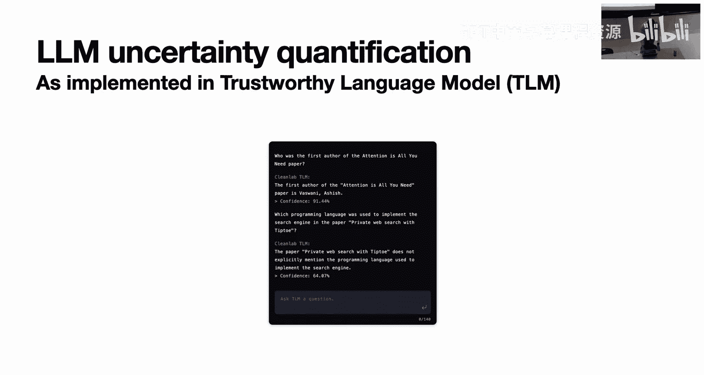
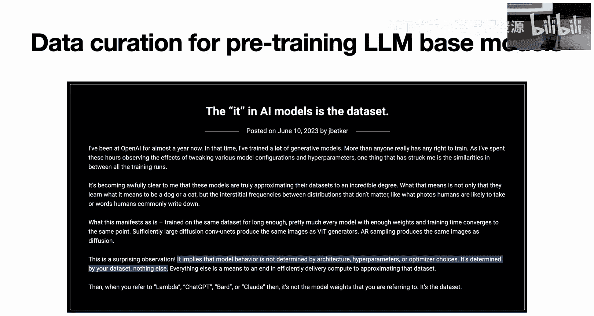
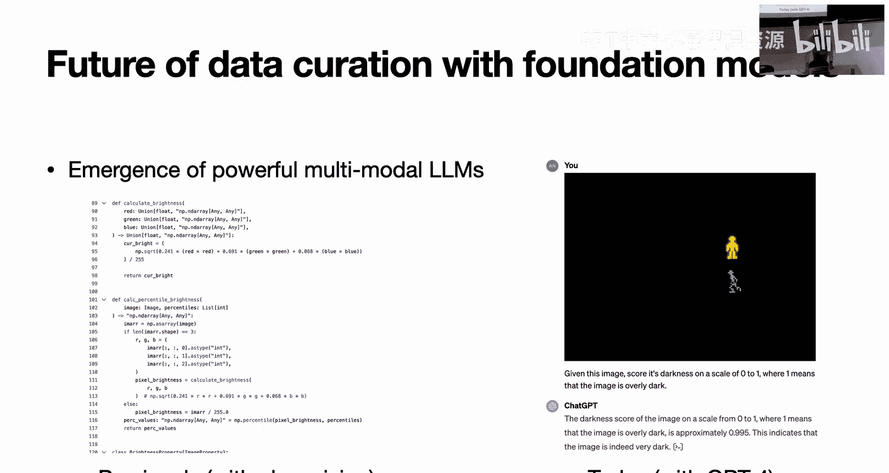

# 《数据中心人工智能导论｜Introduction to Data-Centric AI, IAP 2024》中英字幕（Claude-3.7-s） - P7：Lecture 7_ Data Curation for LLMs.zh_en - GPT中英字幕课程资源 - BV1wvhczTETR

Hello everybody， welcome to Le 7 of Introuction to datacentric AI Today we're going to be talking about a pretty fun topic。

 large language models， we're going to talk about data curation and LLMs。

 so both data curation for LLMs and using LLMs for data curation。

So show of handss， how many of you have heard about LLMs？

Almost everybody and then how many of you have actually tried using one of these。

 say like GitHub Copi it or chat TPT or one of the local models。Okay， awesome。

 like about half of you maybe through two thirds of you。Great。

 so I'm going to do some really quick background， but we'll get through this in a couple of minutes and then get into the details of data curation and LLMs。

So at a high level， a language model is a sequence to sequence model that is trained to predict the next word or token in a sequence。

 so it models this probability distribution given prefix of a sentence or sequence of tokens it' will tell you what the probability distribution is for whatever comes next。

And that's a pretty simple model of what's going on here， right？

And then the first L in LLMs is for large， so one thing that people have found is that increasing the model of capacities really having really high capacity models and then training them on enormous data sets seems to give pretty interesting capabilities that don't really seem to be present at smaller scales。

And so really the big innovation that's happened in the last several years is just scaling up。嗯。

不知的发现。And what's super cool is that these large language models can be used to solve a variety of NLP tasks。

 they can be used as the foundation and kind of just doing a little bit of work on top。

 like not too much work and not too much like computer expense。

 you can solve all sorts of interesting tasks。And so just some quick examples of applications of LOMs One common application is zero shot prompting。

 so these things have really great kind of world understanding。

 lots of knowledge built into them And so for certain tasks that you want to solve。

 you don't even need to do the whole traditional machine learning thing like collect a data set and train a model。

 you just structure like set up a prompt in the right way for the language model。

 give it the prompt and it'll just give you back the answer。

 And so here's a concrete example I just can't put this random example。

Sometime ago I asked the language model to remove all the references to gender in a given sentence while retaining its original meaning。

 so notice that there's not even a single input output example。

 just a natural language explanation of the task I want the language model to solve and on this particular example the model does exactly what I wanted it to right like it replaces shei with they and her with their。

Yeah。I'm pretty cool that。Yeah， these language models have this kind of a capability。

Another application you see of LLM is something called F shot prompting or also talked about as in context learning。

And so here， it turns out that for some complicated like slightly more complicated applications。

 just describing what you want the language model to do and doing that zero shot thing we saw on the previous slide。

 which is not quite good enough。 but giving the L a couple examples of what you wanted to do。

 some input output pairs， that's enough to give you a high quality result。

 And so here's an example where actually。Didn't even specify directly in the prompt what I wanted the language model to do I was kind of programming by example here。

So here I wanted the language model to help me with a file renaming task and figure out the pattern。

 and so you can probably figure out the pattern by looking at the input output examples like I have some file names with 1080p in them and for those ones I want to strip that 1080p suffix。

And output JSON in this particular structure like maybe this is feeding into some program that actually does the action on my file system right so I gave a couple examples like this when to rename this to this thing with this 1080p stripped but okay maybe for the 720 p things I want to delete them so I want this kind of an output。

 And so I just give a couple input output pairs and then I say okay。

 given this now give me the output corresponding to an unseen input and yeah turns out this works。

And yeah here it's pretty clear that if I didn't give these examples。

 I just wouldn't get a sensible result， right， like I haven't even said enough in the initial prompt。

Yeah， so you're pointing out that in these examples。

 it's always the case that the ones that start with one are delete and the ones that don't start with one are not delete。

Yeah， that's that's a good question， I think。To some degree。

 we can't fully explain exactly how these language models work。

 what their like internal understanding of the world and how they're producing the result they're producing。

 it's more like I think the way people think about it is it's just like it's behavior that the system has and we're going to。

Experiment with it and see what we can do。And so yeah， I think there's no way to tell。

 maybe besides giving a bunch more input output examples and seeing if it breaks down yeah。Yeah。

 but kind of I think fundamentally， if you're doing programming by example and you have a limited number of input output pairs。

 there's more than one function that maps all the inputs to the outputs correctly。

 and it's an underspecified problem。 But here it's not like we're even getting a of encoding of the mapping。

 like if we ask the language model maybe to produce a Python program that does this。

 we might actually see what program it produces and that's a more interpretable result and that's one way we might go about it。

 But if you just ask it to produce the output， it's kind of hard to tell how exactly it's computing that。

 maybe it's doing the right thing maybe it's not does it even matter if it produces the right output。

Ire there any other questions here before we move on？Right， so that was yeah。

 one more background side。 And so we talked about zero sharp prompting， like just。

Give a natural language description of your question， get an answer out， works for some tasks。

If you want to solve more sophisticated problems than that。

 this technique of few shot prompting can be adequate to solve the problem and there are a couple other applications that LMMS are commonly used for one is called here in this slide is retrieval augmented few shot prompting。

 you might have heard the term retrieval augmented generation or RAG and in this application。

Consider like okay so these Ls are trained on these huge tax corpes。

 things like just internet scraping and Wikipedia and like OCRs of books and things like that。

 And so they have pretty good kind of understanding of the world and kind of public information but suppose you wanted to say you wanted to build a system for searching your company's internal documents like maybe I have 100000 documents in their company's Google Drive and it' would be super cool if people could query those using natural language right and you like oh。

Tell me this thing about this system we've built and it'll yeah。

Understand the documents and give you a good response， like Ellens can do。

Except you can't take an LM。It's one of the kind of off the shop ones that are trained in public data and uses zeroshot prompting or few shop prompting for that task right because the LLM just has no knowledge of your company's internal database of 100。

000 Google Drive documents and so what people do in RAG is they combine a retrieval system with the LLM so given a query you will look up in a database of documents formatted appropriately。

 what are the most relevant snippets and then all that gets fed into the LLM along with your query which then is used to generate the final response。

So yeah no need to understand all the details of it that's just one other application of LLMs and then finally LLMs can be fine tuned so you might have heard about fine tuning say in the undergraduate machine learning course that you took maybe you trained an image classifier starting with say an imagenet classifier and you trained it you fine tuneund it on your own image classification problem so fine tuning is starting with an existing neural network and then maybe making some small tweaks of the structure of the network and then adapting it to a different data set right？

And so fine tuning often gives the best result of the LLMs if you want to train the model to solve a particular task and you have a bunch of input output examples。

 it actually works better than few shot prompting， actually updating the weights of the network。

And so these are four things that are commonly done with LLMs from left to right that go an increasing order of amount of effort。

 right zero shot prompting， you can do that in one second。

 few shot prompting maybe you need like three data points that takes a little bit more effort whereas fine tuning like now you need to collect say a couple hundred or a thousand data points and then actually fine tune your models so you're going to need like a GPU and it takes a couple hours to train the model。

But still even at the fine tuning level of complexity and effort。

 it's still the compute costs are kind of on the order of like hundreds or thousands of dollars。

 not millions of dollars， which is the cost of training and LLM from scratch。

 like that base model that's pretrained on a huge tax purpose。All right。

 so that's it for the rapid background on LLMs。So in this lecture we'll talk a little bit about using LLMs for data curation。

 so the general theme of this course， like how do we approach data collection and curation in a systematic way。

 LLMs can be used to help us with that task because we just want to have a high quality data set。

 it's a useful tool。We'll also talk about how to evaluate the outputs of LLMs because that is another type of data and evaluating those outputs can be helpful for various purposes。

And then we'll talk about the flip side， we'll talk about how to curate data used for training LLMs。

And these things kind of combine， like you can use some of the techniques that are used in LLMs for data curation in order to curate the data that you're then going to feed into an LLM training pipeline。

So we'll talk a little bit about data curation for pretraining the LLM based models。

 but not spend too much time on that just because I think。

 yeah most of us probably aren't going to be training one of these models that cost millions of dollars to train。

 whereas these LLM applications like they're so accessible that I think it's really yeah。

Likely that a lot of you are going to。Do say El and fine tuning at some point。

So large language models are really powerful natural language reasoning engines and as we've seen in this couple of examples earlier。

 they're really easy to customize for new use cases。

 right you have some particular natural language related task and within kind of seconds or minutes of effort you can get pretty good results on that task。

And it's inexpensive in terms of time you spend and also computationally pretty inexpensive。

 and so this is revolutionizing the way we go about doing data curation for text data sets。

And so I's at a couple examples to make this really concrete and basically there's a bunch of data curation tasks that fit really well into the set of things that LMs can do。

So one thing that you might want to do is avoid training an ML model on data containing personally identifiable information。

There are a number of reasons why you might want to do this。

 One reason is that a machine learning model can actually leak its training data like to some degree like memorizes or understands this training data and there are ways to kind of retrieve that training data out from the LLM。

 So if you train a machine learning model and private data and then like say expose it to the world or give the model out to people it can be a privacy issue。

 So that's one reason why you might want to move PII from a training data set。

And so you need to detect it and then。Yeah， I' of curious what people think。

 how exactly would you handle， say presence of PII in a data set that you're training on？

So you have a medical data set and it happens to contain。

 say like people's names or certain sensitive things， you want to get rid of that。

 you want to keep the non personal stuff medical conditions or other things。

What could be tricky about？Now， how would you address a PI in a data set or what challenges might arise in areas？

热样。Yeah， absolutely so yeah， we'll talk about that in a moment that's for how to like how we might be able to scrub PII。

 but yeah， one note about how PI could be handled or should be handled is not always just as straightforward as like detect it and say throw away the data points containing PII or detect say like all the names and just replace them with like dash dash dash because in certain cases。

嗯。Like suppose you have a text data set that's talking about different people and individual data points talk about multiple people So you have say like Anish mentioned in that data point。

 but also like Curtis has mentioned in that same data point。

 maybe that single data point is like a conversation that the two of us had If you just scrub all the names out。

 you've lost the context of like。Speaker 1 said something， Then Speaker 2 said something else。

 Then Speaker 1 replied to that。 It's kind of that like those correlations are lost。

 And so that's one example of a case in which you have to be careful。 like if you're。

Dealing with that kind of a data set you might want to identify the PII and then do some kind of like deterministic replacement of okay。

 the first name you find， replace it with speaker one， second name you find。

 replace it with speaker two， but keep this consistent。Yeah， so in the past。

 the way people dealt with PII was a somewhat manual way by thinking about all the different types of PI that might appear in a data and like writing rex to find that sort of thing。

Here's some screenshots of code from this Sc up library。

 it's a Python library a bunch of people use it and you can see how it implements some of these features like it can detect credit card numbers or it can detect Twitter handles and yeah like somebody had to think about this and write down like okay here are the rules for how credit card numbers can be formatted or here are the rules for how Twitter handles can be formatted。

And so what are the downsides with doing PII detection this way？Any it is。

 I think of a bunch of them。是啊。Yeah that's a really good one like here you have to explicitly enumerate all the different types of PII and make sure you haven't missed anything right that's a lot of hard work and then yes separately from that just yeah writing these rexes is a lot of hard work like if I asked you to do this you spend hours and hours thinking through all the different types of PI and writing these carefully written reexes。

Whereas now with large language models， you can do this in like one second instead of hours and hours of work。

 and you don't even need to think about all the possible types of PII because the language model has a pretty good understanding of what PII is。

And so here's an example of a prompt I wrote to detect PII in text I said consider the following product review。

 so this is specialized to imaginary data set that I had in mind of product reviews and I say consider the following product review and then here's where I'm going to inject the text so if I have a big data set I'll run this prompt one time for each of the data points injecting in the text here and then I have this prompt for the LLM saying okay tell me whether or not this has PII in it。

And then prompting LLMs is a bit of an art。There's tons and tons of papers on the topic。

 tons of blog posts。 We're not going to go into details on like what's the best way to prompt LLM。

 But yet， here's just one example of how I prompted it。

 And I wanted it to output a final judgment like output colon true or output colon false if the example contains PII。

And so you could imagine how this could be used if I had to say an API key for open AI。

 and I could yeah run my data points through there and then get the response and then parse the output and see if it contains this output true or output false at the end and then say I could drop data points if they contain PII maybe I want to do that in my particular example。

So it turns out like this prompt works pretty well。 here' are some examples， Okay say okay。

 I'm a professional wildlife photographer， I've been shooting with this camera for six months。

 it's been amazing example product review and the LLM says， okay。

 this has no PII right so pretty cool that it's solving this problem that these scrub it up people had to put in a lot of work to solve。

😊，With very little work on our part， right？And then just here's a positive example I mentioned a name in here。

And indeed， the outputs says true。 and what's kind of cool is that， okay。

 here's an example that has a type of PII in it that's not explicitly enumerated in the prompt。

 So I've said。Find PII that includes but is not limited to PII such as name location or credit card number be sure to catch PII not listed here and so it's kind of cool that it's able to figure out like even though this thing isn't formatted like a name would be formatted if you imagine like the Sca De Python library having some sort of Regex pattern for names。

 this wouldn't be caught right they need something specially for Instagram handles。But yeah this。

Prompt， even without explicitly mentioning it， is good enough to catch this piece of PII。作为法庭。Yeah。

 so the question is has this been deployed and used on real data sets。

 I think it depends the cost doesn't have to be that high there are also tricks you can use like you can batch multiple data points in single query so you don't repeat the prompt or things like that for some of these questions like the PI one is pretty basically you probably don't need the super powerful GPT4 model you can just use like GP3 or something it's a lot cheaper or some of the local elements ones might handle it too。

So yeah， absolutely it is being used in certain places。这样。被告。は。包括没。拿回。就是。没到。

Yeah so the question is if you're using an external API。

 maybe you don't want to send a data that might potentially contain PII to this external API in the first place Yeah that's a good question So yeah I think in cases like that one option is just to run an LM on your own infrastructure like there are plenty of open source ones that you can just run yourself。

 there are other setups now like AWS bedrock for example。

 where you can run say like an anthropic LM but within AWS infrastructure and you have all the security guarantees of AWS。

是啊。Yeah， so the question is， have we seen people use commercial APIs or self hosted ones both plenty of people have data sets that are not that sensitive。

 Okay， like I think maybe for this PII example， you don't want to send it outside but。

One other example that we've done is finding say chrommatically incorrect text or informally written text or stuff like that and we've talked to people who are say analyzing social media data sets and want to throw it all badly written text and so that's all public information anyways and it says's totally fine to use an API for that。

要。Yeah， that's a great question， is there a way to get some kind of a confidence score from chat GT？

Maybe it's going to make mistakes and say the wrong thing say out put it false in this case and yeah how do we handle that that's a really great question I'm going to talk about that later in this lecture but absolutely it's a hard problem and we have some ideas for how we might be able to solve it。

Any other questions here？O， so yeah， this is a。Complete example of how we might solve just a classic data curation problem using LLMs as a tool。

 right and using this zero shot prompting technique。Just as one more example。

 we can go through this one a little bit quicker， illustrating one of the other ways of using an LLM。

 Let's talk about。Checking grammar and so the old approach of doing this was classical NLP and hand design lists of rules and this stuff is actually used like here's a screenshot from the language tool library which is used in open office among other places。

And yeah， don't try to like understand the code of some XMl from a big rule list。 But yeah。

 basically， some people had to like sit down and think very hard about what kinds of patterns appear in text commonly and are grammatically incorrect。

 right， That's a ton of work to do。 like actually， it's not just writing down examples of bad grammar。

 You actually have to write down the rule that describes the bad grammar in a general way。

And so yeah， really tricky to do in a ton of work。But one way you can solve this today by building on top of large language models is。

Yeah in this example， we'll utilize fine tuning。 I think this might work out okay。

 would's it zero shop prompting as well but。Let's just talk through how we might do this with fine tuning。

 One thing you could do is collect a data set of sentences。

Collect a bit corpus from the internet and then have people judge whether or not those sentences are grammatically correct and so I have a bunch of examples of input output pairs right so now it's just like a classic supervised learning problem。

And notice that this is a much easier task than manually writing down the rules， right。

 I don't think I could do this， but I don't know， I think I have pretty decent grammatical skills。

 like I can probably decide whether or not a sentence is grammatically correct。

And like some people have indeed done this， for example。

 like there's this corpus of linguistic acceptability that downloads so you don't even have to do this work yourself。

And then what we can do， we can fine tune a base LO M。

 So one that already has an understanding of English language and an understanding of the world and so on on this data set。

And yeah， notice that this is not a sequence to sequence task anymore like we're not trying to generate text。

 we're trying to just classify like is this sentence dramatically correct or not。

 but pretty standard thing to do with an LLM and these days given the high- quality open source libraries that are out there。

 it's literally just a couple lines of code like you use hugging face transformers right a couple lines of code have like one GPU and like one hour later you have a model that solves the problem。

Is there any questions there。All right， yeah， so now we're going to address your question。

A major challenge in working with these large language models is something people refer to nowadays as hallucinations。

Produce outputs。 And you can't really tell whether the output is good or not or there's no kind of built in way of telling whether the output is good or not。

 Sometimes you can get outputs that kind of。Look reasonable at a high level and yet are incorrect。

 And so here's one concrete example of that。 I asked Cha GT or GPT 3。5。 What is 38 plus 72。

 And it gave me the correct answer。And then I asked it a different math problem， what is yet。

 this number times this number， and it gave me this response。And it's actually just wrong， right。

 So if you。Didn't want to do the math yourself and you were just looking at these answers like how are you going to tell these two things apart it's kind of a hard problem right now if you imagine you say using this for that data curation task we were just talking about maybe you incorrectly flag things as PII when they're not PII or vice versa and now you're throwing away like the wrong data points。

And so this is a real challenge。嗯。And so how is this addressed， I'll talk about two techniques。

 one technique you can use is use a more powerful LLM to evaluate the outputs of a weaker LLM。

So as one concrete example， as I was preparing these lecture slides。

 so playing around with chat EPT to get all these examples and。

Going back to that PII and product reviews example， I tried putting in this text here。

 and then this prompt is slightly different， it's an older version of the prompt that had a little bit of that little bit less of that like explain your reasoning chain of thought style prompting and I just asked for the answer。

And turns out like I guess this prompt in this data point didn't work out super well。Yeah。

 I just got false back as a response， right， so it's just an incorrect answer。

But what's kind of interesting is then I use GPT4， which is a much more powerful LLM and then I haven't shown the full prompt here。

 but there's a prompt that says like okay， you're given a query and also an output that's generated by some other LLM like here's a scoring criteria。

 score how well that output answers or the query given in the input and said yeah that's up here。

 it some that's hidden， but then I gave yeah just copy pasted my input and output into here。

And turns out that GPT4 is able to reason about this and say that this given answer is incorrect and yeah。

 so it scores it low and it scores it as like a one out of five。

 like low quality response and even explains what's wrong with it that okay there's an Instagram handle in there。

So this is one technique that you can use。This general idea of using LLMs to evaluate the results of LMs is actually quite commonly used in research。

 like people develop some sort of NLP system and then they'll want to evaluate it right and like how do you evaluate an NLP system if you can have a bunch of humans do it or if you want an automated evaluation and it's not just like say a classification problem where you already have a test data set it some sort of like text generation problem where it's a little bit harder to。

Autoomatically score the outputs。People often just use more powerful language models to judge the weaker ones。

 It's a kind of yeah interesting pattern that people commonly use。

Does anybody see any issues with this？外头。Yeah， so that's a great question。 It's like okay。

 if we have GP4 why are we using GPT 3。5， why not just ask your question to GPG4 in the first place So that's a good question。

One reason to use weaker language models is that they're cheaper。嗯。Like。

 if you just look at open eyes pricing， for example。The the rate limits are much higher for GPP to 3。

5 and the costs are lower。 though if you do need to feed every single data point through the bigger language model anyways。

 it's not just for say like evaluation purposes before deployment or something like that。 then yes。

 in that scenario， might as well use a larger language model。第二。Yeah， exactly。Yeah， depending on the。

Depending on the use case。Yeah， like it。If you're just using the more powerful language model for your task like yeah。

 this doesn't work anymore if for evaluating it， it's probably going to agree with itself。

So actually I forgot about this slide。Before we move on to yeah talking about the problems with this。

 I'll talk about where it can be effective。 So yeah tons of neat results out there。

 Here's one of them。 There's this alpaasus paper where the authors finetuned alpaca on a curated data。

 Okay， so a little bit of history here。 Lama is a open source large language model developed by Me and then Alpaca is a project done by Stanford where they fineted this base Lama model on a bunch of synthetic data points。

And those synthetic data points were like instruction following data points。

 and so it resulted in an instruction tune model that's better for this zero shot prompting。

And so Alpaco was fine tuned on these 52 K synthetic data points。 But these authors。

 what they did was they。Took those 52K synthetic data points and then noticed like。

 oh there's actually a bunch of issues in this data right general theme in this course。

 like data has issues， your downstream results are not going to be quite as good。

 so they found a bunch of issues in them and actually used GPC 3。

5 to score evaluate those 52K data points， filtered out the best 9000 of them and then instead of fine tuning Lama on the big data set they fineted on the high qualityality small data set。

And I haven't included the full evaluation of results here。

 but at a high level the resulting model significantly outperformed the base Lama model。

 and here you'll notice this like okay， they evaluated that using GPT for it。

 which is kind of interesting， but also did a human study。

So this pattern of using powerful language models to evaluate data can be quite useful in certain scenarios。

But yeah， going back to this question of。What happens if you want to evaluate the output from your powerful large language model？

Yeah， so that's totally is it turtles all the way down you what if you're using the powerful language model in the first place。

 so we'll talk about a technique we can use in that scenario and then I also just wanted to flag that this method of using the more powerful language model obviously is not foolproof。

 So going back to the arithmetic example from earlier。The incorrect one that I showed you。

 I gave that same input output pair to GPT4。which was this was originally generated by GP 3。5。

And then here GP4 says the response written from an AI assistance perspective。

 but there's no room for improvement and in this case the answer fully and correctly addresses the user's instruction is like the text says very confident about the result。

 scores at a five out of five， but yeah we know that this is wrong。哎搞兴吃饭。对样。Yeah。

 that's a good question。 So what happens if you use just a different model。

 perhaps train on a different data set or different architecture to evaluate。

Google model to evaluate GP3。5。 I think you can find papers with big tables of like using this model to evaluate that model。

I think at a high level people have a sense of which language models are more powerful than others is kind of an ordering。

 but then to some degree there's people also know like which language models are better for tasks in certain domains because they're all trained on slightly different data sets and so I think it just like it depends on what the task is that you're evaluating on and which model is better for that task。

Yeah， that's a great question is there can Open AI just detect that you're trying to solve a math problem and can the language model call it to a calculator and so like absolutely they've built this。

Yeah。Yeah， so the question， can you generate several output from a language model and then what would you do with those several outputs？

Yeah， yeah so。Can we use as a strategy？这样。嗯， yeah。Yeah。

 so that's great intuition and actually we can even simplify things a bit because if you think back to Jonas's lecture with multiple annotators there we have this setting where some annotators are better than others。

 like maybe multiple doctors and some doctors are just better than others or like a medical specialty or something whereas here if we prompt the LLM multiple times like it's just the same LLM maybe where yeah the LLM is usually operated in a nondeterministic way so itll produce a different output every time randomly but。

It's not like。It's just kind of the same LM。 And you'd expect one answer to be just as good as the other。

 And so you can actually simplify， you don't need the full complexity of what Yus presented to deal with that scenario。

 And so yeah， that actually leads nicely into the next slide。

Here I'm presenting one idea for how you can quantify the uncertainty of LLMs and of get around this issue we saw on the previous slide of like how do you evaluate the powerful language model。

 and it actually uses this idea you were just talking about where you prompt the LLM multiple times and then do something with the results。

 treating it kind of like a multi annotator problem。So yeah。

 Jonis is actually one of the co authors of this paper， and here I'll walk you through the technique。

The high level idea is pretty intuitive。 And so there are two pieces to this that contribute to a final score。

 And so we start off with just the base input or question to the LM and get an answer。

 And then we have two scores an observed consistency score and a selfrelection certainty score。

 And so the observed consistency is basically what you were just talking about。

 So you prompt the LLM multiple times。 There are a variety of techniques you can use to try to get slightly different outputs every time。

One is like varying the temperature parameters to the LM to get like more diverse output。

 or you can also try tweaking the prompts a little bit。

But what you do is you get a number of outputs for the same question and then you compare those all back with the kind of original response that you're going to give that you want to score so we can and then the way we want to compare those is obviously not something like are these identical the same string right because these things are generating text things might look a little bit different but。

What we can do is use a natural language inference model so yet another machine learning model that's trained to do a slightly simpler task which is taken two pieces of text and determine whether or not they contradict each other and give a score associated with that。

 and so we can run this NLI model on every on the original answer paired with the first example answer we generated the second and so on and we get a whole bunch of scores there and then we can average those things and that gives us one component of a final score。

Right， and just intuitively， if the LM is uncertain about the。Like about the answer。

 you might expect that it's going to produce just a bunch of different looking answers， right？

The math problem I gave it earlier maybe we'll give a bunch of kind of random numbers that are roughly in the right range。

 but it's not really doing computation correctly， so it's not going to consistently give the same answer。

Or as if it's certain about the answer， maybe I'll just see the same thing every time。

And then another interesting thing you can do is like it turns out that if you give back to the LLM。

 the original prompt and the response that you got back previously from the LLM and then ask it to reason about its own answer。

 that can also be a helpful signal in determining whether or not the LLM is certain in output so you can actually set up just a zero shot type of prompt。

 which just here's a question and answer。Explain the reasoning that gets you to this answer and then decide whether or not you think the answer is correct or incorrect or if you're not sure。

And so yeah none unlike some of the techniques we talked about earlier in the course like the confident learning stuff。

 none of this has formal proofs backing why it works。

 I think a lot of the research right now related to large language models is very heuristic and you come with some ideas that seem intuitively reasonable and then you very thoroughly benchmark them on a bunch of examples and so we're not covering the benchmarking aspect in the lecture but if you want to I'll show the lecture slides later and then this is a link to the paper and you can see that yeah this indeed gives you high confidence scores when the answer is correct and then situations where the answer is incorrect lower confidence scores and so you have benchmark that show this work pretty well。

And so， this is a。Conceptually simple technique you can use to determine the confidence of LOM outputs。

 and then this can factor into whatever you're doing downstream and what you actually。

Handle that confidence score will just depend on the actual task you're using the LLM1， yeah。じ啊。Yeah。

 so this is if you we have an implementation of this， just one concrete example。

 the text is a bit small to read。I asked it who was the first author of the attentiontention is all you need paper and it gave me a correct answer。

 The first author is and then it gave me his name confidencefid 91。

44% and then I asked another question about a different research paper。

 I'm not sure if this was in the training corpus or not but ask okay what programming language was used to implement the search engine in this paper and then the language model answers it the paper doesn't explicitly mention the programming language used to implement the search engine So I've read this paper this answer is wrong。

 but what's kind of interesting here is that yeah this confidence score is actually lower right it's kind of nice to see this correlation between you wrong answers have lower confidence scores。

Any questions。

我。So moving on to the next topic， let's talk。Just briefly about data curation for that goes into training the base LLM。

 So this is something that yeah I think。The people in this classroom may be less likely to do because it's something that requires so many such compute resources and such a big data set。

 whereas the other applications we talked about， I think very likely that you'll all work on this。

 but let's briefly talk about this。So what I'm showing here is a screenshot from the blog of an open AI researcher。

I don't need to read all of the text， but I've highlighted the key part。He says that。

LLM model behavior is not determined by architecture， hyperparameters or optimizer choices。

 not by the modeling side of the problem， it's determined by your data set and nothing else。

And so this is consistent with the themes of this class right。

 even in the LLM application domain it seems that yeah。

 the details of the modeling don't really matter that much or don't matter nearly as much as the data and the data quality。

And so what goes into the data quality for these large pretrained models Well here are just a couple of other ideas。

 there's tons and tons of research on this obviously we don't have time to get into the details that some of the key ideas used in training systems like GPT 3。

5。One is just the first step of training these language models。 recall that they're just。

Trying like what you're training them to do is given a sequence of text。

 predict the next token in the sequence， right and so。

How you start out is just get tons and tons of text and do unsupervised pre traininging on that text。

And then。Researchers have noted that even here， the quality of this corpus matters is very hard to get an LM to unlearn something。

 So， for example， if you have。Things that look like factual statements that are actually just wrong in your training corpus。

 then that's going to be problematic because you can't get the LLM to forget that behavior later。

And then these corpes come from places like what you might use。All of Wikipedia。

 you might use O CRs of books， or you might just scrape the Internet and like download all of Reddit and use that。

 And you have to be really careful。 And all of the。

Data quality data creation ideas we talked about earlier in this course are all relevant here。

And then furthermore， recent LLMs， some ideas that have gone into improving their performance include supervised fine tuning。

 so once you do this base training over your big data set。

What you do is you have humans just write down a bunch of good input output examples and then it's much more like a classic supervised learning problem。

 you do supervised fine tu of the model and then you've probably all heard of this RLHF reinforcement learning from human feedback idea this is one thing that went into GPT 3。

5 or chatGPT。And at a high level， what they did there was they wanted to train their model to produce high quality outputs and you can frame that as a reinforcement learning problem。

You could imagine having a reward function that's a bunch of humans scoring the output of the language model like you。

In your。Reinforcement learning inter loop like your language models producing outputs。

 humans rate the outputs and that feeds back into training the model except that would be really expensive to do because you need humans to rate tons and tons and tons of outputs so the trick that they played here was that they had humans giving feedback on a smaller number of data points and then they trained another machine learning model to emulate the human behavior like given the inputs and outputs of an LLM give it a score like rate it how good it is and then they use that as the reward signal in a reinforcement learning setup to improve the base LLM itself。

Yeah。Yeah， that's a good question。 Can you do something similar for the supervised fine team step？

And produce more input output pairs using automation Yeah so absolutely there' are some neat papers that so I think one tricky thing is I'm not sure you can use that or you can even use that to improve like use an LLM to improve itself which is kind of cool but one other thing that's more obviously like a reasonable thing to do is you can kind of distill or use a large LLM to train a smaller one by using the large one to generate these high quality input output examples。

And so there yeah， I think I might have a link somewhere in the slides。

 but there are examples of people yeah， training a model that's much smaller than opening IGPT models。

Designed for a specific task， and then all the like 100% of the supervised fine tuning training data for that came from the GPT3。

5 or G4。Any other questions here？this is a huge topic。

 this is like a five minute or one minute overview。

 there's tons and tons of research on how to do better training for these base LLMs。

What I think is a little bit more interesting to talk about in the scope of this class is data curation for these applications of LLM。

 like once you have the base model and you want to do something with that。

And data is relevant in almost all of these applications。

 you be a little bit less so in zeroshot in that the only thing that goes into that is the prompt engineering。

 I don't know if you consider that data or not， but clearly in few shot。

Where you have a prompt that you've tuned plus a couple input output examples。

 like turns out that the quality pretty obviously the quality of those input output examples is crucial in getting good performance and stable performance from the LLM so if you're interested in more of the science and benchmarks there there's a into paper here。

Then clearly in RAG， like you have a database of documents that you're using to help feed into your generation。

 the quality there is going to matter， and then finally supervise fine tuning。

 if your input out prepares or better， you're going to get better results。

And so let's spend the last couple of minutes talking a little bit more about this fine tuning step。

So why would you want to do fine tuning， it gives the best results for some specific task that you want to solve and what's kind of interesting here is that a common paradigm to use is you start with some small kind of manually curated data set and then you use an LLM to generate more data for fine tuning。

So does anybody have any ideas？Why you might want to do this or like， does this even make sense。

 would it make sense to use GPT4 to generate more data to feed into GPT4？

So one thing that's commonly done is people want to fine tune a smaller LLM to for specific task。

And this is because smaller Ls are cheaper， there can actually be a huge difference in cost both in terms of how long it takes to do inference and the actual dollar cost of that inference。

And yeah， so。ItTurs out that you can do this， and it's helpful to use the more powerful LLMs to generate the training data for these smaller LLMs。

And so at a high level， the process looks something like this。

To do synthetic data generation data curation for fine tuning。

 So you start out with some original data set， like you need some input output examples that you've created yourself。

 and you want to first just improve the quality of that base data set。 And so for that。

 you can use all the techniques we've taught earlier in this course。

And then the next step after that is to generate synthetic data using a powerful LLM。And。

Using some of the techniques we talked about earlier in this lecture。

 you can quantify the quality of the output and maybe you can do something like throw away the outputs that you think are not very good。

And just to make it really concrete， how do you get LLM to generate synthetic data？

The way you do most things with LMs is like by feeding them a prompt string right so here's an example of this is the actual prompt used to create that synthetic training data set。

 the instruction fine training data set that was used to train the Stanford Alpaca model So yeah this was just fed into I don't remember exactly which model maybe GP3。

5。You were asked to come up with a set of 20 diverse testing instructions。

 blah blah and they go on to say what else they want in terms of requirements from the LLM。

This gives you your synthetic data。Any questions so far？And then after that。

 so okay so now we have our cleaned base data set， we have some synthetic data。

 and then the step we want to follow next is to filter out the bad synthetic data from this data set and so one thing we might do is look at the entire data set right we have a mix of synthetic and non syntheticthe data and we could train a real data versus synthetic data just a binary classifier on that data and use that classifier scores to toss out the examples that are unrealistic。

So this will give us a higher quality data set。Then we can go back to our what we did in the first step。

 which is applying these general data cleaning principles and practices to the full data set of original plus high quality synthetic examples。

And then finally， we can take that data set and use that for fine tuning and get a high quality model out at the end of the day。

So yeah， this is the recipe that we recommend。没 questions。

And I'll end this lecture with just some brief thoughts on the future of data curation。

 especially with where we're headed with foundation models。 So if you haven't heard the term before。

 people use LLMs and foundation models kind of interchangeably。

 but just think large models trained in an unsupervised way on large chunks of data。

 So today we have。Powerful multimodal LM。 So we don't have these just for text。

 but we have models that can understand images， for example， you can do this today with DP4。

 And so what we used to have to do with say Python code re wrote like we had this package called clean vision that could find a bunch of issues in image data like okay。

 you have a big data set。 Here's an actual image from imagenet， by the way。

 And one of the things you might want to do is find like the really dark images or light images or blurry images or something like that。

 And before in order to do that， we had to write Python code that implemented like basically classical computer vision algorithms to。

Identify those issues， but now you just like chat or GPT4 can just solve this problem in a zero shot way。

 I just gave this image to GPT4 that score its darkness on scale of zero to one and I got a pretty reasonable response。

And so I think these foundation models will come to solve a lot of these data curation tasks in the future。

All right， so that's all I have for today， any final questions？All right。

 and then a quick announcement， this is actually the last lecture for this course I'll update the website later。

 but I will be putting yeah we'll be putting the slides and the videos and all the lab assignments online we got no lecture this Thursday and Friday hope you all enjoyed the course and then we'll continue to answer questions on Piaz and email if you have any final questions。

Thanks， everybody。

