# 《流匹配与扩散模型｜6.S184 Flow Matching and Diffusion Models》中英字幕（Claude-3.7-s） - P1：Lecture 01 - Generative AI with SDEs - GPT中英字幕课程资源 - BV1gc8Ez8EFL

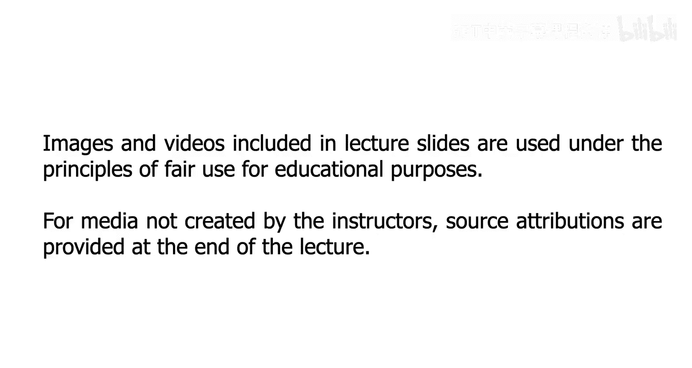

Alright， so welcome， everyone， hello and welcome to the class generative AI of stochastic differential equations。

 As you all know， this is an IP course。 It's gonna take place in the next two weeks。

 and we're gonna focus on giving you an introduction to flow and diffusion models。😊，I'm Peter。

 I'm a PhD student here at M I T， supervised by Tommy Yakala and Regina Barcelay。

 And I'm co teaching this class with Ezra。 Are you gonna raise your hand。😊。

So we did this class together and youll see both of us in the next few weeks at this point。

 a quick shout out to Tommy， who sponsored this class and advised us with the design of the class。

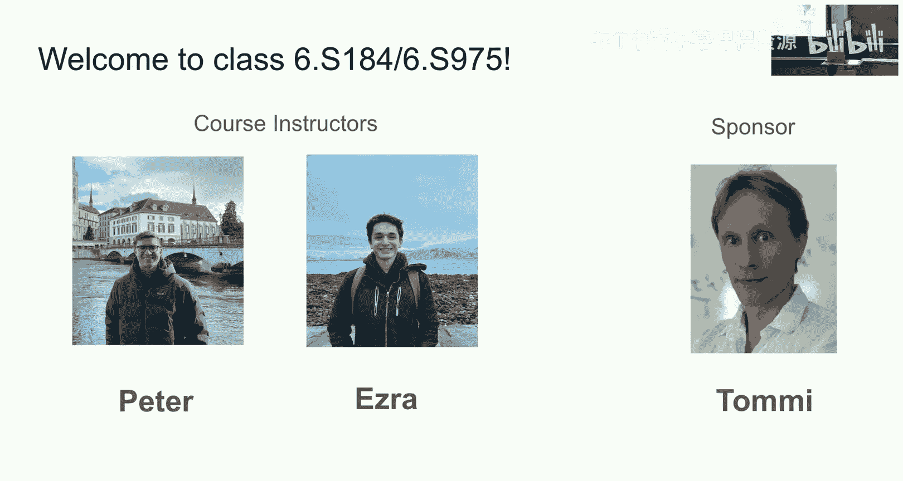

So we're all here， I guess， because we've all witnessed a tremendous revolution of AI systems happening in the last few years。

 what's commonly called generative AI in layman's terms。 So， for example。

 you've seen artistic images like from stable diffusion or midjoney。

 you've seen realistic videos being generated from video generators like Sora from open AI。

 or you've seen things like jetgBT that you use potentially every day to draft text。

 So the really distinguishing feature of these systems is that they're creative。

 like previous AI systems were mainly used to like predict things， for example。

 like classify an image。 But these systems they generate new objects。 And this class。😊。

Very high level teaches you algorithms to generate objects。 So that's the goal。 And we're not。

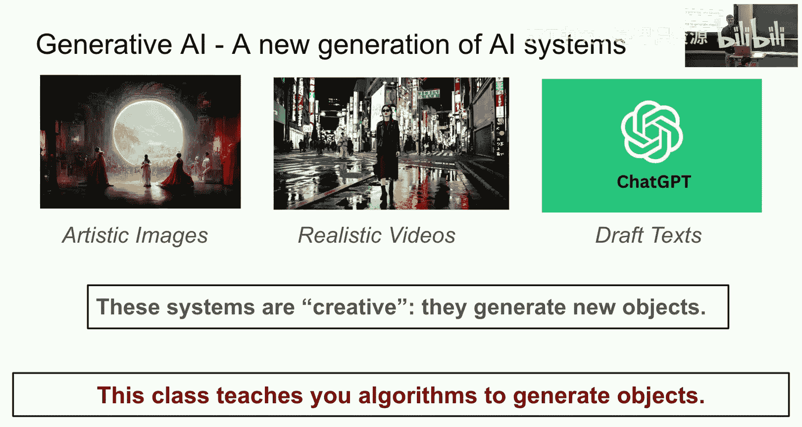

focusing on arbitrary algorithms， where we're focusing on what's called flow and diffusion models。

So the specific family of algorithms， like there's a whole family of related frameworks。

 and all all of them basically build a state of the art models for generating images。

 videos or proteins and a variety of different modalities。 For example。

 you've heard potentially of stable diffusion or Dally， which are based on these models。

 potentially heard on of openly eyesora or Mes movie Gen。😊，And even if scientific domain。

 things like Al folds free or RF diffusion， theyre all diffusion models。

 So these models are really at the core of a lot of generative AI models and the the goal of this class is to make you understand them。

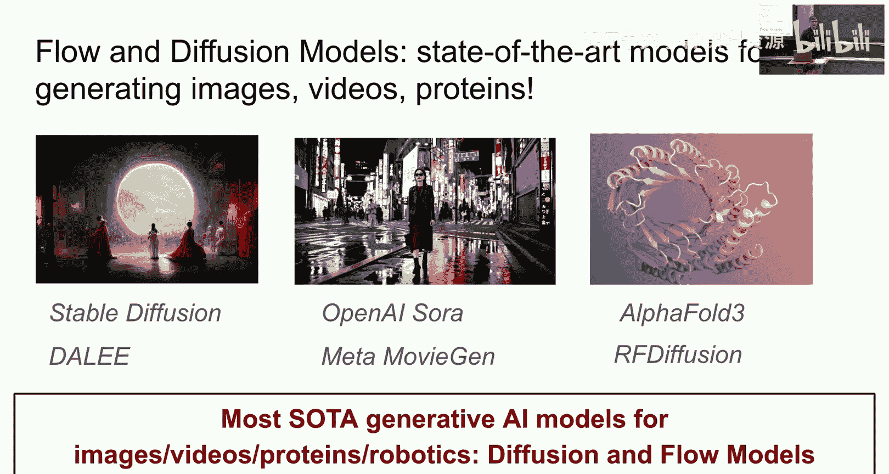

So flow diffusion models， given their name， they're based on a bit of theory。

 and we believe that to understand that you really need to understand the theory first。

 And so along with this class， you， you will be taught about ordinary and stochastic differential equations。

 We basically want to give you the necessary mathematical toolbox to understand these things。

On the other hand， we want you to implement and be able to apply these methods。

 So that's what's going be happening in the labs。 So see this class as has three goals。

 you learn flowing the fusion models from first principles。 you learn the necessary amount of math。

 but only the minimal amount of math to understand them。

 And first you learn how to implement and apply these algorithms。😊。

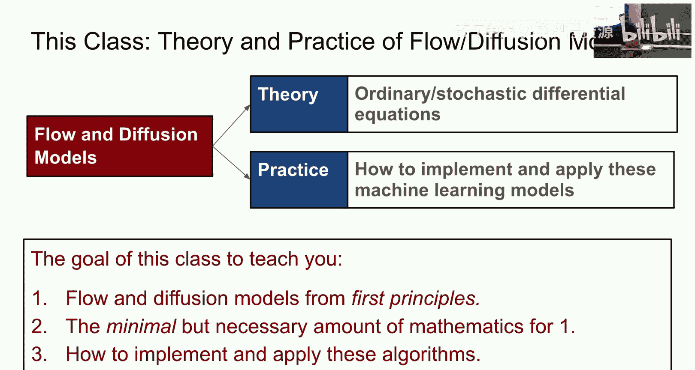

Quick overview。 So we start off today the lecture， lecture 1。 today。

 we're going to talk about sampling。 So we're gonna formalize what it means to generate an object。

Next， we're gonna construct flow in diffussion model。 So we're gonna learn what they are。

The the next thing， we're gonna learn how to derive training targets for them。

 So every training algorithm has a certain objective。 We're gonna learn what the objective is。

Then we talk about flow matching and score matching。

 which are the fundamental training algorithms that's going to be on Thursday。

 So that's going conclude week 1。 And next week， we're gonna to talk about how to build image generators。

 So we're gonna an example of things like stable diffusion。

 We're gonna learn about network architectures， how to condition on specific prompts。

We then talk about advanced topics， for example， like alignment， how to deal with complex data types。

 how to distill a model。 And then on Thursday， we'll have a guest lecture with where we still focus on two。

New applications of fusion models。 The one is protein design。

 where Jason from M T is gonna come give a great talk about how he was really pioneering the design of diffussion models for these applications。

 and also in robotics， where Benjamin Burfield from Toyota Research Institute who is a energy there。

 who currently leads really the frontier of diffusion models in the application of robotics。😊，Great。

 okay， so let's start off with section 1 and think about like what it means to generate something。

 So we will see we've gonna go from gonna go digital generation to sampling。😊。

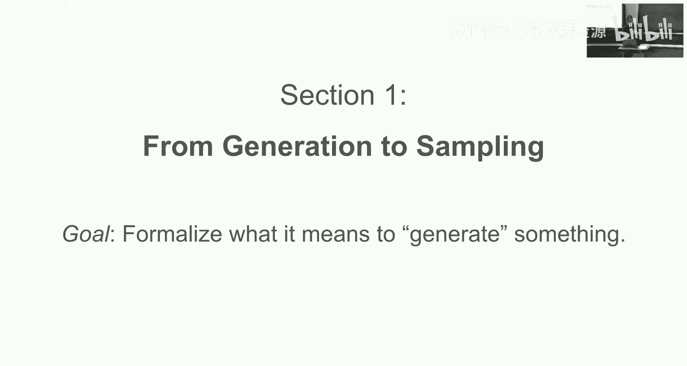

So the first thing is， how do we represent the the objects that we want to generate in a computer。

So that should not be totally new to you。 But let's just recap。 So for example。

 like an image has a certain number of pixel It has a certain height and a certain width and usually have three color channels。

 So numerically we represent this object as a vector set that's in the vector space or a vector of length H times W times 3。

 So it's usually we can represent that like that numerically in a computer。

Videos are basically a stream of images。 If you have T time frames， each of these。

 this image represents an image in itself。 So you usually can represent this in a computer as a vector of that shape。

 where like sex T times， whatever the size of the image was。Let's think about， for example。

 a molecular structure， Mo structure， let's say， as N atoms， and each atom has three coordinates。

 And you represent that as a vector of that shape where it's basically each。

Each row corresponds to the coordinates of a specific atom。

So all of this is to say that in this class， we want to represent the object we want to generate as vectors。

 There's other ways of representing。 But in the end of the day。

 what we want to generate mathematically is just vectors。

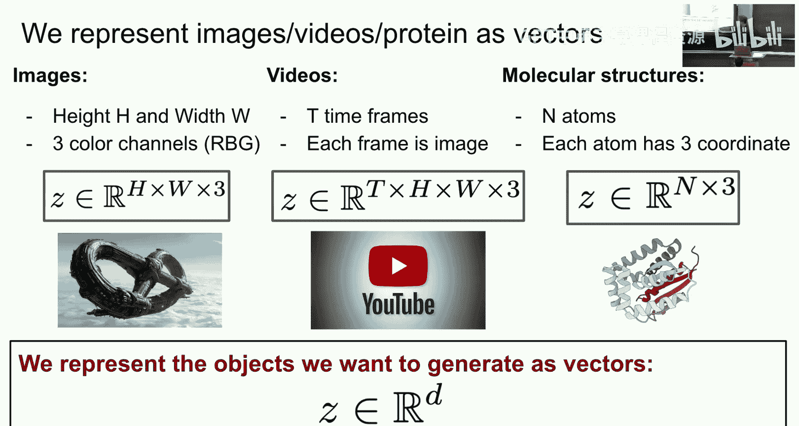

Let's think about what does it mean to successfully generate something。 So let's think about it。

 We have a prompt， a picture of a dog。And let's say you have these four images that you see here on the right。

 So the first one is just some noise。Maybe something you're seen on an all TV。

How would you describe this that could would be completely useless， right。

 Thats has nothing to do with what we actually want。Let's say， this image。

It's not a picture of a dog， but at least it looks like something。

 It looks looks like an image that we would have done in real life。 Okay， so it's bad。

 but better than the previous one。 This one is at least an animal。 but it's the wrong one with a cat。

 And finally， we get a dog。😊，So you can see you rank these images based on how good they are and how good they align with the prompt。

 But these are subjective statements。 like like when I say， oh， that fits better，s that's better。

 That's not a statement I can hemetically formalize。 So the question is， how do we formalize this。

 And the language we use and everybody in general of modeling use language of probability theory。

 When we basically introduce this object what's called the data distribution。

And it basically converts the statement of how good something is to how likely something is on a specific data set。

 For example， in this in this example， we could say how likely are we to find this picture on the Internet。

So let's say we have prompt of the picture of the dog。

 It would be almost impossible to find a picture like this with this caption， right。

This would be pretty rare。 This would be unlikely， but maybe there was a swap between animals。

 and this would be very likely。 So we basically translating how good an image is to how likely it is under the data distribution。

 It's basically we translated this subjective statement into a statement of probability theory。

So let's think about what this means formally。 So I just said we have a data distribution that essentially is the distribution of objects that we want to generate。

 And throughout this class， you should keep this notation。 in your mind， it's called P data。

 That's a data distribution。Now， let's think back about how we represent probability distribution。

 The user represent representation。 the one we are going to use here is one of a probability density。

Basically， it says that P data goes from the vector space R to the D， which shows space of objects。

And gives you a non negative number。 So given an object set。

It gives you a likelihood or probability of how likely that object is。I should stress。

 we don't know this probability density， but we just postulate it。As a distribution。

 they want to sample from。 So what， what does it mean to generate something。

 It means to sample from this distribution， to roll the dice and get samples from distribution out。

 And hopefully， if we've done this right， what we will get is an actual good image。

 So an image of a dog。 or at least most of the time， we should get that。

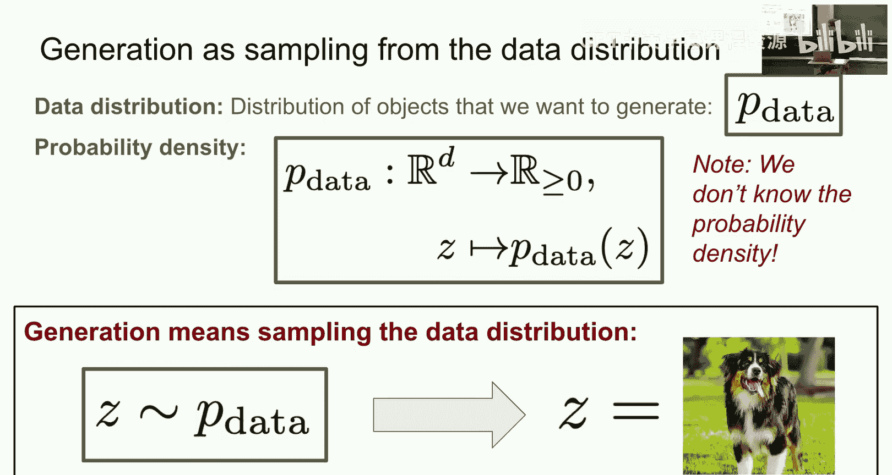

Good。😡，But we don't just want to do that somehow because we're doing machine learning。

 We need some sort of like data， right， So the question is like。

 how does the data set fit into this picture。Let's think about our few examples。For， for images。

 we could just use publicly available images from the Internet。 We could just pull them and like。

 collect the data set。For videos， we could just do something like YouTube。 for protein structures。

 We could use something like the protein data bank。

 just generally scientific data that has been gathered over the last few decades。

 And what's a data set， A data set consists of a finite numbers of set of samples from that data distribution。

 So we just denote this as set one to set N， which are just samples from the data distribution。

 And we're gonna use that to train our model。

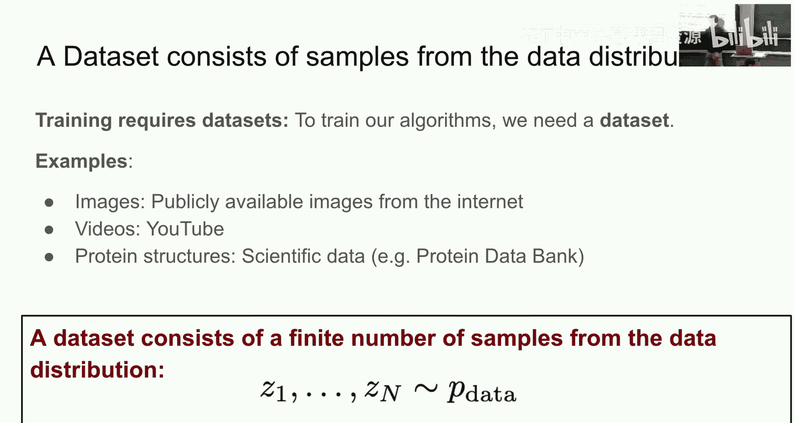

Alright， so let's think about something like the case I just described to you was what what's commonly called unconditional generation。

 So usually we have one model for， let's say， a fixed prom。 For example， that prom could be dark。

 And it's basically means that you always get the same image from the same model。 right。

 you would always get images of dogs。 They would likely look a little different。

 But at the end of the day， they would all be images of dogs。What we more want。

 if you want to condition whatever we want to generate on a certain variable that throughout this class is going to be called why。

 So， for example， it could be why could be dog， could be cat， could be landscape。

 could be a much more complicated object。 It could be a room full of M I T students listening to a diffusion class。

 So something like it could be a much longer text。 So we want to have this variable why。Basically。

 condition our generation。 And for this， we introduce this object what's called the conditional data distribution。

 which we doote as P dot。EDot stands for a placeholder。Given why。

 So it basically means given this prompt， why， what's the distribution of the data。

 given this prompt and conditional generation essentially means that sampling from this conditional distribution。

 So we sample an object set from P data， given y。And it's important to note that this is the case we're gonna to focus on first though。

 because like most general modelic framework solve of that。 And then they translate it to this case。

 So this is the case we're ultimately interested in。 But we want to first focus on this case。

 So just keep that in mind that where we， we are， we're starting and， but where we're going。Alright。

 good。 So let's think about a generative model， so。Given its name。

 a generative model tries to generate something， which we've just learned means sampling from the distribution。

 So in other words， a generative model tries to generate samples from the distribution。And usually。

 what we have is what's called an initial distribution。 We call this here as P in it。

 It's an important nott as well that we use throughout this class。

 which is essentially the initial distribution。 And in the default case。

 you could always think about P in it as a Gaussian。

 So as a standard gausian of0 mean and diagonal identity matrix， as covariance matrix。

 So that's what's here on the top right。😊，And the idea of a geneative model essentially start with an initial distribution。

 So you sample from a Gaussian， which visually would just look like white white noise for an image。

 And you what you get out if you get an image of a do。 So essentially。

 in the language of probability theory， a geneative model converts an initial distribution into a data distribution。

 And the goal of this class is to teach you how to do that。And not so somehow。

 but we're flowing the fusion models。 And that's what we're gonna talk about in a second。

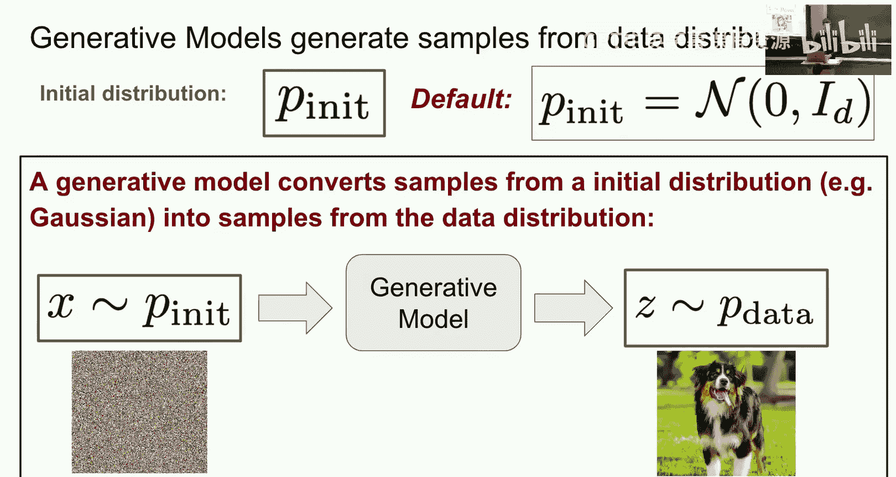

Alright， I'll stop here real quick。 Are there any questions。Good， cool。 Alright。

 so let's dive right in。 So as I said， we want to build generative models with flows and diffusion。😊。

And the goal of this section is going to be to define what that is and how we sample from it。

At this point， a quick note。 So I'm going write now on the blackboard。 there's lecture notes online。

 which is a selfco summary of what I'm going to tell you here。 So you。

 you're very invited to like take notes along。 but I also want to just， as a disclaimer。😊。

Your selection nodes， That's what I would do。有这个法我在。以上がございます。就本认识。要费的发我啊。Thanks。Alright， cool。

 So let's get started。 So we gonna to talk about flow and diffusion models。

 And throughout this class， we will always have an a flow component and a diffusion component。

 And it's much like the most important thing is you understand the flow component because it's really the basis for。

 for the other part。 So I would almost say， like the flow component is the one that's really core to understand。

 So if you struggle， make sure you understand the flow component and then maybe revisit the diffusion component。

😊，Okay， so let's start off with thinking about what's the fundamental object of a flow。

 And that's what's a trajectory。So I'll first define what the trajectory is。

A trajectory is what intuitively you think the trajectory is basically is a function of time。

 And in this class， we're mainly gonna to focus on time from 0 to one。And it essentially。

Given a time point T。Gives you a vector X T。So。You， you're basically saying for every time point T。

 I'm getting a vector X T out。And the way to think about this is essentially in two dimensions。

 for example。You would have a point and you're basically moving through space。

 And that's basically your trajectory X T。The other fundamental object is a vector field。

And vector field， we commonly denote here as U。And it has a spatial component， and a time component。

So we have a vector x at time T， and it returns。E vectorctor， U T of X。Visually。

 you should think about a vector field。Is something that at every point in space gives you direction。

 So like， let's say we start like， at this point， it gives you direction here。 at this point。

 it gives you direction here。It basically gives you directions at every point。

And you basically ideas later to follow along this。So let's define now。

 And that's very fundamental what an ordinary differential equation is。An O D E。

 which stands for ordinary differential equation， which you might have first heard before is basically describes conditions on a trajectory。

So the first thing we have is that a trajectory should start at a specific point。

 which is called the initial condition。 So x 0 should like capital X 0 should start at lowercase X 0。

 which is what's called the initial condition。And then we have the condition that we're basically saying。

There we want to follow along the vector field that's， describes the direction。

 So let's say we started here at x 0， and we basically follow along the time vectors across time。

You should keep in mind that these， these directions change over time because the vector field here is time dependent。

 basically， you should think about。 It's basically following along the direction specified by a vector field。

So how do we describe this， You're basically saying that the the derivative derivative。

Or the velocity of the trajectory is given by。Youji。At the location where X T currently is。

 So says the direction of X T is given by the location of x and then specified by U T。

And that's what's called an O D E R combined with the initial condition。 It's called an O D E。

Maybe some of us， you have heard this。 I mean， O D are fundamental in mechanics， in in engineering。

 in physics。 So I'm sure you have heard this in some form or another before。

But this term is less common。And that's called the flow。

So a flow is essentially a collection of trajectories that follow the O D E。

 essentially we get a lot of solutions for different initial conditions。

And then we gather them in all in one function。 And we call that a flow。

So let's define what the flow is。 We commonly call this Psi。And like before。

 it is a spatial and a time component。And then， given。An initial condition x 0 and T， it maps it。

To Psi T x 0。And what were basically saying is that for every initial condition at 0。

 I want this to be a solution to my O D E， which essentially as the following condition。

It means the initial condition says phi F Psi T of sorry。Si 0 of x 0， It's just x 0。

 which is essentially this condition。 So we're starting at x0。

And the other component is that the time derivative。Of sight tea。Of x 0。

Is specified by this equation。 So it's specified。By赛。Of x 0 and u。Alright， just to recap。

 So a flow is essentially a collection of solutions to an O D E for a lot of initial conditions。😊。

So maybe die， like as a diagram。 So an O D E。Is defined。Byu a vector field。

So a vector field defines an O D E。A trajectory。Is a solution。To this O D E。And then a flow。不。A flow。

Is a collection of trajectories for various initial conditions。

So a vector field defines an O D E in this format。 A trajectory X T is a solution to this O D E。

 and a flow defines a solution， a collection of solutions to that for various initial conditions。

Good， cool。 Let's sit look at an example。 So what you see here。😊，Is an example of a flow。

 And that's a visualization that takes a bit of time to get used to。 So in blue。

 you see the vector field。And then in red， you see for every grid point， that's an initial condition。

 And you see how this initial condition moves through space。 So the grids。

 how they get deformed is basically visualization of the flow。 So basically。

 it says now that's a flow map and every time its a nups I T for different T。

 and it kind of moves through time。😊，Good。

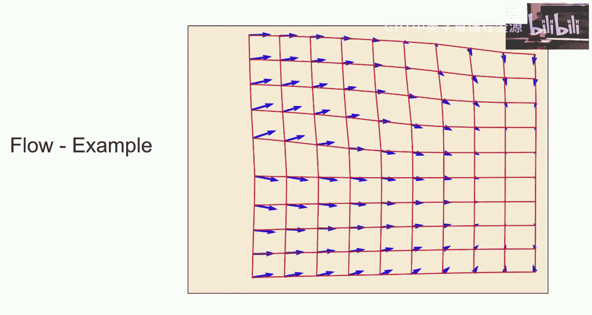

Alright， so the first thing we should ask ourselves if we see in equation is always。

 does the solution exist。And if yes， is it unique。And we can answer this question with yes and a certain regularity condition。

 So if the vector field U T is continuously differentable with bounded derivatives。😊。

Then a unique solution to this O D E exists。There's a bit more general condition。

 which is when the vector fieldless lips shits。 If that's not a term for you。

 it doesn't really matter。 In this case， the key takeaway is in all practical interests of machine learning。

 a unique solution to this OD E exists。 Actually， in most classes you've ever taken that already was implicitly assume it is gonna to re it again that there are certain nice conditions you need to assume。

 But these conditions are usually the case in in in the case of machine learning。

If this would would be a math class， you would prove this。 Maybe you' seen this before。

 It's called the peakcard duration。 I'm not gonna do this， of course， just as a for your information。

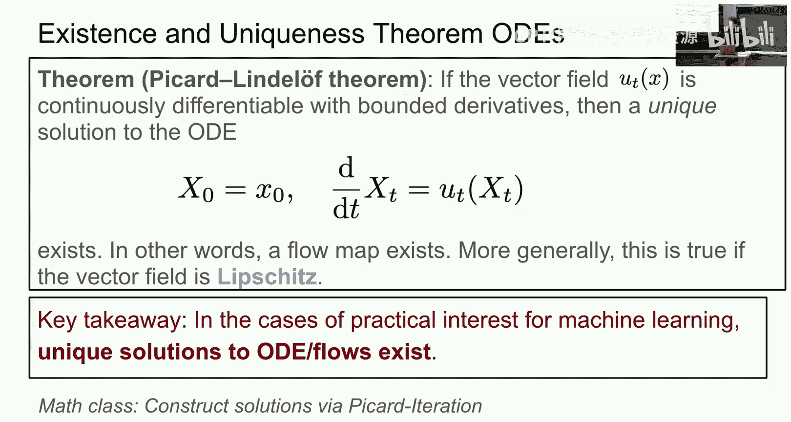

Good， cool。 Let's think about an example。 So a very simple example is a linear vector field。

 So U T of x would just be minus theta times x。 So you just multiply a vector x with a scalar。😊。

And that scalar， we assume to be bigger than 0。 So we take minus e of x。

And the claim I'm going to make is that the flow is given by this function here。

 So some exponentially decreasing term。Times x 0。And visualize。

 it's here on the right for different initial conditions。 So you should see here。

 the Y axis starts at different initial conditions， and it exponentially the case towards 0。

So I make the claim that this is the flow。 So what do I need to check。

 I need to check that the initial condition holds。So y T of 0。That should be 0。 is exponential of 0。

 which is one。 So this is just x 0。 So it starts at x 0。 So the initial condition is fulfilled。

 And to show that the O D E is fulfilled。What do we do， We plug it into the equation。

 So we take the time derivative of T， and then。They can use the chain rule and plug in the definitions again in lecture notess。

 This is explain in more detail。 But you show that basically this you see that the first And the last equation is essentially this condition。

 So you see that the OD is fulfilled and this is the flow that we want。Cool， okay， so unfortunately。

 in most cases， it's not that easy。 You cannot just find by hand a solution to an O D E。

And what we do is we need to simulate it。 And most of the time in this class。

 we're going to use a method called the Uer method。

And that's basically the idea that you just simply go into the direction of the vector field for a small time step at every time。

 So' think about how what this means， we get a vector field U T。

 We get an initial condition at 0 and get a certain number of steps。And here。

 I assume that we just simulate it until time 1。 Youd also use another time。 We start at time 0。

 The step size is just one divided by the number of steps。 We set the initial condition。

And then we just at every time step， X T plus H updates the previous time step plus H times U T of X T。

 we just basically it every time go a small direction into the direction。

 small step into the direction of the vector field。At the end， we just return a trajectory。

 So that's an numerical simulation of an O D E that many of you had potentially have seen before。

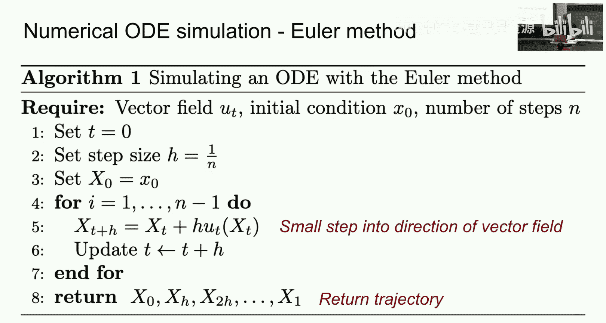

Good。😡，All right， so。Let's。Now use this for machine learning。 So now the question is。

 where does the machine learning come in。And here we want to use a flow model。

Which basically leverages what I've just told you。So what was our goal。

 I told you that a generative model converts an initial distribution， P in it。And that's something。

I don't have haven't specified yet。 And what we get out is the data distribution。And。

Given what I told you， it will not be surprise you that we want to do this transformation with an O D E。

So what we're gonna do is we' gonna start off with the initial distribution。 We simulate an O D E。

 and then we get a data distribution hopefully out。 So let's start with a neural network。

And the idea is basically that really what defines this ODE is a vector field。Let's just make。

The vector field， a neural network。So。We have a vector field U T feedta， which。Is， as I just defined。

 a function of time and space。And feed out other parameters。

So I'm not telling you what these parameters are at this point because it doesn't really matter。

 All it matters is that it's a function that is a vector field that has some parameters that we can optimize over。

We will talk later about architectures at this point， it's not yet that relevant， yes。公司的。

You set P in it。So P in it is at this point a distribution。

 You could think about it as a Gausian distribution。 for the first few classes。

 you could always think about P in it as a Gaussian distribution。Yes， yes。

So we start with something very simple where we have full access to some knowledge。

 And then we want to end up with some abstract object that we have not yet。 don't know yet。

 So that is more a specification of a goal， less so of a definition。

 So we want to build something that does that。it's a distribution。 So you can sample from it。

 for example， you could sample a Gaussian distribution from it。 That's some Gaussian noise。

 If you think about it as a probability density， you're right in the sense that given a vector。

 it gives you a non negative number that specifies the likelihood of that point。Good， cool。

 So now what we want to do is like an O D E is something deterministic。So， at this point。

We will not be。Able to generate a whole distribution yet。

But what we're basically doing is were making the initial condition random now。

 So what we're saying is x 0。I。Sample from P。And thank you for that question。

 because it basically means I told you P in it is something we know。

 something we specify something we design。 So in this sense， we could just。

 if it would be a normal distribution， you would go to a certain Python package。

 Pytorrch and just sample， click on it， give me a sample from a normal distribution。

 So that's something we can easily view。😊，And now what， what we do is essentially， we have an O D E。

That is like before。So。The time derivative。Of the trajectory。Is given by。UT feedda。Of X T。

 which means we're simulating this。And what is our goal。And that's going to be， really。

That's what diffusion and flow models are all about。 is to say that the endpoint x1。

Has the distribution， P data。All right， any questions at this point？Alright， good。

 So let's think bit about a toy example。So we said we want to convert an initial distribution into a data distribution。

 And now this is， as I said a to example。 So we have here now visualize a 2D distribution。

 So if you think about a distribution as a density function。

 you basically see here the control lines of that distribution。

And we start off with a some gausuchian noise， which is visualized here on 2D。

 If you would do some higher dimensions， you would just get some like image like that。

 which we call x 0。 So we initialize。And then our goal is to transform it to this data distribution with a vector field。

And the first two， like free glasses is case you're like gonna teach you how to do this。

 And the outcome of this is gonna be exactly in this so example， this。 So I told you that in rec。

 you see a flow。 And in this case， this flow is simulated with a neural network。And it converts。

 as you see， initial distribution。A gation in this case into some data distribution。

And you see that at the end。 So now we're ending up with the distribution that we wanted。 And。

 of course， we're gonna to do this in much higher dimensions with like， you know。

 higher resolution images later。 But for， for this the， the mathematics。

 the model is always the same， so。😊，There's no real like difference in the sense。

 like what it actually does。

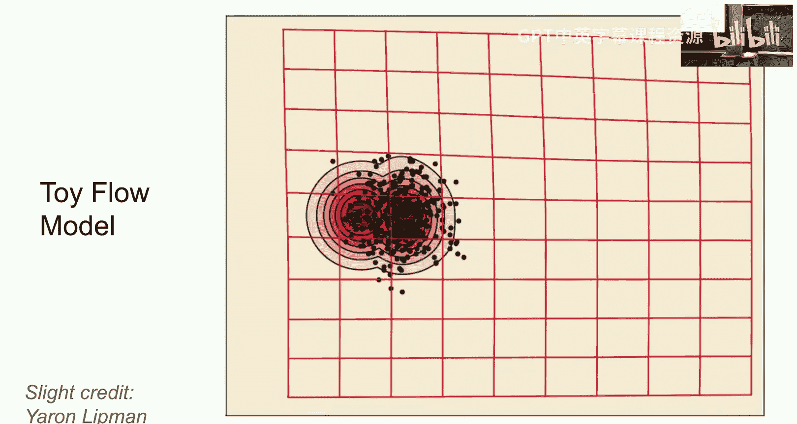

So。How to generate objects with a flow model。So whatever we gonna do， Oh， yeah， question。

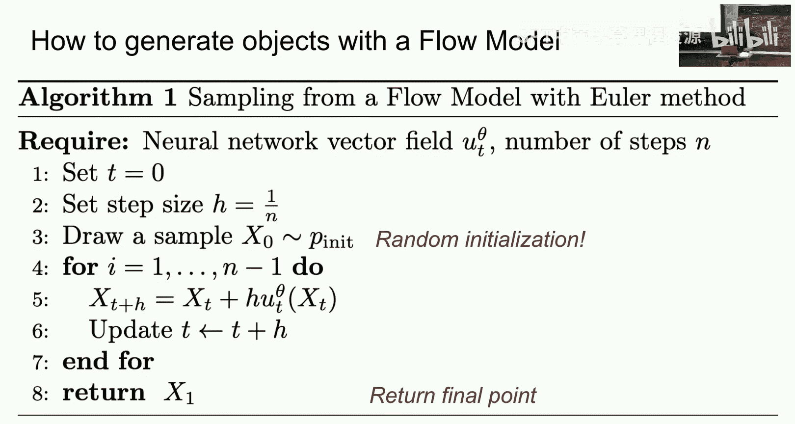

The direct grid is， it is the flow。 So the you could think about the red grid as initial conditions。

 So let's think about it like the the bottom left point of this， of this plot。 So this one。

It just basically， over time。Moves in this with this left grid point。

 it's basically how it moves through time。 And basically。

 it warps this distribution into one that we want to have。I'm not told you how to do this yet。

 This is our goal， right， So like we at point， at this point。

 we've just randomly initialized the model。 and it's just nonsense。 But like。

 this is where we want to go。

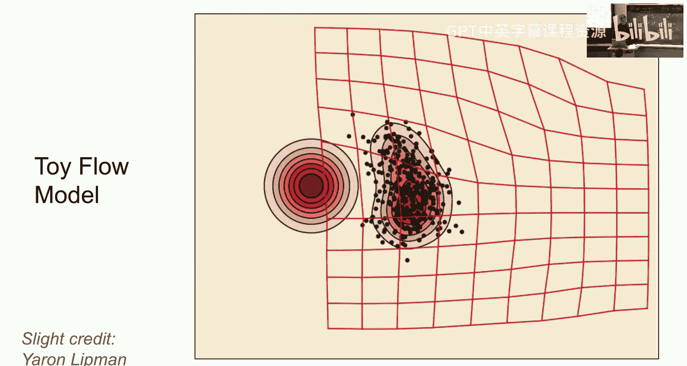

一ょが。

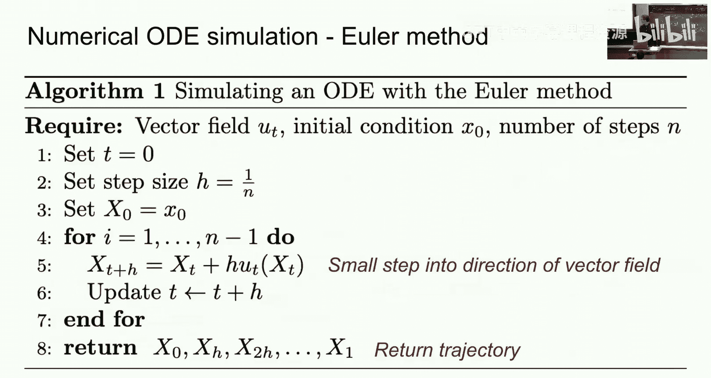

Oh， yeah， your question was what what what the vector field is。 So the， the one in blue。

 the red one is the flow。 The， the blue one is the vector field。

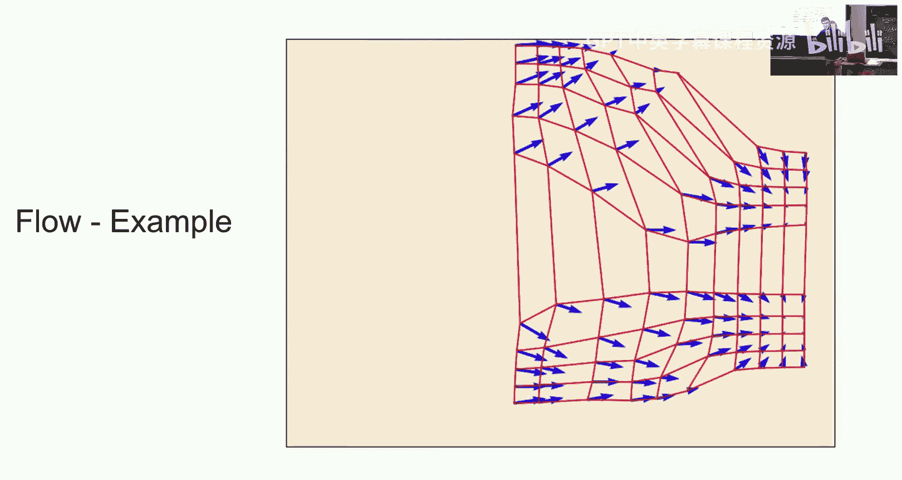

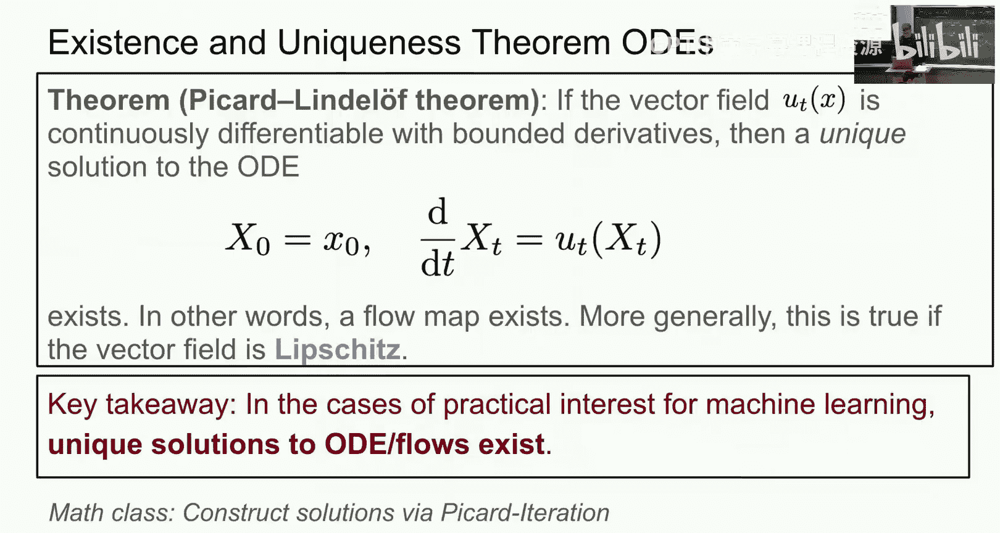

Okay， cool。So now this might seem not so hard or might seem obvious because I'm just restating something I've said before。

 but this is important because you're gonna need to implement this。

 And that's basically how we generate objects with a flow model。

 So if I would now give people a flow model， let's say met us movie generator。 that's a flow model。

 You would know now how to sample from this model。 It's basically。

 we're basically initializing randomly。With our initial distribution， we draw a caution。

 And essentially， what we're doing is we're looping over our Huer scheme。

 But basically at every time step， take a direction that's specified by our neural network。😊。

So we basically， every time we evaluate the neural network U T feedta at a point X T。

 we get some vector out of it， and we， we update our previous step with this， with this vector field。

'， just's the sampling algorithm。 The sampling algorithm was rather a simple。

 The training is gonna to be much harder， but the sampling is basically that。😊。

And what we return is the final time point。 Maybe that's important to know that like。

 that's what we're gonna end up with。Good， cool。That's it for four models。

 And now we're gonna go to diffussion models。 I'm going pause briefly， make sure that were。

No questions or good。So you， you can always ask questions。 Just raise your hand if you want， but。没有想。

Sure question。

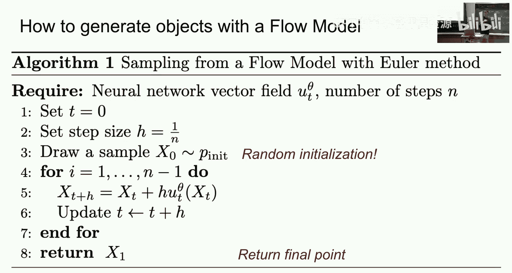

The second thing， it's the direction。 It gives you basically the change。

 It's the the velocity that you have at a specific place and a specific time。Good， cool。 Yeah。

 not a question。For that vector field。So you， you mean what this notation means。Oh， yes。I。

 I guess Im， I haven't told you yet。 All I'm saying is that for every parameter。

 you can think about a parameter as a vector。Of like， let's say length K。

 But K doesn't really matter at this point。 It's just some numbers that specify how I transform my input to output。

 which in this case means specifies the vector field。

 And there's gonna be a diversity of different architectures。

 It's just that this architecture usually differs by modality for images for videos for proteins。

 all of this will the neural network architecture will differ。

 So we're gonna talk about this once we talk about specific applications。我的帮助。Yeah。

 so you ask about boundary conditions。 So boundary conditions is usually something that exists for partial differential equations or PD Ds。

 In this case， an O D E is also a partial differential equation。

 but a boundary condition is the initial condition。

 It says the boundary at this point would be the time like time 0。

 which is the boundary of the time length line would be x 0 equals 60。有类。5。对。Yes， yes。

Oh you mean why the red So your question is， why does the red grid is not defined on whole space anymore。

 Because so what we're starting off with is with red grids populated across the entire space。

 but they then change over time。 So theyre still gonna be value that you can evaluate。

 But the initial points that have been specified by this red grid have moved in the meantime。

I would not say that's something。 I would not say that's a lurian few。 Well， like。

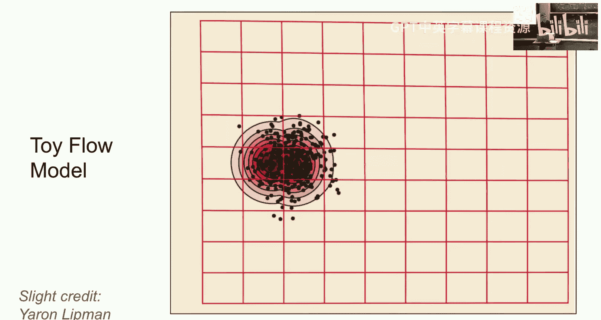

嗯。Yes。说吧。Yeah， yeah。 there's infinite。 like you， and you say the definition。

 the set where this function is defined is infinite in that sense。 Well， you know， in， in。

 if you in a computer， you have a numerical precision， right， there's like limits。

 But for this purposes， like it's fine on everywhere。Cool， okay， so let's go to diffusion models。

And the fusion models essentially extend the ideas that we just discussed。

 but to stochastic differential equations so。To do that。

 we first need to define what a stochastic differential equation is。

 which is gonna be most of the work now that we have to do。before。you。5 hundred。

我 doesn't mean that it's just so。啊。Yes。Yes， that's a great question。 actually。

 So what we are specifying the neural network， the model， like your。

 your Py charge model or whatever you want to implement is gonna be a vector field。 So in that sense。

 I don't quite like the terminology flow model because the the neural network itself is the vector field。

 That's something important to keep in mind。 The flow is the map that we implicitly get by simulating this O D E。

😊，So like I told you before that a flow is basically a function that that solves this O D E。

So the flow map would be abstractly defined as whatever output map。Like output x0， I map。

To P T feedta of x 0。 Now， whatsi feedta is is essentially the flow that corresponds to this O D E。

So that's a flow model in that sense。 But we've not represented this as a neural network。

 We've just represented an algorithm， which is this algorithm I've just showed you that implicitly。

Compfuseute this map。Yeah great question， because I I there are also models that explicitly paras the flow。

 but less popular nowadays， because it's a bit hard to do so。Good， cool。So， the fusion models。

Think about。They use satochastic differential equations。And。We basically do the same game as before。

 So were gonna now think about what a trajectory is， and。Why。

 because diffusion models are not inherently deterministic， like O D Es。

 their solutions are not trajectories， but random trajectories。

 And the language they were used for random trajectories is that of a stochastic process。

 So you should think about a stochastic process， basically as a random trajectory。

So what's the storcchastic process。 So we have a random variable X T。Where， in this case。

T is bigger than 0。 and in most cases， it's gonna be from 0 to 1。

 So you can't have any time convention here。 but it like most of the time。

 you're gonna think from go from 0 to 1。And essentially， we have the same thing as before。

 So we have a trajectory X。That is a function of time。That goes from time to R D。

And maps a time step T to a X T， which is a vector。But in this case， we can draw samples from X。

 So X itself is random。 Okay， so stochastic process is a random trajectory。

 And that's important to keep in mind。嗯。How to visualize this same as before。

We start off at some point。And then we go through space， which would be a trajectory。

 There would be one draw of that sarcchastic process。Now， we take to another draw。

That might look slightly different。So stochastic process， if I do the same trajectory twice。

 I might get out something different。 It's important to keep in mind。

 There's no one trajectory that we're following here。

So the collection of these trajectories are more like how likely they are。

That's a storcchastic process。Allright， so。The other ingredient we need。

Is what's called a vector field。So。I don't need to define this anymore。 I've just done it。

 It's the same thing as for O D E。 So the key ingredient will be the same。

 which is a vector field U that looks exactly like before it has a spatial component and a time component。

😊，And it returns the vector。So that's， this is basically what we've done before。

 So vector field we've already seen。And there's now， though， a second component。And that's new。

And that's what's called a diffusion， coefficient。And what's the diffusion coefficient in this class。

 we always gonna call it sigma。 And it's being a function of time。

 So it's like for every time it gives you a value and it gives you a value。 That's a real number。

 So for every time you get a value， Sigma T。And that's what's called a diffusion coefficient。

You can make this also more complex， but at least in machine learning。 most of the time。

 this object is， is like this。And the idea of the diffusion coefficient。

 especially were injecting randomness or stochasticity into our O D E。

 That's basically what the role of this diffusion coefficient is。 I should say that。This is bigger。

 This is not negative。 So if sigma would be 0， we would not inject any noise。

 We would not inject any randomness。 If sigma is very large， we inject more noise。

And now I'm going to write down what a storcchastic differential equation is。

It's not going to be clear exactly what it means， but I at least want to introduce the notation。O。

Good， so the same way as before， we will have an initial condition。 So we say that our trajectory。

 or in this case， stochastic process is gonna start off at x 0。But now something different comes in。

 So maybe I should say you could also make this random。

 So you could also make the initial condition random again。 in this case。

 just gonna have a fixed initial condition。 But this condition just says stochastic process always。

For every draw of x， we'll start at 0。And now the SDDE has sort。

Stochastic differential equation is a bit long。 So we call it S D E。 So whenever I say S D E。

 I mean stochastic differential equation。And the notation that we use here is。Let me make this。

Very clear。We're gonna what I call like the D X notation。 That's the symbolic notation。

 And it basically says that the change of X T in time。Is given by。A vector field。

So the change of xine time is given by the change of a vector field plus。The change。

Of something that we don't know what it is yet。 But I still want to write it down。

 So what does this notation say， for now， I can just tell you what it intuitively means。

 The change of X T is given by the change of a vector field。

 So we're going to the direction of a vector field。 Plus。

 we're injecting some storcchastic component now。 So we're like。

You can also think about like injecting noise into this equation。

And the first component is essentially an OD E。 And we're gonna see this in a second。But basically。

 you should think about it as injecting going into direction of a vector field。

 injected with some noise。And。In this equation， there's a few things that you probably haven't seen before。

 The W here is what's called a Brownian motion。啊。And we're going to。

Get to know this object in a second。And we denote this as W。嗯。Does somebody know why we call it W。

Sa的。Okay。Yes， so the answer is why we call it W is because it's also called a venno process。

 And Viner Vo mathematician at MI T。 You actually still see some of his pictures at the math department hanging around。

 There's also having a boost like this like you see pictures of H still around here。

 So he starting that process。 So it's also called a venno process。 And that's why we call it。

 you know， with a W。😊，So now what I want to do is I want to explain what this equation means。

 goes step by step。Any questions at this point， I guess I haven't answered all questions yet。

 So I'll keep going for now， okay。Let's see， O。Brow in motion。

So you should think about a Brownian motion。哦，稍微一点点。As somethings like a random walk。

 So it's basically， you see maybe like a random walk that goes it every step a bit forth and back randomly with equal chance。

 And it's basically a continuous equivalent of that。

 But now in a continuous space and continuous time， so。Let's see how we can define this。

 So it's a satorcchastic process。We just learned what that is。 It gives you random trajectories。

In this case， the time can go infinitely long。 We don't have to stop at time 1。And it has。

Several conditions。 So the first one。Is that we initialize it at 0。So， w 0。It's just 0。

 So this browning motion will always start at 0， which you can see here on this plot on the right。

It starts at time 0。 at time 0。 It's at 0。

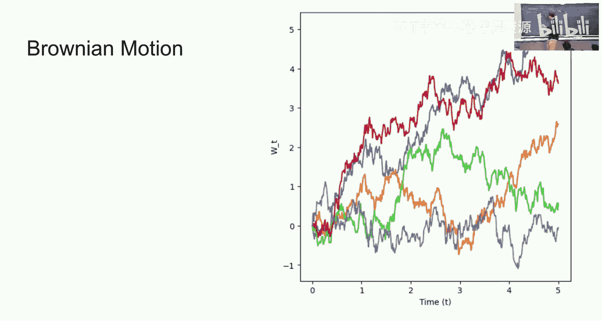

The second thing is that what we call。It has Gausian increments。What does that mean， It means that。

WT。Minus WS。Which is what's called an increment。Has distribution。

That's specified by a normal distribution。And it has this form， so。

So what I took here is I took to arbitrary time points。 S and T。 T is after S。 And I say。

 what's the difference starting from S to the next time point T。

 And we're basically saying that this has a normal distribution， like a Gaussian distribution。

 But with a variance， it basically increases linearly in time。So let's think about this。

 If T would be equal S， then it would have zero variance because we just where we are。

 the more further we go in time， the more insecurity there is。

 the more the variance of this distribution increases。嗯。Yes， so。

Bird thing is that it has independent increments。And that's。

 that might be a bit of an unusual condition。If you haven't seen this before。So， let's define it。嗯。

Okay， so so W T1。in- w T 0。 So what I will now do is I will take a range of increments。Over time。And。

Say that。 they are independent。So independent means that they're stochcastically independent。

 considered as random variable。 You could also say。That you basically。

 they have no information between these points。 It's a bit stronger condition than having no information。

 basically saying that's stochastic independent random variables。 If you stand probability theory。

 you will understand what that means。 If not， don't worry about it。

 We will see how to simulate this in a second， so。And I should make the condition that these time points are increasing。

So T， T 0， T 1 to T， N are increasing in time。Good， cool。 If you're taking a machine learning class。

 maybe heard of a Gaussian process。 that's a term that's commonly used and。

That's a specific gaussian process。 So browning motion is a specific Gausutian process。

 It looks a bit different than the ones you've seen because it's not smooth， but it's。

 it's a specific。 you heard of a kernel from a brown from a Gaussian process。

 This basically what I'm doing is see I'm specifying a specific kernel of a browning motion of a Gausian process。

question。还现在。啊，yes嗯。Yeah， so same， same as the arbitrary stochastic process。

 So for every draw of W and for every time point， it's gonna be a vector in R to the D。

 So this is a vector valued object。 You could like。Great， great question。

 So here applauded it's for dimension 1 for D equals 1。 It。

 it can be generally defined for arbitrary dimensions。Cool。Let's see。Okay， so with this。

 we're basically ready to now understand what this other equation means。

So I call this the D X C notation。 That's not a。嗯。Technical term。 It's something。I coin it。

It basically tries to describe what the symbolic notation is。That this SDE describes。 So like。

 what is what the heck does this DXT mean。Allright， so， first of all。A few fun facts。

Brown in motion is has continuous paths。Actually， that's one of the conditions。

 You can imposese that condition。 You can also derive it。 But basically。

 you can see that if you would draw these paths， you could draw them without ever lifting your pen。

 which intuitively means what a what a function， what a function。

 what it means to be continuous function。But these paths are infinitely long。

 So if I would draw them， I would stand here until etity because I would never stop。

And on the one end， that's just a cool fun fact about it。

 which kind of it basically resembles what's called a fractal。 Maybe you've seen this before。

 So it's just， it's not relevant here， but it's just like a cool fun fact about it。

 But these really unique properties about these paths make it differentiable nowhere。😊。

So you cannot take derivatives of this object。And why am I saying this， Because so far。

 we are studying differential equations， which take rely on taking derivatives。

 So we have to do something。 we want to use Brown in motion for。Specifying a differential equation。

We suddenly cannot use derivatives anymore because this object has no derivatives。

 Theres no derivative anymore because the dynamics are inherently stochastic。

So that's why the first thing we need to do is we need to。Basically。

 describescribe an ODE in a form that does not rely on derivatives。

And that's number that's step number one。So。Let's do that。

So we saw that O D E is given by something like this。

So the time of a trajectory X T is given by U T of X T。And now。

What I make the claim is that this is equivalent to the following formula。X C plus H。Is given by X T。

Plus， h times U T。X C。Plus， some error term or remainder term。Or。What I call R T of H now。嗯。Which。

 which basically， if you take the limit to 0， goes to 0。

So what I'm saying is that a trajectory has this O D E is equivalent to that the next time step for some small age。

 So it means that for a vanishing error term。It's this previous time step plus eight times in the direction of the vector field。

 plus a reminder term that I can ignore。 Maybe you've seen this in autonotation。

Some people write something like， for this error term， write something like O of age。

Small O of H or capital O of H squared。 like this like， think about this as a tail approximation。

Is that clear， shall I derive that。I can。Why that is， I can quickly write it down。So。嗯。What。

 the answer why that is， is that we have to think back about like how derivatives were defined in the first place。

So what does it mean to take the derivative of a trajectory X T。And if you think back to your。

Multivariate calculus class。Let's say you have a function like this。Big function。

And how do we define derivative at a point T。We're taking the next time step， T plus H。

We're taking X， T plus H， taking X T。And we're taking the difference between these two and then take this what's called differential quotient。

And then basically take the limit for that to 0。 So what we are saying is that this is equivalent。

To the limit。Of age goes to 0。X T plus H。Xt。Divided by age， it's equal to。UT。Of X T。So far。

 that's what I've done here is I've used the definition of of a derivative。

 So it's usually not something you use every day， but that's how derivative is defined。And。

What we can do with that is we can say this is equivalent to X T。Plus， age。Minus X T。Divided by age。

Equals。UT。X T。Plus。An error term R T of age。Which basically means that whatever。

 like whatever this term is essentially， like this goes to 0。And。Now， what I do is essentially。

Like do some algebra。 I'm just taking the H here， multil that with H， and then adding X T。

 And that's the equation we I'll end up with。So from this equation to this equation。

It's just algebra。 I'm multiplying with age。 I'm adding up X T。All right。If。

 if this is not entirely clear， it doesn't matter because what's gonna matter is what's gonna come now。

 This is more like motivation for what's about to come。 Alright， question。Right right。Oh， Im。

 I'm still in the case for O D Es， but that's a great point。 It's gonna be random。 But for now。

 it's gonna be， it's a digitbilistic term because we're still in the case of O Ds。😊，But you。

 you get your， your， your eye is good because it's gonna be random。R， R is a term I don't specify。

 R is a term。 I'm just saying whatever that is。 It's just sometimes something that goes to 0 when I makes age code to 0。

 So this is like very small H is gonna be essentially0。

 All I'm saying is that's an error term that you can effectively ignore。 That's basically what I say。

Good， cool。 Okay， so now we're gonna make this random。 and now。😊，EWe're gonna do the same thing。

As before。And I'm gonna write down now this notation that I've used for the S D E。

So what I've done now instead of writing down O D E， I wrote this S E down。

 And I'm doing now the same thing when ejecting noise into this formula。

This formula we cannot generalize， really， because it's like derivatives。

 We don't know how to do this for storcchastic processes in this phone。

 but we know how to do this for like， this is a form that does not rely on derivatives。 right。

 I told you， we need something that does not rely on derivatives。

 that's something that I am not telling you what a derivative here。

 I'm just saying that like the next time step is。In， in， you know。

 specified by this plus some negligible errorator。And now I can make this random。 what I can do。

I can do， I can say X C plus H。Its given by Xt。Plus。H times U T X T。Plus。And now that's a new term。

That I want to highlight in color。识吗？1。And now the Brownian motion comes in。WT plus H。Minus WT。And。

I still need the arrow term， plus。H times error term。And。Great point。

 This thing is gonna be random now。 So what does it mean for this to have order 0。

 It means that it's standard deviation。Goes to 0。 We need to， like， this is a random object。

 Can deal with the fact that it's。嗯。呃不。嗯。So what's written here is that the， the square。

Expected square norm and the square root of that is going to 0。An。So， let's recap。

We knew what an odd is that we specified with derivatives。 We found a formula。

That is not relying on derivatives， but that relies on just going a step forward in time。

 age that's rather a small。 And we can specify it up to an error term R T H。The right hand sign。

 we can make random。That's something we have。 We can inject noise。 an idea of this notation。

Is essentially to add noise to this equation。So we say that the next time set is the previous time step plus some H given going to this vector field plus some increment from a browning motion。

 which is effectively noise that we scale now by the diffusion coefficient sigma T。

 So the more if sigma T 0， this is just 0。And what is what is if Sigma T is 0。

 what have I written down。And O D E， exactly。 So like， if Sigma T is 0， that's just that。

 And we've learned that this is equivalent to this， which is an O D E， right。

 So for sigma T bigger than 0， I've added a term that I told you as a browning motion。😊。

And I'm basically adding this on top of that。 plus some negligible error term。Okay。

 and that's essentially。What this notation means。That's how you should think about it。 I'll show you。

 to be， to be honest with you， most of the time， I think about actually an S E as something how I would simulate it。

 And I will show you that in a second。 But this is basically。

 you could think about this as a tail approximation。

 It's not really a tail approximation of this thing， but this equivalent statement in the same way。😊。

That this is equivalent to this。 This is equivalent to this。

Maybe let's compare quickly about like O D E and Ss again。

 So we've seen O D have trajectories as solutions。 What's the solution of an S D E。

 It's a stochastic process。 It's a random trajectory。We， to define an O D E， we need a vector field。

To define an S D E， we need a vector field and a diffusion coefficient。So we need an extra component。

An O D E is basically defined by a derivative。And in initial conditions it says that the derivative of X is given by the spec vector field。

The S E also an initial condition， and it says that the direction of X T or small incremental changes of X T are given by small directions in the step of a vector field plus small noise or steps added from a brownian motion。

 like small incrementsedphone。 So we injecting stochastic noise in there。

 which essentially says that。We impose a condition on the stochastic process。

 which basically says that this holds。So I've Ive， I've not told you that this thing exists。

 I've constructed it to you as just saying this is a condition that we impose。Question。溜冰。Yes。Yes。

 at this point， I've just brought you on math。 I didn't give you an algorithm yet。

 So the question is like， how do we， how do we sample from this， right？

 And that's a great thing for the next step。 Thank you。 So basically。

 what is the distribution of this object。😊，I wrote this down。Let's look。Let's look back。

 The distribution of an increment。 What I use here is given by a Gaussian variable with variance of the difference in time。

 The difference in time of these two things is age。So， this object。Has distribution。

As a Gaussian distribution。With variance age。Or of covariance matrix。

Like h times the identity matrix。So。To sample from this， you would sample from this distribution。

 which is something we know how to do。Okay， I'll show you an algorithm in a second。

So now we do the same exercise that we did for O D Es for S Es。 So if I show you this equation。

And I'm claiming I'm imposing in conditional something。 I should tell you， does it have a solution。

 iss that solution unique。So。And basically the same thing as before。

 So if the vector field U T is continuously differentiable with boundary derivatives。

Then a unique solution to this S C exists。 More generally， again， if you know what eips。

 what ellipt condition is， is that this S is a unique solution。 if this vector field is slip shits。

The key takeaway is in the cases of practical interest for our our purposes。

 there will be unique solutions to this equation。 So there will be an exactly one stochastic process that satisfies this condition or。

 in other words， satisfies this stochastic differential equation。😊。

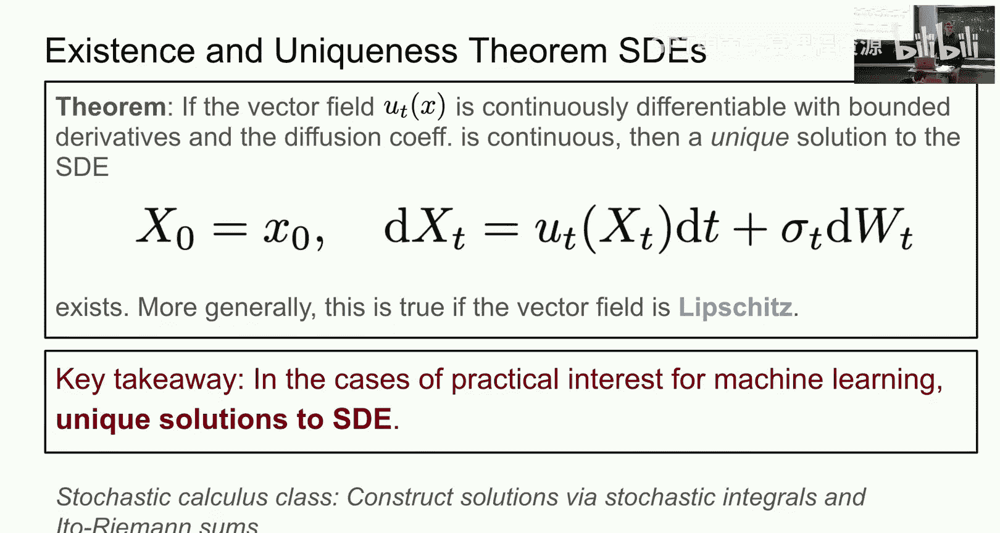

So you can assume that whatever you write down in such a form will have a unique solution。

If this was a storcchastic calculus class， which is not。

 we would try to construct this now explicitly。 There's a thing what's called like sarcastic integrals and you can construct this with like the same way you construct reman integrals with reman sums。

 You can find something like a edo reman sum and then construct this explicitly for the purpose of this class。

 This is like an equivalent statement。 I just haven't shown you yet that I can have a solution to this。

Good， cool。 So thank you for the question about simulation。 So we now need to think about like。

 that's something we can plug in a computer。😊，How do we sample from this。

 We know that this is a normal distribution with variance age。And we know how to sample from it。

 So now let's iterate that and arrive at an algorithm that's called the U Mariioama method。

Essentially， the extension of the U method that we've seen before。

 So it basically describes how to sample from an S D E。 So what have we given。

 We've given a vector field duty。 We have certain number of steps。

 and we have a diffusion coefficiention sigma T。We start at time equals 0。

 and we want to simulate until time 1。 So our step size will be basically one divided by the number of steps。

We set the initial condition at 0 to be 0。 So we amossing。

The condition we have the the initial condition I have written above here。

And then we loop over the number of steps。We draw a sample from a Gaussian。 Stan a Gaussian。

 So like basically。You could call it some Python package。 You do this in Python。

 And you say the next time set X T plus H is given by the previous time set plus H times U T of X。

 So until that time， it's just。OD E simulation。 And now what we're doing is we're adding some noise。

 So we're adding。Were scaling the standard caution with square root of age。Y square root of age。

 Because we want to have it variance to be。A。If I scale a variable with variance one with square root of H。

 its variance will have H variance scales periodically。 That's why we need square root of H。

 And then we need to scale it by the diffusion coefficient sigma T。

And then we loop over this over many time steps to arrive at the final trajectory that we did can then return。

 And you'll， you'll implement this in the lab。 So if you have questions。Best to us now。Yes。ま。What？

Or to to make this completely rigorous。 So if you would take a stochastic calculus class。

 what you would need to do。 first of all， you need to show that a browning motion exists is like a diversity of different construction methods。

 It's not trivial。 And the second thing is then you need this construction that I mentioned with the Eto reman sums。

 You need to explicitly construct stochastic integral。

 And then you show that this is basically fulfill set condition。That's yeah。

 stochastic process exists。 Yeah， so you construct it explicitly。With a brown in motion。

 and then you have these threeman sums or eaterman sums。

 And then you need to define what it means to converge in this space of random trajectories。

 This is not trivial。 And then you arrive at something that fulfills this condition。Sigma， yeah。

 so Sigma T。 okay， this is we're not gonna do this， but this is a great question。

 So Sigma T can be a function of X actually written a paper on this。 So you can do this。

 you can also learn it。 But in， you know， we want to teach you here the state of the art that's currently of the frontier and leave out some exotic stuff。

 So that's why we're not doing this。 But great point。 We can make it make it stay dependent。😊，Yes。

Great question。 So I said that we need to add this increment。

And I'm telling you that the increment has variance H。 So H times at any matrix。

And I sampled here something with variance  one。So， and if I scale it with square root of H。

 it variance will scale with square root H squared， So which will be H。

So it's a bit intuitive at first square square root of H。 But if B course。

 we want to have the variance increasing linear in China， not the standard deviation。好嘞。でさい。That。我给。

Yeah。啊，这对。It seems like there's a lot of。他是否。Yes。Yes。Yes， okay， so question is。

 what what does it mean to be a unique solution。 So you're right， There's many。

 many different trajectories。 But I told you that storcchastic process describes the distribution of these trajectories。

 So now to actually formally define this what we need to do that we need to define what's the distribution over trajectories for that you need measure theory。

 you need to define like a whole bunch of technical things。 like I think is。

Not necessarily needed for actually doing machine learning。But you would need to define that。

 And then you say that these distributions that you then define over this space of trajectories would be same。

 So as you can imagine， it's not quite， I could take spend a whole class on this。

 which I'm not going。Cool， okay， but the way to think about this is， is the way you think about this。

 Really， like when I think about Ss， I think about something like in this format。

 I think about I go to the next step in the direction of the vector field plus adding a bit of noise。

 And as soon as my vector field is nice enough， this thing has a unique solution。😊，Good， cool。

 Let's consider an example。So I've showed you before the example of a linear vector field。

 And now we' looking at an equivalent construction of that。

 But for stochastic differential equations。 So what I'm doing is I'm saying my vector field is minus theta of the state X T。

 So we've seen this before。But now we're saying we're adding a constant diffusion coefficient。

 So Sigma is just a constant in time。 So that it's gonna be all every time gonna inject the same amount of noise。

And。That's called an orangestein ruleback process。 You might have seen this。

 I think it's Denish scientist who found this。 And it basically is like。Describes this linear O D E。

 So this exponential decay that we've seen before。 But now with some noise injected。

So if we have zero noise of sigma 0， we just have an O D E， right， So like if this sigma 0。

 we've learned already that the S D E just basically reverts back to the O D E case。

 And this is the plot I showed you earlier。😊，And now you see。

 if I increase the diffusion coefficient over time。

 you see there is more and more sasticity that I'm injecting into this process。

 They go from left to right。 So you'll get more and more noise it's gonna be more and more random。

 And that's basically what this process describes is kind of this exponential convergence to something I'm just gonna state that now。

 to a normal distribution with that specified the variant specified by these two parameters。

 You'll actually implement this in the lab。 So you'll show see these plots appearing。Good， cool。

 Alright， so now we're finally ready to define what a diffusion model is。😊，Okay。

 and what I'm going to do。I'm going to override。EThe definition of a flow model。

 because the changes are pretty minimal。So。Im going to make the changes in green。So。

What is a diffusion model。I told you that we want to do generative modeling。

 which means we want to convert。An initial distribution that you should think about as a Gaussian。

Into a data distribution。And a floor model that with an O D E。

And now we're just going to do the same thing， but with an S D E。Okay。

 so the goal is to use a stochastic differential equation to convert a simple distribution。

 something like a Gausian into a complex。Distribution。In the same way as before。

 the key ingredient will be the neural network and the neural network will be the vector field。

So the same way as before that has not changed。And then， we add。A the fusion coefficient。

We at that here。And it's basically like sigma like T in the same way as I had before。

 So like this diffusion coefficient is just basically what I wrote here。

And it's important to note that most of the time that's fixed。 So we're not going to learn this。

 There's not going to be new network for this。 We're just gonna have a formula for this。

So you don't have to really have to worry about the Sigma T at this point。

 you can actually more like later choose it the way you want it， which is what were gonna to see。

So the diffusion coefficient is not going go alone。 We are still going to learn the vector field。

 It's very important to note。 So really， the core ingredient is still going to be the vector field。

The same way as before， we're gonna randomly initialize the model。But now。We're gonna simulate an S。

 D E。So what we're gonna to do instead of simulating this O D E。

We're simulating the same way an SD DE。Let's keep this in green。Can you see this at the back。

 It's in green。 I can also switch to。 Can you can see it。 Okay， good。 so what have I changed。

 I've changed the introduction， I've instead of on top of having a neural network that represents a vector field。

 I also have a diffusion coefficient in the same way as before I'm initializing with my initial distribution P in it。

😊，And then I'm simulating an SD DE。In this way， which we know how to do。

And the goal is that we end up with the data distribution。

Which is the distribution of objects that we want to generate。Qu什。嗯。Imagine by。での意。配があり。对对た。我来看。

不这个号多。Yes， great question。 So the question， like， you know， you I was asking like what's， what。

 what is the effect of adding this， this term。 So1 of all。

 I should say that that's why I said the flow component is the most important to understand is that many state of yard models are just flow models。

Like's the really crucial part is the flow part。 And then you can add up add inasticity by this。

 And as's a bit of a it's both an empirical and a theoretical question。

 So most people just empirically choose this sigma T in a way that serves best ass a bit of a tradeoff is that you explore more if youject more noise in some sense。

 you move more through space。 but also if you do it too much。

 you get some numerical errors that you might incur and then not generate as nice object。Yeah。

 great question。 So why are we doing Brown in motion， right， Like， like。

 it seems kind of that kind of arbitrary， so。😊，There is several answers to this question。

 So first of all， a Gaussian distribution is something nice like， like Gaussians。

 like we we know from the central limit theory， for example。

 that Gaussian distributions are somehow universal and we want to have a process that has Gaussian increments。

 So Gaussian is we want to most of the time anyway。 So Gaussian is nice。😊。

But it's actually more than that。 It's pretty universal。

 Any Markov process that is continuous in time and has continuous trajectories actually will be represented by an SD D E in this form。

So like you can impose relatively weak assumption and reduce it to this schastic differential equation。

 Its like whenever you have non- gausian increments or not in this in this format。

 you're gonna have things like jump around in space and not gonna be continuous and stuff like that。

 So it's gonna to be significantly more ugly。 So brown in motion， in that sense。

 the way I think about brown motion。 Like I think about a Gaussian distribution is something really universal for distributions and a brown in motion。

 I think about it as this equivalent for。😊，tochastic processes。Mother。

You could think about general Markov processes。 That's correct， actually。

It does not reduce like this。 I actually wrote a paper on generalizing this thermoography processes。

 but I'm here to teach you the， as I said， the state of the art and， and not the exotic research。

 But you can， you can make this more general。 But then， as I said， you will have jump processes。

 You will have something that's not continuous。 It's gonna be more ugly。😊，Well， more ugly， I will。

 I would say it nicer， but more difficult。嗯。找是吧。But when we define like Ss？There。到对么。Yeah我。Yes。

 so other you' saying， if you look at this as a Gaussian process。 So like a Gaussian process。

 now I'm lacking space。 So usually this is， this is detour， you don't need to understand this。

 but Gaussian process is usually specified for some sort of mean function on the kernel function K。

 right？ So like if you've taken a class。 like K is what like what's a Gaus kernel。

 this is specific kernel。😊，So there's other kernels that would make the functions smooth called the RBF kernel。

 for example， there is should just have， these are just smooth trajectories。

 So this would reduce to the O D E case。 They would be random， but they're smooth。

 That seems you've not done anything new。 And there's other stuff that you could do like white noise。

 but then they would not even be continuous。 that would be just completely。嗯。So you could， you do。

 could do other of choices。嗯，W。No， I guess I was curious。発。要他。Yes， it is just that if they're smooth。

 you could， you could basically their smooth functions。 So it then says you've not done anything new。

That's true。 But we， we've also done this with the the initial condition of the O D。 So Im。

 I'm not saying it's not possible。 I'm just saying why it would not be qualitatively that different than than what what people done。

Cool， okay， so we're almost at the end。 so let's think about how we sample from a diffusion model。

And this algorithmgon send you the same thing as before。

 with J saying were using the U Mariaama method。 we initialize the point now in a random way。

 not in a deterministic way anymore。 And at every time point， we do the saving as before。

 we draw a Gaussian sample and go a small step into the direction of the vector field。

 plus adding some Gaussian noise scaled by square root of H。 and the diffusion coefficient sigma T。

 And you're gonna implement this in lap 1。We want to see and also important note。

 we' always only interested in the final time point X1。 That's what we want to reduce。Alright， cool。

 at this point。Where at the end， actually， you wanted to say something， right。

We want to grab the mic。Yeah， so let's just finish by talking about some of the logistics of this class。

 What do you have to do to pass this class， You have to come to the lectures。Or if you can't make it。

 you can watch the recordings， which I think will get posted。

Maybe it would like a day delay and do the labs。We want you to pass the class。 I think you know。

 you have to give us an excuse to not pass you， but。Really， it's not anything super complicated。

 Come to lecture， pay attention， do the labs， and you should be fine， Tony。Liliia Piazza。

 we do not have a plan to。 There is currently no piazza and。We have B。

 So you can email us if we get like 100 emails， maybe we'll have we'll think about it。 For now。

 there's no piazza。Right， okay， so， yeah， so at the end of the day。

 this is described on the website in our logistics section。 there are 25 points in the class lecture。

10 points， labs，5 points each15 points total， total 25 points。 and you need 18 points to pass。

 I think we have we're in down right now。 And then yeah， so。In terms of resources for this class。

 the central backbone kind of your main point of reference should be the lecture notes you can find on the website。

These are self-contained in a way that the slides are meant to accompany the lecture and in that sense。

 they might they're harder to view kind of standalone。

 but the notes are complete and elaborate on many of the points that Peter went into depth about and many of the questions that people ask you can find answers there and then secondly office hours。

Come to office hours to ask questions about lectures。

 I think they're primarily intended for help with the labs。嗯。So yeah， I think with that。

 I'll just say that we're releasing lab1 today， I think it's actually released at like 11 PMm last night。

 but it's available on our website。 you can go to diffusion。 c。 miT。u， the website up there。

 can open up the lab we are basically providing a link to Github so you can download it from Github。

 you can open it up and your favorite Jupyter notebook environment like coab。

 fill out do the assignment， export it to Pf and upload it to Grscope。嗯。

This didn't be Friday at 5 PM。And yeah， so try and start it as soon as possible。

 I think we have office hours tomorrow at。3，303 PM，3 Okay， my about，3 PM。

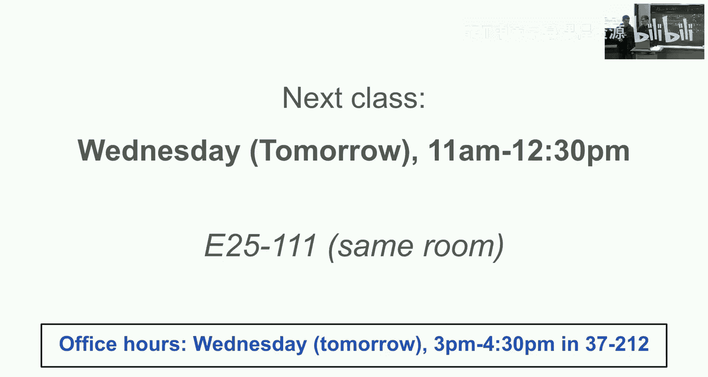

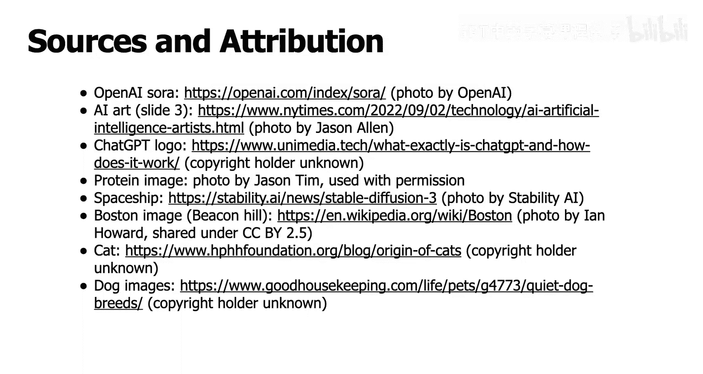