# 《流匹配与扩散模型｜6.S184 Flow Matching and Diffusion Models》中英字幕（Claude-3.7-s） - P2：Lecture 02 - Constructing a Training Target - GPT中英字幕课程资源 - BV1gc8Ez8EFL

Okay。Alright， you can hear me right。 Welcome to lecture 2。 Thanks for coming again。 today。

 we're gonna talk about constructing a training target for flow and diffusion models。😊。

Just as a quick reminder what what we discussed last time。

 we discussed what a flow and diffusion model is。 So we learned that a flow model is initialized with some initial distribution。

 which usually we assume to be a Gaian。And then we simulate some O D E I right now in this D X notation。

 where the vector field is given by a neural network， and we simulate this forward。

And the fusion model looks the same that we also start with some initial distribution。

 which is usually a Gaian。 We simulate this S E forward， just that we inject a bit of noise， Sigma T。

 which is called the diffusion coefficient。 We're simulateimd this usually from time0 to some other time in this class。

 It's gonna be usually time 1。 And we're just returning the final end point of this trajectory。

That's what a model is and how you sample from it。So， at this point。

This model would just produce nonsense。 Like without training。

 no machine learning model has anything except nonsense。 So the question question is like。

 how do we train the vector field duty feeder， And that's gonna be that the goal of today's class and next class is how to train this thing。

 And that's really what the core of flow matching the fusion models and these。

 these models are is like how do you train this vector field。

Maybe let's think quickly about what we want this vector field to do。

 What we want is that we start with the initial condition。 So we sample from a Gaussian。

 We follow along this vector field。 Or if we have an S D E， we inject them more noise。

And that this implies that the endpoint is distributed with our data distribution。

 because as we learned last time， successful generation means we sampled from our distribution。

 So that's the goal。 And that's what training ultimately tries to achieve。And today and tomorrow。

 we're gonna to talk about how we achieve this goal。Specifically today。

 we're going to talk about how to derive a training target。 So typically， when we train a model。

 we want to minimize some sort of mean square error。 If you think about like a regression task。

 usually have some sort of output from your neural network。If some training target。

 you take the mean squarearrow and you minimize that。

The problem is that while in regressional classification， it was just given to you in this class。

 we have to construct it。Like for diff fusion mall。

 isn' not entirely clear what would be this U target that I'm just writing down here。

 I don't tell you what it is。 What's that training target。

So we have no label as in regression or classification。

 So we have to derive a training target that we later can use to train the model。

 And that's what this class is going be about。 It's like how to derive this training target。

 And then tomorrow， we can show how we can actually minimize this loss。

 which gonna be very simple once we have the formula for this object。So just to reiterate again。

 today， we're gonna talk about two things， the marginal vector field and the marginal score function。

 which I look at basically planting， planting stuff for tomorrow。

 that said tomorrow we can basically harvest and arrive at very simple。

 like algorithms to train these models， so。The this。

 this today and tomorrow should be considered basically as one， one class。As I said， okay。

 we want to derive a training target in this in this class。 and I want to reiterate because， yeah。

 just to make very sure， like this will the technically most challenging class。

 like the next lectures will be significantly more easier。😊。

You don't have to understand all the iterations we make today。

 I just wantna make sure that you understand like if you listen to the lecture。

 make sure you understand the formulas for these six objects。

 there's gonna be free conditional objects and free marginal objects。

 it's gonna be a probability path， conditional and marginal。

 a vector field conditional and marginal and a score function conditional and marginal。

 And when you follow along the class and don't understand every detail。

 make sure you understand what these six objects are。

 And I'll show you formulas and summarize everything again later。

It's also worth noting that this is all explained in detail in lecture notes。

 If you want to actually understand the derivations in more detail， Even stuff I'm gonna skip today。

 I have selfconed derivations for every formula we are gonna use。 So if you're inclined。

 so you understand every detail， I have provided for you。key terminology。

 conditional throughout this class always means or not only in this class generally means per single data point。

 So we're always gonna construct an object first per single data point。

 And then we're gonna construct the corresponding marginal object。

 which means across the distribution of data points。 we will see an examples of what this means。

 which just keep in mind what terminology we're using per data point。

 conditional marginal across many data points。

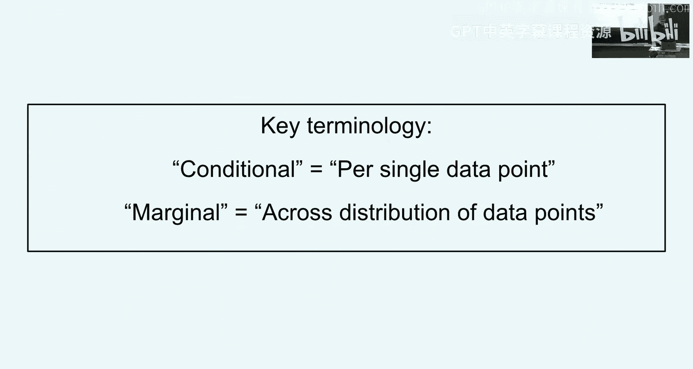

Good。Cool， and we're going to start with probability paths。

 and we're going to start with conditional and marginal probability paths。😊。

So what's the idea of a probability path， And I've maybe you've seen an image like this before in the context of diffusion of flow models。

 You usually start off。With some noise， that's what we want to do。 And we end up with data。

 So in the， for example， we end up with a cat。And what a probability path essentially is is an interpolation between a noise distribution and a data distribution。

 Were basically specifying intermediate time points。

 But we're specifying that in the sense of a distribution。 that's the first。

 like basically provides a skeleton what we want to do。Here's another example。

 This is what you're gonna to implement in the lab。 So you're gonna generate images like that。

 So on the right hand side， there's images like this。 And on the left side side， there's just noise。

 And we're basically step by step having intermediate more add more and more noise from the right to the left or from the left to the right。

 We basically interpolate between these two things。So let's define what this actually means。

And write it down。There we go。So the first object we need is what's called a the。Distribution。

And that's a much simpler object。Then its name seems to suggest。 So what do we have。

 We have a vector。R in R D， which is usually we do not we've set always an object that's a data。

 That's what something we want to generate。And。It's。A distribution that I denote as Delta set。

And this distribution says the following， If I have a random variable and I sample from this distribution。

What do I get， I just always get。That x is set。So it's the most simple distribution you can imagine。

 It always returns the same thing。 It's a lottery that always has the same winner。

 And that winner is always the data point I want to choose。 it's。

 it's a fancy word for something very simple。 Just make sure that like it's basically a distribution for something that always returns the same object。

 Always just said。😊，So what's the conditional probability path。 So now we doing。

 we're starting this that we do something constructing something per data point。

We denote a conditional probability path as follows。 We we do， we denote it as PT T。

And then we have a placeholder， which you doote as dot， which you can plug in to get the density。

Given an data point set。 So given set。We have a placeholder at time T。 and we know it's PT T。

 And you see an example of a conditional probability if we have here where the data point here is this red dot。

And you see what the the idea is that for this data point， we smoothly interpolate。

Between a Gaustion and data point， you see that this distribution collapses stepwise into the single data point。

 And now we want to formalize what that means。 So it means that the first condition is that。PT。

Is a distribution。And the second thing。Is that。So when I say distribution， I mean。

 probability distribution， something that we can draw samples from， like we can。

Roll the dice with this object。And there's two conditions is that it starts at time  zero。

At the distribution that we want to start off with， which is our P in it。

And the second condition is that we end up。At the distribution。

 that's just a single data point that I just introduced， which is the D rock distribution。

So what I wrote down here is what you see visualized here。Basically， across time。So I。

 I start off with my initial distribution， which is the left hand is Gasian。

 I end up at time 1 at my di， which is visualized by this red dot。 Okay， at this point。

 I've not done much except specified this thing。 So maybe a quick example。

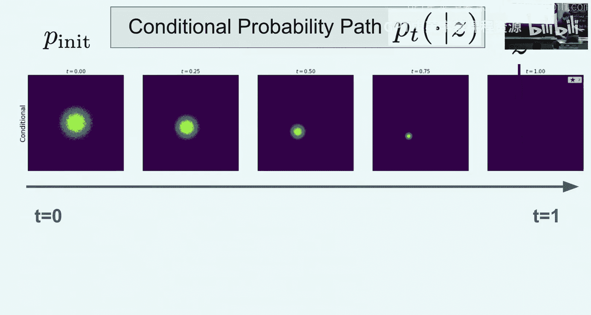

So I'm always giving you throughout this class the example of a Gaussian half。嗯。If you like。

 that's the more general definition and as always the Gaussian definition。To。

 if you want to make something concrete， always use the Gaussian definition。

 And it's actually the most important example。Allright， so for a Gaussian example。It looks like this。

That the conditional path is given by。A normal distribution。Of this form。

And alpha T and better T are what's called noise schedulers。

Which are just functions that have the following property。They end。So alpha starts at 0。And ends。At1。

And beta goes the other direction。 So be starts at one and ends。Its 0。 So if you think about this。

 if this is time T， then alpha goes basically， you could just think about a straight line that goes up。

 You can do whatever you want。 But like，'s the classical example is like alpha just goes from 0 to  one and better goes the other way。

Okay， so these are just functions。 We specify them。 We can。 We can choose them。

 This is a design choice。 We can later， even empirically apply over them and just see what serves our purposes best。

 If you just wanna make this even more concrete， just make alpha T equals T。

And better T equals 1 minus t。This is like， the most common example。Question。Yes。

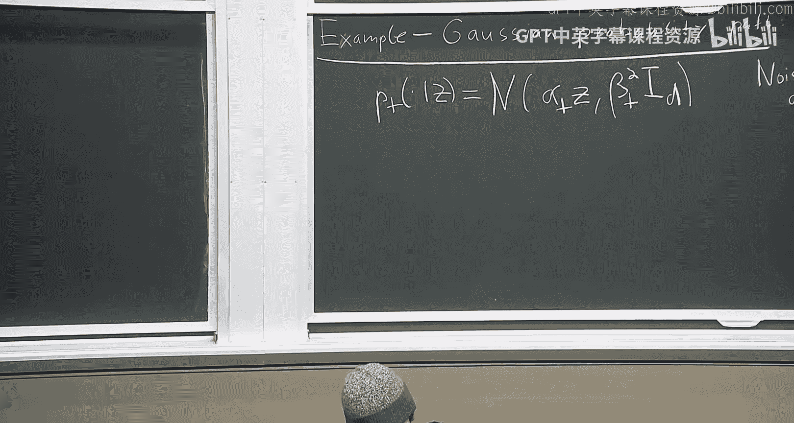

Oh yeah。 sorry。 Thank you so much。 This is， you know， I get confused myself。 the other way around。

 So better 0 is 1 and better 1 is 0。😊，Yes， I should be correct。So。We start with better at 0。At one。

 we we ended 0 with alpha， we started 0。 We ended one。The idea is we upscale from 0 to  one。

 which means we end up at the data point。 If the mean of this distribution will be the data point。

 The variance will go to 0。So let's check that we fulfill these two conditions。Is it a distribution？

It is。 A Gasian is a distribution。 It's the most standard example of a distribution。

 And the second condition， is that fulfilled。Well， at time 0。

 this will be 0 because of the condition I imposed。 So it will have 0 mean。

And it will have unit variances。 So if we just saying。P in it。We're just saying that it's a caution。

Then， we're all good。So we can just choose it that way。 And that was our standard example。

What what happens at time 1， at time1， the variance will be 0 because of how I chose better。

But the mean will be exactly。That， so a distribution with zero variances and mean that is just the rock at this point。

 So I have a distribution that is no variance。 There's no spread。 It always returns the same point。

 which is exactly the huge we have。 So this object basically is what I。Plo it here。 So you see it's。

Starts as a gaian。 And in the variance。Goes down step by step。Alright。

 so now we see this the first time that this object conditionally on a data point is now going to be have a corresponding marginal object。

Which is the marginal probability path。Alright， so what's the idea。

 The idea is essentially that we have the same distribution。

 But we first make the data point set random。So we sample set from our data distribution。

 What does that mean if we think about training later。

 What does it mean to draw sample from the data distribution。Let's start thinking about this。

A means you draw you have doing training， it just means you draw a sample from your data。

 Let's say you have N data points， take a random index， You pull this data point。

 You just in Pytharch， you would loop over your data loader。 That's what happens here you。

 essentially。And next step is were doing with sampling from this conditional path。

And then we're just saying were forgetting about the data point we initially started off with and saying that the corresponding X has the distribution of our marginal path。

 So P T。It's going to be the marginal path。That's going be basically this object。

 But with a randomly initialized data point。 So we marginalize across the data distribution where marginalized means nothing else then。

Forget about that。Good， cool。There's two important。Forms for this。 So the first one。

Is that what is the density of this。 So we want， I've now just defined how to sample from it So how to roll the dice with this distribution。

 But I want to also have a formula for the density。So PT T of x。

 which is the likelihood that the point X， iss given by the integral。

 So I need to integrate over this random sample。 So I marginalize over it。So what did I do。

 I just took the integral， and I made the initial point now。

 weighed by its likelihood under this distribution。

 and then weigh it is basically this is basically the way of writing down the density of a procedure like this。

 So maybe you've seen in graphical models where like you have a point set。And then。

Like we get a point x。Out， so that's what basically mean what we're doing here。 So were。

 we are having a latent variable set。 That's how you can think about it。

 We marginalize this out to get to the distribution of x。The second。Property。

 and that is really key and why we're doing this。Is that what's P 0。

Let's start thinking about it like， what's the initial marginal distribution。马出。😡，Question。

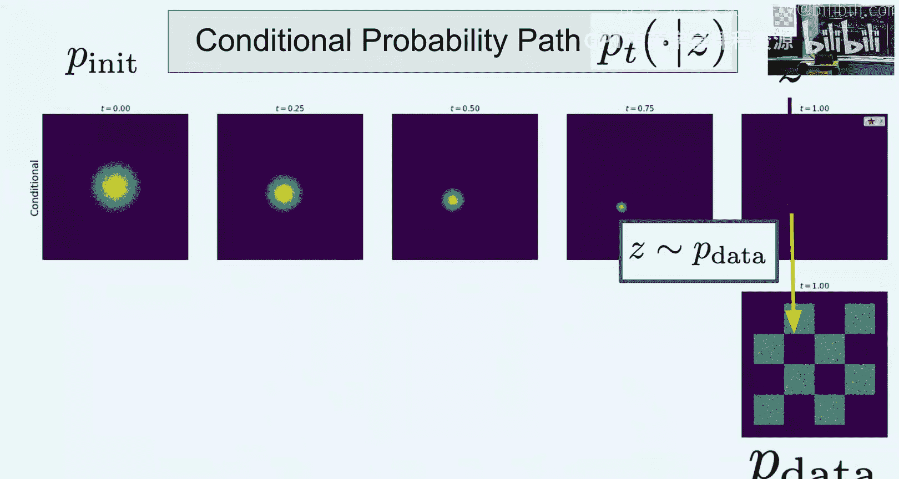

嗯。What's the initial marginal distribution？It is。 So let's see how we sample from it。

 We strive with a data point， and then we sample from this distribution。

 which is completely independent of the data point we started off with。So essentially。

 we're always sampling from P in it。 So it means that P 0 is just P in it。Because。

What this means here in this case is you're just throwing away the data point and sampling from P units。

 So that's the same。What's P1。We sample the data point， and then we just。Return the data point。

 So we sample the data point from the data distribution。 So what do we get out of this。

 We get the data distribution。All of this is to say。That we've constructed a set of distributions。

That goes。From noise。To data。And that's what you see here now plot it。

 So the conditional power is on the top。

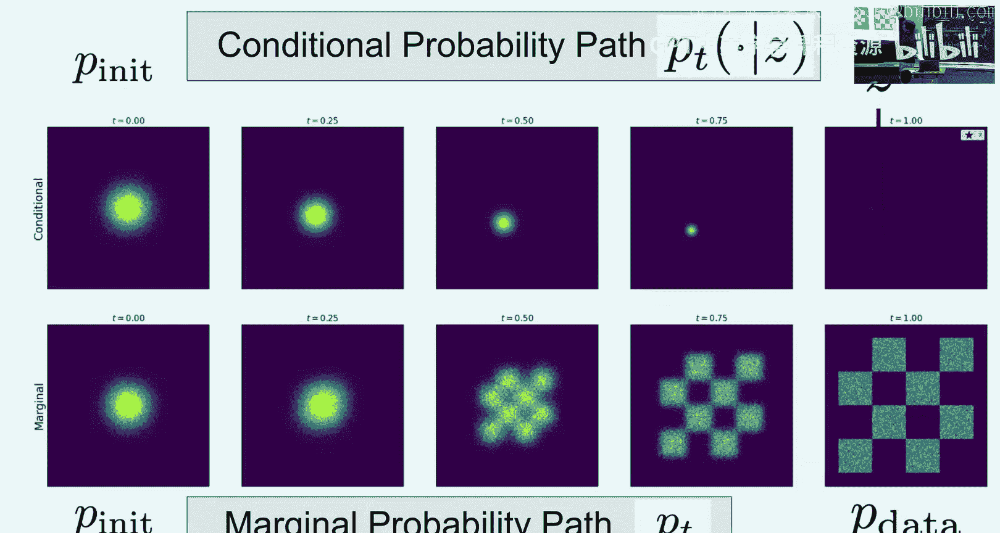

And now we marginalize across the data distribution。 So we make， this is the data distribution。

 We make our point set random。

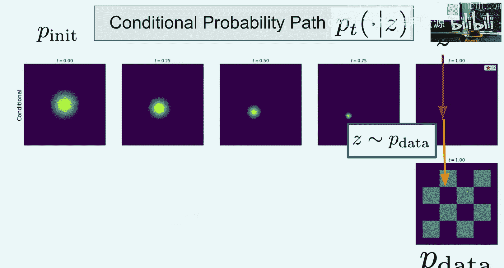

And then when we sample from this， this is what we get out。So you see that we go from noise to data。

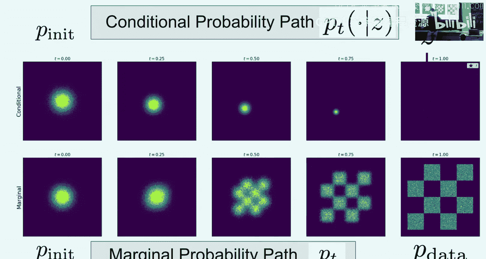

But not with trajectories at this point， we only specified。These distributions， PT T。

 at our intermediate time points。Good， cool。 Are there any questions， yes。These two。😊。

So this object is this object。 So like every conditional path induces a marginal path。

 So you get from a data distribution and a conditional path， you get a marginal path。So。

So P data is the data distribution。 I this what we want to sample from。

This is the conditional probability path， which is what we wrote down here， this object。And these。

And these together， if you sample first from this and then from this。

 the resulting distribution is the marginal path。 So how to build a marginal path。

 need a data distribution and a conditional path。 Then your recipe is to get a marginal path。

Any other questions。OK， cool嗯。So let's reiterate。 We have a conditional probability path where the ideas go from initial distribution to a data point set。

And the standard example is discussion example where alpha t be T have the properties that are owned down here with a variance that goes to 0 and a mean that goes from a variance that goes from 1 to 0 and a mean that goes from 0 to 1。

And then we have the marginal path that by making the initial point random。

 we interpolate between the initial distribution and the data distribution。

 And we have a formula for this object， which is given by this。或ok。Alright。

 so let's do the same exercise now for。Vectctor fields。 So we want to talk about the conditional。

And marginal。Active field。Okay， let's start off。 First of all。

 we want to have a vector field that is per data point。 So it's a conditional vector field。

What's the conditional vector field。 It is for every data point。 We have a vector field。

 and I'm denoting this as U T target because there's later going to be the training target of our algorithm。

So， and we have this for all。Times between 0 and1。And all X set。In。2迪。See。And ideas， basically。

 we had。A way of going from。The initial distribution。To。The conditional， sorry， to the。

To a single data point。And we did this via a probability path。Additional path。

 And now what we want is that we have an O D E that follows along this path。

 And we want to have a vector field that if we simulate this。We， basically。Follow this path。

From noise to a single data point。So。How do you formalize this。We want the condition。That， starting。

From the initial point。O。So we want that when we start from the initial point。

And we follow this vector field。That what we do is we follow this path。

 which means that the distribution of X T at every time point is gonna be。Specified。

Lest probability path。Net holds for all。0。1。So。This is a crucial condition。

And let's make sure we understand this。Let we start with x0。 So we initialize with the initial path。

We， we simulate an O D E。 And now we're just doing this for on a single data point。

 which basically means we have an additional input there。

 But that that one is fixed throughout the duration of simulating this O D E。

 So we saying that derivative or X T is given by some vector field。

And we collected a lot of these per data point。And we're saying then we simulate this O D E in this way。

TheThe distribution of X T for every time between 0 and 1。Is given by conditional Pap。Right。

 so we're saying。And it might be worth mentioning that P in it。Its also。Hes 0。Offset。Why is that。

Because of the condition that we have imposed here。So it easy says。

 starting off with the initial point of this probability， conditional path。

We simulate the O D E with the corresponding conditional vector field。

We end up just following this path。 Following means that the distribution of X T at every time will be given by this path。

That's a condition I impose。 We don't know yet how to construct it。But it's rather simple。

 and I give you an example。So。Let's see。We usually just have formulas for conditional vector fields。

 so。In the case of。The Gaian。Back to field。Here。Is。Where。It given by this formula。Right。

 so I should say that the dot notation is the notation that's from physics。

 So alpha dot essentially means the time derivative。Of alpha。

And corresponding with better thought means the time derivative。Of better。So。

This formula essentially says， I have some values， but remember， I've designed them。

 So I know this value。 So if alpha T is T， we know what the derivative is， this is。

 this is something we know。This is some scalar。 We multiply it， by we've said。Which is a vector。

We then add up another scale with another scale of x。 So that's just a weighted combination of set x。

Like it is a complicated formula。 At the end of the day， you have one value， multip of set。

 another value， multi of x。 You add them up。 Very simple and。

I show in the lecture notes that this fulfills this condition with this path。

 So if you an O D E with this。When you end up having this property with this path， so。

Let's show you an example of this。If we pluguck that in。you get this。

 So what we see here is our beloved flow plot。 The the flow is in red， the vector field in blue。

 you see in the background。😊，The conditional path， you see these control lines to go from a Gaussian in the SA to a single data point。

And plotted on top of that is the flow and the vector field。 So this conditional vector field。

 So this O D E is simulated。 So this thing is simulated。

And what you see is basically that it pushes sit over the data point。

 So you see that it follows along this path。And the distribution at every time point is given by the distribution we want。

 which is our conditional path。Good。Yeah。The conditional path is， so we see here at time。

 timess say time shots or at every time。 So we start off at time 1 at time 0。 we end up at time 1。

 and at every new image， the probability path is depicted by the control lines。And the background。

And app plotted on top of that is a conditional vector field。

And what we're doing is we're simulating with this vector field and O D E。

 We're just doing this fixed theta。 The set is fixed in this plot。 We just chose one。

 So the set is the one that happens to be here。 could have chosen another one。

 but it will work for each of these sets。Cool， okay， so why is this useful。Because of the following。

Yourri。I need new chalk。Right。Because we can construct a corresponding marginal vector field。

 And that's one of the central。Results。And we call it the marginalization trick。Alright。

 So what do we have， We have what's called the marginal vector field。So in the same way as before。

 where we had a marginal and a conditional probability path。

 we now have a marginal and a conditional vector field。And we define this object。

By the following formula。Alright， so that's。A formula that we're going to meet。

So all formulas that are important， I'm usually highlighting color。

So that you know what you would need to take away from this class。So。

What's the marginal vector field， We define it to be the value at x。

 That is some integral where I made a mistake。And wrote it over X。 should be overs。

So it's an integral over set。 So it's an integral over data points。

Where we take the marginal vector field that we had here。And we weighed by this ratio here。Okay。

 so where does this ratio come from。I showed you that。The ratio。

 like we basically having some sort of， you can think about it as a graphical model where x goes。

 set goes to X， let's say， time T。What is this ratio？Have you， you heard of Bay's rule。

 that's the posterior distribution overset。This ratio， posterior given x。

 What's the distribution over。 So we look we where where x and we're saying， okay。

 what could have been the data point set that could have introduced this just x。

We take this ratio how likely it is。 then we addict the integral over things that we know work for this data point。

 So for every data point， we know posterior， what the likelihood it is。 We're weighing it。

 taking integrals over it。 So that's the formula。Whenever have implant this formula。

 it's just central to derive the training algorithm。

 But just make sure you have an intuition that we given X。

 we take essentially a posterior distribution over， over set。And why is this relevant because。

This vector field satisfies something that we want to do。

 So this is the thing that we want to learn later。It satisfies that if we start。

At the initial distribution。And we follow this vector field with an O D E。That we end up。

Having the distribution we want。 So we follow the path， but now not the conditional one。

 but the marginal path。Okay， so let's recap。We started off with a conditional vector field。

 and we said it should， its O D E should follow the conditional path。Then we defined this object。

 I didn't show you where this formula come from。 It was claiming that this formula。

 I'm just writing it down。 I'm defining it that way。

 And the claim I make is that if I followed the O D E with this marginal vector field。

That I'm then following the marginal path。 Okay， so I'm translating this property from the conditional setting to the marginal setting。

That's the important case。 So why is this cool。Like， this is a more general。

 we don't really need this。 We need something more specifics as like a weak condition。

And that's very important to understand。 And I really want to make that point clear。

 So how did it res P T， Where does P T start off with。It starts off。At the initial distribution。

 right。Where does it end。It ends at the data distribution。 So P1 is P data， right。

 So like that's we constructed it that way。 This is， this is by， by construction。So if X。

 T is PT T for every time point T。This implies for X T equals 1 that x 1 follows the data distribution。

So we， we have a stronger condition， but this construction that we have is basically enables us to say。

 we end up。With the right distribution。And that's what we want to do， right。

 We want to construct a vector field that starts at noise。And ends up at data。

 Weve basically just shown your formula for something that does the job。

We don't know yet how to compute this。 but at least we have a formula for it。

 We know what we now want to approximate。 later， we want to learn this object。

 but it's crucial to understand that like， we at least have a formula now for it。It's a question。不。

You mean why we care about probability paths in the first place。

And this is just a useful tool to construct this object。So the conditional path， you're right。

 In1 sets， it's completely point us to generate a single data point。 This is more like we。

 we trying to do something that does this。 So we want to end up with a vector field that generates data at the end。

But what we're doing is we're solving the problem first per single data point。

 we're saying for a fixed data point。 we do this。 And that enables us to have a formula like this and do it across data points and end up with the distribution。

 So that's the whole idea。 like you write on point is that like we're doing something that does not make sense。

 We're doing something。 we're generating single data points。 But that's just， it's just an exercise。

 It's a tool in order for us to derive a formula of this shape where we actually end up with the data distribution。

 like this。😊，Like， this is gonna be a core。Principle that be solving a problem per data point will be enough in order to train the model。

also gonna see this later。 But that's surprising at first。 And I agree with that。

 It's kind of surprising that。Like， at this point， this is just the construction for this。

And we will later see， But this is somewhat enough to train more。Yes， P data is continuous in nature。

 but that's not a problem。 There are some numerical problems that might be might appear。

 And there's some people have realized early on in the design of diffussion models when it comes to deizing score matching。

 for example， we we'll get to this。 but we can design this in a way which is numerically stable。

But once you define them。都第一个。And no。Yes， so what I， what I。

 what I was hiding here was a lot of design choices。

 So there's a lot of waves of going from noise to data。 Its an infinite amount of ways。

 And at the beginning， prefiory。😊，People tried to find the best way。Like。

 people didn't specify these intermediate points。They didn't just say， okay。

 give me the best way of going from noise to data。 For example， like field of neural O Ds。

 Do you not specify this intermediate path。 But one of the key ideas of diffusion models is was to specifying the way you go from noise to data。

 It's actually completely fine to make a choice and just stick with that because that enables scalable training。

😊，So， and in the same way， to answer your question， you also have a lot of choices for this object。

 We'll later see。your father。If I fix the probability app， you also have a lot of choices for this。嗯。

Yes， so we'll later use the con I can later show you how to construct it。

 But there's actually an infinite number of ways of doing this。 But we'll， we'll in this class。

 what you have to implement this formula。 Okay， so understand this formula like。😊，This。

 this is like just an average or。A weighted average between two points。Cool， okay。

Where are in terms of time。Qu real quick。Okay， so。Let's visualize this。嗯。Conditional path。

 marginal path， you see here going from noise， which is in red in the background to data distribution in blue。

 So the top row goes to a single data point。 And if you marginalize this。

 you see the trajectories go to all other points。And so basically， you see that you go from。

By constructing stuff that only goes to single data points and marginalize it。

 meaning like you make this， the data points said random， you get something like this。

 So you get what you actually want to do。Okay， so now something that's not going to be。In any way。

 required for you to continue this class。And but I just want to quickly show how you would prove the statement。

嗯。Let's see， so。You just mentioned already。 So there's a thing called the continuity equation。

And it's actually a pretty fundamental equation， and。This is just for information。 As I said。

 you will not need this。But it basically makes the following statement。

 If we have an O D E that we initialize with some distribution P in it。Basically。

 in the same way as before， we follow some vector field can be any vector field doesn't have to be a neural network。

 can be anything。Following this probability path， meaning that X T has distribution every time T。

This equivalent to saying that the so called con continuity equation holds That that the time derivative of P T at x。

Is given by the negative divergence of P， T times U T of x。 So now， what's the divergence。

The divergence。So if you， if you've seen this before in physics， this might be familiar to you。

 If not， as I said， don't worry about it。 It's not the end of the world。If you don't understand this。

In the lecture notes， we derive every， everything in detail of this。 So if you want to know。

De sales about how you arrive at this also approve of the continuity equation we have in the appendix。

I think it's like， if you're mathematically inclined， I would recommend reading it。Okay。

 so I just wanted to quickly say， what is this divergence。

 The divergence intuitively is an is an an operation that takes in a vector field。 And at every time。

 X gives you。😊，This object， it gives you。The sum of the partial derivatives over each dimension。

And intuitively， this object measures basically the net inflow to a point。 So in physics。

 it's used to measure inflow to points。 You've seen it maybe in specific physics theorems。

 It's heavily used。And that basically is the intuition of the continuity equation。

 So what does it say， our change of probability mass at x。 So a change of likelihood of being at x。

Is given by。Let's think about it。 We at the point X。

 We have a certain probability of being right now at x。

 But we know we're moving along with a vector field U T。 So there's there's stuff coming in。

 thats stuff coming out from where I am。 there's a certain inflow in a certain outflow。

 And now we're just playing accountant and say， okay， What's outflow， What's inflow。

 outflow minus inflow of the probability mass should essentially correspond to。😊。

How am I likely should change？And inflow minus outflow is the divergence。 So we have to swap them。

 So outflow minus inflow is a negative divergence。So that's why this equation basically tells you a condition that is both necessary and sufficient for how my probability mass is going to change。

Good， cool。Let's see。So I'm going to write down proof real quick because I know that some people are interested in this。

As I said。That's not going to be necessary。So we're essentially plugging in this continuity equation into the condition that we want to show。

 So remember， we want to show this object and we know this condition。So。Let's do it。The idea is。

 essentially， that。To show this condition。By the continuity equation。This is this condition。

 so we can equivalently show this。So you see that this year。And this here is the same condition。

 So now we're just instead using the equivalent statement of this。

 And that's something we can we can check by just plugging stuff in。So what's P of x？

The first condition。Says， it's says integral。So I have pluged in condition one of the marginal probability path。

 which is this density。Then next thing I'm gonna to do， I'm swapping this derivative in here。

 which is， which I can do as soon as I'm。Like as long as you assume certain regular assumptions。

Next thing， I'm going to apply the continuity equation。

 but now conditionally on the conditional path。 So this condition， I convert into this condition。

 I'm going backwards。Which is。The negative。Divergence。Of P T。That。有提议。Okay。

 so what I've done here is I've plugged in this equation， which is on the bottom of the slide。

I'm taking the divergence operator out。So in the election notes， this is explained in more detail。

But I'm， I'm gonna brush over this a little， because。嗯。We're not needing。

 We're not going to need this later。Okay， so what I've done here is I took the divergence operator out。

And now I'm going to do a little trick。I'm going to。Divide。And multiply it with P， T of x。Oh。

 I wrote duty T。 Sorry， I should have duty target。Okay， so I， I'll go over this real quick。

So what have we done here from here to here， I've multiplied with PT T of x and divided by P T of x。

This is just a trick， because now this object。What you see here appearing on the right。Is。

This formula。This thing。Is what appears in this integral。

So what you can do is this is minus the divergence of P T of the marginal vector field now。Okay。

 so what have we done here， If you look at the first equation and the last equation。

This is a continuity equation。Look at the bottom row of the slide。

 Look at the end end condition and the first condition that you see here。It's a continuity equation。

 right， so。Let's go step by step。 how we arrived here。 We take the derivative。

 We take this formula that I just showed you of the marginal probability path。

 Were swapping in the derivative。 We're plugging in the connu equation1， One way。

 We are plugging in that we putting the divergence operator out。 We're multiplying by PT of X。

 We're dividing by PT of X。And then we just use the definition of the marginal vector field。

And what we end up is this equation。And now， we can use this。Equivalant。

Arrow here in the other direction。 go from here to here。

 So we can conclude that X T has distribution P， T。Again， this is not necessary to understand。

 but I think it might be like， just to get you a sense of like， how I arrive at these equations。

 So I have an equivalent condition that is just something I can plug in equations with and play around and。

Essentially， I'm just plugging in this equation， applied once conditionally per data point and then get it marginally across data points。

And that's what。That's how we arrived at this formula or not not we。 Like。

 that's how people arrived at this formula。 right， They didn't start off with this formula。

 They started off。Trying to solve the continuity equation and then show that this is what we need。

In the lecture notes， this is explained in much more detail for step by step。Cool， okay。

 let's see how this looks like again。 So I showed you the probability path。 So this is， again。

 a conditional probability path with trajectories from a Gaussian conditional vector field。😊。

And I showed you last time this toy example， which starts from initial distribution。

 the Gash in here。And ends up with a data distribution。

So this is now a distribution in two dimensions。 If this would be like an image does not have two dimension。

 It has as many dimension as pixels。 But for our toy setting， that's what we're doing。

And if we are simulating now this O D E with this formula。We don't really know it。

 the computing this is gonna be tricky。 but like if we do it。

 you see that it converts an initial Gaussian to this distribution that we want over time。

 So it follows the path that we designed。 So what we've done。

 we basically specified a road of going from Gaussian noise to our data distribution with the conditional probability path。

😊，Or the marginal probability path， which you see here。We then said， okay。

 let's solve this problem per data point， which is this， which is this。

That what we what the formula I've showed you。So what we are plugging in this in this animation is this formula here。

 plugging this in。 and then using this formula to get this marginal vector field simulating。

And see that we just do what we want。And that's， that's really like the， that's it。 in terms of like。

 if you simulate this with images， you get something cool out。 Let's see。 Do I have a。Yes， okay。

 If you simulate， what do you do when you simulate the module of vector field for videos。

You get out Matts movie gen。I've not showed you yet how to learn this object。

 Like that's w to be next class。 It's gonna be actually pretty easy that the the hard work is actually finding this formula。

 But once you learn this object and simulate an O D E with it， which is this formula here。

You get out this。 and at the end， you get out the data distribution， which in the case of videos。

It's the distribution of videos on the Internet。So like， I've always showed you toy examples。

But let's just to illustrate it。 like， if you do this on large scale， that's what you get out。

This is all to say， this's not just some sterile formula。 It's actually really useful。Okay。

 let's summarize。 So in the same way， we have a conditional probability path and a marginal probability path。

 We have a conditional vector field and a marginal vector field。 So let's see。

 what is the conditional vector field。 It's a vector field that's given a data point set has gives you direction at every point X。

😊，What's the key property that we wanted to， We want it O E。 It's O E to follow the conditional path。

 So we solve the problem per data point。And then。Okay。

 the most important formula that you're gonna need is this formula， which at first seems hard。

 Once you know that， you know alphapha T and P T， it's a pretty simple formula。

 It's just a weighted average between set and X。 Okay。

 so that's the marginal vector field that you're gonna to use。Like， if you take one thing away。

 this formula。And then we can marginalize this to something that does the job that we want to do。

 And it's not converting stuff to single data points。

 but converting stuff to a full distribution of data points。 this this condition。

And the formula we have arrived is this object， which intuitively is the marginal vector。

 the conditional vector field。Basically， weighted over a posterior over data points。Okay， so。

You're never gonna implement this formula because there's a way to train it without even looking at it。

 But that's where we get to next time。Good。Any questions。Yes。Do you mean the。

 the proof that I just presented。Or the conditional， you mean the one， this one。

That would from the condition to the marginal。 So that was， that was what I showed here。

 the this proof that I showed。So this proof says， if this condition holds， that's all I'm using here。

 this condition holds。And the formula I arrived here。Appears then here。

 which is what would you have here。This one。E this is a definition。

 So I'm saying if I defined this vector field to be this formula。

I'm then showing that this condition holds。So。II'm first stating what holds。 I'm just saying this。

 I'm just defining it that way。 And then I show you later by this that this condition holds。不。

This one。Yeah， happy to explain this again， so。Let's see。So。嗯。Allright， so。

Bys rule is something you've heard before， maybe。 So it basically says that P。

Of the conditional probability of set。I think。Given x its the same as the probability condition probability of set。

X given set。Divided by。So Bay's rule is something you've maybe heard before。

 which says that the conditional probability of set given x can be swapped So the conditional probability of x given set multiplied with the prior divided by P of X。

 So now I've showed you。A special case of this where this is time dependent。

This is the data distribution。And this is the conditional path。 And this is the。Well。

 this is this ratio。 that's I'm plugging in。 So what I'm saying is like， given that I'm an X。

I'm taking the expected value of my conditional vector field。 That's what this integral says。

 So I'm basically given x going backward to my posteri overset and taking solutions that I've used before for single data points。

This intuition is a bit tricky to develop。 Like， as I said。

 the important thing is to know the formula less so to understand this now in every detail， but。

The intuition assess that at every time and being at X。

 I'm basically going backwards to my latent variable。

 which happens to be a data point and then marginalizing over there。不是。Yeah。Yes。

So what you want is you want to start at So alpha gonna determines the mean of discussion， right， so。

If alpha T is 0。And the mean is 0。 So alpha is like 0 time alpha 0， like alpha。Times Z is 0。

 if alpha 0。So we start off with a ga。If it's。At time 1， you w to be at the data point set。

 So if you set alpha T to be one。Then you end up。 The mean is just at set。Yes。AndSo the gosh。

 the conditional vector field relates to the fact that if I simulate an O D E with this object。

 I'm following this path。And that's， that's a condition I impose。

 And that's an example of such a thing。 And how to find this is there's two ways you can plug it into the utility nuity equation again。

Or I also have a way of deriving this from without it in the lecture notes。Okay， Ill question。TheO。

So， yeah， so the last equation， basically， it's a chain of equations that end with the end of Earth point and the end point is the con equation。

And then the continued equation allows you to conclude this。That's the。That's a theory。 Yeah， yeah。

 So， So that's a statement that I made that I've not proven to you。That's I。

 I have a proof in the lecture notes。 I just feel like it's not necessary to understand the rest of this course。

 as is this proof not necessary， but like， if you're interested， read it。 I highly recommend it if。

It's just that this has some math that。You know， you have to be used to it。

 and it's not necessary to understand the， the models themselves， so。But yeah， give it a read。Cool。

 okay， so we're gonna move on。 And now we're going to try to do this same thing。

 but extending it now to。Stochastic differential equations， so。

Let's go one step further and do it for SDs。Cool， okay。And。Given the last row of this table。

We're gonna do use something。 what's called a score function。

And maybe that's something you've heard before in the context of the fusion model， so。Free， free。

Conditional。And marginal score。I want to say again that the most important thing to understand is the flow part。

 Like， make sure you understand the flow part。 The S E part， is's more like the cherry on top。

 And both of the labs you can do without it。So。Let's think about。So in the same way。

 I will define an object conditionally and marginally again。

So let's first define what a score is per data point。Where I have the gradient。

Of the work likelihood。Of my conditional probability path。So， and just to make clear。

 I'm taking the gradient here with respect to the variable X。So what's the score。

 The score is the lock likelihood of something。 And I'm taking the conditional score in this case as the like sorry。

 score is the gradient of the lock likelihood of something。 In this case。

 we can take the gradient of the logarm of the conditional probability path。

 So this is the same object that we've seen before。

 in the same way there was a conditional vector field。 There's no conditional score。😊，嗯。

There's also a marginal score。And that has this formula。Which is a gradient。Of the logarithm。

Of the marginal path。So if you compare this， this is the gradient of the log likelihood of PT T of x。

 given set is the gradient of the log likelihood of PT T of X。 Okay， so these are two。Like。

 these are the same objects just defined on different distributions。

And now we have can have a formula for the。Marginal score， like， let's， how are they related。

In the same way as before， we can。Therriveve one from the other。I make sure I have enough space。So。

The gradient。Of the login of the lock likelihood。Which is the marginal score。Is given by。

The chain rule。So what I've used here is that the chain rule and that the by the derivative of the lock is one divided by the object that I wanna use。

That's something I have a formula for。Which is this。And I'm plugging that in。

So what I've done here is I've used this formula。Only one。没有。Now。

 what I'm doing is I'm doing the same trick again where that I can take the gradient inside the integral。

And now I'm doing this trick reverse where I'm dividing and multiplying with the。嗯。

Like I'm using the chain rule of the logarithm。 So that's。The radiant algorithm。Good。

So here I've done the same trick where basically the。 the derivative。off。Loock of eggs。Is given by。1。

 divided by x。That's the trick I've used here twice。All of this is to say that the end。

 the what's important is going be the end in the， the first and the last equation。

 Well What we're ending up starting here is we're starting with the marginal score。

And we're ending up with a formula over a conditional score， with this ratio。What's that ratio。

 Have we seen it before。We've seen it before。At this。It's this ratio here。So again。

 this posterior ratio。 So essentially， this formula holds in the same way as it holds for the score。

This point。Make sure you understand the formula for the start an endpoint。C。Okay。

 so this formula here。And。One important example。 Like why is this relevant Again。

 It's relevant is because we know this object。 we've designed it。 We can have a formula for it。

 So for the case of the Gaussian path。But still have that。This one。What's the score of this object。

You can just plug in the density。off。The Ga path。And you get a very simple formula。That is。

Minus x minus alpha T。That divided by。Better T square。So。Here， I'm using。This example here。

You actually， if you have started lab 1， you're arriving this the way to derive this is to use the density of a gausian distribution。

 You take the logarithm of it。 You take the gradientn of it by taking derivatives。

 Youll arrive at this formula。 So so you should not take like this should be。We post me in one goal。

You' find how you go。From' here to here。Yes， so what I'm doing is I'm dividing by this object。So。

 I will have。And then I'm multiplying with it again。So， saw at this。

Emplies that the gradient of logarithm。Of P。X， that。Is the gradient。Of P T。X given said， divided by。

P T X given set。So basically， if you plug that in here and use that， this vector cancels out。

 and then you will arrive at this。Good， cool。I've showed you now what a score is。

 but I didn't tell you yet why it's useful。 And that's going be the next thing。So。C。

So I'm going to wipe out that example。But。Again， it's not really an example as much as。

The most essential formula。That you need。But。I have it on the slides as well， as well。

So that's essentially the coffee now。Basically， and a bit of also a bit of the cherry on top is that this is the most important thing。

 This is basically now extending what we've done before to stochastic differential equations。So。😊。

We call this the SE extension trick。It's used heavily in the literature。But this term is something。

We coined。对。Okay， so。Why is it called extension trick， Because we are using the same。

Conditional and marginal vector field。The as before， as before。And then。

What I'm want to do is I want to extend this O D E to arbitrary schiatastic differential equations。

 So Cole earlier was asking is that the only way of generating。Following this path。

 and at least for S Cs， I can now give you a whole range of solutions and give you a whole range of things that。

Follow this path。Sorry。So I'm saying， for an arbitrary。Diffusion coefficient。

The following thing holds。That starting x 0， like， like here。And now， instead of following an O D， E。

 I'm following an SD D E。And it's gonna be like a monstrous formula now。 So let's。

Take some time to digest this。Alright， I'll give maybe people a few seconds to write this down。Well。

 I haven't wrote down the statement yet。So for any of this， this equation fulfills。

That the same condition is here。 So X T has distribution P T。So why is this a cherry on top。

Because it's， it has a special， as a special case， as says we already we do。 Let me， let me， sorry。

 let me go from the start。 So we're having a marginal vector field as before。

 And we know that it already， like the OD E of that vector field already fulfills that we generate the right distributions over time。

 So we follow the right path。And now what I'm saying， I can extend this O D E to an SD D E。

 So what I'm doing， I need an diffussion coefficient sigma T。 So injecting noise here。

 This is the noise injection that we had last time。😊，And I have the old vector field。

 But because I inject noise， I need to somehow correct for it。 I've changed something。

 Like I've now take， you know， I've， I diffuse， it's， we need to correct for this for this effect。

 And this is the correction term that we have to apply on the vector field， so。This。

 were adding diffusion， meaning we need to add a certain correction term it into this。

 And what the same property holds。 So what I find fascinating is that this is arbitrary， right。

 where you can eject as much noise that we want。It will always have this property。

And that's kind of fascinating because at the end， like， this is all we needed。And that's also why。

 you know， I would say 50% of models right now are pure flow models。Because。

That already does the job。 Like， it's a cherry on top to have a whole diversity of models that do the same thing。

But empirically， you might want to。Study the optimal noise level。

 you can maybe test it and see what gives you the best results。Why is this relevant？

Why is following this probability path relevant？Exactly， well， because at time1。

 which is the end point of our trajectory， we're ending up with the data distribution。So。

 we found a way。To convert noise。To data。In a diversity of different ways。

 we started off with a marginal vector field that sorry。

 we started off with a probability path that specified how we go from noise to data。

And we did this by constructing a conditional probability path that interpolated between noise and a single data point。

We then。Modginalize this， which means we made the data point random。

Which then interpolates between noise and our data distribution。 The one we want to generate。

有 got question？啊，可O嗯。No problem。 So then we said， okay。

 we can construct a conditional vector field that follows along the conditional path。

 So we solve the problem per data point。And then we showed that we have a formula for something that then。

This is for the marginal path。 So that converts data to noise。Ens。Once we have that。

 we can show that a score function is essentially the correction term that we need to apply。

If we want to inject noise and convert this O D E to an S。

So now we found a whole diversity of different solutions。 The most important thing is this。And we。

 you can， we can show later that these two are actually related。 That's gonna be the next clause。

 but。Essentially， the whole business of training a diffusion model or a flow model is to train either this object。

Or this object。So， and。You probably， you can't have realized yet。

 but we've done our the absolute majority of the way to getting training this model。

 because the most difficult thing was to find in this formula。 And next class。

 we were gonna study how to do it。All right。I wanted to do a recap。 you got questions， yeah。呃，两啊。

But what is。系。Yes。Yes， great question。 So just reiterate out the question。 So a question is。

 why do we need a whole range of models that all do the same thing we like。

 it would be okay to have one model that does a job。 And that's correct。

 So I told you Mad us movie Genus using flow matching。

 They use one specific way of doing this just with a flow。 So， as I said。

 like I would say current estimate。 that's gonna change over time now。50% of models just use flows。😊。

Some models use also noise injected。And that's more empirically。So like determined。There。

 there's a certain noise level that leads to what's called a time reversal。

 we're going to discuss this next class。 But at the end of the day。

 what's done more is like this thing is just like you test a few different parameters and then see whats what's the best one you gives you the best results。

Subjective quality， like looking at this， where is it。Does this koala look great， Yes。

 does it not look great， Let's increase the noise level， So like。Like。

 there's also theoretical ways of doing this。 But practically， you would do it empirically。Okay。嗯。

Alright， making this very quick。How to prove this。I have proven the lecture notes， again。

 not necessary for this class。What you do is you extend a continuity equation to what's called the focal plank equation。

 I also have approve of this equation in the lecture notes。 If you want to read it， it's in appendix。

嗯。What you're basically adding is to this diversion term。 You're adding a heat dispersion term。

 So if you remember from your physics class。If you took a physics class。

 I actually didn't see this in the physics class。 but that's what's called the heat equation。

 So what you're basically doing by adding noise。Were adding something that diffuses and heat diffuses over medium as well。

 right， So what we basically need to account for is this this effusive effect。 So in black。

 you see the inflow and outflow that we've seen before。 And in rec。

 you see now this additional dispersion term that like， you know， by adding noise。

 you leave this place。 And you need to account for the fact how much you leave the place by scaling this with factor Sigma T。

 And if you have not seen this object before。 don't be confused。 If you've seen it before。

 it's called the lapplian operator it's usually what appears in the heat equation。😊，Good。Okay。

 great point。 Yes， thank you。 As I just made the point that this heavily relies on the fact that Sigma T is scalar。

 So like， you might have seen various versions of this。 So this is a special case。

 But the case we're using in this class。😊，Good， so we're gonna see next time how next class。

 basically the business is gonna be to train a diffussal model。

 We need to train approximate this object。 So we basically what's gonna minimize what's called the score matching loss。

 and how to do this is gonna be next class。😊，Just to visualize flow and diffusion sampling。

 So you see here how you sample with the marginal vector field。

 and then how you do that by adding injecting noise。 you see on the right here。

 this for protein that you see， it's a bit more random。 There's more sity， but they both end up。Okay。

 this giff is prettyty。It has， It should stop at the end。 But like now it ends the protein。

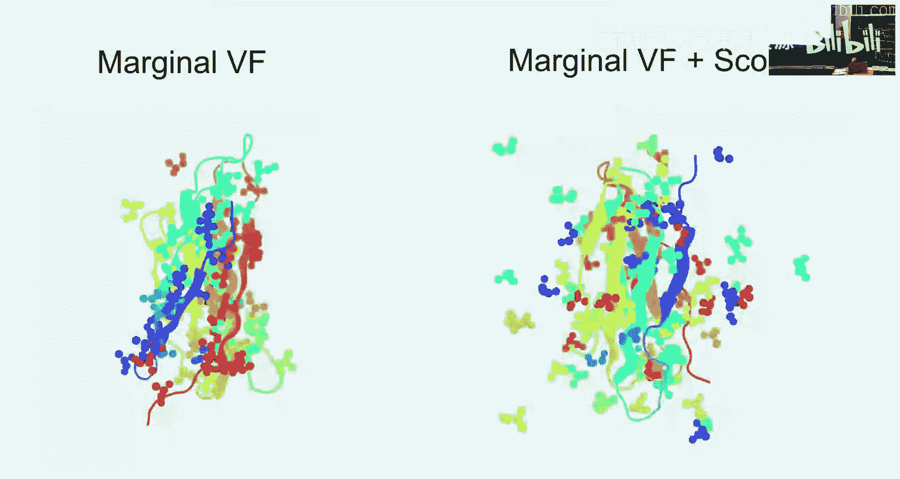

Let's see。 now。 Okay， so yeah I look twice， so。And here's maybe another example。

 That's our guest speaker is， has made these visualizations that we're gonna see next week。

 So if you follow this， you see that there are some sort of you start with cautionher noise。

 you follow this S D E。

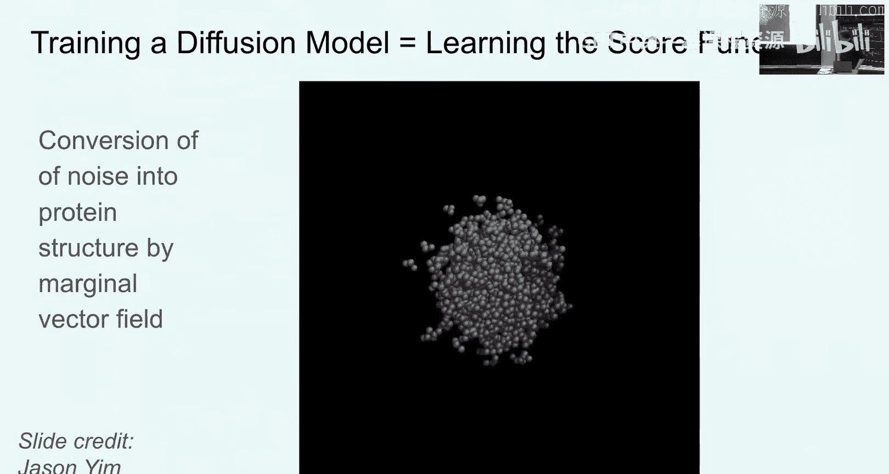

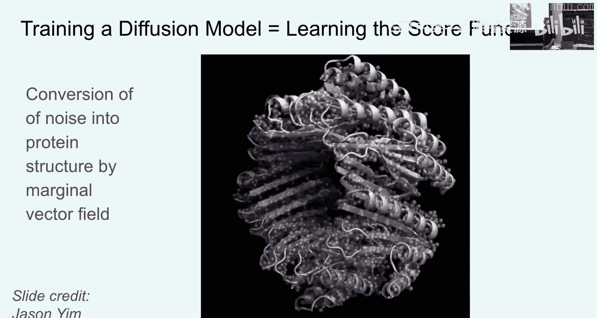

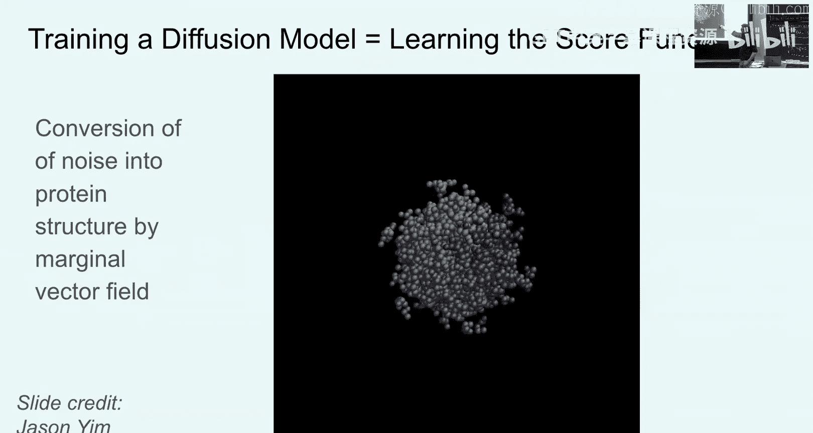

You end up with a protein。 So this is not a sterile function。

 Like I just like this is just to show that like these formulas are really important。 But as I said。

 this is most of the theoretical work we had to do。 Like next class， we will have a very。

 very simple training algorithm。 And some of you might say。

 why haven't you shown this from the start。 And my answer to you is。

 I wanted to show you how we arrive at these things。 Like， that's what what the goal of this is， but。

😊。

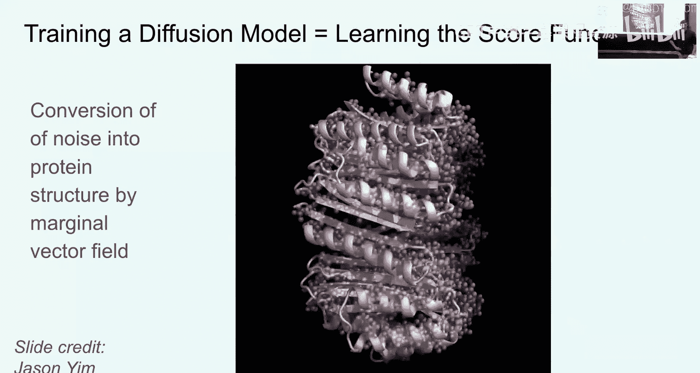

There are six objects that you need。 It's just like two minutes。 and then we're， then we're done。

It's like， as I said， this was a technically most challenging class。

 The next lectures will be significantly easier。 Make sure you understand these six objects。

 conditional path， marginal path， conditional vector field， marginal vector field。

 conditiondal score， marginal score。 The formulas for these is what we need。 So we need。😊。

These formulas， conditional path， which interpolates between initial distribution and data point。

 The standard example that we always use is Disc example。Conditional vector field。

Which is already useful follows is a conditional path。

 whose standard formula we always gonna use is this。Conraditional score function is this object。

Whose format we always going to use is this。The marginal path interpolates between the initial distribution of P data data distribution has this formula。

 The marginal vector field follows the marginal path has this formula。 the marginal score function。

 We can use this to convert an O D E to an S， D E。And it has to this formula。 Okay。

 so these two slides are really at the core。 I've showed you away today。 I arrived at this。

 and our goal will be to train like the train on network to approximate this。

 And you will be surprised of how simple this is next class。 But how to get there。

 We've made most of the work today。 So I hope to see you tomorrow。😊。

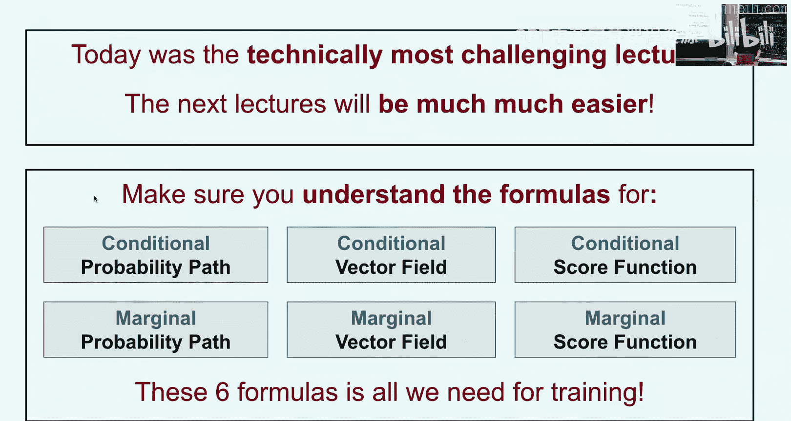

And that's it for today。 Oh， yeah， office， office hours， right。没。3 PM，3 PM。You have questions come。

