# 《流匹配与扩散模型｜6.S184 Flow Matching and Diffusion Models》中英字幕（Claude-3.7-s） - P3：Lecture 03 - Training Flow and Diffusion Models - GPT中英字幕课程资源 - BV1gc8Ez8EFL

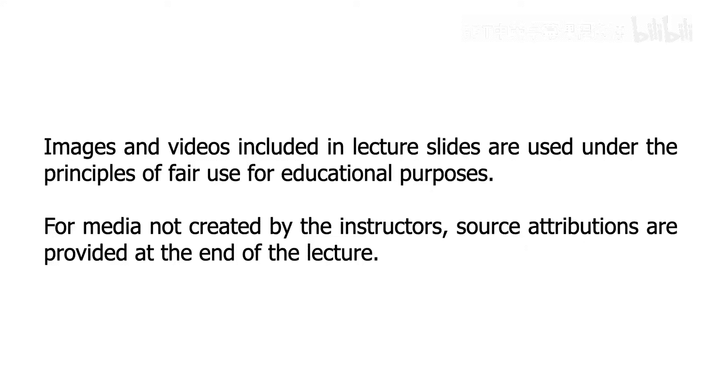

Great， so welcome to lecture free。 today， iss going to be our favorite lecture because we're gonna talk about how to train flow and diffusion models。

😊。

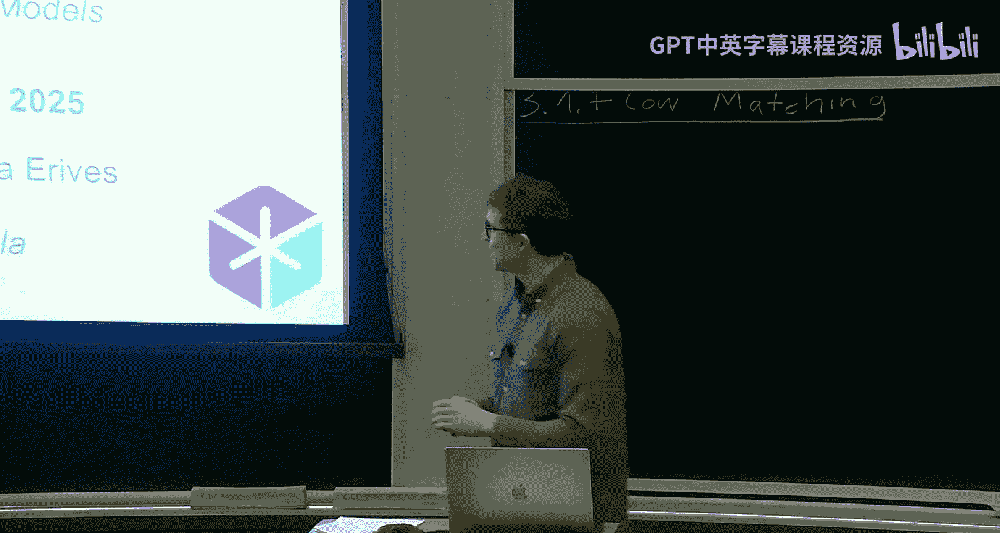

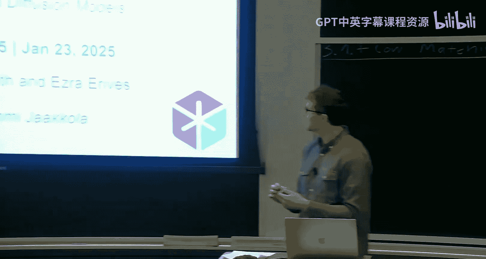

So just as a quick reminder， what did we talk about in the first lecture。

 we talked about what is a flow and a diffusion model。

 So we learned that a flow model is randomly initialized with initial distribution P in it。

 That's usually a Gaussian and then you simulate some sort of O DE with a neural network that represents the vector field of that ODE。

In a diffusion model， we do the same thing。 We initialize in this P in it as well。

 then we simulate an SD DE， which also has an O D E component given by the vector field。

 but we add noise that scaled by a diffusion coefficient WT at Sigma T and Brown in motion WT And to get samples。

 So when we generate object， What does that mean we simulate this O D E or S D E from time 0 to time 1。

 and we always interested in the final time point。 So the object that we want to generate will always be the final time point of that trajectory。

😊，Last time we presented represent three objects that we were interested in。

 And we each of these objects had both a conditional and a marginal object。

 So the first thing was the probability path， the conditional probability path was the one that interpolated between a gausstion or an initial distribution and a data point set and the generic example we interested in this discussion path with a mean scale by alpha T and a variance scale by better T。

😊，We have a conditional vector field whoses defining property is that its O D E follows the conditional path。

And the example that we had in the case of the Gaussian probability path was this weighted average between set and x of some coefficients that we we know。

 We have the conditional score function， which was the gradient of the lock likelihood of the score。

 which in the Gaussian case just turns out to be the simple average again。

 So similar to this formula formula。 This is an average between or weighted average between set and x。

Then we transferred all these objects into marginal objects。

 which means we made the data point set random。 So we induced that with our data distribution。

Modern probability path P then interpolates between P in it and P data。

 So something that starts at the initial distribution ends at the data distribution。

That's the formula， given by this integral。We get the marginal vector field。

 which now whose O D E follows now the marginal path。

And we had this formula here where we had the conditional vector field on the left hand side。

 And this was this ratio that appearss also here， which is always this kind of idea of abasian idea of predicting Z given X。

We have the marginal score who's defining property is that we can use it to convert the O D E to an S T E or at least a training target。

And the formula is similar to here that we have this integral over the conditional score。Alright。

 so that was preparation yesterday。 And we will see today that we be translating the marginal vector field and the marginal score function to two algorithms that are called flow matching and score matching。

 And that's gonna be the training algorithms that gonna learn these two objects。 And with that。

 we're done。 And we know how to train a general model。😊，So we start again with flow models。

Leading to a method called flow matching。And just as a quick reminder。

 the conditional vector field is this integral。 Sorry。

 the marginal vector field is the integral over a conditional vector field。

Multiplied with some ratio。 And we had the what's called the marginalization trick。

 But we said that starting off。At the initial distribution。

 we simulate the O D E with the vector field。 We follow the probability path。And that's。

 in particularly irrelevant because this path was constructed to end at the data distribution。

 So the final time point following this O D E will be。

Da distribution will be objects that we want to generate。All right。

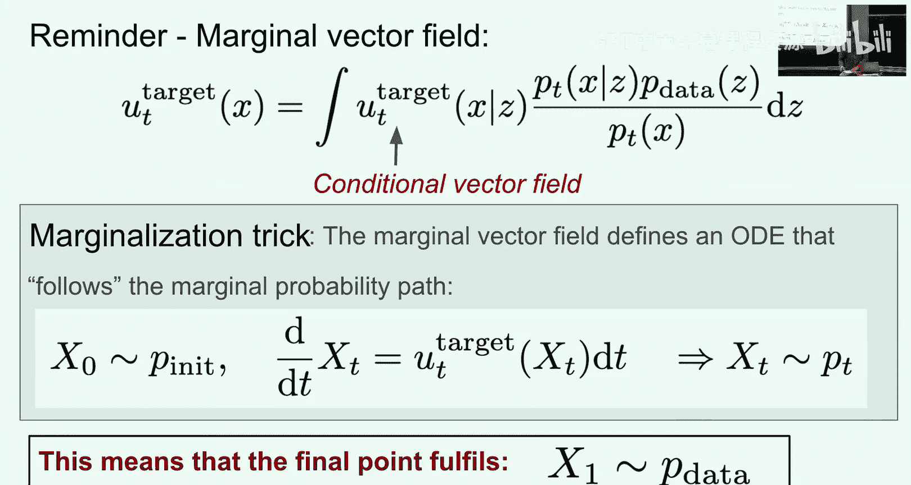

So let's dive in and let's talk about flow matching。So we have。And neural network， U T feed。

And Fida represent the parameters of that network。

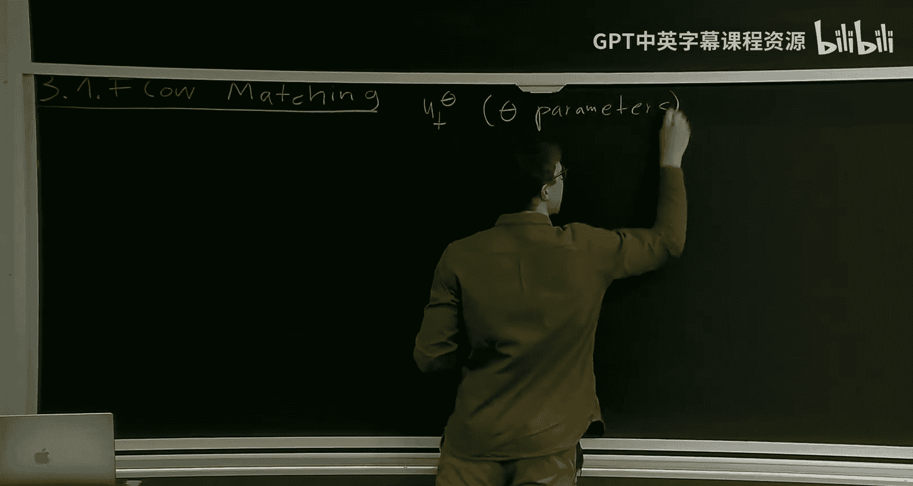

And。What is our goal。

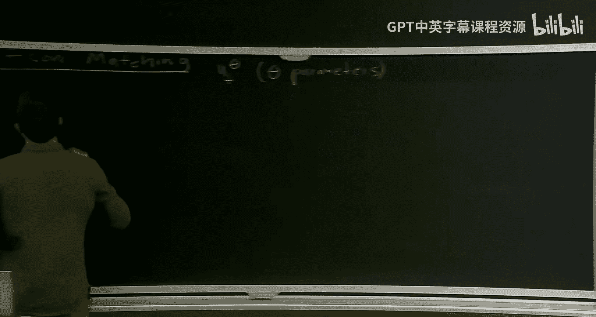

So what I just stated is that the marginal vector field does what we want to achieve。

 It converts noise。Into data。And that's what we want to do， right。

 We want to do basically want imitate。This vector field。

 So the goal will be of training is their duty feeder。

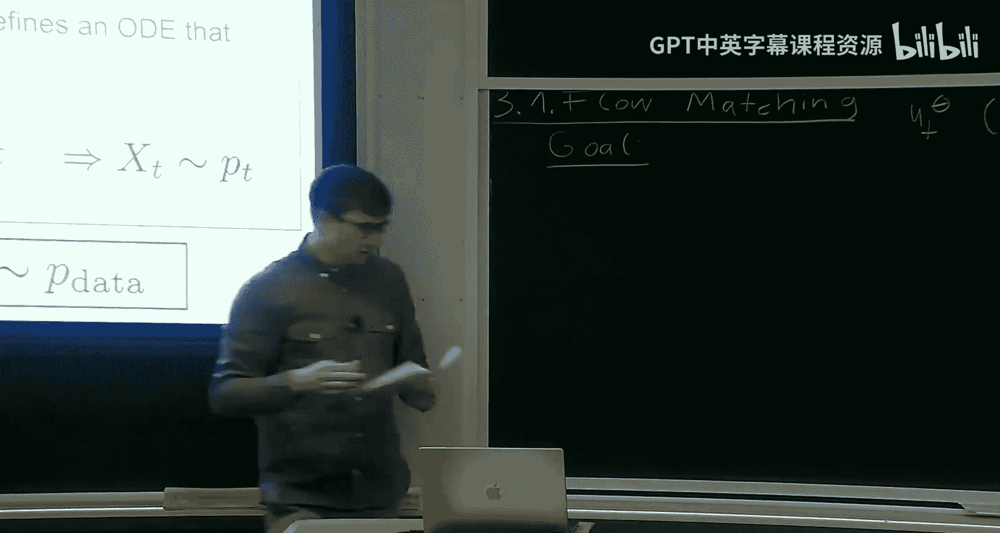

Our neural network。Approximately equals。The target。Which is the marginal vector field。 Okay。

 so the goal of flow matching training is to learn the marginal vector field。

 because we've done that successfully， we will essentially do this when we replace this with the neural network。

😊，So， and there is now a natural loss that we can define what is property。To hold。

And that's what's called。The flow matching loss。So how does it look like？Very intuitively。

We take a mean squarearrow between these two objects。So。We're taking。

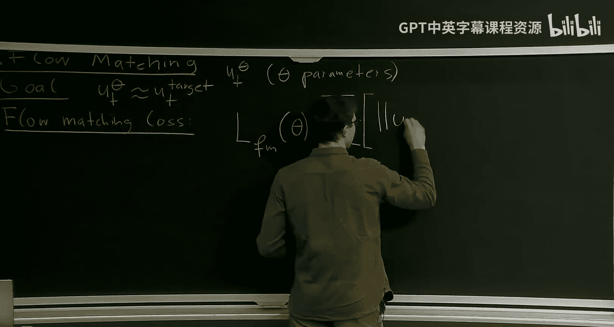

U T Theta at a point x。And we're evaluating or regressing it against。The target。

Which is the marginal activeive field。And I'm writing here an expected value because during training。

 we need to sample from x， and we need to sample some T， right， We cannot do all of them together。

 We need to choose somehow how to choose the time point T and x。 where we evaluate this loss。

And the first thing we do is we just say， we choose T uniformly。In the interval。Between 0 and 1。

So we just say every time point accounts in the same amount to our loss。So， that's。

So we're saying we're choosing T just uniformly in the interval between 0 and 1。

 which is our simulation time， right。next thing you do is we say， we start off。With a data point。

 we sample from the data distribution。What does that practically mean to sample from the data distribution doing training。

 It means we have a data set that's very big。 We just randomly draw a point。 So when Py chart。

 you would have a data loader， you loop over that data loader。 That's what I'm writing here。

 formally mathematically as sampling from this distribution。And the next step is， how do I choose x。

 I'm just choosing x according to the distribution that we constructed at time T。

 which was a conditional probability path。So。I wrote here a mean square between our new network and what we want to approximate。

And now Ive wrote here how to choose T and X and as an intermediate step。

 I'm also drawing a sample instead set。 Okay， so this is not appearing this formula。

 but this is just a way of drawing a point X。 basically for some time， between0 and 1。

 I choose first a data point。 And then I'm evaluating it at this intermediate distribution。

 And then I'm just taking this mean square arrow。So。What's the minimizer of this loss。

The main as is loss is this。Like， this loss is gonna be always。

 like a mean square is always not negative。And it's 0， if and only if this equals this。So。

The minimizer of this object。Is what we want。Great。😊，The question is， now， is distracttractable。

The answer is， no。And that's a bit sad， but it's actually not a problem。 as we'll see in a second。

But。Why is it notable？😡，We cannot evaluate this point。Not trivially。 The problem is。

 this integral here。We have a formula for it。 And that's， in fact， all we need。

 But the problem is to evaluate this integral。It's a very high dimension integral。 What we could do。

 Nobody does。 But let's just think this is a thought experiment。 We could loop over our data set。

 And for every data point， evaluating this ratio and then take an average over that， but。

Let's say our data set has 30 million images。For every evaluation of the neural network。

 we will need to do this。Not a good idea。 So basically。This loss is intractable。 We cannot。

 We cannot compute it。But now we do the same thing as we did。In the last lecture。

 we're taking a conditional loss。And that's gonna be the one we actually can compute。So。

Same as before。 We have now a conditional。罗买清老师。Allright， so。This， so。Same as before， we have a loss。

In Fida， in the parameters of the neural network。And we have an expected value。

 And I'm gonna to now write just T set X in the meaning I'm sampling them in the same way as here。

 Okay， so I'm gonna to drop some notation。Well， I can also just write it out， but。

It's going to be a bit small。呃。It's going be the same as。force， we're choosing time points and。

Z and X in the same way as before。But now I'm doing something。

 I'm replacing this object with something I know。 What do I know。Andode a conditional vector field。

Conditional vector field。We had a formula for。 just this。

 I just have an analytical formula for this object。 I can plug it in。

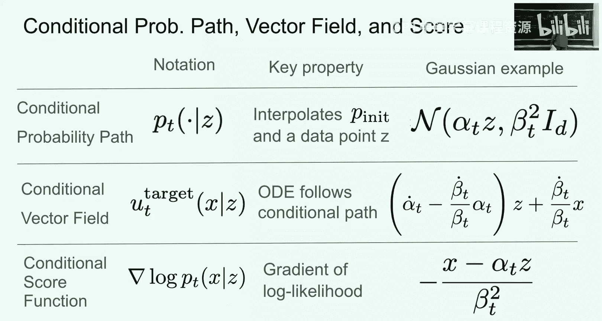

All right。I from。This loss to this loss So from the floor matching loss conditional loss。

 the only difference is I plugging in the conditional vector field， okay。

So now I made distracttractable。 So great。But。What's the minimizer。Well， it's not yeah。 the。

 I would be very surprised if you would see it in in the second because it's not entirely clear。

 So the question is like， does it even make sense。To minimize this object。Because。

The condition of vector field is not really useful。 We don't want to generate single data points。

We want to generate a whole distribution of data points。 this is what this thing is doing。But now。

 that's the main theorem of today。We're going to learn that this thing is all we need to minimize this。

That's really， at the core of。Diffusion models for flow matching and the training is that we can minimize such a loss as a surrogate of that loss。

 and want to explain that in a sec。The subscript under L here。

A C F M standing for conditional flow matching。All right。Okay， so。Fory of today。Is。

The floor matching loss。Equals。The conditional flowashing loss。Plus。A value C。But。

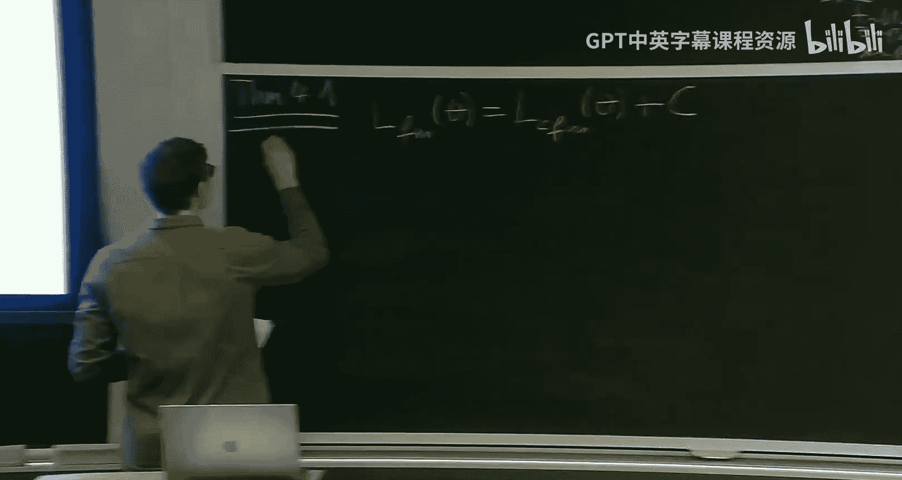

This value C is a constant。Bin。Or is independent of。低六。Alright， so what I tell you。

 I told you that they're basically up to some constant the same。 Let's try to visualize this。

So let's say we only have one parameter me。So usually we have a lot of parameters。

 but let's say we only have one， which is the X x's。And I told you that。Yi。

For matching loss looks love something like this。It has has some minimum whose。Mimizer is the。

Module vector field。And then what the sporem says is。That there are some constant C。

Which Presigi describes the gap to the conditional format matchinging loss。

And that gap is though independent of theta。 So it's going be the same。

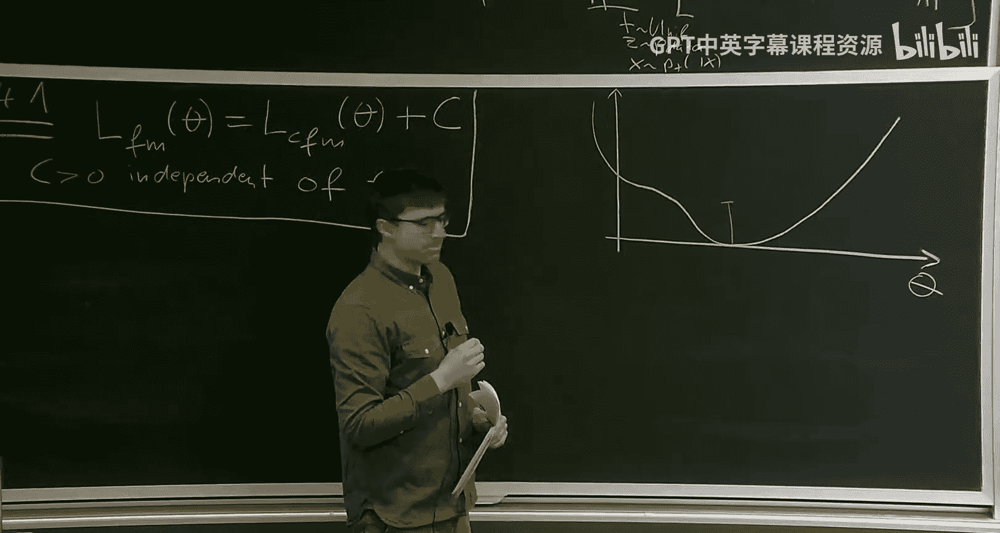

At every point。So， that's。That's the floor matching loss。And now I'm adding this gap up。

Let me try to do this right my drawing skills are not the best。哦。Alright。

 so we basically translated this object a bit up。To achieve the conditional format matching loss。So。

 now。What's the， if this is the minimizer。Of this function。I'm going to call this feetta star。

What's the minimizer of this function。 It's the same， right？ The value is going to be different。

But who cares about the value。Well， some might。 but we don't really care。

 because what do we care about， We're finding the right parameters。

 want they have to write neural network。 It's all we care about。 The value is meaningless。

 It's about to minimize it。 that matters。 So basically。

We have two core properties that fall out of this。 So first of all。

What does it mean for the minimize of the conditional flow matching loss。

 which is something we can compute。It means that the minimizer is。Themod vectorive field。

What does that imply？So at perfect training， let's say we， we're tearing perfectly， right。

 It's not only approximately， but like we've trained it perfectly。 that holds， right。After training。

 it will achieve its minimum。 I mean it's a marginal vector field。

 What does the marginal vector field do。It converts noise into data。So in particular。

 if we simulate our flow model。We will have generated data。So we have convert noise into data。

 which is。说三狗。So。Not only that holds。Much more at the training algorithm of the neural network。

 How do we train neural networks。We use stochastic。Graadient descent。

 So the gradient of these two objects are the same because were taking the gradient derivative respect to feedta that this constant is gonna cancel out。

So， yes， so the gradients are the same， which means that。嗯。Yeah， so stochastic gradient descent。

It's the same。Which I'm now writing is S GD。So your training algorithm will not differ。

The training trajectories will not differ if you minimize this or the other laws。Good， alright。

 So with that， we arrived at the algorithm。 and I' gonna show this to you first in the general setting。

 Then I'll make this specific with the Gaussian example。 and then I'm gonna。😊。

Sketch proof of this statement。 That's the plan for now。 Okay， so let's look。

 how do we train a floor matching model。We have a data set of samples given。

 We have neural network U T feed， which represents our vector field。Then we loop over our data。

 basically means we are at every step sampling a data example set from the data set。

 So if you were in Pyr， you would loop over the Pyr data loader。You sample random time T from0 to 1。

You sample X from your condition probability path。 So what I'm describing here in the first step。

Is wait。Sorry。Is this step。 So I'm sampling a random time T。 I'm sampling a random data point set。

 and then。An X for my conditional path。Then I evaluate this loss。At x against my conditional target。

Which is the conditional formating loss。 So I've just replaced this expected value with a sample from these objects。

 And so it's an estimate。 that's a Monte Carlo estimate of that。If this object。

And I'm updating the model parameters of gradient in thecent。 So I'm taking a step optimizer。

 And there you can choose your favorite optimizer that you usually use in training at some sort of。

You learning model。That's it。 And the power of this is that this is something we know analyticalally。

So at the end of the day， all you do you're minimizing a mean square error。

 And that's what really what's the power of the flow and diffussion models is that all you need to do is to minimize a simple mean square error。

 like， for example， you've heard of。Gans， which were Stan for generative adversarial networks。

 There you have minm optimization procedure。 That's much more complicated than this。This is just。

 you a simple mean square root， which you just have to minimize， which is pretty simple。

 We'll see it in the second house of lettersuce。The the model U T feedta takes as input the time。

So we， we， the， the model is a neural network in time and in location X。

 So it will have two inputs in time and X。 We will， well see that in the labs。 you will code up。

 You'll see that you have to do two inputs。问题。と。Yes， great question。

 So just repeating the question real quick。 So what about other sampling strategies than uniform。

 short answers。 Yeah， for sure， you could do other stuff。 It's more an empirical question。

 A priority。 It's not quite clear。 like what time points do matter more or less。 but you could weigh。

😊，Arbitrarily and sample them arbitrarily often。 So you might want to say something like， oh。

 later time points are more important to assemble them more often。 it。

 it happens to be that at least what I see is that most popized just uniform。我给留的。一婚我都在。Yes。Yes。

 so we picked this。 we， so if you remember last class， we picked the conditional probability path。

 and then we picked the conditional vector field that does that， the job we want。

 So this is a design choice。 We can pick it。 We just have to one that fulfill certain requirements。

 But at the end of the day， there's many other options in this。

 We will actually see there are gonna to be a set of new of options。 But。😊，It。

 it happens to be okay if you to just choose one。Because it does the job that we owned。Good， cool。

 Okay， so I wantan to make this even more specific now by plugging in the equations that we've seen。

😊，And then you'll see that this is actually。呃Very simple。So。I'm going。

Derrive the conditional floor matching loss for de caution。Conditional path。Okay， so。All right。

 so how。We things looking in this example。We saw that。you chalk。

However I think looking in this example， we had the conditional probability path was just。

A caution with a specific mean。And variances。And if you remember。Alpha T and beta T were designed。

Such that。Alpha T increases from 0。To one。And better T decreases。From1 to 0。So what we're doing。

 we're increasing this mean from0 to z。And decreasing the variance from 1 to 0。So， now。The formula。

That we had for this object。我s。A bit clanies or gonna take me a bit time to write this down。

What's this。没。So that's the formula that I had in the in the second slide。Just as a reminder。

So I just wrote down this formula for the condition of active field here again。

So keep in mind that we， we know alpha T and better T。 We just chose them， so。

It this looks more complicated。 is because we can just plug， plug in equations。And。

We now use a trick that we can， of course， sample from this conditional gaustion。

But what we can do is we can also sample noise and then add that up。 So what we。

 what we can do is that if。The noise is distributed to a uniform version。

So that's now with zero mean variance。We can do。Alpha t times set。Laperti。Times epsilon。

And just call that X。So， I'm just。Defining this to be x。And what's the distribution of this object。

 It has mean alpha T set， which is this， and it has， it scales sustain deviation。

 which means the variance scales quadratically， which means it has variance better T。 So this object。

Its going to be distributed according to our conditional probability path。

And all I'm doing now is I'm going plug in that equation， and I'm going replace x by this formula。

Let's see how this looks like。This is gonna be too big。Alright， so。So what I'm doing now。 So so far。

 it's a conditional formating loss。 I've done nothing here except of plugging in the conditional probability path。

嗯。Which is given by this object。 So I'm sampling now from this。Some sampling from discussion。

 instead。And now I'm plugging in this equation。So what I've done here is I've plugged into this。

Object， this object or this formula。 The microphone still works， right。嗯。So， I plugged that in。

And now what I'm going to do， I'm going to replace X。With this。Formula， okay。

 so instead of sampling X from this object， I'm sampling just noise and then adding it up。

 So I'm replacing X。By alpha T。Better T plus。Better teach。Goodness。That's not it。Alpha T， I set。Plus。

 better T。Times epsilon。Let's plug that in。Right now we just do some algebra。

 So what I'm going to do now， I'm replacing x by this sum。OK嗯。Let's look at this formula。And just。

 appreciate for a second。How simple is。嗯。I forgot to say one thing。 What's alpha dot。

I said it last time， but I might be unusual rotation。It's a time derivative of alpha T。

And what's better thought。It's the time derivative of better tea。

Just as a reminder of what these things are。So。What loss do we have here， What did we end up with。

 We sample a time uniformly。We sample a data point from the data set。We sample noise。

Standard noise now， that has nothing to do。 Like， this is gonna be the same for all instances。

We are plugging in some weighted average offset set， data point and noise。Into our neural network。

 And we are predicting the derivative。 So we are placing now in this average， the time derivative。

It's with its time derivative derivative。 So alphapha T dot H T dot。Predicting that。

SoThat's pretty simple because we know alpha T better T， right。Like， we have done like。

That we sampled， we sample the data point。 We sample noise。Pluging in some average into network。

 and predicting some other。Average。And to make this even more concrete。Let's choose a specific。

Instense。off。Alpha T and beta T。And what's the simplest instance。Alpha T is T。Better tea。

Is 1 minus T。Right I'm setting they only have to go from 0 to1 and1 to 0。 if fulfill this。

So what's alpha dot？What's Al T dot。one。What's better， is that。-1。Okay， so I'm going to plug that in。

Now， here。So what's gonna be the conditional floor matching loss in this case。

So I'm all I'm doing is I'm plugging alpha the choice of alpha T and better T now in here。

 which means it's T times set plus 1 minus T。Times epsilon。Minus。One time set。-1。

 like plus-1 times epsilon， which is just set minus epsilon。Alright， this has a specific name。

 this choice， which what's called a con O T path， just as an aside that's related to the idea that conditionally on a specific data point。

 this is related to the optimal transport path because this basically corresponds to a straight line between noise and data。

So we're just taking a straight line here。Which is this object。And what we're predicting。

Its we predicting a difference。So let's just pause a second。 I feel like this is extremely simple。

 right？ I mean， like this is， I cannot imagine a much more simpler training algorithm this。

 this with sampling a uniform time point。Just choose some。

We're sampling a data point from our data set。 Just draw one。Was Sam think some noise？

We're taking some point on the line。Between Epsilon and set between noise and data。

And what we're predicting。It's the difference between those。So， let's make this。

Put this in an algorithm。Well， let's first visualize this。So we have an P in it。

Which we chose to be just noise。We have our data distribution now visualized by this these control lines in 2D。

We sample the data point epsilon。We sorry， we sample a。 We got a noise Epsilon。

 We sample a data point set。We take some point。And the straight line between these two。

 depending on the time。And we are predicting the difference。Alright。

 let's go through this again because it's really important。 Like， I'm not now plugging just in。

 just equations in。 but I feel like it's just good to appreciate how simple it is this。😊，So。

We're looping over the data set。 We sampling a data example set。 We sample random time T。

 we sample noise。We're taking a point in the straight line between set and epsilon。

 which is we're taking。Like on this， on this， this is the line between set and epson。

Taking some point on this line。We're plugging that into the neural network。

 and then the neural network has to essentially predict or learn to predict a difference between two points。

Between data and noise。And then we're just updating this as we would do any other machine learning algorithm。

I'm just going to pause for a second。 Any questions。Like。Because you have to implement this， so。

Make sure you understand it。Question。And the physical intuition is that。0。Yes。Yes。

 but you have access to more information at time 0。

You have access basically only to the information of noise at time1 you have access to the full data point。

 So over time， you will have。Like， you will need to predict the same thing But the excess of information you have is different。

 That differs across time。But there is the physical intuition is that this is like this path here is a path somehow to go from noise to data。

And we took the straight line， but you could have done something different。

And if this is your path described by this function， that's the velocity of that point。

So what you're essentially doing is you're predicting velocities。Given。

Noise and a data point and a path somewhere on this path need need to predict the velocity that you are currently at。

But in the trades of straight lines， the velocity is just a difference。 It's just this vector。

So it's gonna be even simpler。Cool， okay， so。No questions。Question。Yeah。

They are initial diffusion models We're doing on straight lines。 So like。

 it's what something called a variance preserving path or variance exploding path。 And in some sense。

So there's an intuitive answer that straight lines might be better because that induces less error when you simulate an O D E。

 But really， it's a more empirical question of like。

 you choose different things and then select the best one。现在我还我拿。对。Thank you。Cool， okay， great。

 so just a recap。 We had a flow matching loss。 Our goal was to train the marginal of vector field。

 Can't do that。 Don't know， don't know what the value is。 We found a tractable alternative。😊。

And for now， I just claim to you that they are the same up to a constant。

Which means that minimizing the conditional floor matching loss will also minimize the floor matching loss。

 We then instantd that for a specific case of a probability path。

 which was the Gaussian probability path， which in this case LED to the simple formula of some average and predicting velocity that I just mentioned。

And in the specific case of this linear interpolation， let's to this thing。

 which is commonly called condo Tpath。And。Just to give you an example that this is not。三。You know。

 exotic algorithm or too simple。 I didn't break anything down here to make it simpler。

 This is the algorithm that met us movie Gen， for example， is using。

Like these videos were generated with a neural network that was trained in the algorithm I showed in the previous slide。

And in the same way， stable diffusion free uses the same algorithm。So， like， it's。

I would say there's a lot of complexity behind it。 We've seen this yesterday， but it's。

 it's somehow hidden in a rather simple algorithm。 I think that's really the beauty of this。

All right。Question。Oh， I see。So you first make the choice of a set of the data point set that you sample randomly。

 And then once youve sampled it， then you make everything conditional。

 So the whole name of the game is like we， we just always sample the data point and then act as if this would be our distribution。

 just regress only against this data point only against the conditional vector here for this data point。

 But by looping over many， many， many， many， many different data points on average。

We're gonna get a whole distribution。Oh， so， so noise came from the fact that we have a Gaussian distribution。

 So if we want to sample from a Gaussian distribution， it also。

 you can rephrase it as scaling this value set with alpha T。

 which is its mean and scaling it with the the standard deviation。

 So that's just the fact about Gaussian。Variables。Implicitly。

 we've chosen the P in it to be a Gaussian here。 So this example， is' always going to be a Gautian。

Okay， good。 I wanted to quickly sketch。The proof of fearing41， just because it's important。

But it's not going to be。Relevant。Like， you don't have to notice。 essentially， what we're doing here。

 we're using。This formula， twice。So if you have two vectors， A and B。And they lie in R D。

And you take the square， the mean square arrow。 Sorry， just square arrow。You get this formula， right。

 That's basically the quadratic formula， but for the products。And。What do we do now？And I'm going to。

Give you appropriateated notation here， just because。We don't have tons of time。So。This。

We apply this statement here to this。Alright， so I've applied this general formula onto this expected value。

 I'm now doing the same thing for the conditional。王matqing lost。

Or it takes a bit time to write this down。あ。Y。Okay， so I've applied the same formula twice。

 So these two objects are basically the same right up to this conditional vector field。

 So Ive gonna applied this twice， this top formula here and here。Okay。

 so the only difference you see here is that here we have the conditional vector the conditional vector field。

 and here have the marginal vector field。And now what I'm going do is I'm gonna cut out constants in feedta because I want to set show equality up to constants。

 right， so。The first thing the observation is， that's a constant in feedda。

 That's a constant in feedta。 So let's get rid of that。Next thing， this and this is equal， right。

Because that just depends on neural network。 that appears in both losses。All good。

 So we can cut that out because they're gonna be equal。

 So now the name of the game is just gonna to show that this term in this term。

 I'm gonna be equal in expectation。So the the proof proceeds。

 you have it in detail in the lecture notes by showing that this middle term here is the same。

 And why does that hold。It holds because this object， this dot product is linear in set。

And you can swap out expectation values。 I can after class if you want， I can show it in more detail。

 I just don't have time here。 but in lecture notes， it this is described in detail。 But basically。

 you have to show that this middle term on this blackboard is the same。

 which is the fact because which holds because dot products are linear。Good， cool。 Alright， let's。

Proceed to。Okay， I made the statement here。E you use Jensen's inequality。It's。

 it's less important that this is bigger than 0。 It's just important that it's a constant。

 It's important in the sense that if you train。A model like this。 The loss you're minimizing。

Will have a a constant that is bigger than 0。 So the loss will never reach。0。So this loss can be 0。

This loss。嗯。Cannot be 0 because this is bigger than 0。waait。So I swap the constant on each one side。

 It's the other way around。 So it's negative。 but it doesn like。

 for our purpose doesn't really matter。 Like， it matters。 it's a constant。 But basically。

 because this is negative， this is gonna be always positive because this is0 at the minimizer。

 So you show that there's always a positive gap opportunity。😊，What are you saying？嗯。

There might be cases when this happened。This is could be interesting， but on average， on general， no。

 like on general， we just do what we just discussed， no。Alright， maybe one last thing。

 How do we sample from a flow model， Like we've just trained it。 How do we do it。

 Like what what do we do to generate objects。Exactly， yeah， we already discussed that。

 We've done like， remember lecture 1。 How do we sample from a flow model， As you said。

 we we simulate the O D E。 We already have an algorithm for that。 So great。😊，We can move on， so。

Just to pause a second， we now have full pipeline of this general modeling for flow models。

 And now we're going to try to do it。Or stochastic differential equations。

 So with the fusion models and extend it a bit。 And I'm gonna make that a bit quicker because the principles are essentially the same。

All right。The U method。 So question is whether people use U method。 initially， they were。

 but nowadays， you wanna。 So what do you want to minimize。

 you want to minimize the number of L evaluations of your neural network。 And that means as many。

As many times you have many steps you have in the simulation。And you want to minimize that。

 And but people usually use this like higher auto OD E solves。 So like instead of using the U method。

 at least when you care about efficiency， you would use something， something like Us method。

 It in lecture notes as an example。Or you even like distill the model more。 But yeah。

 you would usually use some sort of higher autoover， but。It's huge。 It's not very different。

AndThere's different ways。 There's different ways。 There's adaptive solves and non adaptive solves。

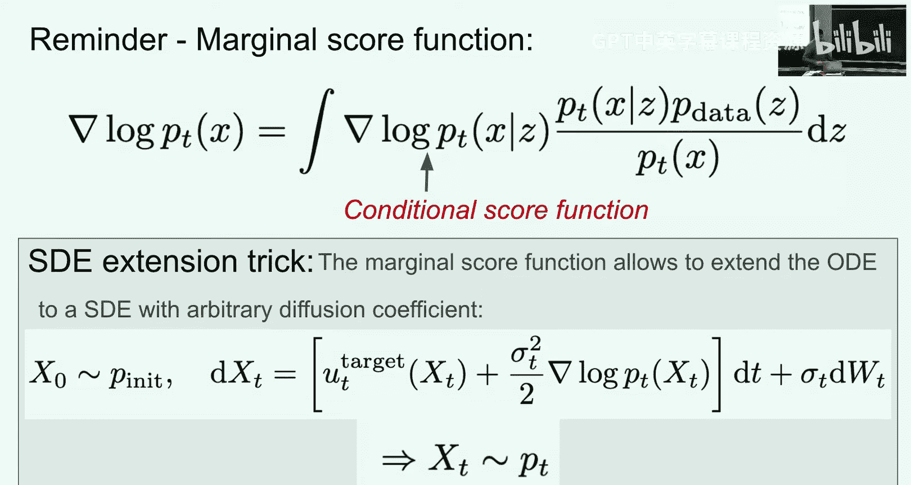

Like these throw match。Yes， so the question is， to what extent are flow models deterministic and they are deterministic once you sample the initial point。

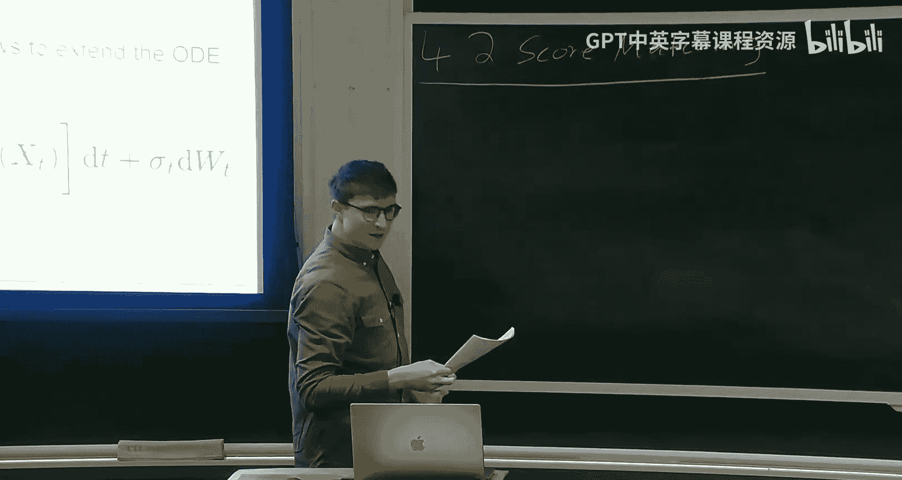

So once you sample the initial point， you always get the same point。

 So there's a one to one mapping between the input or start point and the output。

 which is given by the flow。 Like's this flow map that we discussed。All right， cool。Right。

 let's recap what we had for diffusion models。We had a marginal score that we needed to learn。

And it was basically had the same formula in the im mod vector field just replaced with the conditional score function。

 So this formula looks exactly the same。And we had this S T extension trick with this monstrous formula here。

 which basically said。I'm starting with initial condition in the same way。 I'm following an S D E。

 but now I'm injecting some noise， and I need to add some correction term to account for the fact that I'm adding noise。

And I'm following the same probability path。 So I do the same thing。 And in particular。

 my endpoint will be， will have the data distribution。So what do we do， What do we， What is the。

If we want to simulate an S E E like this， I've just showed you an algorithm to train this object。

Let's learn this object。 So what do we do， We have a score network。

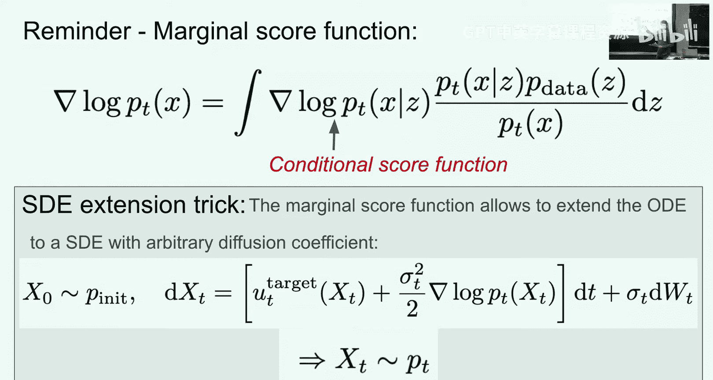

ST leader。We feed out the parameters， again。And as before， our goal is。That S T feedta。Approximates。

The marginal score。And。How would you do this now。Given what you just saw， let's think for a second。

 S T like the marginal score has the exact same formula for the marginal vector field。

The same tradeoffs hold。 We have of of a marginal loss。And a conditional loss。

Now I'm gonna do the same exercise again。 I'm gonna define a margin loss， conditional loss。

 I'm gonna to show you that they are the same up to a constant。Let's make the specific。

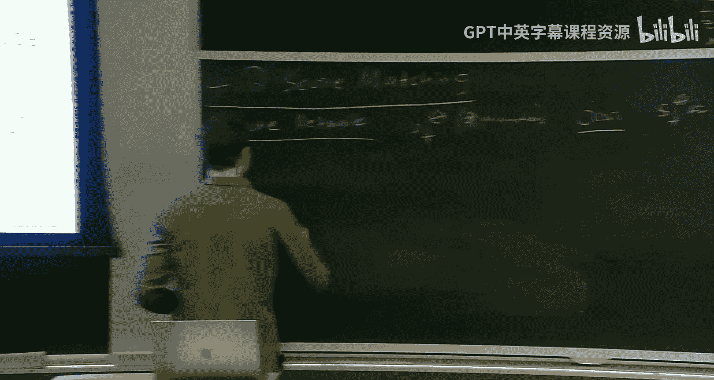

So。Square matching loss。We sample T set X in the same way as before。

 So I'm not going to write this down because it's a bit long to write down。

We evaluate the neural network。We regress against the marginal score。

So same way with have a mean square root。And then now what call is。

 like to call this conditional score matching loss。But unfortunately， people don't call it that way。

 They call it dennoing score matching loss。 So just keep in mind that it's an equivalent thing。

 but a slightly different name。And I'm going to write down now the exact same thing。But replacing。

 whatever do I replace this with， replacing it with the corresponding conditional object。

 which is the conditional score。Why is that tractable。Because we know。

The conditional score analytically， so。A priority， the minimizer of this object is good。

It's the marginal score。Is it tractable？No， it's not because computing this integral。It's very hard。

What's the minimize of this object？In the same way as before， at least a priorityi， we wouldn't know。

But it's tractable。And now。

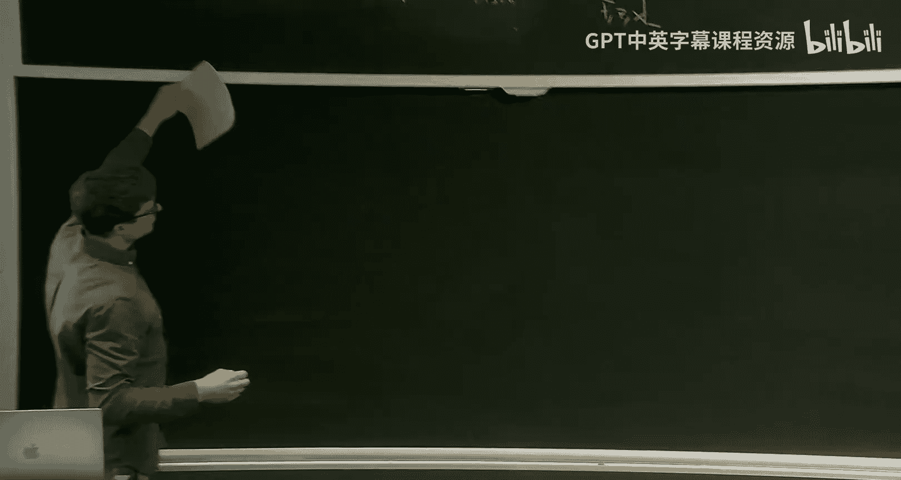

Same exercise。Which is the next viorem。For two。

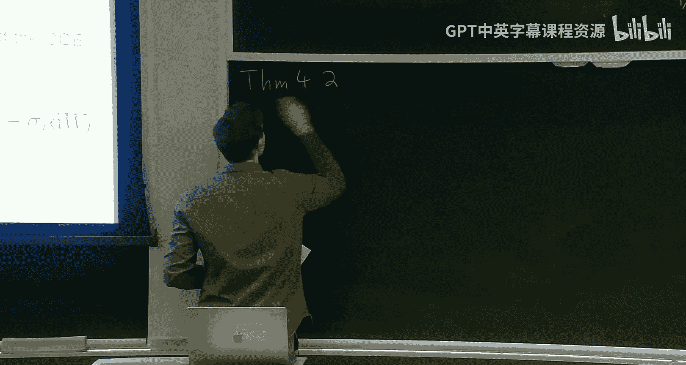

Score matching loss。Equals unionizing skull matching loss。Up to a constant。And now。

This constant is truly negative。So same thing as before。And now the same exercise holes。

 So like just to reiterate。First， property。对。Minimizer。off。The denizing score matching loss。Fulfiled。

That。The corresponding Sc network。Is equal to the marginal score。

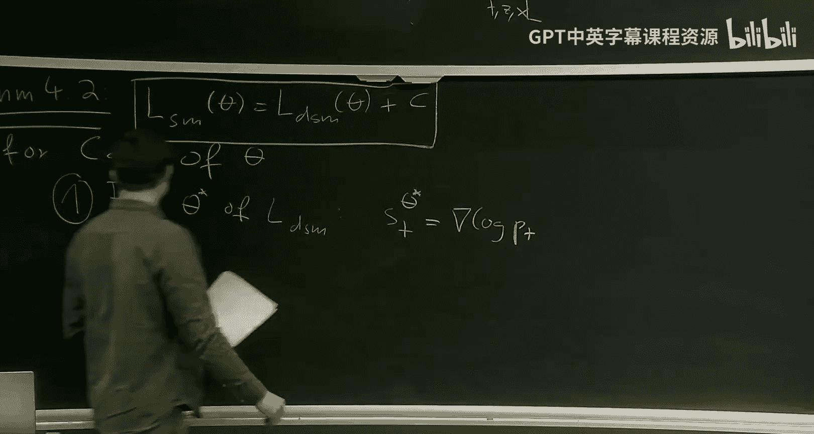

And the same thing holds set again， that the。Radance。2。The same。But the this is the core thing。

 Like once we've trained into perfection， we've learned the marginal score。How do I prove this。

It's a trick question。I'm not gonna give you the proof， but how would you do it。北们。Exactly， like。

 it's exactly the same thing。 like this function， this formulaized the same as before。

 We define everything the same， just。Replace the marginal and conditional vector field with the marginal and conditional score。

 So you only have to read one of the two proofs。And then。We're done。Of course， it's good to。

 to do it， but there's no real need because we've just replaced same objects into into one another。

Good。😡，Alright， so let's take a look on how that looks like。How do you learn scores？

 So we do score matching。We have a score network， S T feedta， same exercise as before。

 We loop over the a mini batch of data， sample a data point。

 sample a random time T sample from the conditional probability path。Computing this loss。

Which is just the mean square， the squarearrow between S T Feta and the conditional score。

 And we update the model parameters。And then we loop over this on and on again。

 And the same principle holds again。We don't score only conditionally per data point。

 and we only ever regress this object against this conditional score。But the effect of traininging。

Iteratively over many， many data points。 is's gonna be you're gonna learn the corresponding marginal object。

When I saw first started it， I found it a bit magical。 actually， the same way as for the。

 for the flow matching loss。😊，Like。This object。Never appears anywhere。Like this is a formula。

 We never have access to it， but implicitly regressiongressing against this object。

 we learned this marginal object。I think it's very magical that you you learn something you've never seen。

😊，But over the course of you know， training for a long time， you will have approximated it。Good。

Some I always feel that the microphone is off， but it's on， right。 Yeah， it's on。All right。

 same exercise as before。 Let's make it specific for gaus and probability paths。

 So let's take the conditional score。Which is given by this formula。 showing this last time。

 this was in in the first two slides。 And now I do the same trick as before。Cautution noise。

This sum is going to have this distribution。It means if I have a Gausian noise variable。

 I'm scaling it by some better T parameter。 Its variance' is gonna be T squared。

 Its me it's gonna be whatever I add up。Now， I'm going plug this again into the denoizing score matching loss。

 So I'm gonna regress this against the conditional object， which is on the top here。

And then I'm doing the same trick。That have。Don。Here。And I replace X。With the corresponding。

Object here。So x becomes this sum X plucked into this equation is going to be the noise divided by B better T。

So what I'm doing is I'm taking some some average between the data point and noise。

Putting that into the network and learn to predict noise， divided by some constant。Pretty simple。

 right。And the cool thing is。Well， maybe just as a， as an aside。

I told you that it's called denizing score matching。

Maybe you now understand why it's called dennoizing scroll matching because the method initially was actually found。

Only for。Proability paths。 And in this case， you just learned to predict the noise that was used to corrupt the data point。

That's why it's called denoing scroll matching。 And it's like this terminology is just。As stuck。

 but in this case， you really see why it's called that way。And。Let's see。 Okay。

 training algorithm this case， same way as before， just that we now here are predicting noise divided by better T。

That's what we're doing。It might be worth like， mentioning。That this is numerically unstable。Or。

Better tea， small。Like for small better tea。And be T is small for times close to one。

 You look at this graph。So for times close to one， it was early on realized in the when diffussion models were developed that this is numerically unstable。

 and there are some tricks to do it。Which is， there's details in the lecture notess。 But essentially。

 you're scaling this by better and then dropping a constant。 Like。

 I just wantna make you aware of the fact that this loss can be numerically unstable for close times。

 close to one。 But it's not something you have to worry about。 But you will see it in papers。 They。

Factor the score network into something what's called a noise predictor。

 So you basically drop that constant。Good。嗯。Data goes from。You're from one to。Yes。安徽。Yes。嗯好。Yes。

 great point。 Yes。 So this is gonna， this is gonna blow up， right。

 This is gonna go bigger and bigger。 And that's why dennoing S matching initially was fought or still the case。

 If you just want to learn the actual score， It's gonna be have extreme high variance for。

 for better T like for no noise levels。 So the amount of noise that we add is determined by better T。

 If we add very low amount of noise， then it's gonna blow up。 It's has very high variance。

 and it's gonna tricky to be learned。😊，Theres tricks around that。

 But that's why initially easying store matching was not thought to be。Like historically。

 not once diffusion was developed was not the case。

 but there was like skull matching was developed before diffusion models。

 And there just was thought to have hi variances。Yes。I，I'll get to that。

 I'll get to that in a second。 So the question is， can we avoid learning both of them And the answer is yes for a specific case or caution path。

It's a specific case where you don't have to do this。And， just go。Yes， well， we。

 so theres very many different frameworks。 So look at the fusion model。

 I'll discuss discuss that in a second。 I'll get back to it。Yes， so in principle。

 for the general case， this is I'm gonna talk about this next， you will have to learn both of them。

 But in the case of， you know， the most important case of the Gaussian paths。

 we can convert them into one another。 I'll talk about this in a second。

 But even if you have to learn both， keep in mind that。

We can just put them in the same network and they just make the output。

 Let's say we have one output per pixel， which just make two output per pixel for an image。

 So it's not gonna be that much more computationally expensive。Okay， so what were going to do now。

 we're going to plug in our neural networks into the SD D E that we had before shown to follow the probability path。

 Were plugging that in。So we are plugging in the。The neural network that represents the vector field and the score network and after training。

At least， training perfectly。We know that X D follows。The probability leap path。

 So we'll end up with data at the end。

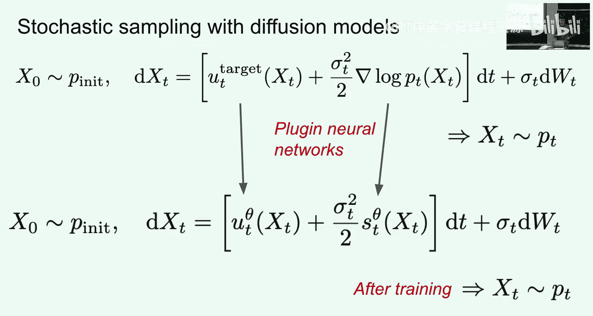

Cool， let's see an example of that。 I showed you this visualization already。

 But how was this model trained， like how， how you train models like that。

 You do score matching and get， get stuff out like this。😊。

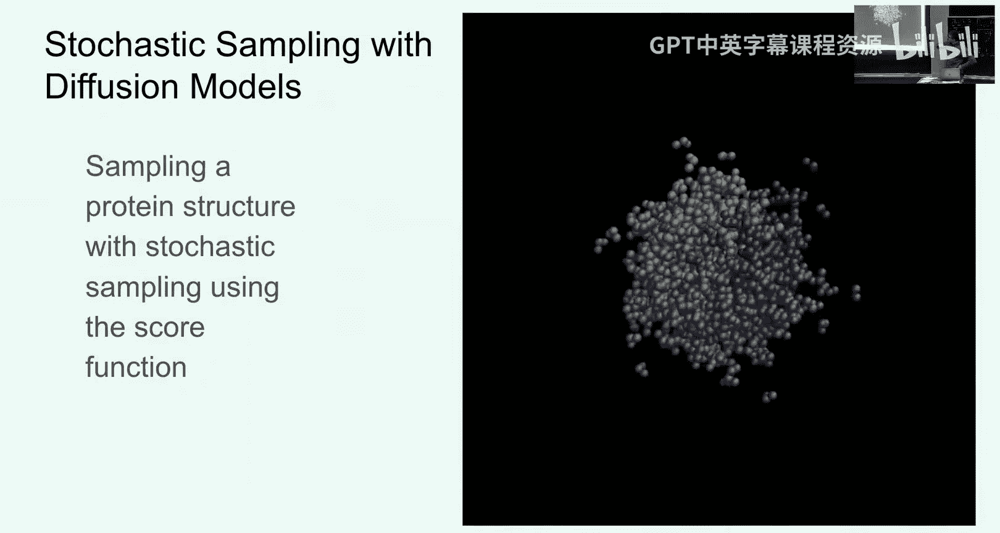

Cool， alright， so now。哎，I want to。So this is， this is 8 in terms of theory。 I just wanna give you。

 No， that's one one small thing that we still have to discuss。

 But I wna give you a bit like talk about a specific case of denoizing diffusion models。

 And then talk a bit about like， you know， how this all places itself in the literature out there。

 like， you know， you might go out and read other papers and you want you to。Not be confused。So。

First of all， denizing diffusion models。In our terminology or in in this general terminology。

 is's a diffusion model with a gasian probability path。 So it's it's this standard example we had。

 So the standard example we had wass the case of denoizing diffusion models。 And for many people。

 a denoizing diffusion model， it's just diffusion model。

 So if you go out there to some machine learning conference， for many people。

 if they say diffusion model， They mean actually this thing。

They mean I have a specific instance in mind。 And you should keep that in mind that there's many。

 many different terminologies。 There's many， many different approaches。

 And people will talk about the same thing in the different way。 It's just important to keep in mind。

Alright， So what's the special property about these dennoizing diffusion models。

 And that's the last theoretical thing for today that we need to realize。 And thank you， Co。

 for bringing this up， so。😊，Let's look at the conditional vector field and the conditional score again。

And let's make a very simple observation。They're both averages of set and x with some。

 somehow weighted。Right， you can。 this is。This is basically both of them have a formula of the form。

Lambta one time set。Plus。Lambda 2 times x。 And the other one has lambda 2。Time set， plus Lada 2。

Times x。But there are specific coefficients there。 But let's ignore them for now， right。And。This。

Has an implication is that we can convert them into one another。 So you can express， in this case。

The conditional vector field。In this format。In form of the conditional score。This is algebra。

 this is not obvious。 but like you just have to plug in the equation。

 you see that this will fall out the same way holds， if we integrate。

Overset with our formulas for this object and this object， same holds marginally。

 same holds for the marginal vector fields。What does this imply。

Implies that we can convert post training。The module vector field。

In the score network and the other way around。And you're gonna to do this in lab。

 So you're going to do both floor matching and score matching。 But youll later realize。actually。

 the same。For this specific case， not in general， but for this specific， simple case。

 they're the same。 So in dennoizing diffusion models， which is this example。

 we don't have to train the vector field and the scoring network separately。

 They can convert it into another one post training。 And calls question。

Regarding score matching and floor matching whether have to do be the same was related to the fact that the first generation of diffussion models did only score matching。

Because say were relying on this implicly， relying on this gaus probability path。

And then could convert stuff into one another。 they only did score matching。

 So if you read early the fusion papers， they just talk about score matching， nothing else。Alright。

 so just to reiterate， we arrived here at a full entry training and sampling algorithm。

 So we have a general model now。 what you can do is you can generate samples from the data distribution。

😊，The question is now， what are next steps。 So next week is going be more applied。

 We' gonna to talk about specific choices that you can make for specific applications。 So。

 first of all， neural network architectures。 so far。

 the neural network was just always just some function。 S T feed， U T feeder。

 I didn't really specify。What this function is。We need to make choices。

 and there's different considerations to make。 We're gonna talk about them。

Then we're gonna to talk about how to condition on the prompt。I told you that this。

Was generated with a flow matching algorithm。 But it there was a specific problem， something like。

A monkey swimming in a pond， having some boat， small sailing or something like this， right。

 So you want have a prompt like this。 and I have something that fits to that。 It's gonna be。

 it's actually relatively simple to do that。 But this is an important thing to， to understand。

 So this is what we're gonna gonna discuss on Monday。 And we're gonna also discuss on Monday。😊。

How to build an image generator or a video generator like this。 these are the two ingredients。

 And then we're gonna to talk briefly about like， how this works。嗯。Oh also also， I wrote an email。

 I sent an email this morning。 We have now our guest speaker on Monday as well。

 who going to talk about reinforcement learning with human feedback or reward fine tuning for diffusion models。

 So you know， for example， that JeGBT was fine tuned with reinforcement learning from human feedback。

And the same way you can do some people flow in the fusion models。 It's gonna be of。

 it's not gonna be relevant to pass anything in this course。

 It's just gonna give you a taste of what else can be done。

 So It's gonna be at the end of last 30 minutes of Monday's lecture。And then。

We're gonna talk about specific applications。 We have guest lectures。

 So for robotics and protein design。 And these are really， really cool people。

 I would strongly invite you to come because they have really shown what's possible with these models that go beyond just image generators in。

 in other areas。😊，Good， cool。 So we have a few minutes left。

 And now I wanted to quickly talk about other approaches orll literature overview。 So first。

 I want to say we've put stuff in the lecture notes in detail。

 So if you want to see how what we learned this class relates to other stuff。

 There's like several pages of text about how what you learned in this class relates to。

 to other models。 So just to make reiterate， there's a whole sw of different flow and diffusion models。

 like， don't be confused to go out there and talk to your colleague。😊，And they're gonna。

 you have a completely different language。 It's， it that's unsurprising because unfortunately。

 this has been discovered in many， many different ways。 that's just important to keep in mind。哎，哎。

就是问了。Still here， I wantanna make a few points。 So the first diffusion models only used discrete time。

 So there was not even an O D E or S C E。 They were discovered in a slightly different way。

 There was a physics approach。 There was approach that used what's called large dynamics。

AndIt's just important to note that they use discrete time steps。

 So essentially what this corresponds to is a discretization of an O D E or an SE。

 And you arrived there at an approximate loss， which is what's called an elbow。

 It's described in election notess in detail。 But it just to keep in mind that like they had a slightly different approach。

 But their loss function was then。Approximate only。

 but it was later shown by the first S E based model that in the limit。

 you recover srcastic differential equation。 and then the training becomes exact。嗯。

Cole's question was related to what's called the forward and the backward process。

 So the first S E based models used time reversals。

 They didn't use this construction of forability paths。

 They used construction by time reversing S Ds。 It's a bit more complex。

 What it means to time reverse something。But it's important to note that their construction was slightly different。

 but essentially， they constructed probability passed in a slightly different way。

 You couldn't just sample from it， but you had to like。

 think about it as a simulation of a Markov process or stochastic eventual equation。 And the final。

 and I personally find that the most annoying bit。 is that they use often an inverted time convention。

 So they start with time0， which is where the data is。And then they flip stuff。

 So that's often when I read papers across these different interpretations。

 that's the most fine time I spent because I first have to think about， oh God， okay。

 now what time convention is used。 So keep that in mind。

 There's a lot of different ways of doing this。 Explain election notes in more detail。

 What we're presented you here。😊，Wass related to what's called flow matching。 Well。

 we talk about flow matching。 So unsurprising。 and also framework that's related to it is called stochastic interulence。

 And these are basically constructions that are similar to here where we can really convert arbitrary distributions into other。

 So P in it can be anything。 P data can be anything。We can only work with flows from the get- go。

 We never have to think about what a stochastic differential equation is。

 That's why also we made this choice。 because stochastic differential equations are a bit hard。

 Ordinary differential equations are easy， and floor matching allows you to never even think about p schiatric differential equation。

And I would make the claim that they're ugly most simple。

 They most closest to what's actually happening， although that's my subjective statement。

 that's not something that's objectively true。 But what's definitely true is they're the most general ones。

Good。😡，So as we said， we can convert arbitrary distributions into one another。

And I just want to give you an example。 Like， why would we care about something that's not only a dennoizing diffusion model。

 Like a dennoizing diffusion model always starts with P in it。

What's P in it for denizing theffusion model。It always starts。With some sort of caution。Like。

 the only thing we can start off with。Is noise。That's for。What。

 what we write is D M Ms youizing the wait DDMs， Deizing。Reus months。

But there might be other cases where your initial distribution is much， much， much more interesting。

And there's a lot of people exploring that in the image space and the audio space。

 in the sciences a lot is where your initial distribution is something meaningful in itself。 So。

 for example， you can think about a video without audio being converted to a video with audio， a low。

 low resolution image to a high resolution image。😊，An unperturbed cell。

 if you have like biological data to a perturbed cell。And。Here's， for example。

 an example from the works from myberggraphers from stochastic turbulence。

 where you convert only partial noise in an image to a full image。 So you basically convert that。

 You see it' it's step by step being recovered to its full higher resolution image。

 So you you basically unmass certain parts of it。嗯。Good。I think at that point。

 I would say we can have a few questions。And with that， we would see each other on Monday again。

 But keep in mind， this basically ends the more theoretical part。 And next Monday。

 we're gonna to talk about specific instances and applications。 As a reminder。

 there's no election on Tuesday。 We want to reduce the amount of additional methods。

 We will gonna to make office hour in this room to allow you to code up the laps because really。

 like implementing this is really the the most fun and coing。😊。

Cool， alright， if you have questions， just come to the front of the class。 Thank you。

