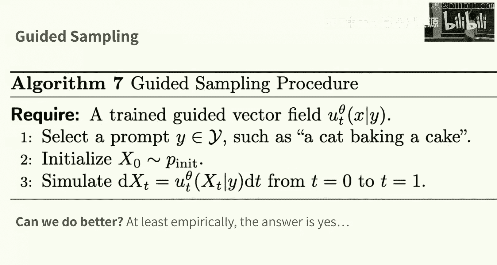
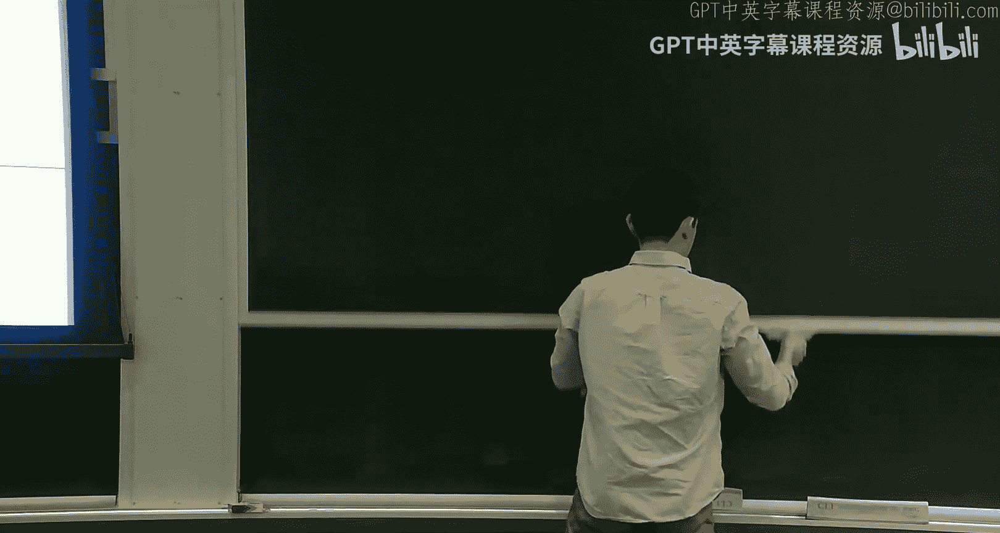
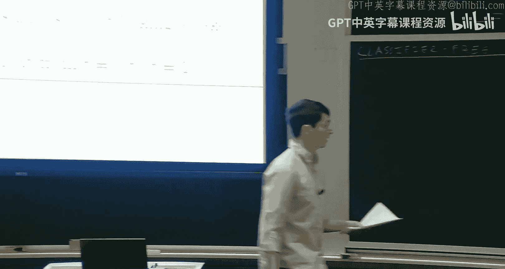
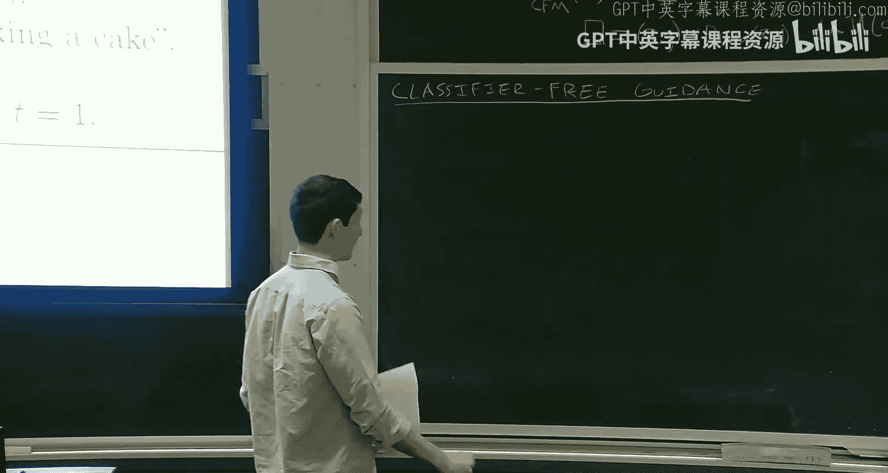
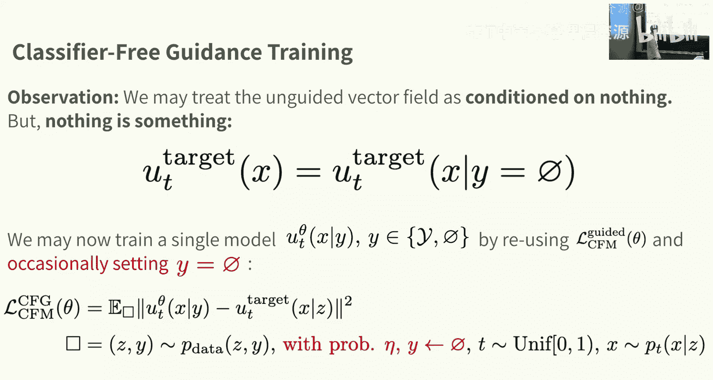
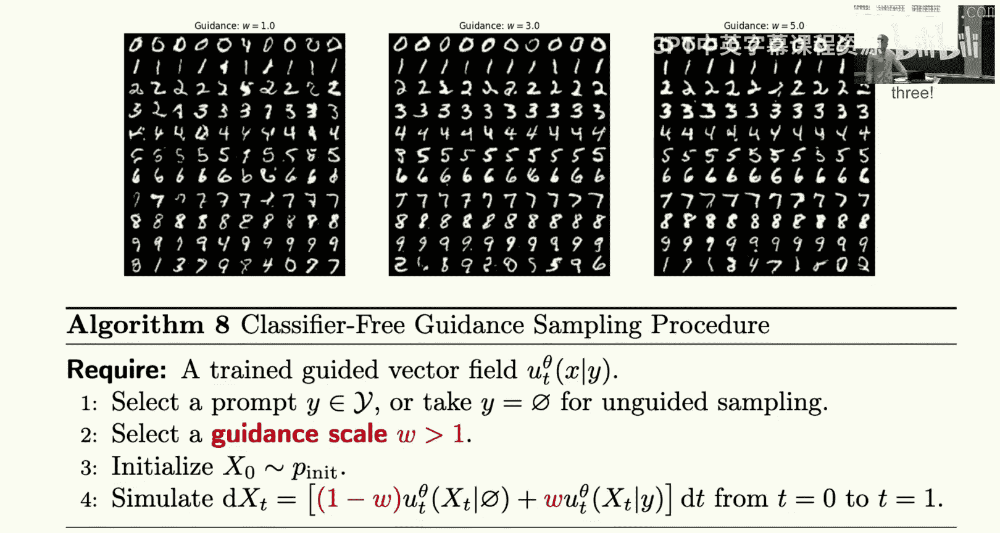
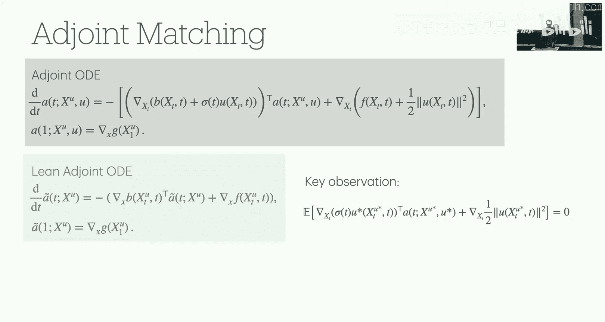

# 《流匹配与扩散模型｜6.S184 Flow Matching and Diffusion Models》中英字幕（Claude-3.7-s） - P4：Lecture 04 - Building an Image Generator - GPT中英字幕课程资源 - BV1gc8Ez8EFL

Alrighty， can everybody hear me。Allright， so good morning and welcome to week 2 of 6。 S 184 slash 6。

 S 975。 This is our last formal lecture。 Next week will be two guest lectures。

 which we want everybody here for as well。😊，But yeah。

 so today we're essentially going to be wrapping up sort of the framework。

That we've been building throughout the past several lectures。

And turning our attention from unconditional generation。

 which is generate something to the task of conditional generation。

 which is generate something given some， you know， preference or auxiliary information about what we want to generate。

And specifically， we're gonna be focusing on this sort of prototypical running example that we've been using of image generation。

So without further ado， let's get into it。Again， feel free to stop me if you have questions at any time。

Yeah。Just raise your hand。 So okay， recall。 what have we been thinking about so far。

 we've been thinking about what I'm going to call conditional generation for the next few slides And what does conditional generation entail？

 Well， the problem is essentially， I want to sample from P data。

 So P data is the distribution of images or the distribution of 3D meshes of video game characters or 2D samples from a checkerboard pattern。

 like in the lab and we've developed these training objectives such as this conditional flow matching objective that allow us to train a model for a this marginal vector field U T theta x by regressing it against this conditional vector field U T target。

And notice I've put this conditional flow matching objective here。

 we've also developed these denoine score matching objectives that are kind of analogous and allow us to extend results for flow models to diffusion models。

 In this lecture， we're really gonna be thinking about flow models。

 All of these results can be extended to diffusion models。

 but just just to kind of contain the narrative of the lecture today and and just sort of prevent clutter。

 We're just going to stick with flow models。 and then you can take a look at the notes to see how they might be extended to diffusion models。

Right， okay， so we can train a model U T theta using this conditional flow matching objective。

 And then we can sample。 And again， this is kind of what we've been talking about for the past week。

 We can sample by simulating the corresponding O D E。 And again。

 if you were train the score with thenoisine score matching， you would obtain an S D as well。

 we simulate this thing from 0 to one。 And we， you know， in theory。

 would obtain samples from our data distribution。 If our model was learned perfectly。😊，嗯。Right， okay。

 but like I said， this is unconditional。 and the problem that we care about is conditional generation。

So what does this mean Before we get into that， I think this' is a good segue into our agenda for today。

 So broadly we're going to be extending our work on unconditional generation to this conditional setting。

 going from generate an image to generate an image of a dog baking a cake or something like that。

 We're going to develop a particular technique for sampling in this conditional setting known as classifier free guidance which is widely used in practice。

 and then we are going to discuss architectural choices for this run example we have an image generation and we're going to survey some current models namely stable diffusion 3。

 which is a flow matching model and then at the end。

 we are lucky enough to have a guest talk by Carls we will talk about alignment and diffusion models。

So without further ado， let's get into conditional generation。And guidance and guidance as well。

 And again， if you have a question， raise your hand。And discuss。 Okay， right。

 So what have we been talking about so far， We've been talking about。

 we've been asking questions of the form， generate an image。

 We've been asking our generative model nicely to generate an image In practice。

 often what we want to do instead， is is ask our model to generate an image based on some textual prompt or based on some additional information。

 like a label， for example，And up here we have images sampled from stable diffusion 3。

 It's this scaling rectified flow transformers for high resolution image synthesis。

 It is a stable diffusion 3 technical report。 and we have these three prompts paired with these。

 these wonderful captions。 The first is a swamp ogre， these pearl earrings。

 we have a car at of vegetables。 and then we have this line drawing of the heat death of the universe。

😊，And。Really， what we're gonna be asking ourselves is， you know。

 we've been generating samples from two dimensional distributions。

 little checkerboards and two dimensions。 And some of you have been coming up to us in office hours and asking。

 well， this is great。 But how do I actually generate things like this。 And today。

 we're gonna be bridging that gap。 And as we'll see， we're actually not very far from this。

 And the difference between where we are right now with our conditional flow matching and score matching objectives and being able to generate images like this based on prompts or based on other labels like this is essentially just。

 we need to sort of。😊，Characterize some mechanism by which we might。

 we might sort of condition or guide our model based on these prompts。 And then we need to develop。

 we essentially just need to scale up our U T of theta。

 to something that you would encounter in practice and as a preview an MP will no longer be sufficient。

 But beyond that， we're nearly all the way there already。 Okay， so before we go any further。

 you've noticed that I've used the words unconditional and conditional。

 which sort of in an effort not to overload these terms。 We're gonna instead refer to them as。

Unguided and guided generation， right， because we've been talking about conditioning on Z。

 for example。 And now we're gonna be talking about guiding on why。geting by someone。O。Right。

 so we're in this guided generation setting。 we're conditioned on why。

 So why here might be a text prompt an ogre with samp swamp ogre with pearl earrings。

 why might be a class label like Apple or banana in lab 3 Y will be a digit we'll be working with the Mist data set of handwritten digits and so why I can take all different all different forms。

 but in general we're gonna be sort of guiding based on why。 So how does excuse me。

 how does our notation change on the left side here。

 we have the sort of unguided terminology that we haven't working with so far and on the right。

 we have the guided notation here。 So essentially you can obtain the right side by prepenending the left side with the word guided and this takes the form notationally of using this conditioned on Y terminology。

Again， I just want to stress that formally guiding is just conditioning on why。Right。

 so our marginal probability path becomes a guided marginal probability path。 And similarly。

 our vector field becomes this guided marginal vector field。And we can define the marginal score。

 the guided marginal score sorry， We can define the guided marginal score。

 the guided model in the same way。 And then just as we had this conditional flow matching objective to train our unguided model。

 we are curious as to what the guided analog of this would be。 I'm trying to train a guided model。

What's， you know， how might I adapt this conditional format objective for this guided setting。

 So this is a question we're gonna sort of be starting with。First。And for which I am oh。

Come to my animations there。 Alright， let's go to the board。 right。

 So what are we thinking about right now， We are thinking about a guided flow matching objective。

 This is where we'll start。So。诶。Guided。呃。Conditional， Ill say。Flow。Matching。Objective。哎。

So we're essentially gonna be making an observation。 And what is that observation。

 It's that if I fix y， that I'm only really carrying about one target。

 which is P data of x given this fixed Y， then I essentially recover the。

 the unguided problem that we've been thinking about so far。 Does this make sense。See some head nods。

 Let me just let me， let me keep writing and。Observation， okay so。If I。Fix fix y。We recover。

The unguided problem。Al， so we might think then that we can construct a sort of CFM S objective with this fixed y。

 So let's define， let's just start writing and we'll see what makes sense。 So okay。

 let's call it L CFM。 And then maybe I want to stick。 Let's call it guided because again。

 there's a Y kicking around in here。And this is a function of sort of this high this parameter theta。

 as well as this hyperparameter y， which is the fixed y。 Okay， and what is this。 Well。

 this is an expectation。It's an expectation over something。Okay。

 we'll look at what something is in a sec。 And well， what are we regressing。

We're regressing our guided model。 So this is U T theta of x。

Guided by why we're regressing it against this a conditional flow matching objective against this conditional vector field。

 U T target。X。Z。The squared magnitude of this guy， Right， Okay， so this is， this is an objective。

 This kind of makes sense。 instead of regressing just U T of X I' regressing U T of X given y。

 And what am I taking the expectation over， Well， taking it over， I want to sample Z from P data。

But is it just P data of Z No， Now it's P datata of Z。

Conditioned or guided by Y I'm sampling T again。From this uniform distribution on 01。

And then I'm gonna sample X from this conditional probability path of X， given my choice at C。

 And again， this is the same。Is everybody happy here？Okay， but why is fixed， right， That's no good。

 We want to be able to vary why。 And so what we're going to do is we're gonna to say， you know。

 let's make another observation。Observation to， okay， now。Let's y vary。And again。

 I'm gonna have a slide in a sec。 You can take a picture of the slide。

 The slide will have this in latex。Okay， so now if we let y vary， then okay， this is going to be。

 let's call this LCFM。Guided。OfNow it's just theta。 right， We're no longer fixing Y。

 This is going to be an expectation。Over some square。写什么？Of sort of this， this difference。

 this term here， which is just the same。Okay， but the change happens。 What is square。

 So what do I have to change with square。Sample y， right。 So now we have to let y vary。 Okay。

 so really， it's this guy that needs to change Z from P data given y。 So instead。

 we're gonna be thinking， we're gonna sample Z and y from this joint distribution over。P data of。

Z and Y。 Okay， so this is sort of a conceptual leap。 right， Now。

 our target distribution is actually a distribution over both Z and Y， right， So if you're。

 if you're thinking about implementation， this would be a data loader that returns you image and label or image and text prompt that corresponds to it。

 right， So our notion of what the target distribution is now sort of encompasses what the label is as well。

 And then the remainder of these guys。0，1。And I'll move in a sex。 I'm not walkinging the board here。

These guys are all the same。 This a sample for this conditional probability path。Like that。 Okay。

 we have our guided objective here where this is the same as here。 Let's go to the next slide。

Which just formalizes this。Okay， there's my animation。 I don't know what happened with the other one。

 right， So just to summarize for fixed why， we can obtain this objective。

 which is basically just conditional format matching。

 And then by varying why we can actually obtain the desired effect of regressing against all such why or sort of amortizing over all possible choices of why。

 And really kind of we've already done all the hard work in developing our conditional format matching objective is now simply a matter of just extending it over why。

 which is， as it turns out， sort of the easy part。Okay， great。 So what can we do with this。

 We can use this to train our guided vector field， U T theta X， Y。😊。

And then we can sample and the sampling is， again， not very different than how we did it when it wasn't guided in the unguided setting。

 So what are we doing， What do we need， We need a trained guided vector fields。 This guy。

 U T theta of X guided by y or a conditional Y。 And then when we sample， we select a prompt Y。 again。

 Y lives in this slash math Cal Y world of Ys。 And this could be something like a cat baking a cake。

 It could be the digit1， as we'll see in the lab。Could be anything that makes sense depends on the context。

 We're going to initialize a starting distribution from this initial distribution P in it。

 and we're gonna to simulate the corresponding O D E。

 we were working with SD DEs check the notes for the generalization to S Ds。

 We would analogously we would sort of consider a stochastic differential equation here。

 we're considering this O D E。 So we simulate it from 0 to 1 It's kind of the same thing that we've been dealing with in the unguided case and then at x1。

 we obtain our samples。Okay， so this is sort of the critical transition point between guided sampling and what I will discuss next。

 which is class for guidance， but I really want to stress that this is sort of at least theoretically kind of we have already obtained sort of a faithful training and sampling procedure for this guided target。

嗯。You know， we are， we are training。 this's guided flow This， you know， if trained perfectly。

 this is the actual guided marginal vector field。If I sample and my model was learned perfectly。

 I would be sampling from the desired marginal。Target distribution， P data guided by y。

But in practice， people don't actually sample like this。

And the reason is that people noticed at some point that there was that you could achieve a certain trade off in。

 I don't want to be too prescriptive here， but essentially。

 you can sort of trade off diversity with perceptual quality with a technique called classifier free guidance。

Which is what we're gonna be discussing next。 So classifier free guidance is what you'll discover inside a lot of models。

 stable diffussion 3 included。And it is。 we， we'll show you some pictures after we develop it of， of。

 of why this might be preferable。 But let's dive into class free guidance to start with。

Let me start on the board。Okay， so。

A， classifier free guidance。So the following derivation is going we're gonna be doing with Gaussian probability paths。

 which I'll write the definition on the board again。

 The result that we obtain is not specific to Gaussian paths。

 but the intuition that we will convey is specific to Gaussian paths。 So what。

 what is a Gaussian path。 So recall that。

A Gausian。一。Gaauusian。Was a conditional。Kant prob。Pa。Is given by。

Is given by this conditional probability path， PT T of X given Z is given by this normal distribution。

 and the mean of this normal distribution is alpha t times x， and the standard deviation or sorry。

 the covariance of this of this distribution is given by beta t squared times the identity。And again。

 recall that where。Alpha T and beta T are。Hes continuously differentiable。Conant， di， monoonic。

Functions。Satisfying。Where do they have to satisfy？ Well。

 they need to satisfy these endpoint constraints。 So alpha 1 equals beta 0 is equal to1。

 and alpha 0 equals beta 1。Is equal to0。Right， okay， so as it。

Happens we have the following the following result for Gaussian paths。 This is simply algebra。

 It's not very exciting to prove this， although you can。 And in fact， a proof is in the notes。

 if you're curious， But the fact is that we can relate。We can relate the marginal vector field。

 the marginal guided vector field and the， the marginal score or the guided marginal score in the following way。

 So we can say thats the。Marginal guided vector field， UT target。Of what's of x given Y。 Well。

 it's going to be equal to。AT， not alpha T， but A T X。Plus。

B T times what times the marginal score or the guided marginal score。 So log。PT of X， given it y。

Okay， in what are A T and B T， A and B T are sort of ugly。 I'm gonna write them on the right， where。

AT， BT。Are equal to this is alpha T prime over alpha T。 And this is what is this guy。 Let's see。

Im to make sure I don't write this demo wrong。 It's equal to alpha。 And again。

 these actual values aren't super important for the derivation we're about to show you。

 But I just wantan to make sure Im not writing these wrong minus。Beta T prime beta T， alpha T。

Over alpha tea。Right， okay。Great， great， quick， great。 Okay， so cool。

 we have this relation that connects the guided target to the guided score and。😊。

What we're going to do is we're going to recall basees rule。 So what does Bayes rule say。呃，B rule。

Well， it says that we're gonna basically be expressing this guy。 We're gonna say， okay， well。

 this guided marginal score， PT T of X given y is equal to。Is equal to。

 we're gonna to rewrite PT of x given y via bayes rule。

 So this is P of x times P T of y given x over PT of y。

And I can sort of pull these out because this this product and division becomes linear with the log and notice that because this gradient is taking with to X。

 because this guy only corresponds to because this only involves Y， this guy's gonna disappear。

 or in other words， let me just actually write out that intermediate step。 So this is log P T of X。

Plus。Log。P， T of y， given x minus log。P， T of y。 And again， this guy disappears because there's no X。

 and we're taking a gradient with respect to x。Goodbye。 Okay。

 so I get that this marginal score actually decomposes into these two guys right here。

So what does that give us， Well， slide the board up。

 I'm gonna use that to rearrange our fact by plugging in base rule again。 So I'm gonna say。

Fact becomes。 no， let's， let's write， plug in B rule。And we obtain what we say， well， U T target。

Of x。Given why is equal to。 what is it equal to， It's equal to a of T times X plus B of T times。

 while we're gonna plug in this expression right here。

 We're gonna replace this guy with these two guys that canceled， we get。

Graadients get this unguided score right here。Plus， we get this other term。

 which I'll come back to in a sec。 P of y condition on x， not x condition on y。Alright。

 and what I'm gonna to do is I'm gonna pair these guys up and then leave this guy off to the side is equal to A T X plus B T。

Times the unguided score。Plus。嗯， plus BT。Times this term right here。Okay， and then， oh， by our fact。

Our fact actually also applies when y is just nothing。This。YouMa recognize as just。U T target。Of X。

So in fact， we have that this is equal to U T target。

Of x plus this other term that we will soon turn to。Okay， any questions there。Yes， no， maybe so。

So all I've done is we've， we've derived。 we've started with this factor right here。

 That's just a bunch of algebra。 We have plugged in Bayes rule and we've obtained this equivalent form。

 Okay， so I'm looking at this thing right now and。We're thinking， okay， so well， what can I do。

 I can say， okay， this is the term I care about。 I want to。 This is my guided marginal vector field。

 And it turns out this is obtained by taking my unguided vector field。

And then adding this term right here。And this term right here is can be this is essentially providing all the signal of why。

 right？ And further， if we zoom in， we see that this is kind of。This is sort of the， the。

 the likelihood of y given X， right， And because it's the likelihood of y given X。

 And because why might correspond to sort some sort of a class， you know， Y might be， you know。0，1，2。

3，4，5，6，7，8，9 in the lab。 We can think of this term as a sort of classifier。And again。

 this is purely intuitive。Okay， and the classifier is what is responsible for all of the signal for Y。

And so people had this idea that， well， let me sort of amplify the effect of my classifier。

 So let me deviate from the actual ground truth expression for you target。

 Let me deviate from the ground truth guided vector field。

 Let me I think I can do a little bit better。 In fact， by。

 by sort of overriding what the true theoretical guided vector field be should be by cranking up the effect of my classifier。

So what I'm going to do is I'm going to choose。A， a guidance scale。W， more than one。

 And what I'm gonna do is I'm gonna scale this term by W。 Okay， and because I'm scaling this by W。

 it's no longer U T of target of X given Y。 It's no longer the actual guided vector field。

 It's going to be something else which will denote U T of Tilde。X given y。Which we are defining to B。

 Well it's UT a target as before。Plus。B T times times our guidance scale times this classifier term。

Right， okay， perfect。So this is important， this is an important conceptual leap， Tony。Okay， right。

 right。 So this is classifiers and quotes because it's intuitively classifier like thing。

 So what is it doing， It's telling us So what is why， Why is like a。

Why is sort of a label or a text prompt。 The term classifier might come from considering why to be a sort of class。

 You know， I'm saying。So maybe y is just some discrete object。

 Let's just think in terms terms of the lab， this could be 0 through 9。

 the digit identity in an mist data set。 So this term is telling us for a fixed x。

 what is the likelihood of y。 So you can think of it's。

 it' sort of it's sort of telling us for each y what the likelihood is。

 And this is very similar to how you would implement sort of classifier as a distribution over the sort of possible bins that you could classify y into。

Oh， that's a good point。 Sorry， this should be， this should be like this。I mean， it could be like。

Yeah， we'll say it's like this this is a classifier， we'll say。So， but， but we're taking。

 we're paying attention。 or maybe you could sneak the log term in there， too。

 And the intuition be the same。 Does that answer your question。 Okay， good， good。

 clarifying question。 Okay， perfect。 but right， okay。

 so let's just make sure everybody's comfortable with。This idea of a guidance scale。

 So the important point is this is no longer the true guided vector field。 But as we'll see。

 it's actually still not that bad。 And in fact， it it might even do better in some subjective sense。

 down the road by cranking up the signal provided by this this guy right here。 So this。

 this line of reasoning， actually， if you were to sort of develop it a little bit further。

 You would arrive at something called classifier guidance。

 which is sort of the original formulation of guidance that people used beyond this sort of naive guidance procedure。

 But we're not gonna stop there。 We want something else。 We want classifier free guidance。

 So what are we gonna do， Okay， let's let us simply plug base rule in again to this term。

 So where are we right now， we are。At U T。Of。X given y is equal to。What is it equal to。

 It's equal to U T of target。 Oh， there should be an X here。X。UT of target x。

Our unguided vector field。我不。plus。B， T times our guidance scale。 You know what， Let's。

's put the guidance scale before。 Let's say it's W times B T times our classifier。Okay。

 now let's reexpress this guy in terms of Bayes rule again。 So where， where was that term。

 This guy was here， So we can say that this classifier term or again， as Tony pointed out。

 this is the classifier。 But I'm just gonna sort of abuse a notation。

 say this is the classifier term。 This guy is equal to this guy minus this guy。

 So I'm gonna replace this。Is equal to U T。 I like。

 this piece of chalk is not as good as the other one。When I say this guy is equal to U T of target。

There we go。Plus， WBT。Times。Log back in Bayes rule， log P of x。Minus。Log P T of x， given y。Okay。

 what happens？ Well， nothing yet。 I'm gonna add in another thing and subtract another thing。

 We're going to say U T of targets。Of x。 And I'm going to say。Minus W A X。Plus， W， A T X。Plus。

 WBT times this guy。Alright， and now we're gonna rearrange some terms。 So we're going to。

 what are we gonna to do， We're going to combine this guy right here。With呃。

I'm to combine this guy right here with。This guy writes here， s is not what I want。

 The sine a hot should be the other way。 This should be PT T of X given y。And again。

 if you see a mistake， if someone's confusing， just call me out and we'll fix it。

 So I just goed right there。 So this should be the other way like that。 Okay。

 so what what are we gonna do， We're gonna combine this minus guy with this minus guy right here。

 And then we're gonna mush these guys together。 And what we're gonna get is。U T target。

Of x minus W times。AT of x plus。B T times the unguided score。Okay。

 and then we have two remaining terms kicking around plus W times。AT X。Plus。

 plus the actual guidance score。Yeah， tell it。What happens between。Second and third lines。 Okay。

 so I basically shoved this guy over。 Oh， oh， yeah， Okay， So there was a mistake that I updated here。

 forgotgot to fix it here， so。So let me fix that。Yeah， yeah， good， good question。

So notice I added it and subtracted it。So it's， it's 0。 I've added 0。

 And I've done that to group things together so that we get what we want。 Yeah， great question。

 Alright， so I've grouped them up together。 and now let me observe。😊，That what is this guy。

 This guy is。U T target。Of x。And this guy is。This is U T targets。Of x given Y。 So we arrive at。UT。

 let me let me move the equal sign this way。1 minus W times U T target of x。Plus。

 W times U T targets。Of x， given y。Right， okay， so I've we've rearranged and we've obtained that this expression right here。

This utilda。Are guided， or sort of classifier guided you they rearranged can actually be rearranged to obtain this classifier free form。

Right。You question什么？嗯。Right， so， so instead of that classifier term kicking around now we simply have our unguided。

And are guided terms。Which is simpler。 This is kind of a nice。 This is kind of a nice result here。

 although weve sort of constructed this quantity so that it does have， have this form， but。

Let's go to the slides just for sake of time。 right， So we've I identified this identity right here。

So would you classify free guidance again？We， we arrive at this end result here。 We can write this。

 this。Classifier free guidance， vector field， U T Tilda as this。

 as this sort of weighted average between our unguided and guided vector fields。

 And this is classifier free guidance。嗯。Okay， but why do we care about this。

 What's so great about this。 I still haven't told you yet。 You should still be skeptical。

 And furthermore， it seems like we still have two terms， right。

 It'd be nice if we only had a single uniform term。嗯。Because as is。

 I would have to obtain the unguided and guided vector fields before I was able to use this。

 And so the idea with classifier free guidance training is， well。

 the unguided vector field is just the guided vector field conditioned on nothing。

 And the observation is that nothing is something。 And so I'm going to say that the unguided vector field is just the guided vector field。

Guided on nothing。 So we've used this null slash of our nothing character to denote the absence of guidance。

 And the idea is now we are going to train a single model。嗯。Denoted U T theta of X given Y。

 just like in the regular guided case， but adapted for this CFG case。 And how do we adapt it， Well。

 were going to， we can start with sort of the same backbone as our guided objective by regressing U T theta of X given Y。

 this guided model against the conditional vector field。 And we can write the same thing as before。

 But notice if we just， if we don't include this guy right here。

Then we are never gonna end up with why being this null character， right。

 We're never gonna sample from our data loader and see， oh， the prompt is nothing。 You know。

 I'm saying， we have to artificially introduce this ourselves。

 So we're gonna introduce this hyperparmeter Eta。 We're gonna say with probability Eta。

 we're gonna sort mask out why。 We're going to replace why with the the var nothing character the the null character。

And this allows our model to see this null character at training time。

 and thus allows us to learn UT theta of x given y over not just our set of Y's， this math cow Y。

 but also this far nothing character。

Alright， that's great。 How do we sample with it。So to sample。

 what we're gonna do is once we've trained this thing right here。

 we're gonna select a prompts Y in our in our universe of Ys。 or if we want to do unguided sampling。

 we're just going take it to be this null guidance。 We're going to choose a guide skill。

 W more than one。 We're going to initialize as before。

 And we are going to simulate the O D E corresponding to u tilde of X condition of y or guided by y。

 And again， it's just this expression right here。And we're gonna simulate that from 0 to 1。

 like we usually do。 And we are going to get our classifier free guided samples。

 So you might be asking， why do I care about this， Why should I ever use this。

 What good is this if it's not sort of theoretically justified in the way that sort of the traditional guided sampling that we discussed first was。

And to that， I say， look at this image。 So this is from the lab。

 We have sampling at three different guidance scales。 So the first is w equal to 1。0。

 which corresponds just to traditional theoretically grounded guided sampling。 We can see that。

 It looks okay， but。😊，You know， it's some of the digits are not quite there， right。

But as we increase the guidance scale， as we go to W equals 3。0， W equals 5。0。

 we sort of get much cleaner generation。 So the perceptual quality increases。

 And perhaps if we lose anything， it's some amount of diversity。

 But the things we do generate seem to be cleaner and nicer。In source of this image， as you see。

 is La 3。 So you'll be generating this image yourself。In lab 3， right， Okay， so real world example。

 please， let's go to the next slide。This is from the original classifier free guidance paper。

 and you can see that they're asking about corgis here。 And if you do know classifier free guidance。

 in other words， said W equal1。Then you get， you know， I mean， these are。

 it kind of matches the prompt， but it's not great。

 We don't really see the corgi prominently in the picture。

 And then if we crank up the guidance scale， we get these great pictures of corgis。And again。

 this is the sort of theoretically grounded one。 And this is the one that seems to。

Give images of sort of higher perceptual quality。 These seem more cord you like to us。All right， so。

Question， two questions， question。Yeah。What is the classifier that we used。

What was the what do you mean by what was the classifier？ So what was are you asking about。

Was the why， Oh， so， yeah， good question。 So why is the identity of the digit。 So 0， is it 1。

 is it  two。6，7，8，9 or nothing。じ call。

Yeah， that's exactly thats。Yeah， so people have， Yes， you're right。 So one， it's not。

Sort of rounded in the way。 It's not sort of principled。

 maybe in the way that setting W equal to one would be。

There is a lot of literature on why you get better results when you crank up the guidance scale。

 One intuition is that it's sort of a crude way of approximating like low temperature sampling。

 So you're sampling from the higher density regions。

 And so you sort of trade off the diversity of your samples with the quality of your samples。

 And I think people have shown that you kind of， you know， trade off you know。

 you can sort of measure diversity and perceptual quality。

 and you kind you can trade these off by by。Using guidance like this with GNs。

 people look at sort of like truncating the initial sample and they get a similar effect。

 Like it's kind of a crude way of sort of trying to not sample from the tails of your data distribution only sample from the kind of the middle of it。

 That's the rough answer。 The longer answer is that There's a lot of research and it's kind of an open question to the best of my understanding。

Right， okay， so let's， we have about 10 minutes left before I'll hand it over to Carls。

 Let's talk about architecture。Right， architectural considerations。 And again。

 this is for our running example of image generation。Okay， so before we get into this， let's ask。

 you know， what is an image look like。 I forgot。 we discussed it briefly in the first lecture。

 So just so that it's fresh in everybody's minds。 an image lives in this Euclidean space。

 which we're gonna define as R to the a factor into three dimensions。

 the first of which is the number of channels， So if this was an RGB image， this would be3 a red。

 blue and green， RB G， this would be thered be three color channels， red， blue and green。😊，RB G。

 and then H and W denote the number of pixels for the height and width of the image respectively。

 So in lab La 3， we'll be working with Mnist images， which are black and white。

 So these would just have one alpha channel。 Sometimes you'll see images with four an RGB。

 and then also a an alpha channel as well。And sort of the observation is that an MP。

 a multi layer perceptron。 Otherwise， maybe some people refer to it as a bless you as a fully connected neural network。

 This is gonna be insufficient in these really high dimensional image spaces。

 These things quickly become thousands and tens of thousands of dimensions very quickly。

 And you're not going to be able to throw an MLP at that in an efficient way。And so as a result。

 we need to actually， you know， think about what what this， this model should look like。

 and we're going to explore two choices。 We're gonna look at units， which are what we use in La3。

 These are based on convolution， and then we're gonna look at diffusion transformers。

 which are sort of the more modern， recently popularized approach， which is based more on attention。

And we want you to pay attention as we throw a bunch of pictures at you， this guiding variable， why。

 how is it encoded， embedded and processed by the model right So instead of just throwing it into an MLP。

 kind of we have to be careful that we're actually kind of using it in a way that makes sense。

 This is kind of the name of the game is really how are you actually featurizing why how is it being used by the model。

Right， okay， so let's start with the unit。 We'll start with the unit from La3。

 is sort of a unit architecture。 And again， unit is a family of architectures。

 sort of all just united by the fact that they all kind of look like a U as we'll discuss in a sec But the unit from La 3 is when we'll be talking about right now。

 and it's sort of it's a simplified unit which we think sort of makes the most sense for learning purposes in which we've sort of constructed and put in lab3 can look at the code when you work on lab3。

 but we're just gonna give a brief overview right now。 So as I said earlier。

 the unit architecture is based on convolution。So in this case。

 let me just say the images we're working with are our Mist images。

 So this is what you'll see in the lab。 The number of channels is one。 It's just an alpha channel。

 and there are 32 by 32 pixels to start。 And our labels as somebody is asking about are just 0 through 9 as well as this kind of no label。

Right， so what's going on with the unit。 So at a high level。

 and we're just gonna discuss for the sake of time at a high level here。 X T is going in。

 It's going through the encoders。 each one of these encoders is sort of adding channels。

 So making each。Sort of。Making the information on each pixel richer。

 will decrease the number of pixels。 So we go down through the encoders， channels go up。

 Pels go down。 We go through this thing called the midcoder。 This is not standard notation at all。

 We just thought it sounded more similar to encodeder and decoder for the sake of the lab。

The midcoder preserves the number of channels and the number of pixels。

 and then it's going to go up through the decoders。 And it's gonna just reverse this process。

 And then we've attached these residual connections that allow information to just shortcut between these two things right here。

 two other things you should note is T is embedded in the lab you'll see that we use Fourier or sinusoidal embeddings。

 These are similar to position embeddings used in language models。 And then we also embed Y。

 Y is discrete here。 So this is is easy in the lab。 you can take a look at how we do this。Right。

 okay， so encoder， what does the encoder look like， It's two of these residual layers。

 which we'll talk about in the sec。 So it just processes it， processes it。

 and then it downs samplesles it， increasesre the number of channels， decreases the number of pixels。

Similarly， we have a， and I'm going through this fast because I don't have a ton of time right now。

 but you'll get to explore this in the third lab。 So the midcoder has three residual layers。

 not super exciting。 And T and Y are fed into both of them。

 And the decoderrs essentially just reverse the operation of the encodederrs。 They just up samplele。

 So they go from maybe 512 channels by8 by8 pixels to 256 channels by 16 by 16 pixels， for example。😊。

And then the actual workforce of our network， this residual layer， it's just。

 we're gonna have this residual shortcut。 and then we have two convolution layers plus some normalization here we use batch norm as well as as an activation right here。

 and then between the two layers we're going to inject this conditioning information And T and Y have been embedded into some embedding space。

 And we are going to basically pass them through an MLP to convert this embedding dimension to the number of channels。

 and we're going to add channel wise。 And again， maybe this this doesn't make sense right now。

 This is something that you can dig into during lab3， sort of the point of La 3。

 We pass it through another convolution normalization and activation layer right there。

 add it to the residual connection and then just send it on what。Okay， that's the unit。

 So the next thing we'll be talking about is a diffusion transformer。

 This is an alternative to a unit。 It disposes of the idea of convolution， mostly。 And it says。

 let's use attention。 Everybody loves attention these days。 Let's how do we use， how do we attend。

 How do we employ attention when we're working with images。 The big idea is take my image。

I'm going chop it up into little patches。 I'm going to featureurize each patch。

 And then I'm going to attend between the patches。 So this is based on what's called a vision transformer。

 This was， you know， originally used in， for example， classification。

 And the idea is we take this image right here。 It so this。You know， the cityscape right here。

 I'm going to patchify it。 This is the first operation。

 I'm going to sort of lay out all the patches in a sequence。

 I'm going to embed them into some common embedding space。

 and I'm going to attend between them and just passing them through。

 And here they have some transformer like encoder。 And at the end。

 you have some head that just kind of reads your states at the very end。 and then just you know。

 passes constructs logics based on them。And then uses that for classification。

 And so the diffusion transformer people were like， this is great。 Let's take this and adapt it to a。

 you know， diffusion setting where I'm trying to predict， you know， what my next step should be。

 The diffusion transformer use their formulation of diffusion is sort of a， a。😊，Is。

 is sort of more of the， you know， in this case， they're predicting a noise in a covariance matrix here is's slightly different than our formulation。

 They're equivalent， but their output looks slightly different than what you would see if you were to implement that in our context。

 But the idea is essentially the same。 Patify inbed and then pass it through these attention blocks。

Allright， so I'll leave a few more minutes before I hand it over to Carls。

 but I want to briefly just switch topics and just discuss a general design pattern that's sort of orthogonal to whether or not we use a unit or a diffusion transformer。

 and that is whether or not we train our model in the latent space of some some sort of autoencor。

 some sort of variational autoencoder。 And the idea is just that let's go to the next slide。

 The idea is that。The idea is that kind of frequently， I'm working with， for example， images。

 and there are all these sort of high frequency， imperceptible details that I don't really want my generative model to have to worry about。

 And so the idea is to kind of farm out some of the computational power to a large。

 usually pre-trained autoenr， which is gonna compress down my image into a space that allows the generative model。

 if trained in this latent space to really just focus on these coar grained perceptually relevant features。

So here we have just an architectural diagram from this paper。

 high resolution image synthesis with latent diffusion model This is a paper from NviDdia from about two years ago。

 I guess it's a 2025 maybe three years ago。 I think it's from 2022。

 They have a unit It's in latent space。 you'll notice that their unit has attention ors doesn't There's a whole bunch of variance of units。

 but the whole thing lives in a latent space and to sample they would sample normally except the thing you end up with is a latent sample and they just pass it through a decoder the data they train on is just an encoded version of the dataset。

Right。So again， this is non alternative to units and diffussion transformers。

 This is an alternative design decision that would is often used in combination。

 And in nearly all state of the art models， for， for example， image generation。

 people will train in latent space。right， and just to end， we have kind of a lock going on here。

 Lets you do a quick case study。 This is stable to fusion 3。

The idea is stable version 3 does use a pre trained auto encoder。

 And then I guess for those of you who are wondering， yes。

 they do train with nearly the exact same objective that we have shown in class。

 They just call it V sub capital T theta instead of our U T。Superscript， lowercase T theta。 But yes。

 this is conditional flow matching。 is exactly what they use here。

 The only difference is that their parameterization of U T theta is significantly more complex than the MOps we've been working with。

Just， just to， you know， be brief here， really， a lot of the， you know， special sauce here is in the。

 the use of these pre trained clip and T 5 X X cell embedding。

 clip is essentially an embedding of it's， it's。Sort of a shared representation space of images and text and allows you to generate these courseargra text embeddings that are perhaps useful to work with when also working with images。

 And then they also use these these embeddings from one of Google's T5 language models to basically obtain some sort of sequence level contextual information that they can then incorporate into their attention。

 And so they define this MM DIT， this multimodal diffusion transformer block which generalizes the diffusion transformer that we talked about on the previous slide from sort of classification based conditioning to more general condition on text prompts。

 for example， and they have this complex architecture that you can dig into here that really is not much more than what we've already seen on the previous slides。

 but is very busy and colorful and is probably best viewed on your own time。And yeah， okay。

 so with that， before I hand it over to Carls， our next class is on Thursday。

 this is one of the most important classes we want you there for it。 This is a lecture two lectures。

 two guest lectures。 The first is on robotics and the second is on protein design。

 It's not one joint lecture。 It's in this room。 it's next Thursday， I believe from 11 AM to 1230。

 And then as a reminder， lab two is due on Wednesday at 5 PM。 we said。

 and we have office hours on Tuesday and Wednesday。 So please feel free to come to office hours。

 ask us about。😊，Lb 2， ask us about。About the notes， about lectures， about any questions you have。

 And the one thing keep in mind is the Wednesday office hours are actually in this room， not 37，2，1。

2。Yeah， so with that。I'll hand it over to Carl。 Peter， do you want to introduce Carl， Why I get。

 Carls， why I get you set up with the mic and stuff。Are there any questions in the meantime。Yes。

 said the。或者一。的。证据人。 let me so let me would you mind help。by words。Alright， cool。 So thanks everyone。

 So we're now gonna switch gears a little bit。 And what we want to show you is bit how the frontier of research in algorithms about flow and diffusion models look like and。

😊，That's why I invited Carl， because hes has done excellent research on that front and he's going to talk a bit about things that are related to what we talk talk about today about class free guidance。

 but an extension of that true reward models。I just put quickly introduce Carl。

 So Carl is a senior researcher at Microsoft Research New England。 So right across the street。

 he graduate from NY U with a PhD， was advised by Juan Buna。

 And he also worked at for two years at metata is a student or visitor Yeah。

 for aor visiting researcher， right，😊，So maybe let's give a quick round of applause and thank calls that he。

 he came here to give us to teach us about diffusion models。 Thank you。Thanks， Peter。 Yeah， I'll。

 I'll， I'll be giving you an overview on reward maintaining for flow and division mouse。 and this is。

Yeah， this presentation will be mostly covering or related to this paper at matching。

 fine tuning flow and diffusion geneative models with my modelstochastic optimal control。

 So if you have some questions about what's in this talk， well。

 there will be some time for me for you to ask me。But you can also check out the paper。

 And I feel like， yeah， we tried to make it as stuff contained as possible。Yeah， so with that。

 I'll just get started。 And the other title of the presentation is reward fine cleaning for flow and efficientffusion models。

And some other open questions that I'll be tackling。Just do。Said the states for for the talk。

The first one would be， what's the best way to perform ourF on di and flow models。

If you look at the LM version of ourF。People use BPO， DPO。And。

 and there are works that use PPO and DPO， in fact， for theion thermo models。

But the additional structure that you have for the efficient four models。Allows you to。

Use other algorithms， but also you have to figure out how you are are actually supposed to do to implement all these techniques that you could also implement coming from our。

 So there are these two things to be figured out。 And yeah， I'll be talking a bit about those。

This is just an interpret slide， so。Where I'm going to be showing results or like。

Applying most of these concepts to text image models。So in theory。

 what we're starting from is like a pretwined efficientffusion model。In this case， it's text image。

 and we want to basically get better samples。 And that means that can mean different things in this case of text to image。

 what we want them to be nicer or like。Better in terms of like， human perception。

And also more aligned to the prompt。嗯。And then the second open question， yeah。Neither the。

 the between model nor the postin one are actually amazing， but。With。Yeah。

 and then the second open question， which is very much related to the first one， is。

 how do we solve stochastic optimal control problems and head dimensions。

The sastic optimal control problems are。Yeah， problems that we can use both to perform LHF on diion flow models。

 which we'll see in in this talk， but they can also be used for other applications。

 and in particular， a big one is sampling from anonymous divisions。So， yeah。

 S O C or except for division fors， very related。But that' a scene way covers other areas as well。OK。

So I'll go into find cleaning setup。 What do we start from and where do we want to get that。

We start from a quaing diffusion or flow matching model that generates a certain distribution P based。

 You can think of our model as being conditional if you want。 And most of the times。

 it will be like that。And then we want， we also have access to a reward model that has been trained either using human preferences。

 And that would be， yeah， just like you would do in LLMs。

Or you can also think of reward models that encode conditional sampling。

If you plug rewards of this form where basically the reward is the log likelihood of some observable。

 then you'll end up performing conditional sampling， which is， as I understand。

 very related to what you discussed earlier on。 So this is to say that when you find tune。

 you can also aim for doing better conditional sampling than what you do at inference time or with others。

And then the goal is to modify the protein diffusion model so that that it generates from P star。

 which is proportional to P basease， should say P base here times exponential of R of X。

 If you look at this one dimensional plot on the right。

You can see that P base would be the distribution that we see in green。

And the trajectories that you see are here， like trajectories for an O D that samples from P Bay。

 So that would be the trajectories for the base model。

 And we also have this reward model that gives us this orange curve， orange curve。

Which essentially is telling us how we need to modify our pre distribution to obtain the fine the the fine distribution。

 which is the one in in purple。So the fineine model essentially will be one that samples from this fine distribution。

 which is proportional to B base times exponentialer R of x。 And you can see that。

The trajectories of the Frankky mo have been modified with respect trajectories of the per 1。

 This would be the OD trajectories and in the in lighter purple you can see。

Dejectors that are sampled from an S D。 the yeah， basically the。

 the interplay between S D and though D will be something that will be very important for fine tuning。

 as you'll see later on。Okay， so just to set the notation straight and to be clear what I'm referring to when I I write some variables in in in the slides。

 I'll give a very brief overview of diploma and division models。As you know。

 we can start from like the pretaining happens by choosing samples from Gausstion and samples from data。

 And then there's a reference flow。 There's probably a different not that we've used in this course。

 but reference flow would be just an interpoing trajectories。

And then what we learn when we pretrain is the genetic flow where the solution of。

 where the genetic flow is given as the solution of of this OD。Where the vector field V。Istrained。哦。

sorry。The the vector field V is trained by solving the regression problem you're all familiar with。

And then we know that when that happens and if we learn the vector field to be exactly。

 then the reference flow and the genetic flow have the same marginals for all times。

 and in particular they have the same marginals at final time。

 So that means that we're actually learning the target distribution。Now， I want to go into。Yeah， way。

 another way you can sample from one you have a pre flow matching model， which is the geneative S D。

In the previous light， you can see。Well， I wanted to show this very light， but it's not showing。

 So I'm just going to go ahead。Yeah， in the previous slide。

 you can see that was sampling from the flow matching model using an O D。Here。

 I'm going to sample it from using an S D。 and the way to do it will be as follows。

 So say you have P T， which is the distribution of the reference flow。And。

This call graphic S is the score function。 I think you've。

 you've heard the link between scores and the。Yeah。

 between this core function and and these kind of models。

What happens is that you can express the flow matching vector field in terms of the score。

 So you there's this relationship， which is， is actually pretty simple。

 So the vector field flow matching vector field can be related to the score in a fine way。And then。

If you。Think of how you can use this course for S these。Basically。

 you can use the score to rebalance adding noise as with a noise term。

 So what what what I'm doing here is I'm adding a noise term。

 which is with an arbitrary diffusion coefficient。 But then I'm canceling it out by adding。

The corresponding term involving the score in the drift。

And then since there's this connection between the score and the flow matching in vector field。

Once I replace the score by what it is in terms of of the flow matching greater field。

 I obtain this flow matching geneative S D。 So this is a generative SD that still samples from the appropriate distribution。

 So if you look at the marginals for all times of this the solution of this SD。

 it still has the same marginals as reference flow。But in this case。

 what we're able to do is we're able to use an arbitrary in our schedule。

 And this is something that we will really like to do。In order to set up the functioning problem。MM。

Some orientation， which I would like to avoid。 But unfortunately， later on。

 I'm using this kind of variables is once you have this SD， you can just rewrite it。I've。

 I've talked about flow matching vector field and score functions。

 basically whatever you have in in terms of one， you can put in terms of the other。

 So here I'm rewriting the flow matching gene s D in terms of the score。

And the only thing I want you to remember here is this variable E T， which will appear later。

 I'll refer back to this。 But yeah， from this slide， the only thing to take home is。

That you can sample from my model with everything schedule。Now。

 I want to go into stochastic optimal control。 I'll later tie in this with diplomamat。

 This is just a generic introduction to stochastic optimal control。

This is a problem where you start from an S D， which is the。

Control SD that that you can see here below the objective。And this SD has a base drift。

A nice schedule， which again， is arbitrary。 And then it has this other term。

 which involves the control function。 And you can see this control term as a perturbion to the original base drift。

And the way you want to learn the control is you want to essentially trade off minimizing the state costs and the terminal costs。

 So you want to make those small while making this perturbion term not too large。

 So the control cost basically takes care of your perturbion not being too large。

And when you think of sarcchastic optimal control。There's an important object that we'll be using later on。

 which is known as the value function。 The value function also known as the coststago is essentially the control objective that you have once you're at a certain point。

 X at a certain time T。 and it has these two expressions。 I know it's stamping you a lot。

of stuff at the same time。 But I'll be using those。

 just keep in mind this that the value function is is an important object for stochastic optimal control。

And now I presented of actic optimal control， but I haven't told you。ASr way to understand it。

 which is that stochastic optimal control is just K L regularized reinforcement learning for those of you that are familiar with PO or with how RF works for L M。

What you're solving when you do allF for L M is actually a K rigorous reinforcement learning problem where again。

 you're using the reward you want to optimize， but you also have a K religious term that avoids。

Your fine model from deviating too far from the printing one。

And now I'm going to show you very briefly and， and a bit schematically how this is the case for stochastic optimal control。

Again， no need to go into depth here。 And， and this is various slides you can skip everyone。

But basically to get there， I'm just going to use this notation where P U given x0 and P given x0 are the conditional properties of the control and on control process。

 The uncon process is one where the control is set to0。And there's a theorem in stochastic calcos。

 which is known as the thena theorem， which actually lets us write the control term in the control objective as the kL divergence between these path priority measures。

So with that theem， we can essentiallywrite the control objective like this。

 And this looks a lot more like a K L regularizer or L problem because if you think of it。

 this first term would be just the expectation of the reward。

 And then the second term would be the KL regularizer。And if you're familiar or you've seen this。

 this kind of problems before。The solution of side scale realization problems。Is。

 is of the following form You essentially have like that that the optimal distribution is proportional to the base distribution times the exponential of the reward。

 So that holds just as well in the case of of what measures。And we're almost there。

I'm just going to copying this from the previous slide。

What we need to do in order to basically get what the optimal solution is without conditioning on the initial on the initial condition on the initial state x0 is we need to find the normal magic constant of this term on the right hand side。

And in order to compute it， we essentially see that the normal magicization constant ends up being expressed in terms of the value function。

This is， again。If you recall， define find this object polyfunction， which had two character。

 This is the second one。And once we plug this normal magician constant。

 which importantly only depends on x 0。We obtain this final。

Characterization of the optimal process in terms of the base process。And the rewards。

 as well as the value function。I know this looks a bit ugly， but we're going to make it simpler now。

 and we're going to apply it to the fine tuning case where things will be significantly simpler。

So if you， if you want to apply all thistochastic optimal control framework that I've introduced to the fine tuning case。

 what you're going to do is you're going to set the state cost F to 0 and the terminal cost to be minus the reward。

 So once again， you see here that what we're doing is。We're trying to minimize minus the reward。

 which means maximize the reward while keeping the perturbion or the control term not too far out。

And then we obtain that the equation that I showed in the previous slide becomes this equation where this the marginal process。

 the marginal of the optimal process at the npoint x0 and x1 takes up this form。Of course。

 if you remember what our goal was and that's something introduced in the first or second slide。

 we wanted。A distribution P star。 We wanted to sample from P star， which is proportional to P Z E1。

B of x1 times exponential of R of x1。 So what we， what bothers us here is that there are these x zeros。

That should that are here， but shouldn't be。And we're going to impose some conditions that will actually be implementable to make sure that those X zeros disappear。

The condition that we need to impose is that。Is this mammalous property？

 So we define a geneticative model a geneative process to be minimalous If x 0 and x1 are independent。

 that means that P of x1， x 0， that's the marginal for the twin points is actually independent and theupos to P of x0 times p of x1。

Once we have this， its just， you can integrate out X0。If you do that， you see that basically。

 you can really get rid of it and end up with what we really wanted， which is that。

B star of x1 is proportional to P of x times。Ex explain cell of R of X1。And okay。

 so we know that this is the condition that the base process must satisfy。

 But how do we actually get this condition to hold。Is it even possible？

 And now I'm going to show that for the framework that I presented before。

 where there was this flowmat and anti SD， we're actually able to come up with a way to make the genetic process for the basic distribution mes。

嗯。That's the proposition。 Basically， there's a way to choose。Sigma， which again。

 we could choose however wanted。 We had this freedom。In order for this process to be memory。

 and the way you have to choose it is basically， you have to choose it to be。

Equal to2 Ata T remember Ata T is this coefficient that appeared before。 and。

 and it's purely given in terms of the parameters， Al and and beta that were used to pretrain the diffusion model。

 So basically， how you did the pretraining forces。Which coefficient you need to use to fine tune。

 and then you can allow for perturbion， which here is here as as high。And this perturbion， yeah。

 essentially it can be too small to negative because otherwise the condition would not be satisfied。

 but you can just set it to zero。 And later on， we'll see that there are reasons to set it to zero。

Okay， now I'm going to tell you what happens if you don't choose a memory schedule to fine tune because you may may think。

 okay， maybe this is your theory， maybe you can actually use another noise schedule and you don't need to go through all this to do fine tuning for theffion models but actually no this is what the pre model looks like and this is again the target that we're aiming for。

And this is what happens when you're fine with a sigma with a nice schedule， which is not memoryless。

In particular， here， we have a small， nice schedule。 and we see that。

The distribution that we generate when we solve thistochastic optimal control problem or this nice schedule。

Is actually drifting away a bit from from the base distribution and towards the one that we're targeting。

 But it's actually very， very close to the base distribution， still。This is。

This third plot shows what happens when you use pointian， say with a sigma， which is one。 and again。

 here you're a bit closer to what you're targeting， but you're still not quite there yet。And finally。

 when you fine tune with a memoryless when the schedule。

 which is meless and that's in particular the one where you're having that sigma square this is just2 H to T。

 you're actually really targeting what you were aim for。 So is just to say that。

You have to solve a stochasticot control problem， and you have to choose a memorymalizational schedule when you do so in order to for the solution that you're targeting to be the right one。

Okay， and then。This is not the end of the story， because normally， when you want to。

Do inference on a fineine model or like a pretin model people tend to prefer to use to do inference with the zero noise schedule because then they can use Ods to sample and Od numerical methods for O these orange and all much better than numerical methods for S these。

 So once we have our fineine model that with fine tune by solving a necessary problem with a me schedule we want to still be able to do inference on the fine tune model with the zero noise schedule。

 So we want to be able to do inference on the fineine model just like we were doing inference with the prein model。

And in order for this to hold， we actually have no choice。 We need to use themem schedule。

 which is given by sigma t equals square root of2 wayta T。Yeah， this is the theorem that we show。

 Feel free to check out the proof in the paper， but I I won't go into detail on this。

 But this is just to say that。There is a pretrain。 there。

 there is a preferred mesh catalog we want to use when we do find。

And for those of you that were curious about， oh。Before this theory came about。

 people were still functioning models。And， and there are works that do that。 And。

 and this is kind of a coincidence or like yeah， it's。

 I would say it's nice that people were actually choosing the right choice because when you look at what the me is nice scale looks like for the D IM。

 So that would be like， for example， for stable division in in versions prior to stable division。😊，3。

嗯。They were using D DPM to fineune， and the DPM is actually the manualization schedule for D VIM。

But when you go to flow Mating mother。Actually， no one was using the meism no schedule for anything because。

Yeah， blow my arose as a。Method that was natively O D based。 So no one had really played around much。

嗯。With SD versions of formatting。Okay， take up the time。Okay， yeah， we have some time。

 Finally to give you the whole detail on of how you go from the control problem to the flow matching problem。

嗯。I'm just going to show the translation between the two languages。

Recall that the drift for the flow matching。Victor Phil， but sorry。

 but did for the formatting as the。Was this one。And then we， once we plug the memos in our schedule。

 we end up with this kind of data， which simplifies substantially。And then， we essentially want to。

Yeah， we have that these choices must hold。Essential。

 we regard B as the drift that we were using for the base model。

 and we regard the control drift as the。Li that we're using for the fine model。

 So if we isolate you from these two equations， we obtain this relationship between the control U and the difference between the fine vector flow matching later field and the base flow matching later field。

 so。When we want to fine tune， we're going to do is construct a control by subtracting the fine tune diploma matching rateer field minus the base diploma matching Raer field。

 and then we're going to apply a stochastic opt control solver to solve that control plan while keeping always this kind of equation whenever we want to evaluate the control。

Okay， so now I'll talk a bit about methods for stochastic optimal control。 And first。

 I'll talk about the the ain method， which is what people have been using classically to solve stochastic optimal control problems with neural networks。

第一。At math method can be seen from two perspectives。 First I introduce the discrete aent method。

 which uses this loss function。 And if you think of it。

This is what you have in the expectation of the control objective。

 So what you're doing for this method is you're simply parameterizing the neural network。

 the control with the neural network。 Then you're taking rollouts。For。That control。

 So you're just sampling trajecties with that control。 And then you're evaluating this quantity。

 which again， has the control term and then。The state state custom and then the terminal custom。

And you keep all of this in the computational graph。

 and then you back up through all of it to obtain a gradient with respect to the parameters of the control。

So this is really very intuitive。 And this is what people have been doing。 And。

 and it's been working。Roughly， okay。嗯。There's another way to see this same algorithm。 So this other。

Yeah， way to compute the same gradient， which is equal ain numerical errors。

 So if you were to take very small step sizes when you discretize the ODs and when you deretize this objective。

 both would look the same。And this is a method where you can see that what you're doing when you're doing the at method。

 and this is something that we call continuous a matching method or basic agent matching。 Yeah。

 these are all different names we give to this audience。

You see that what you're doing is you're solving a regression problem where you're regressiongressing the control U that you're learning into an object which is sigma T transpose times this vector field A。

D A is the adjuint state， and it satisfies the adjoin O D。 That's why。

All these methods are known as the a method， because either implicitly。

In the case of the discrete one or explicitly in the case of the continuous one， there。

Leveraging this at state in order to learn the control。Some more details on， on this method。

It is the same as before。There's an interpretation that you can have for the aju state。

 which is essentially。The gradient of the cost to go for that trajectory with respect to the position at time T。

And once you observe that this， this holds。 and if I tell you also that the optimal control pick up this form。

 So it's， it's basically minus sigma transpose times the gradient of the value function。

What you're seeing is that when optimizing the basic agent machine loss。What we're aiming for is。

Pix point of this equation。 So we want that u star is equal to sigma transpose times the gradient of the expectation。

Here that you have here。And。Since there's only one solution to this fixed point equation。

 This is something that we show when you're actually at the point where which is a critical point of this loss in expectationedition。

 then you're at the optimal control。I know this is a bit rest， but yeah， that's roughly。

How you understand it。The basic loss is doing what it's supposed to。And now we're going to。

 I'm going to present a matching， which is。Basically， slight modification。Of the basic agenda， which。

According to our experiments was the method， the SS solve that performed best in this large scale experiments to solve the control problem that I presented in slides prior。

Okay， this is the agenda D that I just described。And。We came up with this lean adjuint Odi。

 where we essentially canceled out a couple of terms here， so。

The term sigma T u transpose a with the term gradient of one half of u Nor squared of U。

Argon and we just have this simpler OD。And you may wonder， okay， why， why are you doing this？

 And the reason is that in practice， what we want is what's a big issue when you run this audience is variance。

And when you're solving an O D， that has a lot of terms。

The solution of the O D will have higher variance。Most likely， and that that happens。

 and it's higher variance by orders of magnitude by a couple of orders。

So in getting rid of those terms， we're essentially getting rid of other variant。

 And that really helps。And why cant we even get rid of those terms， It's because。

If you think of what happens with those terms at the optimal control， they're already 0。

