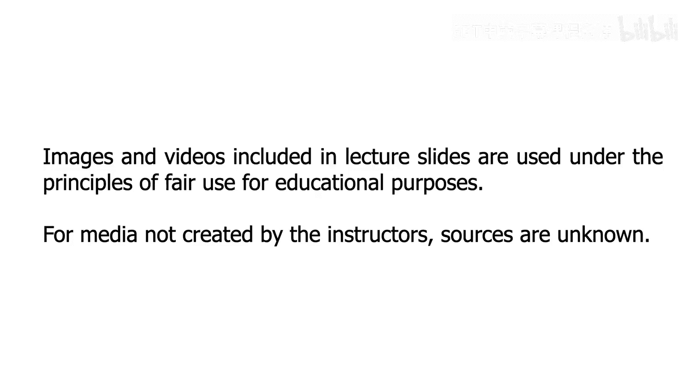
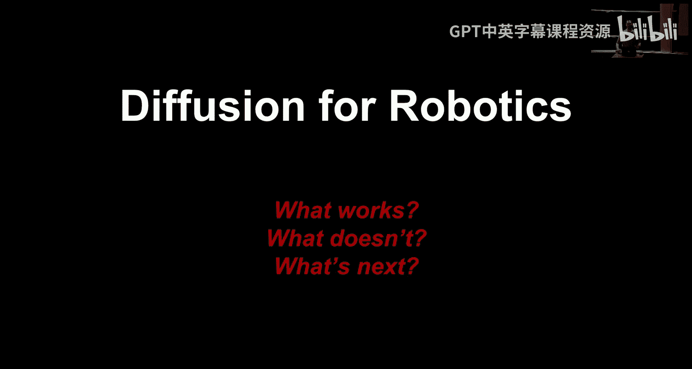
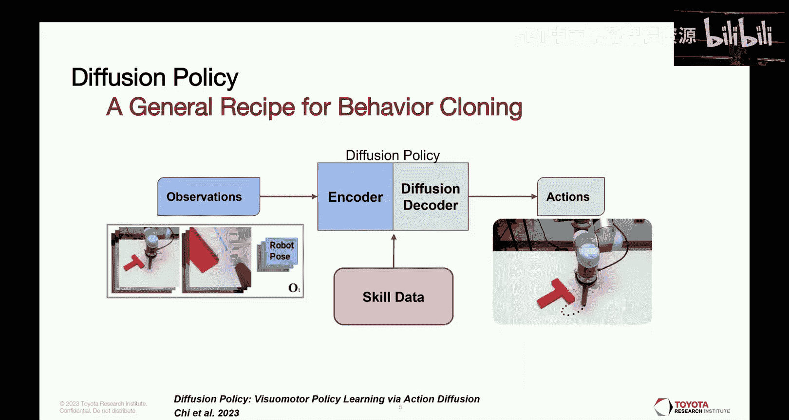
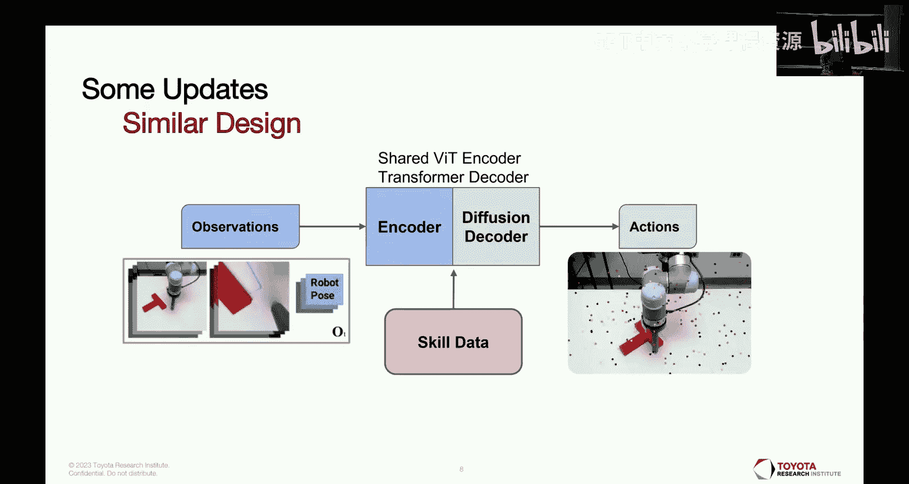
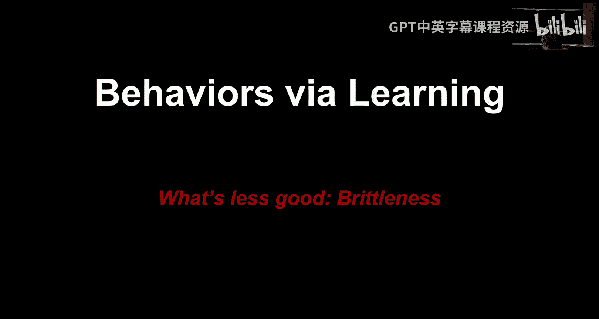
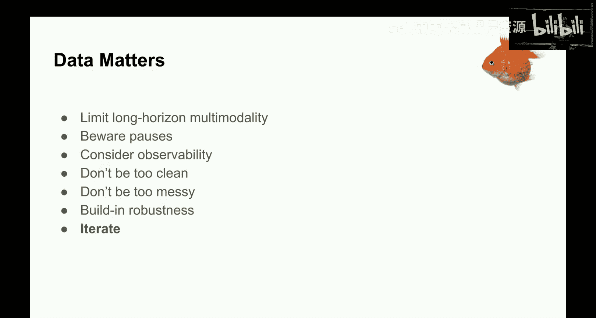
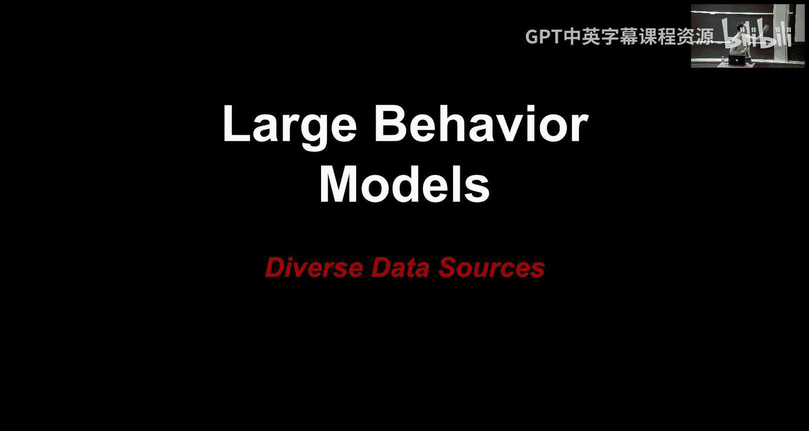
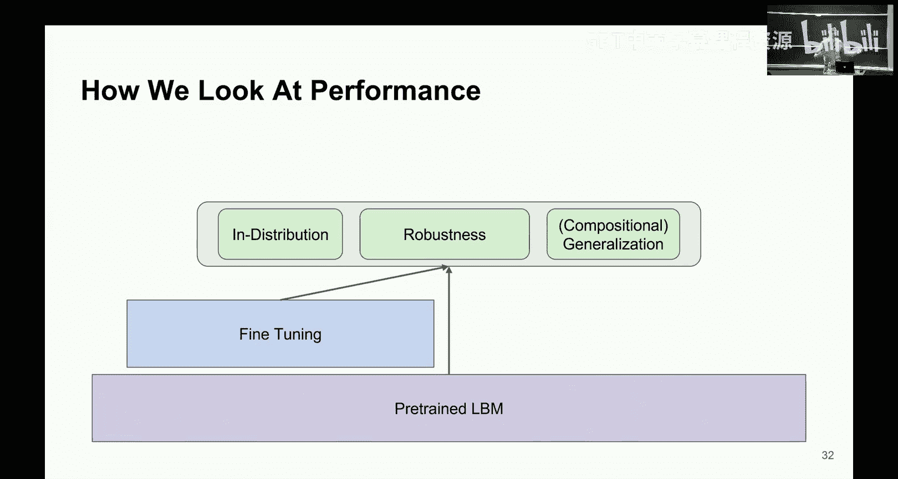

# 《流匹配与扩散模型｜6.S184 Flow Matching and Diffusion Models》中英字幕（Claude-3.7-s） - P5：Lecture 05 - Diffusion for Robotics. - GPT中英字幕课程资源 - BV1gc8Ez8EFL

Alright， so hello， everyone and welcome to our last lecture。 As you know， in the last two weeks。

 we learned about flowing diffusion models as powerful models to generalative modeling and to sample from distributions。

 as we also learned， this could be， in principle， applied to a variety of disciplines。 And today。

 we're gonna look at two of these disciplines。 And we're going to start off with robotics。

 And it's my big honor and pleasure to introduce Ben Bfield for this。

 who is really a leader in the field of applying diffusion models to robotics。😊。

He's a team lead and staff research scientist at Toyota Research Institute just across the street right and he leads the team to talk about large foundation models or large behavior models and I'll leave the rest of you and I just want to say thanks a lot for taking the time out of your busy schedule to teach us about robotics and diffusion models please help me and welcome welcoming Ben。

Wonderful， very excited to be here。 So I expect this talk is gonna be a little bit of a different format from what you all had the last couple of weeks。

 So you all at this point should be pretty familiar with the technical details of diffusion and flow matching。

 I'm going talk a little bit about what it's like to apply those in practice to robotics。

 There's a lot of details that actually turn out to be pretty different from doing something like imagegen。

 largely because you have different magnitude of data。

 And because the thing that you care about is closed loop performance。

 which means these models can sort of distribution shift themselves as you deploy them。

 I'll talk about that a little bit。 But first， just a little bit more background。

 So I'm part of the senior leadership for a new division we have at TI。

 which is basically applying AI to solve robotics。 we call ourselves large behavior models this is the sort of echoing a large language model。

 But now these are models that can be deployed on a robot and directly command lowle robot。😊。

But are still trained with large amounts of data。And so our mission is kind of twofold。

 We're going to build these things and keep pushing the state of the art of what's possible with learning based robotics and also be building out the science and AI based manipulation。

 We pride ourselves in being quite open with our research and you know。

 really helping build up the understanding of why do things work and you know。

 what does that mean we should do for the future。So I actually started off not as a roboticist。

 My original background was computer vision and I got into computational photography then I got pretty excited。

 this is sort of before generative models were cool。 some of the techniques were different。

 but I got very excited about generative modeling for creating 3D shapes and I did a PhD at Duke with George kindnadaris who was there at the time and just was sort of the perception person in a robot lab and kind of got suck in so I I did a st of self-driving。

 I was at Aurora for an extended internship back in the day when they'd sort of just split out of Uber AG I sort of dabbled to going that direction for a while。

 but robotics is pretty amazing， hopefully one of the things you all take away today is that it's a really exciting time to be a roboticist and you I consider myself sort of the AI machine learning computer vision person that just realized that robotics is kind of the coolest and most exciting application for these technologies。

So there are gonna kind be three parts of this talk。 And it's meant to be super interactive。 So I。

I think I have some interesting things to share。 But one of the most fun parts， I think， is。

 you know， I'm here and at your disposal to sort of ask questions to。

 I I there's like a dozen different talks that I could have made。

 depending on what people are interested in。 So interruptions are great。

 and I'm happy to kind of go a little bit deeper in places that people think is worthwhile。😊，Anyway。

 I'm going to start with what can we do right now。 What works。

 I'll talk a little bit about the design decisions that are required to make things on work on a robot。

 Also talk about what doesn't work。 We haven't solved robotics yet。

 And then you know what we and actually recently， there's been a lot of excitement in the field about applying AI to robotics in particular。

 applying diffusionbased methods to robotics。 And I'll talk about what we're doing and sort of what the field as a whole has been focusing on。

So just a brief reminder of the the sort of diffusion。Overview。

 So the basic approach is actually very similar to something like image diffusion。

 So you're conditioning now， instead of， let's say， on a language prompt for generating an image。

 the simplest formulation。 And this is what we started with a few years ago is that you just condition on observations from your robot。

 So you can think of this as creating a single behavior。

 You have one thing that you want the robot to do。 And now you have a diffusion model。

 which conditions on observations coming from the robot from the cameras and also where the robot is in the world。

 we call robot pose or proprioception。 But like where the robot's arms are。

 And then what you're doing is instead of denoing an image。

 you're denoing waypoints on a trajectory into the future。 And each point in this way point。

 these are 10 Hz commands。 So we're predicting a chunk of time instantaneously。

 That's like two seconds into the future。 And that's consisting of each of these waypoints pretty densely。

 And then we just do inference online。 So you actually don't roll out predict。window into the future。

 You don't roll out that entire window。 But as soon as you're done with your next set of inference。

 you then switch to the new plan。 So you， you put this diffusion process in a loop。 And as a result。

 you know， you really want models that can。Complete inference in at least under a second。

 faster would be good。 But， you know， you don't want to go open to open loop too long because then the robot can't react to things in its environment that haven't gone as planned。

And this is a very simple 2D example， makes it easy to visualize what's coming out of the diffusion model because pose here is only a point in space。

 There's no orientation。 And so the the task of like push a block into a new position。

 you can see when you start the denoing process。 your trajectory is random noise。

And then you diffuse it into something。That's coherent。

So it turns out you can do quite a lot with this basic recipe。 like for us。

 at least a shock shocking amount。Here's one of my favorites。 And again， this is just the basic。

One behavior at a time formulation。But with a lot of tips and tricks。And zero structure at all。

 There's no code that was written specifically for this behavior。

We just collected several hundred examples。And you can get things。That show recovery。

Will sort of autonomously retry without being programmed。The formables。

Things that are hard to model visually or no problem because you don't write down any structure。

 You just。Let the data do the， do the speaking。anyone here who is familiar with sort of the history of robotics。

3 or four years ago， this basically wouldn't have been possible。 I mean。

 maybe you could get a team together。 And if that team worked hard for like a year。

 you could sort of build a brittle demo out of this。 But， you know。

 we did it in a couple of days kind of casually。 And it's fundamentally just like a new thing， yeah。

Yeah， absolutely。 So let me。So this is one of the ways that we collect data。

 But just like if you're training noing model to create images。

 you start with a big data set of images， we start with a data set of actions。

 So teleop is the most natural way to do this。 This is our most complicated and probably coolest teleop device。

 It's a short clip all around that one more time。 This actually gives the operator haptic feedback。

 which is kind of neat。 We also do Vr teaching quite often。

 we have a six degree of freedom mouse that is common in graphic design。 We sometimes use that。

 We actually even have methods where people can hold a handheld data collection device。

 So instead of the robot， you're basically holding what looks like a toy grippper with cameras on the wrists。

 And in practice， we collect data through all of these methods。

 And then we sort of amalgamated together in the second part of the talk。

 I'll sort of talk about scaling this up beyond one behavior。

 But all the things that I'm showing here， you can think of someone SAT down for a couple of hours and done teleop。

 And usually it looks like a few hundred demonstrations like this。😊，是。So。We have a few different。

We've had a few different robot morphologies。This particular one， I'll let it play while I talk。

 Sorry hard to pause this video， apparently。

So this particular one has a four camera package。 There's two scene cameras you can't see out of frame。

 They're kind of mounted on a tripod above the table。

 and then those cameras above each of the grippers。 those are wrist cameras。

 We've actually move to a six camera configuration more recently。

 So you have one wrist camera on each side of the gripper， but we're pretty flexible。

 we have come to realize that it's actually very important to have a gripper on the wrist。

 I'll talk about failure modes in a little bit。 but one of the things that's very easy with a static robot like this。

 if your scene cameras are always in the same place in the world。

 the policies that you train they'll kind of learn to assume that the cameras in exactly that spot。

 and it becomes quite brittle， actually， if you bump the camera by a small amount。

 everything will break And we actually this concerned us for a while when we discovered that this happened。

 But one of the solutions that we didn't really expect is when we started out a wrist cameras initially just hey。

 there's things that you can't see easily from the static cameras。 Let's put a wrist camera on。

 and we shared the image encoder。 So it' it's a single backbone that we started。

Thats shared between these risk cameras and the scene cameras， actually。

 the risk cameras serve as a sort of like image randomization for the features that are learned because they're always moving and there's so much diversity。

 And this largely fixed our issue of the static scene camera gridttleness Again。

 these are the sorts of issues you don't usually have if you're doing image generation because the data sets are so big is's very hard to overfit。

 But when you're training a robot behavior， this is actually a tiny amount of data。

 this is data at about 10 Hz and maybe your behavior is like a minute long。

 So that's 600 samples per episode And maybe you're training you know100 episodes。

 So you know you have maybe tens of thousands of data points like it's very， very small actually。

 it's kind of shocking that this works even。呀。With what。要。For this。

 and for a few of the things I'm about to show， it's one behavior at a time。

 What we're doing now and what the field is really moved to is actually training a generalist model that can do many things。

 The common way to do that is with language conditioning。

 So you tell the robot with language what you'd like it to do， you can also show it a goal image。

 There's a few other sorts of approaches。 But it's exactly right， kind of jumping ahead。

 There's some limitations when you do everything from scratch。 And if you want to mix behaviors。

 you need a way to tell the robot what to do。Okay， I'll take one more。

 and then I'm going advance a little bit。 Yeah， way in the back。Yep。

 so we actually roll out multiple steps at a time， but not as many as we predict。

 and we do it asynchronously。 So you can think of it on the robot side。

 There's basically a buffer holding actions。 And there's actually a low levelvel controller that's commanding the robot at know half a kilohertz or kilohertz。

 And there's a little bit of good old fashionioned robotics control under the hood that's doing things like protecting the robot from moving too quickly。

 protecting it from hard collisions。 So the commands that come from the policy。

 which also we do the same thing for the teleup demonstrator。

 Those are sort of sent through the safety layer and then interpolated to super high frequency and streamed to the robot。

 But above that， there's a buffer of these low-level commands that we're filling up。

 So we might predict a horizon of let's say 16 or 32 actions into the future。

 We dump those into the buffer。 And then we start inference again immediately and。Maybe we execute。

 let's say， half of the actions in the buffer before inference runs。 And then at that point。

 we'll just overwrite what's the buffer and kind of keep going。 And if you have a problem。

 like maybe there's other things running on your machine。 and inference is a little bit slower。

 you can just execute farther along that buffer before you refresh it。

So there's been some design improvements。 we had an initial paper in partnership with Sharon's group。

 actually， our first diffusion policy work was an intern project。 Zhang Qi。

 who's just a phenomenal researcher was kind of with us for the summer。

 We were doing robot teaching but without diffusion and you know he just had sort of this idea， hey。

 what if we treat this as as a diffusion modeling exercise。

 and that original formulation a few years ago is surprisingly strong。

 but we've made some sort of standard upgrades to the small scale bit。

 know our backbones are now transformer based， we discovered it's very beneficial to actually pool features between the cameras。

 So you want a larger shared encoder instead of multiple separate ones。

 we have versions with a transformer head that look sort of like diffusion transformer for those that are familiar。

 but mostly this is still state of the art if you want to do something from scratch。

Here is。Just a little bit of a sample of the sorts of things we've been able to do。

 I think at this point， we've collected data for many hundreds of behaviors。 I've。

 I've personally seen us。Gotta be over 100 behaviors I've seen run on the robot。

 I think just in terms of。Getting robots to do kind of an arbitrary assortment of tasks with machine learning。

 we may be the most experienced research group in the world making this happen。

 This is also I should say， our standard station。 we've got a new platform coming up now which is mobile but this is our standard bi manualual station and you know we've done deformables。

 we've done wiping here's an example of sort of a halfcooked skills。

 So I wanted to give you a sense of our development process。

 we've got a full- time team of robot teachers that are sort of constantly teaching new behaviors constantly building the robot curriculum and sometimes we do some prototypings。

 This's like an progress behavior that we decided to teach It's like I wonder if we could take clothes off a hanger and in this case。

 turns out yes and then。With some more cooking， usually。

 we sort of extend these things and make them richer。 Often。

 our first versions are sort of these very small snippets of like， hey。

 can we make this individual piece of behavior possible。嗯。For some reason。

 folding turned out to be very easy。 This was like before we started this project several years ago。

 cloth though， it's super hard。 we think folding is super hard。

 foldolding kind of always works for us。 It's sort of weird。

 I think as best we can tell the visual features are just really obvious like if you're looking kind of top down。

 the thing that you care about takes up a lot of the camera and changes in the topology of the shirt mostly correspond to very obvious visual changes。

 So we've had good luck。 know and this one is one that we spend a little bit of time with because we wanted to sort of push it a bit。

 So we added some more nuances to the behavior like recovery and straightening。

 This is still one skill。 So you can do this pretty long horizon。

 these policies don't have a lot of memory right now。

 that's actually again one of the limitations currently if you make the observation history long。

 at least in this from scratch regime。 the policy starts to get really brittle and that's probably a data limitation。

 although we're looking into ways that we could maybe help reduce that effect。Now。

 mostly people have like a second of memory。 And that's not an architectural limitation。

 It's just things don't work well when you increase it。 So these super long behaviors。

 you can almost think of as many small behaviors ass just the robot looks at what the environment is。

 And that sort of keys it into what mode of operation to do。 But， you know。

 you can implicitly chain like maybe 10 different things。 like you can fold。

 You can slide the thing around。 maybe you go do something else in the scene。

 and you can throw that all into one policy and it just kind of mode switches fairly well。要。对呀。Great。

Great， so closer to joint angles。 We've done joint angles。 Our most common representation。

 which is what we do here， is。Commanded and defector pose。

 So that's basically like a six off command for each of the arms。

 And there's a little bit of nuance there because actually under the hood where running is something called impedance control mode for those of you that don't have a robotics background that basically does is it takes a position command So just think for a second like translation。

 So like you'd like to you move your arm your hand to a particular point in space。

 it takes that and it actually translates it into a commanded force。

 And so when you're not in contact with anything， that kind of doesn't matter。

 you can think of it as like a gain of like how quickly do you move towards what what you've commanded。

 But when you're in contact what that means is that you'll only push so hard。

 So if I command down below this table basically the robot will make contact and then depending on the gains of this controller will actually apply a certain amount of force where that command the farther it is below the table。

 the more force it's now applying。 So even though the commands here sound like position。

 the policy actually is able to essentially be soware。And in fact。

 because we give it a tiny bit of history， it can actually look at， okay。

 what did I command previously and where am I now visually And the delta between that also lets it infer the force that it's applying。

This one， a little bit inspired by the earlier soap one。 we， we again。

 put another round of polish and decided to do some， some different things。

This is from our Palo Alto office。 We've got an office by MI T in an office by by Stanford。

 And the part of the team out there has really enjoyed kind of messing with this one and trying to break it and。

😊， apparently， there's a lot of coffee drinking。People get excited by not having to clean up their mess out there。

But the reason you know， I think it's cool。 And I think we all think this one's pretty cool。

 is you can see how closed loop it is。 You know， it basically is going to keep wiping until visually。

 the liquid is cleaned up and。We take this for granted。

 like you get these effects very easily doing this sort of learning for robotics。

 But a few years ago before I would say this sort of generative AI explosion。

 there was a lot of skepticism for behavior cloning。

 which fundamentally is what this technique is like it's supervised learning where here's examples of robot doing thing。

 fit that。 There's a lot of skepticism back in the day because it's like， well。

 isn't this basically just playing back trajectories or like it's only going to sort of do what you show it。

 maybe it's doing a little bit of interpolation。 And that view fundamentally is not wrong。

 But the negative connotation was wrong。 Like it turns out that actually you can do quite a lot。

 And if you are careful with how you curate your data and you scale up the recipe a bit。

 you can do pretty amazing stuff。呀。Okay， hold your hold your question for like 30 seconds Before I get to that piece。

 which is an excellent question。 I also just wanted to mention。

 So everything I showed was real worldorld robots because that's sort of the most fun。

 We actually do a huge amount of simulation work both for data generation， but also for evaluation。

 It takes a lot of effort to evaluate these things on a physical robot and you're limited by the number of robots you have in the last month or two。

 I think we've done over half a million evaluation rollouts in simulation。

 we have a sort of internal benchmark we've built。 that's like almost 40 different behaviors。

 we use the Drake Simulator。 So so Russ Chadrick whos the head of our group。

 Drake came out of his group。 Sorry， this is actually now that I'm seeing it on the screen there's terribly low resolution clip。

 actually the graphics are quite good and don't have this aliensing。 But in any case。

 we have these scenarios which are quite realistic in Drake that we use sort of an automated benchmark we as well。

 I， I won't let this whole one play out。 It's not the most interesting behavior。

 but just to show you， you know， we can do， we can model a lot of the things we do in the real world fairly faithfully and soon。

The other bit， and then I will get to your question about going out of distribution。

 The other bit that's neat with this recipe is there's nothing special about cameras。

 You just have a essentially latent that you're conditioning on。 And with a camera。

 it's very convenient to have something like a VT is the encoder to get that latent。

 you can get those latent from anywhere you want。 So you can get them from language if you'd like to use that to specify what the robot should do。

 you can also get them from other sensors。 So we've done a fair bit of work these tactile sensors。

 there's a few different flavors we've used One version is you have either a gel or an airfilled membrane and you have a camera or another sensor like that behind it。

 And so you can see here we this is like a big bubble fingertip that you can view the deformation behind the bubble。

 if you do this， you actually get pretty neat sort of touchware policies。

 We've done things like tightening a bottle cap， for instance。

 where it's actually hard to sense when you fully tightened it。

 And you put one of these sensors on without again。

 really changing any of the code you very naturally start stopping when you feel the bottle get。

For instance， the big difficulty is you need to expose some of this information to the person。

 So you know， sometimes we visualize it on a computer monitor。

 but that's actually the hardest part of making this happen on the AI policy side。 It's pretty easy。

Okay， so out of distribution。 So this all seems amazing， right， And like。

 we've done all of these things。 And it's pretty cool。

 Most of the things that we can think of to do that the robot physically can do。

 We can get a version of this to work pretty well autonomously。😊。

Where the caveat of pretty well autonomously is it works in our lab。

 And the thing that is much harder is these policies are quite brittle。

 And the reason they're quite brittle is they're not trained on very much data。

 Every time we train a behavior， we train it from scratch。

And that means you can go out of distribution。 So this is a behavior that we trained。

 And then I believe actually， that the cameras were changed here。

 like to a different type of camera since we trained it。 And anyway， there's some distribution shift。

 This one wasn't bad。 It still kind of works， but。You can see here now there's been enough of a change that the robot isn't actually grasping in quite the right place。

And if we wanted to fix this， what we'd go back and do is we'd add more demonstrations kind of showing probably this recovery。

 So like when you， when you're mis grasping， okay， you should move to recover。

 But we didn't do that here。 And this is sort of the gentlest form of being broken。

There's another early prototype of a a different folding skill。 I said they always work。 But。

 you know， you can still， it's still very easy。To make that not happen again， when， when you know。

 there's a robot station change or in this case， actually。This robot has some mirrors on the wrist。

 This is kind of a prototype based on our handheld data collection devices。

 These mirrors give it some peripheral vision。 And we scratched the mirrors。

 And I had the great idea that we'd replace them with new mirrors。 And that didn't work at all。

 And I looked at the old mirrors。 and they were already like really dirty。 And I said， okay， well。

 maybe we can artificially sort of dirty these mirrors and。😊，Yeah， it didn't really work anyway。

 But this is the sort of stuff that you'll get when you train on a small amount of data and you go out of distribution。

 jerky sort of hesitating motions， right， You can now see that the。

 the sort of off of your smooth manifold that you've learned。

You can often sort of tell that the robot isn't really happy before things catastrophically fail。

And then when you really are out of distribution， all bets are off occasionally。

 you'll flail around randomly as well。And then there's a sort of final failure mode。

 Let me skip ahead here。 That's pretty common。 where you just kind of get stuck。 You know。

 the policy is sort of stuck in one of the modes and isn't jumping to the next one。 And usually here。

 this is because as you did your demonstrations you were like very clean。

 Like you always did it exactly the same way。 And now there's been something's gone a little bit wrong here。

 In this case， it it could be that that towel is soaked in a little bit too much coffee。

 So maybe it looks different。 But you know， the policy is expecting a very particular set of circumstances。

 just sort of switch into the next mode of behavior。 And it isn't seeing that in its observations。

 And so you're now in a sort of out of distribution place that ruins that mode switch。

Does that get to some of your question。Okay， so。One of the takeaways here is that the data actually really banners。

 We spend a lot of time on the policy side， a lot of time。 in the architecture side。

 these things matter。 the data matters a lot， too。 one of the big ones is I call the lack of longter memory。

 you know， the goldfish effect。's like as we teach people how to be good robot teachers and what good data looks like。

 It's like， you know， remember that these things are goldfish right now。 So。

Limit what we call long horizon multimodality。 So diffusion， as I'm sure you all have learned。

 is very neat in that it can model a multimodal distribution。 So in the image case。

 that means that maybe you have you know brown dogs and you have red dogs。 and that's not a problem。

 you know even though having something that's sort of like in the middle like half brown and half red is probably pretty unlikely。

 these models don't usually sort of blur the line between the modes。

 you'll like crisply get a sample that looks like a dog or not。In the behavior case。

 that's also pretty nice for us。 It means that usually you don't do things like， okay， well。

 I could move my arm， you know， to the left of an object。

 I could move my arm to the right of an object。 I'm going to sort of average modes and and blow through the middle and have a collision。

 That used to be a big problem a couple of years ago with behavior cloning。

 diffusion' is really good at that。 The thing that's still a problem is long horizon multimodality。

 So I have a plan。 You know， I'm gonna wipe up this spilled coffee。

 Maybe I'll pick the coffee mug up first and go from there。

 Maybe I'll pick the towel up first and go from there。 And sort of fundamentally。

 these long horizon steps could be a different orders。

The diffusion models don't do so well there because they don't have enough history necessarily to know which mode they've committed to。

 And so what you'll sometimes see in that case is you'll kind of start down one mode。

 And if it's not visually obvious what mode you've picked。

 you sort of start down another and you get a little bit stuck in this kind of indecisive situation。

Auses are a big problem。 So again， learning from demonstration。

 and I don't think there's really an image example that's a good corollary。

 but it's very easy if if you're teaching a robot to sort of sit and think。

 And the problem is while you're doing that， you're teaching the robot that in that particular situation。

 it should be still。 And again， your history is about a second So if you're still for at least a second。

 the robot has a bunch of data in its training example showing in this situation。

 stop and do nothing and you'll sort of be like that forever。

 or in practice until your stochastic denoising process。

 gives you something that moves you just enough to sort of break you out of this cycle。

 of my compatriot Con， who's kind of a resident robot whisper。

 he spends a lot of time with a robots kind of getting them to work。

 he has sort of a wave he does when he's working with a prototype behavior and the robot sort of freezes。

 he'll sort of wave in front of the cameras to inject enough noise to kind of break it out of that situation。

Consider observability。 This one sounds obvious， but it's surprisingly easy to mess up。

 The robot sees through cameras。 The operator sees through their eyes。

 or actually the right thing to do is that the operator should teley up through the robot cameras。

 And in fact， with our mobile platform， that is what we're doing with these stations that isn't the case。

 you need to be very careful to make sure that you aren't cheating And looking at something that the robot just can't see。

😊，Like I said， sounds obvious， but it has tripped us off before。And then don't be too clean。

 So like you would think， oh， I'm going to teach a robot kind of like I teach a person， you know。

 an adult。 Let me give you like one example。 Here's the perfect way to do it， do that。

But that's not really how it works。 These robots don't know anything in this paradigm。

 like you're starting from scratch。 So you actually want to show it some small mistakes。 You know。

 what happens if you miss a little bit。 Well， okay， adjustin and sort of retry what happens if maybe。

 you know， you're folding a shirt and it's wrinkled。

 You want to like smooth it out and then maybe you don't get it in the first pass。

 So like you want to kind of keep going。 you want to build some of this in。But not too much because。

 again， all of this is going in the training data and you don't want to teach the robot to be subop。

 So when you're doing single behaviors from scratch， especially， there's a bit of an art to it。

 And actually are very good robot teachers and the people that have been in the team for a long time They have this pretty good intuition that has a surprising kind of learning curve to build up。

And then， you know， the other bit， too， which sounds obvious when you say it。

 is that you need to build any robustness you want in there。 So if you'd like to be robust to。

 let's say the object you manipulate being different， you know。

 you could have five different rags that you're using to wipe up your coffee instead of just one。

 you should probably show that variation in the training data。

 And if you want to be really robust to let's say a bunch of stuff happening in the background。

 you should probably show that in your training data。

 And it's pretty obvious that this doesn't scale。 like it is important。 we do it。

 but you aren't gonna solve robotics every time you want to teach a robot something new。

 sort of building up it's。Common sense from scratch like that。嗯。

And there is definitely an iterative thing that you need to do as well。 So like I said。

 we often prototype and then add more data and sort of patch bugs。 And。

 and that tends to be the way to do it。

嗯。Speing issues。Notwithstanding this sort of robustness， like I said， isn't free。

 And the real problem is just get doing it manually every time doesn't really scale。

So that's the end of sort of part 1。 And I'm gonna talk about where， where we are now。

 where the field is now。 And that's doing multitask learning with much larger amounts of data， yeah。

有。有。Y。是。So it really depends on who you asked。 So equivariance has been popular in robotics and and M L powered robotics for years。

 actually， Costa Stanelidees did a lot of great work back in the day。

 He's at Uen and Grlab on equivarian architectures， for instance， applied to robotics。

 Some people are still very bullish on， you know， let's design things to be equivariant。

My views evolved a little bit over the years， I think。You want equivaris。

 But my personal view is that。You'll you'll learn the stuff that you would sort of think to design in anyway。

 So there is a cost whenever you add structure， let's say， especially to your model。

 that's my least favorite way to do it， because you're going to be wrong sometimes you build a model that's naturally equivariant and that's great in the situations where it helps。

 but there are places where actually the world is not equivariant with respect to your actions or your representations。

 know you knock something off a table。 And all of a sudden。

 the position of my phone here and cause an effect of equivariant until suddenly there's a huge discontinuity。

 and pretty much any structure， not just equivaris， but pretty much any structure like that。

 that you could think to build into a network。 my view is that either it's completely ubiquitous and it's sort of always a good thing。

 And in that case it's probably going to be present in all of your training data。

 And as you scale up， you'll learn it anyway。Or it's a little bit subtle and， you know。

 maybe important， but basically impossible to completely write down what you want。

 So I like doing these sorts of things on the data side， on the supervision side That not to say。

 don't spend any work getting it， But I would rather have something like an auxiliary loss designed to encourage these sorts of things that to build it into the architecture。

Okay， so not the focus of my talk， which was mostly on diffusion for robotics。

 but in just a few minutes at the end， I want to sort of talk about where we are now。

 and that is training on a lot more data。 The super short version is when things are brittle and you want to juice performance and increase robustness pull in a lot more data is a recipe that's worked quite well and basically all parts of machine learning the only problem is that there isn't that much robotics data sitting around。

 that's kind of the main thing that keeps us from just turning the crank evaluations hard to actually because you need to close with beal。

 but on the data side， there isn't that much robot data。 That's like one of the main issues。

 So in robotics usually the thinking these days is okay， well。

 you're gonna to pull from really diverse sources will take everybody's robot data from the Internet。

 there still isn't that much of that。 let's build on top of pretrained language models and visual language models。

 or even pull in these data sets directly to build these multimodal models that can produce actions or language we're very interested as well as a few other groups and also in。

ating video generation alongside action prediction。 There's a lot of overlap。

 If you imagine you have a language prompt that says， hey。

 robot do a thing and you need to predict a video that shows your robot doing it or you need to send commands that show you know that have your robot do it。

 not a perfect， you know， one to one mapping。 but there's a lot of overlap there。

So this is kind of plan A right now for people。 There's also a posttraining regime that's opened up that I really don't have time to talk about today。

 but in terms of the supervised learning， this sort of transfer learning from diverse sources is plan A。

And there's a lot of ways to do that。 Like I said， we like language。

 The simplest version is that you slap a language encoder alongside your observation encoder。

 then you plum in all of the language annotated data that you can find lying around and you're off to the races。

 just throw all your data in and turn the crank And this works although there's some steerability difficulties。

 So actually there's still a lot of work going on figuring out how to make these models zero shot perform。

 This recipe mostly seems to work fairly naturally if you build these models and then you do fine tuning on top of it some work with collaborators early this year on open VA。

 which had a version of this models like mostly not that good out of the box seems like the pre-trained representations are decent。

 but I would say this is a very hot active area of research of how can we do this effectively have the best performance we can out of the box have steerable models and be more efficient with our data。

So this is just a little more detail on this sort of architecture that we might use that includes language。

 We， we use a lot of clip and coders on the language side for these smaller models。 For instance。

 Most things have moved to transformers。 I I had not a ton of time to dive deeply。

 But just for those of you interested in a few more of the nuts and bolts。

 this is the kind of thing that we do。If you squint at this also。

 you might see that okay well now you have something that looks like a vision language coming in。

 and then you might look around it what pretrained models you can find。

 and you might notice that VLMs look a lot like the right sort of input and output paradigm for this to work。

 And Google actually coined the term VLA a couple of years ago， they had the first early version。

 but this is basically the process of taking a pretrained visual language model and then bootstrapping on top of that to learn behaviors。

 it's also quite promising we have a few versions of this internally。

 But the simple ones really are quite simple。 you essentially are just taking the output from a pretrained VLM doing something like cross attention。

 although actually how you do this conditioning turns out to matter a little bit。

 But here's one of these fairly simple recipes that you can do。

 And now you've turned your visual language model into a robot model when you fine tune it with actions。

啊。Very final thing is， you know， talking a lot about learning one behavior at a time。

 We often would think about this in two ways， like。

 how well do you do in lab conditions is like in distribution， And then is it bttle。

 How robust is it， If I change some stuff， If I change the object， if I'm standing in the background。

 does it still work。When you have a pretrain model。

 there's this sort of new axes now that you care about as well， which is generalization。

I usually think about compositional generalization as sort of the first piece that'll emerge。 It's。

 you know okay， maybe I have one type of object and I've learned if it falls over。

 I can stand it upright。 and maybe I have another type of object。

 And you know I've learned to stack that object on top of something else。

 So an example of compositional generation generalization would be maybe the object that I know how to flip upright。

 I actually can flip it upright and then stack it。 So， you know。

 it's something new that the robot wasn't actually trained to do。 but it's not completely new。

 It's just your sort of composing things within the training data。

 And this seems to kind of be the big supervised learning regime scaled up。

 This is sort of where you are and actually even like language models。

It seems like mostly they're still just having this kind of generalization。

 but in their very powerful feature space。 So even though it sounds like， oh。

 you're in the support of your training data that's kind of limiting， actually。

 nobody's really sure how much headroom we have。 And when that training data is big enough and that feature space is is rich enough and the learned manifold of behavior that you have is expressive enough。

This could get you pretty far。要。Like yeah。So， would。There's some caveats there。

 One of the caveats is that。We are still right in the middle of， you know， making these things good。

 So like we have a lot of these general models。 They all have some idiosyncratic aspects。

 If you still want something to work super well in a demo setting， actually from scratch。

 get a lot of data for that demo is a pretty good baseline。

 Part of the issue is that these models trained altogether can be a little uncooperative at the moment。

 So like。They'll do reasonable things， but maybe not quite what you tell them to do。

 So it depends on your notion of recovery。 One of the things we've seen anecdotally is they start to sometimes play a little bit。

 which is really cool。 Instead of doing random things。

 the robots just sort of picking things up in its environment， putting them down。

 flipping them upright， grabbing something else， you know。

 maybe sorting things onto the edge of the table。 And so there is like there is sort of a recovery in there because you're not just going out of distribution and like doing random stuff。

 which is what all these from scratch behaviors would do。😊，But like I said。

 I think we're still in the process of making sure these models are cooperative。

 You can take them and fine tune them， and then they'll do what they're told。 But you lose。

 you don't really want to have to do that。 It is， I think maybe right now。

 the sort of easiest way to like， see a clear benefit。

 But you don't really want to have to do that because you lose a lot of the benefits of doing this big pre traininging。

嗯。That was good。 We got a lot of questions in the in the middle。 So， you know。

 I planned here to answer more。 I guess if we have a few minutes left， we can。

 but I also don't want to， you know， blow through our time budget。😊，要。えをとな。Y。

So we are fundamentally looking to。I don't want to be too reductive， but。

Understand the science of how to solve general purpose robots with AI is not too far off。

 So the goal for us is not to solve one particular problem。

 We want to understand how to solve all of the problems。 And you know on the one hand。

 that sounds like a lot。 On the other hand， if you look at language and you look at vision and you look at a lot of the special purpose models。

 you know that we're very popular a few years ago， you really see that in many cases you start to get leapfgged by these generalists。

 And you know， actually just being sort of okay at a lot of things is very powerful。

 especially when you kind of get transferred between them。

 I do think that there's a time and a place for specialists。

 And I think it's likely that in many of these scenarios， you will want a specialist。

 But I think the best specialists will be made from a generalist。

 And right now we are really focused on figuring out how to make that generalist。要。有。So。Yeah。

 so if if I understand your question correctly， what I think you're talking about。

 So you have kind of two types of dynamics happening with these models。

 So during the denoing process， theres a there's actually movement。

 you know you're building this vector field。 And you can imagine when you first start denoising。

 you know you have this sort of garbage。 and then there's some dynamics of sort of how you get to the proper output。

 And then somewhat orthogonally， there's the actual path that that you're producing for the robot to follow。

And we treat these things pretty differently。 So we actually， we don't just do diffusion。

 We have auto aggressiveive architectures。 We also have done a bit of work with flow matching internally。

 The interesting thing with flow matching， which I'm sure you all now know is that actually the dynamics。

 you know， while you're doing your denoing are pretty different。

 You don't take the same path with flow matching， even if you arrive at sort of the same point as you would with diffusion and。

😊，We decouple that from the thing that's being predicted。

 partly to just make sure that those idiosyncratic aspects of like， how does the optimization work。

 They're not kind of changing what the robot does。 So the。

We take an action space that we think is reasonable that is sort of easy to teleyop in。

 And then that is the thing that we ask the policy to predict。

 And then the optimization that's doing or denoing is kind of the black box there。Alright， cool。

 I think then we're just at time。 That was really inspiring。 I， I remember seeing a talk from you。

 I think a year ago， and it's great to see the progress you made then very， very cool。

 We're gonna do a little break。 before we start jumping into the next talk。 But I think， you know。

 given this amazing talk， let's thank him。 Let's thank once once again， run on the call。😊，Thank you。

Thanks， thanks for having me。 And you know， I would be remiss if I didn't plug a little bit。

 you know， were always looking for talented people to join us， whether it's internships。

 collaborations。 We have an active university program or fulltime roles。

 So if you're interested in anything like that， reach out， let's talk。 and you know。

 we're just down the road。 So even things like lab visits can usually be arranged。😊。

