# 《流匹配与扩散模型｜6.S184 Flow Matching and Diffusion Models》中英字幕（Claude-3.7-s） - P6：Lecture 06 - Diffusion for Protein Generation - GPT中英字幕课程资源 - BV1gc8Ez8EFL

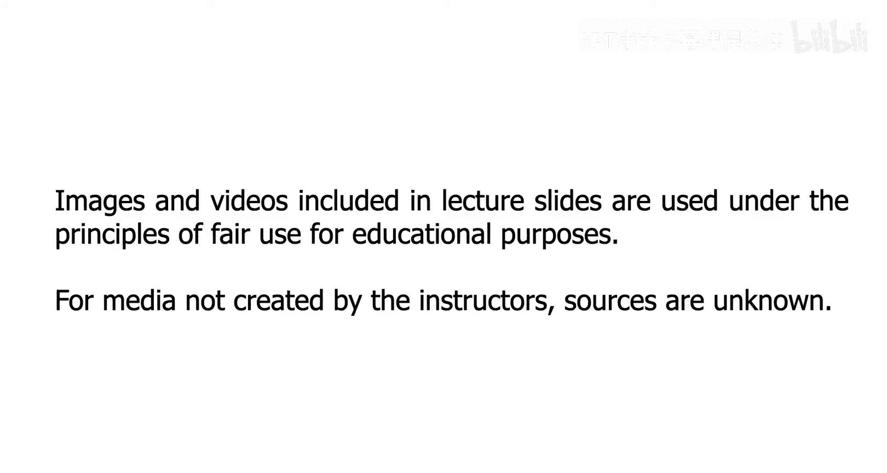

All right。Hey everyone and welcome to our second guest lecture。

 so we're going to switch gears a little bit and talk about diffusion models for protein design。😊。

And for that， it's my pleasure to introduce Jason。 Jason is a PhD student。

 supervised by Tommy Yakala and Rego Barcelay right here at MIT。

 and he really has been a leader in the development of flow and diffussion models for protein design and structural biology his models developed here at MIT and then also codeveloped with recent novel vice winnerer David Baker have been widely used in structural biology。

 And you want to hear that really what the potential and power of these models are。

 So thanks for coming。 Jason， thanks for preparing this talk。 all the best。 and well。😊。

We'll do around like 30 minutes of presentation。 And then I think we're around on time。

 that should be fine。呃。I think you have to turn it on。Yeses。Yes， it's on。 Alright， cool。 Alright。

 G let's give him a round of applause as a welcome。😊，Okay yeah， thanks Peter for introduction。

 So I'm me talking about diffusion models for protein generation and then downstream for protein design。

 if you have any questions， feel free to just say them while I'm talking as well。

 Def more slice than but hopefully will get those important parts。

 So I guess I'm gonna assume that people don't know what proteins are。

 but you probably know a little bit about from biology but going go through some of the basics and to motivate the problem。

 I think as we know of in biology proteins kind of carry a lot of the functions for life。

 one of the simplest things that they have to do is like DNA replication where just making like two cells you have to create copies of a DNA strand and proteins they're actually the molecular mechanism of how this works。

 and DNA replication Here's like a animation of how proteins kind of work together to create new DNA strands。

 this is kind of a very complex process that nature has taken millions of years to kind of come up with。

 but kind of unlike。

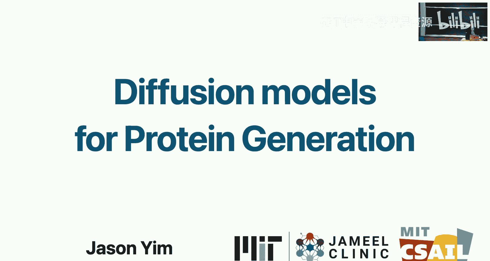

Nature nature having like billions of years as humans， we're creating a lot of issues for ourselves。

 like a lot of pandemicama is coming about as well as creating too much plastic and then even our own biology causing diseases that we have to rely on genome editing like using CRISPR type systems to solve for us。

 And so as humans， we've kind of engineered proteins。

 molecules to become drugs for specific needs for us。

 but this has to be done a lot quicker than the timescale how nature comes up with new functions。

 So you might ask like okay， we've we've seen vaccines like when Sars Covid2 happened。

 we came up with like vaccines。 So we kind of like technology to do some of this stuff。

 but why do we need AI。

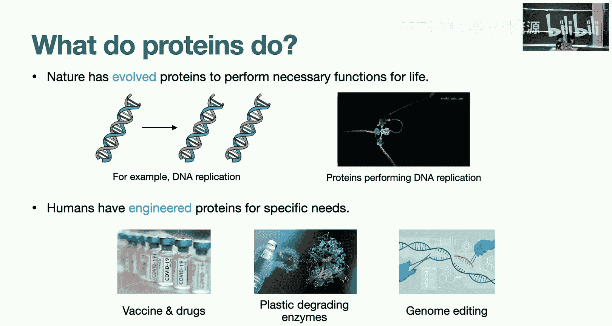

And I really like this figure to kind of illustrate the fundamental issue and kind of why AI is important in this space。

 I think as many of you are private computer scientists， Moore's law says that across time。

 the cost of transist So like go down exponentially。

 So then the costs of new compute that dramatically decreases。

 and that's kind of led to the computing revolution andvis like stock market prices and stuff。

 But then in biology， we have the opposite And so E's law is Moore's law spell backwards because the opposite happens over time。

 the cost of drugs doubles every couple years and so there's like logarmic scaling of drug costs。

 And so there's this crisis actually in the healthcare where it takes maybe like around 10 years and about $2。

6 billion if you make like a single drug which is kind of insane if you think about it。

 We have so many diseases and human health like there's a bird flu now and stuff。

 So imagine like we don't have eggs that costs $2 again in 10 years。

 That's kind of crazy to think about。 So kind of can AI actually accelerate this。

Timeline so that applicant can find drugs a lot faster。

So I'm gonna to talk a little bit about protein modeling to kind of make sure we have like this background knowledge DNA。

 I think as we all know， is like four letter vocabulary and then from DNA through to a central dogma that becomes like a protein sequence which becomes a structure and then the structure is kind of what we can look into and try to figure out like what the function of the protein is and each of these is like a different data type you start from like a sequence that has a four letter vocabulary to 20 to the 3D coordinates。

 So it's also this very multimodal problem as well。

 you have to care about both this discrete type of data structure and this continuous type of data structure and a function is this kind of like wild West that y'all have to care about dynamics of how proteins moving stuff。

 and kind of the way that I like think about it is this pointer works。

 Yeah DNA is kind of like the assembly language of biology and then like protein is like the python of biology And when you're trying to design stuff encode it's much easier work in python because it's like a much higher level thing that's closer to what you actually want to do。

That's why a lot of biologists like to work in protein space because it's often easier to work with。

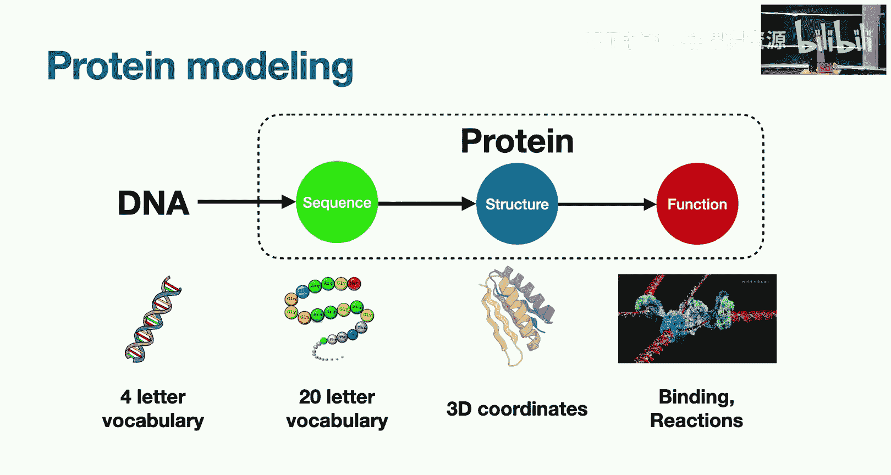

And kind of what is protein function if you're unfamiliar with it， This is kind of how a virus works。

 A virus will infect a human cell， and then it'll replicate itself， cause the cell to die。

 And as the cells die， we get sick and sometimes even die because of that。

How do protein binding stop viruses， you might try to design like a protein that's called an antibody or a body might make them itself thatll kind of attack these viruses。

 so itll kind of surround them and tell the immune system to stop it from infecting a cell。

 So if we can have a like an AI algorithm that can come up with these antibodies kind of almost immediately。

 then we kind of have like a one button solution to kind of kill any virus that might appear in the near future。

This is a very simplified example。 There's a lot of nuances here。

 but that's kind of the the basic of kind of how we might want to use this technology to create new vaccines and drugs。

And I think a lot of us are kind of known or kind of seen in the news a lot of revolutions in proteins and AI。

 the one that may be most familiar is Al too， which was an algorithm developed by deepmind where you'd go from like the protein sequence to predicting the structure。

 And this kind of was in 2021 kind of revolutionized AI and biology and a lot of people have been pouring into this field since。

 But then one other algorithm that might have not gotten so much attention is actually going to inverse way of going from a structure to a sequence。

 This is actually adjourned a model kind of based off a graph neural network that uses like an autoregressive generation along the structure And then also very recently something that I've been involved in was R of diffusion which was given like a function such as binding to get the structure from that。

 And so you can kind of see that color it very specifically because it kind of creates oop this kind of quite like a pipeline of how one might go damage。

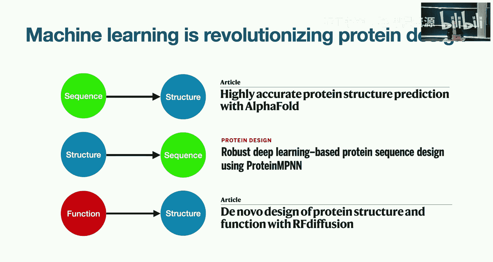

1， how one。Okay， how will Michael go from sequence the structure And like these developments have also led to the Nobel Prize in chemistry last year。

 So David Baker for protein design and then Des and John。

 a deep mind for the protein structure prediction problem and kind of the time frame。

 like if you imagine that Albu2 was released in 2021 and this award was only given know three years after Albu2 kind of just shows the impact of these algorithms what sort of impact they had in biology。

 It just kind of you know also Jorey Hinton or Nobel Prize in the same year really shows the impact of these algorithms so far。

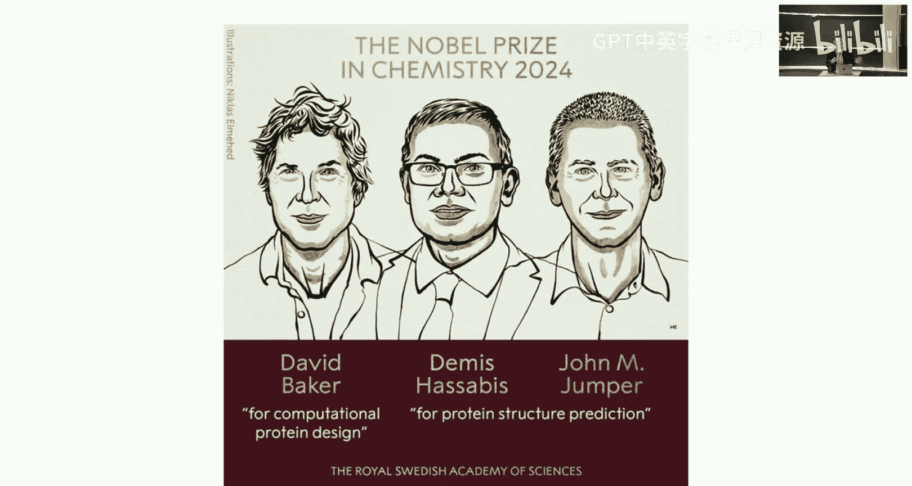

So in degen de Novo proteinme design pipeline， these three algorithms have kind of led to this pipeline that's been really successful in protein design。

 You go from a function to a structure to a sequence and you use alva fold to kind of filter and figure out the final designs and this is kind of like a little bit more of illustratetra a schematic where I might want to tell the model here generate me a protein that binds right here I'll create a structure that might do that and then I'll create a sequence that'll hopefully become that structure and then I'll use alva fold to kind filter out which ones I want to end up using And so I get ask this question a lot which is that why do you need to know the sequence。

 but the sequence is the ultimate thing that we actually want to get down to so that we can actually produce and synthesize the protein。

 So this pipeline has been very successful and kind of like before 2022 a diffusion the structure generation was the rate limiting step but diffusion models is kind of technology that has enabled this step in kind of what my research has been about So I'll be talking about this for the next。

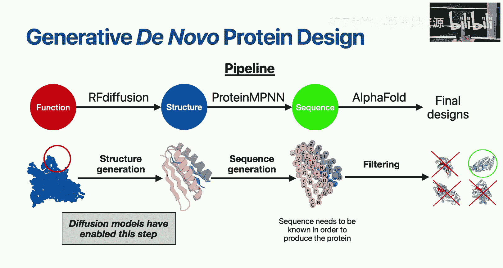

40 minutes or so。Okay， so I think the last thing to say is like if you're like entrepreneurship stuff like that。

 Journal of AI is having a huge impact in startup space。 So recently。

 there was a started by David Baker's La actually based off R of diffusion that is back to $1 billion。

 There's also like isomorphic laps， the spend out by deepmin where they have like these crazy billion dollar deals with pharma companies。

 And also there's like this language model based。Technology for a Per design that recently raised $ hundred42 million。

 So this is like also a very active space for entrepreneurship。

 If you want to work in AI and and technology。

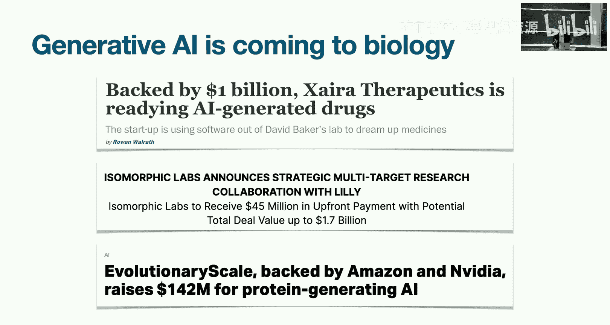

So yeah， last thing I'll say before I go into actually check details is kind of like what the overall goal and kind of what we actually want to get to。

 And this is kind of how I view it is that we wantative AI to create these molecular libraries of proteins for us。

 And we want to be able to use the experiment and optimize the experimental outcomes for them。

 So you can also think of this as like posttrain or fine tuning from like how open AI trains its models。

 I think if we can unlock this where we can actually connect the biology to the AI and have this iterative loop process。

 it also unlock a lot of things in bio design that will enable new drugs and stuff。

So the overview of what I'm gonna talk about， I'll first go over protein structure generation using diffusion models some of my own research。

 And then once we have this kind of basic algorithms of how to do structure generation。

 we've utilized them for downstream protein design tasks。 And something I probably won't get to。

 but I'll just highlight is we can also do this like multi space。

 both discrete and continuous space generation of proteins and then just go over some outlooks at the end。

So kind of the disarrated that we want is that we want an algorithm that can generate for one high quality structures。

 but also a distribution like diverse， also novel structures and also things that actually function and and work。

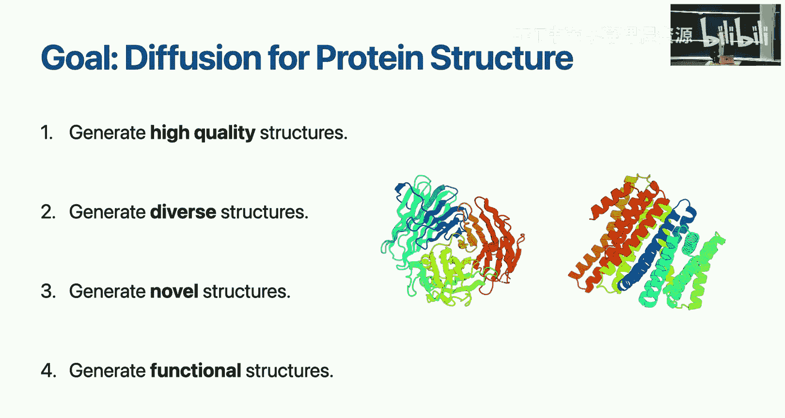

Yeah， so kind of like how do you actually model a protein structure it is basically just a collection of coordinates in 3D space。

 And so you might think， okay， the very naive things so let's just take the diffusion models that like Peter has gone through and with gasian noise and just apply them to every single coordinate here Now the issue when you do this is that because proteins have a lot of constrain to them that they have to like satisfy like biophysics they can't be clash with each other just because of physics and there's like this bond geometry that they have to satisfy that it's kind of hard to control the generation of these proteins because they're always like breaking and stuff。

 And so we actually had a paper in 2022 that tried this very naive idea of just apply gasian noise and trying to figure out like every single coordinate through diffusion it kind of worked。

 we also got into a conference but there are some issues with it that it was kind of difficult to scale and the performance wasn't so great for what we want to accomplish that said。

One thing I think has recently shown like the bitter lesson is that if you actually scale them to like industry level kind of like how deepmind or Google has。

 then you can actually learn like nonecovariant architectures and methods that can generate proteins with pretty high accuracy so that' that's like one option go do it but another option is that you can try to respect the geometry of a protein where there is like linear chain of like how the atoms are connected to each other you can respect this pattern that happens between every atom in the protein and then you can kind of just do diffusion over the angles in the angle space And so this kind of respect the geometry a little bit more but at least do this odd effect which is called the lever arm effect where if I change the angle just a little bit in one of these residues。

 then it's gonna cause this like humongous change in the protein that's going cause very unstable dynamics when you optimize or the diffusion over this。

 And so because of this you are respecting the geometry by keeping the bonds fixed but it's kind of harder control。

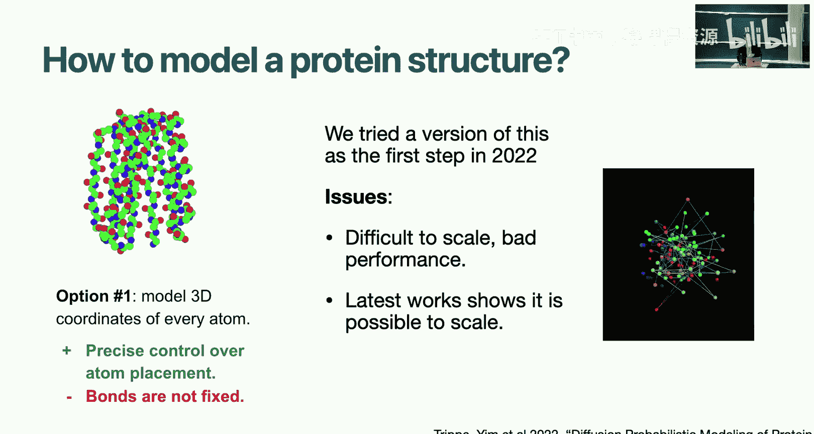

Aom placements。And so one thing that we developed was to something that's like in the middle between both of these is to model us frames along the chain。

 and I'll go into this little more detail， but this isn' the best of both worlds where that you have most of the bonds fixed while you also have like precise control over like where the frames go。

 And so this is kind of going into like biochemistry of like looking into how a protein is actually constructed but if we just like zoom into the atoms here into this little space I've kind of mentioned that there's this pattern of these four atoms that are kind of repeated throughout the chain。

 it's just kind of like flipped here and it's like also repeated there and stuff。

 We can realize that these four atoms are usually very rigid and then we can represent them by element of SC3 which is especially clear group that has both a translation component and then a rotation component and that actually is constructed by taking the two vectors coming out from the central cpha coordinatenet to the others and then doing crashment over that so。

By doing this， you kind of had this rigid representation that's keeping the bonds fixed。

 but also letting you move this around anywhere by just moving to C alphas in a translation。Yeah。

 so any questions about that before I move on or yeah， sorry， Go first。Yeah。Yeah， yeah。

 So the scaling issues。We were we were trying these like graph neural networks。

 We weren't trying fancy like transformers。 I think some of like the transformer scaling models kind of came out after or kind of around the time of this paper。

 So we didn't try any fancy scaling architectures also we were kind of on MI I T compute you know which isn't Google compute as well。

 So couldn't try scaling it too far。 But but there have papers like Al fold3 that showed that you can scale it to Google compute and achieve some of the scaling results that that can just get rid of evariance in there。

I3 for the diffusion， they， they use a transformer there。

 They kind of use the diffusion transformer architecture that kind of like soa and like that that that they use。

Yeah， so kind of Al43， they kind of like threw out brains completely just be like。

 let's just do data augmentation and use a big transformer and it kind of worked。

 I guess that's a good question of if transformers is the necessary ingredienting。

 if that's sufficient and necessary。 And I think that's open research that everyone's looking into right now。

 Yeah， there's a one more question。Yeah， yeah that's a good question。 Yes。

 proteins can scale to like tens of thousands of atoms， which causes a big issue。

 I think there's been a lot of work in like scaling transformers and stuff。

 So transformers actually scale pretty well with new tricks like flash tension and stuff like that。

 they scale like sub quadraically， I think but a lot of protein equivari architecture do not scale that well。

 So this this is one issue why grouping the atoms together like how I did here is one way to get around that。

 But you're only kind of saving a constant factor when you're grouping atoms together。

 So you have scaling issues either way。 basically so you could do smart ways of doing local attention or like grouping attention together to bash things up there's a lot of tricks to get around it。

Okay， thanks， yeah。 and so diffusion for protein frames like where we kind of group the atoms together kind of looks like this。

 where we start with noise on on the rotation and the translational elements。

 And then we want to kind of go between noise and data in this space。

 So the four process it's governed by this a differential equation。

 which I think you all familiar with。 And then you have this reverse process of sampling。

 And thing you actually want to learn is this a score term， which by neural network。

And so I think one thing to highlight here is we， we went about doing diffusion over Rii manifolds。

 Youre all are probably familiar with diffusion over Gaussian spaces and real space with the Gaussian distribution。

 But then here we have to figure out how we're gonna do rotations over something that's non Gasian like S O3 so。

Yeah I just have this process of like how forward diffusion actually looks as you itly add noise to the protein。

 and then this like next slide kind of goes into detail。

 a little detail about kind of little bit of of the math where Brownian motion can just be described by this Gaussian kernel。

 but then a brownian motion you have to kind of project a Gasian onto that manifold S3 so that causes this unique distribution called the isottropic Gasian on S3 the formula is like this infinite exponential sum that I'm not going to write here。

 but one thing to keep in note is that there is this translation between in differential geo of the logarithmic and the exponential map that you kind have to take care of。

 but if you take care of all the math pretty quickly， if you take of all the math quite rigorously。

 then you end up with something that has the same twi flavor as diffusion on Gasian space where at time zero。

 which is like your data the distribution is gonna to be centered at your ground truth and as you add more noise to it。

 it's going to start kind of sampling。Around the manifold until like at time。

 T is gonna to be sampled uniformly around this manifold。 So I think just in a second time。

 I'm not going over the mathematical detail here， but it's all in the paper later on。

And so what we call frame diffusion is that we parameterize the proteins this way。

 and we're gonna crop them with the noise that I described before。

 and you create train a model to uncruppt this noise to get back to the original state。

 And then from starting from pure noise， you can be able to use a neural network to sample the data iteratively here。

And into model architecture， we heavily rely on al2 architecture where in proteins。

 you care not just the ball attention over to tokens。

 but also care spatially that protein like each residue。

 each frame to kind of attend to things that are local to it。

 I how want to have this local bias but also allow for this global interactions and so the spatial attention is kind of complicated。

 So I'm kind of leaving that as a black box， positional attention is just a transformer architecture where you kind add this in here to you add self attention here to kind of help it able to attend to neighbors that are and the long range interaction and a neural network will kind of iteratively update its embeddings using both positional and spatial attention to get the final embedding。

And then the important thing is invariance as well， as you know， like proteins， if you rotate them。

 then they kind of have that the same function， so you want to keep this sc3 invariance when you're sampling from this diffusion model So there is a few things for this to satisfy this invariance criteria of your diffusion model is that one you want to have an echovariant score model so that your score will like rotate if the protein rotates as well。

 and you almost want to keep the translation invariance by zerocenting at each time。

 And so yeah this is kind of like in the algorithm here where you want the score function to be echovariant So the goal is if I start from some noise sampled noise and if that ends up being decod into this protein。

 I might rotate this noise and also the final protein might be rotate as well and this should be the same protein have like the same likelihood under the the distribution that your diffusion model eventually learns。

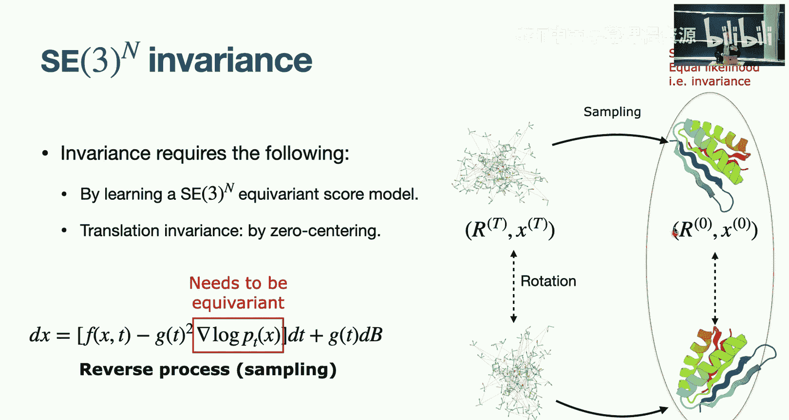

And so this kind of what the generation process looks like。 that starting from pure noise。

 know the condition is that just generate me like a random protein。 And then the protein。

 and then the model is going to， yeah， it is to be decoded and it's gonna come up with like a device diverse set of proteins here。

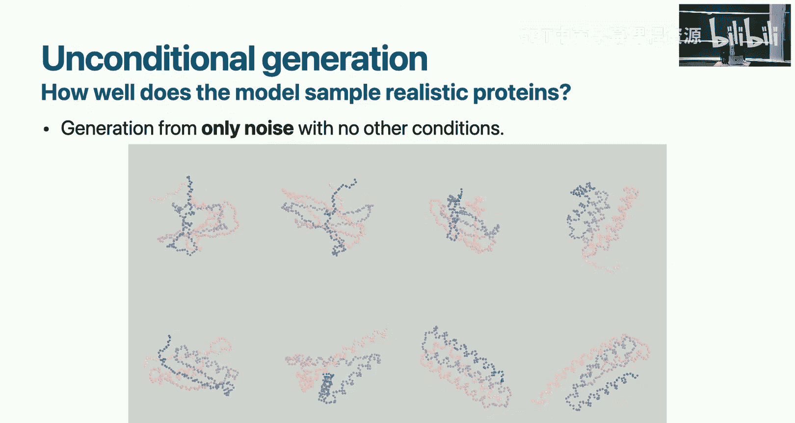

And so kind of how to check if these Spartans are good or not is something called I'm gonna to call like a realism check。

 there's some other names out there， but just for a layman terms。

 we're gonna to see if like a sequence could exist that could actually fold into this AI generated structure。

 So let's say like this new protein is generated by the diffusion model。

 we're going to compute a sequence for it and neural neural network usually ava2 to like predict the actual structure and to see if like the Rst between these two is low or not。

 So is the main method of how we evaluate AI generated structures right now。

And then the other thing is like how diverse are you sampling your proteins as well。

 You don't want to just sample the same protein each time that's not useful。

 You want to make sure that it's sampling the actual distribution of possible proteins and actually even go beyond them and sample novel proteins。

 So there's a way to cluster them by just taking two proteins， calculating like the RD。

 normalizing it by some length and then doing a clustering algorithm。

 like particle clustering to figure out how many cluster there are from your protein。

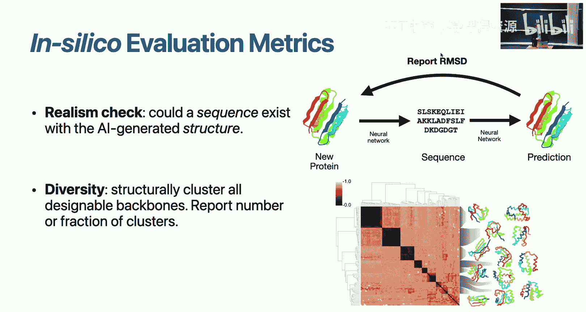

And so， like this。

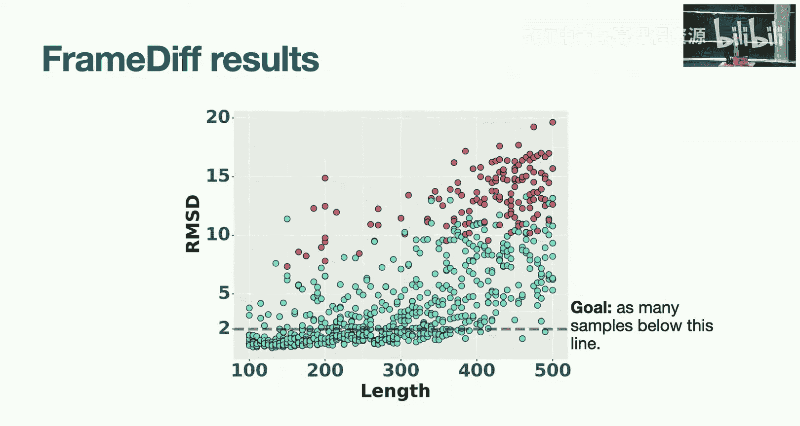

Yes， yes。 sorry。 said that。 Yeah， and Sil means computational。

 It's like a fancy way of saying computational。

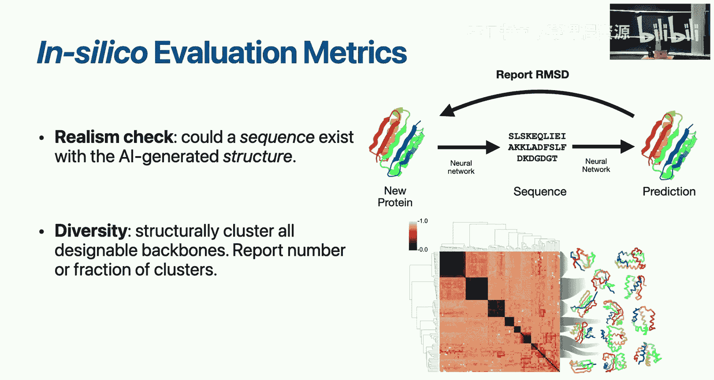

Yeah， and so this is kind of row this is like back in 2021 and 2021。

 things have gotten a lot better since。 but just to show that what we found as initial step was that we're able to sample things that actually pass this R threshold of what you generate and what you predict But when you see is that as you get to longer proteins the performance actually gets worse。

 So like higher here means worse。 So I'm not gonna to blabor that point。

 but the most interesting thing to me was that we're able to actually generalize beyond the training set。

 So that by learning this like equivariant diffusion model we're actually able to sample things that are very different than what I was trained on。

 So here this is like RD again， you kind of want to be as low as possible but they also want to be lowest as possible y axis because it is the similarity to the training sets。

 So these are two proteins the model generates one is kind of short and one is kind of long。

 And we look in the PD， which is the data of this most similar protein to this and that' out。

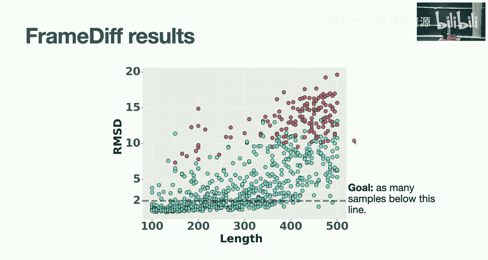

Overlaid and gray， where you can see that these two proteins are extremely different and these two proteins are extremely different as well。

 So the model is able to kind of like generalize and learn beyond the training set。

 which is a very good indication for this model。

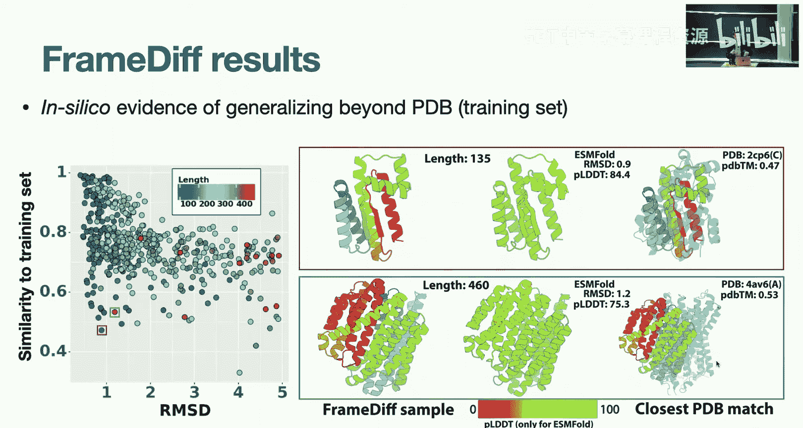

Yeah， so summary with framed is that we kind of achieved three of the four goals。

 which is that we might any any high quality structures that are diverse and novel。

 but we still have to yet design functional structures。

 which is gonna be next step of like to actually do protein design with this。

 And I kind of let this usually go over frameflow as well。

 But this is basically the flow matching version of frame reason like an O D to do diffusion to do flow matching over S3 and we actually get lot better results with frameflow。

 and a lot of the current save our methods are moving to flow matching。

 this is like a time not going discuss it。 But it's something that I think hopefully you all should be very familiar with now。

 So Ill just take a quick break here answer any questions about frame if there's any。Yeah。是的。然不。Yeah。

 so at the initialization， you have to determine like how many tokens the model is going to have。

 And then you give it like this positional encoding like position encoding from like 1 to 200 or 1 to 400。

 So the model kind of looks at the positional encods and decides or like knows I'm gonna to generate a protein of this length。

 So its， it's a parameter have to give the model。 The model doesn't figure it out by itself of like what lengths it's generated。

But there there are works to kind of。Like， have the model sample a length and then generate a protein with that length。

对。Yeah， yeah， so。Yeah， so mytuition for that is that I think flow matching is more general in a sense and it works better for Romani manifolds。

 So in Romanmani manifold， theres some assumptions there that around the space that you're actually diffusing over。

 And flow matching is lot moremenable to this manifolds。

 So if you look at S3 like geodesexics are very easy to define on Rai manifolds。

 but actually finding a noising kernel for Romani manifolds is not trivial。

 S3 is one of those very few cases where you can actually analytically write down a kernel like like a noing kernel。

 but other manifolds sometimes out of luck for those。

 And so actually the geodesic is like a much more stable thing to compute than like a noising kernel on a manifold。

 So that kind of goes into little bit of the weeds there。

 But I think also like matching because it's like a lot more simpler as well。

 And it allows you to go beyond like gassian spaces quite easily。Yeah。没有。Yeah。

 so the model learns to keep them close to each other。

 And this is why the position and codingings are crucial and why the attention mechanism is really important as well。

 Itll kind of learned that if Im， if I'm token 5， then I want to be next to token 6 and right。

 right after token 4。 So it kind of self arranges it as the diffusion process happens。Yeah。

 so arm is these is you kind of take the two protein to calculate the cap alignment after you center them and they just calculate the pairwise distances and average that there。

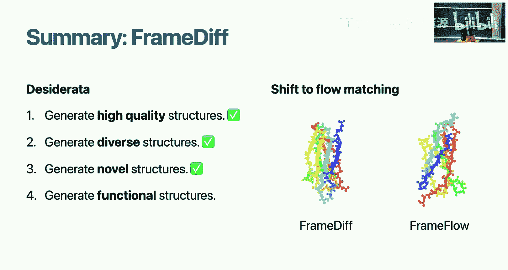

Okay， great。 So okay， not something like more exciting stuff。

 which is like we've gone on for Ugen generation。 but now we wanted do conditional generation。

 This is what people actually care about in protein design。

 So this is a paper that I collaborated with the protein design at University of Washington published in nature we call R of diffusion for protein generation。

 So kind of the idea here is I think we all like pretrain how important that is the language models。

 And so it kind of take the same idea to take a pretrained protein structure prediction neural network and then fine tune with diffusion。

 And so the University of Washington folks it had this pretrain structure prediction network。

 and then we came along with like this fuion idea。 and it was kind of a marriage of two ideas that LED to R of diffusion。

😊。

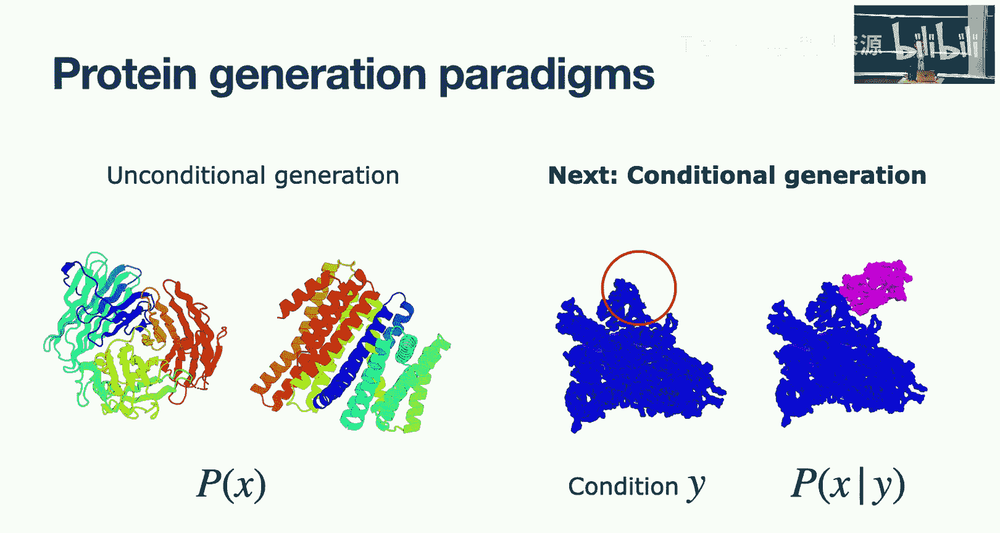

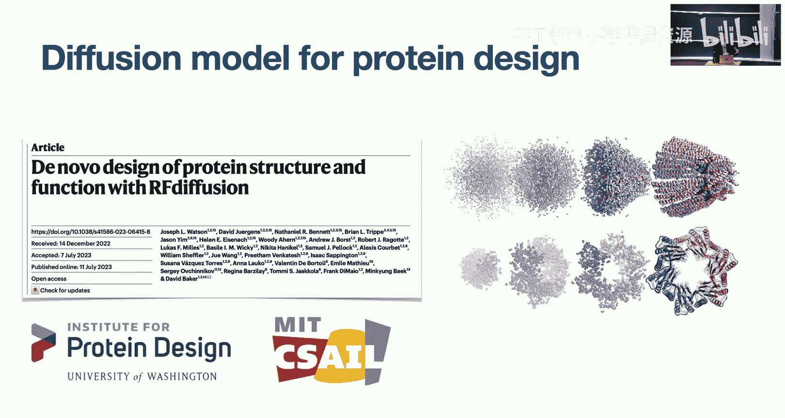

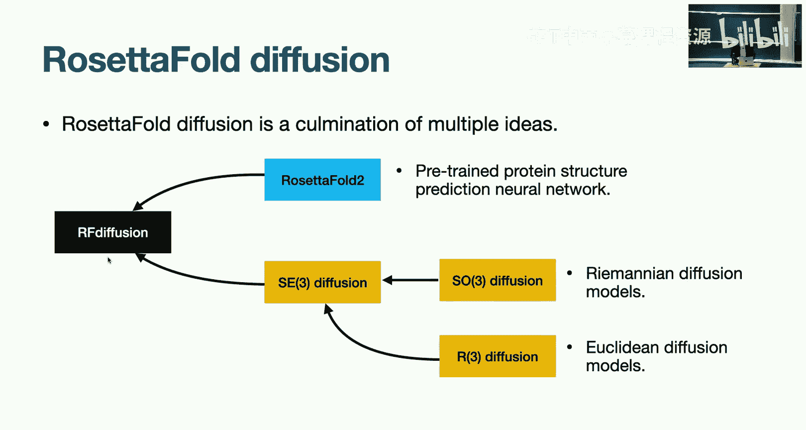

And then the pretraining was actually very crucial because it kind of led us to train lot shorter and then also drastically improved this unconitioned generation test。

 where the， the previous method kind of cagolia only go up to like length like 300。

 but this model is able to go up to like length 800 or something。

 like or even 1000 and generate these like massive proteins that you， look really nice as well。

And then this model is also able to be like even more novel that like 05 is the cutoff point of like if you're below this。

 then you're quite dissimilar to anything in the training set and the model is able to generalize even more beyond the training set as well。

 So this is something our diffusion generated。 And then this is the closest thing in the training set。

 You can see that the model kind of learns some of this pattern of this like sheet looking thing。

 But then it's kind of able to extrapolate beyond that and generate new proteins from this。

And then the most important thing about this model is that it was trained for a conditional generation。

 So I'll go over a few of these。 I'll go over symmetrical generation where you add symmetrical noise and a molecule is going to generate a symmetrical protein。

 The most important is binder design where you're gonna tell the model like here's a virus generating a protein that binds to it and you can also give it like a 2D like instruction that I want this specific looking protein where we can do like an in paintingt task where you get you get the model a partial protein and ask you to generate the rest And then the cool thing is you can also combine multiple condition together。

 So here we're combining both the symmetric generation and a motif like in painting generation to come up with like doing both symmetry and motif scaffolding。

And then the other thing that's important here is also cost fair guidance where using like Bayes rule。

 you can add these extra terms to kind of bias the generation away from what is's traineded on。

 but towards like more desirable kind of proteins。 And so， for instance。

 we might say like here's a molecule， I want you to kind of encapsulate and bind around。

 And I'm going create this potential field where if you're very close to the molecule。

 I'm going to try to repel you away from it。 But if you're too far away。

 I'm gonna to try to guide you to get closer to it。 And so then here's an example where。

These sort of issues might happen that the model might generate a protein that might coash with a small molecule。

 But by applying this sort of potential， you can tell the model to kind of， you know。

 like bind to the molecule like almost perfectly。And so here's like an animation of binary generation。

 What's happening here is that the model sees this protein。

 And we're telling the model to kind of bind like right above it。

 And so the model is able to figure follow those instructions and the kind of generator protein that's above there。

And here's like another example where there is this existing portion here。

 the model the protein that the model sees is going to try to fill in the rest。

 but also follow this symmetry constraint that it has to be symmetric。

 but also fill in the rest of this protein here。And so for binary design， I kind of lose this before。

 But one important thing is that we have to give it these conditions of like where you wanted to bind。

 So you can tell the model bind at site 1 or bind a site 2。

 and the model is going to follow these instructions to bind at a specific location。 Otherwise。

 the model is gonna bind at some random place that might not have an actual importance in the downstream application。

But also you could also condition on the fold topology。

 So like what kind of protein you want to generate， you can tell it both bind here。

 but also this is the kind of fold you w to be or like the topology。

 but you could also tell the model to kind of hallucinate and come up with like its own type of protein that are bind at at that location。

And then the coolest thing about protein is that you can also actually test them out in in the lab。

 So we took this to the actual wet lab。 and there they actually measured how well the protein was actually binding to that。

 So not only is this， you know， like protein that looks good。

 but actually can be produced in real life these are like four cases where to show like the generalization。

 it can generalize across different targets and produce real binders。😊。

And then compared to like previous algorithms， like I was mentioning this structure generation that was the limiting factor。

 those those methods， know， almost had an experimental success rate of like 01% or something。

 But then with these diffusion models， we're able to you know go orders of magnitude higher than that where for this one is like 30% success rate。

 all these like organators is higher than what was previously possible。

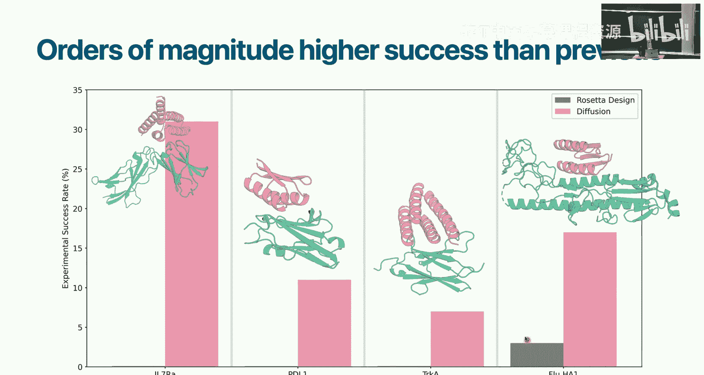

And yeah， this is like an actual structure that was calculated into wet lab where this is like a flu virus protein。

 and then we designed a binder dial binder here and they actually looked at the actual structure and that the binder matches very closely with what came out of the AI algorithm。

 this is like this further validation that the design and the real protein matchulate very closely。

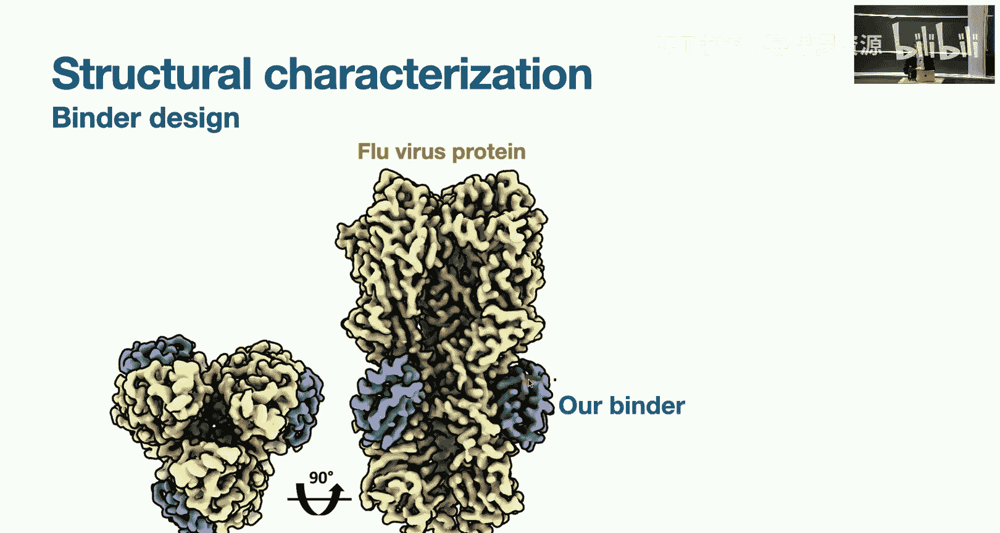

And then this is symmetric protein design where there's a lot of symmetries in nature。

 this is like one way of how it stays efficient that like a viral capsid。

 this is kind of how the virus enters the body， we can analyze the symmetry of this and realize that that this is made up of 60 different copies of this single protein but just tiled up to follow this eossoahedral symmetry and we can take that symmetry group and apply noise to the generation to kind of generate a protein that follow this symmetry。

So I think， I think the animation is a lot better in the world。

 So I have an animation here of like how the the noise added symmetrically with like good starting positions that the noise and a model is going to like figure out the genericicsymmetric protein at the end。

嗯。

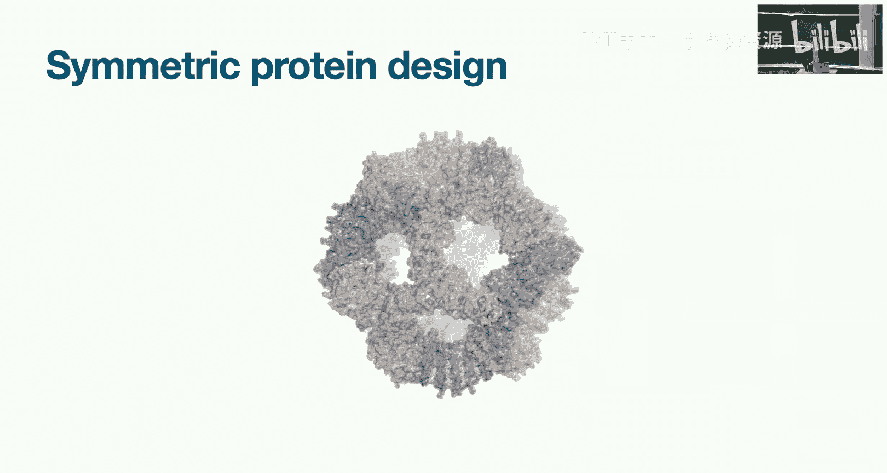

Okay， think that's the end of that。 Yeah， and then the cool thing again， of course。

 is that you can also measure these proteins。 So these are like actual pictures someone took of the proteins after they were synthesized。

 And you can see that the like the 3D volume of the proteins closely match what came out R diffusion。

 And that's kind of remarkable you can go from an AI algorithm to the actual protein and validate。

 It's， it's one of the nice things about this field。😊。

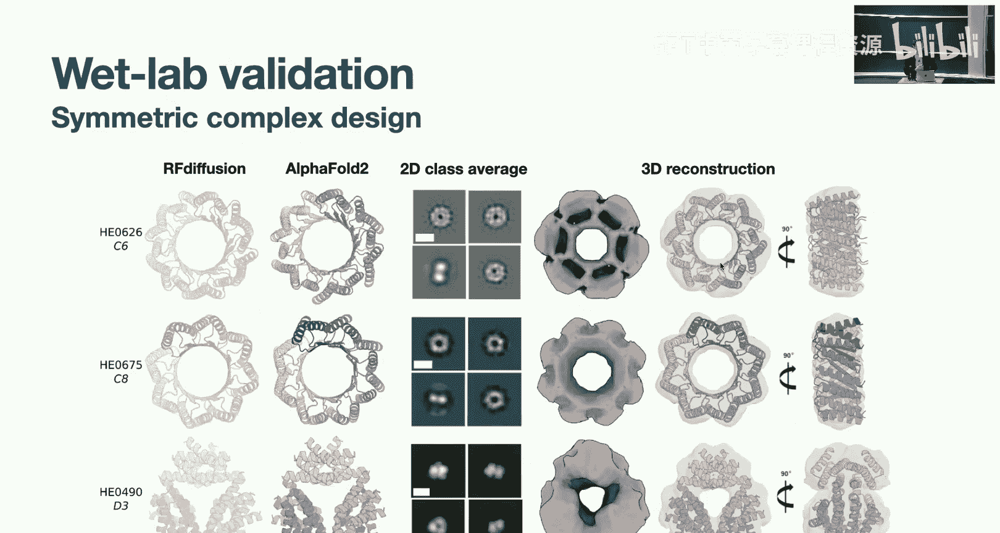

Yeah， so art diffusion follow ups， one thing that we're moving beyond proteins to also incorporate like small molecules and other types of non nonprotein things。

 and another thing is antibodies。 This is like a very important class of antibodies that a lot of drug companies are very interested in。

 And so there's any work to specialize art of diffusion to specifically make antibodies for therapeutic applications。

 So so this is kind of takeaway so far that we've now accomplished all all four of these with these past two works。

 I was going to going to live into codesign which is doing both。

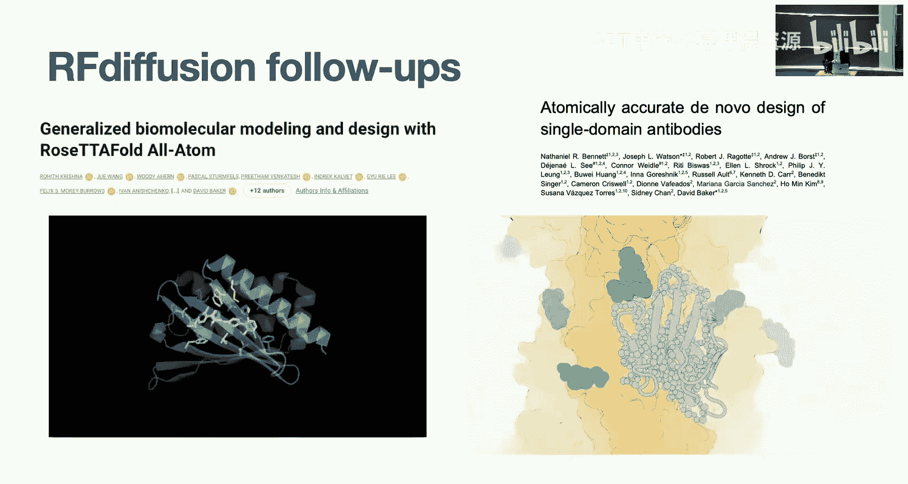

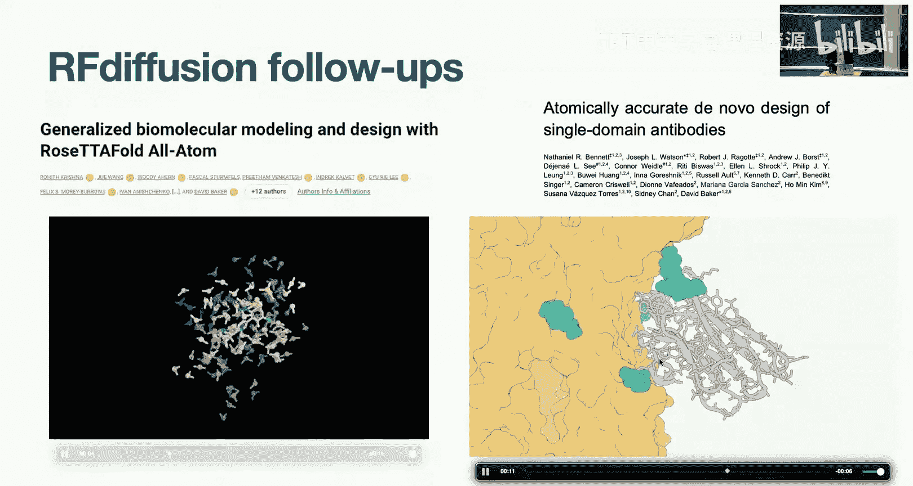

Both like structure and sequence generation。 But I think maybe I'll just take a few questions here into the time。

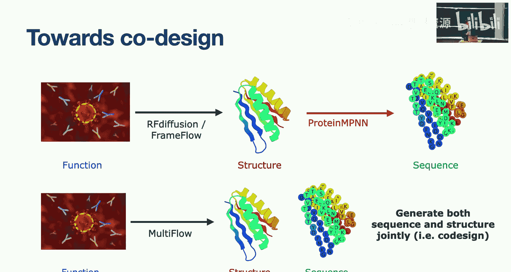

Okay， so carry on forward。

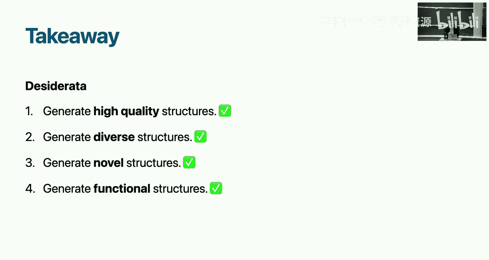

Yeah， so codes， I should just have a few slide in this。

 which is I was talking about this twostep process where you would go from like a function to a structure and into a sequence。

 And it kind of， you know， if it's happening sequentially， why not just do it together at once。

 And so in codesign， the task is to generate both the structure and a sequence at the same time。

 So there could be benefits of this as in you might have like better control。

 You also solving a chicken and egg problem where do I do the sequence first or the structure first。

 So yeah， that's kind of question that we try to answer。

 And so I was working on last year was just come up with a formulation and the algorithm to do this。

 And so the algorithm we came up with was multiflow where it' it's a full matching algorithm over translations rotations but also the sequence And I kind of describe the translation and rotations previously。

 But a sequence thing is kind of a new thing where you actually have to describe a full matching algorithm over discrete spaces。

 And and that is kind of。

Technically has all the same principles in continuous space。

 but also requires some new developments there to make it work。

 So I kind of left out the technical details， but kind of the general idea is that you want generation of discrete data。

 but you want to be over continuous time， usually in auto aggressivegressive language models。

 it' would be like left to right generation， but in proteins。

 there is no inherent left to right order。 So you have to have an any order algorithm that can generate kind of kind of things arbitrarily in in any order here。

So by doing this together， this is like a sequence and structure code design algorithm that's generatinging both the sequence in the structure at the same time。

 starting from T 0 to T1 that should at the very end， you know。

 have boths of them completely filled in here。嗯。Okay， yeah， so technical summary of this work。

 I think proteins are interesting because it's highly multimodal。

 So there's a lot of interesting technical questions to work on。 You're。

 you're working with Rimani manifolds and Gaussian space and also discrete spaces as well。

 And so there's a lot of work looking into kind of what's the best algorithms。

 What's the best models to like like do protein modeling。

 And this that translates to other molecules like small molecules and RNA DNA。

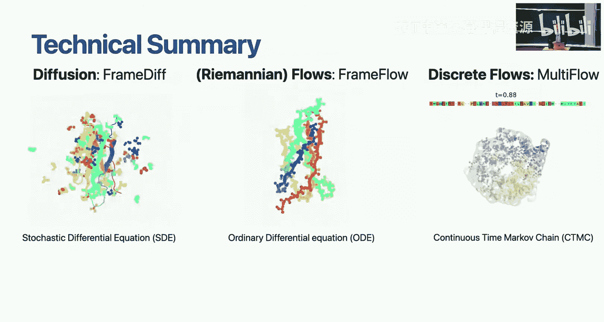

And it's kind of what's what's next。 I kind of hinted at this。

 but our fold3 came out last year where they also introduced a diffusion model to generate proteins。

 but also things are not proteins such as DNA， RNA， as well as small molecules。

And one thing that I think one of the questions was that they also removed echo brains。

 So it kind of brings into question how important is echobras after all。

 or the scaling loss can can get get away with that。

 So I think my prediction for the next year or two is that there's gonna be this huge shift to move beyond proteins and capture all of molecules。

And then the other thing I think that's going to be very important is fine training and post training。

We have ways to generate a lot of proteins。 But then after we do some experiments on them。

 not everything works out or fail or succeeds。 So we want to be able to iteratively improve from the experiments that we get and a ability model that will get better and better over time。

 This is kind of how GBT kind of work by aligning to human preferences。

 We want to be able to align our our models to experimental data。 that could have。

 know large ramifications for new biology。Sos like a reference page。 Yeah。

 so I'll take any questions here。 but this is like just contacts my advisors。

 again Reggina and Tommy， I think if you want to do some research in this space or looking to work on the fusion models for biology in general。

 out to me or our coadvisor， same coadvisors as Peter and Ezra and if there's any website。

 Twitter and stuff reach out to as well。 So here I'm also happy to take more questions that are any。

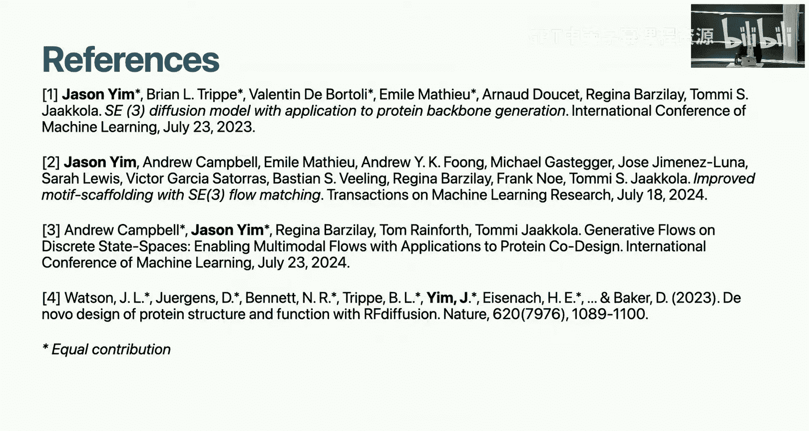

Or okay，All right， cool， so。I， I'll make a final announcement。 And then we're gonna， we're gonna end。

 So as you know， today was our last class。 So I just wanted to say also in Ezra's names together。

 thanks a lot for， you know， taking this class。 We had a lot of fun。 I hope we learn。

 you learned a lot。😊。