# 《生成式AI微调LLM速成课｜Generative AI Fine Tuning LLM Models Crash Course》中英字幕 - P1 - GPT中英字幕课程资源 - BV1R7421Z77t

Hello all my name is Chrisshneak and welcome to my YouTube channel so guys here is an amazing crash course to help you understand that how actually you can perform fine tuning specifically with respect to LLM models and again in this crash Co we will be discussing the theoretical intuition what exactly fine tuning is how you can actually perform fine tuning well be learning about concepts such as quantization Laurara Clara Pft right and along with that we will be implementing multiple projects with the help of hugging face open source open source LLM models like Lama2 along with that we'll also be seeing how you can perform fine tuning with the own custom data with the help of Google Gemma model。

😊，Now in most of the companies that are probably looking for geneative AI rules usually want this specific skill set of fine tuning and you should definitely know how you can actually fine tune with your own custom data set and how you can solve different different use cases so this entire class course will be having a step by step process of understanding it includes both theoretical intuition practical intuition and we will be also developing completely end to end solutions with respect to this so I hope you will enjoy this series please make sure that you was this series till the end and definitely you will be able to learn a lot of things out of it so yes best of luck let's go ahead and watch this series in one of our previous video and already shown you how you can actually find tuneune Lama2 model with your own custom data set and over there we learned about we saw code that were related to something called as quantization lara chlorra techniques and all right and all these techniques are super important if you also want to train a find。

😊，T your own LLM models with your own custom data set。 Now， when I showed the code， right。

 when I executed that particular code， many people had actually requested about。

To explain the theoretical indep intuition about it and that is what I'm actually going to do the best thing is that when I learned about this theoretical intuition and I'm doing it from past two to three months it's quite amazing guys you now this is where that machine learning era is probably coming where I used to upload a lot of theoretical in depth geometrical intuitions regarding various machine learning algorithms similarly here also in this series of videos in this video we are going to discuss about quantization now what exactly is quantization we are going to discuss about that in the upcoming video we are going to see techniques like Laura or Clara every maths intuition that is probably involved and this is all are important for the fine tuning technique right if I probably talk about geneative AI one of the most important interview questions will be something related to fine tuning and what is the techniques that is usually used behind it right so what are things we are going to cover in this video in this video we are going to talk about quantization。

😊，specifically when I say conagation， it is all about model conagation because if you remember in our Lamatu code right when we are doing the fine tuning here you could see that。

😊，We had put some parameters right regarding precision based modeling we had spoken about quantagion you know what when we are downloading the models you know from a higher bit to a lower bit why we are specifically doing this I will be explaining about that right so with respect to each and every parameters definitely I will explain you the theoretical intuition and later on you just go ahead and see my previous video with respect to all the coding now everything will make sense okay。

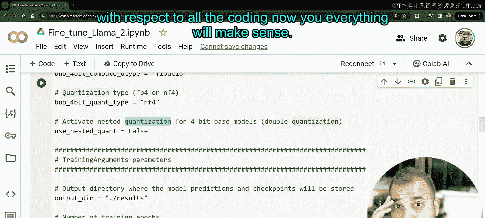

So， what exactly quantization we are going to discuss you know we are going to discuss about full precision half precision and this is something related to data types like how the data is stored in the memory when I specifically say data in LLM models I will talk about weights and parameters right。

😊，Because at the end of the day， elementss are also deep learning neural networks in the form of transformers or bird。

 right？Then we are going to discuss what exactly is calibration。😊。

This is also called as like calibration in model quantization right we are going to also make sure that we are going to see some problems right how we can actually do calibration then there is different different modes of quantization right first of all I will explain it a definition then only we will be able to understand in modes of quantization we are going to discuss about two types one is post training quantization and quantization aware training right so these all are very important in terms of fine tuning techniques now lets go ahead and talk about quantization and we will try to see the definition right。

😊，Quantization， okay？Now， if you want to really understand the meaning of quantation。

 it is better to write a simple definition for it okay。So conagion basically means conversion。From。

Higher。Memory format。毒。啊。😮，Lord。Memory format。Right。

Now I will return a very generic definition what exactly quantization mean。

 it is nothing but conversion from a higher memory format to a lower memory format。😊。

Now when I say higher memory format lets lets consider any data right and if I probably consider any neural network okay so lets say if I have neural network right and when we train this neural network right all this neural network are interconnected at the end of the day what are the parameters that is probably involved away it is nothing but weights right we specifically have weights now weights are usually in the form of metrics right lets say that I have a three cross stream weight okay I am just taking as an example in one of the layer I have three cross3 weights and over here every value right is probably stored。

😊，In the memory， in the form of 32 bits。right 32 bits we also say this bits as we also we also denote it as something like something like Fp 32 what exactly is Fp 32 so Fp 32 basically means I can also consider it as see fp full form is not floating point okay but we are I am just writing floating point 32 bits right。

😊，When I say FP， F basically means it is nothing but full precision。😊。

fullu precision or single precision。Okay， so this is the definition that is probably given right but in short this is like a floating point number okay so over here lets say my number is somewhere around 7。

23 now this number is stored based on 32 bits in the memory。😊，Right？Now。

 understand when you have a very big neural network or you have LLM models right as you see different different LLM models right parameters keeps on increasing right some may have 70 billion parameters if I probably consider Lama 2。

😊，With 70 billion parameters that basically means it has 70 billion parameters in terms of weights and bias okay now it is not possible for me to let's say I want to use this particular model and I want to probably do a some fine tuning with respect to the normal GP that I have right and let's say I have a very limited Ram in my system let's say the Ram I have is somewhere around 32 gb right I cannot directly download this specific model and put it in my in my Ram itself right let's say or load it in my Vam that is available in the GPU。

😊，Because GP also has some limited Ram， right？And it is not possible you cannot directly download it obviously it will require use space the other way is that yes I can probably take a cloud space somewhere let's say in AWS I can create my instance I can say hey give me this this much ra 64 gb Ram and I probably want this much GPU and then I will try to load the model over there that you can do it but over there what is basically happening lot of cost is involved。

😊，Right。Based on the resources。The cost is involved， right？So， in this scenario。

 and why this 70 billion parameter is happening， why this model has a 70 billion parameter because every weight or every bias that is available in this。

 you know， this may be getting stored in 32 bits。😊，So。

 what we can specifically do is that we can convert this 32 bits。😊。

Into as I said O conversion from a higher memory format to a lower memory format。

 let's say I can probably convert this 32 bit into int8 and then download the model or then use the model right after doing this what will happen within my system I will be able to inference it right obviously for fine tuning if I want to fine tune a new data set I will obviously require GPU but if I consider with respect to inferencing it becomes quite easy because now all my values that are stored in the form of 32 bits it will be stored in the form of 8 bits。

😊，So， what we are specifically doing over here we are converting from a high memory format to a low moral format and this is what is called as quantation。

😊，A very important thing。Now why congion is important because you will be able to inference it quickly say inferencing basically means what if I have an LLM model if I give any input to that I should be able to get any output right I should be able to get response right now when I give any input all the calculation with respect to different different weights will happen right and obviously if I have a bigger GPU this inferencing will quickly happen right but if I have a GPU with less less scores lets say then what will happen this calculation will take time。

😊，But if I convert my 32 bit to 8 bits。😊，Every weights are basically converted into 8 bits now just imagine the calculation will there be a difference。

 yes， it will happen a little bit much more quicker。😊。

So quantization is very much important for inferluencing。😊。

And some of the example that I again probably talk about is that and obviously you may have heard about this it is not like only in LLM models we specifically do right in different computer vision models in NLP models also where you think that there is a lot of weights that is involved and all these weights if I want to quantize it。

😊，I can actually do it right now this inferencing， lets say I want to use a specific deep learning model in my mobile phone。

😊，So in my mobile phone， if I want to use it right in in a specific app。

 then what I will do I will try to quantize right whatever deep learning model I have created from 32 bits to 8 bit and then I will try to deploy it in my mobile phone or any edge device。

😊，Any edge device right， it is not possible that you can probably deploy this big model over there。😡。

It is not possible so and so many parameters， so what we do we basically perform quantation。

 so I hope you are able to understand over here。😊，Quantization is nothing but we are trying to lower down the memory right with respect to any weights that we have like from 32 to probably 6 intake or lets say FP 16 we can also say FP 16 right lets say if I have an FP 32。

😊，Bit that is specifically required to store any information in my memory。

 I can also convert this into Fp 16 bit。This is also conagation only， right？

Usually all these values are stored n floating point right we specifically say this F P 32 bit we say single precision or full precision we for F P 16 but if I'm trying to convert like this。

 it is basically call as half precision。😊，So you should be able to understand all these technical terms right and in short this are nothing but these are floating point numbers right now similarly in tensorflow also you will be able to see。

😊，When we probably work with Tensorflow youll find Pf 32 bit right the data types the numbers are stored in this particular format right and it is important okay this is all our terminologies that are super important but I hope you got an idea what is the main aim what is the main motivation out of quantization is that if I have a bigger model I should be able to quantize it and make it as a smaller model so that I can use it for my faster influencing purpose both in mobile phones in the edge devices lets say in even watches smart watches I want to use it over here I can actually do that right？

😊，Now， if I talk with respect to LLL model also with the help of contagation。

 see once we compress this particular model right， later on we can also perform fine tuning right fine tuning。

😊，But here there is one disadvantage when we quantize， right？When we perform this quantization。

Since we are converting from 32 bits to intake， let us say as an example。

 there is some loss of information also and because of this there will be some loss of accuracy。😊。

Now， how to overcome this we will talk about it there are different different techniques how we can specifically overcome it。

 but I hope you got an example what exactly is quantization what is full precision half precision half precision example is something like this。

😊，Now lets talk about what exactly is calibration now calibration basically means how we will be able to convert this 32 bit into N8 like what is the formula。

 what is the mathematical intuition that is specifically required， lets go ahead and discuss that。😊。

So guys， now let's go ahead and try to understand how to perform quantagation。

 and this is super important in terms of mathematical concept that Im probably going to talk about。

Because。With us with the help of tensors for just by writing four lines of code， you know。

 I will be able to perform contagation， but it is important you should know that how you can actually do it manually。

😊，Whenever I talk。😡，In terms of what are the types of conization that we have。So。

 we have two different types of contgation one issymmetric contagation and one is called as asymmetric contsation now just by showing you an example you will be able to understand what is the exact difference between them okay。

😊，Let's say I have a task and this first task that I am probably going to talk is with respect to symmetric and I understand I hope in deep learning you have heard of something called as batch normalization。

😊，So if you have heard about this batch normalization so batch normalization is a technique of symmetric quantization right so every time you'll be able to see that whenever we do forward propagation and backward propagation between all the layers we apply batch normalization so that all our all our weights are zero centered that is near the zero and the entire distribution of the weights will be centered near0 so batch normalization is one technique of symmetric quanttization so let's go ahead and see one example so this will be my first example over here I will go ahead and write it now and now youll be able to understand it how symmetric quanttization is basically performed and what is quantization you have understood from higher memory format to lower memory format we will try to convert so here we are going to understand the mathematical in so let's go ahead and talk about one technique which is called a symmetric。

😊，Unsigned。Unsigned in it。Onside in8， okay quantization， so we will see this technique first。Now。

 here what is our main aim？😡，Let's say。I have a floating point number， okay。

 lets go ahead and write it down， lets say I have a floating point number between。0 to thousand。

 or just imagine that these are my weights。whatever metrics mate I have my values ranges between 0 to000 let us consider in this particular way right and this is lets say these are the weights for my larger model。

😊，Okay， larger model。Okay。Now one very important thing that you really need to understand right when I talk about any larger model let us consider any LLL model okay so in LLL model you have lot of parameters lets consider this is one kind of LLM model。

😊，Now when I say all these weights are there this may be getting stored in 32 bits okay usually what will happen guys the weights will not be in this range also okay it will be in the minimalistic range so I will just consider this as some numbers okay so that you don't get confused with respect to these are some numbers I will also not consider LLM model over here and let's say this this this numbers are stored in the form of 32 bits okay。

😊，Now my main aim is to convert this。😡，Enと。Unsigned end 8 that basically means。E bit。😡，Right。

 so 8 bit basically means what two race to 8 is how much two race to  eight。

But when we say u unsigned that basically means my value will be ranging between 0 to 255 so I want to quantize from this values to this value okay what is my aim I want to quantize my range of values between 0 to0020 to 255。

😊，Okay， this is what is my aim with respect to this okay？😡。

So this is what is my target now lets see okay so if I probably draw just a real points and the same thing we will do with the weights over there。

 whatever quantization process we are specifically doing lets say I have values between 0 and this is basically thousand0 okay。

😊，Then what I will do over here。I want to convert this into again， 0 to 255 okay。😊，Now。

 let me talk about one very important thing， guys， whenever we have any。

Lets lets consider this one if we have this single precision。Single precision。Floating point。他地度。

Right if we have this number， how this number is story， do you know that？

The1 bit will specifically be used for sine or unsine values right let's say positive or negative if positive is then then this will be plus one if negative is there it will be -1 so all the values are basically saved between 0 to 1 right it can be 0 or 1 okay。

😊，Then the next eight bits are stored。😡，For exponent。Okay，1，2，3，4，5，6，7。8 okay， so this is for sign。

This all numbers that you see。😡，It is basically stored for exponent。

This is how it is stored inside the memory and remaining 23 numbers。😡。

All this 23 bits will basically be saved for Mantesa。😊，This is specifically for the fraction。

 so if I have a number which looks like 7。32。😊，Now 7。32 is the number it is a positive number。

 so for my sign bit there will be a positive value， lets say one over here。

Then the7 will be probably put up in this8 bit。😡，And remaining 032 will be put up in this mantasa。

So this is how the numbers are basically stored in the memory if I consider an example with respect to Fp 16。

😊，right half precision floating point 16 bit then you will be able to see there will be one bit for the sign number there will be five bits for the exponent we basically say exponent12345 let us consider this5。

😊，Lets lets throttle here okay， so this lets lets lets say that this is5，1，2，3。

45 okay so this will be5 and remaining remaining 10 bits will be saved with respect to mantea。😊，말 돼어。

So we basically say this as a fraction， right， anything that comes after the decimal。😊。

Right and this is how you will be able to see it take this will take less memory。

 this will take high memory right now what is our main name over here。

 I already have a 32 bit number。 I need to probably convert this into a range of unsigned n unsigned it intent basic limits I will not take any negative numbers。

 It will be between 0 to 255 right This is what I really want to do okay。😊，Now for this。

 what will be the equation and I hope you have heard about something called as Min Max Scalar。😊。

I've repeated so many times this in my machine learning sections also。

So any number that is over here， how will I be able to convert from this floating point to this unit8 unit intake right unsigned in right how I will be able to do it now for this lets go ahead and calculate it and what equation is specifically required okay。

So that basically means over here what we are going to do0。

0 will be converted into a quant value of 0 okay not 00 it will be 0 and similarly thousand should be converted to a quantized value of 255 at the end of the day the bits are decreasing so quantization is basically happening but we have to probably come up with a scale factor now what exactly is a scale factor so let me define a scale over here。

😊，So here the scale。😡，Formula will be x max divided by x mean。

 and then they will be divided by  Q max minusq mean。😡。

Thisq is nothing but quantation now what is the x max over here thousand00 right so this I will consider asma x this I will consider as my q right I am showing you how quantation happens in a symmetric distribution symmetric basically means all the data is evenly distributed okay and we really need to convert this based on this itself these are evenly distributed now what is x max x maxax is nothing but thousand0 minus 0。

😊，Then Q max， Q max basically means 255。mininus 0 right so if I probably go ahead with this specific division right then what will be the value that I will be having right000 divided by 255 it is nothing but 3。

92。😊，So this is nothing but this is called as a scale factor right scale factor so any number that I have over here if I want to convert from this Fp 32 bit to U int 8 I just need to use this scale along with one formula which is called as round okay so I will apply round with respect to any number lets say if I consider 500 divided by 3。

92。😡，Or lets let's just consider 250。Divide by 3。92 so if I want to see what will happen to 250 right what will be the number in this u in so I can probably go ahead and divide it it will be nothing but 250 divided by 3。

92。😊。

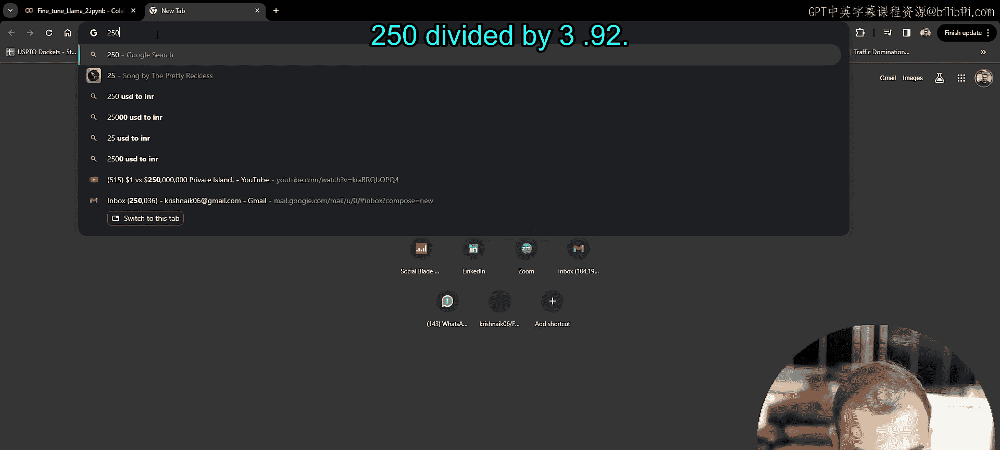

So if I go and calculate it it is nothing but 63。77。 so if I do the rounding。😊。

That basically means this will be 64。So in short， any number that is over here。

 lets say it is 250 over here this will get converted to a quantized value to 64 right so the same thing the code will also be doing and this is for symmetric。

😊，Unsigned intake okay quantization if I want a quantization sum for some other factor。

 lets let us talk about this Okay， so lets say I have another kind of distribution and this is time that it is a symmetric。

😊，And I want this as U in 8。😡，So， if I want to perform this contaagion。

 so what will happen now in this particular case， let us say if I have a values between minus 20。

02000。Okay， so these are my floating point now I have to perform contagion and convert this into 0 to 255。

😊，Right now in case of asymmetric what will happen is that in my real number section right this numbers are not symmetrically distributed。

 it may be right skewed it may be left skewed okay。😊，So。

 in this scenario you will be able to see that my values are ranging between minus 202000。

 I want to convert this into this。😊，Now， in this scenario if I apply the same formula x max minus x mean。

 so how it will be 000 minus 20， so minus of minus 20 is nothing plus plus 20 divided by 255。So。

 if I probably do the calculation， then you will be able to see that I will be getting somewhere around 4。

0。Okay。😊，Now， very important thing that basically means this 20。0。😡，If I quantize it。😡。

Right if I quantize it it will get converted to something like 4。

0 oh sorry this this is the my scale factor okay scale factor now if I take any number and try to convert it lets consider minus20 if I try to convert it by dividing by 4。

0 right and if I do the round。😊，So what it will become minus 5。

minus5 of round this much I will probably get minus 5 right？Now。

 you can understand that this minus 20。0 is getting converted to minus 5。0。

 but you can see over how my distribution starts from 0 to 255。😊。

So how can I forcefully make this minus 20。0 to 0 all you have to do is that go ahead and add the same number in a positive way。

😊，So in this case， the number that you see this5。😡，This is basically called as0 point。😊，Right？So。

 there are two important parameters that we specifically talk with respect to quantization one is0 point。

😊，For for the above one since we have a symmetrical distribution here， the0 point was。😊，ゼロに。

And the scale was 3。92 in this particular case since it is asymmetrical distribution here we have a0 point as nothing but p。

😊，But scale is。4。0 so these two parameters we usually require to perform quantization okay and these are some of the examples that Ive shown you to just give you an idea like how quantization basically happens and super important in terms of understanding is the simple。

😊，Cuations you will be able to understand how things are basically working right at the end of the day。

😊，Understand quantation is a simple process of converting that high full single precision of full precision floating point 32 bits into small bits you know it can be unsigned integer 8 it can be signed integer 8 if we say signedine integer 8 then what will happen it is that it will be ranging between  minus 128 to 127 and based on that you can specifically apply the formula right。

😊，Now let us go ahead see we had already discussed about these two topics。😊，Mine is this？

And second one， we wanted to discuss about calibration。😊，Now， this sezing that you could see， right。

 from here to。Here to here， here to here。 we are s squeezing it， right。

 This squeezing process is basically called us calibration。

 Whatever process we are basically applying in this quantization process。

 it is nothing but it is called us calibration because we are squeezing those values from a higher format to a lower format Okay。

 so that is nothing but calibration。 So we have completed both this thing。 okay。😊。

Now let us see what are the different modes of quantization one is called as post training quantization and quantation aware training right I will talk about this why it is super important both this technique okay so you will get an idea about it over。

😊，So， first of all， we will go ahead and say post。😊，Training。Quantization。

So what exactly is post training conion？Here we already have a pre traineded model。😡。

So we already have a pretrain model。Now， if I want to use this pretrain model。

 obviously the weights are very high here we apply。😊，Caallibration。

Right when I say calibration that basically squeezing the value from high format to a lower format right and then after performing this particular calibration we take what kind of data we take that weight data。

😊，Whatever wage data is basically there in this particular operator in model and then we convert this into a。

😊，Quantized model。Okay。😊，So， once we apply this process。

 then only we will be able to get the quantized model and then we can use this entire model for any use cases。

😊，Okay for any use cases right this is a simple mechanism with respect to post training quantization see understand post training basically means I already have a pretrain model where my weights are fixed I dont need to change those weights I will just take or download those weights I will take this weights data apply the calibration and then convert this into a quantized model right the second technique that we have written away is quantization aware tech training。

😊，Okay， quantization await training。So let's talk about this。Quantization。Areware。对你。

This is also called as cube。😮，So， this is also called as Q80 okay so we we can write it as Q80。Okay。

 quantization a technique， this is basically called as PTq PTq， okay。So over here。

 what is the exact difference we will try to see between these two okay？😡，Now。

 in quantization away training what happens here over here what is the problem if I probably perform calibration and if I create a quantized model。

😊，There is a loss of data and because of this， what will happen is that。😊。

The accuracy will also decrease。😊，Okay， for any use cases。

But in the case of quantization await training， okay？😡。

You will be able to see that we will be taking out train model， whatever train model is there。

Prain model is there。Okay， let me just go ahead and write it down。Train model is there。

 Then we perform quantation。Again， contation is what？Same。

 the calibration process will apply over there， we will probably do all these things， okay。

And then once we do this， the next step is that we will go ahead and perform。Fine building。See。

 we know that。😊，We know that with the help of PTtq you will be seeing over here on the top。

Some loss of data increases there， but here with respect to fine tuning we will take new training data。

😊，New training data now once we specifically take new training data。

 we will be fine tuning this model and then we create a quantage model。Quantized model。

So with respect to any fine tuning technique that you will be seeing we dont use post training quantization we specifically use quantization away training technique so that basically means we are just not losing accuracy or data away because we are in turn adding more data for the training purpose and through this we will be fine tuning our data and then we create our quantage models right so this is the basic difference so all the fine tuning technique that I will probably show you in the future we be of this type that is quantization away training so that we do not lose much data accuracy。

😊，So， I hope you got an idea with respect to all these three techniques guys going ahead there are two important techniques that we really need to understand。

 one is chlorra and one is Lara。😊，So these techniques specifically will be also understanding with respect to fine tuning we are into the part two of fine tuning series and in this particular video we are going to discuss about Laurara and Clara in depth intuition already in the playlist of fine tuning I've discussed about quantation and I hope you're seen the video early many people who are requesting for Laurara and chlorra also so let's discuss and we will try to discuss the complete in depthep math intuition the best thing will be that guys I'll try to explain this maths in depth intuition I've already seen the research paper and there are a lot of complicated things that is probably there in the research paper but I will try to teach you in such a way that at least you should be able to understand you know what exactly is Laurara what exactly is Clara and then well also see one example you know how with the help of code you will be able to do it。

😊，And trust me， these are some of the very important things in fine tuning because tomorrow you go in any interviews you are going to get asked。

😡，Respect to this kind of questions that may be coming because at the end of the day。

 any gene AI projects。spec with LLM right LLM models if you are working in the company they will be giving you fine tuning task so let me quickly share my screen and show it to you so here already I have uploaded a video part1 where we have discussed about quantization of good 32 minutes video everything you willll be able to understand it because here I've also used all the mathematical intuitions everything as possible as as much as possible。

To talk about the research paper so what does Laura means Laura basically means lower adaptation of large language models。

This is this amazing research paper and probably you will be seeing a lot of this kind of equations as you go ahead there will be different different performance metrics。

 but as usual I will do what I am good at， I will try to break down all these things and probably explain you with respect to examples with respect to code and many more things。

😊，So quickly， let's go ahead。🤧。So while Laurara and pra is basically used。

 lara basically means lower rank adaptation， lower order rank adaptation。

It is specifically used in fine tuning of LLM models okay。

 so lets go ahead and discuss this and I have created this amazing diagram over here。😊。

Initially whenever whenever you have a pre trained NLM model that basically means let us say that there is a model something like GPPT 4 or GPT 4 turbo。

 right？😊，And this model has been created by Open AI。

 so we basically see this model as the base model， okay GPpT 4 turbo。😊。

And this model is trained with huge amount of data right so the data sources will be internet。

 it can be books， it can be multiple sources， right。😊。

At the end of the day all these models how you can measure them they may be saying that hey it supports 1。

5 million tokens you know it has been trained with this many number of words right so many tokens of words now what will happen is that all these models you know probably to predict the next words it will have the context of all those tokens and then it will be able to give you the response so this all models are basically。

😊，base model and we also say this as a pretrain model okay some of the examples again I will be telling you GP4 g 4 tubo right g 3 gP3。

5 something so all these models are specifically pretrain models。😊。

Now further we can take this model and there are various ways of fine tuning it。

 please make sure that you was this video till the end if you watch this video you will understand everything that is actually required with respect to fine tuning。

😊，And there are multiple ways of fine tuning also Now let's say that I take this model。

 I do some amount of fine tuning Okay and this fine tuning is done on all the weights of this specific model right so some of the application that we may generate is like chat GT you know we may generate like cloud cloudy GT right cloudy G itself like the chatbot that we specifically use some of the examples Okay so this one way of fine tuning is there where we train all our parameters So here we specifically say full。

😊，Full full parameter training okay， so here you can see full parameter fine tuning。

So here I'm going to write full parameter fine tuning。Now。

 this is one way of fine tuning where we train our entire parameter based on our data that we have okay。

And after training it， we can develop applications like Cha GPT or any custom GPpT that you specifically create。

😊，As we go ahead， you can also take these models and perform。😡，Domain specific fine tuning okay。

 so one type of fine tuning is this the other tune other fine tuning technique that you can specifically use is called as domain specific fine tuning。

 Some of the example， let's say that I'm fine tuning chatbot model you know which will be for finance it can be for sales it can be for different different domains itself right So here the main important word is domain So this fine tuning also we can perform Okay again why Im saying all these things because they are various ways of fine tuning things right。

😊，One more fine tuning we can basically divide by is something call a specific task fine tuning now in case of specific task fine tuning this are my different different task let's say this is task a B CD this task can be something related to Q andH chat but this task can be something related to document Q andH chat but different different applications so that is the reason why we are specifically saying over here as specific task okay specific task fine tuning。

😊，Now perfect。 Now， this is good。 You have seen all the different ways of fine tuning， okay。😊。

Now lets talk about full parameter fine again I'll repeat it this is my base model right now。

 if you use it as an example as I said GP 4 tubo GP 3。5 you know。😊，Gmini Gemini 1。

4 different different models can be there。 We can take this base model。

 We can fine tune and create applications like Cha GPT。

 We can create other other applications like stable diffusions you know not specifically to LLM but Lium we can actually do it then we can also further fine tune this based on domain specific fine tuning right based on different different domains like fine sales retail We can also take this model and do more specific task fine tuning like task a task B task D let's say I want to convert this into text to SQL I want to have this as document Q and A so I can further fine tune based on specific task Now let's talk about this full parameter of fine tuning okay。

😊，And what are the challenges with full parameter fine tu and that is where see I'm building up the story later on I'll be explaining you where Laura will be used。

😡，Now in full parameter fine tuning the major challenge is that we really need to update all the model weights lets say that I have I have a model which has somewhere around 175 billion parameters that basically means 175 billion weights。

Now in this particular case whenever I find tune in this model I need to update all the weights great now when I am saying updating all the model weights and when we talk about this many number of parameters white can be a challenge because there will be hardware resource constraint right so with respect to different different task if I really want to use this particular model that much ra I really require for influencing purpose that much GPU I really require right so。

😊，For downstream task it becomes very difficult Now what is downstream task downstream task some of the example is like model monitoring。

Right， model monitoring。The other task can be like model inferencing。Right。Model infernccing。

Similarly。The GPU constraint that we may have the RA constraint that we may have so we may face multiple challenges when we have this full parameter tuning full parameter fine tuning now in order to overcome this challenge we will specifically use Laura。

And pra。Okay， what exactly is Laurara as I said low order rank adaptation and chlorra is something it is also called as lara 2。

0 so we will discuss about both of them with respect to mathematical intuition and you will get a complete idea what Im actually trying to say。

😊，Now what does Laura do okay now let us read the first point and this is very much important because in the research paper you will find this equation okay this equation now what exactly Laura will do。

😊，Laura says that instead of updating all the weights in full parameter fine tuning， right？😊。

Instead of updating all the weights， it will not update them instead it will track the changes。😡。

It will track the changes Now what changes this is basically tracking it will track the changes of the new weights based on fine tuning。

 Okay， this is very much important to understand。😊。

So based on the new weights how we are going to combine this weights with the pretrained weights Okay so here you can see these are my pretrained weights from the base model like let's say that this model is Lama 2 now if you are performing fine tuning using Laurara then Laurara will track the。

😊，New weights over here， which will be of the same size okay。

 so let's say that if this weight is 3 cross 3。Then the new weights when it is probably doing the forward and the backward propagation。

Those new weights will be tracked in a separate matrix and then these two weights will be combined wherein we will get the fine tube weights。

Now， this way， what will happen is that this tracking will happen in a separate way。

 but still you may be thinking crash。😊，Here also we are updating all the weights itself right so here also the resource con will definitely happen yeah fine I am talking about three cross 3 but what about weights and parameters where they are 175 billion right 175 billion parameters or 7 billion parameters。

😊，That time I will be having a huge matrix right so at that scenario you need to now understand how Laurara works。

😊，Because this waits。😊，How it is getting tracked， it will just not get tracked in this three cross 3 metrics instead。

😊，All these weights that is getting tracked。😡，There a simple mathematical equation will happen or I not say mathematical equation will happen but。

😊，There will be a technique that will happen which is called as metrics tocomposition that basically is the same three cross 3 metrics。

😊，saved it in a two smaller metrics。😡，Now， in this two smaller metrics。

 you can see this is nothing but  one cross 3 and this is nothing but 3 cross 1。😊，So。

 this is3 cross  one and this is1 cross 3 so this is3 cross 1 and this is one cross 3。

When we multiply both these weights then I will be getting this weight on me right so over here if I consider I have some around nine weights。

4，56。😊，7even， eight， nine， right？You will be able to see that I will be able to get all these nine weights from how many number of parameters。

 just six parameters。😡，Because when we multiply this。

 then you will be able to see that I will get all these nine parameters or nine weights that I have。

😊，So in short what Laura is doing is that it is performing this metrics decomposition where a big matrix and this metrics can be of any size is decomposed into two smaller metrics based on a parameter which is called as rank。

😊，How to calculate a rank of a matrix you can definitely check out any YouTube channel it is a simple algebraic equations based on transpose of a matrix how we calculate the rank but lets say that this matrix that I have which is a three cross one over here the rank of this particular matrix is one right。

😊，And。If I use this two metrics you can obviously see that the number of parameters that Im storing over here is less when compared to this right yes there will be a loss in precision but it is making sure that when we combine both this metrics will be able to get the entire updated weights and just imagine start thinking guys let's say that if I have 7 billion parameters now I am trying to perform fine tuning on those parameters so whenever I track those weights this huge metrics will be decomposed into two smaller metrics。

😊，And when we are decomposing this this metrics is updated trackatess metrics into two smaller metrics obviously we will be requiring less parameter to store all these values。

😊，And this way your fine tuning becomes very much efficient and this really solves the resource constraint。

 right？😊，This is the most important thing right and so in any research paper that you go ahead you' will be seeing this equation。

😊，W0 this is my pretrain weights plus the tract changed weights is nothing but my pretrain weights plus b multiplied by a what is b b is this a is this so when we multiply this you will be able to see that we have able to get the all the track change weights right and obviously this requires less parameter if you are decomposing our bigger metrics into two smaller metrics less parameter is required。

😊，Now what will happen if you keep on increasing the ranks if we keep on increasing the ranks this parameters will also keep on increasing but it will always be less than this right if I have 7 billion parameters if I try to decompose that into two2 metes two small mattresses with increasing rank then also the parameters that will be required will be less how I am seeing this because in the research paper also they have tried with multiple trainable parameters now let's see over here there are multiple techniques of fine tuning some of the techniques that are there is something called as prefix embeddedbed prefix layer adapter adapter is one very famous thing that is probably used before Laurara right you can see as the rank is increasing the parameters also increases right initially the trainable parameters of 175 billion but when I use techniques like adapter right so initially it will have 7。

57。1 million parameters with rank is equal to one。😊。

But as I keep on increasing the rank as I keep on increasing the rank you will be able to see that this parameters also get increase but you can see from 175 billion parameter if I compare 7。

1 million weights the percentage is very less now similarly in Laurara because of that metrics decomposition you will be able to see that as I keep on increasing my ranks so these are my ranks with respect to  Qkv because in transform you have this  three parameter  Qkv then only all the metrics multiplication will happen with respect to this three parameters and then we as we keep on increasing the rank here you can see4 here you can see 8 here you can see 64 then you will be able to see initially we got 4。

7 million parameters。😊，Compared from 175 billion to 4。

7 million how this was possible the because of the matrix decomposition。😡。

Because of the metric decomposition。right and as we keep on increasing the rank you will be seeing that the parameters are increasing right the parameters are obviously increasing but if I compare it with 175 billion parameter this is very less 9。

4 million you just see the percentage right。😊，So here also when rank is equal to 837。

7 million then rank is equal to 64301。9 million right parameters are there so still it is making sure that the parameter is not that much like like not not like 175 billion or not near to this if I talk with respect percentage is very very less I have also made another table right just to show you if I have different different models number of。

😊，Trainable parameter。Number of trainable parameter here you can see I have one LL model with 7 billion if I use rank is equal to1 then I will be having 167 k parameters to fine tune fine tune weights based on fine tune weights then and this167 k parameters basically means what this decomposed metrics that I have right two metrics that many number of parameters so in the first case it is just nothing but 7167 k parameters that is available in this decomposed metrics okay when we combine them then we will be able to get how many 7 billion parameters if we combine both this metrics then we will be getting 7 billion parameters okay。

😊，Then similarly you can see in 13 billion then you have 2 to 8 k parameters in 70 billion you have 5 to 9 k parameters in 180 billion you have 8。

4，9 k parameters so as you keep on increasing the weight this parameters will keep on increasing but it is not increasing with that huge amount right even you can see when we keep the rank as5hi22 right so here you can see 86 million parameters is then when compared to billions right Microsoft you know it came up with this lower technique in one of the research paper and it has huge rank is equal to 8 to probably do the fine tuning and it has performed absolutely well so most of the time we select this particular value but at the end of the day how to select this right it won't matter you know because the parameters are increasing by very less number over here as we go ahead so usually you can select rank 1 to 8 while you are performing fine tuning。

😊，Now there may be also a scenario that when should we use very high rank， when to use high rank。😡。

When do use highlight rank。This answer， because in the interview they may ask you if the model wants to learn complex things。

Complex things then you can specifically use high rank right let's say some of the model is not trained to probably interact or probably perform some of the behavior at that point of time those complex things can be handled when you are probably increasing the number of ranks so this can be a very simple question that may be asked in the interview but I hope you got a complete idea at the end of the day。

 this is the equation that you'll be able to see most of the research paper what Laura is doing is that nothing very simple all the track weights is decomposed into two smaller metrics with different different ranks it can be different different rank when you fine tuning the first thing is that you really need to set that rank okay if you set that rank like in this particular case if I probably see if I go ahead and calculate with all the mathematical stuff I will be able to get the rank is equal to one for this also rank is equal to one right so similarly if you have rank two so one of the metrics can be something like this so decomposed metrics so this is based on rank2。

😊，Okay。So if I probably combine this right how many 12。

345678910112 right if I multiply this I will be getting a matrix of much more parameters right but at the end of the day for in this particular I guess it is less number of parameters right so this is what lara is all about and because of the technique the fine tuning is done less the weights the parameters becomes less so this is how the main resource constrain is done and with respect to all the downstream task it becomes very much easy。

😊，Now， one more thing that I really want to talk about is chlorra okay。😊，Clora。

 chlorra basically limits quantized。Conantized Lauraura okay now if you have already learned from the first video what is quant quantized basically means now in chlorra case what will happen is that all these parameters that is probably stored in float。

😊，Float 16 bit。Okay， we will try to convert this into4 bit， that's it。Okay， once we do this。😊。

You will be able to see that we reduce the precision and then we try to reduce these values also by this you won not require much more memory so that is the reason we say quantized Laura technique okay。

😊，And the best thing about is this is that chlorra also has one amazing algorithm which will be able to take care of both this part。

 lets say if there is a float 16 bit I quantize it to 4 bit I can also convert this back into 16 bit okay。

😊，So with respect to this explanation guys I have already spoken about many things over here Laura and Clara just to show you one example so here is one example Ive already shown you this fine tuning using Google gamma model let me talk about quantation quantation over here is basically done by bits and bytes config so here it says load in 4 bit through that basically means we are going to convert that entire model of 16 bit to 4 bit quantation technique that we are going to use is something called Nh4 and all the further fine tuning is basically done in v float 16 okay。

😊，呃。Now there is also one more thing right See Laura configuration here we have selecting the first rank value 8 and then target models where we need to apply this particular decomposition and the task type casual Lm once you do this and just execute everything you'll be able to see right and that is how the entire con and the Laura happens guys in this particular video we are going to see the step by step way of probably fine tuning your LLm models in this case I'm going to specifically take open source Lama2 model and with the help of a custom data set。

 we are going to fine tune this specific model right over here we are going to learn about various techniques practically not theoretically because if you really want theoretically you can let me know in the comments section So we will be discussing about something called as parameter efficient transfer learning for NLP which is an amazing technique to basically fine tune all these LLM models which will。

😊，Definitely be of U size like 70 billion parameters and all so how this parameter efficient transfer learning actually happens well try to see in the code and we are also going to see a technique which is called as Laurara right so Laurara paper if I go ahead and search right it is basically called as lower rank adaptation of large language models right so these are some of the mathematical concept don't worry in the upcoming videos I will talk about all every theoretical intuition about PF about Laurara right now a simple way of fine tuning I'm just going to show you because many people were requesting for this right so initially what we will do is that we will go ahead and install some of the important libraries like accelerate PF as I said PF is nothing but parameter efficient transfer learning inside this only you'll find this lara technique which is called as lower rank adaptation of large language models then we have bits and bytes bits and bytes。

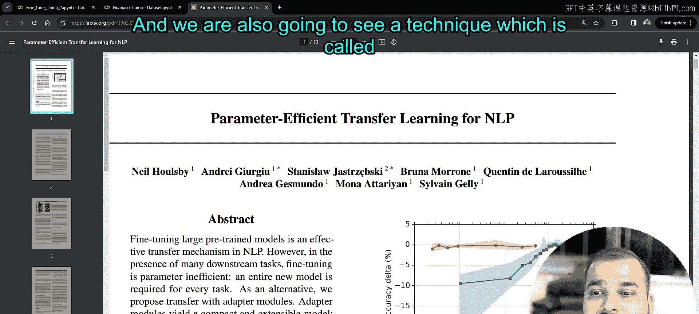

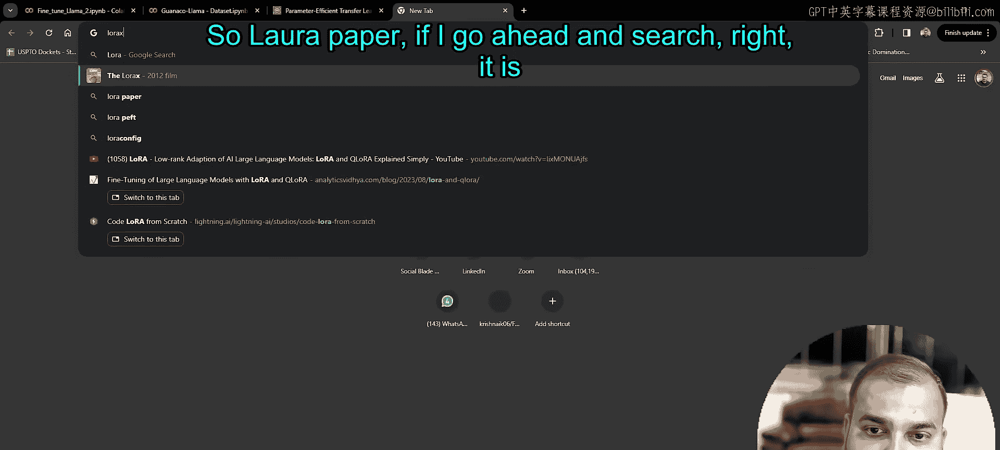

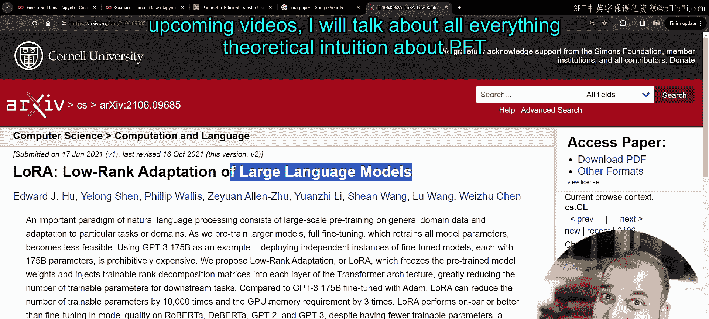

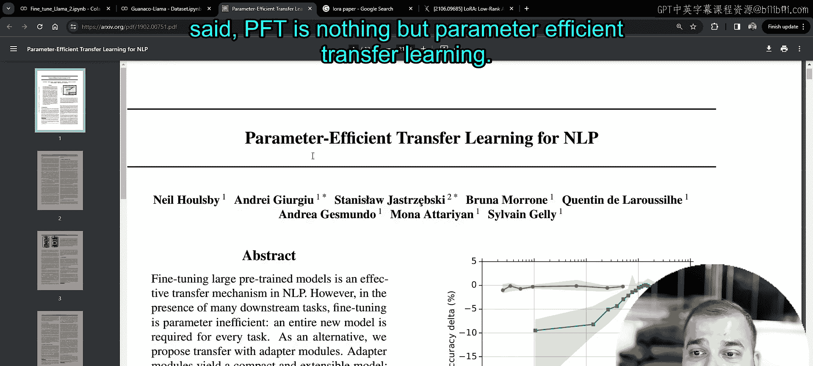

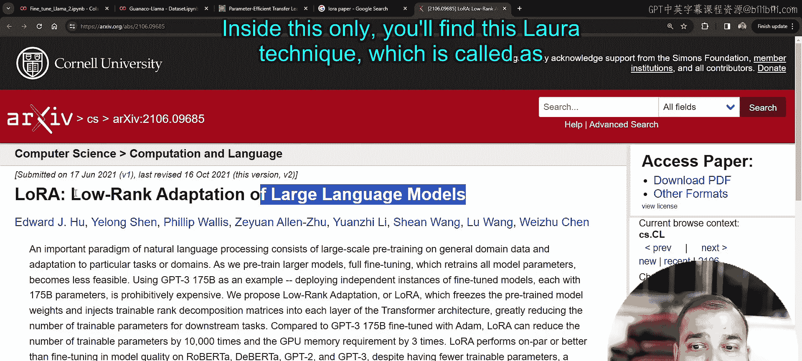

Specifically used for doing quantization Now what does quantization basically mean all these L models you know。

 when they are trained with 70 billion parameters or 13 billion parameters by default the weights data types are in the form of floating values right when we say floating values that they are basically 32 bit values what we can actually do and obviously since I am actually going to do this in Google collab we get a very less ram so it is a better way that you quantize those weights you know from float 32 probably convert that into int8 and then probably based on the Ram size you will be able to quickly find tunenet along with that I will be also will also be using transformers and then you have Trl So all this libraries will go ahead and execute it and once we specifically executed you will be able to see that all these libraries will get installed now in the second step。

😊，The major thing is that we will specifically be using the library called as transformers which is specifically used for this particular purpose and internally will also be using PFT which is having some Laura configuration and willll use this PF model I know you'll not be able to understand what exactly PFT is but I'll just tell you in some time just let me go ahead with but at the end of the day PFT actually you know uses techniques which will try to freeze you know when it applies transfer learning on these LLM models it is freezing most of the weights of that LLM model and only some of the weights will be retrained and based on that they will be able to provide you accurate results based on your custom dataset okay how it is done don't worry I'll create a amazing dedicated video to make you understand this mathematical intuitionions okay。

Now over here， youll be able to see that I'm going to import OS import torch。

 I'm going to use a data set。 I will talk about what dataset we are going to specifically do the fine tuning but here we are specifically using open source LLm models and then from transformer I'm going to use auto model for casual LM or autokenizer bits and bytes I will talk about all these libraries as we go ahead so let me quickly go ahead and executed now till this is getting executed。

 this import statement is getting executed let's talk about some of the important properties over here with respect to Lama2 in the case of Lama2 the following prompt template is used for chat models so this is the specific prompt template here we give an instruction in this S symbol and then we have our system prompt which will be closed with the Cs brackets and then you will also be able to give user prompt over here and the model answer will be coming after this after this entire instruction so this is how the entire Lama。

wo models LLM models specifically require the system prompt and the user prompt and the model answer format right now any data set here that you specifically get right we really need to convert that data set into this format okay and that is how I will show you how to probably do this there is a technique you can also write your own custom code and all them many ways okay。

Now what we will do we will reformat our instruction data to follow Lama2 template so right now we are going to use this data set which is basically called as open open assistant gu guannoco I hope I'm pronouncicing it right now here you will be able to see this is my dataset right human can you write a short introduction about the relevance of term monosonny in economics please use example related to this and then monosonny refers to the market so here you can see assistant answer so here the data is basically in the form of human and assistant like human has a question over there an assistant is probably providing you a specific answer so in this format you will be able to find out each and every rows each and every rows in different different languages so we are going to take this entire data and then。

Considerring this entire dataset set， what we are going to do we are going to reform the dataset following the Lama2 template and out of all these samples。

 all these data there are around how many dataset sets are there。

 I guess there are around 10k records we are just going to take thousand records of 1 records the reason is that I really need to show you how the find evening is basically done so if I go ahead and click on this and if you see this format right this format youll be able to see that this entire data is converted in this format only right instruction is basically there the answer is over here and this entire S is getting closed right so all the data is basically converted into that specific format how do you converted right So for that already what we are basically done is that over here to know how this data was created you can check this notebook so this notebook is there already you can see that we are loading the data we are applying this we are taking the thousand records and then we are transforming right so。

😊，forming basically a simple Python code like I have to probably keep in that specific format right so that is a reason I am showing you this specific code over here just by one click you will be able to do that okay so all the links are actually given。

😊，Now， you need to follow now understand guys， same。

Understanding how these specific techniques are definitely I create a dedicated theoretical video。

 understanding all the math equations that is required right over here we are trying to see that how you can also run your own fine tune model right so note you don't need to follow specific prompt if you are using the base Lama2 model but right now we not will use will not use this base Lama2 model how to fine tune Lama2 So these are some of the steps not only with Lama2 with other models also this will work but again there the format may change you know the format of the instruction the format of your prompt may change So free Google Collab offers a 15 gb graphic card right So limited resources barely enough to store Lama 2 7 billion weights now here we are going to use 7 billion weights。

 but it is also very difficult to store 15 gb whatever free model that we specifically have we also need to consider the overhead due to optimizer state gradient and forward activation So usually in in any Lm models。

 you will be having gradients you will be having forward。😊，Tivvisions you will be having optimizers。

 so there also you require some amount of memory fine tuning is not possible here right。

 obviously this will not be possible because 7 billion weights you cannot store it in 15 Gb。

That is the reason we require this parameter efficient fine tuning technique now what does PF basically do？

😊，It is going to freeze most of the weights that is present in that LLL model like Lama 2 and only with some of the weights after applying quantization it is going to probably perform the f tuning。

😊，Now parameter efficient fine tuning in the my next video I will talk about this research paper if you quickly want this video please make sure that you make the video like 2000 okay now what we are going to do over here we are going to use techniques like Lora and chlorra as I said Lora or chlorra Lora is nothing but Lo rank adaptation of rank large language model again I aologies guys if you don't know the mathematical concepts I will explain in the upcoming video so first of all we will load a Lama27 B charge GP model this chat model then train it on this onek sample which will produce a fine tune model which in the name of chat fine tune we will try to create in this。

😊。

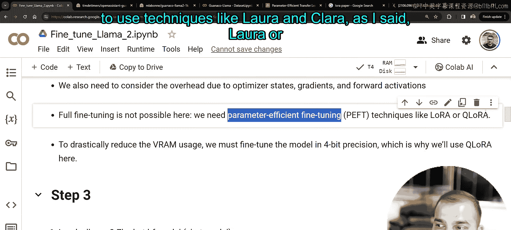

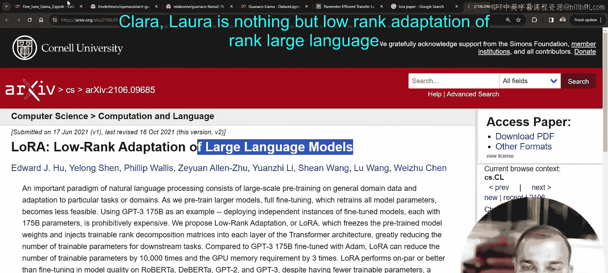

Chlora will use a rank of 64 with a scaling parameter of 16。

 we will load the Lama to moral aline4 bit precision we are trying to convert that 32 bit into 4 bit so that is how we are going to do the training and with respect to chlorra in order to find the lower rank index we are going to use。

😊，The rank of 64 right this is a hyper tuing parameter you can just consider right now this is a kind of a hyper tuing parameter with a scaling parameter alpha this is also called as alpha it will be having a scaling parameter of 16。

😊，As I said， everything will be explained detail when I probably go with the mathematical equation。

 but right now our main aim is to probably learn how to find tiing it。😊。

Now what model we are going to use we are going to use Lama27 7b chat then the instruction data set to use is this particular data set we will be downloading it from the hugging face the model name also will be downloading it and after fine tuning it this will be my new model name okay。

Now these are some of the chlorra parameters that is required Okay so one is Lora underscoreco R 64 what is this R this R is a rank of 64 a kind of hyperparmeter Lora alpha as I said alpha right I told you alpha why because I know the entire mathematic stuffs in this just to increase the curiosity and'm coming up with this first video and later on I will come up with that then here also dropout is basically required now in order to do the quantization we will be using bits and bytes parameter so here you can see activate4 bit precision based model so there is a parameter which is called as use underscoreco4 bit which is called to true then compute data type for4 bit base model so here it is basically float 16 then quantation we are using a4 on n4 so B and4 bit quant type we have to keep this particular value to N4 since it is4 bit activate instead quantization for4 bit base model so here we are keeping it as false now understand that these are some of the。

😊，parametersmeter that we specifically use in lower technique specifically in PftT then training argument parameters our output director will be present in this results I am going to run one epoch then we are going to enable this fP 6 and Bf 16 training okay。

😊，It is set to true with an a 100 right so a 100 you can set it if you are using A 100 you can set it to true right now I am using T4 if you have the paid version of Google Collab then you can set it to true。

😊，Bs size for purse GPU for training I hope you know what is batch size then you have GPpU for evaluation base size then gradient and accumulation step checkpoints max max grad norm learning great weight decayk right optimizer page Adam W we will be using which is of a variety of at itself then learning learn schedule type cosine because it works on similarity right whatever question answers we specifically write then maximum steps is minus one number of training steps overr number of training epochs and after this you are also putting logging steps is called a 25 now with respect to any fine tuning technique you use something called a supervised tuning right in supervised tuning that is you require some parameters right max sequence length then packing then device map so this is load the entire model on the GPU0 right so this is what are some of the parameters don't worry this are some of the parameters that you don't need to learn each and every parameter because already all these things are provided。

😊，By the official page itself I've just copied and pasted it over here right so we will go ahead and execute it so let's go ahead and execute it。

 So all these parameters are set now the step4 right they are multiple four steps right one more step is there later on load everything and start the fine tuning process right first of all we want to load the data we defined here our data set is already preprocessed but usually this is where you should reformat the prompt right filter out bad text combined multiple data some amount of preprosing is required。

 but already we have done that so we are not going to do it then we arecon we are config bit and by4 bit quantization as set right from 16 32 or 16 bit we are converting that into four bit so that it required less space with respect to GPU for the fine tuning purpose next we are loading the Lama2 model in4 bit precision GPU with the current corresponding tokenizer right with that tokenizer will try to load that and obviously we also be loading it with the four bit precision Finally we are loading the configuration of chlorra。

😊，So and passing everything to the SftT trainer So here is what self fine tuning this Sft will basically happen right now let's go ahead and let's do this so first of all we are loading the data set we are loading the tokenizer model with chlora configuration so here I will return this Bnmb compute D type and we are using torch so along with that you also require bits and bytes config again load we are enabling this4 bit then all the necessary parameters like compute data will be using used nestt quant again I am telling you guys there is nothing new to learn in this because all this formats will be available in the official documentation then we are going to check the GPU compatibility with float 16 if compute type is called to torch dot float 16 use4 bit otherwise this all things are there right then we are going to load the base model see whenever we want to load the base model from hugging phase we can use this auto model for casual Lm right that is the reason we have imported on top dot from。

😊，Tin model name what is my model name Ive given that contact config so here you will be able to see conation config we have also given something called as Bnb config right so here you will be able to see this is the compute type。

😊，Let me just search for it somewhere here on me， it will be available so so B andb config。

So here you can see this entireabtes config is basically there So based on that you will be okay a computer app okay yeah perfect So Bnb config is basically given over here。

 then device map is nothing but with respect to the GP mapping then modeled do config that use cache false you can also make it true if you want modeled config pretraining underscore tp is equal to1 then we are loading the Lama tokenizer see for any  model we also need a tokenizer so that it will be able to convert any L model the input data that we are specifically using into word embeddings and all so that is the reason order tokenizer from pretrain again。

 model name we are going to use this trust remote code is one additional parameter that is used then we are going to put a pad token with respect to the end of statement token right so that this dot EOS underscore token specifically applies the token for the Lama itself right and here we are giving the paddingsiders right fixed word overflow issue with fp16 training All this parameters will be almost fixed。

😊，uys only thing that you will probably be changing is with respect to the configuration。

Then load lower configuration here you will be able to see PFT config， lower config。

 all the values that you are putting with respect to this lower configx and here here you have your PFT configuration。

😊，Now this is the most important thing because in this training arguments we had set all the parameters。

 output directory number of epos this is this learning rate P Fp 16 B 16 you can probably see over here and then finally we are reporting it to the torflow right tensor board then you can also see that supervised fine tuning parameters right I'm giving my model name I'm giving my data set my PF config my data text field this PF config has a lower config right then you have a tokenizer you have the arguments you are you have packing then you have finally trainer dot1 okay now this is what is the main thing and that is where your supervised fine tuning will happen step by step we have done it okay let me repeat it quickly we have loaded the data set。

😊，We have set our D type right we are setting up all our conagion process over here here we are checking whether GPU is compatible or not here we are loading our LLM model that is Lama 2 here we are specifically loading our tokenizer which is reused in Lama 2 along with this we are putting padding techniques then my Laurara configuration which will specifically be in terms of PF config。

And then all my training arguments will go inside this， right？

that this training argument is with respect to where my output directory is and all learning rate and all okay。

😊，Finally set supervised tu parameters here we have set it model data set PF config text max equalequl length tokenizer。

 everything is put up over here and finally we go ahead and train this now once we train it it is going to luran for 250pos I think 250 step size I have actually given away here sorry 25 steps logging steps let's see what is a bath size bath size is for。

Yeah till that much it will probably go so let this start so it has already started I guess so here you can see it is downloading here you will also be able to see the data set okay。

Sample data right now you cannot see it because the data set will get loaded okay。

So table of contents install all the required packages will reformat all the steps are given side by side you can also read it out I know this looks like a little bit tough guys but at the end of the day I'll not say that it is easy and just the reason why I'm sharing you this fine tuning technique because you should just get in your mind later on you know this is the pattern that I'm following first execute this don't worry about anything as such just try to get an highle overview how things work later on I will try to break down each and everything in my next video by breaking this entire code why this specific parameters is used because the main thing is to understand what is Pft what is conagation what is precision and how how do you specifically use this Pf technique what is Qra everything what is low order rank index how to basically calculate that everything I will talk about it okay so we will wait for some time till。

Then just let let us wait and we will I'll just come again I think it will take 15 to 20 minutes to complete the entire fine tuning with thousand0 records and then again i'll come back and we start doing and seeing whether we are able to get the good results or not so yes lets wait for some time Thank you。

😊，So guys finally you can see here the 250 epoch or 250 steps have completed it took 25 minutes and again this is in Google Collab if you have paid version of Google Collab it will probably take hardly5 to 10 minutes to complete okay so over here you can see the global step for 250 training loss it when went till 1。

36 metrics runtime everything training samples per second all this information is basically done okay and please remember this particular word which is called as floss okay total flos because I am going to discuss about this in my next video also。

Now once we do this we are going to save this train model right and understand the new model name what it will be right so here you can probably see Lama27b chat fine tune so this is my results with respect to runs all the results you'll be able to see over here also okay so here in this fine tuning technique it is also created something called as adapter adapter model please remember this words because in the next theoretical intuition we are going to discuss each and everything as we go ahead okay so please make sure that you remember it so we are going to save this model so we have written trainer do model do save do pretrain model right now you can also check out in the tensur board but I will just go ahead and show you quickly that how it is probably going to generate it right so here we have created a prompt which is called as what is large language model I've used pipeline right so this pipeline we have already imported it the task will be task generation whatever model we have actually created that model will be there tokuizer will be used over here and max length。

😊，And keep to 200 to 250。The result and always understand as I always suggested with respect to Lama2 this will be my format there will be an s then there will be an instruction and here I will be having my prompt and with respect to this particular prompt we are going to get some kind of response so whatever response we are going to get inside this result variable it will be in the form of list and inside that there will be one field which is called a generated text so if I go ahead and search what is large language model you will be able to see that how we are going to get the result okay。

😊，Because we are running the same model over here so here is my prompt here we are using pipeline pipeline basically helps you to combine multiple things like task model tokens you know multiple things it will be able to give you right now since this is already running in this particular collab and obviously you'll be able to see ra and all are almost it is used the disk space of somewhere around 39 gb right so just wait for some time and here you will be able to get the response if you quickly want to get the response obviously you need to have a good GPU right based on that it will be able to give you a quick result right so after that you will be also able to see that we will be able to delete all this V Rams and all okay。

😊，So， let's see。And let's see whether well be able to get a result in the next step we can also push our model to the hugging face which I will keep it right now I will not explain it because this I will show you as a complete project as we go ahead so here you can see what is large language model a large language model is a type of artificial intelligence a large language models often seen then here you can also see all the information are there some example of large language models are include this okay now what we are going to do let's go ahead and take any one example over here from this particular data set okay。

😊，So I will just write how to。Own a plane in the United States， okay？So， this will be my。

Over here and I'll paste it over here， let's see。So this will also run and I will finally get my result also so same same question I have taken right so from this one key result so to own a plane this is the answer that we will probably be getting。

😊，Let's see how much time itll take to probably showcase but always remember please keep on looking at this particular ra like how much time it is probably taking and how much space it is taking so so guys here you can probably see the response how to own a plane in United States in United owning a plane is this determine your budget so this is completely based on this information that is present over here but here Ive written only 200 max length so I can only see 200 characters that is given right so you can probably try with each and everything as you go ahead one of the most interesting thing in the field of data science or geneative is that the kind of research that is currently happening right every day you'll be seeing some new things that are actually happening which is very much beneficial for the entire community working with LLM models specifically today I saw this amazing research paper where it is written as era of1 bit LLm so I'll be going to talk about this particular research paper and what exactly one bit LLM is and how。

😊，far more advantageous when compared to those 32 bit or 16 bit LLMs models okay so everything I'll be discussing about one important thing that I also want to make sure that you learn from this particular video is that how do you read a research paper what are the important points that you should definitely highlight while reading a research paper and how you should and one thing is that you cannot directly understand just by reading it you really need to have some basic knowledge and without that particular basic knowledge it will be very difficult to understand so if you are following my tutorials I always make sure that whenever I make my videos right I definitely watch or see all the research papers and then with respect to that I simplify those concepts and try to explain it to you so let's go ahead and understand about this one bit LLM now guys if you remember in my previous video we have already discussed about quantization so quantization was covered now with respect to quantization what we were doing is that let's say I have a model which is called as Lama2 which is an open source model。

😊，Let' us say this model is billion having 7 billion parameters。

When we say 7 billion parameters Im talking about weights okay now obviously if I have a system where I don't have very high configuration not I have resource constraint I have limited amount of RA or GPUus what we specifically do we perform quantization and we convert this Lama 2 model which is probably in Fp 32 bit and we try to convert this into int 8 bit okay。

😊，In8 which is nothing but 8 bits right now when we are once we are doing this specific process what is basically happening is that the model size is getting decreased right and because of that we will be able to load it and we'll be able to perform any task along with this we can also perform fine tuning with the help of lara and chlorra right so I hope you know this la and chlorra I've already discussed in my previous video please just go click on my click on my channel otherwise just go ahead and see the description I been providing that particular links with respect to fine tuning now with the help of Laura and chlorra we can perform the fine tuning now the question is that what is this one bit LLm right as I said that with the help of quantization we will try to convert this into T2 to 16 bit or it can be 8 bit right but converting this into a1 bit that can be again if you if now just by seeing this right if we are able to convert this into one bit that basically means we will never be having any resource constraint right resource。

😊，constraint， yes， with limited Ram with limited GPU with limited storage。

 we can probably perform everything from fine tuning to infferencing right so infferencing can also be performed right and this is what is so amazing about this and this is I don't know like what is going to happen just in some days because once this is probably gone right now we just have the research paper once this implementation get started trust me it will be quite amazing for the entire community who are working with LLm models so this was just a brief idea about this one now let's go ahead and discuss what is one bit LLm and when we say to be precise when we say that all large language models it is basically in 1。

58 bits white is 1。58 will discuss about it and there are many points that needs to be discussed along with me please make sure that you was is read it till the end because I'm going to read away here because this will also give you an idea that how you should probably go ahead and read the research paper so let me quickly go。

😊，and clear this。 let's see whether it will be getting cleared or not， Okay so。Over here， okay。

 clear is basically happening。Okay， I will just rub it Okay now lets go ahead and discuss about this and lets read some of the important information that is present over here Okay and trust me guys read along with me then only you'll be able to understand how you can read the research paper okay。

😊，Now what exactly this 1 bit LLM model is in this work we introduce a 1 bit LLM variant namely bit net okay so bitnet is the LLM model name1 bit LLM model name and then where every single parameter of weight of the LLM is turnernary right now it is not floating 62 bit sorry 32 bit or 16 bit it is turnernary Ternary basically means it has only three values it can have only three values weights it can be minus10 or1 it matches the full precision transformer m the same model size and training tokens in terms of perplexity perplexity basically means so with respect to any query that I ask and end to end task performance right well being significantly more cost effective in performance of latentance memory throughput and energy consumption so obviously at the end of the day all the LLM model will specifically have this kind of constraint right which are specifically with huge number of parameters。

😊，7 billion170 billion right and if you are just using this three numbers minus-101 you'll be able to understand why I am saying that because of this ternary values right you'll be seeing how abundance the performance improves okay so furthermore so here you can probably see all this points latent memory throughput and energy consumption energy consumption can be with respect to influencing with respect to fine tuning and all okay now let's understand how this operators how this values will be basically used okay this is also important so with respect to this what I am actually going to do I am going to make sure that to explain you I take the right thing okay so let's understand this okay。

😊，Understand， guys， whenever we talk about parameters， this are my weights， okay。

 this are my weights。😊，Lets see so these are my weights， okay。And these are my weights。

 so let us consider that my initial transformer LLM weights is this one okay。😊。

Now by when we say one bit LLm。😡，We are going to convert all these values and replace them with either of these three values minus10 comma 1 okay so that is the reason that you see over here all this weights is being getting converted into something like this okay minus10 or 1 only that three parameters is there okay and this is what we basically say as bitnet B 1。

58 okay and this is also called aspirto improvement how this is basically happening I will talk about it okay just give me some time there will be some kind of quantization getting applied here also okay quantization getting applied over here okay to convert this values to this okay。

😊，Now lets understand one very important thing again。

 this is the most important thing what will happen if you convert this values to this。😊。

See with respect to any fine tuning or forward propagation backward propagation what exactly happens the model weights the model weights over here is basically getting multiplied by the input and then we get the output right Yes additionally we add a bias So it's okay we don't include a bias right now over here just to show it to you so over here this lets consider that this is my floating point。

16 number So every number will get multiplied by the input right and then what will happen is that。😊。

After that all the it it just like this right summation of is equal to1 to n w of x。😊。

Plus B right so this is what is the operation that is basically happening whenever we do the forward propagation whenever there is an a of weight that basically means we are doing the sum of weights and the input right so once we are doing this and then we are doing the sum but if we have all these weights in the form of minus-110 then what will happen is that over here you will be seeing that multiplication operation will not be you know that much valuable right so over here first of all we are doing multiplication then addition but over here we are just doing addition no multiplication because any number it will be multiplied by 0 is 0 only any number that is multiplied by 1 is  one only any number that is multiplied by minus-1 is -1 only so over here the main thing is that your addition operation is only happening。

😊，Addition operation is only happening now obviously if you only need to do addition operation then what will happen your GP will not be requiring that one GP also。

 so your GP will also get reduced。😊，Why why this operation takes more GPU because multiple multiplication needs to happen right with respect to different different weights right then addition of all those values needs to happen because in the forward propagation this is what is the equation that specifically happens right we multiply the weights with the inputs and then we do the submission and then finally we add the bias right So this is the most important thing So here you'll be able to understand with floating point16 right all the numbers is first of all multiplied by the inputs and then the sum is done but here your values are with respect to ternary that is -101 So here multiplication is already skipped because one in x0 is x0 only right it is a simple multiplication right and that much resources will not be required for simplistic multiplication So here maximum to maximum only addition will be required right so I hope you are able to understand because of this technique of perito improvement because of this technique of。

😊，Pto improvement you'll be able to see that what we are able to achieve right and obviously when we are able to achieve this。

 the GPU will be required less when we are doing the fine tuning or training right so I hope you have got this as a complete idea and you have understood right why we specifically do this how it is done how this transformation is done so here you can probably see that it provides a potato solutions to reduce inferluencing cost to latency through potent and energy of LLm while maintaining the model performance。

 the new computation paradigm of paradigm of Binet 1。

5 it calls for action to res new hardware optimization for one bit LLm right I know guys this is more of a research paper so Im reading and I am telling you each and everything and also explaining you the concept I know this can be a little bit of boring but trust me you need to understand in this specific way okay。

😊，Now let's talk more about this and we will I've highlighted main things in this green color okay this models have demonstrated remarkable performance in a wide range of natural language processing tasks like LLm models but the increasing sizes post challenges for deployment and race concern about the environmental and economic impact due to high energy consumption obviously this is the problem with LLms that are already available one approach to address the challenges to use post training quantization to create low bit models for inferencing I've already discussed about this quantization lara chlorra everything this technique reduces the precision of weights and activation significantly reducing the memory and computational requirement of LLM the trend has been to move from 16 bit to lower bits such as 4 bit variant this is what is basically happening with respect to LLm models right this is with LLm okay this is with LLm。

😊，So here I'll write LLm models Now let's see with the help of one bit architecture1 bit model architecture what we can solve so recent work on one bit model architecture such as bitnet presents a promising addition from reducing the cost of LLm while maintaining the performance vanillaina LLms vanilla LLms are in 16 bit floating by and the bulk ofLm is matrix multiplication therefore the major computation cost comes from floating point addition and multiplication operation I said you just now on top of it right in contrast the matrix multiplication of Binet only involves integer addition because anything multiplied by1 is one anything multiplied by1 is that same number anything multiplied by minus1 is that same number with a negative sign and everything multiplied by0 is obviously zero right so as the fundamental limit to compute performance in many chips is power this energy saving can be translated into faster computation now this is the most important thing right。

😊，And here you can clearly see the things that Ive highlighted， right？😊。

I hope you get an idea how good this 1 bit LLM can be okay。😊。

Then you can still read about it here we are going to just use turnernary of values like -101 and obviously because this 0 your 0。

58 bit is basically increasing there are two major advantages of using this also it is written over here see。

😊，Furthermoremore Binet Oh my god why this is getting highlighted like okay furthermore Binet offers two additional advantage first its modeling capacity is stronger due to explicit support for feature filtering how feature filtering is happening because anything multiplied by  zero will be 0 ora。

😊，right made possible by the inclusion of 0 in the model weight which can significantly improve the performance of1 bit element secondly our experiment shows can match full precision baseline in terms of this end to end task performance starting from a 3 b size okay。

😊，Now， most of the things that you are able to see right now let us discuss about one more important thing that is how this transformation is happening。

 how this number are getting converted to this， it is just by using this simple mathematical equation or this quantization function okay。

😊，Grantization function。Quantization function， okay。

 and this quantization function is called as absolute mean quantization。

 and this is the formula that is basically used by which all the numbers are basically getting converted。

To only these three values， okay，0，1。Okay。Wen。01オッケ。Just by applying this particular formula， okay。

So in and there is also one more change with respect to the transformer it replaces nn dot linear with bit linear okay so this bit linear I think you will be able to see that it is strain from scratch with 1。

58 bit weights and 8 bit activation so this is what it is basically done with respect to the initial training okay。

😊，So most of the thing I have actually discussed over here。😊，Let us talk about the performance。

 so here you will be able to see that。😊，The Lama model of 700 million parameters bitnet will also have 7 million parameters。

 but here you see the memory is in decreasing right over here 2。081。182。33 is getting reduced to 080。

96 and then this PL is basically 12。8 so over here you can see that how it is getting reduced now similarly when the billion of parameters are basically increasing right let's say with lama is 1。

3 billion right the parameter will be same but memory again 1。14 is required 。971。

29 right and similarly over here also youll be able to see the same thing is basically happening So memory is decreasing latency is also decreasing for the inferencing purpose。

😊，Perfect and one more parameter that you will be able to see with respect to model size and latency。

😊，right model size so the the blue color is basically the lama model okay the orange color is basically 1 bit LLM models you will be able to see how much huge latency difference is there similarly with respect to this how much huge memory difference is there right to save this kind of models。

😊，So this is just the research paper that has come up recently， but I am really。

 really happy to see this because in the future， many is going to happen。😊。

So again I would like to welcome you all to the era of 1 bit LLm models and now you'll also be able to use this one bit LLm models soon I think first of all hugging face will only come and try to implement all these things where you can also easily create your application using Gene so guys Google is again on bang and it is created its own open source LLM model that is called as gamma now again it is on that specific race of open source LLM models also till now the most accurate model that we specifically had was from meta that is called as Lama2 now gamma is there in this specific video will try to see a practical application along with that will try to fine tune with the help of this specific gamma model okay。

😊。

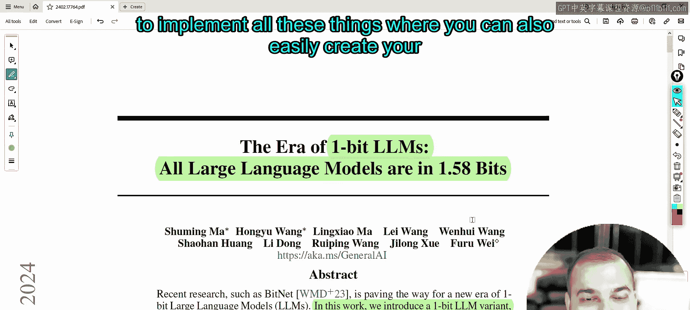

So what exactly is gamma model I'll just show you one block。

 first of all why they have actually created it at the end of the day all the companies。

 you know is saying this thing right so Gemma is built for responsible AI development from the same research and technology used to create Ge models at Google we believe in making AI helpful for everyone we have a long history of contributing to open source communities such is transformer Tensorflow Tja X Al fold and Al code obviously Google is doing I think it is it is from past so many years it is doing so much of research specifically in open source contribution it is given Tensorflow it has given many things as such along with that meta is also in the same race both are doing fabulous job so let's go ahead and let's know more about gamma gamemma gama will say gama okay Gema also we could say I don't know how to pronounce it but it's fine so if I drop probably talk about this。

 the main thing that you really need to know is about the performance metrics over here。😊。

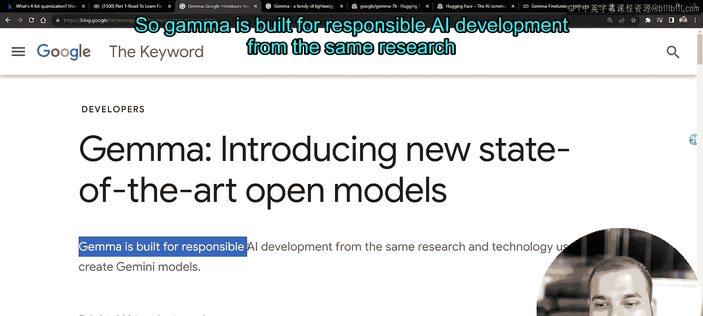

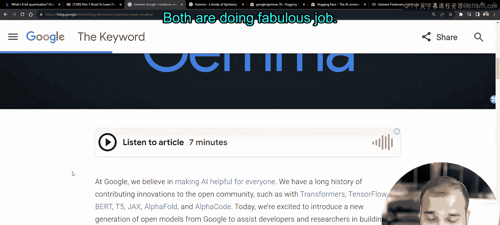

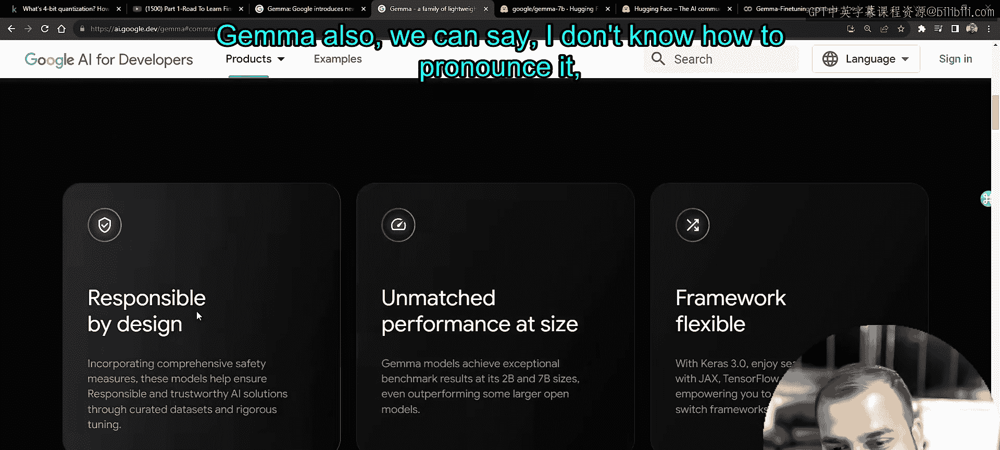

I compare see two models are there with respect to this particular model one is 7 billion parameter when it's2 billion parameter if I consider with respect to Lama2 we have 13 billion and 7 billion with respect to all these things I think gamma is performing absolutely fine here you can see that it is having 64。

3 with respect to various benchmark accuracy if you want to know more details about it you can actually see this particular blog over here if if we are just comparing open source models like gamma and Lama2 gamma is way forward when we compare with respect to the 7 billion parameter it has right 64。

3 the general accuracy reasoning is 55。1 81。2 maths 46。

4 it is far far better than the Laau 2 models also right so this looks absolutely great here the accuracy is also very very good。

😊。

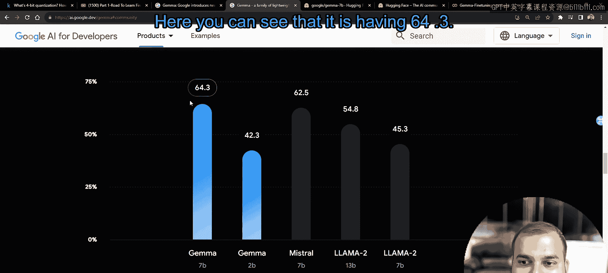

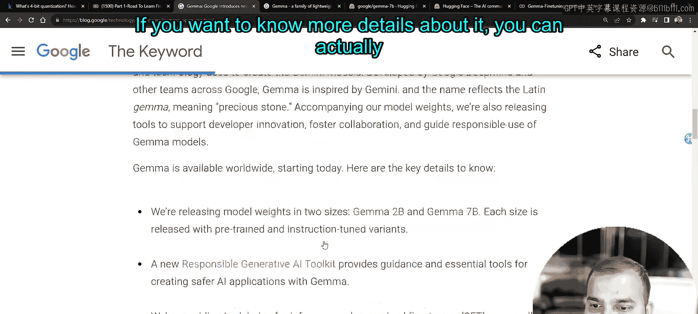

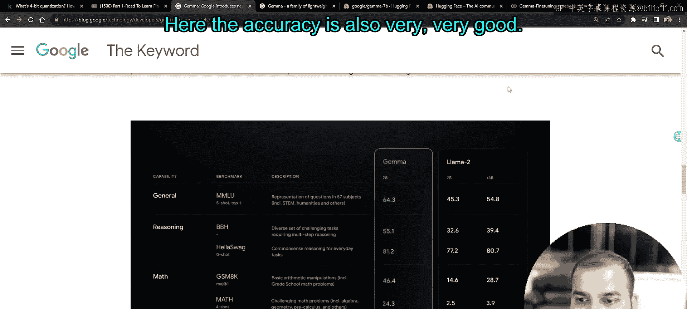

Now lets talk lets see more about it it is specifically used for you know research purpose you can also use it over here you can build your own models。

The other thing is that right now the gamma2 models right 2 billion parameters。

7 billion parameters is already available over here see in hugging phase So once you probably go to hugging phase and search for gamma 7b or gamma2 B you'll be able to see this kind of page here you need to get granted to access this model so here they'll tell you to probably check the terms and conditions to get the license of this particular model to use it so it will be like a checkbox you just need to check it I understand that that and give the confirmation right once you probably do that you'll be able to get the access of this specific model what is the main aim of this particular video I'll try to show you with the help of practical implementation how you can access this particular model and how you can actually use it so now let's go ahead and let's see this fine tuning technique with the help of Google gamma model and again guys this is just a simple use case that I have taken over here but you can do some amazing use cases with the help of this and that is what I'll plan in the future。

😊。

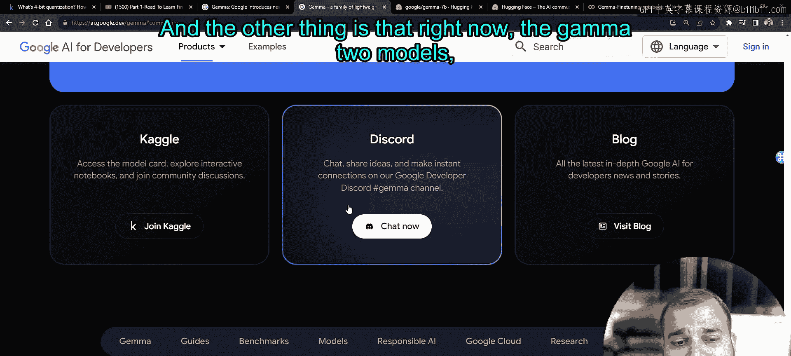

Use cases that I've already developed with paid opening eye models。

 I'll try to also develop that with this along with fine tuning so initially what we are going to do we are going to see this Google gamma model how it performs and what a kind of task all that kind of nLP task youll be able to do it so initially to go ahead with I will go ahead and install all these libraries that is bits and by Trl X datas and transformers if you don't know guys Ive already created a video with respect to fine tuning okay now in fine tuning what we have actually done we have done the fine tuning with the help of Lama2 model Okay so let's see a UTF local is required。

 let me restart my kernel change run type disconnect and delete runtime so let me go ahead and reconnect it and then we will try to do the installation again but I' have already created a fine tuning technique with the help of Lama2 model the same steps and process will basically happen over here also。

😊，So let's okay， so got connected now let's go ahead and just do the PP install so here you' will be able to see the PP installation will specifically happen with all these libraries。

To just tell you what we are going to do this bits and bytes techniques。

 bits and bytes library is used for quantization purpose I've already created a video with respect to quantization。

 What is the main name of quantization， quantization actually help allows you let's say that you have a huge model right right now we have this Google gamma model of 7 billion parameters or 2 billion parameters It I want to load it let's say in Google collab So in Google collab right now I have somewhere on 50 gb or 201b hard disk right and right now I'm using this Google coll premium version right let's say if you are using it itll hardly get 15 gb Ram it is not possible to load that entire model over here So what quantization techniques helps you do is that it helps you to convert that float 32 bit right usually all the numbers all the weights all the bias are saved in 32 Bs。

 itll help you to convert that into 8 bit 16 bit So when you convert that you require less memory at that point of time right。

😊，So that process is specifically called this quantation and I have actually explained it。

 I've shown you how mathematically we specifically do quantation So everything is explained in this particular video I'll provide you this link in the description of this particular video now the next thing is that we will be importing some important libraries one is OS transformers then you can probably see torch Googlecoab user data data sets I'm going to load it trainer Pft PF Pft Laura configuration as I said that we are going to use Laurara technique a safety trainer is specifically used for fine tuning purpose supervise fine tuning we basically say right now from transformers we are also going to use auto tokenizer because tokenization if you want to really perform tokenization while fine tuning will be using this auto tokenizer so that it can load based on the model that we have then you have this auto model for casual LLm this is specifically used so that we be able to fine tune with respect to casual large language model。

😊，Then from transformers you are also going to import bits and bytes config here we are going to give the configuration with respect to conagation and then we have this gamma toizer。

😊，So lets go ahead and import all these things so gamma tokenizer is something for the gamma model itself right our tokenization technique otherwise you can also use other tokenization it is not necessarily that you always need to use gamma tokenizer。

😊，Now， let me tell you one more step。The next thing is that after importing all this you know that this gamma 7b model is specifically present in hugging phase right now in order to access this model in order to download this model we really need to have something called as access token。

😊，Exceses token of what excess token of the hugging face so how do you get an excess token go over here click on settings and here you will be having something called as access token just copy this okay copy this excess token and。

Once we have this excess token access right then only we will be able to download the model from here so here what we will do go ahead and set it in the Google Collab how do you set it click on this key button so everybody will be having this key button and just click on add and music right and I have written it over here as Hf underscore token with that same value that I have copied from there so once I probably write it down over here so this is basically saved right so this is saved over here。

😊，Now once I've saved it any number of notebook that you specifically work in you will be able to access this hugging face token how do you access it it is in simple O dot environment at_co token is it called to user data dot get a_co token you just need to write user data dot get a Che token so once you do that it will ask you for the grant you just need to grant it and then it will be able to access and it will be able to also identify which hugging face from which username or password or which user name you are specifically pulling that particular information okay so this is done right now through this you will be able to access any model from the hugging face right let it be Lama to any model that you specifically want to use。

😊，Now what we do， we will go ahead and call this particular model Google Gemma 2 b initially I told showed you 7 b right I' am going to load it 2 b right 2 billion parameters。

 not 7 b7 b also you can do it It still take time for the fine tuning purpose now here you can probably see。

😊，Have taken this and then I have written bytes B and B configuration that is bits and bytes configuration the first parameter is load in4 bit is equal to true that basically means what。

😊，My model， the gamma model in 2 billion parameters is specifically in the 32 bit right initially we are trying to convert that into 4 bit and this process is specifically called a contagion right so what we are doing is this once we set it in load in4 bit all the activation function sorry all the weights that are stored in 32 bit will get converted into 4 bit okay。

😊，Now， the second parameter that you will be able to see Bnb underscore 4 bit quant type is equal to Nf 4。

 what is Nf4 4 bit normal float。So the quantization technique how do you convert this into a 4 bit is basically taken from this particular parameter if you really want to know about it have've given a link over here what is 4 bit quantization and how does it help Lamato2 the reason why Ive written Lamato two because we are talking about open source model then you have Bnb4 bit compute type which is nothing but torch dot B float 16 bit now the reason we have kept this as 15 B16 bit。

😊，See this we are performing conaggion that basically means we are taking a big model we are making it to a small model how by performing conagion by converting the 32 bit into4 bit。

😊，Now， along with that， whatever fine tuning takes place for those fine tuning。

 all the weights that gets updated will get updated with respect to this particular 16 mi。😊，See。

 there is some loss of information with respect to quantion to balance that we are keeping the new fine tune parameters in 16 bit。

 So that is the reason we have written it over here So once I execute this so this is my model I this is my configuration now based on this model I and configuration Im going to use the tokenizer and from this particular pretrain model I'm going to call the tokenizer and here also I'll be using the Hf token then you have model over here auto model for casual L from pretrain model I will use this model I see auto tokenizer is to call the tokenizer that is required for this particular model right and here also I've given thef underscoreco token automatically that tokenizer we call called called right then we are using auto model for casual L and here also you'll be able to see that we have be using model I quant config with respect to the Bnv configuration the device map will be called to0 which is nothing for the GPU and here you can see that I'm going to use the Hf underscoreco token so once I execute this。

😊，You will be able to see that I am going to download all those information see Auto model specifically to call those particular model。

 the model I that I've given over here by applying this contention technique and this entire process is going to happen in the GP the GPU that my Google collab is connected to and over here I've given the token so quickly you'll be able to see that the entire model will get downloaded and now all the information will be specifically present in this particular model now with the help of this particular model I will go ahead and test it now now serious how Im going to test it I've given a quote over here imagination is more I've used a device sc is equal to 0 that basically means whatever is the GPU that is available and then Im going to use this same tokenizer see this tokenizer is basically getting used。

😊，I give the text and I get this particular information so this input will be a vectors right and then what we do we use this same model and we say dot generate with respect to this particular input and lets say that I am going to take a token of 20 okay initially。

😊，Then once I get this particular output the output will have in the form of list like what all information is basically coming So once we write tokenizer dot deco of output 0 c at the end of the day we are doing sentence generation so when we write modeled or generated is again going to create some embeing vectors right and that output which is in the form of vector we will get decoded with the help of tokenizer and then we will get the real text so if I execute this。

😊，You'll be able to it is saying skip special token if any token is there， it will get removed。

 Okay so once I execute it， you can see imagination is more than knowledge。

 I'm a self- taughtaught artist born in 1985 right so this information is basically coming based on based on the model that it has let me go ahead and execute once more So here also you can able to see that I'm trying to execute one more time。

 let's see whether I get a different output So here you can see imagination is a more than knowledge knowledge limited imagination in circles the So this information is given by Albert Einstein okay so two information。

 if you probably search in the internet， you will be able to find this code also okay so over here one output we got the code completion here you you could probably see that I'm also getting the author name okay。

😊，Now this is what it is able to do it okay so whatever information you probably put it over here it will be able to get the output based on the information that you require now what we are going to do we are I am going to show you a fine tuning technique now see this。

😊，O dot environment1 disabled so one parameter we need to keep it as false that was given in the documentation so I do not still understand why this parameter was used but once I know it Ill let you know because I am going to create a lot of projects as we go ahead。

😊，Now we are going to fine tuning with the help of Laura configuration so for Laura configuration what are information I require one is rank okay so Laura technique is something called rank decomposition we will get to know I have not still uploaded the theory video so here we can select the rank value okay so rank over here is selected as8 y 8 why cannot select 16 or 64 we can select any number but understand what exactly is rank decomposition for that I need to create a dedicated video and soon I will be coming up with this。

😊，The target modules in this you specifically require this KV parameters gate up project down project so these are some of the target models that is required as I said guys once I probably upload a video dedicated to Laura configuration you will be able to understand。

😊，The task type， we always need to keep it as casual underscore Lm that basically means it is specifically used for this language modeling task。

 So this is one of the parameter that we need to set it up。 So once I execute this。

Now lets go ahead and do the fine tuning Okay so this is my Laura configuration now the data set that I am going to specifically use is this okay。

 so lets see this data set okay so Ill see this arbitrate English quotes okay。😊，嗯嗯嗯。Okay。

 let me see whether we are able to find it out or not， arbitrate hugging face。

Okay I will just search for hugging phase now this is the data set if you see this data set you have to information one is code one is authors right based on this information。

😊，This is the quote and this is the author and we'll try to fine tune with this let's say that my gamma models knows some of the quotes in the internet along with the author okay now my main thing is that Ill have some more additional data set and well train with this specific data set and well then identify the author for this particular code okay we'll do something like that we'll implement something like that so here you can see that I am loading this particular data from arbitrate on English codes and then we are taking a sample from this sample of quotes okay so here we are going to execute this。

😊，And if I just execute data train of code right so I will be able to see all the codes over here okay codes you can also see the codes you can see the authors and also so this entire is getting generated and here you can see train split is also happening and once this is executed here I have my data set so if you probably go ahead and executed you will be able to see all the codes Okay so the codes the sample of codes that we have there is nothing noble in this so so so so in permission as you can see okay so this is my data set。

😊，Now， whenever we perform SF， that is supervise fine tuning right。

 we require some information Okay one function we specifically require to indicate what is my input and what is my output so here we have used something like this quote example code of0 So this is my first parameter like0 okay and then whatever information is that this is my input and this will be my output so code of0 author of0 so that basically means code of0 indicates I will show you it this code of0 basically indicates each and every sentence over here。

 author of0 basically indicates this one Okay so this information will be my output and this will be my input something like that Okay so once I format this will be able to see that I'll be able to return my text okay so let's let's consider over here if I give any example over here right so here will be able to see that any kind of example from that example code will be separated and author of information will be separated and then we return that。

😊，Particular text in the form of key value pairs in this list。Now is the time for S trainer。

 So here we use the model。 we use the data of train。 data of train is what So lets see this。 Okay。

 so you will be able to see what is exactly data of train。

The same data of train will be able to see where Ill have all this information this is my features author tag input idea and attention mask okay then we use some training arguments per device batch1 gradient recognition steps for warm up steps take I am going to run it for maximum steps of 00 learning rate is so much Fp 16 is true。

Then output directory will be this optimizationim will be this right P of the configurationg will be nothing but my lower configuration and whatever formatting function I'm using I'll be using it over here So I am formatting function Okay。

 so that I get the text in this particular key value pairs So once I execute it you will be able to see it。

😊，So here you have your training will probably start now， okay， once I write trainer or train。

And we are going to run this for00 steps now see how fast it is going to happen The reason is that 2 billion and we are trying to convert that into  four bits I think the training will quickly happen and we are taking just a sample of data okay sample of data so here you can see 26 steps is that 100 steps and here you can also see that loss is decreasing right 0。

39。39。21802080 it's got 0。131 so loss is keep on decreasing over here okay。😊，Now。

 this code you will be able to see have've taken from one of the。

Over here lets see so here so a human is like a tea bag and then my author should be Ellen Roosevelt right so now once we execute this I think we should be able to get that specific response。

Okay from that particular model So let's say 89919200 it is reducing it is increasing a bit。

 but again it is in that step So training output global step。

 if you still want to reduce the loss what you can basically do you can increase the number of steps Now here I have a quote a human is like a t back k is equal to zero tokenizer this model or generate this same thing Now let's go ahead and execute it I should be able to get the author name in forward see Ior is coming a human is like a t back。

 you can't tell how strong C until you put it in hot water Okay so that information you can see you can never know how strong it is until you put it hot water so see all this information is basically coming and the author is also coming as Ior right。

😊，So let's see this I will also take one more example， something like this。

 lets see whether we will be able to generate the same thing or not based on the data that we have because we have already doing the fine tu okay。

😊，So I will something night like this。 Okay， now let's execute and see the output。And again。

 now every fine tuning you can specifically do this specific way， right。

 Ive just shown you in one example。 The opposite of love is not hate。 It's fear。

 and the opposite of fear is freedom and the most wasted of all days。

 Let's see whether it is there or not。😊，See， the opposite of art is offer is of love is not opposite of love is not its indifference。

 the opposite of art faith is not somewhat it is almost equivalent right？😊，Fear opposite of freedom。

 most of the warrant is， okay， let's try some。Okay。

This looks unique unless I until this person is not of famous。The book is man's。

 so I will just go ahead and execute this。Let's see where there will be And again。

 understand guys we have just max new tokens as 20 because it needs to also complete the entire statement。

 So outside of a box dog， a book is a man We friend say man's best friend author is Nichoolala comfort。

😊，The quote is again the most wasted days of all days in one， so you can probably see over here。

right inside of a dog something all the information is great right so you can you can check it out with different different examples but again at the end of the day yes fine tuning is good in this。

😊，Again， as we keep on doing more and more， we will be able to do it now all the application that we have specifically created like text to sQL in voiceice will try to do it with the help of this also we will also try to do the fine tuning。

😊，Now， one challenge that I probably see in while you are building an LM application。

 there is a dependency of lot many different different tools okay lets say that Im specifically using a model。

 let's say Im using open AI。😊，And I also want to integrate my LLM app with external sources。

 it can be documents， it can be Google search API， it can be Wikipedia search API so for all this kind of work I really need to integrate with different different APIs altogether I need to have an environment key created everywhere let's say with respect to Google search API let's say if I want to use vector emmidding I need to have a separate key stored for the vector databases like Chma D P cone if I want to probably integrate with Cassandra Db datats I need to have different different connection points。

Now this is always a challenge when you are creating a project from scratch because here to create this entire LLM pipeline。

 it will definitely take a lot of time along with that you really need to manage all the configuration。

😊，Now here in this video I'm going to talk about this amazing Pla which is called as vexed VXt and here we will be simplifying this entire LM ops along with that well be building LM pipelines without writing any code so here you have almost every feature if you want to probably implement application like document Q and A vector embedding is integrated over here if you are dependent on any external sources like Wikipedia or save if you dependent on Google search everything is available over here so you don't have to probably save all the configuration or create all the APIs just with one API you can actually build this entire LLM pipeline and use that specific API in your chat chatbo in your LM application anywhere that you specifically want to use now let us go ahead and let us see that how things will probably go ahead in this you can also start completely for free so I will just go ahead and login over here。

😊，So I have already logged in so here you can see with my email ID Ive already logged in I'll show you step by step how you can pre performform all these things right please make sure that you was this video till the end an amazing platform altogether at the end of the day I should be able to explain you and teach you many more things as we go ahead right so quickly lets say I will go ahead and log in。

😊，So once it is logged in and then we will go ahead and see to it。

 lets see I will go ahead and log in in this way。So once we log in over here。

So here you can see that you will be able to see a dashboard okay once you probably will log in now after you log in all you have to do is that go and towards this AI project section okay if you have not logged in you have to sign up in this specific platform now what I will do is that I will go ahead and create a AI project so let me go ahead and create an AI project and I will name this AI project to something else lets say I will write。

Document Q and A something I can write up to you Okay so whatever application let's say I will say rag system right so I I'm actually trying to create this I will enable this also make sure that you enable this then only your application will probably get started。

Now in this entire pipeline initially you will be able to see two important section one is query and one is output okay so query basically means an event that starts the flow now this will be super important guys because a person who does not know much coding can also probably use this and create its own application right entire LLM application with LLM ops right and you can also build the entire pipeline very simple you don't even require a developer over here。

😊，Now here you have query， here you have output， output basically means。

 whatever is the final response that you will probably get。😊。

Now in between this there is a plus sign over here if I click on the plus sign I have all these options right so let me zoom in so that you will be able to see to it okay so over here you'll be able to see once I click on plus in here you have an option to add an action so first you can add a generate response generate response basically means a response from a specific L model you can also add data sets let's say you want to implement a document Q&A or a system over here then you can add your own data set along with that you also have an option where you can execute a function like this or smart function Now what is this exactly smart function I will go ahead and explain you okay。

😊，Now let me do one thing let me first of all add this search data set lets say that I have some multiple PDF file I want to probably create a document Q andA or it can be a retrieval augmentation generation right that kind of rag system we can we want to create so for this I will go ahead and add a data over here let's go ahead and create a data lets say this data I will say these are nothing but research papers。

😊。

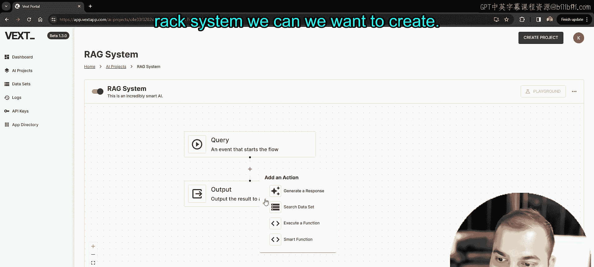

Okay so I will go ahead and create this research paper Now inside this research paper。

 what I will do I will go ahead and add the data set itself right so over here you'll be seeing you'll be having multiple option you can upload a plain text you can upload a file you can upload a page call you can even use Google drive any file that is available in the Google drive that also you can add in notion in confence so still many more options are probably coming up as I said for people who is not much familiar with respect to coding in Lm they can specifically use this now let me go ahead and let me upload a file now over here I'll click on upload a file and then I will go ahead and upload one file over here let's say this is one of the research paper we' will try to see what this research paper is all about and I'll click on upload so this one pdf has got upload it this is one of the research paper on basically means the lara and Clara configuration the fine tuning specifically that we use in LLM models right so that research paper we have added so I will go ahead and click。

😊。

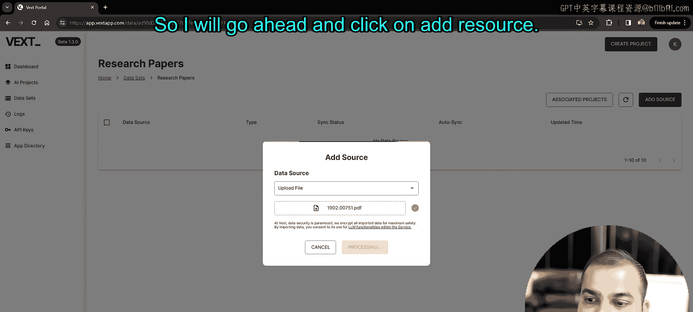

One add source Okay now as soon as I click on a source。

 you' will be able to see that this P file will get uploaded over here。

 let me see that okay let me say that I have more files to be added over here so I will go ahead and click on add source and let me go ahead and upload one more file so now there is one more research paper that is available away I'll write attention attention is all you need so I will go ahead and click it over here so this is another research paper that was available attention is all you need that is something related to transformers so I will also go ahead and upload this particular file so as soon as I upload it you will be seeing that I have added the source so inside this particular data set that is research paper I have this two two pdf files the research papers itself and I can have any number of research papers because people will again say can we just only add one or we can add any number you can add any number but the maximum Pdf size should be 5 so this is there Ive added it let me go back。

😊。

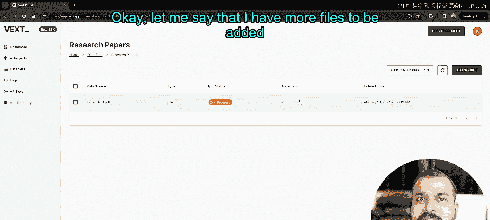

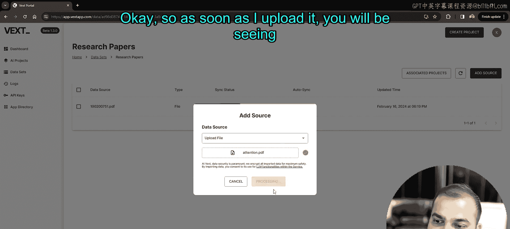

To my project now inside my project the rack system that I actually created right now I just have this two flows right my in my Lm pipeline now Ill go ahead and add something called a search data set。

😊。

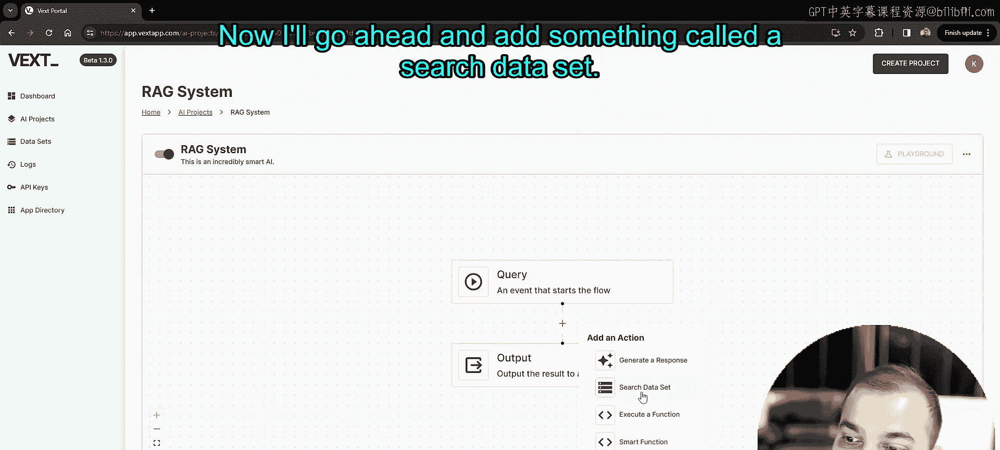

So as soon as I add this search dataset you will be able to see that it will give me an option to select the dataset right whatever I have uploaded so over there you will be able to see that I have my dataset set called as research paper so Ill add it over here okay now you can see both this specific file has got added right now once this is getting added there is in the right corner right you will be able to see there is a button in the right corner which is called a save I will go ahead and click on save okay so once I click on save that basically means this。

😊。

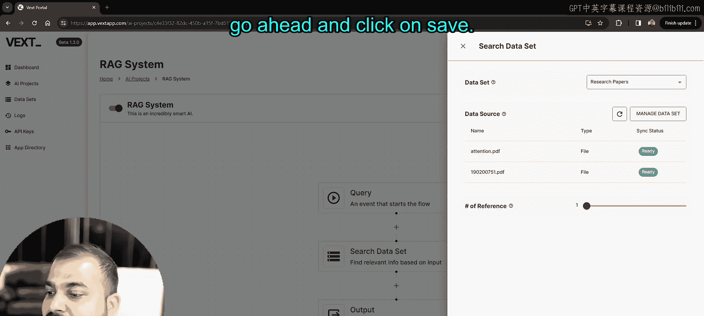

Ingesion， the data ingesion that is specifically required is now available inside this search dataset okay so over here you'll be able to see this search dataset because I want to implement a Rg system or it can be a document Q and a I can probably ask any question it should be able to give me the response so inside this this particular data has got added but internally what this system is doing it is already creating that entire embeddings that is specifically required internally if it is requiring any vector store it is creating all those things now this is done so this entire is my data ingesion step now coming to the next step here let me go ahead and generate a response because here what I will do I create Ill add an LLM model okay now any question that I specifically asked to my data it should be able to give me the answer and summarize that answer using this LLm whatever LLm I'm selecting over here so generate a response you basically select over here and you have multiple option of selecting different different models now see。

😊。

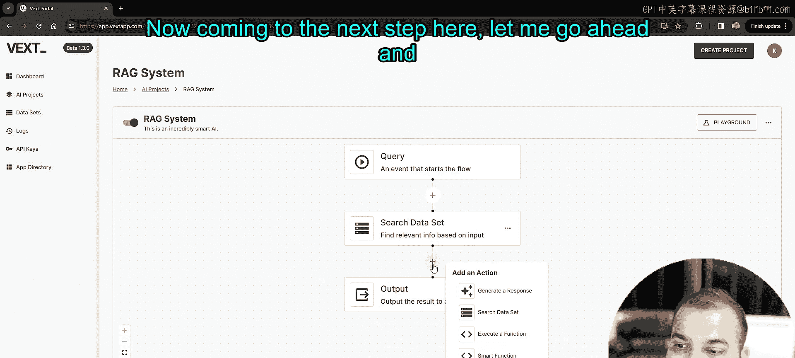

It is also providing all these models Azure OpenI GP3。5 Azure Open GP 4 Anthropic cloud instant。

 Anthropic cloud， Google Japanese Pro be and in the future so many different different models are coming like Lama 2 and all are also coming okay and the best thing about this model is that they they have hosted this particular model in their cloud and they are providing it as a service to you。

😊，Now， let's go ahead and select anyone。 So let's say I will go ahead and select Azure open AI GPP 4。

 okay。😊，Now here you can see it is it is showing the next field as purpose。

 So in short here you will write a prompt like how you want this particular model to prompt to behave。

 So Ill say you are a。😊，Helpful assistant。呜。Please answer。Please answer。

The questions based on the context。Okay， so this is what is my prompt Ive written it over here Now there is also one more option which is called as behavior any additional thing that you really need to give on top of that particular prompt you can give it over here lets say away here one example is the behavior of this AI application be as specific as possible be very helpful and assist user something any any additional prompt that you really want to write right now Im not giving anything so let me quickly or let me just give one okay so that I say be。

😊，Helpful。As much as。Much as possible。Okay so this is done so now what I will do I will go ahead and save this Okay so on the bottom right corner you will be able to see a save button so I am going to save this now this is my entire LLM application right so。

😊。

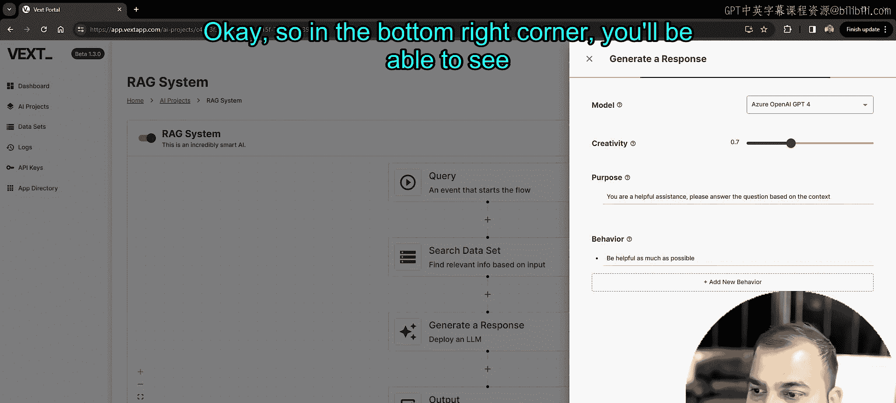

Any query that it will go it will go and probably search in this particular data set and then it will give me a response now quickly to check this whether it is working absolutely fine or not。

😊。

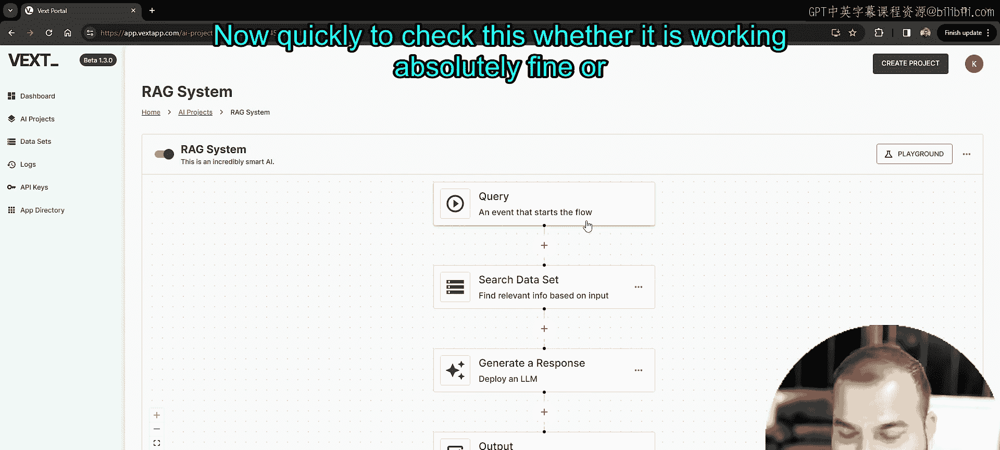

Here there is an option of playground。Okay now in this playground I will go ahead and ask all my questions that I want see two research paper that I had added。

 I will talk about both those research paper one is Pf for one research paper or something for this parameter efficient transfer learning and one research paper is attention is all you need so here I will go ahead and ask the question what is。

😊。

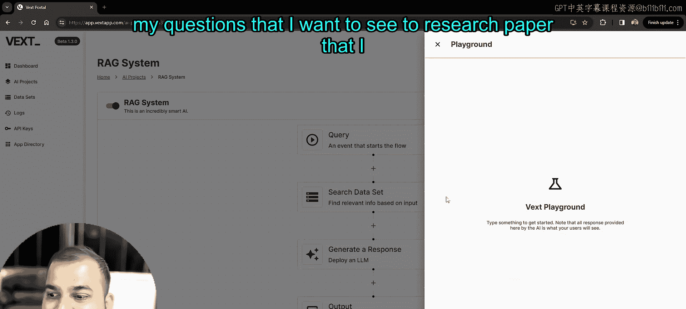

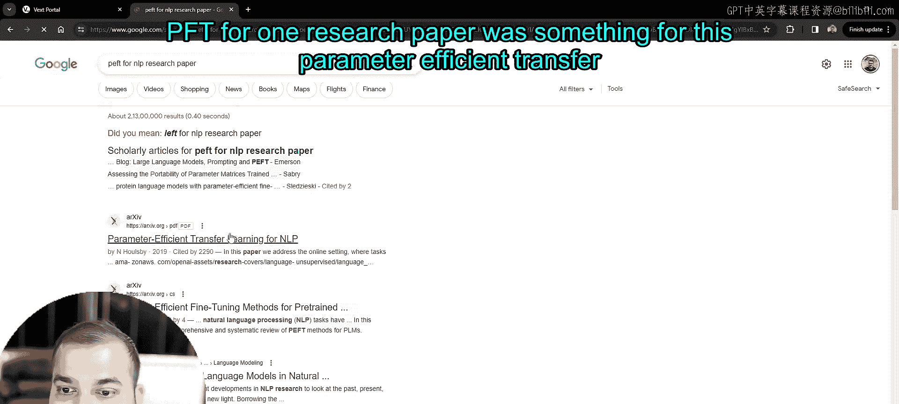

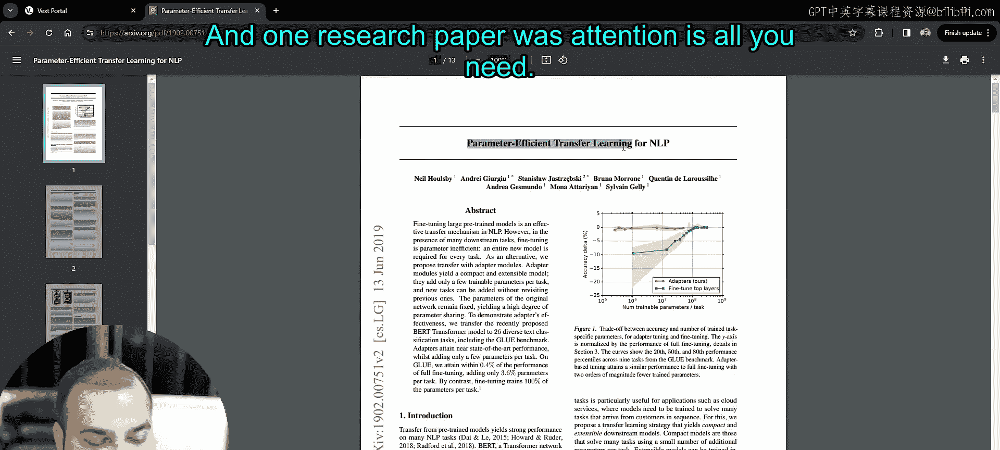

Parameter efficient transfer learning Okay so I will go ahead and click on send let's see whether we will be able to see the response or not So in short what is happening now any query that Im giving first of all。

 it will go and search from this particular data which is already in the vector meeting format and then whatever information is going to come based on the parameter is going to get summarized by this LLM model and finally we are going to see the output result and understand one thing is that based on the context whatever context it is available or whatever context we are able to retrieve from this particular data that response we will specifically get okay till we get the response I will just go ahead。

😊。

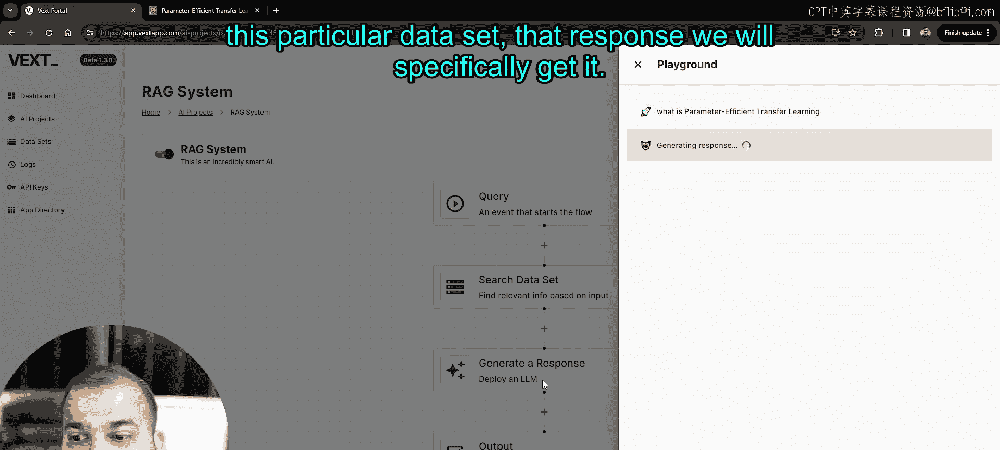

And search for some more questions over here okay lets see experiments lets say I will go ahead and ask instantiation for the transformer network now here you can see Ive got the response parameter efficient transfer and refers to the method used in machine learning and specifically natural language processing that allows for the transfer of knowledge and here you are specifically getting your inter okay let me just go ahead and let me talk about what is attention is all you need okay because that research paper also I have added okay。

😊。

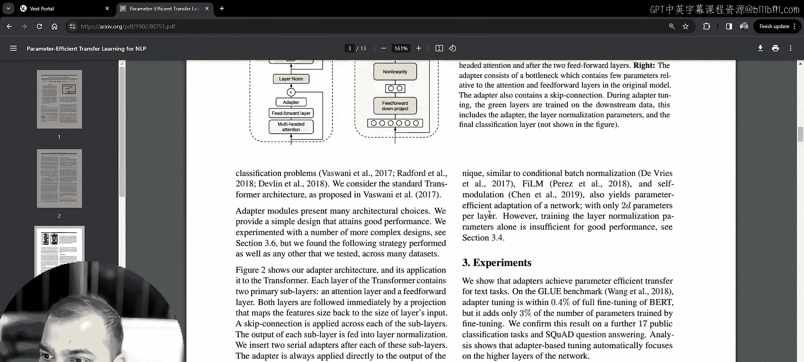

🤧哼。Please。Summarize okay so I've given this and here I will go ahead and click on send now the best thing is that the same functionality I can integrate with any chat boards that I specifically want let's say in telegram channel and Whatsapp channel in any channel as such that option also also show now again I've got it so attention is all you need is a semi research paper by Ashish Waswani and colleagues so perfectly we are able to get it okay so any Q and a with respect to the data you will be able to get it here you see that you do not have to write much line of code right and it is very simple just by drag and drop adding the feature adding the data everything you are able to do it okay。

😊。

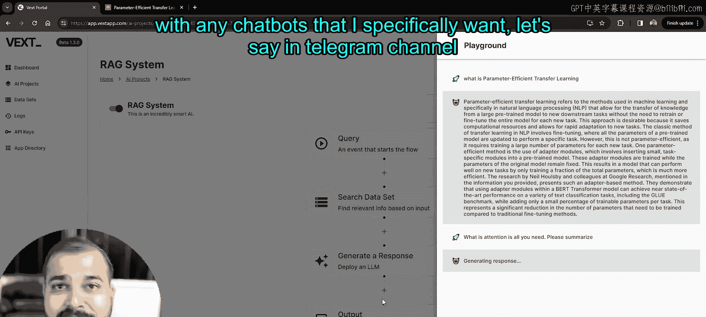

Now let me go ahead and add one more function。Let's say that I am going to add a smart function Okay let say executive function basically means here you will get some options to write to probably do basic maths Wikipedia search Google search R like let's say you want to ask queries from this particular you know R safe where all the research papers are uploaded you can probably use this okay。

😊。

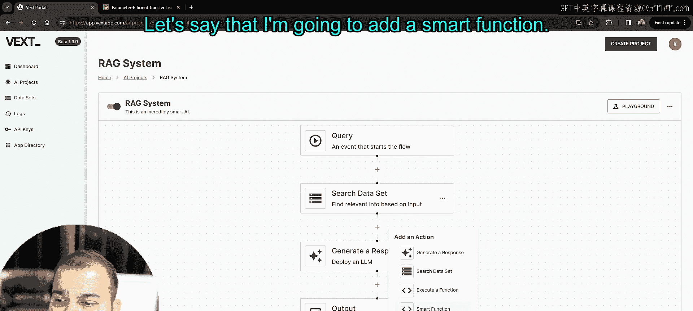

So you can specifically use any of this activation function one more if you want to go ahead with is something called a smart function。

😊。

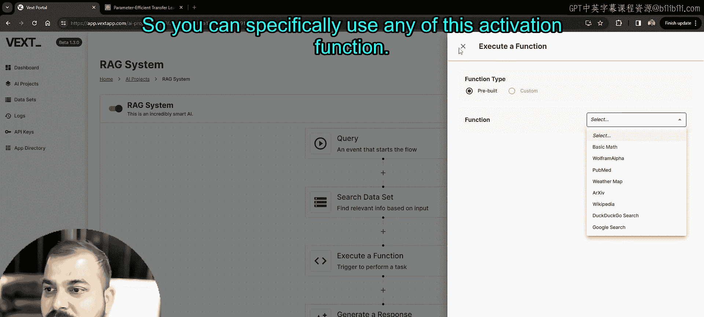

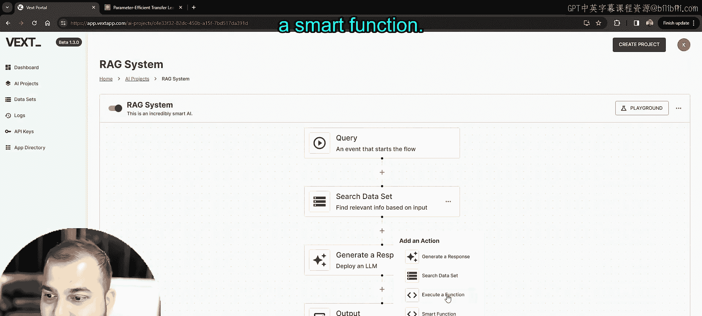

Now inside this smart function you can add multiple functions altogether so let's say that I want to do a Google search so I will say over here you can see in the description it allows users to perform searches on the Google let's say I want to also go ahead and use our safe if I want to also go ahead and use Wikipedia I can actually use over here so let's say that I'm adding all this smart function over here and for right now what I will do is that from my first flow I will remove this search data because I don't want to use data right so let's say Im using in this particular way now let me go ahead and quickly search in this playground so if I go ahead and write what is machine learning。

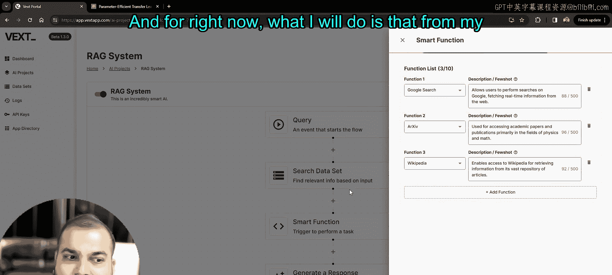

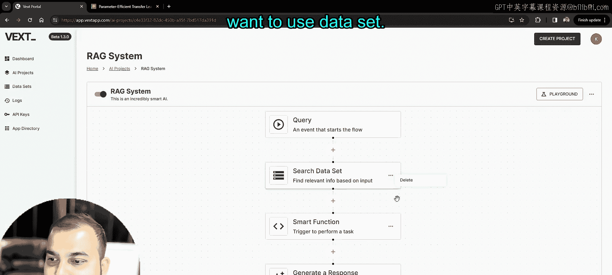

Okay so if I press enter， you'll be able to see that now it is going to do the Google search and it is going to give me the specific answer okay so and for the first time once you set it for the first request it will take some time but from the upcoming request to become very smooth so here you can see machine learning is a branch of artificial intelligence and so let's say I will go ahead and write who is Kniak so here if I go ahead and click on send here also you can probably see that if it is using the right API Google search API it should be able to give me the answer about myself so Kesna is a YouTube and data scientist known for his educational content or machine learning so all the answers are perfectly coming up right now this is what is the most amazing thing about this。

😊。

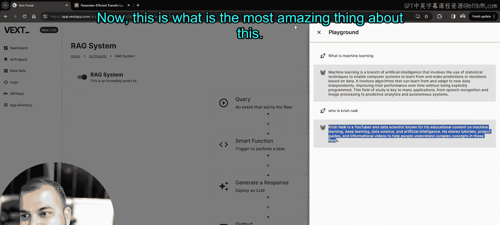

But again， that question will come quite， what is the use of all these things， you know。

 you are saying that we can do all these things in a specific platform but how to probably do this in the coding because I want to use this entire time functionality implement in my chatbot okay so let me talk about that Okay so if you go ahead and click on the output So here is what is the most important thing。

😊。

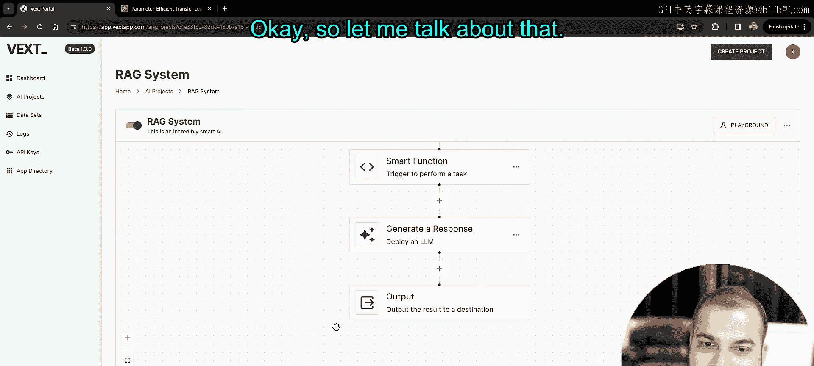

Here you will be able to see that you get the http request and you can also get the entire post request right so once you probably get this post request inside this post request you just need to set the API key。

😊，And then by using whatever payload like whatever is the question you need to include it over here and then by hitting this particular URL and this channel token you can probably see this should be unique some unique name okay so here I will show you okay Ill give you the code also how you can actually hit the post request with the help of Python programming language now what I will do。

😊，First of all I require an API key right so if in order to create an API key what I will do I will go ahead and click over here。

😊。

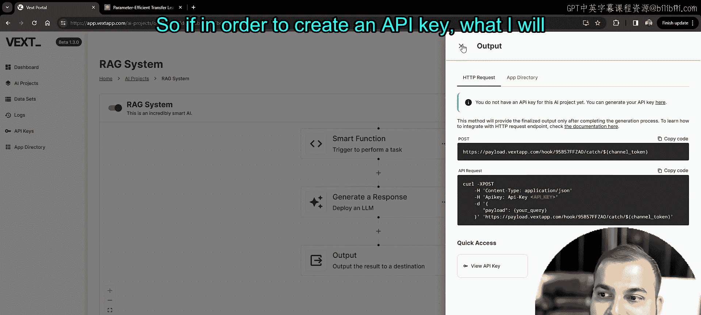

And here you can see I will go ahead and click create an API key so let's say I go ahead and write test this is my air project or the rack system and this will be my API key okay please make sure that you save the API key so I will copy this API key I will paste it over here okay so this is my API key。

😊。

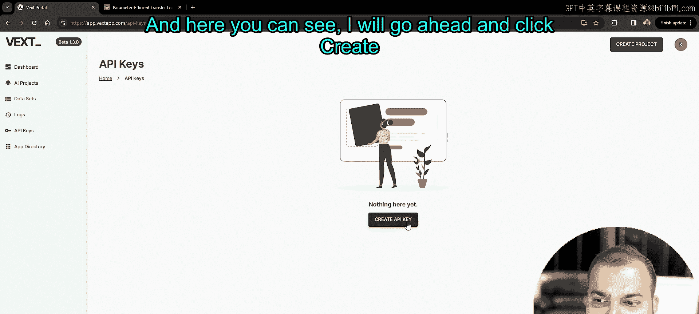

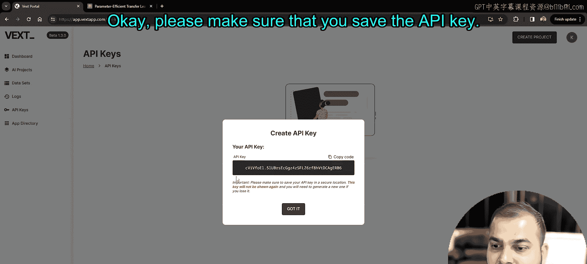

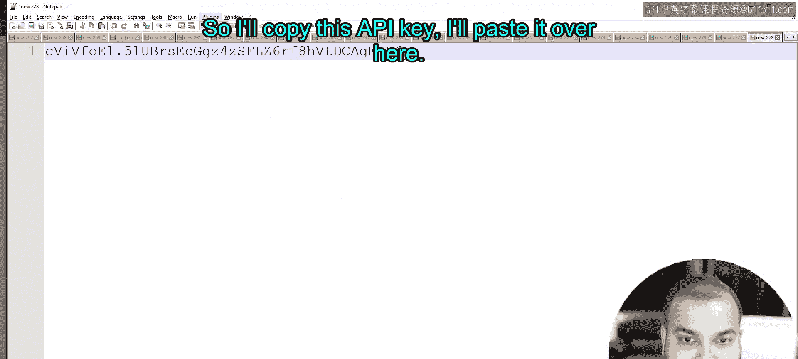

Now， what I will do， I will go back to my AI project。😡。

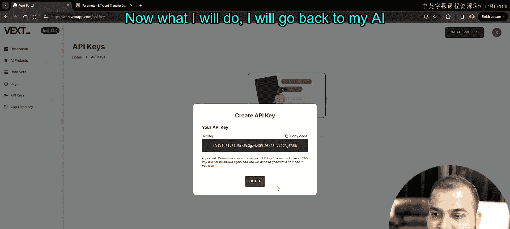

Okay。Go back to my AI project。 I will take the code。

 the post request Okay now see this this entire pipeline。

 I just require one API and with that I can do a post I can do a get and all the functionality Ill do I don't have to even worry about the vector meetings I don't have to worry about the APIs of search Google search or R or Wikipedia I don't have to worry about it all Ill be worried about this specific API itself right so what I will do the same call post request that you will be seeing I have written this in a normal Python code Okay so here is the entire Python code here you can see。

😊。

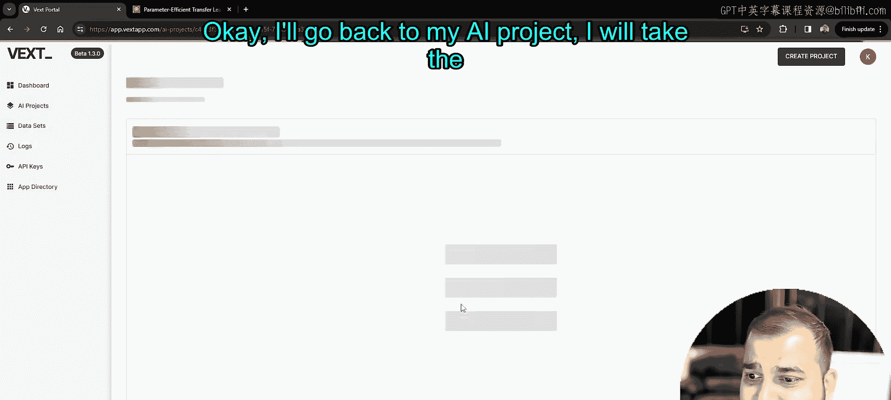

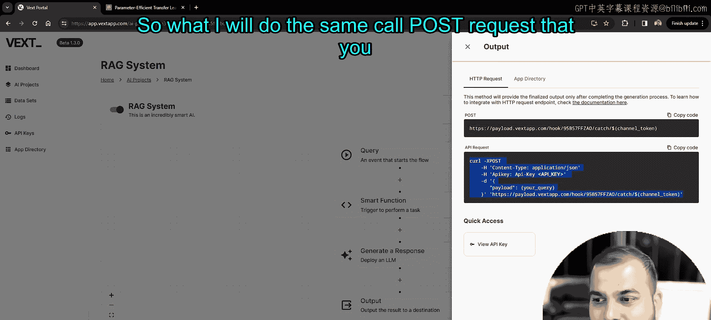

This is my API key so API key Ill just update it this is my older API key that I had actually tried it out but don't use this API key it will be of no use because I will be deleting it。

😊，And then here I will write the query， what is machine learning？

Then Ill set the headers of content type of application Json， the same thing see over here。😊。

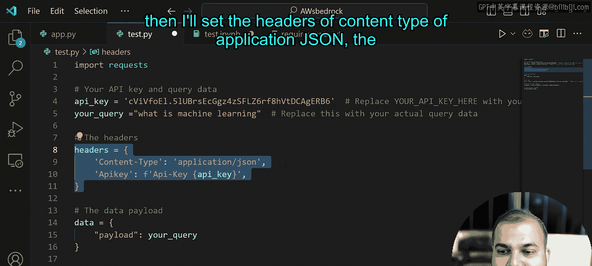

Content type is application gson API key I need to set it up and then the payload which will have my query okay。

 so I will go over here。😊。

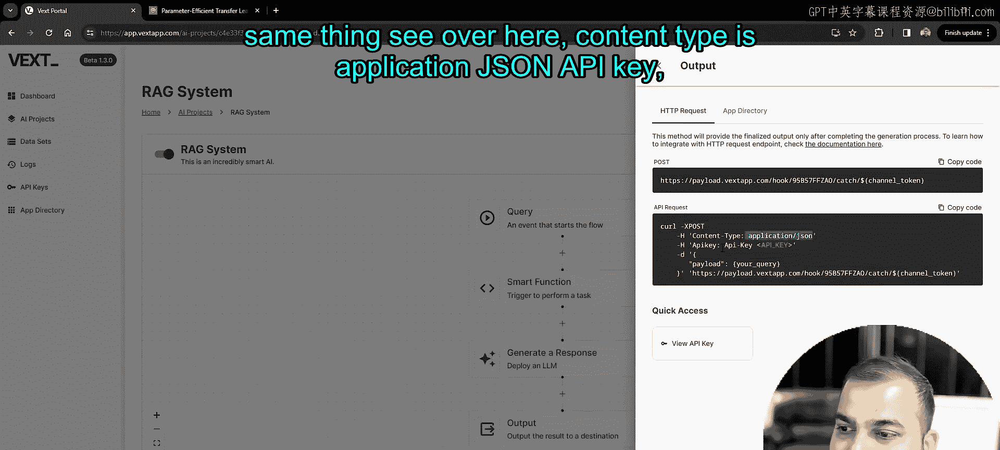

So API key I have set it to API key， whatever API key is there。

 my que is what is machine learning and this is my entire data payload。😊。

All I did I took that curl post I just searched in the charge bit and it gave me this entire code okay and this is my URL and instead of that catch token I'm writing Krisrhak 06 a unique value you can put it anything over here and then Im doing request dot post with this URL with this Jasonson data and headers physical to headers okay and I'm printing the response dot text again see the code this is very simple I'm setting the API key this is my query this is my headers this is my data Im just setting it up whatever is the post request and now let me go ahead and execute。

😊，Now， if I go ahead and execute it， the best thing will be that see I will write Python。😊。

Tash dot P Y， Ive asked the question， what is machine learning Okay。

 now you hear you'll be able to see that。 I will be getting that entire。 Okay。

 text it shows unauthorized。 Okay， let's see what is the error。 Okay， I have not saved this one。

 It's okay。 No worries。 I not saved it。 So that is the reason now I will be able to see the response。

 cannot match app with endpoint perfect。 so still this is not matching because I had already tried it out previously。

 so let me do one thing。 let me copy this again。 and then youll be able to see it。 Okay。

 So I will copy this entire URL。😊。

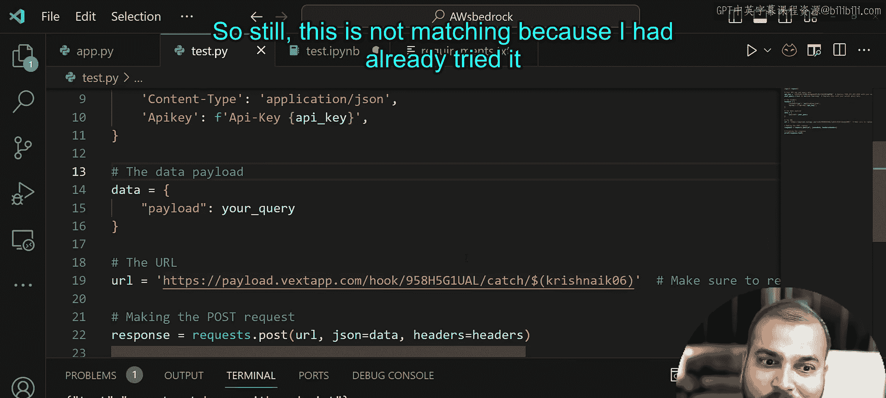

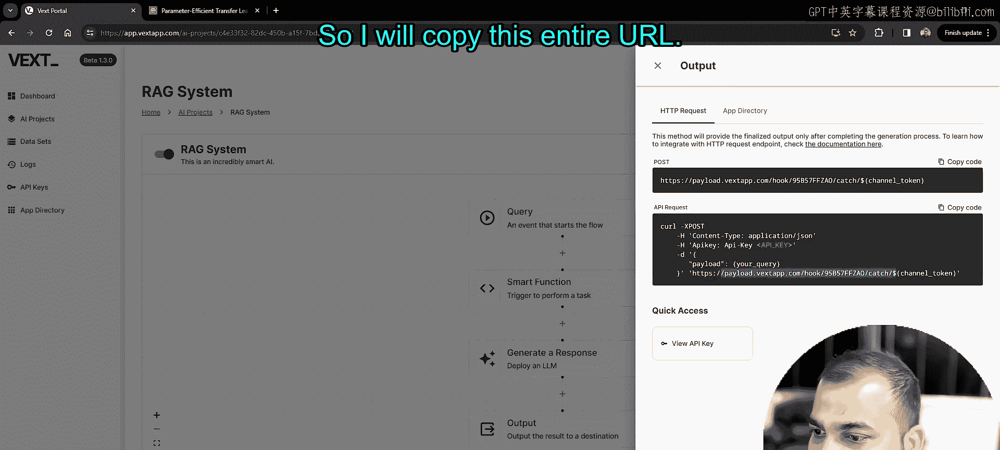

And the channel token will be almost same。 Okay， so from catch， I'm pasting it over here。

 So I'll remove this。 I think it is dollar catch。 this catch should get removed。

And this will be my dollar channel token perfect now lets see okay。

No it shouldn run。What is machine learning and now I think I should be able to get the answer okay？

So let's wait for the first time it will take time but after that I think it will work absolutely fine so this is done but at the end of the day you can see that it is a simple python code you know a post python code and how you really want to use it from the front end point of view it is up to you you can specifically use it。

But this is my end point， this this is called as an endpoint， this is my API key。

 and the API key is basically getting upended over here。So now here you can see that。😊。

I am getting the response Mach learning is a sub of artificial intelligence that involves the creation of algorithms。

 so and so everything is there。😊，Now， this simple post。

 I can include it in any API that I specifically want okay。

 that is the most amazing thing so coding wise you can now see you don't have much dependency。😊。

Now one more thing that I really want to show there is something called as app director。

 you can also connect with Google Drive confluence Ja your Sla team So all these things are coming soon later on you can also work directly with LLm and bring your own Lm to the platform here you have A s make bedrock hugging face it is also having this entire support So guys in this video we are going to discuss about how we can fine tune our own LLm models with our own custom data for this purpose we will be specifically using this platform which is called as gradient do AI gradient actually provides you a lot of Lm models on top of that you can probably do a lot of fine tuning with your own custom data Custom datas can just be formatted in a specific way to give it and later on the fine tuning can really happen in a quicker way So probably when I will be doing the fine tu it hardly take 7 to8 minutes this is the demo that I really want to show you in this specific video by doing this you will get an idea if you have a custom data and you want to also create your own custom Lm model。

😊。

Can definitely do it with the help of gradient AI Now let's understand what does gradient AI provides you。

 It is a one platform unlimited AI。 it not only does the fine tuning it helps you to develop it。

 deploy it and even for the inferluencing part So over here you can create your own private Lms your own models fully unlock model right and you can build with any languages it provides you three Sk I think jascript。

 Python and Java so that is also provided we will be specifically using python SD we will be using Google collab and we will be fine tuning our own model So it is only AI platform that allows you to combine industry AI with your private data and here is all the other information that you can see that it also provides accurate AI transformation deploy AI to solve mission critical problem10 into faster with gradient AI cloud platform we handle the infrastructure for you so it is an amazing platform altogether where you can not only build your model even you can influence it you can even fine tune it so in order to go ahead with first of all you need to。

😊。

head and sign up so for sign up you can probably put your entire details I have already signed out signed up so Im going to probably do the logging over here as soon as I do this logging it will ask you to create a new workspace and this is the first important step that you have to do so for creating a new workspace you just need to create like just click on this particular button create a new workspace you can give your own workspace name and just submit it。

😊。

Once you submit it like in this case， I've created a test workspace。

 you need to know this specific I because this I is nothing but it is a workspace I So I will copy this workspace I so that I will be using it in my coding when I probably do it in the Google co The next thing that is specifically required you need to click on the excess tokens one is the workspace I and the other one is the access token again to generate the access token。

 I've already generated it。 I have kept it in my coding environment all you need to do is that just click on generate new access token and you have to just put your password submit it and it will give you the access token there you just need to do the copy over there So what I will do I will go ahead and give my password as soon as I do this so here you can probably see that you get your secret access token you can copy it over here One amazing thing about gradient A is that it provides you all the necessary documentation over here。

 you can just go and refer documentation it provides you the entire code that is actually required with respect to Python SD and trust me guys just with the minimal lines of。

😊，you can probably fine tuning an entire model in an easier way right so if you probably go to the guides here you have something called a Python SDdk example。

 So with respect to Python SDdk， you can probably see this is the code for fine tuning I will copy the same code and I'll probably run it but here I'm going to make some changes with respect to my dataset along with that you can also you can also go ahead and see the entire documentation whatever things you specifically required the integration it specifically provides for la Lama index Mongo Db hashtag so whatever things is specifically required Mongo Db and all you can probably do the vector you can create it as a vector database and probably store all the vectors over there Now let me quickly log in again So once I log in if you probably go to the workspace okay so this is the workspace that I have actually created now inside this work workspace you can see all this are the models that Ive already created for the fine tuning purpose if you probably go ahead and click on fine tuning and if you see if I。

😊，Go ahead and select or create fine tuning over here。 it provides you three base models。

 Okay1 is the B 5 601 is Lama 27 vcha。1 is Nos Hermes 2 okay so these are different different models Lm models you can use any one of them for the fine tuning purpose now in our example what I'm actually going to do is that I'm going to use this specific thing and then what will happen is that with the help of Python Hdk I'm going to do the entire fine tuning process here then I will be able to see my fine tuning job also as I go ahead so here I have open my Google collab let's go ahead step by step and let's see that how you can probably find tune your Lm models so let me first of all make this spelling mistake correctly now the first step is that we will go ahead and install gradient AI so for this I will be using Pip install gradient AI upgrade So once I execute this over here you will be able to see that the installation will start taking place Now it shows that requirement is already satisfied。

😊，Now the next thing is that the two important information as I said one is the gradient workspace ID I've already shown you from where you can probably get your workspace ID right initially in the workspace when we are probably checking it out that particular ID Id copied it over here and I pasted it away。

😊，And the next I that I really need to set it is my excess token gradient access token so I will set up the environment by using import Os and then I'm going to probably use Os dot environment gradient workspace I with my workspace I itself so this is the I which you will again get it from the gradient itself once you log in and the second thing is about the gradient access token so here also I haveve pasted the excess token so let me just go ahead and executed and I have set up this environment variable one is the gradient workspace I and gradient access token now is the most important thing This is the code of the entire fine tuning so let me go ahead step by step and see like how the fine tuning is basically done so first of all we will go ahead and import from gradient AI import gradient right so this gradient will be responsible in fine tuning in even calling the base model Now I've created a function definition main Now this is the function initially I have initialize gradient okay。

😊，Inside this gradient you have a method which is called as get base model and here the first parameter is something called as base model slug that basically means what model you are specifically calling and I have already shown you in the fine tuning right if you probably go ahead and create fine tuning through the Ui you have this three models that is there Broom phi60 Lama27 B chat Noruse Hers 2 so in this case I'm going to specifically use Noruse Hars2 okay now Nor Hars2 I'm going to do it see you can also do it with the helpf Ui but I really want to show you with the help of coding by using Python Hdk so here is the same model I have pasted it over here right so this specific model over here is my L model that I'm going to find on top of it I'm going to fine tune it with my own custom data。

😊。

Now once we created this base model so this line basically gets you the base model over here now this model will be responsible and we will try to create a model adapter right the reason we are creating a model adapter because this will be specifically my model let's say this is like ch model over here and this model the reason we are creating as a model adapter because in further we will be doing fine tuning for this particular model itself so the first step is basically to create adapter on front of it right and the name of that particular model will be cr model itself so this is the second line of the code that we have executed now here we are created the model adapter with the ID new model adapter do ID so we will be getting the ID itself now is the most important step I will try to go ahead and create a query So this is my sample query the instruction see I've given some kind of format the instruction is who is Krisny so this is the question and usually what happens is that in。

😊，You really need to use a specific format in creating your custom data and for that you can refer this Python SDdk here you have some tips and tricks。

 it will talk about like how you can probably create your entire data itself right with custom data so you can check it out this specific thing and with respect to that you'll get an idea like how your data set should be created in a form right so some format should be there so let's say if I ask any query right for a base model something like this I've given this three hash and then the instruction this is the question who is Krisna and then we are closing it with two end line Okay and then we will be seeing the response So response over here is kept as blank because this response is going to come from this specific new model adaptor which has the base model Nor harmmus okay now we will be printing this sample query So already it will be just going and printing this with all this information like instruction and response now this model。

😊，When I say dot complete okay so dot complete is a method over here。

 the first parameter I' will be giving my query。 That is my sample query。

 the max generated token I will be giving10 So it is going to probably take00 max token in the form of output and then we are going to use dot generated output So this is one of the attribute that is present inside this dot complete method Okay so after this complete method we will be getting the generated output as soon as we get the generated output that basically means whatever questions I have asked over here who is kn I'm going to get the output over here itself right so generated before fine tuning now here is my output that I'll be getting and understand Im not started my fine tuning so that is the reason I have written a comment over here before fine tuning now before fine tuning if I ask who is kn obviously this model will not know unless and until Im very much popular Okay I'm not that much popular。

😊，So it will just say that if if it has heard somewhere Krisrishna it will give some information now what I will do I will go ahead and create my own sample data okay regarding Krisrishna because obviously over here in before fine tu if I probably executed I will not be able to get the output the right output now this will basically be my custom data so here you can see that the first question that I have asked the first sample that first input data that I have created which will be used for training is that who is Krisna。

😊，Then over here， the response I've written as Krishna is a popular mentor and a YouTuber who uploads video on data science and LLM and channel channel and in his channel。

 Krish So this is one of the input and the output that I've given similarly second input I will again create who is this person named Krisna now I'm giving in a different format of text like question and answer and again the response I've written Krisna likes data science and AI make videos in YouTube and is also a mentor something like this then instruction again。

 what do you know about Krisna so again， I've created one more response Krisna is a popular creator who specialize in the field of data science and channel name is Krisna and again one more input like this I can create lot of inputs related to a single context Now suppose if I have hundred of context I may probably create this kind of inputs and at the end of the day in a real world scenario in an end project if you see this all information will be coming from some kind of databases it can be among a D database can be a SQL data。

😊，based send right so this will be my sample of data is just like more like a key value pair you know a list of key value pairs now this is done now what I am going to do define after this my input is done my model before fine tuning is done now I need to do the fine tuning so for performing the fine tuning I need to have number of epos one parameter I will initialize count is equal to0。

😊，Now I am saying well count is less than number of hippochs and then I will start my fine tuning over here so fine tuning count plus1 then I will say new model adapter dot fine tu is one method where I am giving my samples okay so samples over here this all samples I will be giving it over here for the fine tuning purpose so。

😊，In short， I'm using a method which is called a dot fine tune and we are specifically giving these pamp over here and then we are incrementing the count so that the epoch keeps on increasing So first iteration1 iteration2 iteration 3 and then this entire fine tuning will happen okay now after this I again writing this comment after fine tuning and I will execute the same method right over here by giving the same sample query who is Krisrni right and over here the same thing is then I am get the generated output I am going to display the generated output and after doing this I am deleting my adapter because I will not require it afterwards if I wanted to use it further I can keep it like that otherwise I can just go ahead and delete it and here also I' am closing the gradient and this is where I am starting my main So this in short what we are doing is that before fine tuning I really want to see the response I created my sample data over here and then again I did the fine tuning with respect to number of epochs and all。

😊，And now let's go ahead and execute it。So， once I probably start executing it you can probably see it will it will start you know it may take hardly a couple of minutes since I have just done three iteration okay so here created model after with this particular ID the instruction is who Krisrna so it is waiting for the response。

😊，Let's see over here whether it is been created or not model testing。 let's see fine tuning。

 So here also it will as soon as the fine tuning will happen here。

 the model will get created and it will got deleted it will get deleted So here the response it is getting that Krishnna is a wellknown Indian actor who is prepared in various films and television shows is best known for is Raj in the popular I have I've never worked in any industry guys so it is saying I'm an Indian actor I'm not an actor altogether。

 Kki Sasbihi Okay， so this is a very famous serial in India。 Okay， I have never acted over there。

 It know whom it has considered Okay， it's also said that I've worked in Dl Khona nice so now I am doing the fine tuning So this is the response that I've got generated before fine tuning and now after fine tuning I' have given the right kind of data with respect to input and the response the third iteration is getting over。

😊，See how fast it is happening in the cloud platform gradient cloud platform that is quite amazing right and this is super super nice at the end of the day you'll be able to see this right beautiful right we already in the third iteration and now here I' am getting my output generated after fine tuning ch is a popular YouTubeber and data sign is known for its data sign the Python tutorial is on his YouTube channel Kris now see just with this three sentence a four sentence how well it has done the fine tuning now just imagine the power guys the entire fine tuning is happening in the gradient cloud itself right if I probably give this kind of data and just increase the number of epochs and train it how beautifully within five to seven minutes you can actually train it I hardly just to put my input data it hardly took very less time right so this is one amazing application this is how you can probably do the fine tuning once as I really want to give it to you let's let's reload this I think you'll be able to see my fine tune model also。

😊，Let us see the model。 Okay， I have already deleted it， I think。Yeah I've deleted it。

 so that is the reason you are not able to see it over here If I had not deleted that you could also see the models over here right so model testing say model is also not here right otherwise you could also see it put it over here and you can ask any question you want right this is quite amazing so at the end of the day if you don't want to delete it just don't delete it and keep it like this so I hope you like this particular video I hope you have understood how we can fine tune our amazing LL models with the help of gradient AI cloud which is quite amazing you should definitely use it try to use it and try to see whether you are able to do this or not but just by seeing the code and all I think it is quite easy quite amazing again yes this was it for my side I hope you like this particular video I'll see all in the next video have a great you won all take care bye bye。

😊。

