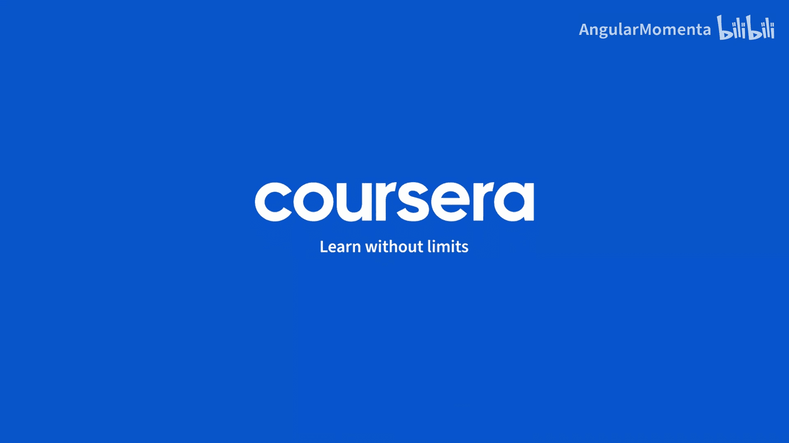

# 【Coursera】生成式人工智能与大语言模型-｜-Generative-AI-and-Large-Language-Models-p01-01_01_01_欢迎来到生成式人工智能--BV1SMFgzoEh9_p1-

。Hello and welcome to the world of generative AI， a domain where artificial intelligence meets creativity。

 innovation and endless possibilities。I'm thrilled to embark on this journey with you。

 St of AI is reshaping how we interact with technology， bringing the imagination of machines to life。

 from crafting， mesmerizing artwork to generating lifelike human speech。

 These AI models are blazing trails across various industries。😊，Today。

 we'll dive deep into what makes generative AI so transformative。

 especially in redefining creative domains such as art。

 music and even writing This course is crafted specifically for beginners will unravel the complex terms and explore fascinating models like Gs。

 VAEs， transformformers and diffusion models The beauty of these models is in how they can learn patterns and create new renditions going beyond mere replication to crafting something entirely new Our course is designed in a way that gradually builds your understanding and skills We'll start by laying a solid foundation to help you define and differentiate the various types of models along the way you'll discover the intriguing evolution of generative models and their real worldorld applications from self-driving cars and face generation to content creation safety and ethics and AI can be overstated will touch upon critical aspects by sea security risks and the broader impact。

😊。

🎼Of AI on society This knowledge is crucial as responsible innovation must go hand in hand with technological advancement for practical experience。

 weve lined up a series of screencasts and programming assignments that will enable you to try your hand at these ainspiring technologies。

 you'll work with real datas and some of the coolest tools used in industry today。

 Eming you to understand， build and refine your skills。

 your learning is in safe hands and I encourage you to remain curious and ask questions。 Remember。

 exploration comes with responsibility as we dive deeper。

 think critically about how these technologies shape our world。

 Let's embark on this exciting journey together as explorers。

 creators and ethical innovators in the world of generative AI I can't wait to see the amazing things you achieve。

 Welcome a。

