# 【Coursera】生成式人工智能与大语言模型-｜-Generative-AI-and-Large-Language-Models-p02-01_01_02_训练二维斑点上的判别模型逻辑回归--BV1SMFgzoEh9_p2-

Welcome back。 Today we'll create a simple machine learning model that can separate two groups of data points。

 Think of it like teaching a computer to draw a line between two types of dots。

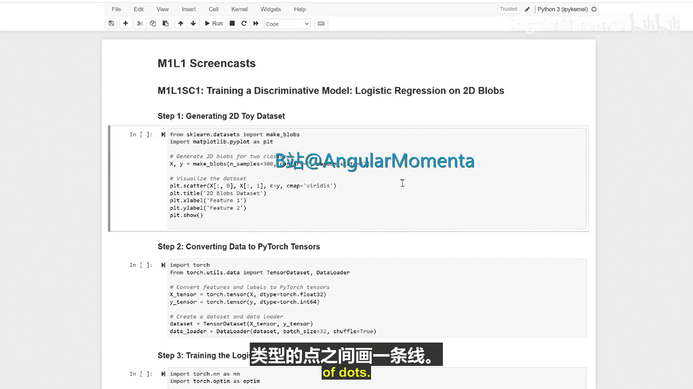

First， let's create some practice data。Our code creates 300 data points， splits them into two groups。

 purple and yellow。Gives each point two features like X and Y coordinates。

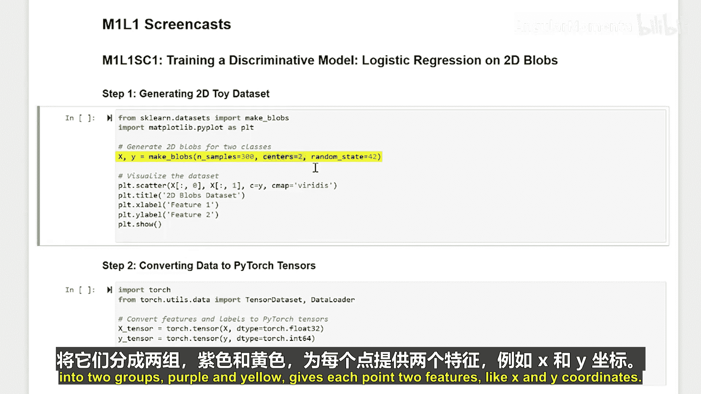

Look at our scatter plot。 See how the purple dots cluster separately from the yellow ones。

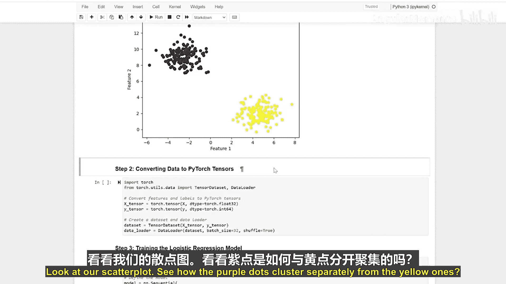

Now， we need to convert our data into a format Pytorrch understands。

 Think of it like translating our data into piytorrch's language。

 We also create batches of 32 points。 batch underscore size equals 32。

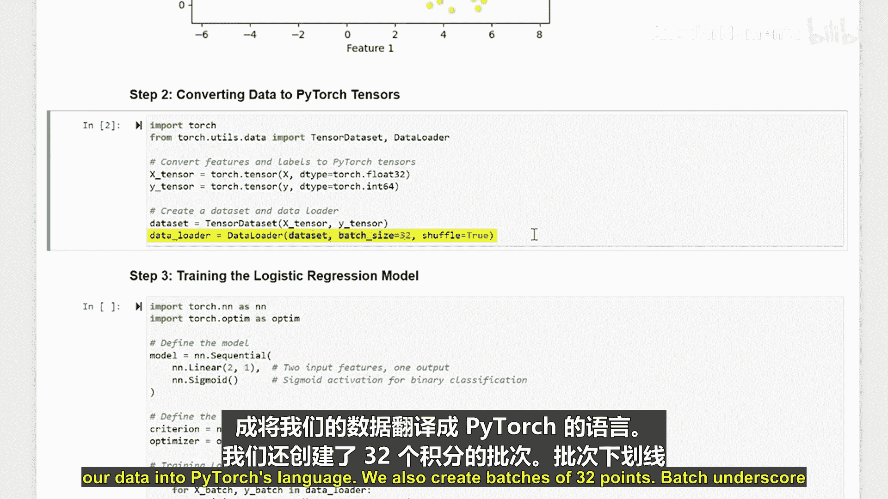

Shuffle the data for better learning。

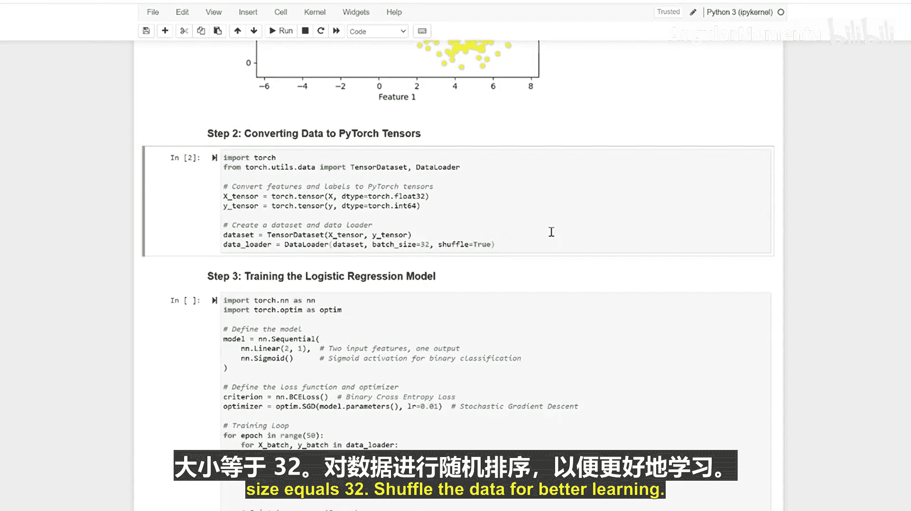

Here is where the magic happens。We create a logistic regression model。

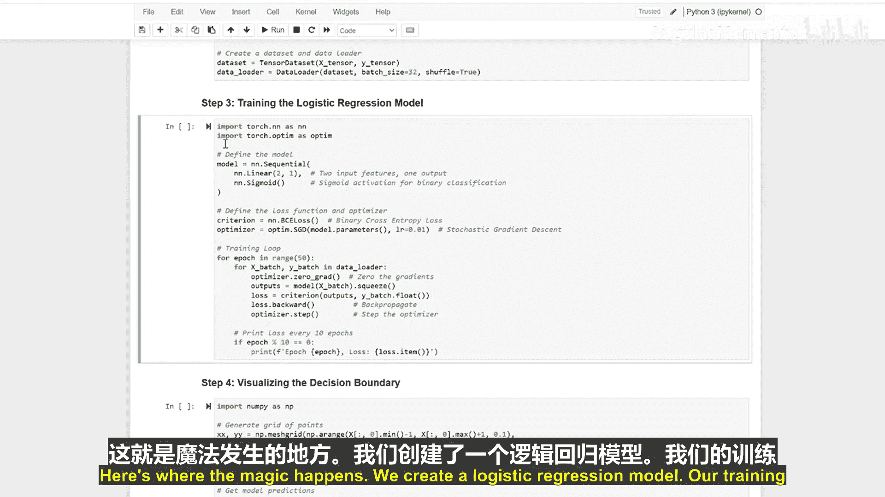

Our training process uses BCE loss to measure mistakes， updates the model using SGD。

 like small steps toward better predictions。Runs for 50 epochs， completete passes through the data。

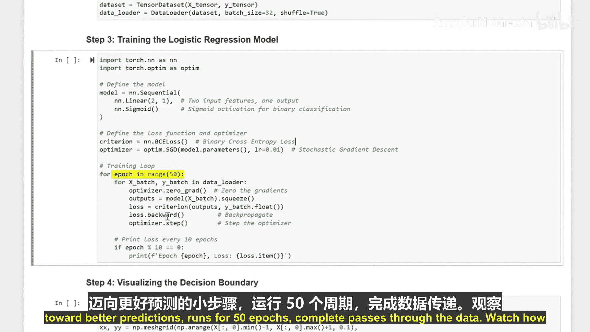

Watch how the loss number of mistakes gets smaller over time。

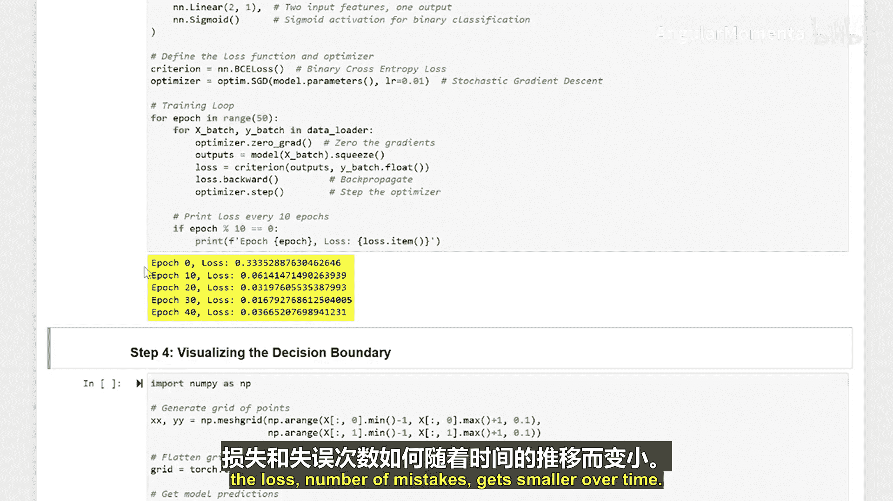

Finally， let's see how our model separates the groups。Gray area shows the decision boundary。

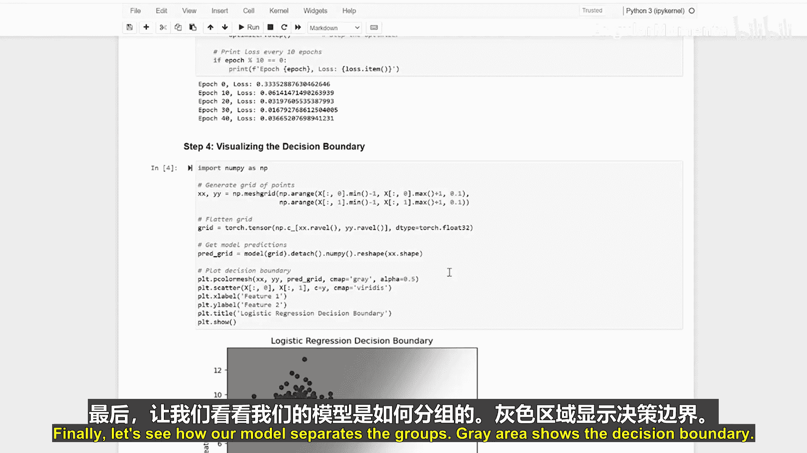

Lightside predicts yellow group。

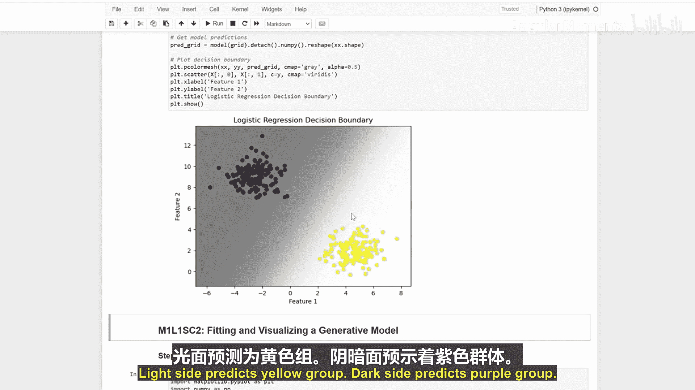

Dark side predicts purple group。

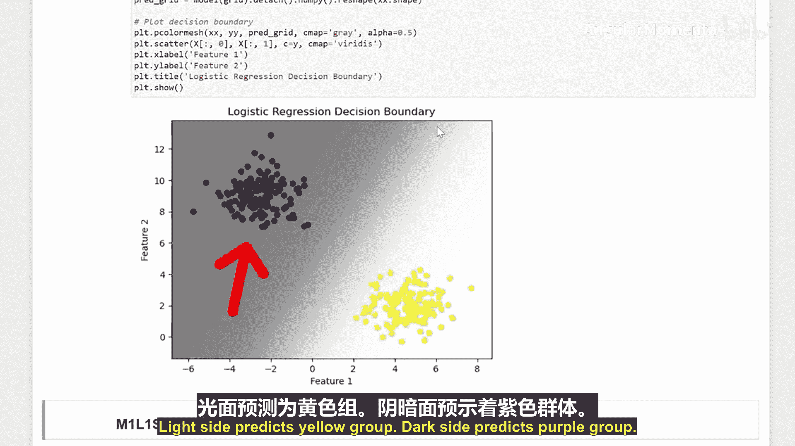

See how the model drew a smooth line between our clusters。

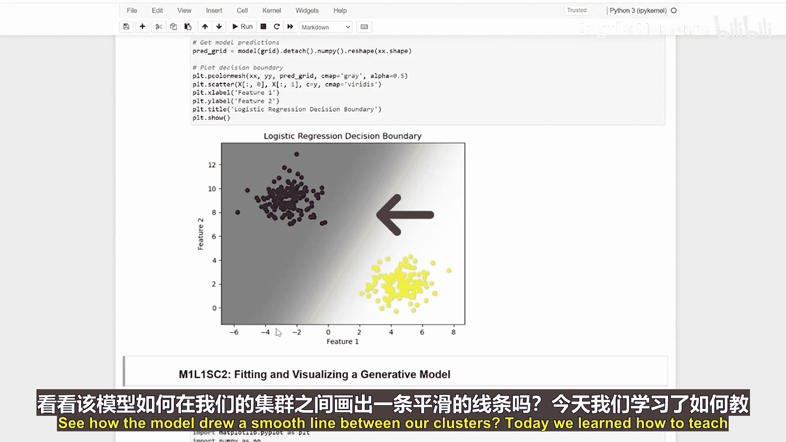

Today， we learned how to teach a computer to separate two groups of points using logistic regression。

 The decision boundary shows us exactly how the model makes its predictions。

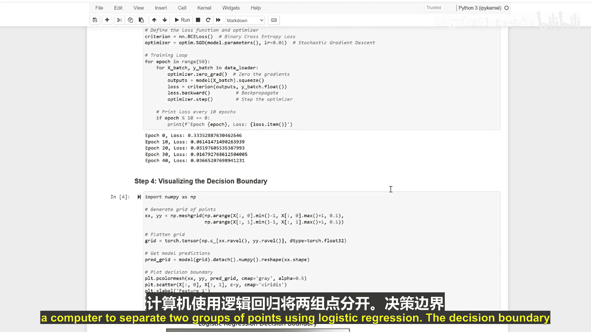

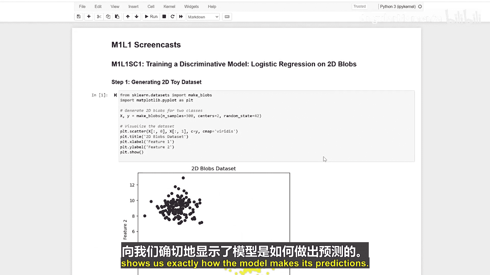