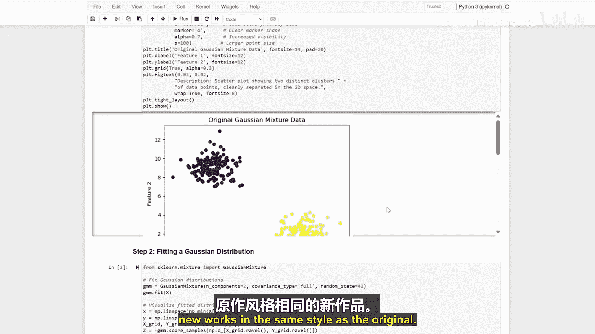

# 【Coursera】生成式人工智能与大语言模型-｜-Generative-AI-and-Large-Language-Models-p03-01_01_05_拟合与可视化生成模型--BV1SMFgzoEh9_p3-

Welcome back。 Today， we'll learn how to create a generative model。

 Think of it like teaching a computer to draw new data points that look just like our original data。

😊，It's similar to an artist learning to paint in someone else's style。First。

 let's create some practice data。Our code creates 300 data points。Grips them into two clusters。

Spreads them out in a bell curved shape， a Gaussian。Look at our first plot。

See how we have two distinct groups of points。Now， we'll teach our model to understand these patterns。

 We're using a Gaussian mixture model that learns by finding the center of each cluster。

Understanding how points spread out around these centres。

Calculating the probability of points belonging to each group。

Contour lines in our plot are like elevation maps。Each line shows points with equal probability。

Tighter circles means higher probability。The model has learned where points are most likely to appear。

Here is the exciting part。Let's create new data points。In our final plot。

Triangles are our original data。 Cs are created by our model。

Notice how the new points follow the same pattern as the original ones。

🎼Our model has learned to generate data that looks like what it was trained on Today。

 we learned how to create a generative model that can make new data points similar to our training data。

 It's like teaching a computer to become an artist who can create new works in the same style as the original。

