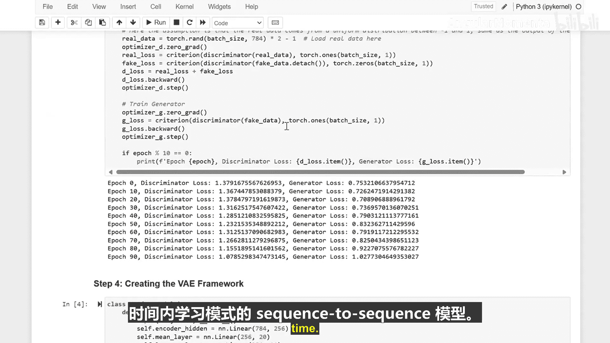
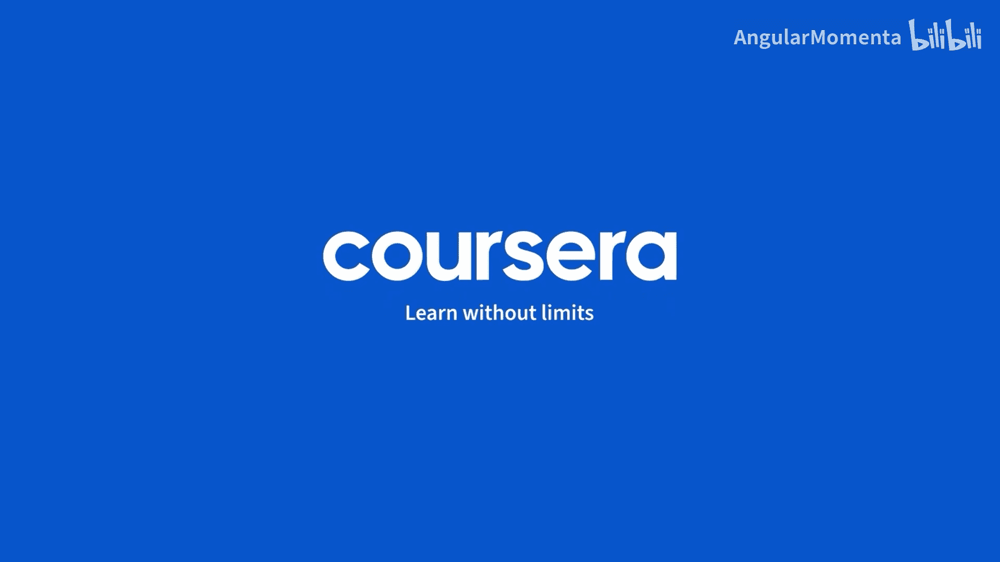

# 【Coursera】生成式人工智能与大语言模型-｜-Generative-AI-and-Large-Language-Models-p04-01_02_02_从生成对抗网络到自回归模型：生成式基础实战--BV1SMFgzoEh9_p4-

Welcome back Today we'll learn about three different types of generative models。GANs。

 VAEs and sequence models。Think of these as different artists who learn to create new data by studying patterns in existing data。

First， let's get our tools ready。 We're using pietorrch to build our generative models。

 It's like having a special art studio with all our creative tools。😊。

A GAN is like having two artists。A generator tries to create fake data。

The discriminator tries to spot the fakes。Our code creates both。

It's like a game where one player gets better at creating fakes while the other gets better at spotting them。

Now we'll train our GAN。The generator creates fake data from random noise。

The discriminator learns to spot real from fake。They take turns， improving their skills。

Watch how both losses change as they learn from each other。A VAE works differently。

 It's like teaching a computer to compress data into a small space， encode code it。

Then recreate the original from the compressed version。Decodeode。😊。

Our code creates this by building an encoder and decoder that work together。Time to train our VAE。

It learns to compress data efficiently。It learns to reconstruct data accurately。

It balances between compression and accuracy。 The loss shows us how well its learning both tasks。

Let's set up our sequence model。Think of it like teaching someone to predict the next word in different sentences。

We create our data and model。LSTM stands for long， short term memory。

It's like giving our model a notebook to remember patterns。We create random data to practice with。

Now， let's train our model。 every 10 epochs。 we check how well it's learning by looking at the loss number of mistakes。

Let's look at how our model improves over time。High loss means lots of mistakes with each epoch。

 We see that the loss is getting smaller， and our model is starting to see patterns By Epoch 40。

 We can already see about a 28% improvement。Today， we learned about three different ways to generate new data G A Ns that play a creation game。

 the AEs that learn to compress and recreate and sequence models that learn patterns over time。

。

