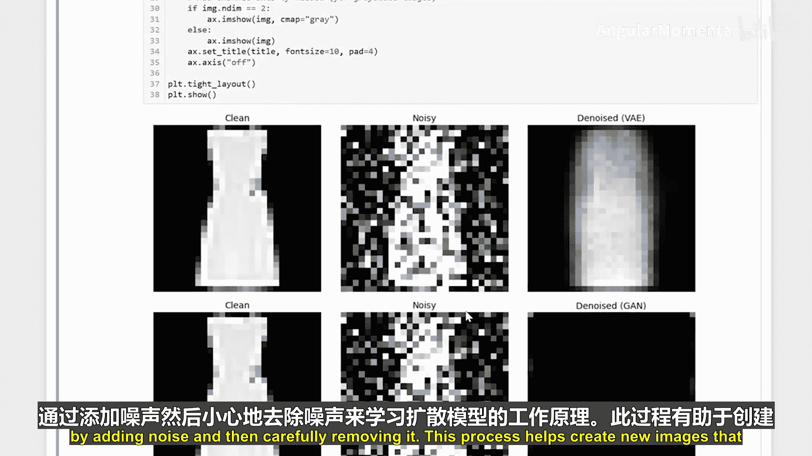
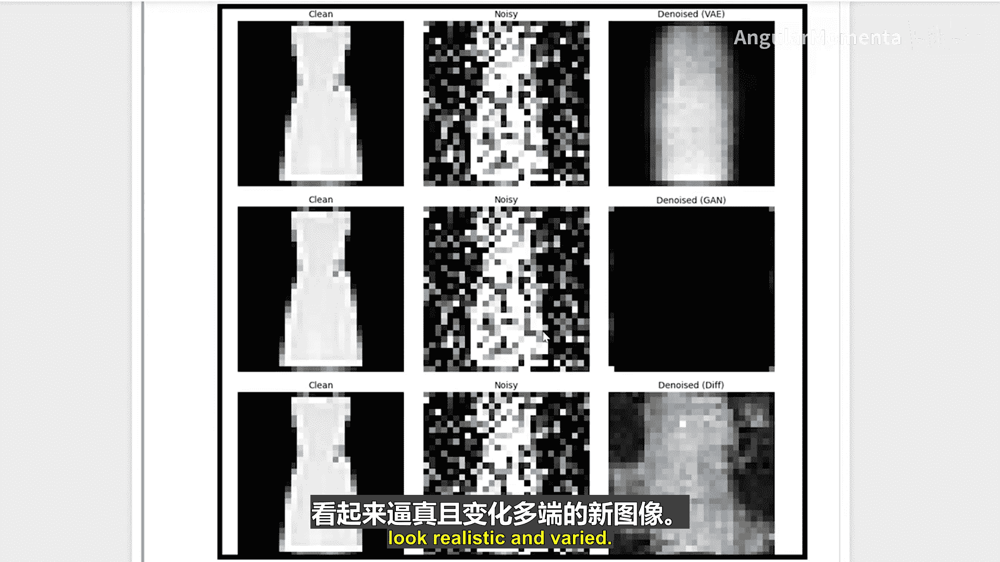
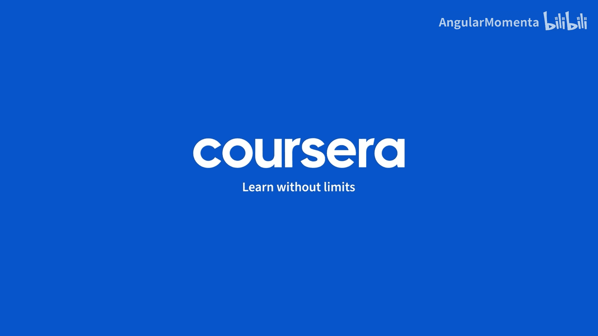

# 【Coursera】生成式人工智能与大语言模型-｜-Generative-AI-and-Large-Language-Models-p05-01_02_04_扩散模型实战：从噪声到逼真输出--BV1SMFgzoEh9_p5-

Welcome back。 today day。 well learn about diffusion models。

 a special type of AI that learns to clean up noisy images。

 Think of it like slowly clearing up a foggy photograph。😊，First， let's get our tools ready。

We'll also use GPUs if they are available。We'll also set the hyperparameter。

And we'll set up data split and loaders。We'll also do a quick check using this image。

Here's the code that creates this progression of images with noise。

We'll also calculate the mean squared error MSE between our denoed outputs and clean images using this utility function。

Now let's implement our variational auto Ender， VAE。Which is another type of model used for denoing。

 Here's the implementation。Next， we'll train our VAE model。Now， let's implement our GAN。

 which is another type of model used for denoising images。 Here's the implementation。Next。

 we'll train our GAN model。Now， we'll train our DDPM model to remove the noise and reveal a clean image。

 Here's the DPM model implementation。 Our model starts with a noisy image， gradually removes noise。

 makes the image clearer step by step。 It's like watching a photo develop in a dark room。Next。

 we'll train our DDPM model for several epochs to ensure the model learns to perform denoisizing efficiently。

Now， let's visualize the denoising results in different models。🎼Today。

 we learned how diffusion models work by adding noise and then carefully removing it。

 This process helps create new images that look realistic and varied。😊。

