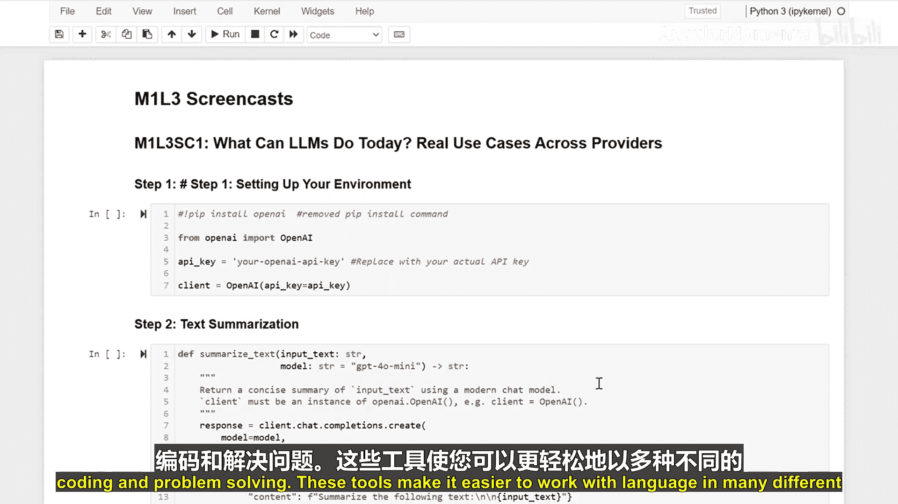
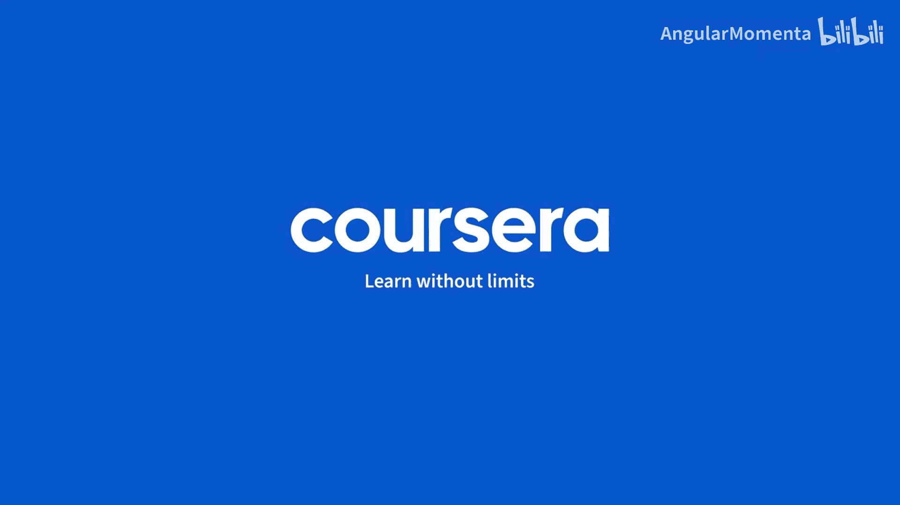

# 【Coursera】生成式人工智能与大语言模型-｜-Generative-AI-and-Large-Language-Models-p06-01_03_02_当今大型语言模型的实际应用案例：跨服务商分析--BV1SMFgzoEh9_p6-

Welcome back。 Today， we'll explore different ways to use large language models。

 L L Ms in real applications。 Think of L L Ms as super smart assistants that can help with tasks like summarizing text。

 writing code， translating languages and solving problem。 First， let's get our tools ready。

 We're using open AIs API。 Think of it like a special phone line that lets us talk to their L L Ms。😊。

Let's start with summarization。 Our code tells the model to act as a sumr sets temperature to 0。

3 for consistent summaries， limits output to 150 words。LLMs can help explain code。

 suggest improvements， and even write new code from descriptions。Need to translate text。

 LL Ms can help。 For example， this code sets up the LL M as a professional translator and keeps temperature low for accurate translations。

 It's like having a language expert at your finger tipsip。Finally。

 let's see how L L Ms can solve problems。 This function asks the model to think step by step。

 uses low temperature for clear logical answers。😊，Perfect for helping with math problems or logical puzzles。

 Today， we saw how L L Ms can help with different tasks from summarizing and translating to coding and problem solving。

 These tools make it easier to work with language in many different ways。😊。

