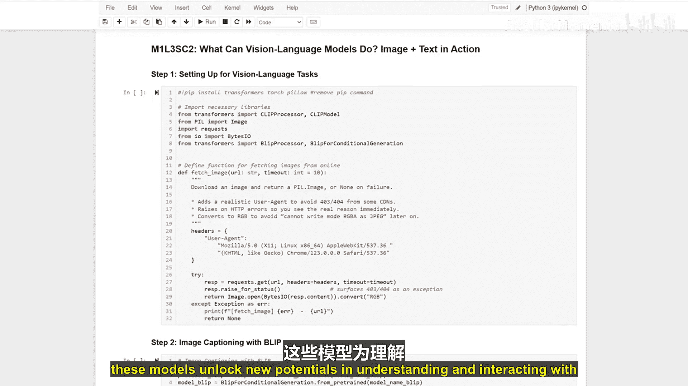

# 【Coursera】生成式人工智能与大语言模型-｜-Generative-AI-and-Large-Language-Models-p07-01_03_04_视觉语言模型能做什么：图文交互实践--BV1SMFgzoEh9_p7-

Welcome back， everyone。 Today， we're exploring the amazing capabilities of vision language models。

 These models combine text and images to perform sophisticated tasks such as image captioning。

0 shot image classification and visual question answering， V， Q， A。😊，First。

 let's set up our environment。 We'll make sure we have the necessary libraries installed for our tasks。

Let's start by generating captions for images using the BLIP model in line 6。

 the Fech underscore image function fetches the image from the provided URL in lines 7 through 15。

 the BLIP model and processor are first loaded to handle the image inputs。

It processes the image and generates a caption using the BLIP model。

 then dedes and prints the generated caption。Next， we'll classify images using CLIP without needing specific training for the task in this if else block。

The Fech underscore image function retrieves the image from the provided URL。

Then the CIP model and processor are then loaded to handle the image and text inputs。

It processes these inputs to classify the image based on predefined labels。

 then outputs the predicted label with the highest probability。Finally。

Let's explore visual question answering using CLIP。We'll simulate answering questions about an image。

 although CIP does not directly provide answers itself。

The Fech underscore image function retrieves the image from the provided URL。

 The C L IP model and processor are then loaded to handle the image and text inputs for visual question answering。

It processes these inputs to evaluate the fit based on predefined labels。

 then outputs the simulated answer。In today's session。

 we saw the powerful capabilities of vision language models in action。

From generating image captions and performing zero shot image classification to simulating visual question answering。

 these models unlock new potentials in understanding and interacting with multimodal data。

。

