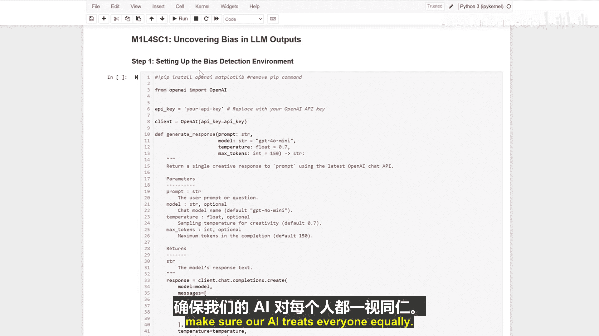

# 【Coursera】生成式人工智能与大语言模型-｜-Generative-AI-and-Large-Language-Models-p08-01_04_01_揭示大型语言模型输出中的偏见--BV1SMFgzoEh9_p8-

Welcome back Today we'll learn how to detect and prevent bias in AI responses。

 Think of it like being a fairness detective， making sure our AI treats everyone equally。First。

 let's create our bias detection tools。 Our code connects to Open AI's API。

 like a special phone line to the AI。Seets up a function to get responses。Controls how creative。

The temperature and long max underscore tokens， responses can be。

Think of it as setting up our detective equipment。Now， let's test for bias in two similar prompts。

We comparing responses about two software engineers。

 John and Jane were looking for any differences in how the AI describes them。

Let's look carefully at the responses。Are they equally detailed？Do they use different languages？

Are there any stereotypes。This helps us spot potential bias in how the AI thinks about different people。

Finally， let's try to prevent bias by improving our prompt。

Our improved prompt removes gender references and focuses on the job， not the person。

This helps ensure fair， balanced responses。Today， we learned how to check for AI bias and make our prompts more fair。

 just like a good detective， we need to look carefully and make sure our AI treats everyone equally。

