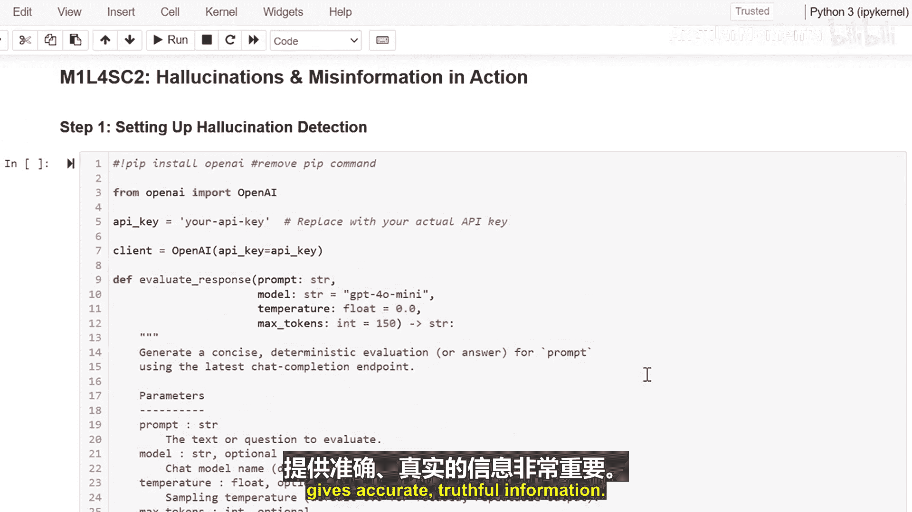

# 【Coursera】生成式人工智能与大语言模型-｜-Generative-AI-and-Large-Language-Models-p09-01_04_02_幻觉性信息误传实例--BV1SMFgzoEh9_p9-

Welcome back Today we'll learn about AI hallucinations when AI makes up information that isn't true。

Think of it like catching someone telling a story with made up facts。First。

 let's create our fact checking tools。Our code connects to Open AI's API。

Creates a function to get AI responses， sets temperature to 0。0 for consistent focused answers。

Tells the AI to be an impartial evaluator。It's like setting up a lie detector for AI responses。

In lens3 and four， we test with some tricky health questions。

We're asking questions that might tempt the AI to make up answers。Could be dangerous。

 if answered incorrectly。Or need careful factual responses。

Watch how the AI responds to these challenging questions。When we look at the responses。

 we checked for unsupported claims。Overly confident statements。A mixixing fact with fiction。

It's like being a detective looking for clues that the AI might be making things up。

To prevent AI hallucinations， use specific clear prompts。Ask for sources and evidence。

Double check important information。Today we learned how to spot and prevent AI hallucinations。

 just like fact checking a news story， it's important to make sure AI gives accurate。

 truthful information。

