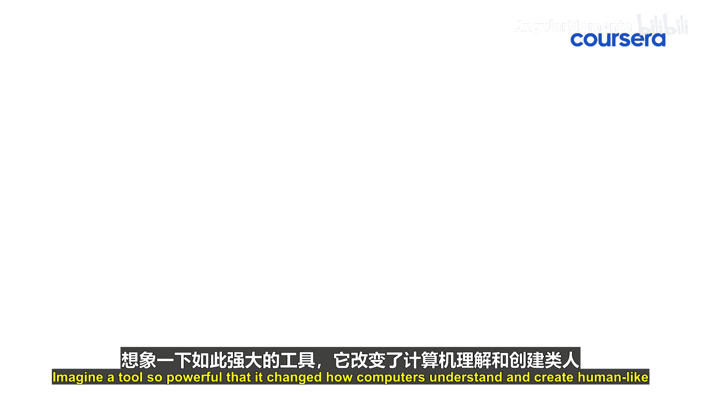

# 【Coursera】生成式人工智能与大语言模型-｜-Generative-AI-and-Large-Language-Models-p10-02_01_01_变压器使大语言模型成为可能，原因何在至关重要--BV1SMFgzoEh9_p10-

。

Imagine a tool so powerful that it changed how computers understand and create humanlike text。

 This is the transformformer。 Transformers have revolutionized machine learning。

 becoming vital to the enormous capabilities of today's large language models or LLMs。

 What makes transformers a big deal。 let's explore First。

 Transformers have reshaped the landscape of natural language processing。

 Before transformformers understanding long， complex text was a huge challenge for machines。😊。

Transformers introduced a mechanism called self-attention。

 allowing the model to focus on relevant parts of the text efficiently。

 much like how we emphasize important pieces while reading this efficiency lets transformers handle massive data sets。

 unlocking the potential of models like GT and Bert， which can generate cohesive stories。

 translations and even poetry， in the real world， Transers have sparked breakthroughs across various industries。

 for instance， in healthcare， they enable analysis of vast medical texts。

 aiding in diagnosis and treatment suggestions。They assist businesses by automatically sorting and managing customer inquiries。

In entertainment， they contribute to generating dialogue for video games or creatively assisting writers in crafting narratives。

 Why does this matter for you， understandingstand Transformers opens the door to innovative AI solutions。

 impacting everything from chatbots to complex data analysis。

 It's not just about what transformers do， but also what you can do with them。

 by maintaining a balance of processing efficiency and nuanced text understanding。

 Transformers ensure that AI applications are not just powerful。

 but also accurate and context aware Transformers form the backbone of today's AI advancements。

 Embracing their capabilities means you'll not only be able to leverage the state of the RAI。

 but also shape the future of technology interactions。

 making you an integral player in a rapidly evolving field。

 dive into the transformative power of transformers and be at the forefront of the AI revolution。😊。

