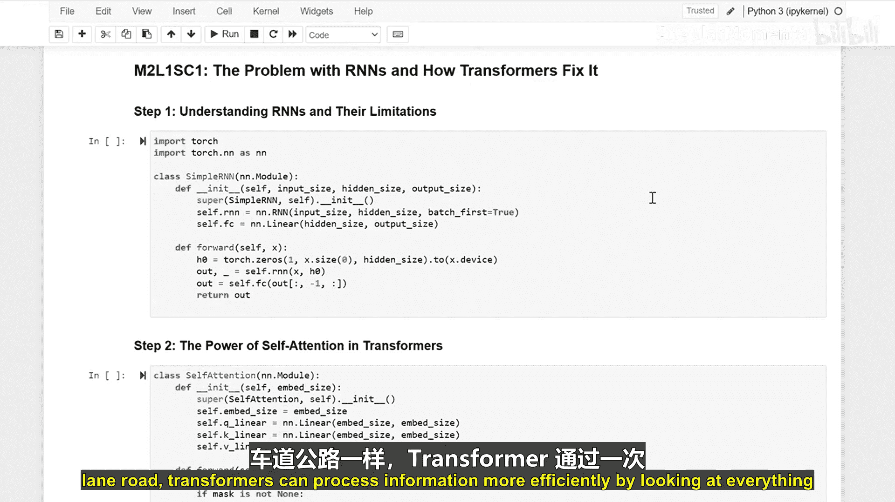

# 【Coursera】生成式人工智能与大语言模型-｜-Generative-AI-and-Large-Language-Models-p11-02_01_04_循环神经网络的问题与Transformer的解决方案--BV1SMFgzoEh9_p11-

Welcome back。Today， we'll learn why transformers are becoming so popular in AI。

Think of it like upgrading from a one lane road R NNs to a multi lane highway transformers。

It helps information flow much better。 Let's look at how RnNs work。

R NNs process information one piece at a time， like cars on a single lane road。

 Each piece of information has to wait for the previous one。The longer the sequence。

 the harder it is to remember early information。Just like traffic jams on a narrow road here。

 our code creates a simple R N N layer。Self dot R in it。Adds a final layer to get our output。

 self do Fc。Processes data one step at a time。Forward。Starts with empty memory。H 0。

Updates memory as it reads each piece of information。

 just like cars having to wait for the ones in front of them。Now。

 let's see how transformers handle information better。Think of self attention。

 like having multiple lanes。 All pieces of information can move at once。

 Each piece can easily connect with others， and there aren't any more traffic jams。

Our code here creates three lanes for the information。Q， underscore linear K， underscore linear。

 B underscore linear。Calculates how important each piece is to the others scores。

Combininees information based on importance， attention。Lets everything move at once。

Mat Mule operations。Just like giving each car its GPS coordinates。

 we need to tell our transformer where each piece of information belongs。

 This helps the transformer know the order of information， like knowing which car is first。

 second or last in the line。Within this block， our code creates a unique position code for each word。

P O underscore encoding。Uses sine and cosine waves to mark positions like unique GPS coordinates。

Adds these position codes to our words in forward。Can handle sequences up to 5000 words long。

Max underscore L。Think of it like giving each car a special tracker that shows exactly where it is in line。

Now we combine everything into our transformer。 This sets up multiple attention heads。

 like having multiple traffic controllers。Adds position information to our input， self dot position。

Creates several layers of processing， self dot layers。

Processes information through each layer forward。It's like a complete highway system where multiple lanes work together。

Multi head attention。Every card knows its position， positional encoding。

Traffic flows through multiple levels， transformer layers。Everything moves smoothly and efficiently。

Today， we learned why transformers are better than R N Ns at handling information。

Just like a multi lane highway is better than a single lane road。

 Transformers can process information more efficiently by looking at everything at once。

