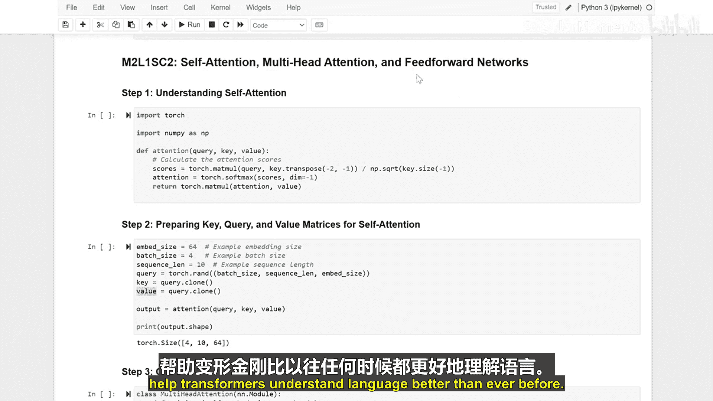

# 【Coursera】生成式人工智能与大语言模型-｜-Generative-AI-and-Large-Language-Models-p12-02_01_05_自注意力多头注意力与前馈网络--BV1SMFgzoEh9_p12-

Welcome back Today day， we'll learn how transformers understand text by looking at three important parts。

 self attention， how words relate to each other。Multi head attention。

 looking at relationships in different ways and feed forward networks。Making final decisions。

Let's start with self attention。 Here。 We calculate how important each word is to others。

 Sc use softms to turn scores into percentages， attention。Combine words based on their importance。

Next， we'll prepare the key。Qury and value matrices necessary for the self attention mechanism。

 These matrices help the model understand relationships between different tokens。

Now we'll create a multi head attention mechanism， allowing the model to focus on different aspects of the input simultaneously。

The multi head attention class splits inputs into smaller parts called heads。

Each head focuses on different aspects of the input。The query。

 key and value are processed by these heads and then combined to produce the final output。

To enhance the model's ability to process data， we'll add feed forward networks。

 which help in transforming the attention's output into more complex representations。

The feed forward class has two layers。 The first layer increases the size of the data。

 and the second layer brings it back to the original size。

 This helps make the data more complex and useful。Finally。

 we'll combine the multi head attention mechanism with feed forward networks into a transformer block。

 The transformer block class combines multi head attention， normalization layers。

 feed forward networks and dropout。This helps the model process data more effectively and is the main building block of transformer models。

Today， we learned how transformers understand text using attention， spotlights， multiple viewpoints。

 different readers and decision making。The teacher。🎼Together。

 these parts help transformers understand language better than ever before。

