# 【Coursera】生成式人工智能与大语言模型-｜-Generative-AI-and-Large-Language-Models-p13-02_01_06_调整语言模型输出：温度参数、Top-K与Top-P采样--BV1SMFgzoEh9_p13-

First， let's learn how to adjust the output creativity of a language model by changing the temperature set。

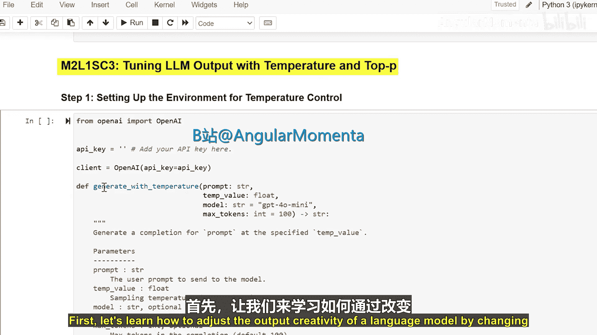

Higher temperature makes the output more random and diverse。

 while a lower temperature makes it more focused and consistent。

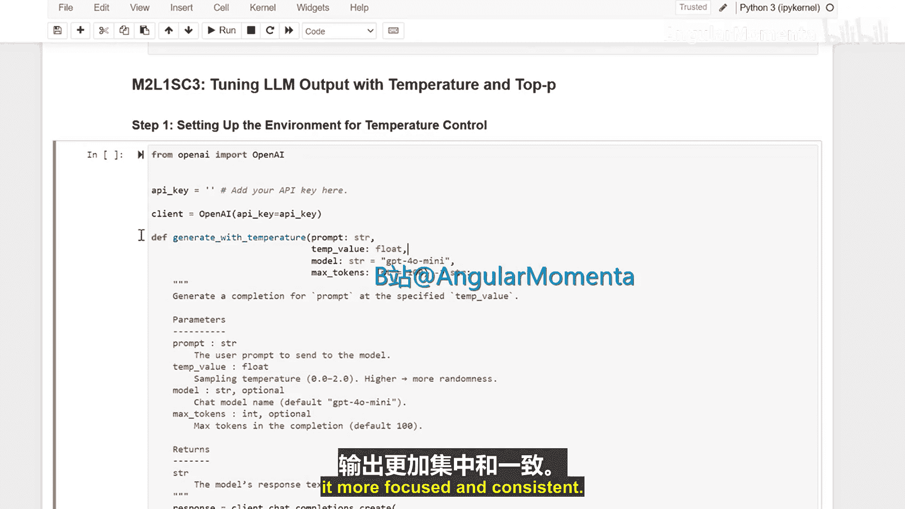

The generate underscore width underscore temperature function adjusts the randomness of the model's output by changing the temperature value。

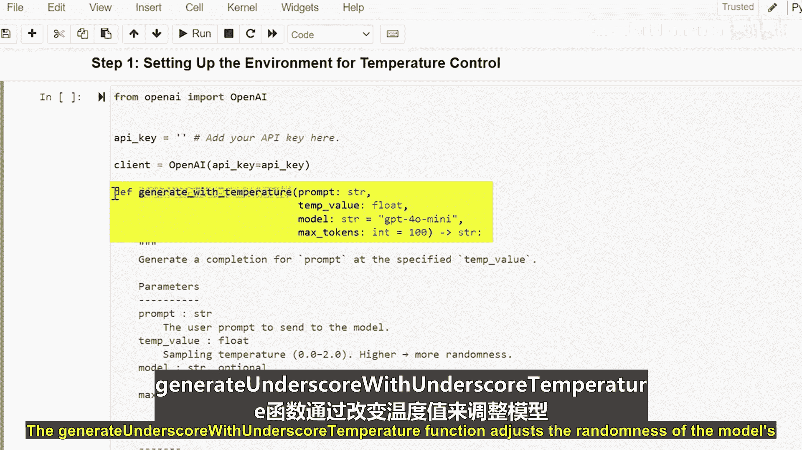

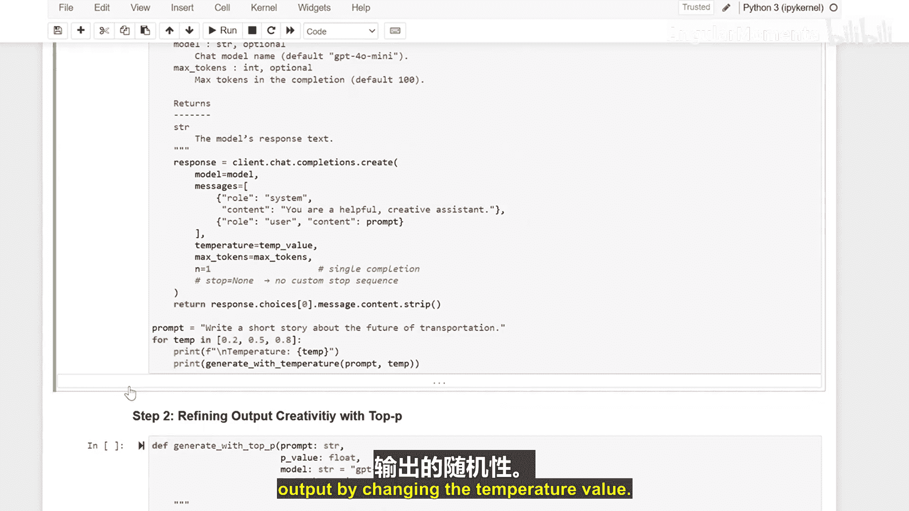

Higher temperatures produce more varied and creative responses。

 while lower temperatures make the responses more focused and consistent。

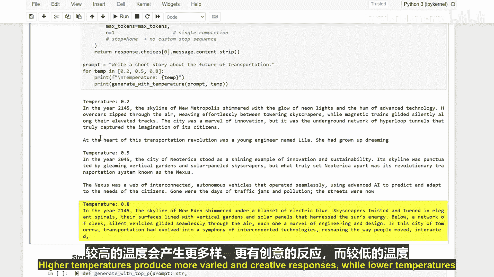

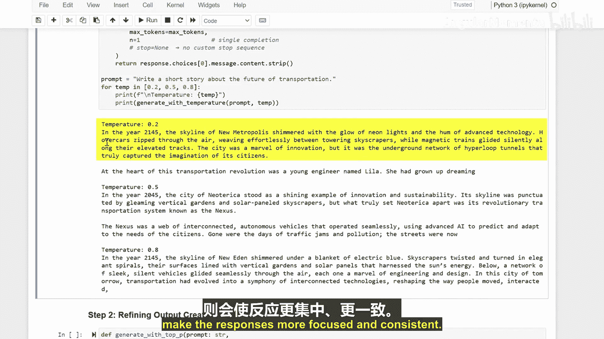

Next， we'll refine the output creativity of the language model using top8。Nuccleus said。

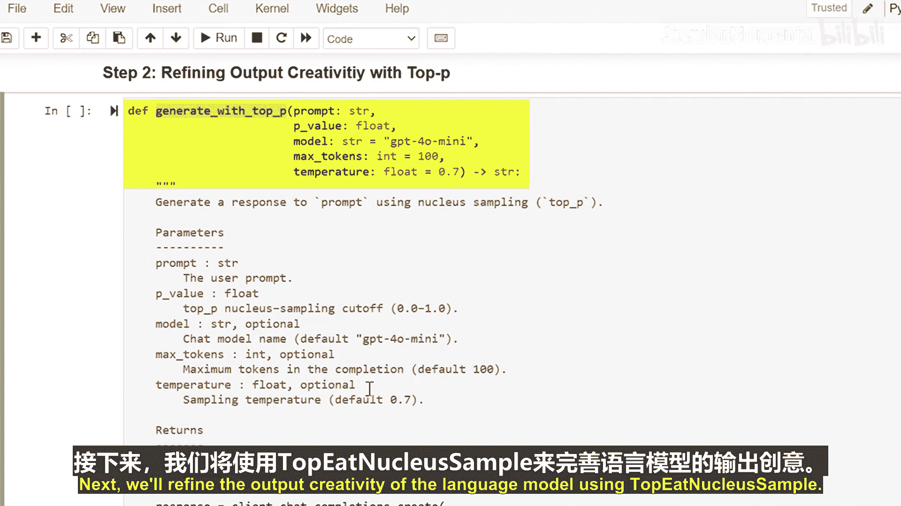

This technique ensures that only the most probable choices are considered。

 making the response more controlled。

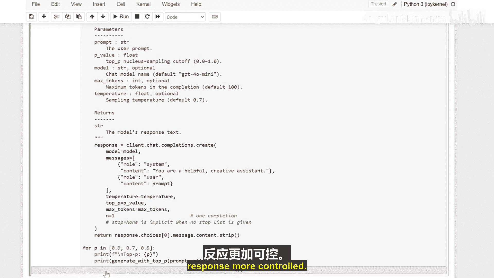

Higher top P values include more tokens， making the response more diverse。

 while lower values limit the choices， making the response more controlled。

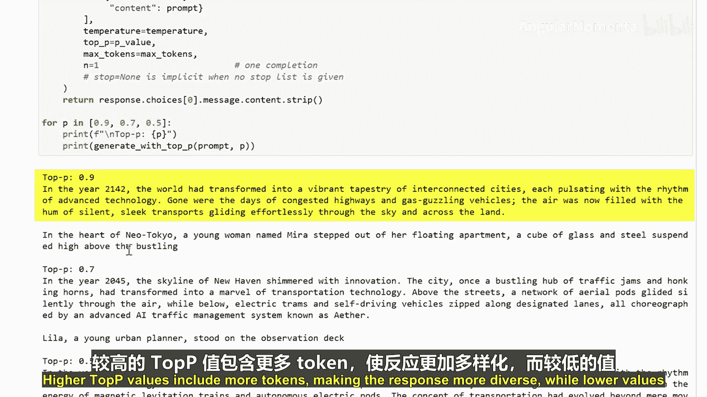

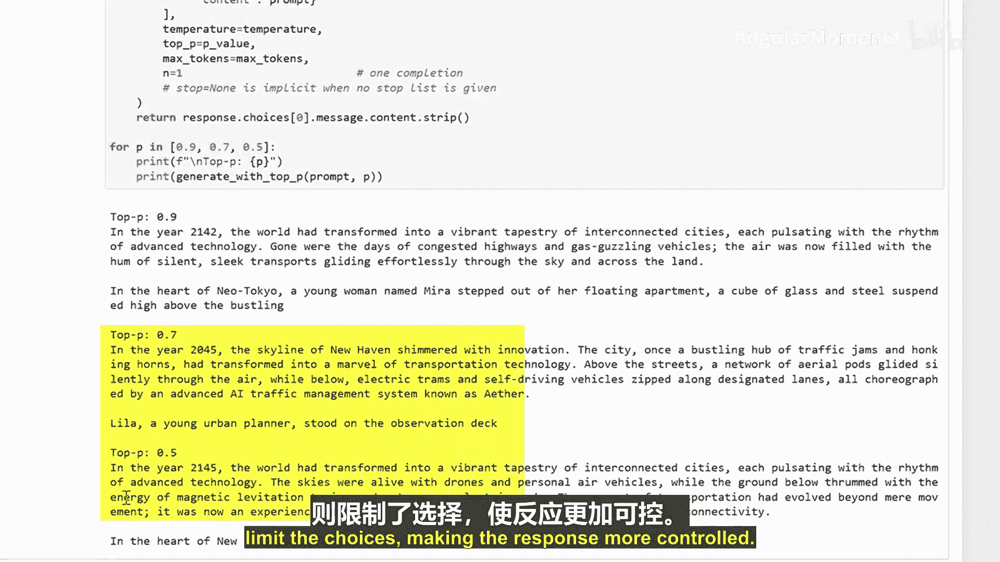

In today's session， we explored how to tune the output of a language model using temperature and top P settings。

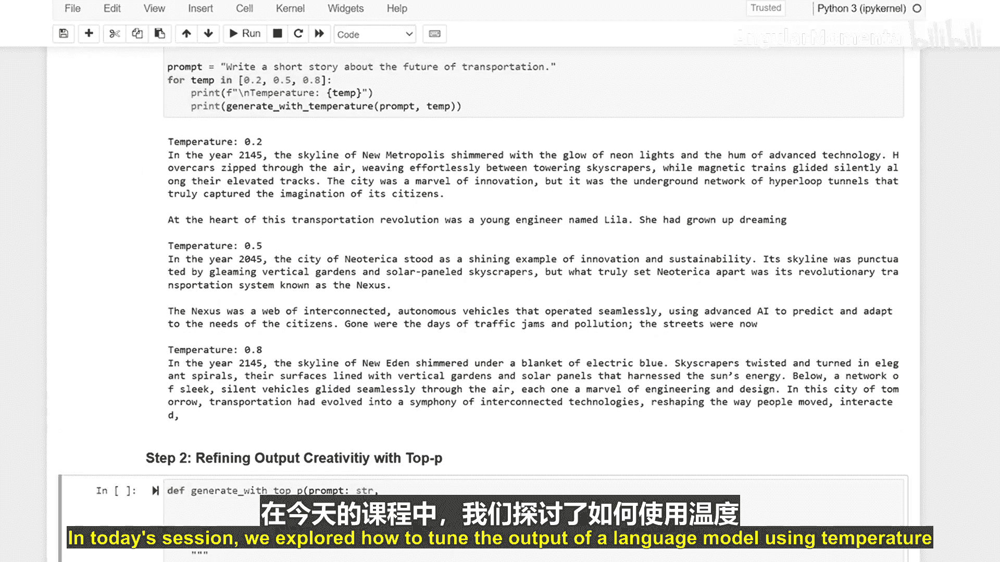

These techniques help control the creativity and randomness of the model's responses allowing for more focused or more creative outputlets。

 depending on your needs。

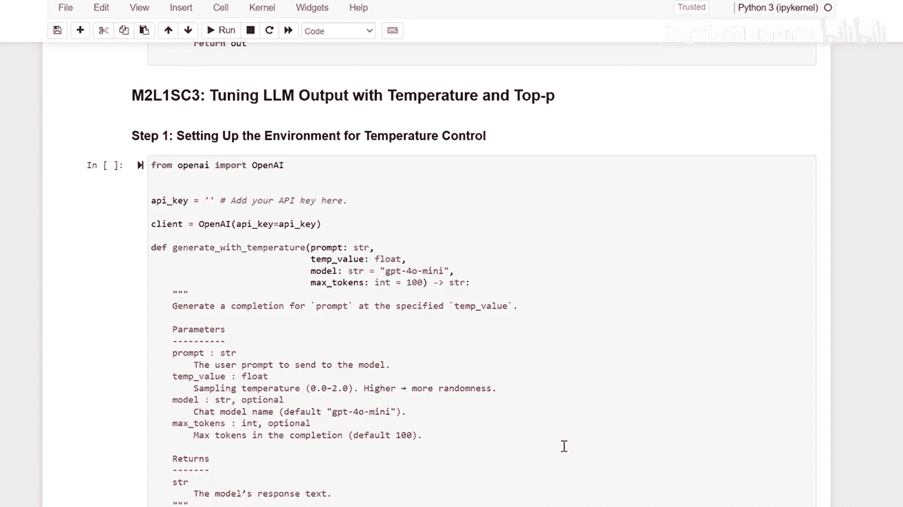