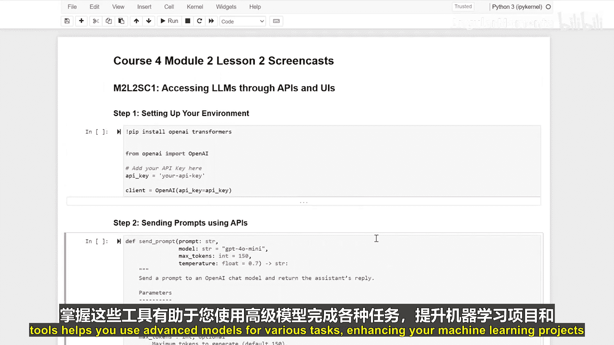
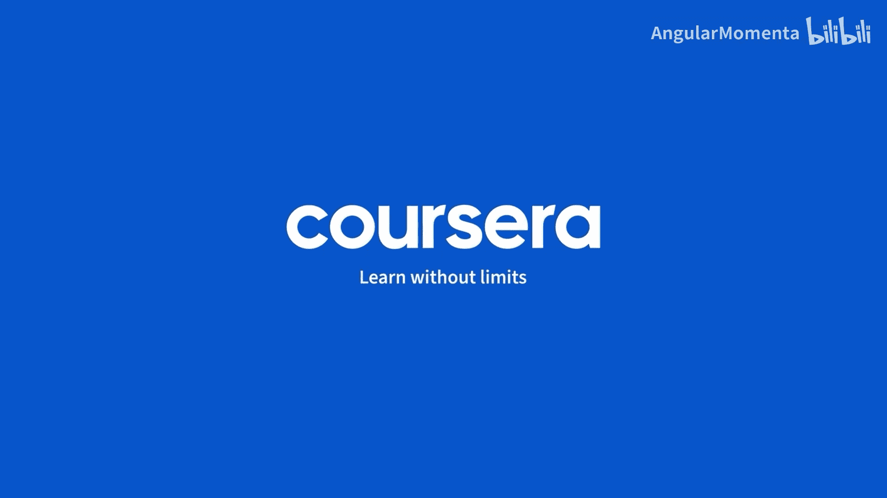

# 【Coursera】生成式人工智能与大语言模型-｜-Generative-AI-and-Large-Language-Models-p14-02_02_03_通过API和UI访问大型语言模型--BV1SMFgzoEh9_p14-

Welcome back In this video， you'll learn how to access large language models。

 LLMs through APIs and user interfaces U。We will use open AI to easily send prompts and receive detailed responses。

 Let's get started。 First， let's set up our environment。

 We'll need the open AI and transformers libraries。

Now let's create a function that sends prompts to the model and gets responses。

This function sends a prompt to the open AI model and gets the assistance reply。

 You can control how the model responds with parameters like model， max tokens and temperature。

Let's send a sample prompt to see how the model responds。

🎼The model will reply with a sample explanation of photosynthesis Accessing LLMs through APIs and UIs makes it easy to get detailed and accurate information。

 Mastering these tools helps you use advanced models for various tasks。

 enhancing your machine learning projects and data analysis， happy coding。

