# 【Coursera】生成式人工智能与大语言模型-｜-Generative-AI-and-Large-Language-Models-p15-02_02_04_提示工程：微调带来巨大成效--BV1SMFgzoEh9_p15-

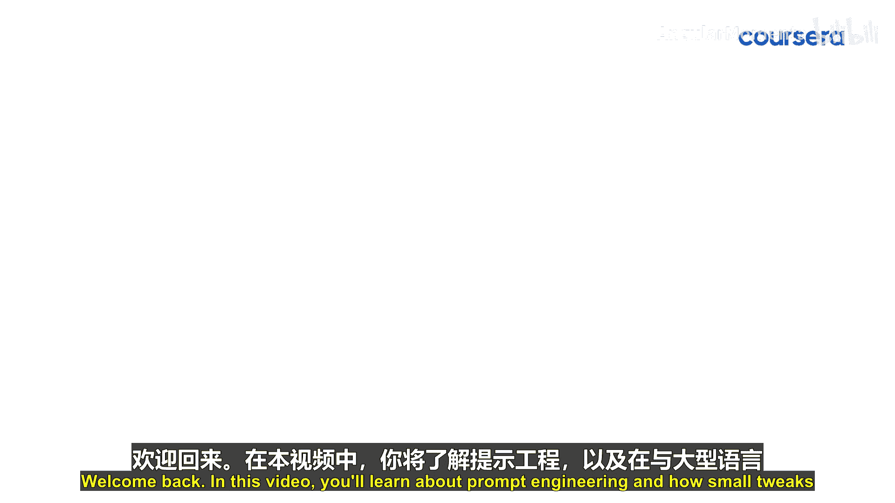

Welcome back In this video， you'll learn about prompt engineering and how small tweaks can lead to big results when working with large language models。

 LLMs。

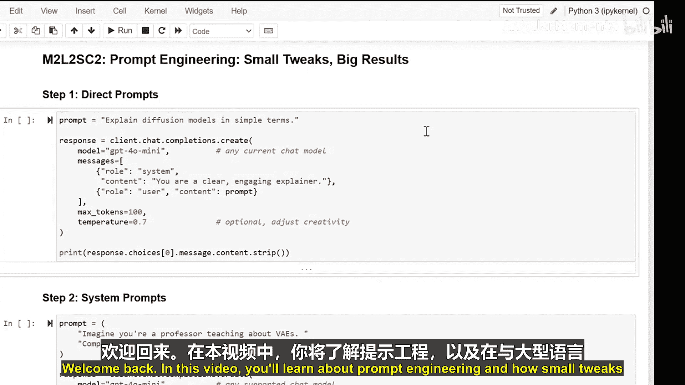

We will explore different types of prompts and see their impact on the model's responses。

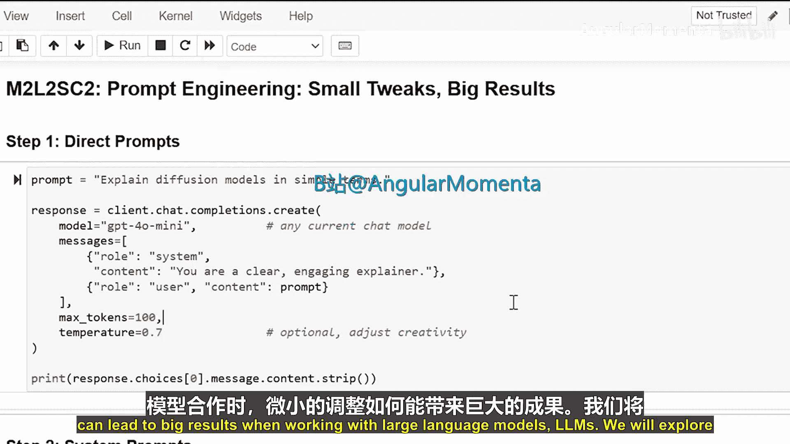

Let's start with direct prompts。

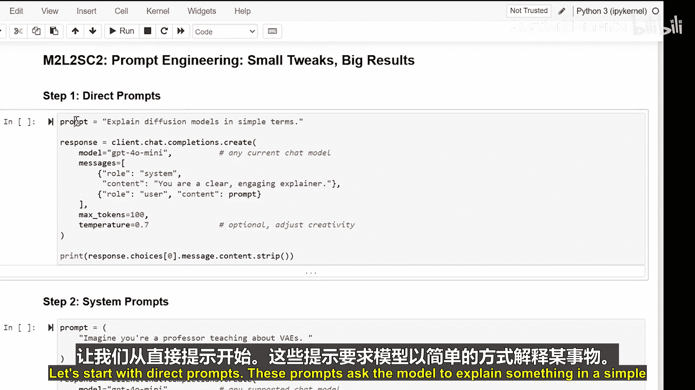

These prompts ask the model to explain something in a simple way。

 This prompt asks the model to explain diffusion models。

 Ading parameters like max underscore tokens and temperature helps control the output length and creativity。

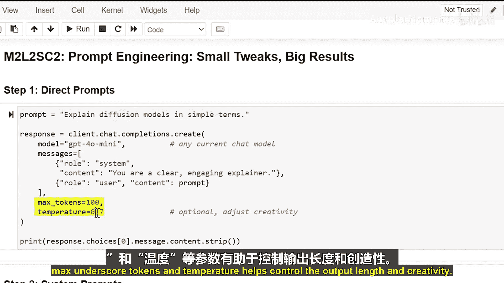

Next， let's use system prompts。 These prompts set a context for the model。

 such as pretending to be a professor。 This prompt asks the model to compare VEs and G A Ns as if it were a professor setting the system message helps the model provide relevant and contextual responses。

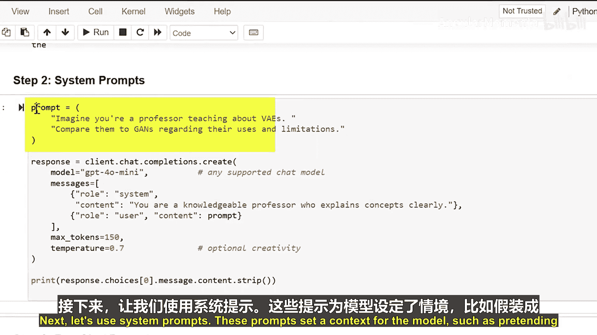

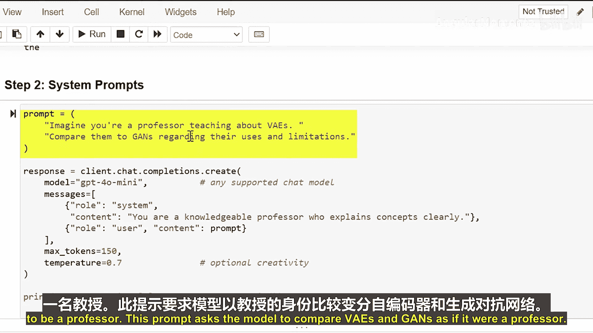

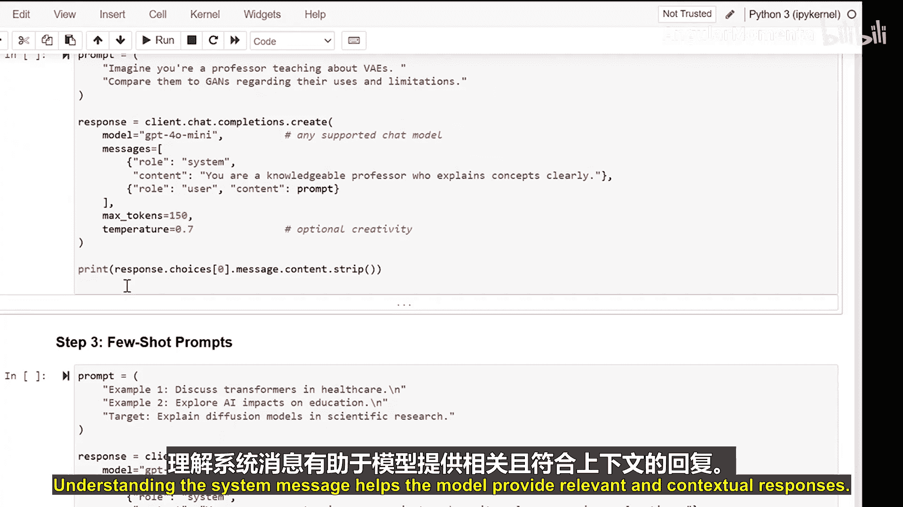

Finally， let's look at few shot prompts。 These prompts provide examples to guide the model's response。

The prompt here gives the model examples to follow。

 helping it understand the format and context for the target question。

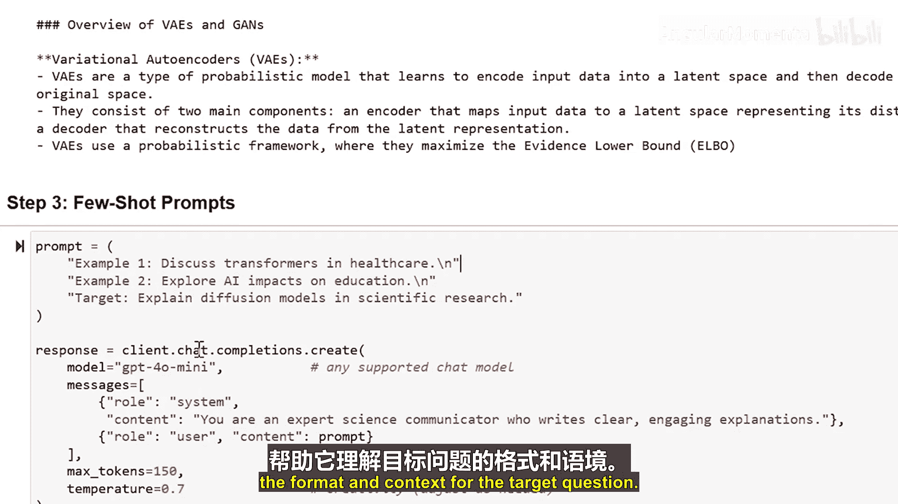

Prompt engineering involves small tweaks that can significantly improve the model's responses by experimenting with direct system and few shot prompts。

 You can enhance your interactions with L L Ms and achieve better results。 Happy coding。😊。

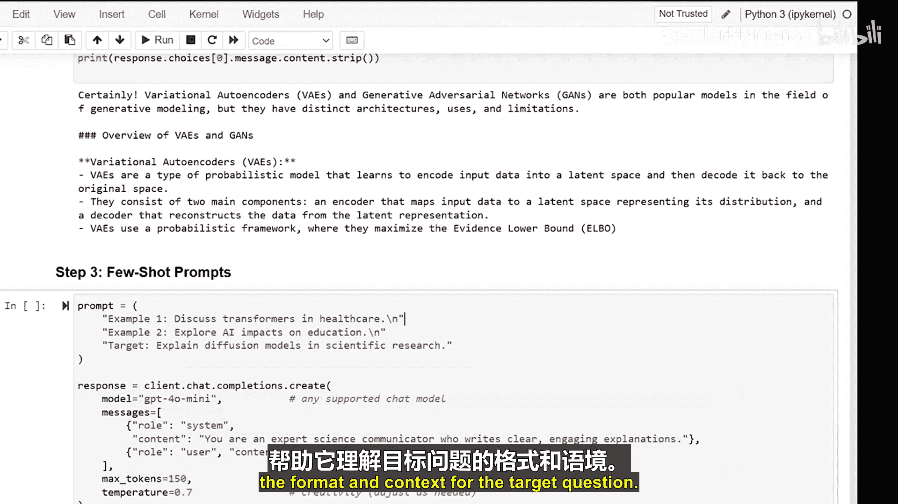

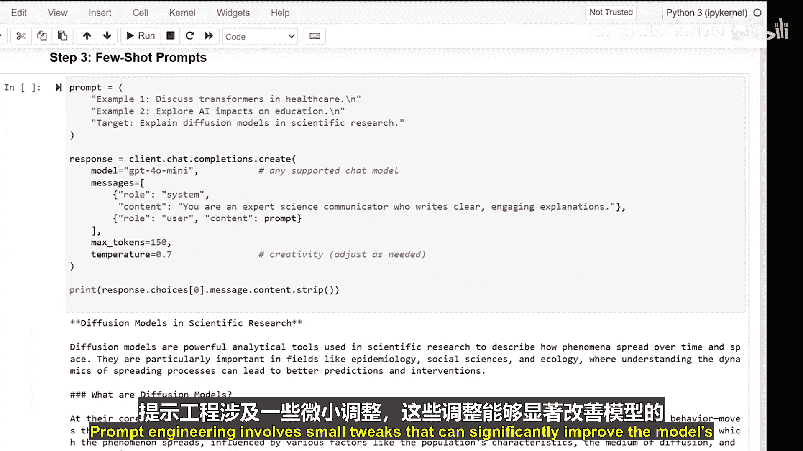

。

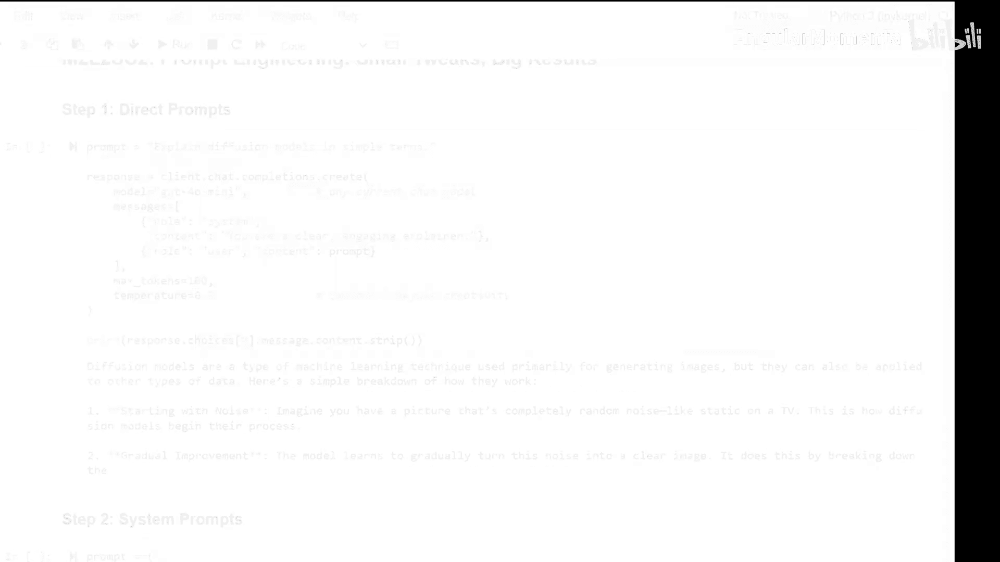