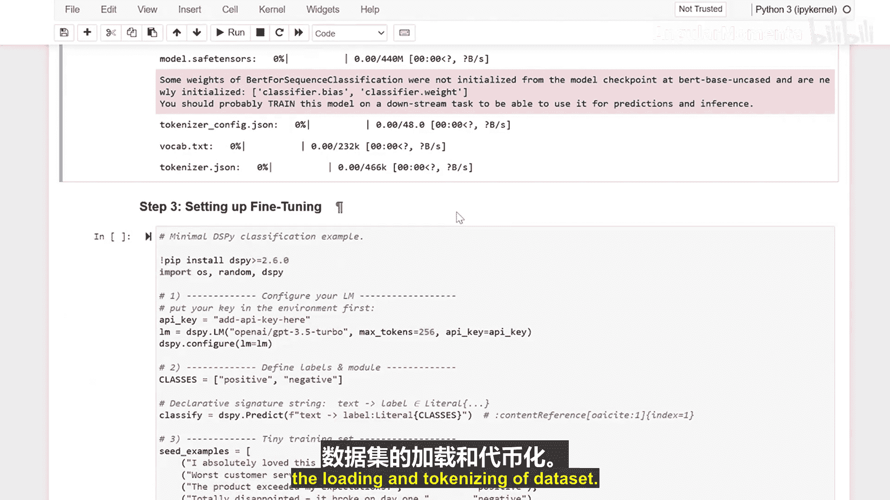
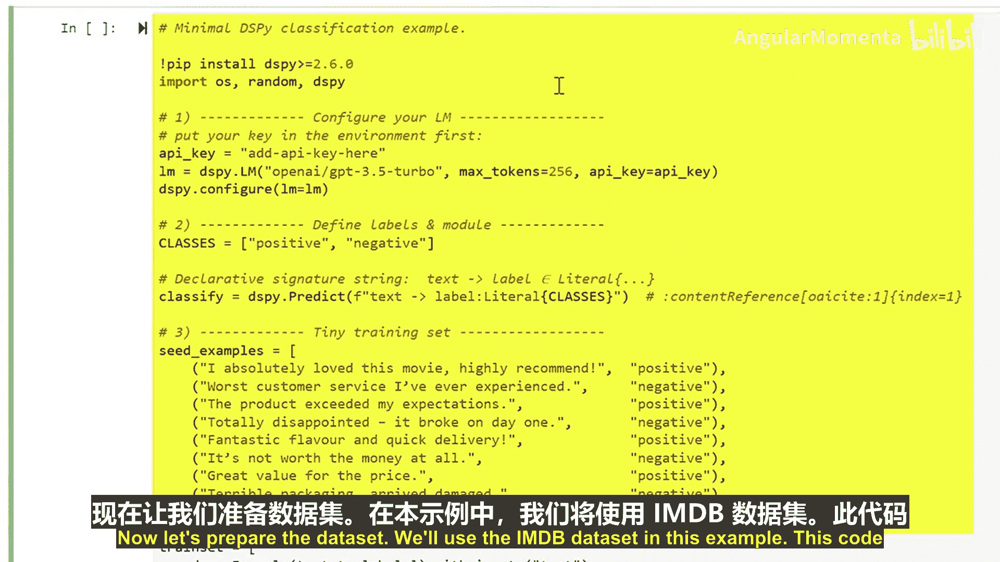
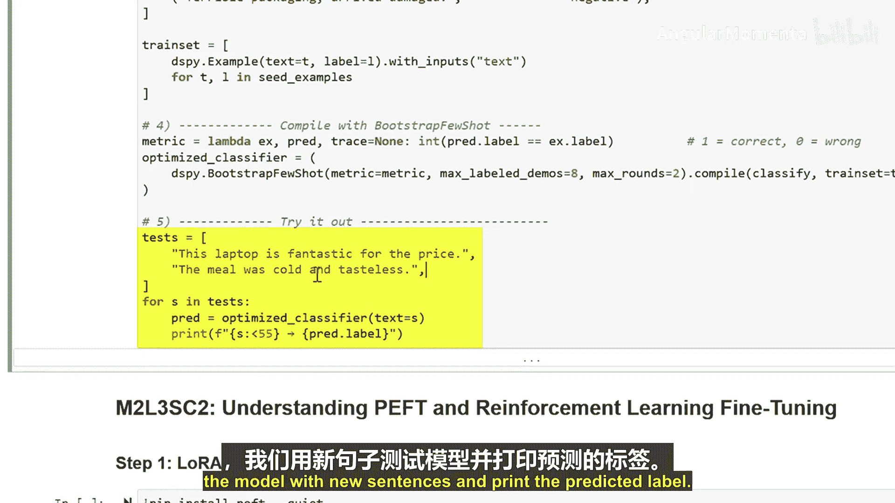
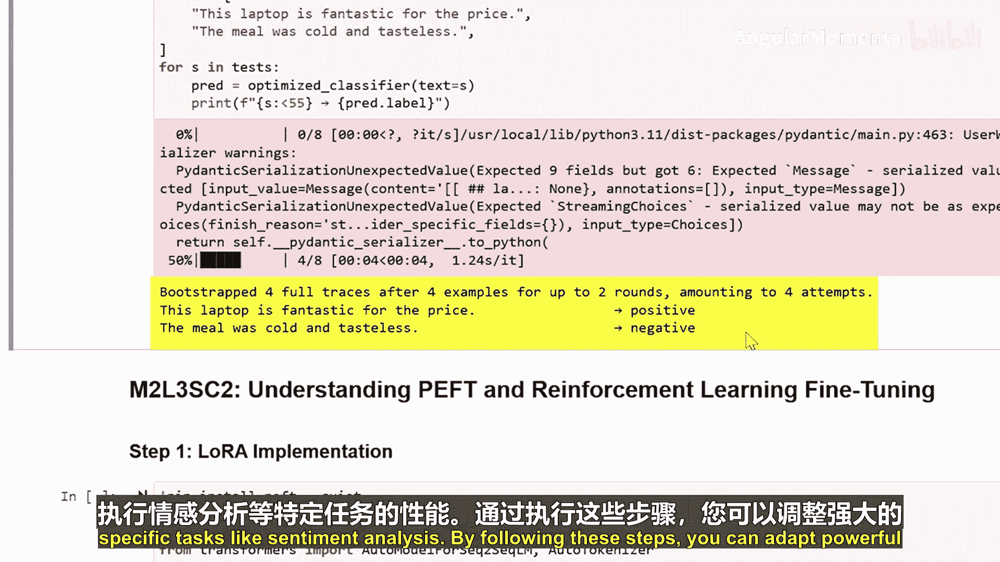
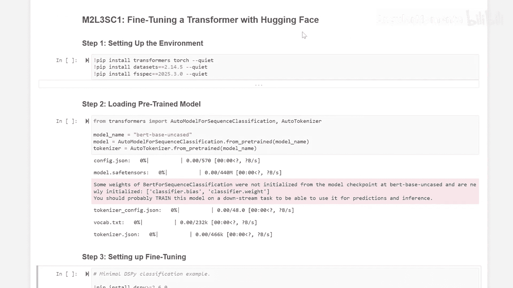

# 【Coursera】生成式人工智能与大语言模型-｜-Generative-AI-and-Large-Language-Models-p16-02_03_02_使用Hugging-Face微调Transformer模型--BV1SMFgzoEh9_p16-

Hello， in this video， you'll learn how to fine tune a transformer model using hugging face。

 fine tuning allows us to adapt pre trained models to specific tasks。

 making them even more effective。 Let's get started。 First。

 let's set up our environment by installing the required libraries。😊，Next。

 we'll load a pre trained model and tokenizer。 We'll use Bert。 for this example。

 This code sets up the Bt model and tokenizer。Ready for fine tuning。

Code editor showing the loading and tokenizing of data set。 Now， let's prepare the data set。

 We'll use the IMDB data set in this example。

This code loads the data set and prepares it for the model by tokenizing the text。Next。

 let's set up the fine tuning process using the DSP Library。

This code sets up labels and uses a small training set to fine tune the model with few shot learning。

Finally， let's test the fine tuned model with some example sentences。

 here we test the model with new sentences and print the predicted label。

 fine tuning a transformer model with hugging face and D S P enhances its performance for specific tasks like sentiment analysis。

 by following these steps， you can adapt powerful models to your needs， I accuracy and efficiency。

Happy coding。

