# 【Coursera】生成式人工智能与大语言模型-｜-Generative-AI-and-Large-Language-Models-p17-03_01_02_检索知识嵌入与使用Faiss进行向量搜索--BV1SMFgzoEh9_p17-

Welcome back， everyone。 Today， we are diving into retrieving knowledge using embeddings and vector search with vice。

 First， let's set up our environment。😊。

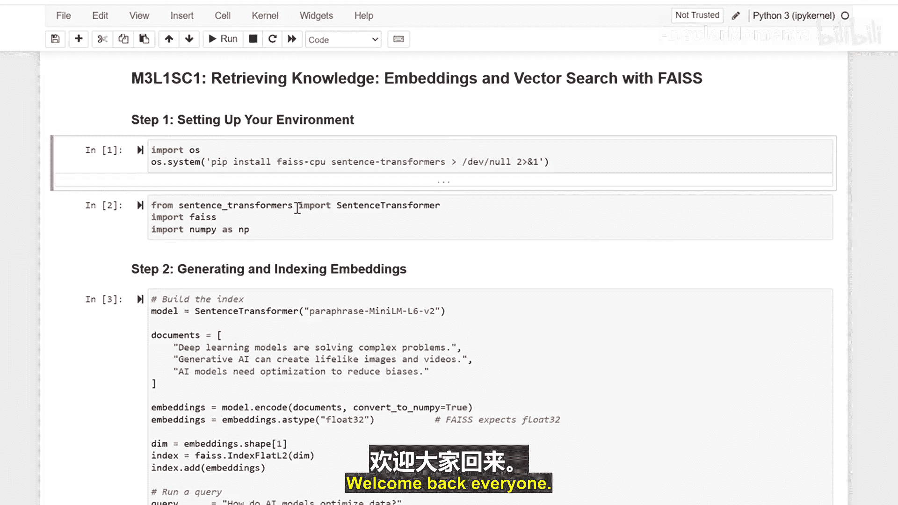

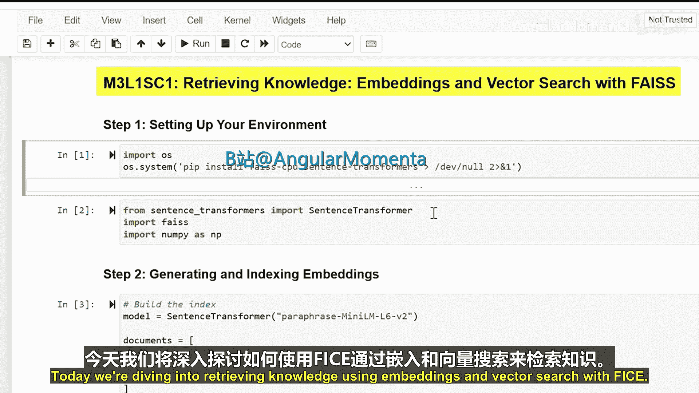

We'll install thice and sentence transformers， suppress unnecessary outputs and import the necessary tools to generate embeddings and perform vector search。

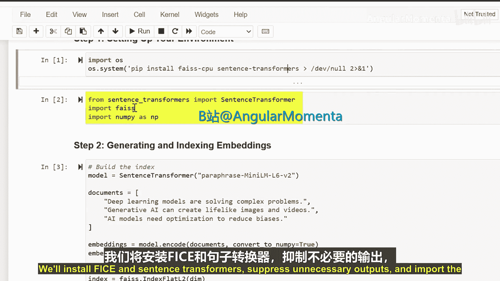

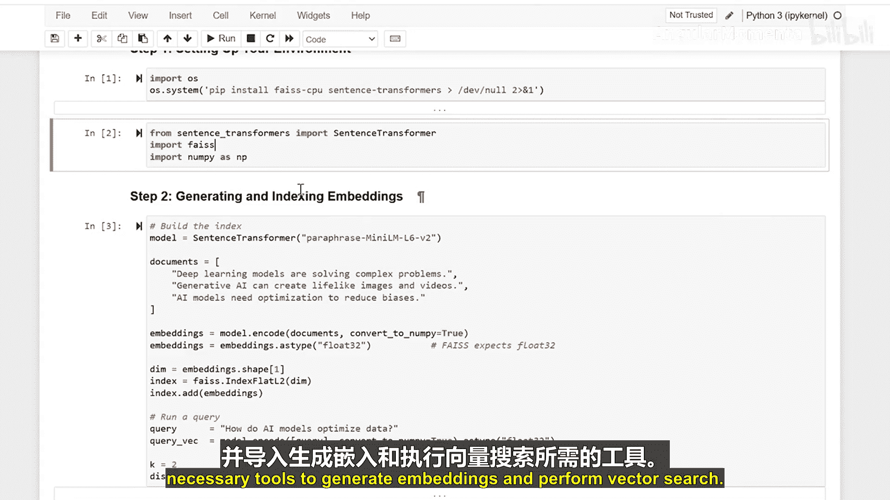

Next， we'll generate vector embeddings for a set of documents using sentence transformers and then index these embeddings with F for efficient search。

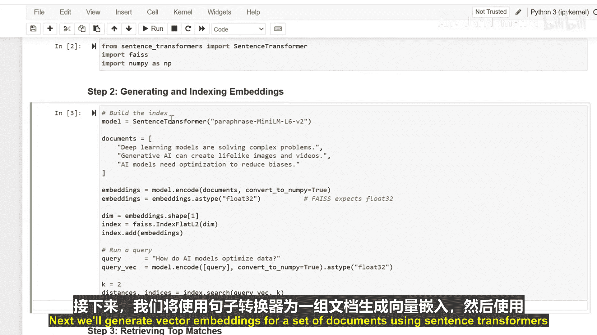

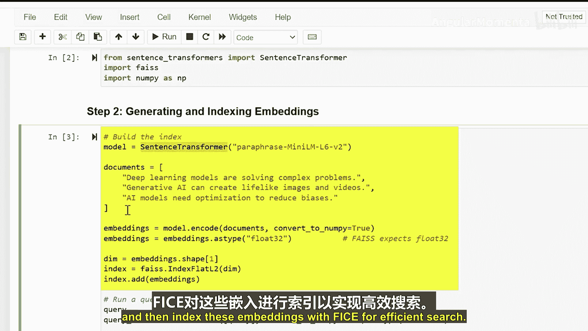

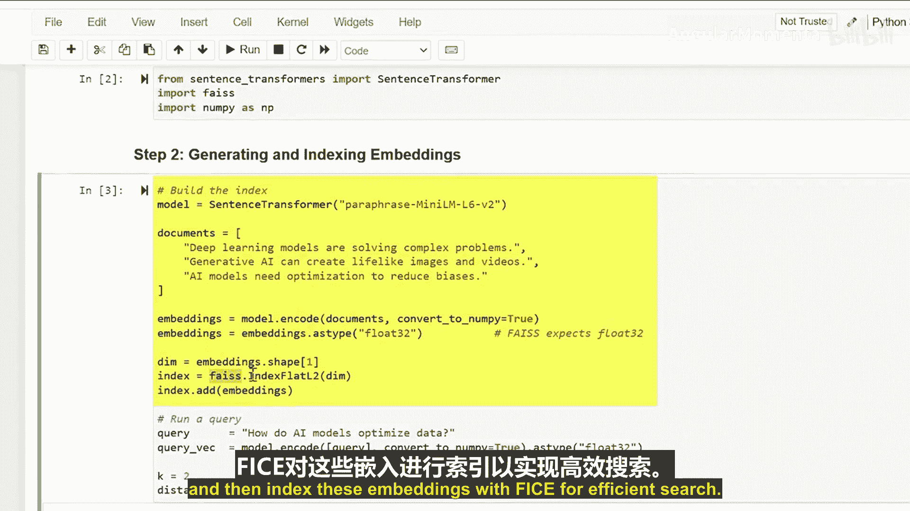

Finally， let's retrieve the top matches for our query。

 we'll use Fice to find the most relevant documents based on their vector embeddings。

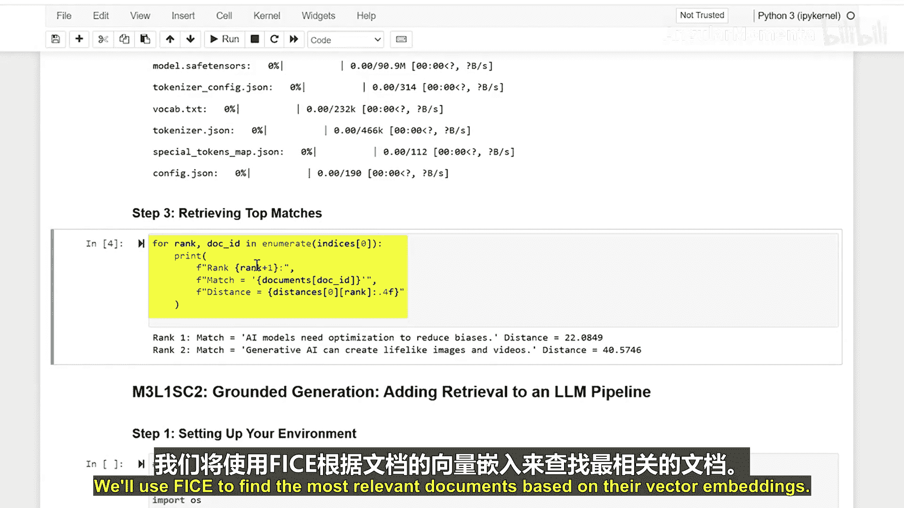

🎼Here's the output showing the top matches。 In today's session。

 we learned how to use embeddings and vector search with Fice to retrieve the most relevant documents based on their meanings。

 This powerful technique allows us to efficiently search through large data sets and find the information we need quickly。

😊。

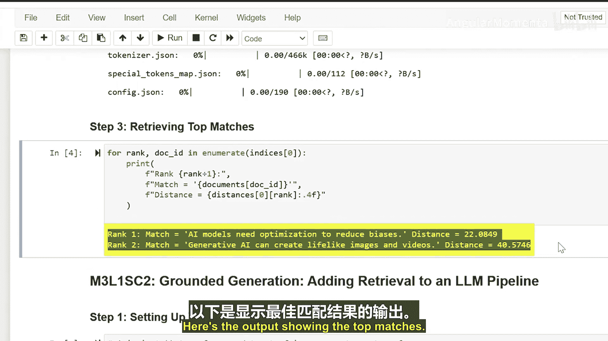

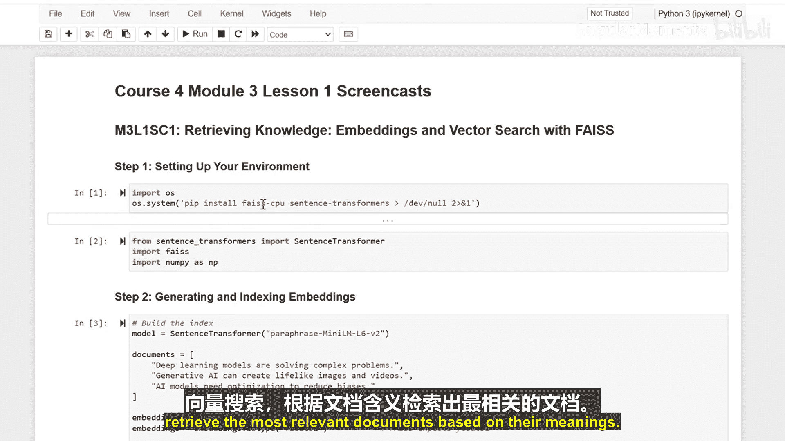

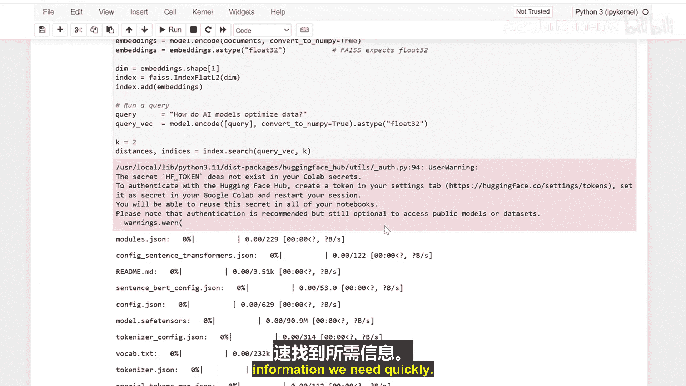