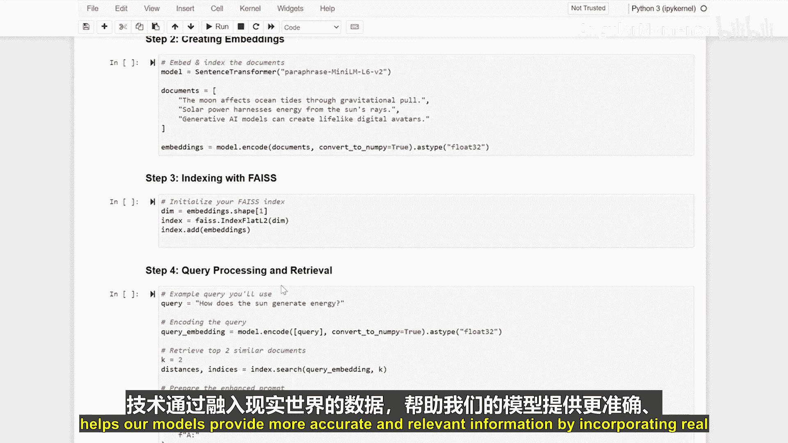

# 【Coursera】生成式人工智能与大语言模型-｜-Generative-AI-and-Large-Language-Models-p18-03_01_03_基于检索的生成：在LLM流程中融入检索机制--BV1SMFgzoEh9_p18-

Welcome back everyone， today we're diving into grounded generation by adding retrieval to a large language model pipeline。

This technique helps our model produce more accurate and relevant responses by incorporating real world information。

 First， let's set up our environment。 We'll install transformers， data sets。

 Fice and sentence transformers。😊，Suppressing unnecessary outputs。Next。

 we'll create vector embeddings for a set of documents using sentence transformer。Now。

 well index these embeddings with F for efficient retrieval。Next， we'll process a query。

 retrieve the most relevant documents and prepare an enhanced prompt。Finally。

 we'll use a text generation modelp to generate grounded responses based on the enhanced prompt。

Here's the output of the enhanced response。 In today's session。

 we learned how to add retrieval to a large language model pipeline to generate grounded responses。

 This powerful technique helps our models provide more accurate and relevant information by incorporating real world data。

😊。

