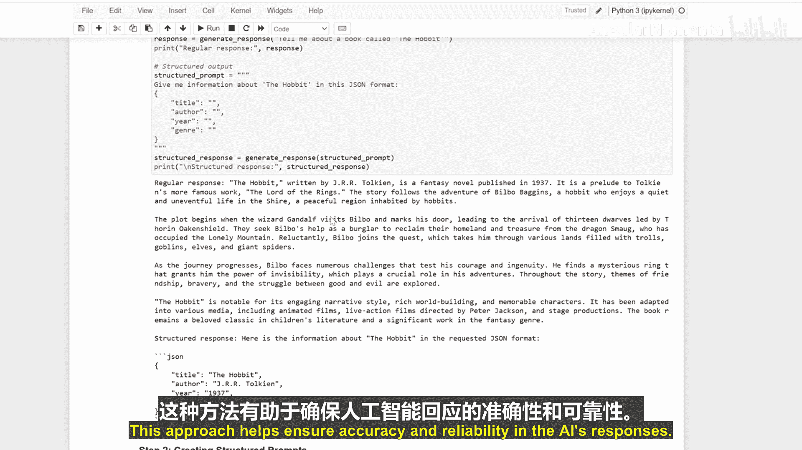
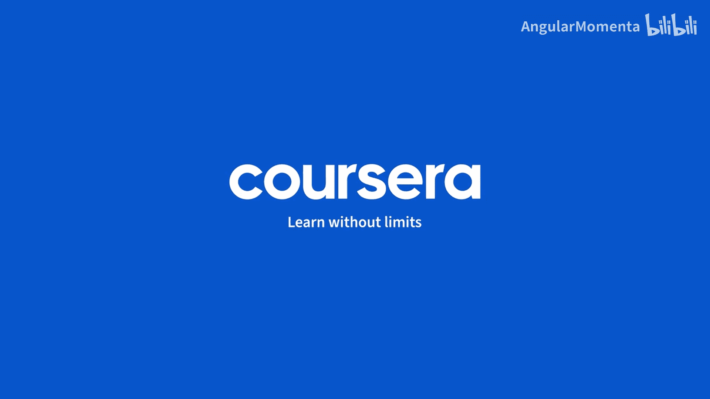

# 【Coursera】生成式人工智能与大语言模型-｜-Generative-AI-and-Large-Language-Models-p19-03_02_02_提示大语言模型实现结构化输出与函数模拟--BV1SMFgzoEh9_p19-

In this video， you'll learn how to prompt large language models。

 L L Ms for structured output and simulate functions。 We'll cover creating structured prompts。

 validating responses and simulating complex tasks。 Let's get started。😊，First。

 let's understand how to prompt the model for structured output like JSON format。

This code shows how to prompt the model for regular and structured output。

The regular response tells us about the hobbit， including details about the story and characters。

The structured response gives the same information in a Json format with fields like title， author。

 ear and genre。Next， let's create structured prompts for requesting output in specific formats like JSOson or XML。

 These prompts ask the model to return information structured as JSOson or XML。

Let's simulate a function where the AI acts as a calculator here the model is guided to simulate a simple calculation task。

It's important to validate the responses to ensure they follow the requested format。

This code checks if the AI's response is valid Json and follows our exact format。

This output shows that the requested format was followed。

We can simulate more complex tasks like calculating shopping totals。

 This prompt asks the model to act as a shopping calculator and follow specific rules。Finally。

 let's create a smart assistant that combines everything we've learned。

 This code shows how to create a smart assistant that performs tasks and validates responses。😊。

By using structured prompts and simulating functions。

 you can enhance your interactions with LLMs and achieve better results。

This approach helps ensure accuracy and reliability in the AI's responses， happy coding。

。

