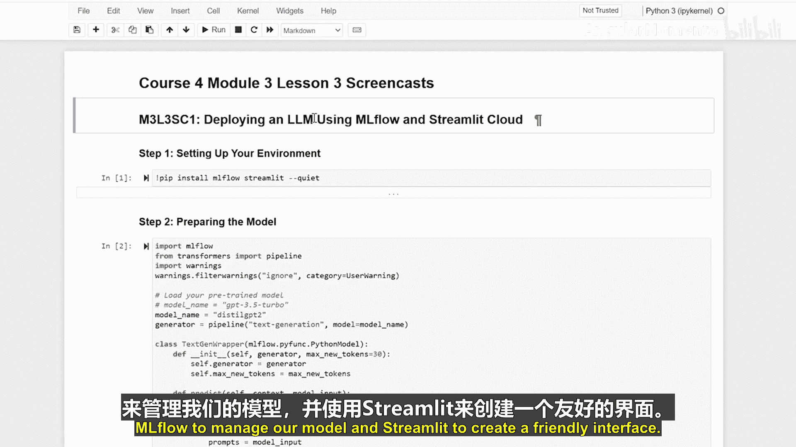

# 【Coursera】生成式人工智能与大语言模型-｜-Generative-AI-and-Large-Language-Models-p20-03_03_02_使用MLflow与Streamlit云部署大语言模型--BV1SMFgzoEh9_p20-

Welcome back Today we'll learn how to share our AI models with others using MLflow and Streamlit Cloud。

Think of it like building a website where people can chat with your AI。First， we need our tools。

 M L flow helps manage our AI models， and streamamlit helps create a user interface。

 It's like getting our workshop ready before building。Now。

 let's prepare the model using ML flow and the Huging F Transformers Library。

 This code prepares the model for deployment， wrapping it in a custom ML flow model class。

Now we package our model。 We save it in a special format， which will make it easy to load later。Now。

 let's build our website here。 we create a title。Add a text box for users。

Make a button to generate responses。 It's like building a simple chat interface。Deployment command。

 finally， we share our app。When we upload it to Streamlit Cloud， we make it available to everyone。

Today we learned how to take an AI model and turn it into a website anyone can use。

 We used MLflow to manage our model and streamlit to create a friendly interface。

