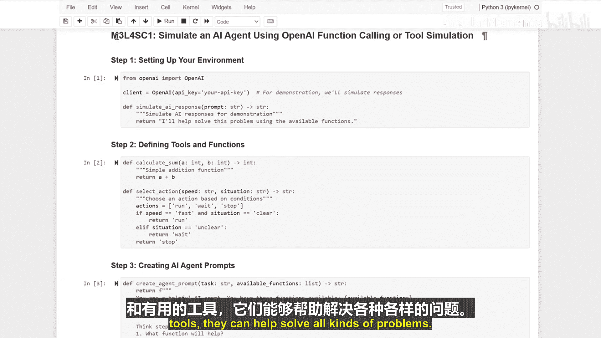
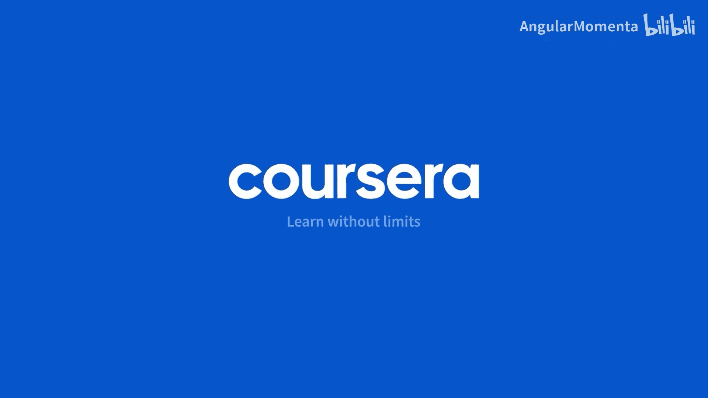

# 【Coursera】生成式人工智能与大语言模型-｜-Generative-AI-and-Large-Language-Models-p21-03_04_02_使用OpenAI函数调用或工具仿真模拟AI代理--BV1SMFgzoEh9_p21-

Welcome back。 Today， we'll learn how to create AI agents that can make decisions and use tools。

 Think of it like teaching a robot how to solve problems by following specific steps。 First。

 we set up our AI assistant tools Today， we'll create a simple simulation。

We are creating tools our AI can use， such as a calculator for adding numbers and a decision maker for choosing actions。

Like giving our AI a toolbox to work with。We are teaching our AI how to understand what tools it has。

 break down problems into steps。Choose the right tool for each job。Watch our AI agent work。

It will read the problem。 choose the right tool。Solve the problem。Like a。

 smart assistant following instructions。Today， we learned how to create AI agents that can use tools and make decisions by giving them clear instructions and useful tools they can help solve all kinds of problems。

