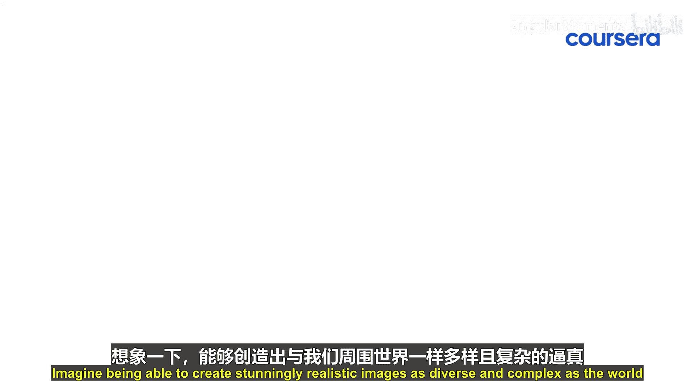

# 【Coursera】生成式人工智能与大语言模型-｜-Generative-AI-and-Large-Language-Models-p22-04_01_01_为何扩散模型成为高质量图像生成的首选方法--BV1SMFgzoEh9_p22-

Imagine being able to create stunningly realistic images as diverse and complex as the world around us。

 That's the power of diffusion models。 a revolutionary approach in image generation that leaves traditional methods likegans and V A Es in the dust。

😊，But what makes diffusion models stand out， let's break it down。

The magic of diffusion models lies in their stability and precision， Unlikegans。

 which often struggle with producing stable results， diffusion models provide a consistent framework。

 En every image generated， maintains high fidelity and realism。😊。

Have you ever used a photo app to transform your selfies into art？That's diffusion quietly at work。

Providing you with more clear， vivid transformations without the randomness that sometimes plagues other methods。

 St isn't just about producing one good image。 It's about reliability across countless renditions。

 and industries like media and entertainment， where the demand for lifelike graphics is constant diffusion models are reshaping the landscape。

 They bring in unprecedented level of control and diversity。

 making them ideal for creating everything from hyper realisticistic movie visuals to interactive gaming environments。

But the impact of division models doesn't stop at entertainment。

 consider health care where accurate imaging can be life saving。

Diffusion models enhance medical imaging technologies。

 potentially improving diagnostics by generating high quality images that reveal more about our anatomy and health conditions。

So why should you care about diffusion models， Because they aren't just another tool in the AI toolbox。

 They're a gateway to innovation， whether you're an aspiring artist。

 a game developer or a healthcare professional understandingstanding diffusion models unlocks new potentials in your field and a rapidly evolving world。

 staying at the forefront of technology is crucial。😊。

Embracing diffusion models not only equips you with the knowledge of the latest advancements。

 but also empowers you to lead in your industry。 So take this opportunity to explore and master this cutting edge technology。

The future of AI driven image generation is bright。

 and with diffusion models you're already ahead of the curve。

