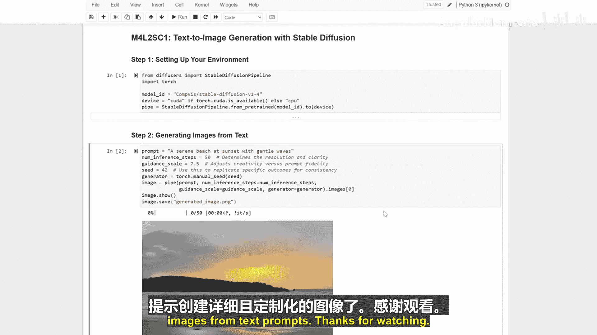
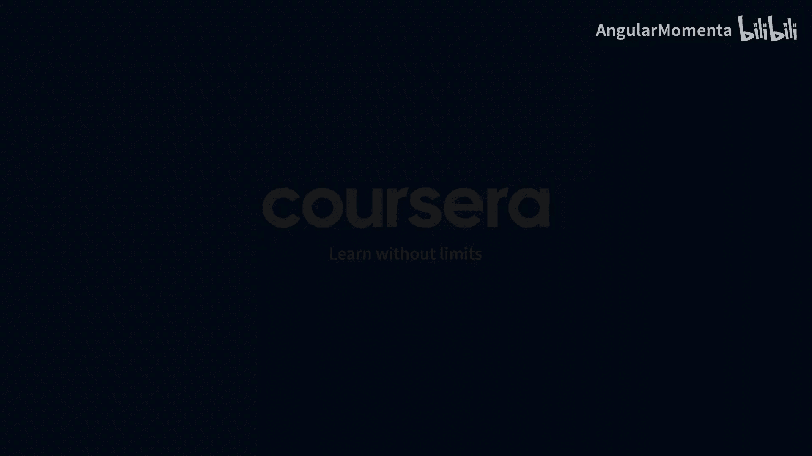

# 【Coursera】生成式人工智能与大语言模型-｜-Generative-AI-and-Large-Language-Models-p23-04_02_01_基于稳定扩散的文本到图像生成--BV1SMFgzoEh9_p23-

Welcome back。 Today， we're going to explore how to generate images from text using stable diffusion。

 a powerful tool for creating visuals from written descriptions。First。

 let's set up our environment by installing the required packages for stable diffusion。Next。

 we'll generate an image from a text prompt。 We'll adjust the number of inferences steps， guidance。

 scale and seed to customize our output。Here we'll display our image。

 We'll also save it so we can access it later。In this video。

 we've learned how to set up the environment， use stable diffusion to generate images from text and understand the model outputs through various visualizations by mastering these steps。

 You can create detail and customized images from text prompts。 Thanks for watching。😊。

