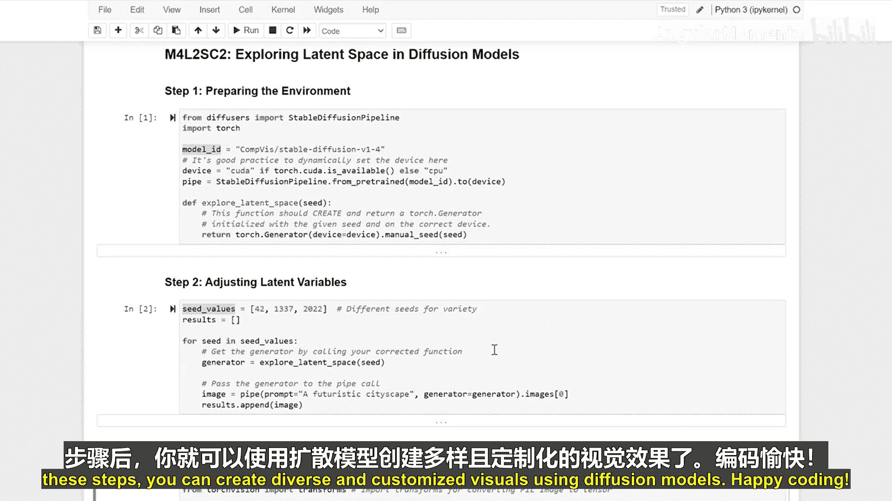
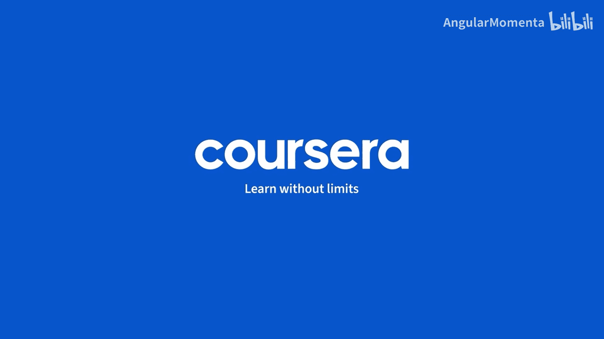

# 【Coursera】生成式人工智能与大语言模型-｜-Generative-AI-and-Large-Language-Models-p24-04_02_02_探索扩散模型中的潜在空间--BV1SMFgzoEh9_p24-

Welcome back。 Today， we're going to explore the latent space in diffusion models。

 which allows us to create different images by adjusting the underlying variables。 First。

 let's set up our environment by loading the necessary libraries and model for stable diffusion。😊。

Next， we'll adjust the latent variables to generate different images。

 We'll use different seeds to explore the variety of outputs。Finally。

 let's fine tune one of our generated images by pertuurrbing the latent vectors。 In this video。

 we've learned how to set up the environment， explore latent space and diffusion models。

 generate different images by adjusting seeds and fine tune hour outputs by perturbing latent vectors。

 by mastering these steps。 You can create diverse and customized visuals using diffusion models。

 H coding。😊。

