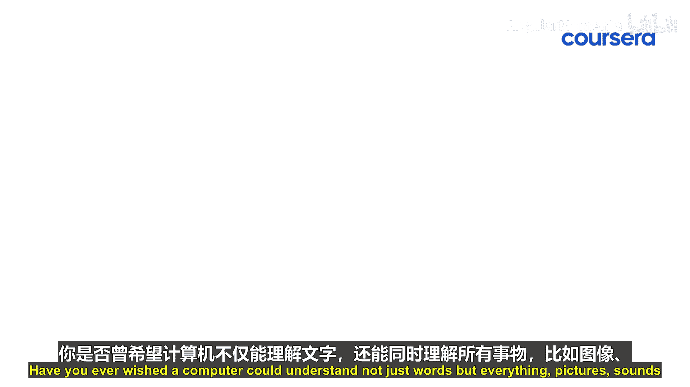
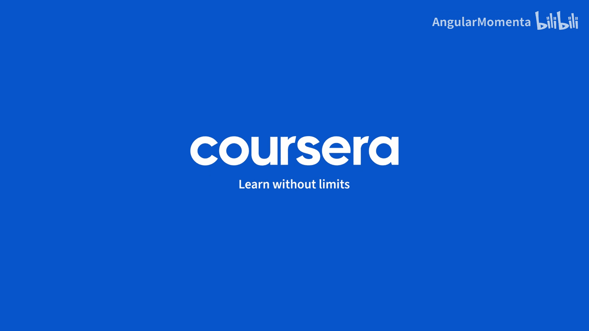

# 【Coursera】生成式人工智能与大语言模型-｜-Generative-AI-and-Large-Language-Models-p26-05_01_01_从文本到万物：多模态革命--BV1SMFgzoEh9_p26-

Have you ever wished a computer could understand not just words， but everything， pictures。

 sounds and more all at once。 Welcome to the world of multimodal AI。

 where everything from text to sounds and images is combined to create a seamless understanding of complex data。

😊，Multimodal AI models are changing the way we process information by integrating text。

 images and audios， mimicking how humans perceive the world using all senses。

 Imagine a model that sees an image of a dog at a park hears a bark and reads a story about its day。

 All at the same time。 This revolutionary approach allows AI to gain richer understanding and context。

 transforming interactions in areas like search engines， customer service and accessibility tools。😊。

In the real world， multimodal AI is making significant waves。

 Take online learning platforms where these models can analyze students written questions。

 interpret diagrams， and even listen to lectures， offering personalized feedback and support。

 E-commerce is another frontier where virtual trionss and smart shopping assistance are now more intuitive than ever。

 thanks to the ability to process visual， textual and audio inputs seamlessly。

 but developing these models isn't without its challenges。

 Unlike traditional unimmodal systems that focus on one type of data。

 Multimodal models must unite various data types， and that's no easy task。

 It requires sophisticated alignment of data representations and innovative training techniques。

 Yet the effort is worth it。 solving these challenges enables the creation of systems that are not only smarter。

 but also more natural to interact with。😊，As we stand on the brink of this multimodal revolution。

 the possibilities are endless from enriching virtual experiences to expanding our understanding of AI's capabilities。

 Multimodal technology is opening up a new world of opportunities。

 Let's embrace this change and explore how these powerful tools can reshape the way we interact with technology and each other。

😊，Keep exploring because the next innovation is just around the corner。

