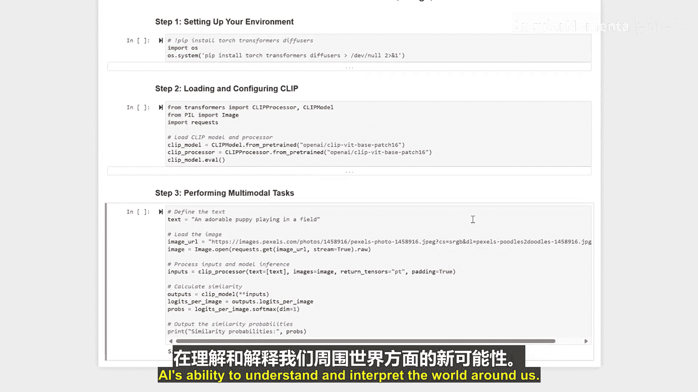

# 【Coursera】生成式人工智能与大语言模型-｜-Generative-AI-and-Large-Language-Models-p27-05_01_02_多模态模型如何整合文本、图像与音频--BV1SMFgzoEh9_p27-

Welcome back， everyone。 Today， we'll explore how multimodal models combine text。

 image and audio to perform complex tasks。 First， let's set up our environment。

 We'll install pieytorrch transformers and diffusers。

 suppressing unnecessary outputs to ensure compatibility with coab。😊。

We are setting up our multimodal model。 We all load the C IP model and processor。

 which can handle text and images simultaneously。 Let's combine text and image inputs to perform multimodal tasks。

 We'll use the C IP to process and infer similarities between these modalities。

 The similarity probability Tensor shows a value of 1。0。

 indicating that the model believes the text and image are a perfect match。

 Multimodal models like CIP in us to perform complex tasks by combining different types of data by setting up and using these models。

 We can unlock new possibilities in AI's ability to understand and interpret the world around us。😊。

