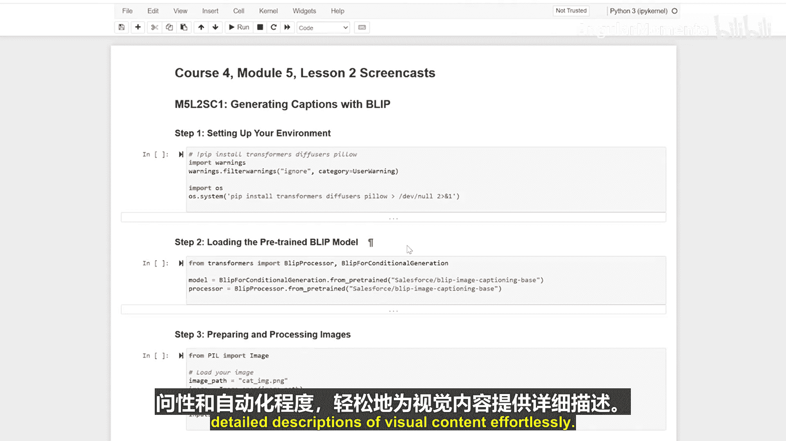

# 【Coursera】生成式人工智能与大语言模型-｜-Generative-AI-and-Large-Language-Models-p28-05_02_02_使用BLIP生成字幕--BV1SMFgzoEh9_p28-

Welcome back， everyone。 Today， we're exploring how to generate captions for images using B， L I P。

 First， let's set up our environment。 We'll install transformers， diffusers and pillow。

 suppressing unnecessary outputs to ensure compatibility with coab。 Next。

 we'll load the pre trained B L IP model and processor。

 which will help us generate accurate captions for images。

 Let's process our image for caption generation。 We'll load the image using pillow and process it using the B。

 L IP processor。😊，Finally， we'll generate a caption for the image using the B L IP model。

 In today's session， we learned how to use B L IP to generate captions for images。

This powerful tool can enhance accessibility and automation。

 providing detailed descriptions of visual content effortlessly。😊。

